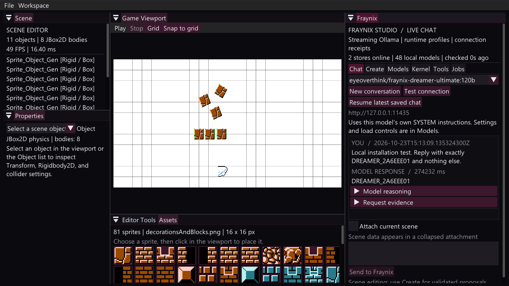
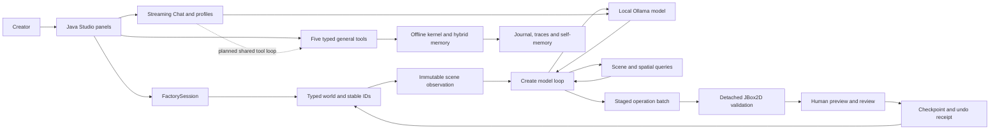
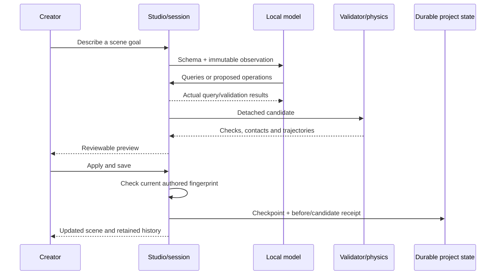
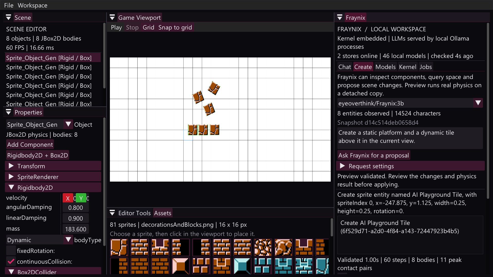
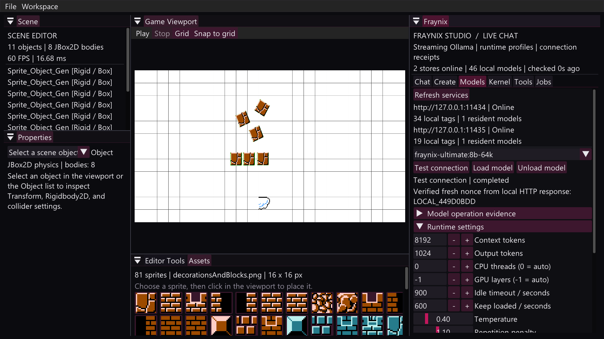
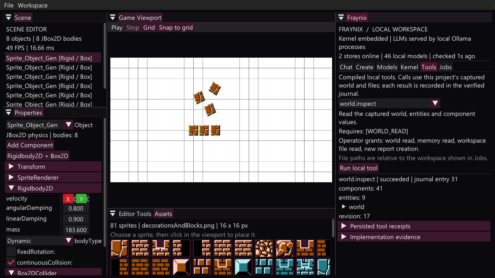

<a id="top"></a>

# Fraynix Studio / README 001

**The local creator workspace: entities, components, physics, persistent memory and Dreamer 120B.**

Edition **001** · October 23, 2026 · Vaughn Scott / eyeoverthink · private independent repository

[All editions](docs/readmes/INDEX.md) · [Interactive companion](docs/readmes/001/index.html) · [Obsidian home](docs/readmes/001/obsidian/00-home.md) · [System canvas](docs/readmes/001/obsidian/01-system.canvas) · [Full file tree](docs/readmes/001/FILE_TREE.md) · [Published model](https://ollama.com/eyeoverthink/fraynix-dreamer-ultimate:120b)

This is a new system edition written for the combined project. The original [README](README.md) remains available. Future editions receive new numbers and retain this edition's evidence, decisions and forecasts as history.

[](docs/readmes/001/images/dreamer120b-live.png)

*Captured during the October 23 activation: 11 authored objects, 8 JBox2D bodies, the F: model endpoint, and a completed model reply. This is a saved runtime image; object and model counts will change with the user's project.*

## Choose your route

| I want to… | Start here |
| --- | --- |
| Use the installed model and editor | [Run it](#run-it) |
| Understand the entire system | [System map](#system-map) and [component ownership](#component-ownership) |
| See what actually works | [Capability ledger](#capability-ledger) and [evidence](#evidence) |
| Follow the data from click to save | [Creation and persistence](#creation-and-persistence) |
| Explore code, folders and responsibilities | [Repository tree](#repository-tree) |
| Plan the agent/data/software factory | [Plan and forecasts](#plan-and-forecasts) |
| Explore graph maps locally | [Obsidian and interactive views](#obsidian-and-interactive-views) |
| Produce the next edition | [Sequential editions](#sequential-editions) |

<a id="the-intention"></a>

## The intention

Fraynix Studio combines the physics editor's visible, editable world with the Java kernel's persistent task and memory substrate. A creator can place an object, inspect its components, ask a local model to reason about the scene, preview a proposed change under real physics, and save the accepted result with its identity intact.

The larger intention is a factory for components, structured data, software artifacts and agents. The useful common foundation is **a typed object with persistent identity, observable state, permitted operations, validators and a recoverable history**. A sprite, a processing job and a future agent specification can share that foundation while retaining different domain rules.

The project is Java-first and local-first. Ordinary scene creation and local inference can operate without internet once runtimes, libraries and weights are installed. The editor uses established graphics/UI/physics libraries; the shared world and kernel modules use JDK-only Java. Ollama serves model weights in a separate local process. Optional training, media and network services have their own provider boundaries.

The current proof is a working closed loop. The forecast is a broader factory built by extending those same contracts.

<a id="run-it"></a>

## Run it

### Existing local installation

Studio was reopened with **`eyeoverthink/fraynix-dreamer-ultimate:120b`** selected in **Fraynix > Chat**. Enter a message and choose **Send to Fraynix**. The installed profile uses the existing 116.8B MXFP4 weights, with the reviewed Dreamer instructions and native Harmony formatting.

For a terminal using the already-running F: service:

```powershell
$env:OLLAMA_HOST = 'http://127.0.0.1:11435'
ollama run eyeoverthink/fraynix-dreamer-ultimate:120b
```

The primary local service is on 11434. The secondary F: store is on 11435. Select the exact endpoint and tag together; identical tag names in different stores can refer to different weights.

<details>
<summary>Start the F: service after a reboot</summary>

From this source checkout, pass the actual existing store directory:

```powershell
.\scripts\Start-FDrive-Ollama.ps1 -ModelStore 'F:\LocalDiskC\Users\eyeka\.ollama\models'
.\Launch-Fraynix-Studio.bat
```

The helper binds loopback, allows 15 minutes for model loading, uses one loaded model and one parallel request, and logs under `build/fdrive-ollama/`. It reuses a responding existing Ollama server without changing that server. This setup does not install an automatic Windows boot service.

For another machine, replace the store path with its own location. See the [full setup guide](docs/DREAMER_120B_SETUP.md).

</details>

### Source checkout

```powershell
git clone https://github.com/eyeoverthink/Fraynix-Studio.git
cd Fraynix-Studio
.\gradlew.bat check installDist
.\scripts\Configure-Models.ps1 -Endpoints @('http://127.0.0.1:11434','http://127.0.0.1:11435')
.\Launch-Fraynix-Studio.bat
```

The repository requires GitHub account access. Build/CI uses JDK 21; source compatibility is Java 17. Windows x64 and an OpenGL 3.3-capable driver are the current graphical target. A first build needs the pinned Gradle/Maven artifacts; `--offline` uses cached dependencies. An extracted distribution runs without Gradle when Java, Ollama and any required model weights are already installed.

<a id="capability-ledger"></a>

## Capability ledger

**Verified** means concrete execution evidence exists for the named surface. **Implemented** identifies code whose broader workload coverage still needs testing. **Planned** identifies work that has not been integrated into the editor. Measurements belong to their stated dates and fixtures.

| Capability | State at this edition | Evidence / next gate |
| --- | --- | --- |
| Entity/component scene and persistent IDs | Verified | [World contracts](fraynix-modules/factory-runtime/src/main/java/fraymus/factory/FactoryWorld.java), checkpoint and transaction tests |
| Grid placement and negative-coordinate mapping | Verified | [Editor regression sources](src/test/java), [verification record](docs/VERIFICATION.md) |
| Rigidbody, box/circle collider inspection and registration | Verified | [Physics editor commands](src/main/java/editor/PhysicsComponents.java), [physics regression](src/test/java/factory/EditorPhysicsRegressionTest.java) |
| Detached AI proposal, collisions, apply/save and durable undo | Verified | [Scene protocol](src/main/java/factory/SceneProposal.java), [creation preview](docs/readmes/001/images/creator-preview.png) |
| Real streamed local chat and saved runtime profiles | Verified | [Live controls](docs/LIVE_MODEL_CONTROLS.md), controlled HTTP tests and native checks |
| Dreamer 120B in Studio and the Ollama account | Verified | [Activation evidence](docs/evidence/dreamer120b-activation-2026-10-23.json), [model page](https://ollama.com/eyeoverthink/fraynix-dreamer-ultimate:120b) |
| Persistent hybrid retrieval, journal and task traces | Implemented with bounded verification | [Kernel service](fraynix-modules/factory-kernel/src/main/java/fraymus/factory/kernel/FactoryKernelService.java), [continuity contracts](docs/CONTINUITY_AND_SKILLS.md) |
| Five compiled general tools in the UI | Verified | [Dispatcher](fraynix-modules/factory-kernel/src/main/java/fraymus/factory/kernel/LocalSkillDispatcher.java), [tool tests](fraynix-modules/factory-kernel/src/test/java) |
| Chat automatically selecting and executing general tools | Planned | Typed assistant/tool messages, host grants, receipts and live-model conformance |
| Durable multi-worker agent jobs and persisted agent recipes | Planned | Lease, restart, cancellation, race and task-completion invariants |
| Forty-five named fleet skills | Catalog / integration inputs | Per-skill handlers, providers, contracts and tests |
| B200 LoRA/GRPO training from the supplied scripts | Unverified / blocked | [Package review](docs/DREAMER_120B_REVIEW.md): supplied code benchmarks matrices but does not train weights |
| General autonomous software factory, broad multimodal perception | Planned | Task-level behavior, artifact and provider evidence |

The model receives structured authored state and any explicitly attached context. Visual perception requires a compatible image-input path. General Chat, scene Create and operator Tools currently have different execution responsibilities; the next shared tool loop will join their contracts.

<a id="system-map"></a>

## System map



Solid arrows describe current paths. The dashed edge is the next integration target. The [interactive map](docs/readmes/001/index.html#system) and [Obsidian system canvas](docs/readmes/001/obsidian/01-system.canvas) link the same responsibilities to their source files.

<a id="component-ownership"></a>

## Component ownership

| Layer | Owns | Primary entry points |
| --- | --- | --- |
| Application shell | Window, frame loop, dock layout and input | [Main](src/main/java/Main.java), [Window](src/main/java/jade/Window.java), [FraynixPanel](src/main/java/editor/FraynixPanel.java) |
| Scene and physics | Authored game objects, rendering components and JBox2D bodies | [Scene](src/main/java/scenes/Scene.java), [Physics2D](src/main/java/physics2d/Physics2D.java) |
| Shared world | Versioned schemas, entity/component records, snapshots and transactions | [factory-runtime](fraynix-modules/factory-runtime/src/main/java/fraymus/factory) |
| Session bridge | UI-owned state, frozen worker inputs, staged commits and checkpoint actions | [FactorySession](src/main/java/factory/FactorySession.java), [FactorySceneAdapter](src/main/java/factory/FactorySceneAdapter.java) |
| Model bridge | Catalog/endpoint routing, HTTP streams, history, profiles and load controls | [FraynixWorkspace](src/main/java/editor/FraynixWorkspace.java), [FactoryModelService](fraynix-modules/factory-models/src/main/java/fraymus/factory/models/FactoryModelService.java) |
| Creator protocol | Observation, spatial tools, proposal parsing, simulated preview and undo | [SceneAgent](src/main/java/editor/SceneAgent.java), [SceneKnowledge](src/main/java/factory/SceneKnowledge.java), [SceneEditHistory](src/main/java/factory/SceneEditHistory.java) |
| Kernel and operations | Retrieval, task execution, verification, journals and typed local handlers | [FactoryKernelService](fraynix-modules/factory-kernel/src/main/java/fraymus/factory/kernel/FactoryKernelService.java), [OfflineKernel](fraynix-modules/factory-kernel/src/main/java/brain_architecture/kernel/OfflineKernel.java) |

The mutable graphical scene stays on its owning thread. Workers receive immutable observations and return results for the session to commit. Real-time behavior currently means a responsive editor loop with background work separated from rendering; deterministic latency bounds remain a development goal.

<a id="creation-and-persistence"></a>

## Creation and persistence

The essential creator transaction is **observe, propose, validate, review, commit, recover**.



Camera or selection changes do not invalidate an authored proposal. Changed authored data does. A reviewed commit retains unrelated non-scene records, and failed installation preserves the prior scene. Durable undo checks whether later authored edits would be overwritten before it applies an earlier snapshot.

### What is saved where

| Storage | Role | Git policy |
| --- | --- | --- |
| `%USERPROFILE%/.fraynix-studio/projects/default/scene.fworld` | Versioned world checkpoint and previous generation | User project, ignored |
| Project `scene-edits/` | Before/candidate checkpoints and edit receipts | User project, ignored |
| Project `chat/exchanges.jsonl` | Human prompts, separate scene attachments, replies and request evidence | Private runtime data, ignored |
| Project `models/runtime-profiles.json` | Exact endpoint/tag settings | Local configuration, ignored |
| Project `models/operations.jsonl` | Connection/load/unload results | Local runtime data |
| Project `.northstar-kernel/` | Memory index, journal, routing state, traces and generated self-memory | Runtime state, ignored |
| User model catalog | Exact tag-to-loopback-service routing | Local configuration, ignored |
| Ollama stores on C:, F: or another drive | Weight blobs, manifests and model metadata | External model storage |
| Repository `docs/evidence/` | Selected, sanitized measurement records | Checked in |

Checksums and hash chains establish their documented consistency properties. Stronger claims about authenticated provenance, adversarial rollback prevention or hardware power-loss durability require additional mechanisms and tests. [Recovery contracts](docs/CONTINUITY_AND_SKILLS.md) state those boundaries explicitly.

<details>
<summary>Explore the three current ways to work with the model</summary>

**Chat:** select a local model, enter a message, optionally attach the current scene, and observe streamed output. Open Request evidence for server-reported identity, timing, completion and stream hashes. Reasoning is separate from the answer. New conversation retains earlier records.

**Create:** describe a concrete scene goal. The model may query scene/spatial information and return a typed operation batch. The engine rejects invalid or stale changes, simulates a detached candidate, and exposes a preview before apply/save.

**Tools:** choose a registered local function, provide its schema fields, and invoke it explicitly. The host supplies capabilities and the captured world. The result and its journal receipt persist. A source file parsed successfully by `java.analyze` still needs semantic compilation and behavior tests for broader correctness.

</details>

### Current tool contract

| Tool | Input | Result / effect |
| --- | --- | --- |
| `world.inspect` | Captured host world | Revision, entities and full component records |
| `memory.search` | Query | Actual persisted hybrid retrieval hits |
| `java.analyze` | Workspace-relative Java path | Hash, AST declarations and syntax diagnostics |
| `docs.generate` | Report title | A new Markdown world report and hash |
| `artifact.verify` | Relative path + expected SHA-256 | Actual digest, size and an explicit match value |

The host's capability grants are separate from model-supplied arguments. Imported SYSTEM prompts, skill prose and attached documents do not install handlers or authorize effects. The complete [tool and journal contracts](docs/CONTINUITY_AND_SKILLS.md) cover path boundaries, payload limits, incomplete calls and restart behavior.

<a id="screenshots"></a>

## Screenshots

Click any image to inspect the full-resolution file. Each image captures one run; the visible counts belong to that run.

| Actual desktop view | What to inspect |
| --- | --- |
| [](docs/readmes/001/images/dreamer120b-live.png) | October 23 Dreamer activation: full model tag, secondary local endpoint, completed nonce and restored user scene |
| [](docs/readmes/001/images/creator-preview.png) | Earlier native fixture: Rigidbody2D inspector, model-created operation list and a validated physics preview |
| [](docs/readmes/001/images/live-model-controls.png) | Earlier October 23 controls check: real nonce, service residency and editable runtime settings using the Ultimate model |
| [](docs/readmes/001/images/tools-preview.png) | Earlier native Tools run: actual `world.inspect` result, world revision and persisted receipt controls |

<a id="model-lanes"></a>

## Model lanes and measured 120B behavior

Dreamer 120B is a local inference recipe derived from the existing `gpt-oss:120b` model. Its stored weights are shared with the base; the reviewed recipe changes instructions and inference defaults. The model is also published to [the creator's Ollama account](https://ollama.com/eyeoverthink/fraynix-dreamer-ultimate:120b).

| Activation measurement, October 23 | Result |
| --- | --- |
| Model metadata | 116.8B total parameters, MXFP4, native tools/thinking capabilities |
| Weight blob | 65,369,799,840 bytes on F: |
| Tested local profile | CPU, 12 threads, 4K context, 1,024 output allowance |
| Cold model loading | 260.77 seconds |
| Complete cold request | 274.23 seconds, 38 frames, exact unpredictable nonce |
| Separate warm identity/arithmetic request | 13.45 seconds with low reasoning |
| Registry publication | Push succeeded; public page and registry returned HTTP 200 |
| Published identity check | All five layer digests and the config digest matched the local package |
| Scene preservation | Revision 30; exact checkpoint bytes retained through normal close/reopen |

Small models remain useful for fast interaction. Larger planners may do better on difficult tasks, but route them using measured workload results. Active MoE parameter count alone does not determine desktop latency. A 4K run does not establish that the full advertised native context fits this machine.

The prior [October 22 base-model experiment](docs/MODEL_TEST_RESULTS.md) tested arithmetic and a schema-grounded floor/falling-tile proposal with real JBox2D contacts. Those measurements differ from the October 23 Dreamer activation; they are separate experiments.

<details>
<summary>Why the proposed B200 package was reviewed rather than enabled</summary>

The supplied trainer creates 200 records from five canned examples and optionally performs random CUDA matrix multiplications. It never loads or trains the base model or saves learned LoRA tensors. Several generated records claim tool execution without actually invoking those tools. The supplied daemon also returns a canned successful answer when inference fails.

The WAT compiles and its DNA encoder passes all 256 byte values. Its radius approximation, memory layout and recovery behavior still need correction. The portal emits valid parameterized WASM but does not parse arbitrary WAT; its compression and commit indicators do not provide the claimed recovery or Git guarantees.

The [full package audit](docs/DREAMER_120B_REVIEW.md) retains concrete probes, strengths and failure cases. Dreamer activation uses Studio's existing model bridge and the reviewed short recipe, preserving those useful parts without importing the erroneous success paths.

</details>

<a id="repository-tree"></a>

## Repository tree

This source checkout owns all three Java modules. The legacy physics and Full-AI-System folders remain provenance/reference sources rather than hidden Gradle inputs.

```text
Fraynix-Studio/
  README.md                      Existing entry point and latest-edition links
  README-001.md                  This new system edition
  AGENTS.md                      Persistent repository and edition conventions
  settings.gradle                Checked-in module boundary
  build.gradle                   Desktop build, checks and packaging
  gradle/                        Pinned wrapper and dependency tooling
  src/main/java/
    Main.java                    Application entry
    jade/                        Scene objects, window, input and camera
    editor/                      Dock panels, model controller, creator UI
    factory/                     Observation, proposals, simulation, receipts
    physics2d/                   Bodies, colliders and physics registration
    renderer/                    OpenGL render pipeline
    scenes/                      Editor scene and initialization
  src/test/java/                 Editor, geometry, physics and integration tests
  fraynix-modules/
    factory-runtime/             Schemas, snapshots, spatial data, transactions
    factory-kernel/              Memory, tasks, verifier, journal and local tools
    factory-models/              Ollama bridge, catalog, profiles and chat history
  models/                        Small reviewed Modelfile recipes
  scripts/                       Launch, discovery, verification and server helpers
  assets/                        Current editor images/shaders/fonts
  libs/                          Bundled JBox2D artifact
  docs/
    readmes/INDEX.md             Sequential edition directory
    readmes/001/                 Offline viewer, map data and frozen file tree
    obsidian/                   Linked notes and three native Canvas maps
    images/                     Real application screenshots
    evidence/                   Selected execution measurements
    provenance/                 Import records and source origins
  .github/workflows/            Hosted Windows build/test/package
```

The [complete file tree](docs/readmes/001/FILE_TREE.md) is generated from Git's tracked and non-ignored project files for this edition. The [machine-readable inventory](docs/readmes/001/file-inventory.json) records paths, sizes and file categories. Runtime projects, build output, credentials, Obsidian workspace preferences and weights are excluded.

The interactive viewer's File tree panel searches that inventory. Source links resolve in a complete checkout; the binary distribution contains runtime libraries and documentation, while repository links provide the complete source history.

<a id="evidence"></a>

## Evidence and verification

| Evidence | What it establishes |
| --- | --- |
| [Edition validation](docs/readmes/001/verification.json) | Local check result, documentation/link/canvas checks and viewer verification for this edition |
| [Dreamer activation](docs/evidence/dreamer120b-activation-2026-10-23.json) | Actual local HTTP stream, preserved scene, native frame and registry layer comparison |
| [Live model controls](docs/evidence/live-model-controls-2026-10-23.json) | Native tabs, profiles, connection checks, streamed replies and model lifecycle evidence |
| [Continuity and skills](docs/evidence/continuity-skills-verification.json) | Journal checks, compiled tools and bounded worker integration |
| [Standalone extraction](docs/evidence/standalone-verification.json) | Independent source boundary and packaged native launch checks |
| [120B base-model experiment](docs/evidence/gpt-oss-120b-2026-10-22.json) | Earlier task-specific numerical and scene/physics results |
| [GitHub Actions](https://github.com/eyeoverthink/Fraynix-Studio/actions) | Hosted results by exact commit; separate from native/model tests |

The automated surface includes 58 editor JUnit tests and six executable module harnesses. The previous hosted run exposed a 30-second deadline in the asynchronous repeated-inspection test. Its deadline is now 120 seconds with the same idempotence assertions and a useful timeout message. This test checks stable objects/components and a single inspection status; it does not define a latency benchmark.

Local results are recorded with this edition. The hosted run for the publication commit is available through Actions. A green build establishes its own checks; native window behavior and real model quality retain their separate records.

Source-checkout verification:

```powershell
.\scripts\Verify-Documentation.ps1
.\gradlew.bat --offline --no-daemon --console=plain :check :distZip
```

Optional real-model/native scripts operate on test projects under `build/`. Their configured time budgets and model requirements are documented separately; routine source checks do not download weights or contact model providers.

<a id="plan-and-forecasts"></a>

## Plan and forecasts

The long-range target remains one local entity/component/data/agent/software creator. The next stages extend the verified substrate. Each stage earns its status through a concrete acceptance gate.

| Stage | Deliverable | Acceptance gate | Dependencies |
| --- | --- | --- | --- |
| Current | Usable local Studio + Dreamer profile | Actual streamed response, restored identities/physics, reproducible model publication | Existing Java/UI/physics/Ollama runtime |
| Next | Shared typed model/tool loop | A real model reads a current entity through the dispatcher; unknown/failed tools cannot complete the task | Typed assistant/tool messages, grants and receipts |
| Then | Durable job and agent specifications | Competing workers produce one accepted lease/commit; restart and cancellation retain correct history | Job schemas, idempotence keys and state transitions |
| Then | Creation recipes and reusable lessons | A validated artifact becomes a reusable recipe that improves a later task | Behavioral validators, repair memory and explicit provenance |
| Then | Artifact portability and recovery | Exact binary/Unicode round trips; corrupted active/backup content handled distinctly | Versioned envelopes, hash/signature scope and restore logic |
| Optional | Receipt-backed supervised training | Real adapter tensors and held-out improvement over a pinned base | Curated data, supported training stack and measured hardware |
| Optional | Media/network/Base44 companions | Actual authenticated provider results while offline projects remain usable without them | Per-provider schemas, grants and explicit availability |

### Planning scenarios

These are effort estimates for a solo implementation, not delivery dates. A focused session means roughly 2–4 engineering hours; new failures or changed scope can invalidate the estimate.

| Forecast slice | Planning range | Confidence | What could change it |
| --- | --- | --- | --- |
| Typed tool-loop pilot over existing read tools | 2–4 focused sessions | Medium | Model-specific streaming/tool serialization and cancellation behavior |
| Durable jobs with restart and competing-worker tests | 4–8 sessions | Medium-low | Lease/recovery semantics and external effect boundaries |
| First reusable component/artifact factory recipe | 3–6 sessions after tool/job foundation | Medium-low | Goal-level validation and schema evolution |
| Strict DNA/container and recovery interoperability | 2–5 sessions for a bounded format | Medium | Legacy format ambiguity and corrupted-input behavior |
| Training pilot | Estimate after dataset and hardware preflight | Unresolved | Actual GPU, kernels, memory, licensing/provenance and measured learning |

Quality should be measured through task completion, verifier catch rate, exact restore behavior, useful reuse and resource cost. Free mathematics can support that process: search and validation, bandit routing, lexical/HDC retrieval, graph locality, bounded dynamics and reproducible experiments. Constants and biological metaphors become operating decisions only when they improve a defined comparison.

The [full implementation plan](docs/IMPLEMENTATION_PLAN.md) provides the wider phase breakdown. The [roadmap canvas](docs/readmes/001/obsidian/03-roadmap.canvas) and [interactive roadmap](docs/readmes/001/index.html#roadmap) make dependencies navigable. The next edition should report whichever stage is actually completed, with evidence and revised forecasts.

<a id="obsidian-and-interactive-views"></a>

## Obsidian and interactive views

### GitHub

Use this page's table of contents, source links, full-size screenshots, collapsible sections and Mermaid diagrams. GitHub supports Mermaid rendering in Markdown; see its [diagram documentation](https://docs.github.com/en/get-started/writing-on-github/working-with-advanced-formatting/creating-diagrams).

### Offline companion

Open **`docs/readmes/001/index.html`** from the checkout or extracted docs. It embeds its map and file inventory, uses system fonts and has no CDN dependency. It provides searchable subsystem cards, evidence/status filters, a selectable pan/zoom graph, roadmap, file search, screenshot expansion and direct links back to this narrative.

GitHub's file view shows HTML source. Download/clone the files and open the local viewer to use its JavaScript controls. No public website hosting or repository visibility change is required.

### Obsidian

Open the **repository root as a vault**, then open [the map of content](docs/readmes/001/obsidian/00-home.md). Notes use vault-root wiki links and ordinary Markdown links. Open any of the native maps:

- [System architecture](docs/readmes/001/obsidian/01-system.canvas): current modules, ownership and the planned shared loop.
- [Creation/data lifecycle](docs/readmes/001/obsidian/02-lifecycle.canvas): observation through validation, commit and recovery.
- [Factory roadmap](docs/readmes/001/obsidian/03-roadmap.canvas): dependencies and acceptance gates.

Canvas uses the open [JSON Canvas 1.0 format](https://jsoncanvas.org/spec/1.0/). Paths are checked against this repository. Personal `.obsidian/` settings stay untracked so navigation preferences do not replace the shared maps. [Obsidian internal-link documentation](https://help.obsidian.md/Linking+notes+and+files/Internal+links) describes the underlying link behavior.

<a id="sequential-editions"></a>

## Sequential editions

This edition starts the numbered series. The [manifest](docs/readmes/editions.json) identifies the latest edition, canonical text hash and its companion files. [Edition conventions](docs/readmes/README_SEQUENCE.md) and [repository instructions](AGENTS.md) preserve the workflow.

1. Select the next unused number and write a fresh `README-NNN.md`.
2. Retain published editions; link back when correcting claims or changing forecasts.
3. Capture actual screenshots and add source/evidence links for the new state.
4. Add `docs/readmes/NNN/` viewer/map/inventory assets and update the Obsidian notes/maps when their source changes.
5. Run the documentation verifier, inspect the viewer and run relevant source checks.
6. Update the edition manifest and index, then commit/push the authorized change. Edition tags provide stable historical links.

The planned tag for this publication is `readme-001`. The index remains the place to find newer editions. This edition's snapshot files describe its publication state; runtime status can be observed in Studio.

<a id="reading-room"></a>

## Reading room

| Subject | Documents |
| --- | --- |
| Current application | [Architecture](docs/ARCHITECTURE.md), [live controls](docs/LIVE_MODEL_CONTROLS.md), [verification](docs/VERIFICATION.md) |
| Model activation and audit | [Dreamer setup](docs/DREAMER_120B_SETUP.md), [original package review](docs/DREAMER_120B_REVIEW.md), [broader model/agency review](docs/MODELS_AGENCY_REVIEW.md) |
| Durable operations | [Continuity and skills](docs/CONTINUITY_AND_SKILLS.md), [implementation plan](docs/IMPLEMENTATION_PLAN.md) |
| Origins and permissions | [Provenance](docs/PROVENANCE.md), [import manifest](docs/provenance/IMPORT_MANIFEST.json), [third-party notices](THIRD_PARTY_NOTICES.md) |

The repository remains private. Imported source provenance and third-party notices stay part of the project. Current sample artwork still has unresolved distribution provenance. Those release tasks belong in the plan alongside the engineering work.

[Back to top](#top) · [Edition directory](docs/readmes/INDEX.md) · [Interactive system explorer](docs/readmes/001/index.html)
