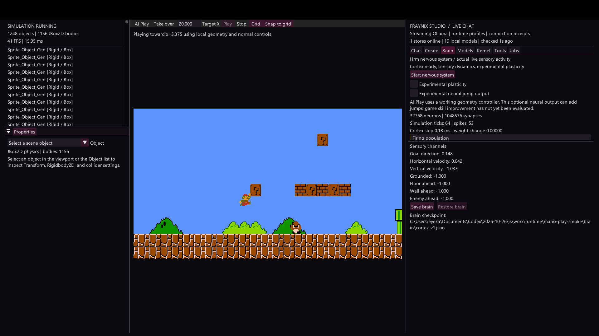
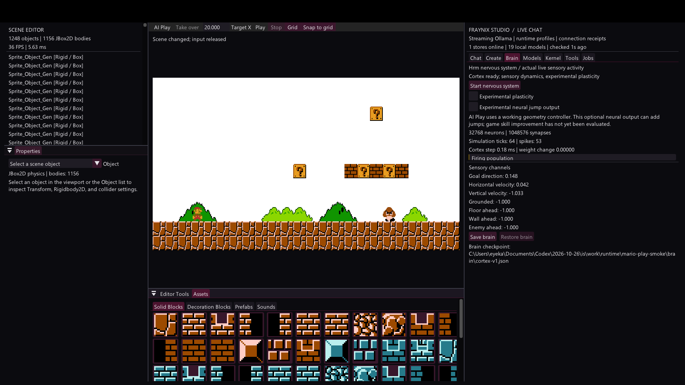
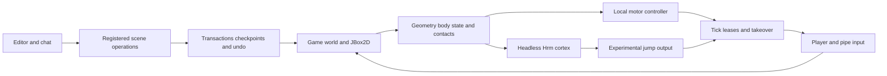

# Full Mario gameplay and the live sensory cortex

Edition 002 · October 28, 2026 · Verified local integration

Fraynix Studio now contains the complete imported Mario gameplay alongside its existing local models, scene tools, transactions and memory infrastructure. AI Play moves the real player through the original controller and JBox2D physics. A headless adaptation of the user's Hrm nervous system receives live sensory features from that same world. The original H: checkout, current LibGDX editor, and their project state remain separate from this integration branch.

The local controller supplies working movement and obstacle responses. Neural plasticity and neural jump output are experiments with explicit controls. This edition demonstrates live perception and control, and provides the state needed to investigate learning. It does not establish that the neural policy has improved game performance or learned to finish the complete level.

[Interactive offline explorer](docs/readmes/002/index.html) · [Source tree](docs/readmes/002/FILE_TREE.md) · [Verification](docs/readmes/002/verification.json) · [Architecture map](docs/readmes/002/system-map.json) · [Obsidian note](docs/obsidian/09-full-game-and-cortex.md) · [Canvas](docs/obsidian/full-game-and-cortex.canvas) · [Edition 001](README-001.md)

## Run and review

Use **Launch-Mario-Studio.bat** from the checkout or the installed distribution. The source launcher uses the bundled Gradle wrapper. Alternatively, run `gradlew.bat run --args="--mario"` with JDK 21. The native package contains assets, sounds, shaders, the complete original level, the source license, and all application modules. Docker and WSL are not required.

The Mario project defaults to `%USERPROFILE%/.fraynix-studio/projects/mario`. A `fraynix.studio.workspace` JVM property can select an isolated project. The packaged level remains the starting asset; project checkpoints and authoring saves are stored outside Git.

In the viewport, **Play** starts a runtime copy. Use arrows or A/D to move, Space to jump, E to fire when powered up, and the original directional controls to use connected pipes. **AI Play** starts the local controller toward Target X. **Take over** or Escape releases agent control. **Stop** restores the authored scene. Movement and jumping affect the actual player and body, rather than relocating a sprite to claim success.

The **Brain** tab shows neuron and synapse counts, simulation ticks, spikes, measured cortex update cost, the actual sensory channels, and checkpoint controls. AI Play starts the core asynchronously. A saved project brain is restored when the nervous system starts. Plasticity is off by default; enabling it changes synaptic weights and saves the learning state on Stop and normal shutdown. The optional neural jump output can add jumps and is labeled experimental.

The **Create** tab still uses Studio's existing model catalog and scene protocol. A goal produces typed operations, a detached physics preview and a revision-checked transaction. Validated edits can apply automatically, with task undo available. Disable automatic application to inspect a proposal first. Ordinary Chat replies and reasoning text do not execute scene JSON. Stop Play before editing the authoring world.

## Complete game content

The imported original level contains **1248 objects**, **6085 component instances**, **16 serialized component types**, and **1156 physics bodies**. The asset baseline includes 13 PNGs, 24 OGG sounds and three original shaders; Studio's compatible shader fixes are retained. Player controls, enemy behavior, animations, blocks, pickups, pipes, flagpole logic, following camera, audio, prefab creation, and the broader asset palette are present. Runtime-created components are also registered rather than limiting support to the starting scene's types.

The native test verifies actual walking, jumping and enemy movement, then checks that Stop restores the exact authored content. Pipe traversal, a full playthrough, every powerup combination and every game outcome still need broader gameplay coverage. Rendering the whole level and passing component round-trip checks are useful evidence without implying that every mechanic has been exercised end to end.

Captured from the integration application's own OpenGL framebuffer on October 28, 2026. The player is airborne through the original jump logic. The right pane observes the core receiving that episode's sensory input.

## Engine and persistence changes

The host retains one scene and one JBox2D world. Missing gameplay components were merged into its existing entity/component classes. Duplicate legacy component handles are repaired on import; persistent object and component UUIDs are derived for old data and retained in checkpoints. Complex Gson map keys preserve animation transitions. Signed sprite scale remains valid for facing and mirroring.

The simulation now advances components and physics using a common fixed tick. New objects enter at a safe boundary, and scene transitions requested by gameplay are deferred until the update finishes. Rotation conversion, impulse arguments, transform cloning, compound pillbox fixtures and collision callbacks were repaired or integrated. The build uses JDK 21 with one LWJGL/ImGui dependency set and OpenAL support.

Mario retains its native 0.25-unit grid. The smaller LibGDX editor's 32-unit grid is a different format. A transform conversion and component migration remain necessary before importing one of those projects into the full game. Serializing authored entities also differs from restoring exact runtime physics and controller state; this edition resets play from authored state.

Full-scene serialization no longer runs repeatedly during Play, and the hierarchy clips offscreen rows. The native capture shows the integrated game and neural telemetry at a responsive frame rate on the test machine. This is a local observation rather than a hardware-independent performance guarantee.

## Neural integration

The headless core derives from the user's `fraymus.neural.HrmNeuromorphic`, whose source snapshot is preserved in [the neural archive](docs/neural/HrmNeuromorphic-original.java.txt). It uses 32768 leaky integrate-and-fire neurons, 1048576 sparse weighted synapses, threshold recovery, calcium modulation, seeded noise and simulation-clock timing. It owns no AWT window, infinite render loop, desktop capture or native graphics resources.

Sensory channels include goal direction, horizontal and vertical velocity, grounded state, floor ahead, a wall and an enemy. The optional output is connected to jump input through the same lease-controlled gameplay boundary. The geometry controller remains the working baseline. The Brain tab therefore reports neural activity and weight changes separately from any claim about game skill.

The original timing rule could not reach its negative-time branch. Tests now demonstrate both strengthening and weakening of actual synapses. Additional tests cover seeded repeatability, frozen evaluation weights, corrupt-state rejection, and continuation after JSON export/import. A managed worker handles growing the core and writing or reading checkpoints; simulation state remains owned by the engine thread.

## Architecture

The interactive explorer provides the module map, source links, searchable file inventory, screenshots and verification records without an external CDN. The Obsidian canvas refers to files inside this repository. Imported prompts and historical documents remain data and cannot install command handlers.

## Verification and remaining milestones

The committed verification snapshot records the current JUnit results, Gradle checks and native diagnostic output. Source isolation, runtime transactions, identity and checkpoint recovery, journal continuity, local skills, model streaming and cancellation, and kernel integration checks pass alongside the new full-level, control-lease and cortex tests.

Remaining work is tracked in [the implementation plan](docs/IMPLEMENTATION_PLAN.md). The next gates are replayable episode records, human demonstrations, measured motor learning on held-out tasks, synchronized framebuffer observations for visual models, and game-based evaluation before evolution promotes a candidate. The browser BinaryNervousSystem and BaremetalLLM experiments remain separate sources to integrate and validate; their earlier learning labels are not treated as proof of gameplay improvement.

This branch has not changed the public visibility of a repository or pushed the new integration. The original projects and numbered edition 001 remain preserved.
