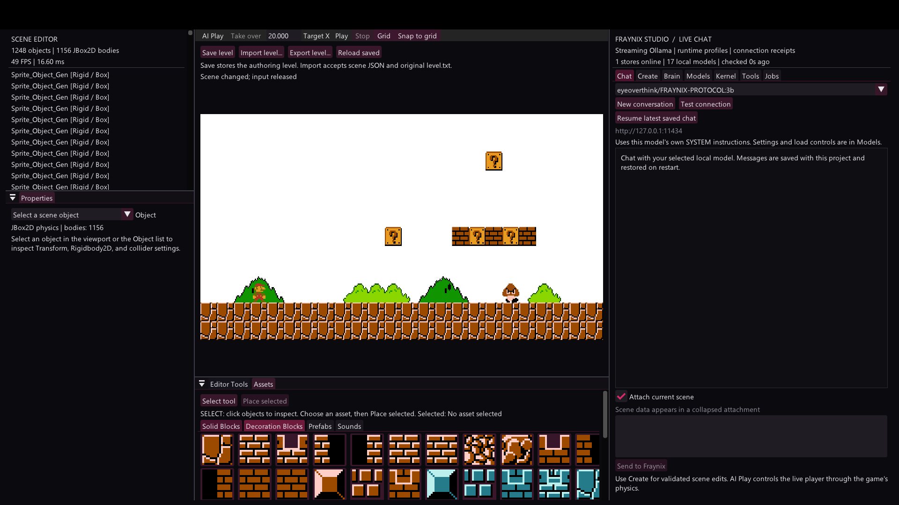
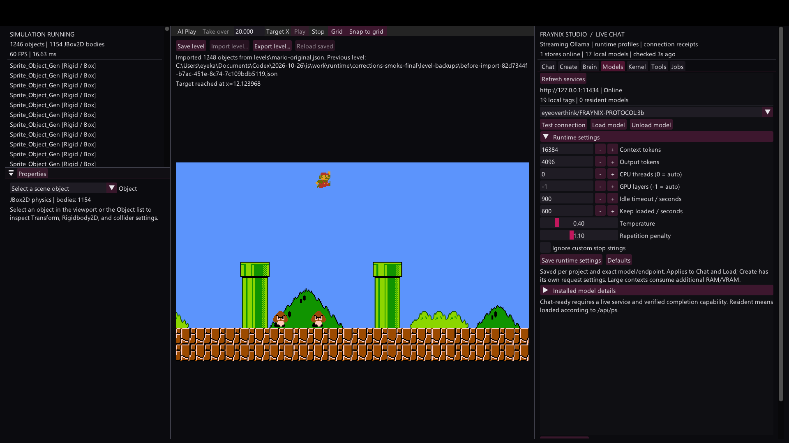
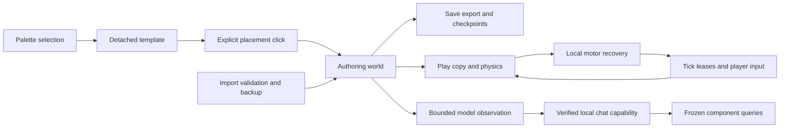

# Reliable AI play selection and level files

Edition 003 · October 28, 2026

This edition corrects the block-handling, unintended placement and model errors found during review of the full-game integration. The editor now separates selecting an asset from placing it, exposes level file actions in the viewport, checks actual local model capabilities, and keeps scene attachments inside a bounded context budget. The pilot can back up and retry an obstacle while continuing to use the original player controller and physics.

[Interactive offline explorer](docs/readmes/003/index.html) · [Verification record](docs/readmes/003/verification.json) · [Native route log](docs/readmes/003/native-route.log) · [Live model result](docs/readmes/003/live-model.json) · [Source tree](docs/readmes/003/FILE_TREE.md) · [Obsidian map](docs/obsidian/reliable-play-and-level-files.canvas) · [Previous integration edition](README-002.md)

## Start the corrected application

Run **Launch-Mario-Studio.bat** from the checkout or the installed distribution. The source launcher uses the Gradle wrapper and JDK 21; the installed launcher finds its bundled application libraries and assets. `gradlew.bat check installDist` builds and verifies the distribution. Docker and WSL are not required.

The window is titled **Fraynix Studio | Full game editor**. The original Mario level supplies the starting content. Project saves, chats, runtime profiles, scene edit history, import backups and brain checkpoints stay outside Git. The default Mario project is `%USERPROFILE%/.fraynix-studio/projects/mario`; `fraynix.studio.workspace` can select a separate project. Existing H: and V: source projects and earlier README editions remain preserved.

## Select an item without adding it

Clicking a palette item now selects a detached template. It creates no scene entity, body, checkpoint change or hidden object. The Assets panel stays in **Select** mode after the choice. Click an existing scene object to inspect it normally.

Choose **Place selected** to enter placement mode, then click the viewport once for each copy. Every copy receives its own persistent identity. **Select tool**, Escape or right-click returns to selecting objects. Switching palette assets also returns to Select mode. A held click from the palette or toolbar cannot become a placement when the pointer enters the viewport: placement uses a new mouse-press sequence.

The regression verifies zero insertions from selection, one insertion from explicit placement, and no additional insertion after returning to Select. This replaces the earlier behavior that added a template immediately when the palette button was pressed.

## Save import export and reload

The viewport has visible **Save level**, **Import level**, **Export level** and **Reload saved** buttons. Save uses the authored scene even while Play is running. It writes the project authoring JSON and the existing validated checkpoint. Ctrl+S performs the same action without also sending the S key to the player's pipe controls.

Import accepts the full engine's Gson scene arrays, including Studio exports and the original `level.txt`. Ctrl+O opens import. Stop Play before replacing the authored world. The application parses known component types, checks transforms, validates image references and verifies serialization before applying an import through the host transaction. A uniquely named JSON backup of the previous level is written under the project's `level-backups` directory. Invalid data leaves the current scene installed.

Export opens a save dialog and writes an authoring scene JSON file. Existing export files require an overwrite choice. Reload restores the saved project. The smaller LibGDX sprite editor's different coordinate and component format still needs migration before it can be imported as this full-engine format. Exported JSON retains asset references; it does not bundle unrelated external image files.

Captured from the corrected native editor on October 28, 2026. The viewport shows the file actions, and the asset palette shows Select and Place selected as separate controls.

## Recover from an obstacle

The pilot now queries solid fixtures separately from sensors and ignores its own body without discarding nearer ray hits. Its obstacle decision considers a wall, floor ahead, a safe place behind, overhead clearance, enemy proximity and actual position progress. Enemy lookahead begins earlier, and the pilot can brake or steer during descent to line up a landing.

When progress stops, it backs away to create room and tries a jump through ordinary controls. The status displays Advance, Back off or Jump clear together with the recovery attempt. Repeated failure has a finite budget. If the retreat is unsafe or the retry budget is exhausted, control is released with a blocked result. No operation teleports the player or removes the obstacle to manufacture success. Escape and Take over still release the controller immediately.

The longer native regression starts at the original player spawn and targets x=12.25. It reaches **x=12.158443 after 682 simulation ticks**, crossing early terrain and enemies while exercising a backoff and jump recovery. The test injects no jump command. This verifies that route on the packaged level; unseen terrain, every pipe route and complete-level success require further evaluation.

The original game's player, collisions, animation and enemies are active. The neural core continues receiving the episode's sensory channels; synaptic plasticity and optional neural jump output remain separate experiments.

## Resolve local model availability

The reported `clef:27b` tag is present in the C: Ollama store. The live service reports **decision** and **vision** capabilities for it, without **completion**. It therefore belongs in the model details list with a reason and is excluded from Chat and Create choices. Embedding-only models are excluded as well. A tag being advertised by a server is no longer sufficient to label it chat-ready.

The corrected local snapshot has 17 chat-ready models. An unavailable or incompatible restored selection is reconciled before a new request, with a visible notice when a saved choice changes. The FRAYNIX 3B model is preferred when it is actually chat-capable, followed by compatible local choices. An active inference request is not rerouted midway through a response.

The Models panel also scans conventional Ollama model-store paths across mounted drives. It reports manifests, complete blob references and missing blobs independently of service availability. Discovery is bounded to model locations and metadata: it does not move weights, download a model or start a competing service. A disk store requires a configured local Ollama endpoint before its models can serve requests. The existing model-store launch script accepts an explicit store path when a secondary local service is needed.

## Keep the whole level within the model budget

The full level contains 1248 objects and 6085 components. Sending its entire serialization as a chat attachment can exceed a model's context. Chat now attaches a valid JSON summary bounded to 6000 characters, prioritizing the selected entity and nearby objects. The tested original-level summary is 5677 characters. It declares that it is partial and retains the observation identity, world coordinates, transforms and component types.

The complete immutable observation remains available to the scene agent. Queries can inspect a specific entity, component type and property. Oversized query results explicitly report partial data and guide the model toward a narrower request. Model history is bounded, and chat budgeting reserves an estimate for the model's own SYSTEM and template as well as its reply. Create defaults to a 16384-token context and sends bounded observations instead of a multi-megabyte initial message.

A real local request to `eyeoverthink/FRAYNIX-PROTOCOL:3b`, using its own SYSTEM and the full-level summary at a 16384-token context, completes successfully. The verification record includes the actual context, prompt token count and completion result. Capability checks and a successful connection do not establish quality on every task or guarantee that every model size fits this machine.

## Architecture and verification

The verification snapshot records passing root JUnit tests plus the runtime, transaction, model streaming, journal, skills and kernel integration checks. Native checks cover selection, one explicit placement, save persistence, export/import round-trip, import rejection, autonomous travel, model selection and the rendered controls. The live model receipt is a separate actual inference result.

Windows desktop capture timed out twice during automated click verification. No blind mouse input was sent. The native event paths and exported application frames passed, while manual file-dialog clicks remain unverified in this run. These limits are included in the verification record.

The next acceptance gates are broader navigation fixtures, complete episode replay, demonstrations, visual-model input, measured motor learning and outcome-based evolution with rollback. This edition fixes concrete review failures while retaining the full engine and the user's experimental nervous system. [The implementation plan](docs/IMPLEMENTATION_PLAN.md) distinguishes those remaining gates from the completed corrections.
