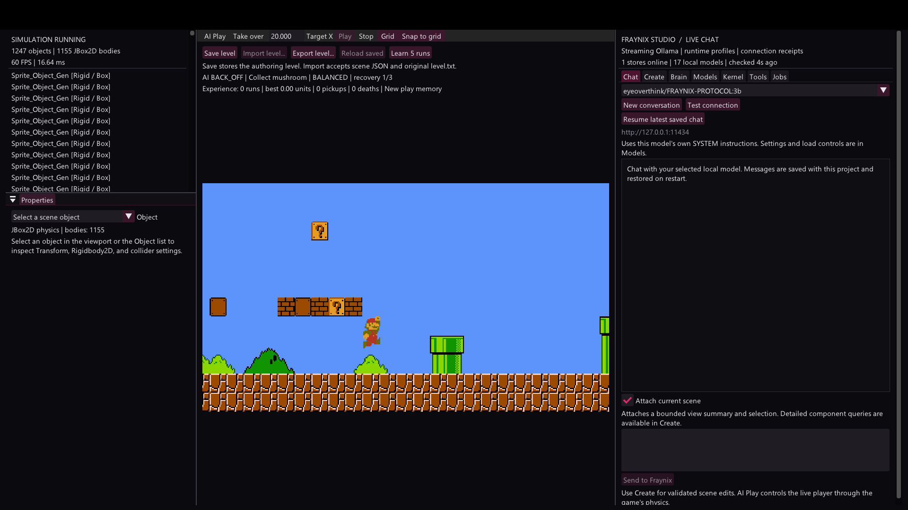
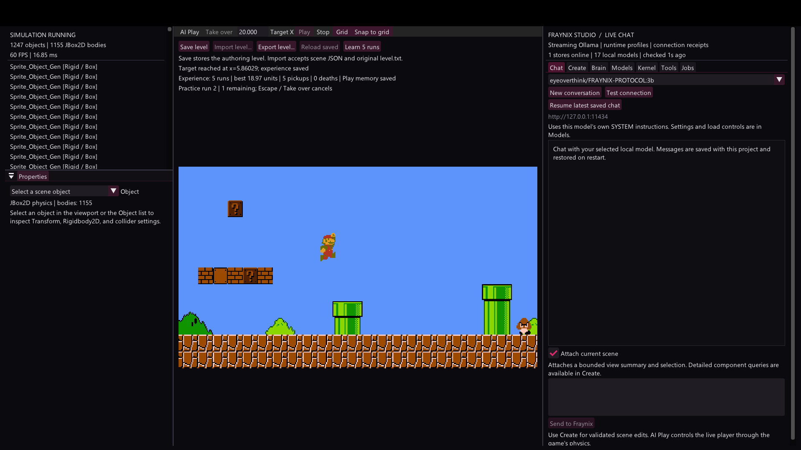
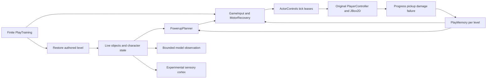

# Power ups character rendering and persistent practice

Edition 004 · October 29, 2026

Mario now keeps his character texture after collecting a mushroom. AI Play deliberately pursues useful power-ups, saves the outcomes of its movement decisions, and remembers optional routes that failed. A later run can keep the useful part of a route while skipping a previously blocked detour. Learn 5 runs repeats that loop within a finite budget and restores the authored level between episodes.

[Interactive explorer](docs/readmes/004/index.html) · [Your suggestions and full vision](docs/EMBODIED_AI_VISION.md) · [Verification](docs/readmes/004/verification.json) · [Native episode log](docs/readmes/004/native-route.log) · [Source tree](docs/readmes/004/FILE_TREE.md) · [Obsidian map](docs/obsidian/powerups-and-practice.canvas) · [Previous edition](README-003.md)

## Start and review

Run **Launch-Mario-Studio.bat** from the source checkout or installed distribution. The source build uses JDK 21 and the Gradle wrapper. `gradlew.bat check installDist` verifies the project and builds the distribution. Docker and WSL are not needed.

**AI Play** performs one episode toward Target X. **Learn 5 runs** performs five episodes, saving experience after each and restoring the authored scene for the next. Use **Take over**, Escape or **Stop** to cancel practice and regain control. Save, Import, Export and Reload retain the behavior introduced in edition 003; Save during Play stores the authored level.

The viewport reports the current objective, motor strategy, recovery attempt, completed runs, best progress, pickups and deaths. The Brain tab has recent episode outcomes and the separately controlled nervous-system experiment. The live review uses your existing project; verification trials use an isolated project so they do not overwrite your level or personal learning history.

## Fix the white character after growth

Small Mario and Big Mario use different sprite sheets. The animation state switched the sprite correctly, but the rendering batch only registered textures when a sprite was first added. After growth, the new texture was absent from the batch, leaving texture ID zero. The shader renders an untextured quad with its tint, which produced the white rectangle reported during review.

The renderer now reconciles changed sprite sheets before drawing. It registers a new texture when there is room and moves the sprite to a compatible batch when the sampler table is full. Sampler zero remains the untextured case, so the eight-entry shader table has seven usable textured slots. Batch preparation also handles changed draw order without sorting the batch list during a draw. Each batch binds the shader it uses.

Regression tests cover the ordinary sheet switch and a switch with all usable texture slots occupied. In the native gameplay test, the AI collects an actual spawned mushroom; Mario changes to the big sprite sheet and renders as the enlarged character.

Captured October 29, 2026 from the engine framebuffer. The character is textured after growth. No power-up, jump or teleport was injected by the test.

## Choose useful goals

The pilot now recognizes active power-up blocks, moving mushrooms and flowers from their live components. It can position under a block, jump to release its contents, and steer toward the moving item. Item collection generates a measured reward. Damage and death generate penalties. The existing solid-geometry queries, enemy landing alignment, normal actor controls and tick leases remain the execution path.

A power-up is an optional objective. The planner abandons a goal after a bounded timeout or blocked recovery, records the failed source block, and continues toward the destination. A later episode of the same authored level can skip that detour. The motor controller can also back away when a grown player is stationary against geometry even if a ground ray does not currently report grounded. It still needs actual grounded state to initiate the recovery jump.

The planner reads known component types and authored block contents. It does not infer mushroom or character identity from image pixels. Bounded model observations now include an explicit Mario record with stable entity identity, form, sprite sheet, position, grounded state and death state. This makes the character's current form available without sending a multi-megabyte scene or guessing from its generic serialized object name.

## Save experience and use it on later runs

PlayMemory stores separate experience for each authored-level fingerprint. Local contexts include the route segment, player form and objective type. A small contextual bandit scores Balanced, Early jump and Short hop using observed progress, power-ups, elapsed time, damage and failure. Useful demonstrated strategies are retained. Poor or new contexts can try alternatives. Failed optional goals are remembered independently of the selected movement strategy.

Each episode stores its outcome, progress, pickup count, damage, simulation duration and strategy choices. The project saves this data atomically to `brain/play-memory-v1.json`. Memory is restored when the application starts. Invalid data is backed up before a replacement is written. Editing the authored scene changes its fingerprint and separates its experience from the old geometry. Personal memory and model weights remain outside Git.

The goal is to avoid repeating a demonstrated mistake. It is reasonable to repeat a successful jump or mushroom interception. Arbitrary variation on every run would not establish learning. The saved experience must produce a decision change that can be connected to an observed result.

## Measured comparison on the original level

The native test repeats the same authored level with Target X set to 20. It uses the real game controller, enemies, power-up collisions, animation and physics.

| Episode | Outcome | Simulation ticks | Mushroom pickups | Damage |
| --- | --- | --- | --- | --- |
| First run | Target reached | 1117 | 1 | 0 |
| Second run using saved experience | Target reached | 839 | 1 | 0 |
| Third run using saved experience | Target reached | 839 | 1 | 0 |

The later runs take **278 fewer simulation ticks, a 24.89 percent reduction** on this original-level prefix. They retain the useful movement strategy and skip optional power-up detours whose recovery failed in the first run. This is a scoped improvement from recorded experience. Complete-level solving and transfer to unseen levels still require broader evaluation.

The same native harness reloads the saved memory, completes a separate two-run practice budget, and verifies that human takeover cancels another practice session. Unit tests cover reward-based strategy choice, preservation of a useful strategy, persistence, corrupt-memory backup, power-up selection, failed-goal avoidance and texture changes. Existing scene, physics, model, transaction, kernel and source-isolation checks also pass.

Captured October 29, 2026 near completion of the additional practice batch. The screen shows five completed runs and five pickups. Episode records and cancellation assertions are in the linked native log.

## Distinguish the learning mechanisms

The route improvement above comes from explicit goal memory and motor strategy rewards. It does not come from modifying the local Ollama model. The Hrm sensory cortex still receives live observations, and its plasticity and optional jump output remain experimental controls. A change in synaptic weights alone does not establish improved gameplay; that needs a controlled comparison between frozen and trained policies.

The full vision combines timestamped engine and visual observations, goal selection, motor planning, episodic memory, replay, neural learning and evaluated self improvement. The next milestones are wider navigation fixtures, replayable traces and demonstrations, synchronized vision-model frames, reward-linked neural policies, and isolated candidate evaluation with promotion and rollback. The [full vision](docs/EMBODIED_AI_VISION.md) records your review suggestions, the complete intended loop and acceptance gates for each stage.

## Architecture and implementation

Key sources are [texture reconciliation](src/main/java/renderer/RenderBatch.java), [goal planning](src/main/java/agent/PowerupPlanner.java), [motor execution](src/main/java/agent/GameInput.java), [persistent experience](src/main/java/agent/PlayMemory.java), [bounded practice](src/main/java/agent/PlayTraining.java), and [character observations](src/main/java/factory/SceneKnowledge.java). The [source inventory](docs/readmes/004/file-inventory.json), [source tree](docs/readmes/004/FILE_TREE.md), [system map](docs/readmes/004/system-map.json) and [verification record](docs/readmes/004/verification.json) describe this edition. Earlier numbered editions remain preserved.
