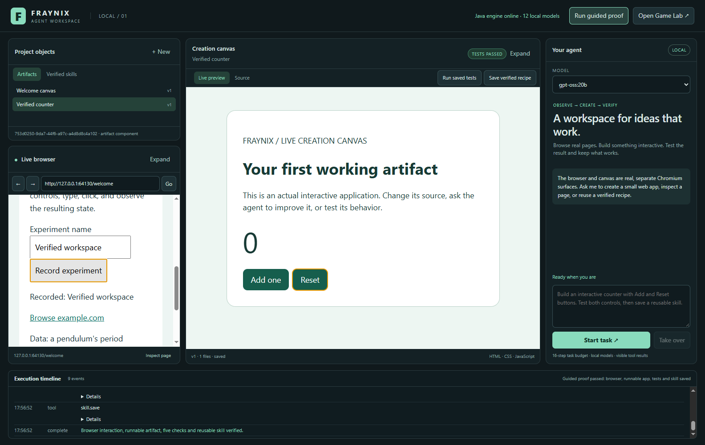
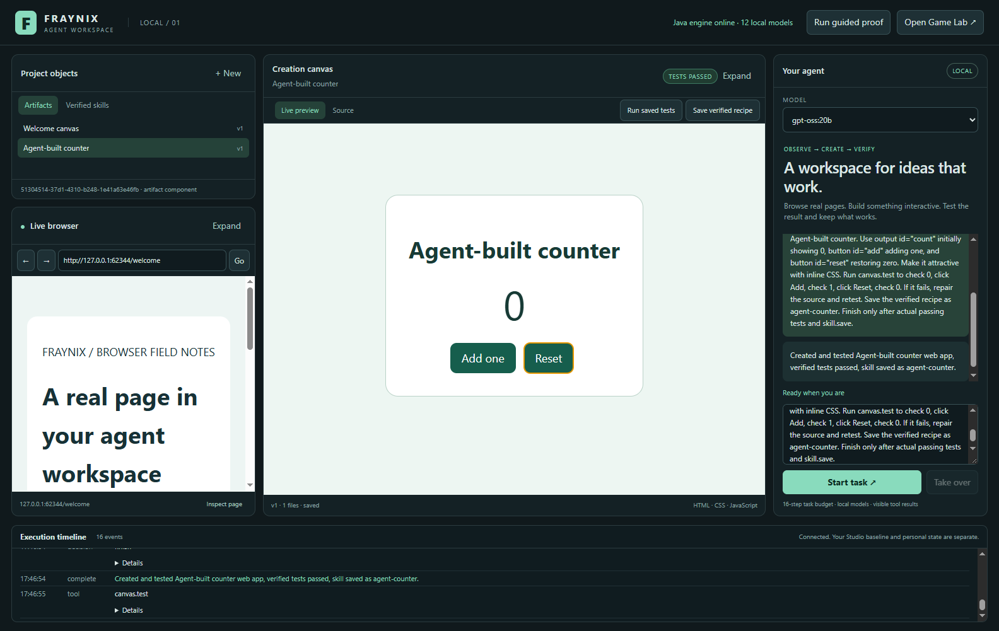
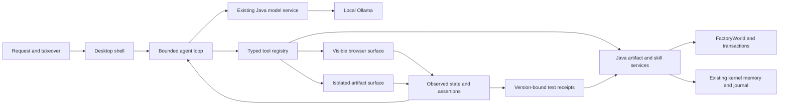

# Fraynix Agent Workspace browser canvas and verified skills

Edition 005 · October 29, 2026

Fraynix Agent Workspace is the independent successor to the working Studio game editor. It adds a real browser, a runnable creation canvas, a local-model tool loop, versioned artifacts and reusable tested recipes. Java continues to own models, entities, transactions and persistent project state; a new Electron desktop shell hosts the browser and artifact surfaces.

[Interactive explorer](docs/readmes/005/index.html) · [Design and delivery plan](docs/AGENT_WORKSPACE_DESIGN.md) · [Verification record](docs/readmes/005/verification.json) · [Source tree](docs/readmes/005/FILE_TREE.md) · [Obsidian canvas](docs/obsidian/agent-workspace.canvas) · [Preserved Studio edition](README-004.md)

## Independent project and baseline

The successor starts from verified Studio commit `6341404`. Its repository, launcher, browser profile and default runtime directory are separate. The original Studio repository and personal scene are preserved. The complete inherited game source, assets, levels, licenses, tests and historical README editions remain in this repository.

Successor project data defaults to `%USERPROFILE%/.fraynix-agent-workspace/projects/default`. Set `FRAYNIX_WORKSPACE_PROJECT` to choose another project. That directory contains versioned artifact files, FactoryWorld checkpoints, test receipts, recipes, browser profile, tool events and the kernel journal. These are personal runtime data and stay outside Git.

**Open Game Lab** launches the inherited Java game editor in a separate window using the successor project's `game-lab` subdirectory. The new browser and canvas are inside the successor shell; the native game viewport has not yet been embedded there.

## Start the desktop application

Use **Launch-Agent-Workspace.bat**. The first setup requires JDK 21 and Node.js 22.12 or newer. The launcher builds the Java applications if needed and installs pinned desktop dependencies. Electron's Chromium binary is downloaded on first use. The engine and ordinary artifact work run locally; browsing external sites requires internet, and inference requires a running local Ollama service with a compatible installed model. Docker and WSL are not required.

For an explicit source setup:

```powershell
.\gradlew.bat check installDist :workspace-engine:installDist
cd workspace-desktop
npm.cmd ci --no-audit --no-fund
npm.cmd test
npm.cmd run test:integration
npm.cmd start
```

The **Run guided proof** button exercises a real local practice page, creates an interactive counter, tests its behavior and saves a verified recipe. It is a deterministic application verification workflow. A separate live-model test exercises actual model decisions through the same tool boundary.

## Workspace surfaces

| Surface | Function |
| --- | --- |
| Project objects | Saved artifact entities, current versions and verified recipes |
| Live browser | Real HTTP/HTTPS navigation, page reading, supported form interaction and human browsing |
| Creation canvas | A running HTML/CSS/JavaScript application served from its saved artifact version |
| Source view | Inspect files, edit source and save a new version without overwriting older versions |
| Agent panel | Local model selection, task request, results and takeover |
| Execution timeline | Decisions, tool calls, errors, repairs, tests and completion records |

Both browser and canvas can expand while retaining the agent panel. The browser and its automation use the same underlying page. These surfaces are Chromium renderers, rather than static screenshots or an iframe that pretends to be a general browser.



Captured October 29, 2026 as an application frame export composed from the actual shell and child Chromium renderers. The native Windows capture helper timed out; no screenshot-based desktop clicks were used.

## Observe and act on the browser

The browser adapter returns the actual URL, page title, bounded visible text and supported controls. Each observation creates short-lived references. A click or text entry requires the observation ID and a current control reference. Navigation or an action invalidates older observations. The host scrolls and focuses the element, sends input, and reads the result.

The initial agent observation includes the current browser state and canvas source. Subsequent decisions receive actual tool results. This reduces guesses about which page is open or which artifact version is being edited. Page contents and project source are treated as untrusted task data, with no authority to install tools or grant access.

This adapter covers the main document's links, buttons, text inputs and common controls. Password fields require manual interaction. General iframe and shadow-DOM traversal, multi-tab workflows, downloads and vision-model browser control need further adapters and evaluation. Native human browsing remains available on the visible page.

## Create a working artifact

`canvas.write` creates real files and opens the saved version on the canvas. An artifact needs `index.html` and can contain CSS, JavaScript, JSON, SVG, Markdown, CSV and text resources. Existing artifacts require an expected version before updates. The Java engine stages component changes through the inherited transaction system and saves a validated world checkpoint.

Each version has its own file directory. Source edits create a new version and invalidate the prior test badge. Stale edits cannot overwrite a newer version. Interrupted uncommitted files are preserved in the project's recovery directory before another write proceeds. Paths are bounded, relative and checked against traversal and symbolic-link escapes.

Generated web code runs in a Chromium renderer with Node integration disabled, context isolation enabled and the renderer sandbox enabled. Preview network requests are blocked, and the generated page receives no privileged workspace preload. This is a web-artifact execution boundary; arbitrary generated Java, Python and native programs are outside this milestone.

Browser navigation and renderer operations have deadlines. An infinite-loop artifact stops its own renderer after the timeout; the host remains available so a corrected version can be opened. The integration harness verifies that recovery path.

## Test behavior and repair failures

`canvas.test` reloads the exact saved artifact version, performs supported clicks/fills and checks observable text, values or element counts. The host records each actual result and JavaScript errors. A model cannot establish a pass by printing a claim. The Java engine stores the receipt against that artifact version.

The integration harness deliberately creates incorrect behavior, observes a failed assertion, writes a corrected version and verifies the repaired behavior. It also rejects attempts to turn untested or stale evidence into a verified recipe. Test coverage depends on the assertions supplied; passing a weak test is not proof of every requested behavior. The live-model fixture therefore has separate fixed acceptance checks for its Add and Reset controls.

**Run saved tests** reruns a selected artifact's recorded test steps. An artifact without tests can be tested by the agent or through the guided proof. The UI never labels an untested version as passed.

## Reusable recipes and memory

A current passing artifact can be saved as a versioned recipe. The recipe includes its files, source references and actual test steps. Reuse creates a new artifact and runs those tests again. Recipe versions are retained, and the inherited offline kernel indexes saved recipes for memory retrieval.

These are tested web-artifact recipes. New operating-system adapters or executable tool implementations still need code, schemas, capability declarations and verification. Naming a tool or storing a prompt does not install a handler. The first delivery establishes a working skill lifecycle without claiming an unlimited collection of implemented capabilities.

## Local-model execution

The agent uses Ollama's native tool calls. Only advertised local completion/tool-capable models are offered. Tool definitions carry input schemas, and the host validates the chosen operation before execution. Reasoning text and ordinary assistant content are never interpreted as tool calls.

The task loop has a 16-step budget. Progress guards move repeated unchanged observations toward creation, require tests for a new artifact, require source changes after a failed test and source read, and require current passing evidence before completion. Custom model stop strings are cleared for the structured tool request only; the installed model configuration and shared Ollama service are not modified.

**Take over** cancels the local request and prevents further agent actions. Manual surface commands and agent actions are serialized. Model capability metadata does not establish task quality; the verification record names the model and workflow actually tested. The inherited neural cortex and gameplay memory remain in Game Lab and are distinct from recipe reuse in this workspace.

Local `gpt-oss:20b` passes the complete fixture and independent Add/Reset acceptance checks and is the initial default. The custom FRAYNIX 3B trial returns an Ollama native-format error; its advertised tool capability does not establish reliable execution of this workflow.



Captured October 29, 2026 from the real application renderers after the local model created, tested and saved the counter recipe. [The live-model record](docs/readmes/005/live-model.json) separates the model's tests from the fixed acceptance assertions.

## Architecture



The Java API is loopback-only on an ephemeral port. Its private session bearer stays in the desktop main process. Remote pages and generated applications cannot invoke the privileged IPC channel or call the control API without that capability. Browser cookies and successor data use separate project storage.

The [design plan](docs/AGENT_WORKSPACE_DESIGN.md) covers the complete intended environment. Later gates include additional artifact renderers, broader browser control, general code workers with OS isolation, native game viewport integration, synchronized visual-model observations, replayable episodes and evaluated candidate promotion with rollback. This edition establishes the first complete browser-to-artifact-to-test-to-reuse workflow.
