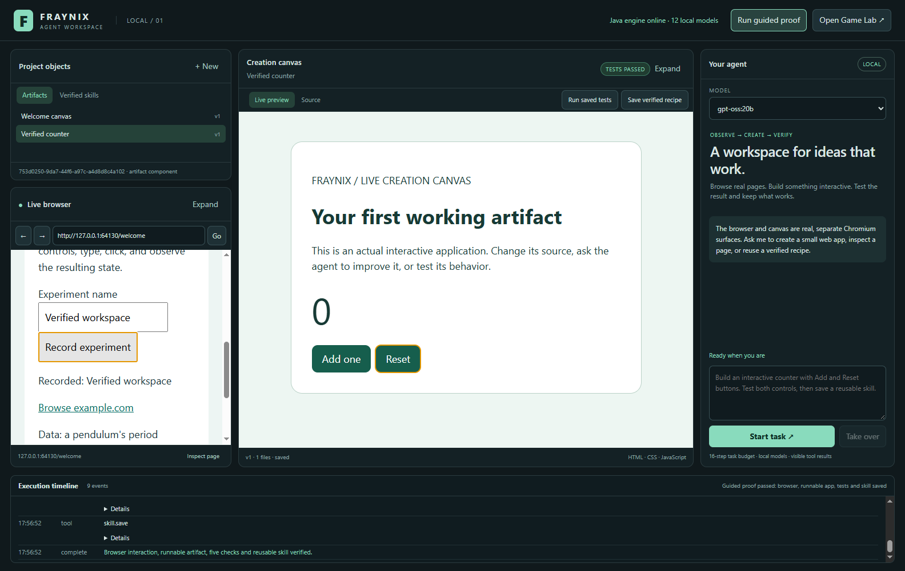
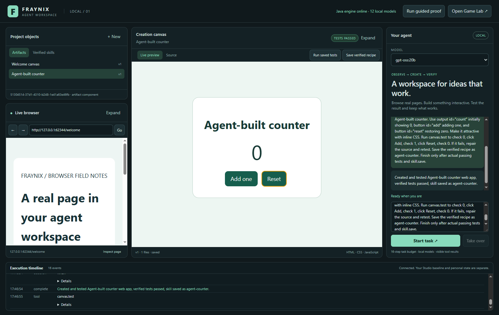
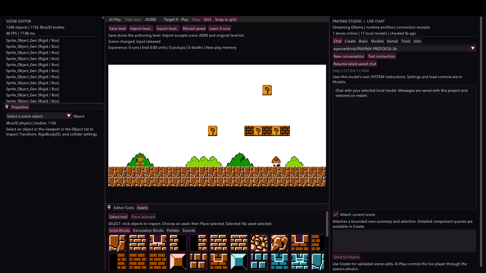
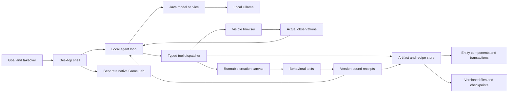

# Fraynix Agent Workspace complete guide and development roadmap

Edition 006 · October 29, 2026 · Documentation release for implementation `e370eea`

Fraynix Agent Workspace is a local visual application in which an AI agent can read a real browser page, create a working web application, test its behavior, correct failures and keep the result as a reusable recipe. The person using the app can watch that work, inspect its source and take control. It extends the original Fraynix game editor into a broader creation environment while retaining the complete game engine as a separate Game Lab.

The first working milestone is delivered. Its browser, canvas, local model integration, persistence and test workflow have run together successfully. This edition explains the actual product, how to use it, how it developed and which measured steps come next. It adds documentation; it does not change the app's design or executable behavior.

[Start](#install-and-start) · [First walkthrough](#first-walkthrough) · [Screenshots](#screenshots-and-what-they-demonstrate) · [Agent workflow](#ask-the-agent-to-build-something) · [Architecture](#architecture-and-source-ownership) · [Next steps](#next-steps-and-acceptance-gates) · [Interactive explorer](docs/readmes/006/index.html) · [File tree](docs/readmes/006/FILE_TREE.md) · [Previous edition](README-005.md) · [All editions](docs/readmes/INDEX.md)

## The vision becoming a working application

The starting point was an AI inside a game engine. The engine already knows object identity, transforms, components, collisions and changing conditions. That gives an agent explicit state to reason about and actions whose results can be observed. The successor applies that principle to browser pages, generated applications, files, tests and reusable skills.

A game actor, a browser control and a document can all be addressable objects, but each needs an adapter that understands its domain. A game actor has physics; a browser control has a page location, role and interaction state; an artifact has files, versions and behavior. JSON serialization transports those descriptions. The implemented adapters make them observable and actionable.

The game engine is one useful environment for agent control. Browser DOM and accessibility APIs, operating-system automation, screenshots with action tools and application APIs provide other routes. The value of this workspace is bringing observable state, visible creation, execution evidence and persistence into one product. Merely converting data to JSON does not give a model sight or computer control.

The long-term workflow is: describe a goal, let the agent inspect its environment, create the necessary artifact or tool, exercise it, improve it against evidence and reuse what works. This release makes that loop real for small web applications. Larger programs, broader computer interaction and model training have separate engineering and evaluation gates below.

## What works today

| Capability | Current behavior | Evidence or practical boundary |
| --- | --- | --- |
| Visible browser | Real Chromium navigation and human browsing | External HTTPS navigation passed |
| Browser actions | Read the main document, click supported controls and enter text | Actual local form input/click passed; old control references are rejected |
| Creation canvas | Run saved HTML, CSS and JavaScript | A real interactive application executes in its own renderer |
| Source editing | Inspect files and use Save & run | Saves another immutable version; older versions remain on disk |
| Local AI | Native Ollama tool calls through the Java model service | Local `gpt-oss:20b` completed the full fixture |
| Behavioral testing | Click/fill and assert text, values or element counts | Incorrect counter behavior was caught and repaired in integration testing |
| Verified recipes | Save a current passing artifact and reuse its files and tests | Persistence and replay passed after restart |
| Memory | Index saved recipes and search through the inherited kernel | Recipe retrieval reuses the existing memory interface |
| Human control | Take over stops the active task and pending operations | Immediate takeover prevented subsequent agent mutation |
| Renderer recovery | Bound operations and stop a hung artifact renderer | Actual infinite-loop fixture timed out; corrected source ran afterward |
| Game Lab | Launch the full inherited native editor separately | Rendered using successor-only project storage |

The shell, browser, canvas and execution timeline are functional product surfaces. There are no new placeholder pages for future learning, operating-system tools or training. New functionality should enter the existing layout when its backend and acceptance checks work.

## Install and start

The verified development environment is Windows with JDK 21, Node.js 24.14.1 and local Ollama. The documented Node minimum is 22.12. The repository pins Electron 45.1.0 and Playwright 1.64.1. Docker and WSL are not required. First setup needs network access for build and desktop dependencies; browsing external sites also needs internet. Local inference requires an installed model and a running Ollama service.

1. Clone this repository into a new directory. This is the successor repository, separate from Fraynix Studio.
2. Make JDK 21 available through `JAVA_HOME` or `PATH`, and make `node.exe` and `npm.cmd` available through `PATH`.
3. Start your local Ollama service. Check that an installed model supports completion and native tool calls. The verified initial choice is `gpt-oss:20b`; its memory requirements depend on the installed quantization and runtime settings.
4. Run [Launch-Agent-Workspace.bat](Launch-Agent-Workspace.bat). It builds missing Java distributions and installs missing desktop dependencies. Electron downloads its browser binary on first use.
5. Wait for **Java engine online** and local model discovery. The initial library contains a welcome canvas. Use the walkthrough below before trying a larger task.

```powershell
git clone https://github.com/eyeoverthink/Fraynix-Agent-Workspace.git
cd Fraynix-Agent-Workspace
.\Launch-Agent-Workspace.bat
```

For an explicit developer setup and launch:

```powershell
.\gradlew.bat check installDist :workspace-engine:installDist
cd workspace-desktop
npm.cmd ci --no-audit --no-fund
npm.cmd test
npm.cmd start
```

After changing Java sources, rebuild the installed distributions before launching. The launcher checks whether the installed engine exists; it does not automatically rebuild every later source edit. Keep the model service running separately. Closing the workspace stops its own engine, not the shared Ollama service.

## Find your way around

| Location | What to do there |
| --- | --- |
| Top bar | Check engine status, run the guided proof or open Game Lab |
| Upper left | Open saved artifacts or switch to Verified skills |
| Lower left | Browse real websites, inspect the page or expand the browser |
| Center | Use the running artifact, switch to Source or expand the canvas |
| Right | Choose a local model, enter a request, watch its result and take over |
| Bottom | Inspect tool calls, failures, test results and completion events |

The agent operates the same browser page you see. **Inspect page** displays the browser observation. Browser controls receive references tied to that observation; a later navigation or action invalidates them. The model must observe again instead of acting on an old page description.

## First walkthrough

1. Click **Run guided proof** in the top bar. This is a deterministic demonstration of the application workflow, independent of model quality.
2. Watch the lower-left browser. The workflow enters an experiment name on the local practice page and clicks its real button. The page displays the recorded value.
3. Watch the center canvas. A saved counter application opens with Add and Reset controls.
4. Inspect the execution timeline. Five behavioral checks establish the initial count, Add behavior and Reset behavior. The canvas receives its passing badge only after actual results are recorded.
5. Open **Verified skills** in the library. The demonstration saves a recipe containing the application source and its test steps.
6. Open that saved recipe to create another artifact and rerun its tests. Recipe reuse makes a fresh artifact rather than changing the original file version.
7. Restart the workspace. The artifact and recipe library persist in the project directory.

This proof answers a practical question: can the browser, creation canvas, file storage, tests and recipe library work as one system? The separate live-model fixture establishes that an actual local model can choose the create/test/save sequence through the same tools.

## Ask the agent to build something

Select **gpt-oss:20b**, enter a bounded request and click **Start task**. For the first autonomous run, use explicit behavior and acceptance criteria:

> Create a new counter web app titled My counter. Use an output with id count starting at 0, an Add button with id add, and a Reset button with id reset. Test that Add changes 0 to 1 and Reset returns it to 0. Repair failures and rerun the tests. Save a verified recipe named my-counter only after the checks pass.

The agent receives a real initial browser observation and the current canvas source. It uses native tool calls to choose registered actions. Ordinary answers and reasoning text are not executable instructions. Each result comes back from the tool implementation before the next decision.

The current task budget is 16 planning steps. Progress guards require tests after creating an artifact and source changes before retrying failed behavior. A step budget bounds a task; it is not a fixed completion time. Local model speed, model context and the work requested affect duration.

Click **Take over** to cancel the active request and pending renderer operations. Human commands and agent actions are serialized. If a task reaches a budget or model error, inspect the timeline and current source, then give a smaller request based on the actual state.

`gpt-oss:20b` completed the real counter fixture in four planning steps and passed separate fixed Add/Reset assertions. The custom `eyeoverthink/FRAYNIX-PROTOCOL:3b` trial returned an Ollama HTTP 500 native-format error. The selector may show a model that advertises tool support even when a particular workflow fails. This release records verified task behavior rather than assuming all installed models perform equally.

## Edit test and improve a creation

1. Open an artifact from **Project objects**.
2. Choose **Source** and select its file.
3. Make a change and click **Save & run**. The Java service writes a new artifact version and opens that exact version in the canvas.
4. Use **Run saved tests** when the artifact has recorded tests. For new behavior, ask the agent to add appropriate assertions.
5. Inspect individual outcomes in the timeline. Correct failed behavior, save a new version and rerun tests.
6. Use **Save verified recipe** only after the current version passes.

An older passing result does not certify a later edit. Test receipts are bound to artifact identity and version. Reusing a recipe copies its real source and reruns its tests. Weak assertions still provide weak coverage; independent acceptance tests should cover the behavior the user actually requested.

The current artifact type requires `index.html`. It accepts local HTML, CSS, JavaScript, JSON, SVG, text, Markdown and CSV resources. A write changes 1–20 files, an artifact has at most 32 files, and the serialized source bundle is bounded at approximately 2 MB. Each file is limited to 512,000 characters. Paths must be validated relative names. Generated previews cannot fetch external network resources, so use local assets and inline or local scripts/styles.

## Screenshots and what they demonstrate

These are real captures from the October 29 implementation fixtures published with edition 005, reused here without implying a new runtime release. Workspace images are application frame exports composed from the actual shell and native child Chromium renderer captures. They are not design mockups. Game Lab is a native game-frame capture. New projects do not automatically contain these fixture records.

### Browser canvas and verified recipe

[](docs/readmes/006/images/workspace.png)

The lower-left page shows the recorded experiment. The center runs the saved counter. The bottom timeline records test completion and recipe saving. This is the guided proof, not a claim that a model generated this particular fixture.

### Actual local model creation

[](docs/readmes/006/images/live-agent.png)

The local `gpt-oss:20b` fixture created the application through native tools, tested Add and Reset, saved the recipe and finished. [The original live-model record](docs/readmes/005/live-model.json) contains both its assertions and independent acceptance checks.

### Preserved native Game Lab

[](docs/readmes/006/images/game-lab.png)

Game Lab retains the full editor, game assets and embodied gameplay work. It launches separately with the successor project's `game-lab` data directory. The original Studio's personal level and application remain separate. Embedding this viewport inside the new shell is a future gate.

## Architecture and source ownership



| Source | Responsibility |
| --- | --- |
| [workspace-desktop/main.cjs](workspace-desktop/main.cjs) | Desktop lifecycle, Java child, tool execution, task loop, takeover and Game Lab launch |
| [workspace-desktop/surfaces.cjs](workspace-desktop/surfaces.cjs) | Actual browser/canvas surfaces, observations, input, assertions and renderer recovery |
| [workspace-desktop/policy.cjs](workspace-desktop/policy.cjs) | Tool catalog, argument schemas, permitted protocols and observation leases |
| [workspace-desktop/renderer/app.js](workspace-desktop/renderer/app.js) | Visible project library, source editor, model/task controls and timeline |
| [WorkspaceServer.java](workspace-engine/src/main/java/fraymus/workspace/WorkspaceServer.java) | Loopback API, artifact hosting and existing local model routing |
| [WorkspaceStore.java](workspace-engine/src/main/java/fraymus/workspace/WorkspaceStore.java) | Entities, immutable source versions, checkpoints, receipts and recipe persistence |
| [fraynix-modules](fraynix-modules) | Inherited runtime, model service and kernel adapters |
| [src/main/java](src/main/java) and [assets](assets) | Preserved Java editor, game, physics, nervous-system work and assets |

Java owns model routing, domain state, transactions and persistence. Electron owns the shell and browser surfaces. The successor uses the existing runtime/kernel/model interfaces instead of duplicating a parallel model service. The [338-file source and asset inventory](docs/readmes/006/file-inventory.json) records the implementation snapshot with canonical text hashes and exact binary hashes.

The browser and generated preview have Node integration disabled, context isolation enabled and renderer sandboxing enabled. They have no privileged workspace preload. The Java API binds loopback on an ephemeral port and requires a session bearer kept in the desktop main process. Untrusted page text cannot register tools or grant access. An unresponsive web artifact is stopped with a deadline while the shell remains usable.

This execution boundary applies to web artifacts. General Python, Java, shell and native-program workers require a separate process-isolation design before they can become generated tools.

## Project data and portability

Default project location: `%USERPROFILE%/.fraynix-agent-workspace/projects/default`.

| Project item | Purpose |
| --- | --- |
| `workspace.fworld` | Validated entity/component checkpoint |
| `artifacts/<id>/versions/<version>/` | Actual artifact files and immutable source history |
| `receipts/` | Behavioral results for exact artifact versions |
| `skills/` and `skill-history/` | Current recipes and earlier recipe versions |
| `events.jsonl` and inherited kernel storage | Execution evidence, recipe indexing and memory journal |
| `desktop-profile/` | Successor shell/browser profile, preferences and cookies |
| `recovery/` | Interrupted uncommitted artifact source retained for recovery |
| `game-lab/` and `game-lab.log` | Separate native game workspace and its launch output |
| `engine.log` | Java engine startup and diagnostics |

For another project, set `FRAYNIX_WORKSPACE_PROJECT` to an absolute directory before launching. Close that project's app before backing up its complete directory. Browser profiles can contain personal cookies and sessions; source Git excludes personal runtime state, model weights and credentials. Moving a project between machines also requires the application dependencies and appropriate models on the destination.

```powershell
$env:FRAYNIX_WORKSPACE_PROJECT = 'C:\FraynixProjects\MyExperiment'
.\Launch-Agent-Workspace.bat
```

The full inherited source and assets live in this repository. Local model weights are external resources and are not bundled or copied into Git. Existing licenses remain with the source. Check asset and dependency terms before redistributing a packaged product.

## Development from the original engine

| Edition | Development stage |
| --- | --- |
| [001](README-001.md) | Local creator architecture, typed tools, persistence and model profiles |
| [002](README-002.md) | Full Mario game environment and sensory/nervous-system integration |
| [003](README-003.md) | AI recovery, explicit placement, save/import/export levels and model availability |
| [004](README-004.md) | Character rendering after power-ups, mushroom goals and persistent gameplay practice |
| [005](README-005.md) | Independent successor with real browser, runnable canvas, native tool calls and verified recipes |
| 006 | Complete operating guide, current evidence, design preservation and next acceptance gates |

The successor starts from the verified Studio baseline `6341404bf4178ff7df959ad7807776fae7d75a93`, preserved by the `studio-baseline-6341404` tag. Implementation `e370eea` is the first successor milestone. Historical editions remain intact, including their dated limitations. This edition expands the explanation without claiming new implementation or new model-training results.

## Verification and how to repeat it

The implementation passed **91 Java tests** (87 inherited and 4 new workspace storage tests), **3 desktop policy tests**, **11 desktop integration checks**, and the separate real local-model fixture. A fresh clone from GitHub also built successfully, passed the Java/desktop tests and matched all 338 inventoried source/assets. The first five editions passed their documentation integrity checks before this edition was added.

The desktop integration checks exercise real browser interaction, external HTTPS browsing, source editing, a narrower window, denied unprivileged API access, stale observation rejection, repair after failed assertions, persistence/replay, takeover, separate Game Lab rendering and recovery from an actual infinite-loop artifact. [Original implementation evidence](docs/readmes/005/verification.json) and [edition 006 verification context](docs/readmes/006/verification.json) keep those results separate from this documentation update.

```powershell
.\gradlew.bat check installDist :workspace-engine:installDist
.\scripts\Verify-Documentation.ps1
cd workspace-desktop
npm.cmd ci --no-audit --no-fund
npm.cmd test
npm.cmd run test:integration
# Optional: uses an actual locally installed model and may take several minutes.
$env:FRAYNIX_LIVE_MODEL = 'gpt-oss:20b'
npm.cmd run test:live
```

The integration and live-model fixtures use isolated temporary projects. They do not certify arbitrary websites or every generated application. Additional task suites must evaluate new adapters, artifact types and learning mechanisms against their own acceptance criteria.

## Troubleshooting

| Symptom | Action |
| --- | --- |
| Java engine does not start | Confirm JDK 21 and `JAVA_HOME`; rebuild both installed distributions; inspect the project's `engine.log` |
| App launches older Java behavior after a source edit | Rebuild with `gradlew.bat installDist :workspace-engine:installDist` |
| First launch appears to pause | Dependency/Electron binary downloads may still be running; keep the launcher output available |
| No local model offered | Check Ollama service availability and installed models; discovery repeats about every 45 seconds and requires advertised completion/tool support |
| Native tool-format error | Inspect the exact model error and try the verified `gpt-oss:20b` workflow; a model advertising tools can still produce an invalid native response |
| Page action rejected as stale | Inspect/observe the page again before sending another action |
| Generated app cannot load a CDN | Store resources in the artifact; preview network access is disabled |
| Run saved tests is disabled | That artifact has no saved test steps yet; ask the agent for explicit behavioral assertions |
| Recipe saving is rejected | Test the current artifact version and resolve failures before saving |
| Canvas script hangs | Wait for the operation timeout, open Source, correct the code and use Save & run |
| Browser interaction needs a password or unsupported frame | Use human browsing/takeover; those agent adapters are outside the current scope |
| Game Lab does not start | Rebuild root `installDist` and inspect `game-lab.log`; it opens in its own native window |

## Next steps and acceptance gates

Keep the current layout: project objects and browser on the left, runnable canvas in the center, agent on the right and evidence below. Broader intelligence should improve this existing workflow without multiplying empty control pages.

| Order | Next development | Acceptance gate |
| --- | --- | --- |
| 1 | Examine the creator's [Fraymus-OS-One](https://github.com/eyeoverthink/Fraymus-OS-One) implementation | Identify actual learning code, storage formats, model updates, evaluation and reusable interfaces before choosing an integration |
| 2 | Replayable learning episodes | Persist task, observation, action, artifact version, independent outcome and failure cause; replay produces comparable metrics |
| 3 | Candidate improvement and evaluation | A candidate policy/recipe/model change beats the baseline on held-out tasks and regressions; promotion is versioned and reversible |
| 4 | Broader browser interaction | Measured iframe/shadow-DOM, multi-page and download fixtures with stable observations and human takeover |
| 5 | Additional creation types | Real document/data/diagram renderers and independent validators using the same artifact/version/receipt lifecycle |
| 6 | General code workers and tool generation | Isolated workers with resource/deadline limits, declared capabilities, actual tests and a way to stop/recover |
| 7 | Unified embodied observations | Game ticks, entity identity, physics and visual frames align; actions refer to the correct observed state |
| 8 | Sustained autonomous projects | Resume across restarts, budgeted execution, meaningful progress checks and measured improvement across a task suite |

These are dependency gates, not completion dates. The first priority is to examine existing work rather than invent another learning subsystem. That review may change the order and scope of later gates. It should preserve both repositories and the current app design.

## What model self training would mean here

The current workspace learns by retaining tested recipes and retrieval memory. The inherited game code also has its own nervous-system and practice mechanisms. Those mechanisms are distinct from updating the parameters of the Ollama model that chooses tools.

An existing self-training system could contribute a real training worker, data preparation, adapters, checkpoints, metrics or candidate-selection logic. The useful integration must connect actual observations and verified outcomes to that mechanism, preserve a reproducible baseline and measure whether later runs improve. Merely recording a conversation, changing prompts or naming an optimizer does not establish model-weight learning.

The requested Fraymus-OS-One review is the next evidence source. Its original interfaces and app should remain intact. Candidate learning services can sit behind the present Java model/data boundaries and appear in the existing agent timeline and object library. The user should be able to see what changed, why it was promoted and which tests still pass.

## Explore the system offline

The [interactive edition companion](docs/readmes/006/index.html) contains an offline module/status explorer, walkthrough, roadmap, screenshot gallery and searchable source inventory. It has no CDN dependencies. GitHub shows its HTML source; open the file locally to use its interaction.

Open the repository root as an Obsidian vault to use the [workspace roadmap canvas](docs/obsidian/workspace-next-steps.canvas) and [operating guide note](docs/obsidian/13-workspace-guide.md). Standard Markdown links remain available throughout GitHub. [Edition manifest](docs/readmes/editions.json) and [sequence policy](docs/readmes/README_SEQUENCE.md) preserve the historical snapshots.
