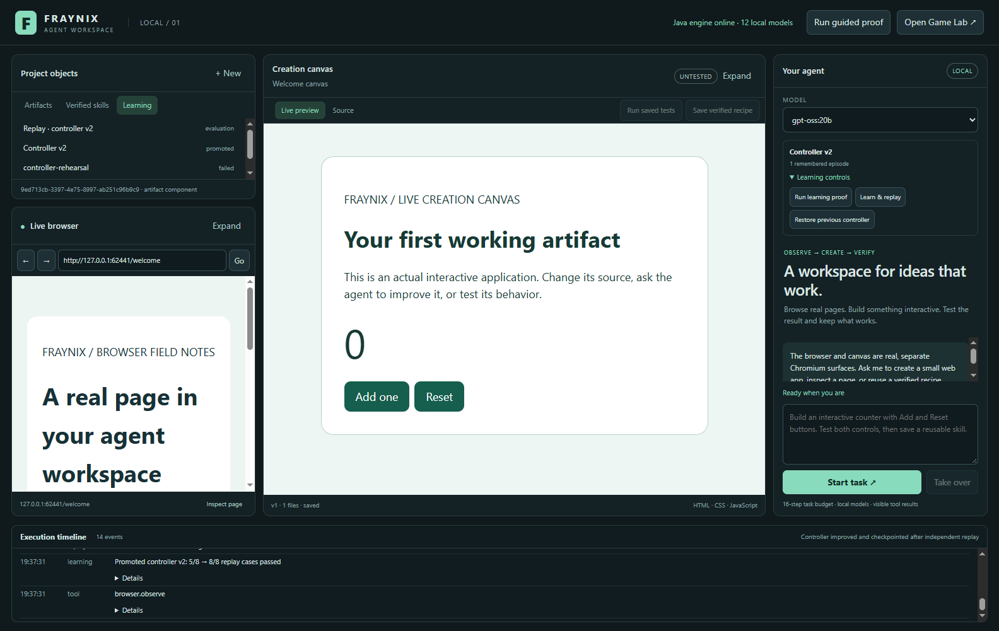
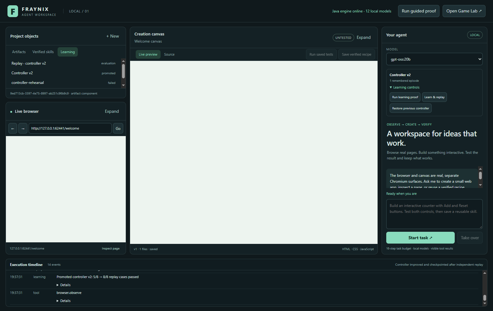
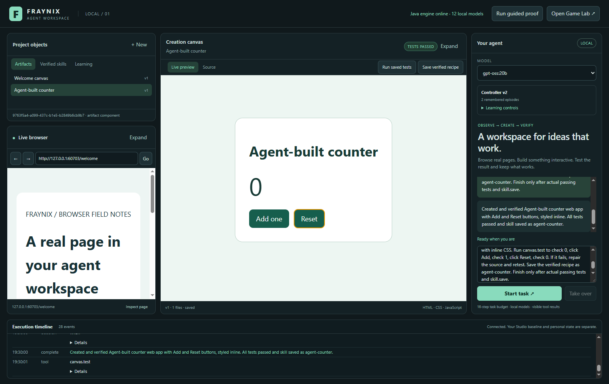
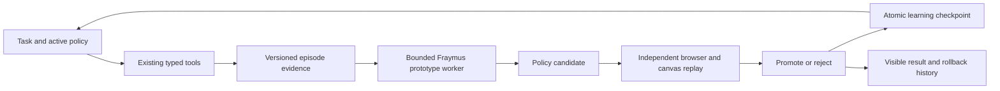

# Fraynix Agent Workspace persistent learning and evaluated control

Edition 007 · October 29, 2026

Fraynix Agent Workspace now retains task episodes, updates a small adaptive controller from recorded failures, tests candidates against actual browser/canvas fixtures, and promotes useful changes with rollback. The local model continues to create real applications through typed tools. The current workspace layout and the original Studio remain intact.

This delivers the first three learning stages identified in the [Fraymus-OS-One assessment](docs/FRAYMUS_OS_ONE_ASSESSMENT.md): durable episodes, an extracted bounded controller and independent replay. The measured first controller changed from **5/8 to 8/8** on its fixed acceptance suite. A deliberately regressive candidate was rejected. The actual `gpt-oss:20b` model then completed a creation/test/recipe task using the learned controller and retained a verified episode.

[Start and walkthrough](#try-the-learning-workflow) · [Actual images](#actual-application-images) · [How learning works](#from-an-outcome-to-a-controller-change) · [Evidence](#verification) · [Source inventory](docs/readmes/007/FILE_TREE.md) · [Interactive explorer](docs/readmes/007/index.html) · [Operating guide](README-006.md) · [Project memory](docs/PROJECT_MEMORY.md) · [Development log](docs/DEVELOPMENT_LOG.md) · [All editions](docs/readmes/INDEX.md)

## The vision and this delivery

The creator's goal is a visual environment in which an agent can understand its surroundings, act, build working artifacts, test them and improve through experience. The game engine supplied explicit object identity, components, physics and live outcomes. Edition 005 added the real browser and creation canvas. Edition 006 documented their operation and examined the creator's existing learning work.

This delivery connects actual task execution to durable learning evidence. It makes a small controller's changes observable and reversible. A later task uses the active learned policy rather than silently returning to the original settings. The controller is deliberately bounded to two existing strategies, so its effect can be checked without installing generated code or changing tool permissions.

It is not whole-model Ollama training. It is genuine persistent controller adaptation with numerical prototype updates and evaluated policy changes. The separate Fraymus small weight trainer remains a candidate for later task-routing or model research, as described under next steps.

## Try the learning workflow

Use **Launch-Agent-Workspace.bat** with JDK 21 and Node.js 22.12 or newer. Local inference needs an installed compatible Ollama model. Docker and WSL are not required. For a checkout updated from an earlier edition, rebuild the Java distributions before launching:

```powershell
.\gradlew.bat installDist :workspace-engine:installDist
.\Launch-Agent-Workspace.bat
```

The complete first-install instructions remain in [README 006](README-006.md#install-and-start). Close the previous workspace instance before opening an updated build against the same project. The original Studio and its project directory are separate.

1. Launch the workspace and expand **Learning controls** below the local model selector.
2. Click **Run learning proof**. A separate test environment records a real rejected stale browser action. It leaves your visible browser page and its session unchanged.
3. Watch the execution timeline. A worker updates the Fraymus prototype memory and proposes a bounded policy candidate. Separate browser/canvas fixtures compare it with the active baseline.
4. On a fresh project, controller v2 is promoted after the first suite improves from 5/8 to 8/8. Repeating the proof on a controller that already handles the recorded failure does not invent another improvement.
5. Open **Learning** in the existing Project objects library. Select the replay record to inspect baseline/candidate outcomes. Select an episode or candidate to inspect its checkpoint data.
6. Use **Restore previous controller** to roll back an active promotion. The evidence and history remain available.
7. Select **gpt-oss:20b** and run a small creation task with explicit behavioral tests. Its episode records the policy version, tool outcomes, artifact revisions and actual test evidence.

**Learn & replay** evaluates recorded controller feedback on demand. Agent tasks also check for supported candidates after finishing. A task without relevant feedback does not manufacture a candidate. Previously evaluated identical candidates for the same parent are not repeatedly replayed.

**Take over** cancels an active learning worker or fixture replay. A candidate cancelled before the promotion commit remains unpromoted and is checkpointed as cancelled. An already committed promotion can be reversed through rollback.

## The existing design remains the workspace

| Surface | Addition |
| --- | --- |
| Project objects, upper left | Learning tab with actual episodes, candidates, evaluations and promotion history |
| Browser, lower left | Same real browser; the learned stale-reference strategy can request a fresh observation |
| Creation/source canvas, center | Same runnable artifacts and source workflow; testing remains mandatory |
| Agent, right | Active controller version, remembered episode count and compact learning controls |
| Timeline, bottom | Candidate proposal, each replay case, promotion/rejection and rollback |

There is no new top-level training dashboard or collection of placeholder pages. The evidence viewer is a contextual dialog. Learning evaluation uses temporary browser/canvas surfaces with separate nonpersistent partitions. They close after the run, rather than commandeering the user's browser.

## Actual application images

The images below were captured October 29, 2026 from the working implementation and isolated verification projects. They combine actual shell and native child Chromium renderer pixels. They are application frame exports, not design mockups. Fixture records are separate from personal project data.

### Learned controller in the existing workspace

[](docs/readmes/007/images/learning-workspace.png)

The library and timeline show controller v2 and its promotion. The welcome canvas remains independently untested in this frame: a controller replay receipt does not certify an unrelated artifact.

### Independent replay evidence

[](docs/readmes/007/images/learning-report.png)

The candidate passes stale click, form and link cases while preserving fresh controls, password refusal, correct counter behavior and detection of an incorrect counter. The complete raw record is available in the dialog and the [frozen learning evidence](docs/readmes/007/learning-integration.json).

### Real local-model creation with the learned policy

[](docs/readmes/007/images/live-agent.png)

The actual local model created the counter, passed Add/Reset tests, saved the requested recipe and finished. Its verified episode identifies controller v2 and four recorded tool actions. Separate fixed acceptance assertions also passed. See the [live-model result](docs/readmes/007/live-model.json).

## From an outcome to a controller change



The Java engine owns the episode, candidate, evaluation and promotion schemas. Its checkpoint uses the existing FactoryWorld transaction and validation machinery in a separate learning world. The desktop owns actual browser actions and assertions. Only trusted application execution can submit receipts through the private control API; model text and generated pages cannot call the learning endpoints.

An episode begins with a task kind, model identity, active policy and a digest of the goal. Actions record a tool ID, outcome, failure class, elapsed time, observation ID/control count, and relevant artifact identity/version. A successful artifact test step must refer to a real stored passing receipt before the episode can become verified. A browser-only completion without an acceptance receipt remains completed-unverified.

Episode records omit raw goals, page text, typed values and source code. Existing application tool journals have their own content retention behavior; this narrower episode format does not retroactively remove earlier journal data. Personal runtime evidence stays outside Git. The published files are deliberately isolated fixtures.

## The extracted Fraymus mechanism

Six original kernel source files are pinned from `eyeoverthink/fraymus-brain` commit `bf7c513e97480376d2583688f9e5b43c6c44657f`. The [provenance manifest](workspace-desktop/vendor/fraymus-brain/provenance.json) records canonical hashes. Source comments are retained. No model weights, trained tensor checkpoint or personal continuity data are copied into this repository.

The worker uses the original `classifyAndUpdateNcm` and `embedVector64` functions for supervised nearest-class-mean prototype updates. Inputs are canonical controller failure summaries. After updating prototypes, it reads back the predicted route and proposes a strategy only when recorded support and the learned route agree. The returned policy is validated again by Java.

The worker runs in a separate Node process with a five-second deadline, a 96 MiB JavaScript heap setting and bounded input/output. It receives a reduced environment and no page contents, model keys or control-API bearer. This isolates its lifetime and crash behavior; it is not an operating-system sandbox for arbitrary programs. Its shipped code is fixed, its source hashes are checked, and its output cannot create executable tool handlers.

The original Think engine is retained as a reference regression fixture: a wrong operator can be revised, serialized and reused on another arithmetic task without another rewrite. The workspace strategy learner uses prototype updates and bounded rule proposals; it does not pretend that arithmetic repair itself trains a language model to browse.

## What the controller can change

| Strategy | Permitted values | Actual effect |
| --- | --- | --- |
| `refreshStale` | false or true | Replace a click/type using an outdated observation ID with a fresh observation. The requested action is not automatically retried. |
| `observationLimit` | 1 or 2 | For a requested artifact task, move from repeated observation to the existing create stage after the permitted number of reads. |

The controller cannot add tools, execute shell commands, increase privileges, bypass testing, change the local model's installed configuration or enlarge the 16-step task budget. Artifact testing, repair and recipe-saving gates remain host logic.

Prototype memory contains two bounded failure classes, 64-dimensional centroids, at most four sub-prototypes per class and a recent episode-ID index. Reusing an indexed episode does not train it again. Memory and policy activate together only after an accepted replay. Rejected candidates retain their evidence without changing the active controller.

These strategies address specific controller friction. They do not yet solve arbitrary DOM mutations, every website, gameplay planning or whole-model learning. New failure classes need their own adapters and fixtures.

## Independent replay and promotion

The first suite contains eight fixed cases: one training example, two validation cases, one final-test variation and four regression cases. It checks actual browser clicks and text entry, rejection of password automation, running Add/Reset behavior, detection of incorrect Add behavior and the observation budget.

A candidate must pass all eight, avoid baseline regressions, and strictly improve either passed cases or the measured count of rejected actions/extra reads. Java recomputes the decision from the fixture records. Missing or duplicate cases, unknown suite identity, unsupported policy fields and a changed parent generation are rejected.

The first learning proof improved **5/8 → 8/8**. The extended integration check also records two actual unchanged observations, proposes a lower read budget, retains **8/8**, and reduces extra reads. A harmful candidate that disables the learned refresh regresses from **8/8 → 5/8** and is rejected.

The final-test variation is separate from the examples used for that proposal, but the suite is fixed and will be reused across future candidates. These are current regression/acceptance checks, not a perpetual untouched benchmark. Broader improvement claims need additional hidden or newly generated task families and full task outcomes.

## Persistence recovery and rollback

| Location under the project | Purpose |
| --- | --- |
| `learning/state.fworld` | Authoritative entity/component checkpoint for all learning records and active policy/memory |
| Existing `receipts/` | Actual version-bound artifact test results referenced by verified episodes |
| Existing `events.jsonl` and kernel journal | Evaluation and rollback audit events alongside ordinary execution evidence |
| Existing artifact/recipe directories | Generated application source, versions and reusable tested work |

Project data still defaults to `%USERPROFILE%/.fraynix-agent-workspace/projects/default`. `FRAYNIX_WORKSPACE_PROJECT` selects a separate project. The original Studio's scene and profile are not used.

Restart marks unfinished episodes and proposed candidates as interrupted rather than successful. Checkpoint failure restores the previous live learning world. A promotion transaction stores the prior policy/memory and the new active state together. Rollback restores the previous pair and increments the active generation, so a stale candidate cannot replace the restored parent.

The UI/API expose the most recent 50 episodes and 30 candidates/evaluations/promotions. Older records remain in the checkpoint. An episode holds at most 96 steps. Worker summaries bound per-episode failure inputs, and its prototype deduplication index retains 256 episode IDs. Pagination, long-term compaction and larger learning datasets are subsequent work.

## Verification

- **97 Java tests:** 87 inherited, four artifact-store tests and six learning-store tests; no failures.
- **7 desktop tests:** existing action policy plus bounded controller behavior, prototype learning/read-back, episode deduplication, worker cancellation and the pinned Think reference.
- **11 original integration checks:** real browsing, runnable artifact, repair, persistence, takeover, Game Lab, renderer isolation and infinite-loop recovery still pass.
- **9 learning integration checks:** real failure capture, promoted host behavior, reduced repeated reads, rejected harmful candidate, persistence, rollback, cancellation/retry and receipt-bound episode capture.
- **Actual local model:** `gpt-oss:20b` completed create/test/save/finish with controller v2; independent counter assertions and its verified episode passed.

A clean Git clone of the release candidate also builds, passes its 97 Java tests, seven desktop tests and nine learning checks, and matches all 369 inventoried source/assets. The [verification snapshot](docs/readmes/007/verification.json) identifies the separate records. Images and results name their actual fixture scope; no synthetic intelligence score is used as a promotion metric.

```powershell
.\gradlew.bat check installDist :workspace-engine:installDist
.\scripts\Verify-Documentation.ps1
cd workspace-desktop
npm.cmd ci --no-audit --no-fund
npm.cmd test
npm.cmd run test:integration
npm.cmd run test:learning
$env:FRAYNIX_LIVE_MODEL = 'gpt-oss:20b'
npm.cmd run test:live
```

The local-model fixture may take several minutes and requires that actual installed model. Other tests use their own temporary projects. Model weights and services are not changed by these checks.

## Documentation memory and development history

The [project memory](docs/PROJECT_MEMORY.md) records the publication target, accepted product direction, current implementation, verified model, data boundaries and remaining work. The [development log](docs/DEVELOPMENT_LOG.md) records implementation progress and the issues found during testing. These are shared engineering continuity; they do not claim to update an assistant's global training or every future conversation automatically.

This edition adds a [searchable offline explorer](docs/readmes/007/index.html), [source inventory](docs/readmes/007/file-inventory.json), [Obsidian learning canvas](docs/obsidian/persistent-learning.canvas) and dated actual images. Earlier editions and their frozen assets remain intact.

## Next steps

1. Expand episode replay from fixed controller fixtures to varied end-to-end browser/artifact goals, with independent acceptance criteria, recovery cases and unseen task families.
2. Add failure classes and bounded strategies for dynamic pages, revision conflicts and longer tasks. Keep measured task success, repeated actions, completion time and resource cost visible.
3. Connect Game Lab observations and outcomes to the same episode schema with tick/frame/entity identity, then measure live recovery and power-up planning across runs.
4. Evaluate the existing small ternary trainer on meaningful routing or action-ranking targets from verified episodes. Keep training, validation and final evaluation separate.
5. Develop a separate whole-model dataset/checkpoint/export/inference adapter for an explicitly chosen model. Require loadable candidates, tool-format quality, task-level comparisons and rollback before activation.
6. Add richer artifact generators, document/data/media renderers and isolated general-code workers from the assessed OS One engines. Each capability needs working execution, validation, persistence and takeover.

The current milestone establishes the evidence and promotion path those additions need. The next useful measure is success across broader tasks, rather than a larger counter of training cycles.
