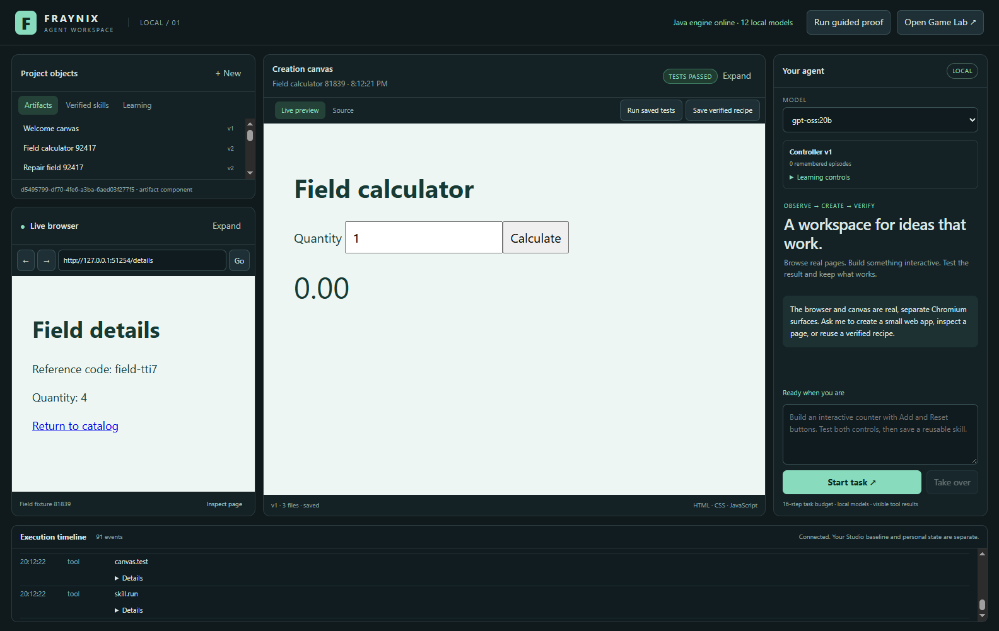
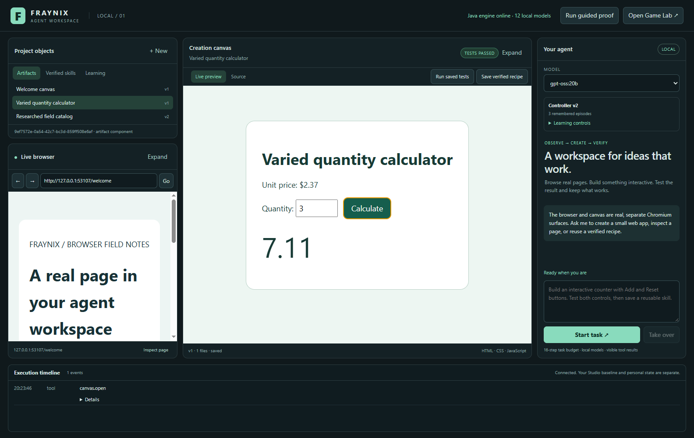
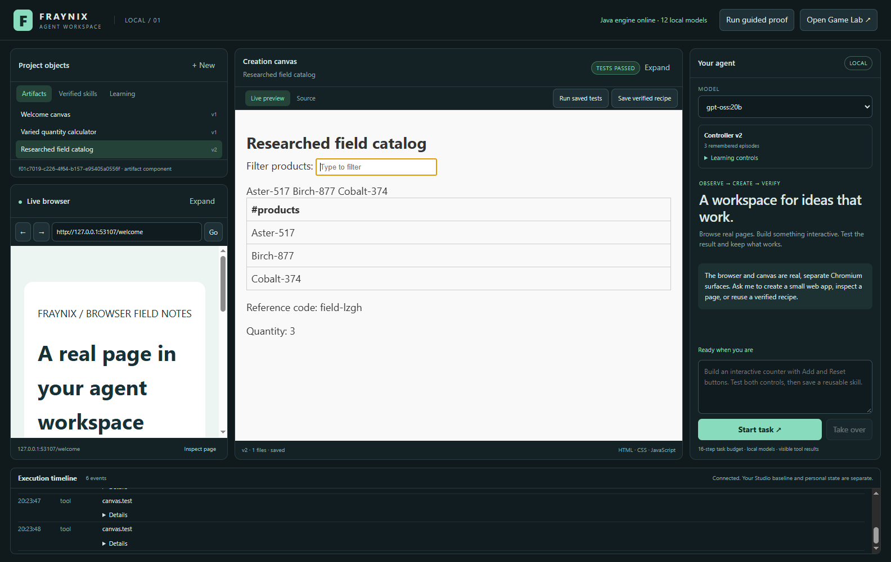
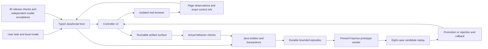

# Fraynix Agent Workspace · edition 008

## Broader validation and useful recovery

October 29, 2026. This edition extends [the persistent learning release](README-007.md) by testing the workspace against more varied, observable work. The same generated checks improved from **28/45 before corrections to 45/45 afterward**. The original browser, canvas, artifact, recipe and learning regressions still pass. Actual local-model tasks and independent acceptance checks are recorded separately from the scripted host checks.

The goal remains your original idea: give an agent a visible environment where it can observe real conditions, take typed actions, create working objects, test them, retain useful experience and improve its next attempt. The game engine supplies a strong starting point for entities, components, state and simulation. The successor workspace adds a real browser and a creation canvas while retaining the full native Game Lab. Its design stays recognizable: library and browser on the left, canvas and source in the center, agent on the right, evidence below.

This release improves execution inside that design. It adds no placeholder pages, model services, cloud accounts or arbitrary generated tool handlers. Existing local models, personal projects and the separate original Studio remain in place.

- [Offline interactive explorer](docs/readmes/008/index.html)
- [Verification and scope](docs/readmes/008/verification.json)
- [Before corrections](docs/readmes/008/broader-before.json) and [same checks afterward](docs/readmes/008/broader-validation.json)
- [Actual varied local-model tasks](docs/readmes/008/live-broader.json)
- [Source tree](docs/readmes/008/FILE_TREE.md) and [canonical source hashes](docs/readmes/008/file-inventory.json)
- [Installation and complete operating guide](README-006.md)
- [Edition history](docs/readmes/INDEX.md) and [project continuity](docs/PROJECT_MEMORY.md)

## What broader checking found

The previous edition established durable episodes, prototype updates, candidate replay, promotion and rollback. Its fixed eight-case replay was deliberately narrow. Passing that gate did not establish that research across pages, changing controls or diverse artifact inputs worked reliably. The next step was to exercise those assumptions against the real host dispatcher and actual Chromium renderers.

The new release suite has fifteen check families, each run with three generated datasets. Seeds are recorded so another person can reproduce the same pages, names, reference codes, prices and input values. Several checks repeat a structural invariant across those datasets; forty-five checks do not mean forty-five unrelated task types. Most use live browser or canvas tools; the stage-selection and registry-boundary checks directly test those host functions. Local fixture servers keep this comparison controlled and avoid changes to third-party websites.

The unchanged starting release passed twenty-eight checks. The failures exposed three practical problems. First, the old observation budget could treat the automatic welcome-page read as sufficient research, leaving the agent only the create action before it had visited the requested information. Second, a control could be replaced, hidden or disabled without changing the observation identifier. Third, numeric fills occasionally appended to the old field value. Receipts showed values such as 41 when the intended replacement was 4. A calculation could then be correct for the wrong input and fail the actual task.

The preserved baseline includes failures and errors. The final report runs the same seeds and families after the corrections. This is a before-and-after release regression comparison. It is not an untouched final benchmark or a general intelligence score.

## Research stays available

The host now fingerprints an observation's URL, page text and control data, excluding its freshly generated observation identifier. Only an explicit read of the same semantic page observation counts toward repeated reads. A changed page or a meaningful browser action resets the repeated-read count. The fingerprint lives in the transient job; the learning episode does not gain raw page content through this mechanism.

When the learned read limit is reached before creation, the controller suppresses another identical observe action. Navigation, clicking, typing and artifact creation remain available. The model can follow a detail link, visit the supplied research URL or use what it already learned. It cannot finish an artifact request without creating the requested artifact. The existing mandatory test, repair and recipe stages still apply afterward.

This matters because saving a redundant read is useful only if the agent can still do the work. A request to build a catalog from two pages needs both pages. A low read count alone would reward premature creation. The v2 runtime contract measures repeated unchanged reads while preserving actions that can reveal new information.

The eight-case automatic promotion suite is now named `browser-controller-v2`. Under the corrected semantics, its read-budget comparison retains eight passing cases while reducing extra reads from two to one. The historical edition 007 recorded the earlier contract and its one-to-zero result; that published evidence remains intact. Policy version numbers identify saved candidates, while the runtime contract names the host semantics. They serve different purposes.

## Changed controls produce a fresh observation

An observation reference identifies a particular DOM element. Replacing a button with a similar-looking button does not make the old element a valid target. Before an action, the surface checks connection, enabled state, geometry and visibility. Disconnected, disabled or hidden targets return a specific changed-control error to the host.

With stale refresh enabled, that error becomes a fresh browser observation. The original click or type is not automatically retried against a different element. The model receives current controls and can choose its next action from that evidence. This adds recovery for changes within a page as well as the earlier recovery for expired observation identifiers.

The generated checks replace, hide and disable a real fixture button after observing it. Each verifies that control recovery returns an observation and leaves the fixture's action receipt unchanged. Duplicate labels are tested separately: two buttons can have the same name, and the observed exact reference still selects the intended second button. This remains main-document control, with a bounded number of exposed controls. Frames, complex editors, drag operations and arbitrary desktop applications need further adapters and checks.

## Input replacement and artifact evidence

The input path now focuses the correct renderer and clears supported input or textarea controls using their native value setter before inserting text. This replaces the unreliable cross-renderer select-all shortcut. Actual text insertion still flows through Chromium. Password controls remain manual. The broader suite checks special characters, numeric replacement, independent arithmetic, deliberately incorrect code and subsequent repair.

A runnable artifact is versioned source, not a screenshot. The Java store owns its identifier, file contents, revisions and test receipts. A write persists the source and opens it in the isolated preview. An edit requires the expected version so a stale writer cannot overwrite a newer revision. A test receipt belongs to its artifact version. A later write needs a new passing receipt before a verified recipe can be saved.

The suite deliberately supplies an incorrect calculator, checks that its result fails, checks that a recipe cannot certify it, repairs the source and retests. It also exercises a multi-file calculator with local HTML, CSS and JavaScript. Passing the tests is evidence for the asserted behavior; it does not certify every possible input or every property of the generated program. Keeping those limits explicit makes later learning targets more useful.



Actual October 29 application frame from an isolated generated fixture project. The screenshot composes the shell and child Chromium renderer captures. It shows the preserved workspace layout, real local pages and a saved tested artifact. It is not an OS screen capture or a model-generated mockup.

## Actual model work and independent acceptance

The local model remains `gpt-oss:20b`, using Ollama and the existing Java routing layer. Generated host fixtures exercise the tool boundary directly; the live tasks additionally require the model to choose valid tools, use real results, create source, test it and save the requested recipe. Their reports name the model, policy, episode, artifact version, tool sequence and independent assertions.

The varied calculator request supplies a price of 2.37 and asks the model to test quantities two and five. Independent acceptance uses four, zero and three. This checks different values without giving the model the evaluator's source. The research task supplies a live loopback catalog URL. The model must navigate, follow the details link and carry actual product names, quantity and reference code into a new filterable artifact. Those generated values are not written into the task prompt. Acceptance compares against the fixture's separate dataset and inspects actual filtering behavior.

These are two actual task instances, alongside the existing counter regression. They establish concrete workflows, not an expected success rate across all tasks. Rechecking saved model outputs after reopening is identified in the report. Model-selected tests and independently authored acceptance checks are kept distinct. A completion message alone does not pass the evaluator.





Both images are actual composed application frames from isolated validation projects. They show saved model outputs reopened for independent acceptance, with the acceptance activity visible in the timeline. The accompanying JSON retains the original model episode and tool order as evidence for completion; screenshots alone cannot establish it. Acceptance timings on reopened outputs measure that check, not the earlier model run.

## Learning still has a measured boundary

The creator's pinned Fraymus numerical kernel remains part of the controller-learning path. A bounded worker updates supervised prototypes from canonical episode outcomes and reads back routing. It proposes only the defined stale-refresh and read-limit policy fields. Java validates and checkpoints the candidate, evaluates its parent and candidate, and promotes policy plus prototype memory atomically when the acceptance rules pass. Rollback restores them together.

New episode and candidate records include the runtime contract. Existing project data remains readable. The v2 evaluation digest prevents an old unfinished candidate from being promoted using a different replay definition. The new changed-control recovery transition is an allowed bounded episode value. Raw source, page text and typed content remain excluded from learning episodes; older tool journals have their own retention behavior.

The separate forty-five-check release suite does **not** silently become the automatic per-candidate promotion gate. The fixed eight-case suite still controls promotion. Keeping the broader evaluator outside candidate training gives it a separate role, but once failures are inspected and used for corrections it is no longer an untouched holdout. Future evaluation needs additional withheld task families and task-level outcomes, with explicit coverage and failure reporting.

No Ollama weights are updated here. The fixed-code worker has time, memory and data limits; that is not an operating-system sandbox for arbitrary generated code. Those distinctions leave room for the larger vision while accurately describing the working capability.

## Ownership and execution path



Electron main owns typed dispatch and isolated surfaces. Java owns durable objects, model routing, transaction checks, learning state and artifact evidence. Browser content and generated pages do not receive the privileged shell bridge or Node access. Documents and page text provide data, never new handlers or permission. The registry rejection checks establish that unrecognized tool names cannot register themselves; they do not establish that a model resists every possible prompt injection.

The complete game editor, assets and inherited sources stay in this repository. Game Lab launches separately and uses successor storage. This edition does not replace its physics, character behavior or existing gameplay controller. Bringing browser/artifact and game experience into one tick-aligned learning stream remains a subsequent stage.

## Run and reproduce

Use JDK 21 and the Node version described in the operating guide. Existing installed Ollama models are used as they are. Docker and WSL are unnecessary for this release.

```powershell
.\gradlew.bat check installDist :workspace-engine:installDist
cd workspace-desktop
npm.cmd ci --no-audit --no-fund
npm.cmd test
npm.cmd run test:integration
npm.cmd run test:learning
npm.cmd run test:broader
# Optional actual local-model tasks; these take longer:
$env:FRAYNIX_LIVE_MODEL='gpt-oss:20b'
npm.cmd run test:live
npm.cmd run test:live-broader
```

Launch the normal application with `Launch-Agent-Workspace.bat`. Tests create separate temporary projects and close their own test windows. Normal projects default to `%USERPROFILE%/.fraynix-agent-workspace/projects/default`; credentials, browser sessions, personal work, model weights and dependency folders stay outside Git. Test hooks are enabled only in explicitly configured test processes.

To review the feature manually, open Learning controls and run the learning proof. Inspect a saved episode and its replay report under Learning in Project objects. Then request a small app, let it test and save, reopen it from the library and rerun its tests. Try research that requires a link as well as a first page. The evidence timeline makes the actual tool order visible. Take over stops the active run; a failed candidate cannot replace the current controller.

## Next acceptance gates

1. Add withheld task families and repeated model trials with task-quality, repair and cost outcomes. Keep host reliability, model planning and artifact correctness separately measurable.
2. Add navigation races, delayed updates, frames, overlays and long-page observations with explicit action postconditions. Expand only after actual failure recovery is verified.
3. Connect Game Lab observations to frame, tick, entity and action identities. Reward collecting useful items, avoiding repeated blockage and reaching goals through reproducible scenarios.
4. Train small numerical controllers on meaningful targets from those outcomes. Compare checkpoints against a frozen parent and newly withheld tasks before activation.
5. Add other artifact types behind dedicated renderers, validators and execution isolation. A document or dataset needs its own correctness rules.
6. Establish a separate whole-model dataset, training, checkpoint/export and inference adapter path. Loadability and retained task quality must be demonstrated before calling it model self-training.

The value of the environment grows when observations, actions, tests and remembered outcomes describe the same actual task. This release strengthens that connection by correcting failures exposed through broader work. The next stage should widen what the agent can reliably accomplish while retaining visible evidence and reversible improvements.
