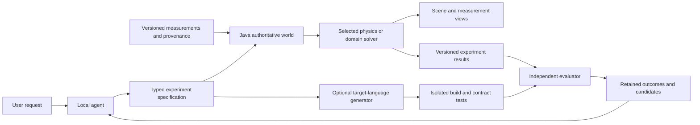
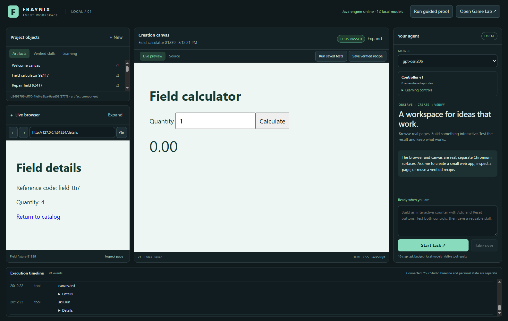
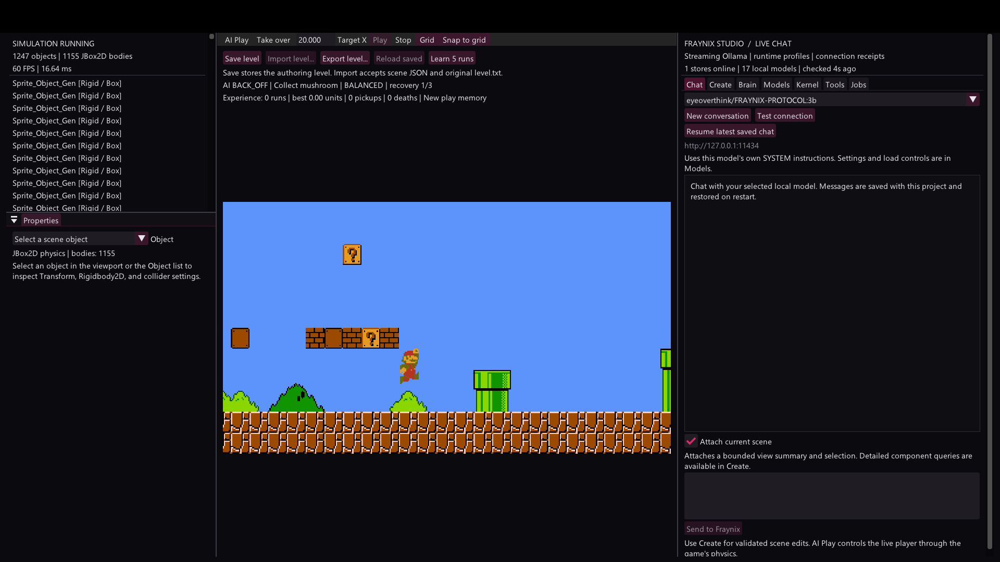

# Fraynix Agent Workspace · edition 009

## Shared world, 3D experiments and real-data roadmap

October 29, 2026 · **Design and implementation-plan edition.**

This edition records the next agreed direction: expand the existing visual agent workspace into an environment where requests can become scenes, experiments and executable artifacts, all connected to structured state and measurable outcomes. The first proposed implementation is a small 3D ramp-and-block experiment, followed by measured-data comparison and reusable agent experiments.

The current application remains the verified edition [008 runtime](README-008.md). **This documentation update does not implement 3D rendering, a 3D physics backend, general native-code execution or whole-model training.** It preserves the existing application design and gives those changes an explicit sequence and acceptance criteria.

- [Interactive offline roadmap](docs/readmes/009/index.html)
- [Working engineering plan](docs/SCENARIO_ENGINE_ROADMAP.md)
- [Versioned milestone definitions](docs/readmes/009/roadmap.json)
- [Current implementation evidence and scope](docs/readmes/009/verification.json)
- [Source tree](docs/readmes/009/FILE_TREE.md) and [canonical inventory](docs/readmes/009/file-inventory.json)
- [Full operating guide](README-006.md), [verified runtime](README-008.md) and [edition history](docs/readmes/INDEX.md)

## The vision being carried forward

The original game supplied more than a picture for an AI to watch. It supplied objects, components, positions, constraints, time and actions that change an actual running environment. The workspace extends that idea with a real browser, generated applications, versioned files, tests, recipes, local models and persistent learning records.

The next development should connect these foundations through a common authoritative world. An agent should be able to request a scene, inspect a particular object, change a permitted parameter, run an experiment, compare outcomes and retain useful experience. A person should see those changes immediately, inspect their source and measurements, and take over at any point.

The interface stays familiar: library and browser on the left; canvas, source and an eventual scene view in the center; agent on the right; execution evidence below. A scene is a supported project object and view, rather than an unrelated new application or a vacant page. The original native Studio and personal projects remain separate and preserved.

## Current engine compared with the intended system

| Area | Implemented foundation | Planned extension and evidence required |
| --- | --- | --- |
| Object identity | FactoryWorld entities, schemas, transactions, checkpoints and artifact versions | Shared scene identities that survive persistence and appear consistently in the agent, inspector and renderer |
| Scene transforms | Two-dimensional position/scale, scalar rotation and draw-order zIndex | Transform3D with position, orientation and scale, explicit coordinate conventions and migration rules |
| Physics | JBox2D gravity, bodies, collisions and fixed 1/60-second stepping | A selected 3D backend with validated bodies, materials, joints, collision behavior and recorded solver configuration |
| Rendering | Native 2D editor plus isolated Chromium browser/artifact surfaces | A real 3D viewport consuming authoritative scene snapshots and showing selection and agent changes |
| Agent execution | Typed tools, observation references, tested artifacts, recovery and takeover | Bounded scene queries, validated changes and experiment jobs with measured postconditions |
| Data | Versioned artifact files and source references | Measurement datasets with units, timestamps, coordinate frames, uncertainty, provenance and explicit bindings |
| Learning | Durable episodes, pinned Fraymus prototype adaptation, eight-case candidate replay and rollback | Physical-action episodes, task-level targets, new withheld scenarios and measured promotion |
| Code generation | Actual HTML/CSS/JavaScript create/test/repair workflow | Typed specifications and compiler adapters for additional languages, each with independent build/run validation |

The current `zIndex` controls drawing order; it does not supply physical depth. The existing camera is orthographic and its position is two-dimensional. A 3D expansion therefore includes rendering, geometry, orientation and collision/solver work. It cannot be completed by adding a third number to a serialized transform.

The existing Java runtime and entity system provide useful integration foundations. Mature engines already provide substantial 3D and agent-training capabilities: [Godot documents corresponding 2D and 3D physics objects](https://docs.godotengine.org/en/stable/tutorials/physics/physics_introduction.html), and [Unity ML-Agents defines observing and acting agents inside simulation environments](https://unity-technologies.github.io/ml-agents/). Our practical advantage is the particular local workflow already assembled: model-driven actions, editable artifacts, persistence, test evidence, recovery and evaluated controller adaptation in one visible product. No comparative performance or novelty benchmark has been established.

## One world with domain-specific components

A shared world needs common identity, transactions, relationships and history. Its components retain the meaning of their domain. A block has physical dimensions, mass and velocity; a dataset has rows, units and provenance; a browser has a URL and controls; a recipe has source versions and test receipts. A document's screen position does not give its contents physical gravity.

Java should remain authoritative for durable state and experiment records. Renderers receive versioned scene snapshots or deltas. Agent actions request validated changes through registered tools. A renderer, generated page or imported document cannot independently redefine the world or install a privileged handler.

An experiment record should identify the scene version, initial conditions, solver/version/configuration, timestep, random seed where relevant, agent/model/policy identity, action sequence, input dataset version and output measurements. The record should also identify the evaluator and its tolerance. Reproducibility must state the supported platform/backend and numerical tolerance; identical floating-point results across all hardware are not assumed.

Agent queries should return relevant objects and summaries with references for detail. They should not attach a serialized entire world to every model request. The earlier oversized-context failure is a reason to preserve bounded observations as scenes grow.

## Implementation sequence and acceptance gates

### 1. Establish the shared experiment contract

Define versioned Scene, ExperimentDefinition, ExperimentRun and MeasurementDataset schemas using the existing transaction/checkpoint mechanisms. Specify SI units, axes, handedness, time, object IDs, revisions and relationships. Separate authored scene state from transient simulation state and measured results. Describe how the existing 2D world participates without changing the meaning of its current units or saved levels.

Acceptance: save/reopen a small scene with stable identities; reject malformed or non-finite values; detect stale edits; record configuration and dataset identity; retain all existing 2D/runtime regressions. A failed experiment must preserve the authored scene and its previous evidence.

### 2. Select the 3D rendering and physics adapters

Evaluate candidate backends behind narrow interfaces before committing the product to one. Compare Java/native compatibility, licenses and redistribution, maintained bindings, Windows packaging, collision/constraint behavior, observability, cancellation and reproducibility. Rendering may use an existing native path or an isolated scene surface, but both must consume the same Java-owned state. This plan does not choose or install a new backend.

Acceptance: a real perspective scene with a selectable object, camera controls and visible updates from validated state changes; physical depth, rotations and collisions; a reproducible backend-selection record; continued operation of the present browser, artifact canvas and Game Lab. A static 3D illustration does not pass this gate.

### 3. Deliver the first complete 3D experiment

Build one ramp, one block and a ground surface. Expose bounded gravity, slope, mass, friction and initial conditions. Show the scene alongside time, position, velocity and contact state, with play, pause, fixed-step, reset, save and replay. Label the friction model and the assumptions used by the evaluator.

Use a deliberately simple frictionless ramp as an analytical reference, where acceleration along a straight incline is g × sin(theta) before other contacts or boundaries intervene. Add friction only with explicit static/kinetic assumptions and appropriate reference cases. Include free-fall and resting-contact checks. Set tolerances before judging candidate results and record numerical error.

Acceptance: correct trends and bounded numerical error against defined reference cases; stable resting contact; replay from the same initial state within tolerance; no NaN/infinite values or lost bodies; visible manual edits; reset leaves the authored initial conditions intact. This is a small mechanics lab, with no claim to model every physical domain.

### 4. Connect the agent to measured scene actions

Register explicit tools for querying relevant entities, proposing version-checked edits, starting/stopping an experiment and reading bounded results. Names such as `scene.query`, `scene.apply`, `experiment.run` and `experiment.compare` in the working plan are proposed contracts, not currently callable tools. Keep long model inference outside the fixed physics tick. The solver integrates the world; the model chooses higher-level goals, settings and experiments.

Acceptance: the local model changes one requested parameter, predicts a qualitative outcome, runs the actual scene, receives measurements, checks a stated objective and reports evidence. Takeover stops further agent actions and an experiment job has a bounded lifetime. The evaluator must detect an incorrect prediction even if the model reports success.

### 5. Bind real measurements to the experiment

Start with a small imported CSV/JSON dataset whose columns explicitly map to time and measured position. Store its original source, import transformation, units, missing-value handling, uncertainty if known and version. Label whether each value is measured, assumed or simulated. Add a chart comparing the actual observations with the simulation and a declared residual/error metric.

Acceptance: a known dataset imports correctly; inconsistent units and missing mappings are rejected or explicitly resolved; binding the data updates the intended object; the reported error agrees with an independent calculation; out-of-range or stale data is visible. A synthetic fixture remains labeled synthetic. Agreement supports the tested model and conditions; visualization alone establishes no causal explanation.

### 6. Retain physical experience and evaluate improvement

Attach frame/tick/entity/action identities and experiment outcomes to learning records. Evaluate candidates on separate scenarios with changed initial conditions and newly withheld task families. Track objective success, physical validity, prediction error, recovery, time and action cost separately. Keep learning targets explicit: a controller, routing prototype, parameter estimator and language-model weights are different trainable systems.

Acceptance: repeat a recorded failure, retain an evaluated improvement, demonstrate it on additional conditions, reject a regression and roll back the active policy and its associated learned state. Existing browser-controller promotion remains governed by its current suite until a separately versioned experiment suite is implemented and validated. Current controller learning does not update Ollama weights.

### 7. Add language-generation backends through the same evidence path

Your transmutation idea becomes a typed specification and intermediate representation with target-language generators. A common task contract can describe inputs, outputs, units, constraints and required behavior. Separate Java, C and Go adapters then generate source, invoke the correct toolchain, run independently authored checks and retain build/run evidence. Formatting equivalent code is insufficient; the target behavior must agree within specified tolerances.

Java can coordinate this pipeline and interoperate with native libraries. Its processing capacity also depends on algorithms, solver design, hardware and data movement. [Oracle's JDK 21 documentation](https://docs.oracle.com/en/java/javase/21/core/foreign-function-and-memory-api.html) describes native interoperability through a preview foreign-function API; adopting that path would be a separate compatibility decision. No JDK upgrade is implied here.

Acceptance: one deliberately narrow specification produces two target implementations, both compile through recorded toolchains, pass the same independent contract, fail deliberately broken cases and run within appropriate isolation and resource limits. Expand language coverage after that proof. General native-code execution needs an actual execution boundary; the existing fixed-code learning worker is not an arbitrary-program OS sandbox. Docker/WSL availability must not be assumed.

## Requests, data and visible cause-and-effect

The ramp experiment provides a manageable first proof. A later warehouse example could import dimensions, package masses and route data, then compare movement strategies under stated contact and energy assumptions. A measured-device example could compare observed and simulated trajectories. A geographic scene could attach timestamped events or observations to real locations; [Cesium's entity model](https://cesium.com/learn/cesiumjs-learn/cesiumjs-creating-entities/) provides an established example of spatial, time-dependent visualization. These examples are prospective applications rather than installed modules.

Different questions require different solvers. Rigid-body collisions do not establish fluid flow, weather, structural stress or traffic behavior. A real-world model requires calibration and validation for its intended conditions, explicit uncertainty and evidence for intervention/causal claims. The system should expose those assumptions as inspectable components rather than letting a convincing animation stand in for accuracy.

## Current visual foundations

Earlier runtime image, captured October 29 in an isolated edition 008 validation project. This actual frame composes shell and child Chromium captures. It shows existing browser, canvas and library capabilities; it does not show the proposed 3D lab. [Frozen original](docs/readmes/008/images/broader-validation.png).

Earlier native Game Lab image from edition 004, October 29. The preserved game is the 2D foundation for the roadmap. [Frozen original](docs/readmes/004/images/mario-grown.png). Neither image is a new 3D implementation or mockup.

## Verification and continuity

This is a documentation release against source baseline `3a1922d794d4aaa3717203eaf59073c297e046ed`. Its canonical implementation inventory contains the same 372 files as edition 008. That edition's retained evidence reports 97 Java tests, nine desktop tests, eleven original integration checks, nine learning checks, 45 broader generated release checks and three local-model workflows with 24 independent assertions. Those application tests are historical evidence and are not represented as newly rerun by this documentation update.

Publication checks verify local references, frozen prior editions, embedded explorer data, source hashes and Obsidian canvas references. The offline viewer is inspected at normal and narrow widths for navigation, module/status filters, selection, source search and actual images. See [verification context](docs/readmes/009/verification.json). Runtime and personal project state remain unchanged by this edition.

Implementation should start with phase 1 and a narrow adapter spike for phases 2–3. Keep each later milestone reviewable with actual results, new screenshots, a subsequent README edition and rollback. Use [the working roadmap](docs/SCENARIO_ENGINE_ROADMAP.md), [project memory](docs/PROJECT_MEMORY.md) and [development log](docs/DEVELOPMENT_LOG.md) for continuation. Forecasts here describe dependencies and acceptance gates; they do not promise dates, unmeasured performance or universal autonomous capability.
