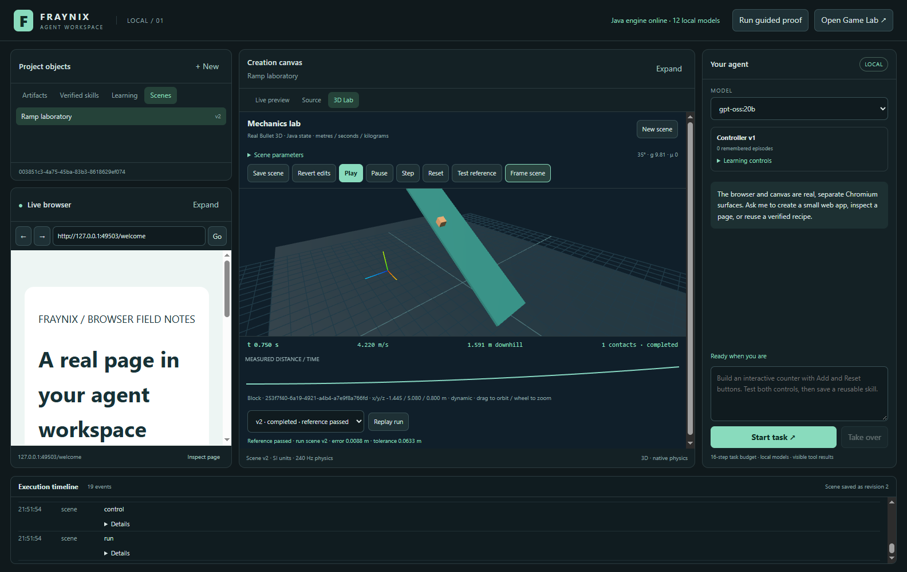
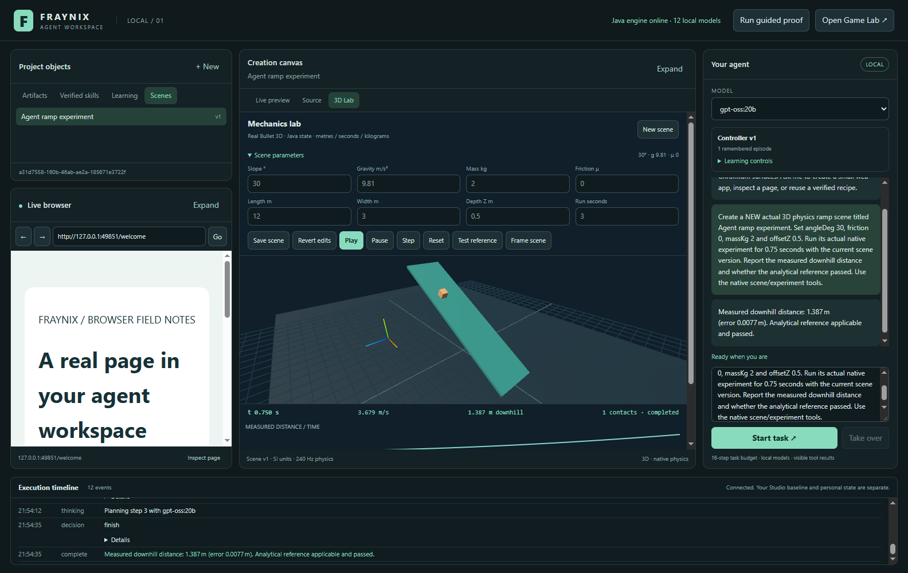
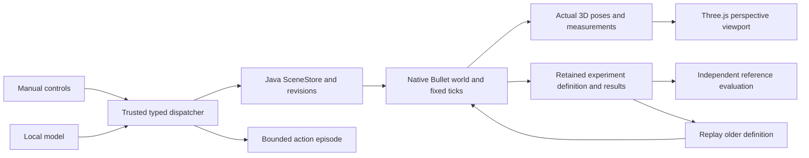

# Fraynix Agent Workspace · edition 010

## The first native 3D mechanics lab

October 29, 2026. The roadmap's first 3D slice is now working: a Java-owned ramp, block and ground, simulated by native Bullet and displayed in a real perspective viewport inside the existing workspace. You can change physical parameters, play, pause, step, reset, save authored revisions, run a reference check and replay retained experiments. A local Ollama agent can create a scene and run the same native experiment through registered tools.

This implements initial shared scene/experiment contracts, a selected 3D adapter, the bounded ramp lab and an early agent-action path from [the design edition](README-009.md). It does not finish every roadmap phase. Arbitrary 3D scene authoring, real instrument-data ingestion, physical-policy learning and additional language compilers remain later work. The original 2D Game Lab and the existing browser/artifact application remain preserved.

- [Interactive release explorer](docs/readmes/010/index.html)
- [Verification and measured results](docs/readmes/010/verification.json)
- [Actual 3D integration evidence](docs/readmes/010/scene-integration.json)
- [Actual local-model physical task](docs/readmes/010/live-scene.json)
- [Backend decision and dependency boundaries](docs/3D_BACKEND_DECISION.md)
- [Working roadmap](docs/SCENARIO_ENGINE_ROADMAP.md), [source tree](docs/readmes/010/FILE_TREE.md) and [canonical inventory](docs/readmes/010/file-inventory.json)
- [Installation/operating guide](README-006.md), [earlier runtime](README-008.md) and [edition history](docs/readmes/INDEX.md)

## What you can do now

Open **3D Lab** in the creation canvas. On a project with no scenes, that explicit action creates a saved ramp scene. The **Scenes** library lists authored scenes and revisions. Opening the normal application alone does not populate your personal project with test fixtures or learning-proof records.

The center view shows actual three-dimensional bodies, an orbitable perspective camera, a ground/grid reference and a selected object's identity and x/y/z position. Drag to orbit, scroll to zoom, or use **Frame scene** to restore the camera. **Expand** gives the existing canvas area more room while retaining the agent column. The scene's rendering is built from poses returned by Java; moving shapes are not a separate browser simulation.

Scene parameters include slope in degrees, gravity in metres per second squared, mass in kilograms, a friction coefficient, ramp length/width and the block's initial depth position. The native frame is right-handed with +Y up. The inherited 2D editor's units and zIndex retain their earlier meaning. New physical depth is part of the new 3D object contract.

Change parameters and click **Save changes** before running. This creates a new authored revision and retains stable scene/body identities. **Revert edits** restores the saved parameters. **Play** advances the physical world; **Pause** holds the state; **Step** advances exactly one 1/240-second tick while paused. **Reset** restores authored starting conditions and preserves recorded run history. It also clears the active native world so another scene or experiment can start.

For an analytically checked experiment, set friction to zero and choose **Test reference**. The host runs 0.75 simulated seconds, records the actual result and checks it against the ideal frictionless-incline equation within a declared tolerance. The plot shows solver-derived distance over simulation time. These are simulated measurements, not imported real instrument readings.



Actual October 29 frame from an isolated verification project, composed from the shell and child Chromium captures. The block pose, contact count, clock and plotted samples come from native Bullet. The image shows a saved revised scene and its passing reference check. No mockup or generated illustration is used as implementation evidence.

## A request becomes a real experiment

The current local-model proof asks `gpt-oss:20b` to create a new 30-degree ramp scene, with friction zero, mass two kilograms and initial depth 0.5 metres, then run 0.75 seconds and report measured downhill travel. The model selects the native scene and experiment tools, using the actual returned ID and revision. The host then retains the completed run and its independent reference calculation.

The model trial passes separately authored checks for the requested scene/title/parameters, 180 actual native ticks, displacement against an independently calculated reference and preservation of the requested depth. Its completion event links the task episode to the physical result. The [JSON report](docs/readmes/010/live-scene.json) records the actual tool order, values and summary.

The ideal reference for that case is approximately 1.3795 metres; the native result is approximately 1.387 metres. The difference is a numerical discrepancy from the ideal model. It is not a measured uncertainty or confidence interval. The host's structured fields distinguish expected distance, actual distance, absolute error, tolerance and applicability. Model prose is not the evaluator.

An initial local-model trial created the scene and completed its native run but did not finish the reporting workflow. Physical-task instructions were then separated from web-artifact instructions. Subsequent physical-task trials complete the workflow. The release retains [the initial trial summary](docs/readmes/010/live-scene-first-trial.json) and passing evidence so completion is not inferred merely from a working animation or a partial tool sequence.



Actual isolated local-model trial, October 29. The agent's request and completed response are visible alongside the native scene. UI details may differ slightly from the final manual-check frame. This establishes the tested task instance, rather than a general success rate for arbitrary physics requests.

## State, identity and persistence

`SceneStore` owns a separate project checkpoint under `experiments/scenes.fworld`, using the existing FactoryWorld schemas, transactions and checksummed persistence. A scene is a versioned entity. Its ramp, ground and block have their own stable object3d entity identities, scene references, positions, quaternion orientations, dimensions and body types. Saving new parameters updates those authored components through a transaction.

The live physical world is transient. A run stores a copied authored definition, scene identity/revision, backend/version, timestep, solver configuration, target tick count, initial sample, bounded sample series, final pose and evaluation. Live ticks do not overwrite the saved starting conditions. The native solver's type and iteration count, precision, stepping mode, damping, restitution and friction combination are recorded rather than left as undocumented renderer assumptions.

The currently selected backend uses externally fixed 1/240-second physics steps. During live playback, the Java clock requests four steps per scheduled 60 Hz callback. Simulated time comes from tick count; it may lag wall time under load. The renderer periodically receives snapshots and uses the current body poses. The tested setup is Windows x64, and reproducibility is assessed within numerical tolerances rather than promised bitwise across every platform.

An unfinished saved run becomes **interrupted** after restart. It is not silently labeled completed or passed. Previously completed results and the authored scene remain available. Restart does not resume uncontrolled physical execution. The user can open the scene and choose a fresh run or replay.

## Replay without rewriting the present

Select a recorded experiment and click **Replay run**. Replay reconstructs the native world from the retained run definition, including its older parameters, and records a new result linked to the prior run. It does not replace a newer authored revision.

The integration proof saves scene v1, records a run, changes the authored scene to v2, then replays v1. It verifies that the replay uses v1, produces matching displacement within tolerance, retains the replay relationship and leaves the current authored scene at v2. The displayed result identifies its run's scene revision. The authored parameter controls continue to refer to the saved current scene.

Only one live physical experiment occupies this lab at a time. Reset precedes a new native run or an authored update. This makes state transitions and provenance explicit. The API rejects stale revisions, unknown parameters, invalid parameter types, non-finite values and out-of-range conditions instead of passing them into native physics.

## Physics and rendering adapter choice

Java uses pinned **Minie 9.0.3**, backed by **Libbulletjme 22.0.3**, for actual Bullet 3D bodies, collisions, rotations and contacts. The trusted shell uses pinned **Three.js 0.186.1** for perspective rendering, camera interaction and selection. The existing Java control capability remains in Electron main. Remote browser pages and generated artifacts receive neither that capability nor the shell preload.

This adapter uses a headless Java physics world, so a second game-rendering application does not need to be embedded inside Electron. The existing JBox2D editor remains a separate functioning Game Lab. The new scene store shares the entity/transaction technology and Java ownership model with other workspace systems; it does not yet provide cross-domain atomic transactions or merge every legacy game entity into one universal world.

The [decision record](docs/3D_BACKEND_DECISION.md) explains selection, dependencies, packaging and limits. [Minie's official overview](https://stephengold.github.io/Minie/minie/overview.html) describes its real-time mechanics scope. This is a game/educational-scale lab with defined numerical checks, not a calibrated scientific model. The retained [Minie license](licenses/MINIE-LICENSE.txt) and [Three.js MIT license](licenses/THREE-LICENSE.txt) accompany the dependency declarations. Packages resolve from Maven Central and the npm lockfile; no CDN, Docker, WSL or new cloud service is required.

## Agent boundary and retained experience

The registered tools are `scene.create`, `scene.read`, `scene.update`, `experiment.run` and `experiment.reset`. They operate the same bounded Java scene as the manual interface. Parameters and revisions are validated by the authoritative store. A physical task must complete an actual experiment for the current scene/revision before the host accepts its final reporting action.

Physical tasks use their own prompt/stage path. Existing browser/artifact tasks keep their earlier allowed tools and mandatory create/test/repair/recipe stages. The local counter regression still passes after this addition. The browser-controller's eight-case promotion gate remains unchanged.

Experiment tasks retain bounded action episodes under `experiment-task`. Their current learning-ledger status is **completed-unverified**, because that ledger's verified receipt path still concerns artifacts. The physical run has its own actual reference evaluation. This prevents a new physics result from being mislabeled as a trained or promoted physical policy. No physical learning target, reinforcement-learning controller or Ollama weight update is claimed in this milestone.



## What was tested

The Java suite now contains **105 tests**, including eight new scene/physics tests. Those eight methods cover multiple angle/mass combinations, friction, resting contact, actual free fall, separation along Z, ground collision, SI/value validation, stable identities, stale-edit rejection, save/reopen, pause/step/reset, interrupted recovery and replay after an authored revision.

The 3D Electron suite passes **12 integration checks** against actual Java, native Bullet and WebGL2. It checks the visible workflow, perspective-camera interaction, native tick progression, revised physical depth, recorded old-definition replay and persistence after restart. It also returns to the original browser/artifact proof and checks for renderer JavaScript errors.

Existing nine desktop tests, eleven original integration checks, nine learning checks and forty-five broader generated release checks pass. Actual `gpt-oss:20b` counter and physical-task runs pass their independent checks. A fresh-checkout build, dependency install and relevant regression runs verify packaging rather than relying on installed local artifacts. The [verification snapshot](docs/readmes/010/verification.json) identifies exact results and publication checks.

The frictionless check uses distance = 0.5 × g × sin(angle) × time² before reaching the ramp edge. It applies only to a bounded short run with zero friction. The default 0.75-second reference uses tolerance max(0.015 metres, four percent of predicted distance). Longer or frictional runs can be recorded and replayed, but are labeled reference-not-applicable. A completed run alone does not establish an independently passing physical objective.

## Build, review and reproduce

```powershell
.\gradlew.bat check installDist :workspace-engine:installDist
cd workspace-desktop
npm.cmd ci --no-audit --no-fund
npm.cmd test
npm.cmd run test:scene
npm.cmd run test:integration
npm.cmd run test:learning
npm.cmd run test:broader
# Optional actual local-model checks:
$env:FRAYNIX_LIVE_MODEL='gpt-oss:20b'
npm.cmd run test:live-scene
npm.cmd run test:live
```

Launch normally with `Launch-Agent-Workspace.bat`. Use JDK 21 and the Node setup in the operating guide. Build/install before launching a Game Lab test: Windows may lock its open audio assets while a distribution is being recopied. Tests use isolated temporary projects and close their own windows; the original Studio and personal data are not their working directories.

The launcher now incrementally refreshes the Java workspace distribution and compares a dependency-lock hash before starting. A changed lockfile or missing rendering package triggers installation from the lockfile, preventing an old checkout's build/dependencies from silently hiding the new feature. Close an existing workspace before a dependency update if Windows holds those files open. `scripts/Start-Agent-Workspace.ps1 -PrepareOnly` prepares a checkout without opening the UI.

Review the lab manually by opening 3D Lab, running Test reference, saving a changed slope/depth, running again, and replaying the older result. Watch the version labels, clock, selected entity, graph and timeline. Return to Live preview or Source to use the original artifact workflow. Project state and native extraction stay under the selected successor project, outside Git.

## What comes next

The next useful step is a small versioned measurement dataset and an independently checked comparison between observed and simulated trajectories. That requires explicit source, units, timestamp/frame mappings, uncertainty when known and measured/assumed/predicted labels. The current plot contains solver output only.

After that, expand physical task outcomes and genuinely withheld scenarios before training a physical controller. Additional shapes, joints, object editing and Game Lab bridges should follow explicit observation/action contracts. General 3D authoring is a larger milestone than this fixed lab. The target-language specification/IR/compiler pipeline remains separate and needs its own execution boundary.

Continue through [the working roadmap](docs/SCENARIO_ENGINE_ROADMAP.md), [project memory](docs/PROJECT_MEMORY.md) and [development log](docs/DEVELOPMENT_LOG.md). Preserve the present layout and earlier numbered editions. Publish new implementation evidence as capabilities actually pass their gates.
