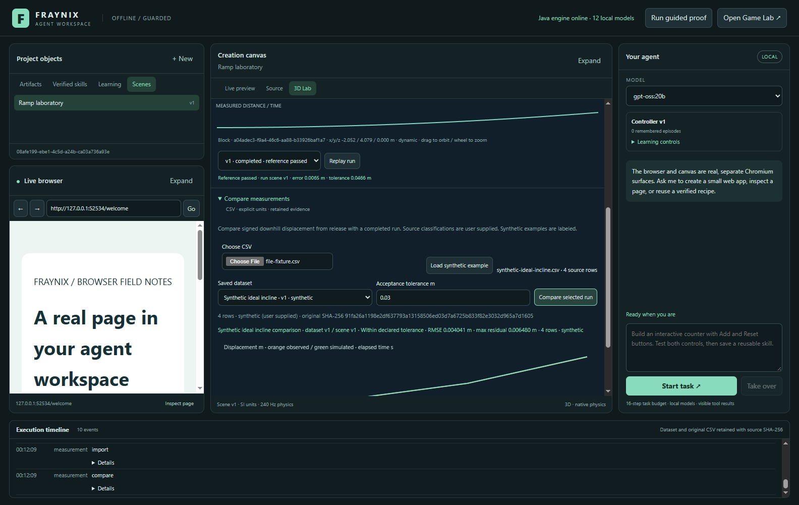
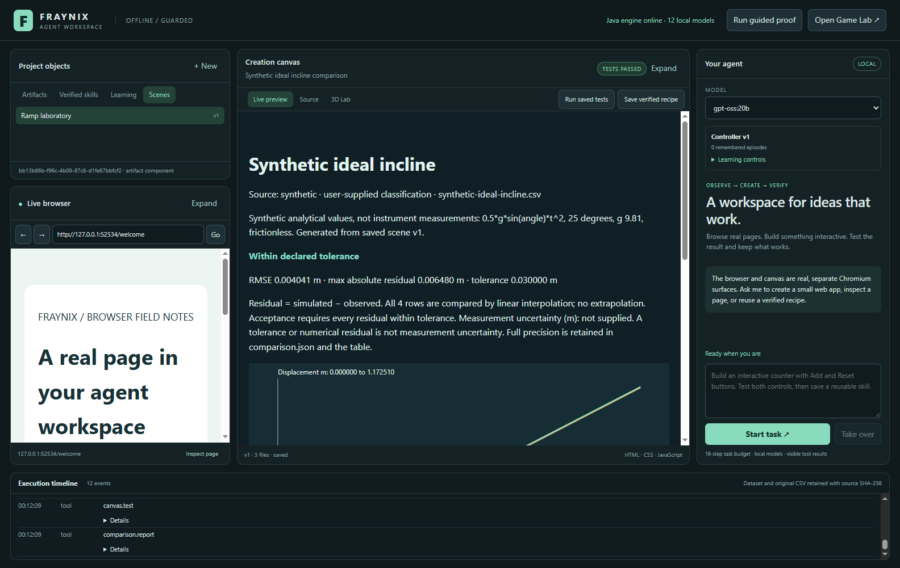
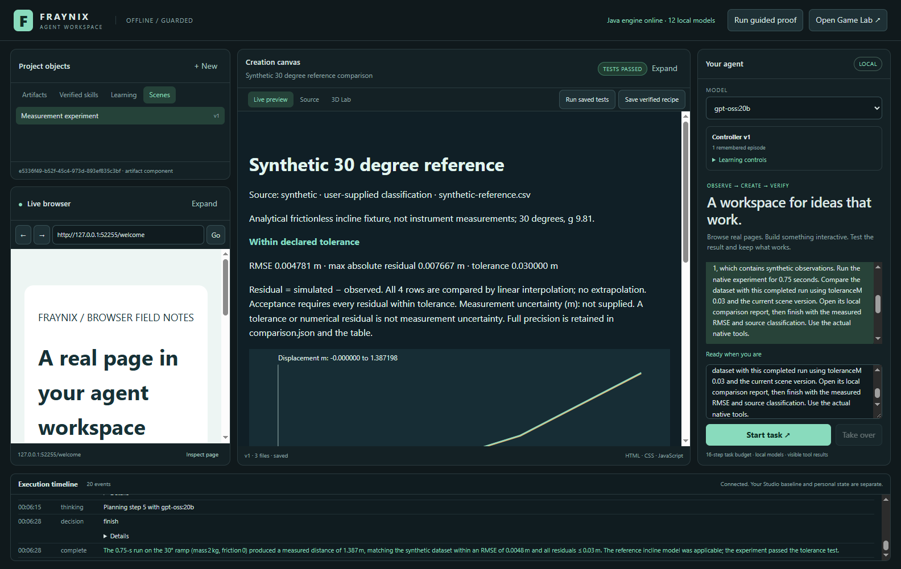
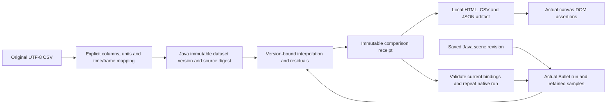

# Fraynix Agent Workspace · 011 · Measurements, native comparisons and local reports

October 30, 2026 · Windows x64 · implementation `cbf37f1`

**Import an actual CSV file, declare its meaning, compare every usable row with a saved native experiment, and retain a report that can be reopened and rerun.** The existing Java-owned world, live browser, creation canvas, model panel and evidence timeline remain the foundation.

[Entry README](README.md) · [Offline interactive explorer](docs/readmes/011/index.html) · [Verification](docs/readmes/011/verification.json) · [Source tree](docs/readmes/011/FILE_TREE.md) · [Obsidian map](docs/obsidian/measurement-pipeline.canvas) · [Previous native lab](README-010.md)

## What this edition delivers

The native ramp laboratory now accepts external measurement files. Java stores the original UTF-8 CSV, a SHA-256 digest, explicit column and unit mappings, collection notes, source classification, missing-row policy and normalized samples. Importing another version preserves the old source and mapping rather than overwriting the evidence behind an earlier result.

A comparison refers to one exact dataset version, scene revision and completed native run. It interpolates the retained simulated displacement samples at each observed timestamp, computes signed residuals, RMSE, mean error, mean absolute error and maximum absolute error, and applies a declared acceptance tolerance. Results remain inspectable after restart. A later edit cannot borrow an old run to certify new parameters.

The local report is a real saved artifact. It includes a chart, readable metrics, source classification, point table, hashes and run identifiers. Its files include the original CSV and full-precision comparison JSON. The host opens it in the existing canvas and checks three real DOM assertions. Report rendering and numerical agreement are separate checks: an accurate report can correctly say the observations fall outside the declared tolerance.

**Repeat experiment & compare** reuses a saved binding after restart and runs native Bullet again. It creates a fresh experiment ID and comparison receipt, retaining the previous evidence. This is a functioning bounded workflow. General pipeline graphs, arbitrary code workers and automatic physical-policy training remain later milestones.



Actual isolated application capture, October 30. The supplied example is explicitly synthetic. A second test exercises the real file chooser with UTF-8 BOM, CRLF and quoted-column data. These images are application exports composed from the actual shell and child Chromium surfaces, not mockups or instrument-measurement claims.

## Review it step by step

1. Run **Launch-Agent-Workspace.bat** with JDK 21 and Node.js installed. Existing dependency caches are checked before replacement is considered. Ollama must already contain an eligible local model for agent tasks; manual physics and measurement operations do not require model inference.
2. Open **3D Lab** in the center creation canvas. Open or create a saved ramp scene. Keep friction zero for the first analytical reference exercise.
3. Click **Test reference**. It runs 0.75 simulated seconds using native Bullet and records the exact scene definition and samples. The analytical reference check is distinct from a later comparison with an imported dataset.
4. Expand **Compare measurements**. Choose a UTF-8 CSV or click **Load synthetic example**. Loading a file does not silently import it or infer its units.
5. Select the time and distance columns, units, source classification and collection notes. Confirm the time offset, distance origin, downhill direction and missing-row policy. Optional measurement uncertainty is entered separately in metres.
6. Click **Import dataset**. The original source and normalized version are retained. A source labeled measured remains a user-supplied classification; the application cannot establish how an instrument was calibrated from that label alone.
7. Select the saved dataset and completed experiment. Declare a tolerance in metres, then click **Compare selected run**. Read the residual metrics and chart. An uncovered timestamp, stale binding or ambiguous mapping produces an explicit error.
8. Click **Open local report**. The existing canvas displays the saved report. Open **Source** to inspect `index.html`, `comparison.json` and `measurements.csv`. The displayed metrics are rounded for readability; JSON and the table retain full numerical precision.
9. Close and reopen the application. Select the retained comparison to view its evidence or generate another report. Click **Repeat experiment & compare** to produce a new native run and comparison using the still-current saved binding.
10. Change and save a scene parameter or import a new dataset version. Historical receipts remain readable. Repeating an outdated binding is rejected before starting another experiment; explicitly choose the new versions and compare them instead.

The long measurement form scrolls within the existing scene surface. Scene controls retain their height, the canvas can still expand, and controls show a busy state while an operation settles. Returning to web artifacts preserves the browser, source editing, tests and existing recipe library.

## CSV meaning and validation

The importer accepts a header plus two to 2,048 usable data records, up to 32 columns and 256 KiB of valid UTF-8 source. Quoted commas, embedded newlines, escaped quotes, BOM and CRLF are supported. Headers must be unique and nonempty; selected time and distance columns must be distinct. Cells are data and never execute as code.

Time units must be seconds or milliseconds. Distance units must be metres, centimetres or millimetres. The current physical meaning is signed downhill displacement from release, rather than arbitrary world X/Y/Z coordinates. A source measuring another quantity needs an explicit transformation before it can be compared under this contract.

```text
timeS = sourceTime * declaredTimeScale + timeOffsetS
distanceM = (sourceDistance - distanceOrigin) * declaredDistanceScale * direction
direction = +1 or -1
```

Mapped timestamps must be finite, nonnegative and strictly increasing. Duplicate or reversed time, malformed numbers, infinities, mismatched column counts and broken CSV quoting are rejected. The missing-value policy is explicit: reject an empty selected cell, or skip that logical CSV record and retain its record number. Skipping missing cells does not permit malformed numeric text. At least two usable measurements must remain.

No automatic time fitting, axis guessing, sensor calibration or unit inference is hidden behind import. The visible defaults mean zero time offset, zero distance origin and increasing downhill distance; the saved mapping records those choices. Notes and filenames are escaped when rendered, and imported text cannot install tools or change permissions.

## Binding, interpolation and acceptance

The comparator uses completed saved experiments, not a changing viewport snapshot. Dataset ID/version, immutable dataset-version ID, original-source digest, mapping digest, scene ID/revision, run ID, backend and timestep are retained together. The copied scene definition makes the conditions inspectable even after later authored edits.

Each observed timestamp must fall inside recorded run coverage. There is no extrapolation, automatic truncation to a favorable interval or silent row removal. Linear interpolation between adjacent retained native samples supplies simulated displacement. When the final native tick is not already in the regular sampling cadence, its recorded final sample supplies the interval endpoint.

```text
residual[i] = simulated[i] - observed[i]
RMSE = sqrt(sum(residual[i]^2) / count)
meanResidual = sum(residual[i]) / count
MAE = sum(abs(residual[i])) / count
acceptance = every abs(residual[i]) <= declared toleranceM
```

The acceptance criterion uses the maximum absolute residual, so a small average cannot hide one large discrepancy. The report states the criterion and tolerance. Agreement is evidence under these conditions, not proof of general causation or scientific calibration. Measurement uncertainty is optional source information; numerical discrepancy and the chosen acceptance threshold are not uncertainty estimates.

Seven measurement Java tests cover validation, normalization, immutable source versions, persistence, independent residual arithmetic, interpolation, stale or uncovered bindings, safe report rendering and actual repeated native runs. Integration tests independently recompute results from the retained native samples instead of trusting a green badge alone.



## Local model integration and honest outcomes

The registered actions now include `dataset.import`, `dataset.read`, `experiment.compare` and `comparison.report`, alongside the existing native scene and experiment actions. A physical comparison request receives a bounded tool set. Ordinary CSV web-application creation stays in artifact mode rather than being redirected into physics merely because the request contains “CSV.”

The actual local `gpt-oss:20b` acceptance task uses an already imported synthetic trajectory, creates a requested scene, runs 180 native ticks, compares the dataset and opens the tested report. Independent checks verify requested parameters, exact binding, classification, native sample interpolation, RMSE, report files and DOM assertions. The retained evidence includes the freshly admitted model digest.

The first trial is preserved: the model invented a one-metre ramp width and changed requested depth from 0.5 m to 0.1 m. It completed the comparison/report workflow but failed the user's requested-parameter check. Physical guidance now tells the model to send requested parameters and preserve host defaults for unspecified fields. The later acceptance result is checked separately; it is never inferred from that failed trial.

The passing model case records RMSE **0.004781307 m**, maximum absolute residual **0.007666654 m** and declared tolerance **0.03 m** across four synthetic observations. A single task is evidence for that bounded workflow, not a broad autonomous-success rate. Its physical episode remains `completed-unverified` under the existing artifact-oriented learning contract. The report has its own passing DOM receipt and the comparison has its own numerical evaluation. No Ollama weights or physical policy are trained by importing these data.



## Offline mode and startup recovery

```powershell
# Initial preparation may require downloads if dependencies are not cached.
.\scripts\Start-Agent-Workspace.ps1 -PrepareOnly
# Require cached dependencies and guard external browser requests:
.\scripts\Start-Agent-Workspace.ps1 -Offline
# Equivalent BAT argument forwarding:
.\Launch-Agent-Workspace.bat -Offline
```

Offline preparation uses Gradle's offline resolution and refuses a missing dependency cache rather than silently downloading packages. The desktop cache verifier checks installed package versions and lock metadata, essential entry points, and Electron executable presence/version. It does not claim to hash every installed dependency file. A missing launcher stamp no longer causes replacement of an otherwise validated cache. If replacement is necessary and this installation is in use, setup stops before attempting removal.

The application's offline browser policy permits loopback pages and blocks external navigation and subresource requests. Tests exercise both a direct external URL and an external image requested by a local page. Artifact previews already have their own restricted content policy. Each model turn also rechecks local service metadata, rejects remote model proxies and redirects, records a weight digest, and rejects a changed digest during the task.

This is application-level enforcement. It is not an OS-wide network sandbox and does not control the shared Ollama process or unrelated applications. The tests ran on a network-connected Windows host with the application's guards enabled; they do not establish a physically disconnected or firewall-isolated machine. Initial setup, optional online browsing and future providers have separate requirements. Docker and WSL are unnecessary for this fixed local workflow.

After the interrupted session, the working stylesheet contained 11,473 NUL bytes. A source scan found no other affected tracked/source text file. The committed theme was restored, new styles were moved to `measurement.css`, and a startup guard now rejects empty, NUL-containing or invalid UTF-8 renderer sources before loading them. The integration suite checks that the actual grid layout loads, preventing functional controls in an unstyled window from being mistaken for a complete UI pass.

## Ownership and architecture



`MeasurementStore` registers dataset-head, immutable-version and comparison schemas in its own FactoryWorld checkpoint under `measurements/data.fworld`. Java owns validation, normalization, metrics and persistence. `SceneStore` continues to own authored scenes and native experiment records. These checkpoints are separate; this edition does not claim cross-domain atomic transactions or a durable general-purpose job graph.

The Electron shell exposes explicit IPC operations, invokes the private loopback API and renders source-safe previews. Browser and canvas content do not receive the privileged bridge or bearer token. The model can select installed actions; it cannot install handlers or turn a stored recipe into a new privilege. Source files, weights, personal projects and shared services stay in their existing locations.

The repository is the existing **eyeoverthink/Fraynix-Agent-Workspace**. Chandra remains reference material for selective future abstractions; this app is not moved into Chandra/React. The original Studio remains a separate application. The publication preserves editions 001–010 and their frozen hashes, with this edition carrying new implementation evidence and forecasts.

## Verification and next gates

The release records **114 Java tests**, **12 desktop tests**, **10 measurement integration checks**, **12 existing 3D checks**, **12 browser/artifact integration checks**, **9 learning checks** and **45/45 broader checks**. See the [verification record](docs/readmes/011/verification.json), [actual model case](docs/readmes/011/live-measurement.json), [failed first trial](docs/readmes/011/live-measurement-first-trial.json) and [canonical inventory](docs/readmes/011/file-inventory.json). The clean-checkout and documentation viewer gates are recorded separately.

```powershell
.\gradlew.bat check installDist :workspace-engine:installDist --offline
cd workspace-desktop
npm.cmd test
npm.cmd run test:scene
npm.cmd run test:measurement
npm.cmd run test:integration
npm.cmd run test:learning
npm.cmd run test:broader
$env:FRAYNIX_LIVE_MODEL='gpt-oss:20b'
npm.cmd run test:live-measurement
```

Next add broader measured-data examples with declared sensor provenance, separate fitting/evaluation trajectories and better uncertainty handling. Document/PDF/OCR ingestion should preserve page/span evidence before optional semantic retrieval. Then extend fixed workflows into durable jobs with explicit cancellation and unknown-effect reconciliation. Compiler backends and arbitrary native execution still require their own toolchain and OS-isolation gates. Physical learning needs varied task families and withheld evaluations before promotion.

Those are future gates, not additional working tabs. The delivered loop already connects an imported file to native motion, independently checked discrepancies, a visible report and a reproducible repeat after restart. Further development should extend that evidence chain while retaining the current design and existing tested workflows.
