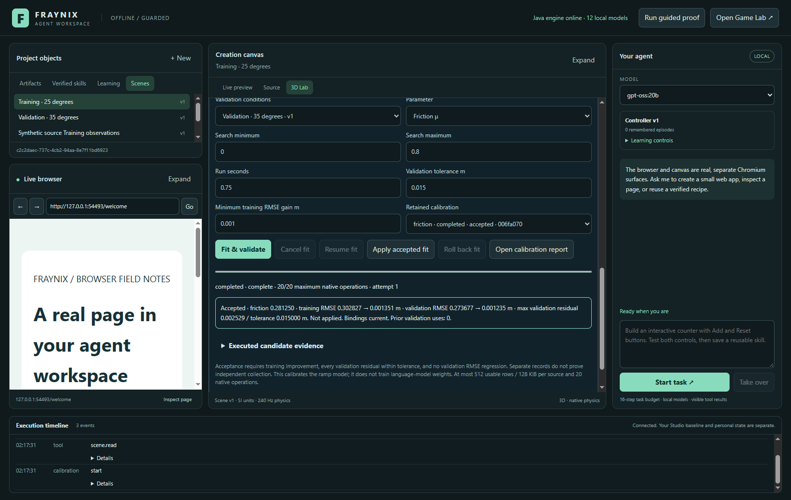
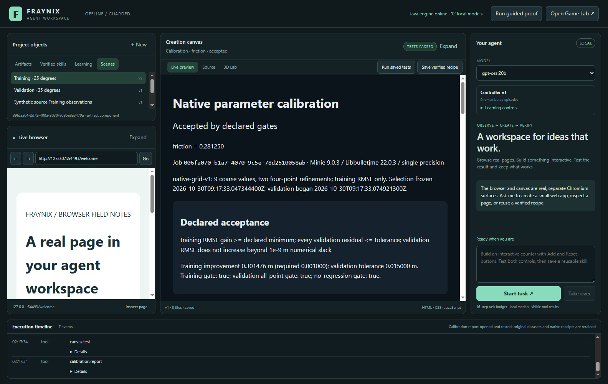
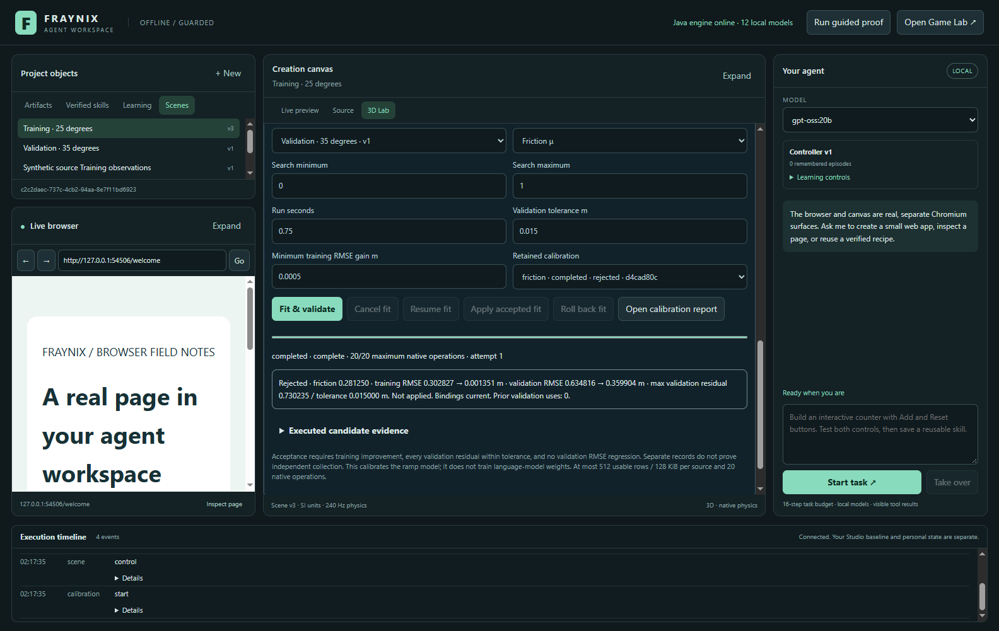
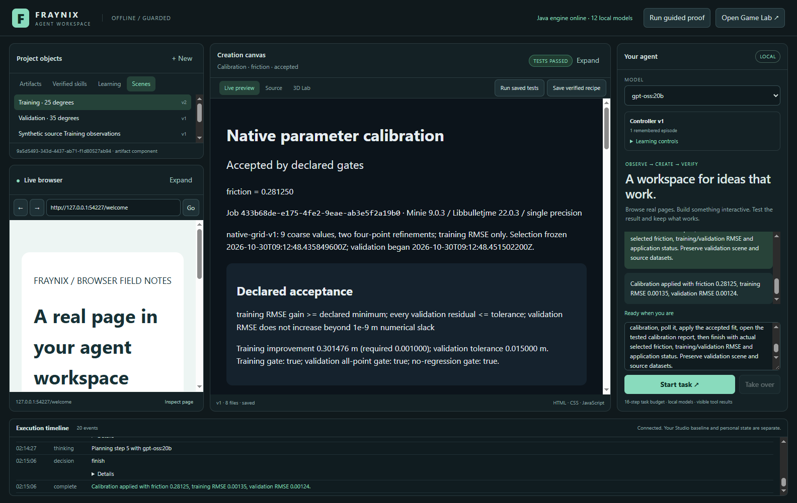

# Fraynix Agent Workspace · 012

## Observations can now improve the physical model

October 30, 2026. This edition continues the existing Java application, its local browser, creation canvas, source editor, agent and native 3D lab. It adds a complete physical calibration loop: select observations, run candidate parameters through native Bullet, select using training error, evaluate separate validation data, inspect a report, then apply or roll back an accepted change.

The user’s direction is a local environment in which an agent can observe state, act through real tools, see the consequences, preserve experience and improve against evidence. A game engine supplies object identity, spatial state, components and a clock. Java supplies the persistent host and typed execution boundaries. Browser and canvas surfaces extend that environment into ordinary information work and live creation. The new calibration workflow connects observations to a measurable change in that shared environment.

This is physical parameter fitting. It does not change Ollama weights or train a general game-playing policy. A successful synthetic experiment shows that the implementation works under recorded conditions; instrument validation requires real observations, collection provenance and independently chosen evaluation cases.

**Navigate:** [Current entry point](README.md) · [Previous edition 011](README-011.md) · [All editions](docs/readmes/INDEX.md) · [Offline interactive explorer](docs/readmes/012/index.html) · [Verification](docs/readmes/012/verification.json) · [Source inventory](docs/readmes/012/FILE_TREE.md) · [Obsidian map](docs/obsidian/native-calibration.canvas)

## What was already working

The baseline was 2d793c2. Edition 011 already delivered immutable original CSV sources, explicit units and coordinate mappings, dataset revisions, saved native runs, independently checked residuals, tested local reports and repeat after restart. Earlier releases supplied the real browser and canvas, versioned runnable artifacts, tested reusable recipes, durable learning episodes and bounded controller promotion/rollback.

The native lab uses Minie 9.0.3 and Libbulletjme 22.0.3. Java owns the scene and fixed 1/240-second physics steps; Three.js displays actual native poses. Authored objects have stable IDs and scene revisions. Saved experiment definitions and results remain readable after later edits. Those foundations are retained. The original Studio and private runtime projects remain separate, and Chandra remains a reference application rather than the publication destination.

The next gap in the written roadmap was separate fitting and evaluation. Comparing data with an unchanged model could expose disagreement but could not propose an evidence-backed parameter correction. This edition closes that bounded gap rather than adding another demonstration page.

## Review the working flow

1. Launch with **Launch-Agent-Workspace.bat**. JDK 21 and Node are required; Docker and WSL are not. Prepare dependencies once before using the cached offline launch option. The agent uses an installed local Ollama model.
2. Open **3D Lab** and save the scene whose parameter should be fitted. Keep the scene’s angle, mass, geometry, initial placement and units consistent with the observations.
3. Expand **Compare measurements** to import training and validation CSVs. Declare time/distance columns and units, source classification, collection notes and any explicit origin/time mapping. CSV values and notes are data, not executable instructions.
4. Save a validation scene describing its experimental conditions. A different ramp angle can test transfer to another condition. Use genuinely separate observations; duplicating or renaming a training file is rejected.
5. Expand **Fit & validate**. The currently open scene is the training scene. Select the two datasets, validation scene, one parameter, search bounds, run duration, validation tolerance and minimum training improvement.
6. Click **Fit & validate**. The panel shows actual completed native operations, attempt count and phase. Expand candidate evidence to inspect each parameter, measured training RMSE and native run ID. Fitting runs in separate worlds and leaves the viewed authored scene unchanged.
7. Read the result. **Accepted** requires all declared gates. **Rejected** is retained evidence and cannot be applied. Open the local report to inspect curves, sources, metrics, criteria and native IDs.
8. **Apply accepted fit** changes only the training scene’s selected parameter as a new revision, with an atomic receipt. Validation conditions and source data remain unchanged. **Roll back fit** restores the previous value as another revision if no intervening scene edit occurred.
9. Reopen the app to inspect retained jobs, reports and receipts. Cancelled or interrupted jobs require an explicit **Resume fit**. Completed native operations are reused only when their frozen definition, duration and backend match.

Actual October 30 application capture in an isolated test project. The observations are explicitly synthetic. The panel shows completed native work, a selected friction value, both error changes and application availability.

## How selection and validation work

Choose either block friction or gravity, one at a time. Jointly fitting gravity and friction to one ramp trajectory can confound their effects. The search begins with nine evenly spaced values across the declared bounds, followed by two bounded refinement rounds around the best executed training candidate. Boundary duplicates are skipped. At most seventeen candidate trials run, plus a training baseline and two validation runs: twenty native operations.

Every candidate constructs a real Bullet world and executes the requested fixed ticks. The comparison uses retained native displacement samples at the observation timestamps, with linear interpolation where needed and no extrapolation. RMSE is the square root of the mean squared simulated-minus-observed residual. MAE, signed bias, maximum absolute residual and point-by-point values are retained too.

The lowest executed **training RMSE** selects the winner. Exact ties prefer the value nearest the existing parameter. The selected value and native run ID are checkpointed before validation scoring begins. Validation never chooses a different winner or changes search bounds. A finite grid and refinement search is an approximation; it does not promise a global optimum or a statistically identified material parameter.

Acceptance requires all three conditions:

- Training baseline RMSE minus fitted training RMSE meets the declared positive minimum.
- Every absolute validation residual is within the declared tolerance.
- Fitted validation RMSE does not exceed validation baseline RMSE, allowing only 1e-9 m numerical comparison slack.

Declared tolerance is an acceptance choice, not measured uncertainty. Native single-precision numerical differences are not a confidence interval. Source labels such as measured, synthetic or unverified remain user supplied.

Training and validation must use different dataset identities and different normalized observations. Shared observation records beyond a common exact zero origin are rejected. Duplicate detection rounds identity keys to twelve decimal places; the evaluator still uses the full imported values. Stationary observations, uncovered times, invalid bounds and stale versions are rejected before trial creation. The job records prior known uses of validation observations; different IDs alone cannot prove independent collection or an untouched holdout.

## Actual measured outcomes

The acceptance fixture generated observations in separate native worlds at 25° and 35° with known friction 0.28, then fitted scenes authored with friction zero. The search selected **0.28125**. Training RMSE changed from **0.302827190 m** to **0.001351358 m**. Separate validation RMSE changed from **0.273676764 m** to **0.001235496 m**, with maximum residual **0.002528772 m** against a declared 0.015 m tolerance.

Another validation source used friction 0.65. The training search retained the same selected value and rejected validation. That check matters: a system that quietly retunes against its validation observations can make a report look better while losing a useful independent evaluation boundary.

The first local-model trial repeated Start/Read until its task budget expired; seven completed search jobs did not count as a completed user task. That failure is [retained](docs/readmes/012/live-calibration-first-trial.json). The corrected host offers only lifecycle-appropriate actions, prevents a second Start within the owned task and preserves explicit no-apply intent.

The corrected actual local **gpt-oss:20b** task preserved the requested IDs, versions, bounds, duration and criteria; started one job; inspected completion; applied the accepted fit; opened the host-rendered report; and finished with measured results. Independent checks recomputed every candidate’s training RMSE from saved native samples and checked scene revisions, source hashes and the report receipt. Model digest and evidence are recorded in [the live acceptance record](docs/readmes/012/live-calibration.json).

The report is a saved HTML/CSV/JSON artifact in the existing canvas. Two SVG plots compare observed, baseline and fitted values. Source titles and notes are escaped; the report has no scripts or remote dependencies. Exact evaluated points remain in JSON even when drawing paths are downsampled. Three DOM assertions check the verdict, both plots and executed trial rows.

This is a real failed gate retained by the same workflow, not a simulated error badge. Apply is unavailable.

## Durable work and guarded changes

Jobs persist their frozen scenes, dataset versions and hashes, criteria, candidate values, completed native operations, selection, evaluation and application intents. A background worker permits one calibration at a time. Each attempt has a sixty-second wall-time budget; cancellation is checked every native tick. Each run is bounded to 0.05–10 simulated seconds. Calibration sources are explicitly limited to 3–512 usable rows and 128 KiB each. The existing general CSV importer retains its larger 2048-row/256-KiB limit.

Native trial results live in the scene checkpoint, while job progress lives in its own calibration checkpoint. If a crash loses progress after a trial completed, explicit resume finds the matching logical operation and reuses its real completed result. An interrupted native trial is not called completed. Jobs interrupted during application startup are marked interrupted and await human or agent resume.

Applying a fit requires a completed accepted evaluation and still-current training/validation dataset and scene bindings. The host writes an application intent first, then commits the training scene and its unique application receipt together in the scene transaction. Reopening reconciles that receipt if the acknowledgement was lost. Repeating Apply does not create another scene revision. Rollback also uses a unique receipt and refuses to overwrite a later authored change.

Calibration trials are labeled **CALIBRATION OVERRIDE** in run history. Their copied definition includes the actual tested parameter. An ordinary measurement comparison cannot treat an override trial as if it used an unchanged authored scene merely because its scene ID/version matches. Use the calibration report, or apply the fit and run the new authored revision.

This is a durable calibration workflow with a narrow cross-checkpoint receipt protocol, not a general transactional job graph. There is no arbitrary generated C/Go execution, hidden shell runner or general sensor model.

## Architecture in the existing application

~~~mermaid
flowchart LR
    CSV[Versioned observations and provenance] --> Fit[Java calibration worker]
    Scene[Saved training and validation scenes] --> Fit
    Fit --> Native[Separate native Bullet worlds]
    Native --> Trials[Executed training metrics]
    Trials --> Frozen[Durable training-only selection]
    Frozen --> Validation[Separate validation scoring]
    Validation --> Gates[Declared acceptance gates]
    Gates --> Report[HTML CSV JSON report and DOM receipt]
    Gates --> Apply[Guarded atomic scene and receipt]
    Apply --> Rollback[Version-checked rollback]
    Agent[Local Ollama typed actions] --> Fit
    Agent --> Report
~~~

| Component | Responsibility | Source |
| --- | --- | --- |
| CalibrationStore | Frozen inputs, native search, lifecycle, selection, gates and apply protocol | [Java store](workspace-engine/src/main/java/fraymus/workspace/CalibrationStore.java) |
| SceneStore | Authored entities, native trial records and atomic application receipts | [Scene execution](workspace-engine/src/main/java/fraymus/workspace/SceneStore.java) |
| MeasurementEvaluation | Shared numerical residual/interpolation evaluation without fitting logic | [Evaluator](workspace-engine/src/main/java/fraymus/workspace/MeasurementEvaluation.java) |
| CalibrationReport | Escaped portable report with original sources and point evidence | [Host report](workspace-engine/src/main/java/fraymus/workspace/CalibrationReport.java) |
| Existing desktop | Native tool dispatch, task completion guards, panel and canvas | [Main process](workspace-desktop/main.cjs), [panel](workspace-desktop/renderer/calibration-panel.js) |
| Independent checks | Native arithmetic, lifecycle/recovery and real visible workflow | [Java checks](workspace-engine/src/test/java/fraymus/workspace/CalibrationStoreTest.java), [desktop checks](workspace-desktop/test/calibration-integration.cjs) |

The agent has typed calibration start/read/cancel/resume/apply/rollback/report handlers. Calibration task routing offers a scoped subset and requires a completed job and tested report before Finish. An apply request additionally needs an actual application receipt when accepted. Human takeover cancels only the job owned by that agent task. The current chat path guides a new fit through its lifecycle; use the panel for selecting historical jobs and rollback. Generic CSV application creation retains the web-artifact path.

Actual local Ollama task in an isolated project. A completed report is independently tested; physical episodes remain completed-unverified in the artifact-oriented learning ledger. That ledger does not reinterpret a fitting result as trained language-model weights.

## Validation and reproducibility

Current evidence: **123 Java tests**, **13 desktop unit tests**, **8 calibration integration checks**, **10 measurement checks**, **12 native 3D checks**, **12 browser/artifact checks**, **9 learning checks**, and **45 broader release checks**. The local-model acceptance adds six independent assertions. Full scope, source hashes, platform and clean-checkout checks appear in [verification](docs/readmes/012/verification.json).

The Java checks cover fitting both supported parameters, arithmetic independently summed from native samples, validation isolation, failed-gate rejection, no-effect input rejection, changed dataset/scene guards, stable entity IDs, idempotent apply/rollback, cancellation/resume, lost-progress recovery without duplicate completed runs, escaped source text and lost-acknowledgement reconciliation. The desktop checks operate actual controls, reports and restart; they do not merely call a mock response.

Run these from the repository:

~~~powershell
.\gradlew.bat check installDist :workspace-engine:installDist --offline
cd workspace-desktop
npm.cmd test
npm.cmd run test:calibration
npm.cmd run test:measurement
npm.cmd run test:scene
npm.cmd run test:integration
npm.cmd run test:learning
npm.cmd run test:broader
# Optional installed local model:
npm.cmd run test:live-calibration
~~~

The offline profile restricts application browser requests and checks fresh local-model metadata. It is not OS-wide isolation or a policy imposed on the shared Ollama process. No personal runtime data, credentials or model weights are included in the repository. Dependency caches must already exist for an offline build.

## What comes next

The next useful gate is real collected data: document apparatus, units, timing, coordinate transforms, uncertainty and collection separation, then predeclare a calibration range and validation criterion before running the fit. If the bounded ramp cannot represent the apparatus, report that model mismatch instead of increasing tolerance until it passes.

Next, connect document/OCR imports to source digest, page and span evidence so a reported measurement can be traced to its source. Add local retrieval only over persisted, inspectable evidence. Broader durable creation jobs should reuse the tested lifecycle and effect-receipt patterns while defining their own execution contracts.

For physical learning, add tick/entity/action-linked experience, new task families and withheld evaluation conditions. A fitted friction coefficient can improve a simulation, but a planner or player needs its own outcomes and regression gates. Expand authoring and the Game Lab bridge through those contracts. General shapes, arbitrary meshes and scientific solvers remain future work.

Target-language generation remains a separate pipeline: reviewed typed specification → intermediate representation → Java/C/Go generator → recorded toolchain → isolated execution → independent behavior tests. Java is a capable host, but it does not automatically turn source text into safe, equivalent executable programs.

The value of the platform is the connected evidence loop: observe, act, execute, inspect and retain what actually happened. This edition adds a complete, bounded improvement mechanism to that loop. Future claims should continue to follow executed outcomes, not precede them.
