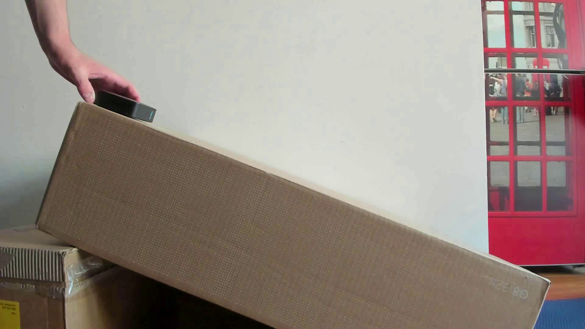
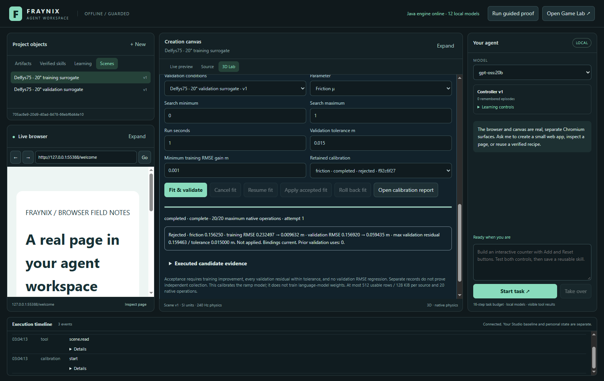
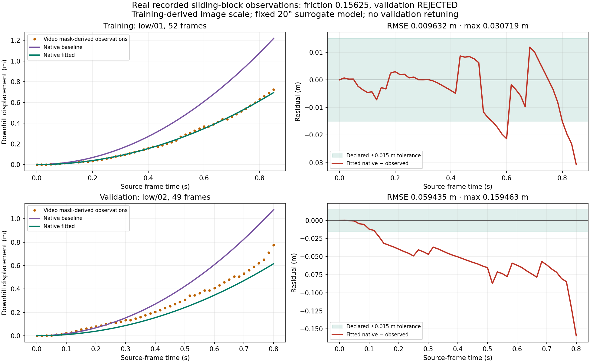
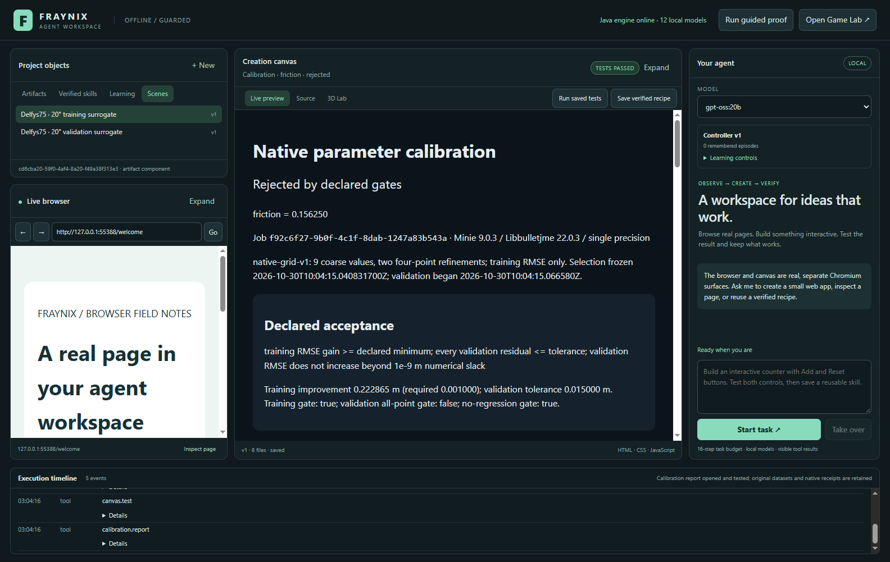

# Fraynix Agent Workspace · 013

## Real observations, an honest rejection, and the next observer layer

October 30, 2026. This edition answers two connected requests: move the calibration workflow onto real recorded data and assess the downloaded XGEN-JING model for the next stage of the application. It delivers a reproducible observation-preparation script, a real-data acceptance harness, retained numerical evidence and a source/weight/interface assessment. The existing app, Java engine, layout and private projects are preserved.

The real-data workflow completed successfully, while the fitted parameter **failed validation**. Those are separate outcomes. JING was reviewed statically; its weights were not installed and no JING video was generated. The first-person observer and generated audiovisual backend described below remain planned. No empty application page or inactive model action has been added to stand in for them.

**Navigate:** [Current entry point](README.md) · [Calibration implementation 012](README-012.md) · [Edition history](docs/readmes/INDEX.md) · [Interactive offline explorer](docs/readmes/013/index.html) · [Execution evidence](docs/readmes/013/verification.json) · [Real-data methods](docs/datasets/delfys75-013/README.md) · [JING assessment](docs/XGEN_JING_ASSESSMENT.md) · [Source inventory](docs/readmes/013/FILE_TREE.md) · [Obsidian map](docs/obsidian/real-observations-and-observers.canvas)

## Where we started

The current native engine already runs a bounded Bullet ramp/block experiment, persists scene revisions and native trajectories, imports CSVs with explicit units/source mappings, fits one physical parameter and evaluates separate validation observations. Edition 012 verified that loop with synthetic data. It also supplied cancellation/resume, matching completed-operation reuse, guarded apply/rollback and tested local reports.

The next scientific question was whether real observations agreed with the same model under declared criteria. A second request supplied XGEN-JING, a system for action-conditioned first-person video/audio. We investigated both without merging an external runtime into Java or changing the preserved browser/library, canvas/source/3D lab, agent and timeline layout.

Implementation baseline: **5fb652b**. The new preparation/replay source is **177e4a0**. This edition changes research tooling, reproducible case data, provenance text wrapping in the report and documentation; it does not claim a new native solver or newly trained model.

## What the real data are

We selected two recordings from [Delfys75 / Physical Parameter Prediction](https://www.kaggle.com/datasets/jaswar/physical-parameter-prediction), version 11, linked by the authors of *Learning Physics From Video*, CVPR 2025. The dataset includes real sliding-block videos and estimated segmentation masks. The published low-angle setting and travel scale provide the case's physical context. [Author methods](https://arxiv.org/html/2410.01376v2#A6).

The fixed selection was low/01 for training and low/02 for validation. These are separate recordings, not two random row subsets of one trajectory. The observations comprise **52 training frames and 49 validation frames**, sampled at 60 fps.

Actual dataset frame, not a generated scene or our native simulation. The dataset listing reports MIT; the associated paper has its own publication license. Raw source files stay in ignored build storage and can be retrieved using the pinned script. Committed data include numerical observations, exact source hashes and disclosed transformations.

Segmentation masks are estimated from real video. Their centroids are not raw position-sensor readings. Calling the app's source classification “measured” does not remove that uncertainty; the report's source notes preserve this qualification and the video/mask digests.

## How pixels became observations

The preparation script thresholds each author-provided mask, verifies a usable dominant component and computes its centroid. An independent full-mask centroid check agrees when only one foreground component exists. Missing/ambiguous masks cause failure. The script does not smooth positions, fill gaps, silently drop rows or fabricate replacement data.

Training first-to-last motion defines the image-plane downhill direction. The paper's reported 0.726 m travel supplies a constant pixel-to-metre scale. That transform, dataset selection and numerical criteria are frozen before validation centroids are processed. Validation receives the same training-derived direction and scale, with its own first-frame spatial origin.

Time is the source frame number divided by 60. We do not fit a release-time shift or initial velocity correction. The validation endpoint under the unchanged mapping is approximately **0.775559 m**; it is not forced to equal the training endpoint.

This is an approximate camera-plane transformation. Perspective, camera consistency and source clipping/release timing remain unresolved. The training endpoint constrains its own scale, so it cannot also serve as independent proof that this scale is correct. The [methods and provenance](docs/datasets/delfys75-013/README.md) preserve these limitations.

The downloadable processor pins all five source-file hashes, reproduces both CSVs byte-for-byte and supports offline use after its initial fetch. A corrupted-source check fails before observation outputs are created. Existing conflicting files are preserved. Python, numpy and OpenCV are needed for this preparation step; the Java app imports the resulting CSVs without those Python dependencies.

## What the native experiment actually did

We used a nominal 20° incline, gravity 9.81 m/s² and friction zero as baseline. Friction search bounds were **0..1**, duration **1 second / 240 native ticks**, minimum training RMSE gain **0.001 m**, and validation tolerance **0.015 m**. These criteria were not changed after seeing validation.

The engine's 12 m ramp, 0.5 m cube and 1 kg mass are surrogate assumptions, not measured dimensions or mass of the filmed apparatus. This is a bounded downhill trajectory comparison, not a complete reconstruction of that apparatus.

Every candidate executed a separate real native Bullet world. Training alone selected friction **0.15625** from seventeen candidates; the job completed twenty total native operations. The selected value was durable before validation scoring began. All candidate RMSE values were independently recomputed from retained native samples and observation timestamps.

| Metric | Baseline | Fitted |
| --- | ---: | ---: |
| Training RMSE · 52 observations | 0.232497 m | 0.009632 m |
| Validation RMSE · 49 observations | 0.156920 m | 0.059435 m |
| Maximum validation absolute residual | 0.340718 m | 0.159463 m |

Training improvement passed. Validation RMSE improved, so the nonregression gate passed. The all-point validation gate **failed**: 0.159463 m is greater than the declared 0.015 m tolerance.

**Verdict: rejected.** Apply was disabled and its server operation rejected the request. Both authored scenes stayed at version 1. No parameter was promoted to a user project, and no model weights were trained.

Actual isolated application run. The rejected result and disabled Apply action are part of the delivered behavior, not a mocked failure badge.

## What the result tells us

The existing software can retain real observations, execute a native search, calculate residuals, expose a genuine failed gate and preserve the original scene. The numerical improvement shows that the friction parameter explains some trajectory difference. It does not establish that 0.15625 is a reliable material property or that the surrogate is an accurate physical twin.

Computed scientific figure, not an application screenshot. Orange points are real-video-derived observations; purple and green curves are retained native baseline/fitted values. Residual panels show the declared ±0.015 m band. [Exportable PDF](docs/readmes/013/real-data-curves.pdf).

Further experiments should isolate camera calibration, perspective, release conditions, timing and geometry. We cannot identify the cause of disagreement from this pair alone. Increasing tolerance or rescaling/delaying validation after inspecting the result would undermine this evaluation.

These two recordings are now observed development/regression cases. Later work must use fresh evaluation recordings before claiming generalization. Separate files are useful, but do not prove independent collection or an untouched scientific holdout.

## Inspect and reproduce the app-side report

The report remains a real artifact in the existing canvas, with original CSVs, point-by-point comparisons, criteria, native run IDs and source notes. The same report action used by the agent executes three actual DOM assertions. The numerical workflow passed nine provenance, import, arithmetic, guard and visible-UI checks while retaining its failed fit verdict.

Start with the ordinary launcher and installed prerequisites. Docker and WSL are not required. To run the isolated case:

~~~powershell
cd workspace-desktop
npm.cmd run test:real-data
~~~

To reproduce extraction from the pinned recordings:

~~~powershell
python scripts/Prepare-Delfys75.py --output build/delfys75-case
# Reuse the verified raw cache afterward:
python scripts/Prepare-Delfys75.py --output build/delfys75-case --offline
~~~

The case files are [here](docs/datasets/delfys75-013/README.md). Preparation refuses a different existing source/output instead of silently replacing it. No synthetic fallback is available.

## What we found in the JING download

The user's XGEN-JING ZIP passes archive integrity checking. It is about 9.6 MB and contains code/examples/assets, with no bundled weight files. Seven critical files match pinned upstream commit **41c41ae9a1dbe5213e8733bbebeaebe297afa7a7**. Inventory: 44 text files, 7,294 lines; that is not a claim of a complete line-by-line audit.

The reviewed release supplies four-step **bidirectional** inference and validated case/control/reference formats. Four steps describes diffusion evaluations, not an established real-time control latency on this computer. The causal model is listed as forthcoming. The [full source review](docs/XGEN_JING_ASSESSMENT.md) identifies the distinction between the demo and the report's larger DAO/JING system.

Small weight metadata files identify fifteen transformer shards with **66,885,622,272 tensor bytes** and a 50-layer controlled transformer. The user machine has one **GTX 1660 Ti with 6 GB VRAM**; the published demo was validated on six H100s and requires a CUDA sharded runtime. Encoder and audio/video codecs add further requirements. No large weights or CUDA environment were installed.

The release's NOTICE applies the MiniMax H3 community license to JING modifications/resulting derivatives, while selected upstream portions retain Apache notices. The community license lists the US, EU, UK and South Korea as excluded territories and contains model-improvement restrictions. Those terms need resolution before deployment/distillation decisions; the entire release should not be described as Apache-2.0. [Pinned license](https://github.com/XGEN-Labs/XGEN-JING/blob/41c41ae9a1dbe5213e8733bbebeaebe297afa7a7/LICENSE).

These facts do not prevent studying the architecture. They do prevent an honest claim that the ZIP has already supplied a working local audiovisual model, portable Ollama weights or a general self-training engine.

## How the concepts fit this system

The report separates explicit shared-world computation from observer-specific audiovisual generation. Our interpretation is that Java can remain the authoritative host while observation/rendering models are replaceable. It is an architectural correspondence, not proof that our current app has the complete DAO/JING capability. [Technical report](https://arxiv.org/html/2610.19726v1).

| Layer | Current app | Proposed next addition |
| --- | --- | --- |
| Facts and actions | Java entities, scene revisions, physics and typed execution receipts | General observer/action contract tied to native state |
| View | Existing native 3D rendering and separate browser/canvas | First-person pose, field of view and actual frame capture |
| Context | Saved scenes, runs, episodes and artifacts | Ordered entity references plus bounded observation history |
| Appearance/audio | No JING backend | Executable eligible media model consuming frozen conditions |
| Improvement | Bounded controller evaluation and physical parameter fitting | Independently evaluated perception/policy/model training targets |

A camera intent is not a physical displacement measurement. Generated video is not evidence that a native object was moved. The bridge should bind action intent, actual native effects, source revision/tick, frame hash and observation origin so the agent can reason about each correctly.

The learned control layers are architecture-specific. They cannot simply be inserted into an Ollama chat model or serialized as ordinary entity components. A host LLM can prepare requests; a compatible multimodal model must still execute them. Prompt skills prepare/validate cases, and do not themselves install tools or train weights.

~~~mermaid
flowchart LR
    Action[User or agent action] --> State[Java world state and native receipts]
    State --> Native[Actual native observation]
    State -. proposed .-> Packet[Frozen observer and reference packet]
    Native -. proposed .-> History[Bounded source-linked history]
    History -. proposed .-> Packet
    Packet -. proposed .-> Media[Executable audiovisual backend]
    Media -. proposed .-> Clip[Labeled generated observation and receipt]
~~~

## Next complete implementation

The next local deliverable is a **native first-person observer**, not a JING-branded placeholder. It should have working manual and agent movement, stable observer identity, bounded pose/field of view, actual frame capture, visible-entity references, source revision/tick binding and replay/restart checks. Free-camera movement and collision-aware physical avatars need separate contracts.

Then add immutable action/reference/history packets. Validate departure/revisit consistency against committed state and link older observations to events. Only expose a media action once an executor can generate an actual clip with model/version/seed/input/output hashes and cancellation on suitable hardware/terms.

For real-data science, obtain camera-plane calibration references, document release/timing/geometry and preregister criteria for new recordings. For model training, define an aligned dataset, baseline, held-out families, actual optimizer/checkpoint and independent acceptance before promotion. No current result establishes unlimited skills or language-model weight training.

## Verification and limits

Current checks include nine actual real-data workflow assertions, nine calibration Java test methods rerun after the report-wrapping correction, offline raw-source extraction, exact CSV reproduction, source-corruption rejection and thirteen desktop unit tests. A clean checkout's evidence is recorded in [verification](docs/readmes/013/verification.json). Edition 012's 123 Java and broader regression results remain historical evidence for the unchanged runtime; they are not presented as a newly trained model or new physical validation.

The downloaded JING archive, pinned source interfaces and small weight metadata were reviewed statically. **JING generations: zero. JING weights installed: zero.** The real-data fit remains rejected. Long provenance hashes now wrap on narrow reports; this correction was prompted by the real-data report check. The original Studio, private projects and shared local-model services are preserved.

Future code and evidence belong in the next unused edition. Keep the frozen calibration milestone and this first real-observation result readable even when later models improve.
