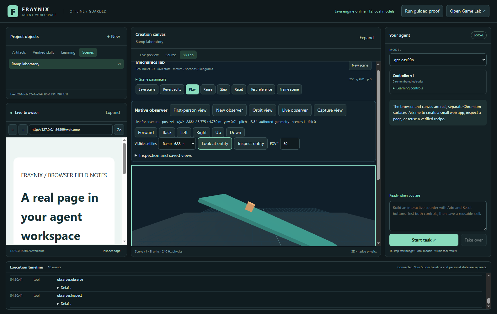
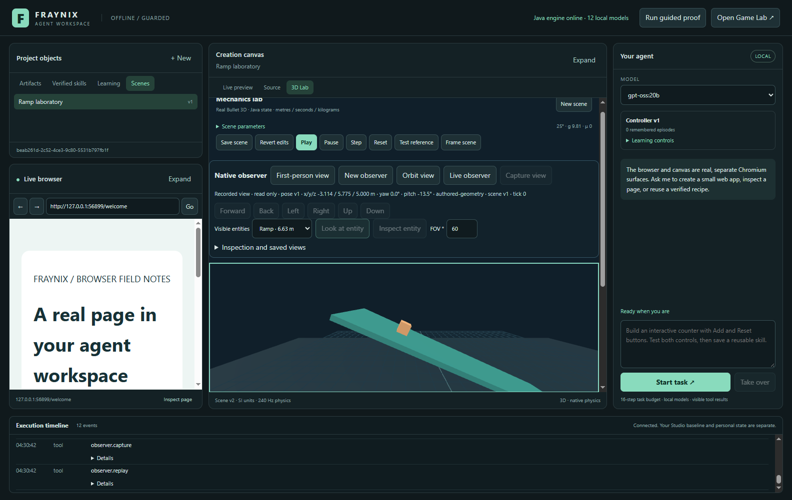
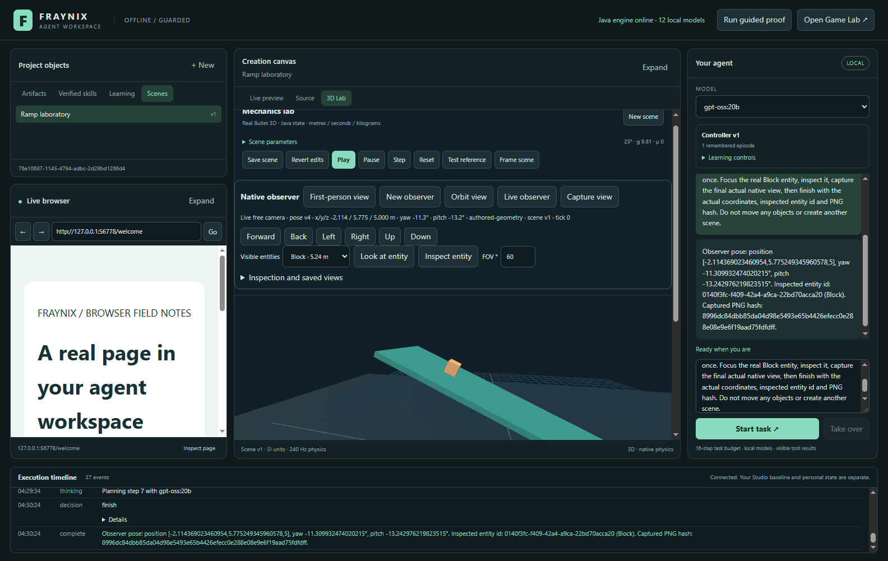

# Fraynix Agent Workspace · 014

## A native world does not need a video transformer

October 30, 2026. This edition implements a Java-owned first-person observer inside the existing application. It moves through the actual 3D laboratory, identifies the engine's visible box entities, inspects their components, captures real rendered frames and reopens those frames with their original source state. The manual workflow requires **no model inference**. The optional local language model translates a request into the same bounded actions.

The user's correction is the architectural direction: start from the engine, its logic and its authoritative world. An observer does not need to generate an imagined video when the application already knows the scene and can render it. The previous [JING assessment](docs/XGEN_JING_ASSESSMENT.md) remains an assessment, not a dependency. No JING weights, video transformer, Python inference service, CUDA installation or remote generation service is needed for this observer.

This is a complete, bounded observer workflow. It is a **free camera**, not a colliding character or a physical grasping agent. The world already has real native physics; camera movement does not apply force to a body. Inspection uses engine geometry, not learned recognition of arbitrary photographs. Those distinctions keep the larger vision measurable.

[Main entry](README.md) · [Previous edition](README-013.md) · [Offline explorer](docs/readmes/014/index.html) · [Verification](docs/readmes/014/verification.json) · [Source inventory](docs/readmes/014/FILE_TREE.md) · [Obsidian map](docs/obsidian/native-observer.canvas) · [Edition history](docs/readmes/INDEX.md)

*Actual isolated Windows application, October 30. The left browser, center canvas/3D lab, right local agent and bottom execution timeline retain their existing roles. The camera sees the real ramp and block, rendered from Java-owned state.*

## What changed, and why it matters

| Capability | Delivered behavior | Evidence boundary |
|---|---|---|
| Native observer | Durable identity, scene binding, position, yaw, pitch, field of view and selected entity | Java owns and validates the pose; it is not text claiming that a camera moved |
| Movement and looking | Buttons, focused keyboard input, drag-to-look and typed agent actions share the Java action handler | Free-camera motion; no avatar collision, locomotion or grasping claim |
| Visibility | Frustum tests, oriented-box ray intersections and occlusion sampling identify actual entities | Sampling may miss thin or partially visible features; known boxes only |
| Inspection | A fresh observation permits inspection of a sampled visible entity; receipt includes its actual ID and components | No recognition of arbitrary browser/desktop pixels |
| Real images | Existing Three renderer draws a frozen Java packet and exports an actual PNG | Decorative grid and lighting belong to the renderer; authoritative entities come from Java |
| Saved experience | Immutable frame metadata binds scene definition, run, tick, time, pose, viewport, source hash and PNG hash | Historical evidence is not a fresh observation lease |
| Restart and replay | Pose, actions and captured bytes survive restart; replay remains read only | Replay does not restore a physical simulation or overwrite the current scene |
| Language interface | Existing local Ollama adapter can request the same native tools | The native workflow works without an LLM; one tested model task is not general intelligence |

Java remains the application backbone: entities, transactions, persistence, source observations, validation and receipts. This edition's observer math is ordinary Java. The existing project still uses libraries, including FactoryWorld infrastructure, JSON, native Bullet through Minie, Electron and Three. “Native world logic” does not mean this whole application suddenly has zero dependencies.

Source baseline for this edition: **fe55acd**. See the [canonical inventory](docs/readmes/014/file-inventory.json) for every included source/asset hash and the [verification record](docs/readmes/014/verification.json) for the executed checks.

## How the world becomes an observation

The source packet is an explicit contract, native-box-observer-v1. Java atomically reads the applicable scene and current body poses. Authored geometry is marked authored-geometry. A running, paused, completed or replayed native experiment supplies native-physics state with its real run ID, tick and time.

An old experiment may refer to an earlier scene definition. The packet preserves both its sceneVersion and the current authoredVersion. It never relabels an old replay as the latest definition. Objects retain their stable native IDs, dimensions, positions, rotations and body types. A hash binds the captured world data.

The observer then evaluates its camera basis, vertical field of view, viewport aspect, near/far limits and oriented boxes. A 9 by 5 screen-ray grid plus each box's center/corner rays sample visibility. Nearest-hit tests account for opaque box occlusion. Entity inspection requires visibility in that observation and an unchanged source world. It returns the actual object payload, not a model's invented description.

~~~mermaid
flowchart LR
  Scene[Java scene and native physics] --> Packet[Frozen source / tick / objects]
  Pose[Java observer pose] --> Geometry[Java frustum and box rays]
  Packet --> Geometry
  Geometry --> Observation[Visible native identities and observation lease]
  Observation --> Manual[Buttons / keys / drag]
  Observation --> Adapter[Optional local language adapter]
  Manual --> Action[Validated Java action and receipt]
  Adapter --> Action
  Action --> Pose
  Packet --> Render[Existing Three renderer]
  Pose --> Render
  Render --> PNG[Actual PNG and SHA-256]
  PNG --> Memory[Private durable source-linked capture]
  Memory --> Replay[Read-only historical replay]
~~~

The rendering path uses a frozen packet and exact viewport dimensions. The host captures pixels through the trusted first-party renderer; agent tool inputs cannot submit arbitrary PNG data. The Java store verifies the image signature, dimensions, decoding, size limit and hashes. These checks bind submitted bytes to the source contract; they are not a mathematical proof that every pixel faithfully represents a scene. The integration test adds an independent pixel check: moving right by 0.25 m changes Java x exactly and shifts the rendered orange block left.

## Review it step by step

1. Start the normal workspace and open **3D Lab**. Use the existing saved scene or create a new native ramp scene.
2. Click **First-person view**. A scene's latest observer reopens; **New observer** creates a separate identity. The status shows metres, angles, source kind, scene version and tick.
3. Use the movement pad. Each button moves 0.25 m. Click the viewport, then W/S move forward/back, A/D move sideways and R/F change height. I/K look up/down and J/L turn left/right. Dragging the viewport changes looking direction.
4. Pick a sampled visible entity. **Look at entity** changes camera angles without changing position. **Inspect entity** records the actual identity/components. **Inspection and saved views** exposes the details and saved frame list.
5. Click **Capture view**. The actual PNG, its SHA-256 and source packet are saved in this project's private observer store.
6. Run, pause and step the existing native physics. A new capture records the actual run/tick. Inspection of moving objects requires a current source; pause when a stable inspection is needed.
7. Open a saved frame through **Replay view**. It is marked read only and stays frozen while the laboratory polls current state. The current authored scene and observer pose remain unchanged. **Live observer** returns to a fresh source; **Orbit view** returns to the original orbit camera.

Opening another scene clears the old scene's observer controls. This prevents a visible new scene from accidentally receiving actions through an old observer.

*Actual historical replay after the authored scene advanced to version 2. The view retains its original version 1 packet; movement and capture are disabled until returning to live observation.*

## Agent interface and evidence

The dispatcher registers real handlers for observer.open, observer.observe, observer.move, observer.look, observer.focus, observer.inspect, observer.fov, observer.capture, observer.history and observer.replay. The tool schemas reject undeclared fields. Camera actions require the observer ID and latest observation ID. Operation IDs make exact retries idempotent; reuse with different input fails.

For a native observer task, the agent receives only the relevant native tool group. After opening one observer, the task keeps that identity. A camera mutation returns a fresh observation, including current visible entities and source binding. Finish requires a saved frame from the final pose version. If movement or inspection was requested, the corresponding real action must have executed. The host does not accept a prose statement as action completion.

Development retained two failed trials. The first repeatedly confused observer selection and exhausted 16 steps. After simplifying agent open, a second executed the actions but restarted movement after capture; it was cancelled after an unwanted second move. The host now carries authoritative progress between turns, removes one-shot movement after execution and permits only finish when the current capture and requested actions exist. See the [first failure](docs/readmes/014/local-model-initial-failure.txt) and [repeat failure](docs/readmes/014/local-model-repeat-failure.txt). The passing fixture is a development case, not an untouched holdout.

A representative request is: “Use the native first-person observer for this saved 3D scene. Move right exactly 1 metre once, focus the Block, inspect it, capture the final actual view, then report coordinates and the saved hash.” The independent local-model fixture checks exact movement, entity selection, capture source, PNG digest and unchanged authored scene rather than trusting the final answer.

*Actual optional local-language-model task, not a generated illustration. Exact model identity, digest, actions and assertions are stored in the [live evidence](docs/readmes/014/live-observer.json). The underlying observer workflow is also tested with no model task or model inference.*

Observer episodes remain completed-unverified in the existing artifact-oriented learning ledger. This is deliberate: an observer capture is independently checked by this fixture, but the application's artifact promotion gate does not yet certify a general embodied policy. This edition does not train Ollama weights, invent a physical-learning score or claim recursive improvement from repeated camera actions.

## Bounds, persistence and failure behavior

Each observer accepts at most 500 actions and 100 saved frames; the project has at most 32 observers. One move is at most 5 m in total. The camera stays within x/z ±100 m, y 0.05–50 m; pitch ±85 degrees and field of view 30–110 degrees. Look deltas are bounded to ±90 yaw and ±45 pitch degrees per action. Zero movement/look changes are rejected.

Observations expire after 120 seconds and are held in a bounded 128-entry in-memory lease cache. Pose version changes or authored-scene version changes invalidate an action's old lease. Focus and inspection also require the exact current world hash, so stale positions in a running experiment cannot be passed off as current. Camera movement may continue while physics advances, provided its pose and authored binding remain current.

Captures use a 320–1280 by 240–960 viewport, pixel ratio one and a 1.2 MB PNG limit. PNGs are content addressed. A corrupt existing frame or replay image fails its hash check. Captures preserve historical packets, but replay does not issue a new action lease. After restart, a fresh observation is required before acting.

The private layout is observers/state.fworld plus observers/frames/SHA256.png inside the selected project. Checkpoints contain observer identities, action receipts and capture metadata. A transaction/checkpoint failure restores the in-memory world. Orphan image bytes after a failed metadata write are not successful capture receipts. Personal frames, project data and model weights are excluded from Git.

## Verification and reproduction

The [verification record](docs/readmes/014/verification.json) distinguishes current checks, clean-checkout checks and historical evidence. Eight new Java observer tests cover movement/idempotency, source staleness, visibility/occlusion, lease expiry, cross-observer input, image validation, persistence and read-only replay. The actual desktop observer suite checks pixels as well as state, focused keyboard input, live ticks, restart, historical integrity and damaged-image rejection.

Current release checks:

| Check | Result |
|---|---|
| Full Java check/build | 131 tests pass, including 8 new observer tests |
| Desktop units | 15 pass |
| Actual native observer workflow | 12 checks pass, without model inference |
| Native lab / measurement / calibration | 12 / 10 / 8 checks pass |
| Real recorded-data workflow | 9 checks pass; the physical fit remains rejected |
| Browser/canvas / learning / broader workflows | 12 / 9 / 45 checks pass |
| Actual local gpt-oss:20b task | 6 independent assertions pass; one stale inspection is rejected before recovery |
| Independent checkout | Offline build, 131 Java tests, 15 desktop units and 12 observer checks pass |

[Current regression records](docs/readmes/014/regressions/INDEX.md) preserve the actual results. These are development/regression cases, not a new untouched evaluation set.

The shared browser, canvas, native laboratory, measurement, calibration and learning paths are rechecked because their dispatcher and renderer are shared. Existing real-data results remain honest: edition 013's real recorded fit is still rejected by its declared tolerance. A passing application workflow does not turn that failed physical fit into a scientific success.

~~~powershell
$env:JAVA_HOME = 'C:\Program Files\Eclipse Adoptium\jdk-21.0.10.7-hotspot'
.\gradlew.bat check installDist :workspace-engine:installDist --offline
cd workspace-desktop
npm.cmd test
npm.cmd run test:observer
npm.cmd run test:live-observer
~~~

The live test uses an already installed local gpt-oss:20b by default; FRAYNIX_LIVE_MODEL can select another available local model. It does not download a model or change shared Ollama settings. Desktop tests use isolated temporary projects, not the user's current saved world. Run Electron suites sequentially.

For normal startup, use the repository's existing [workspace start instructions](README.md). Offline builds require the established Gradle/npm caches; offline operation is an application policy, not OS-wide network isolation. [Observer integration source](workspace-desktop/test/observer-integration.cjs), [Java test source](workspace-engine/src/test/java/fraymus/workspace/ObserverStoreTest.java) and [local-model fixture](workspace-desktop/test/live-observer.cjs) make the assertions reviewable.

## How this advances the full vision

The engine now supplies a reusable relation: authoritative world → observation → bounded action → receipt → rendered result → durable history. A transformer is unnecessary for that relation. It can support a laboratory assistant, a navigable data scene, a digital-twin viewer or an agent that reasons about known components. Data imported from real instruments still needs explicit units, coordinates, timestamps, uncertainty and validation; geometry alone does not establish cause and effect.

The next native milestone should add a physical actuator, not a decorative tool page. A bounded select/reach/grab/move/release workflow needs body identity, ownership, collision/contact constraints, force limits, cancellation and independently checked postconditions. A physical navigation controller then needs body/terrain collision, reachability and stuck recovery. A camera arriving at a coordinate is not proof that a robot or character could travel there.

After that, align observations, controls, contacts, rewards and failure events by run/tick/entity. Build repeatable tasks with separate development and held-out evaluation cases. Promote a changed policy only if it improves measured outcomes without regressing the existing browser/canvas/native workflows, and retain rollback. Persistent history supplies training evidence; storing history alone is not learning. Small native controllers can be evaluated before adding a learned model.

General meshes, images, audio and real sensor streams require additional adapters. Java/C/Go code creation should use a typed specification and build/test backends with actual artifacts, rather than treating language “transmutation” as automatic correctness. A generative renderer can remain an optional later adapter for imagined appearance; it should not become the source of truth for native objects or physics.

The current app and original Studio remain separate. This edition keeps the existing design and adds working engine capabilities with visible evidence. [Current roadmap](docs/SCENARIO_ENGINE_ROADMAP.md), [implementation contract](docs/NATIVE_OBSERVER.md) and [continuity notes](docs/PROJECT_MEMORY.md) identify what is delivered and what remains.
