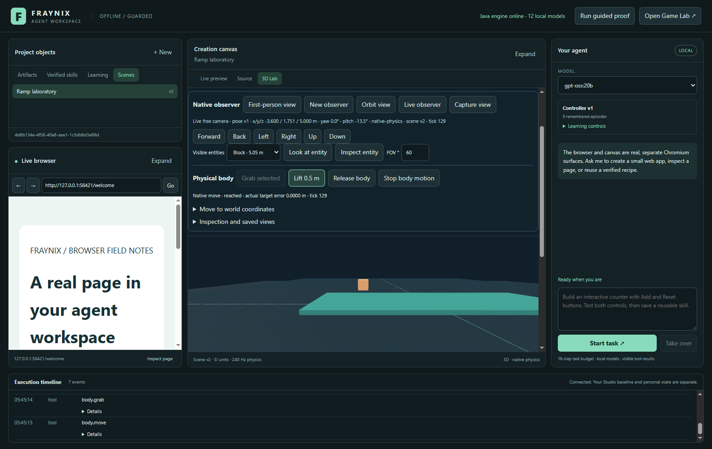
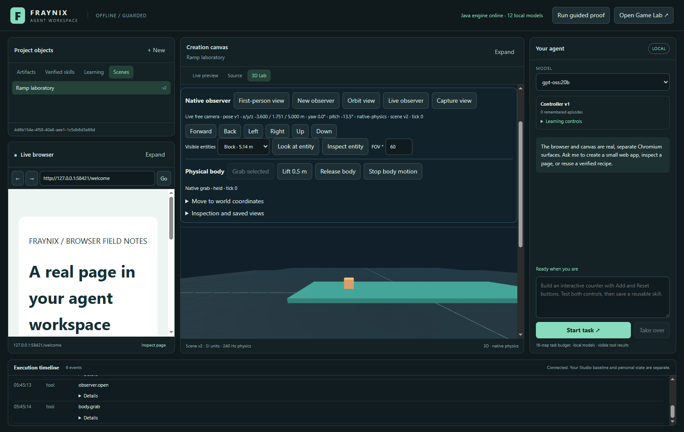
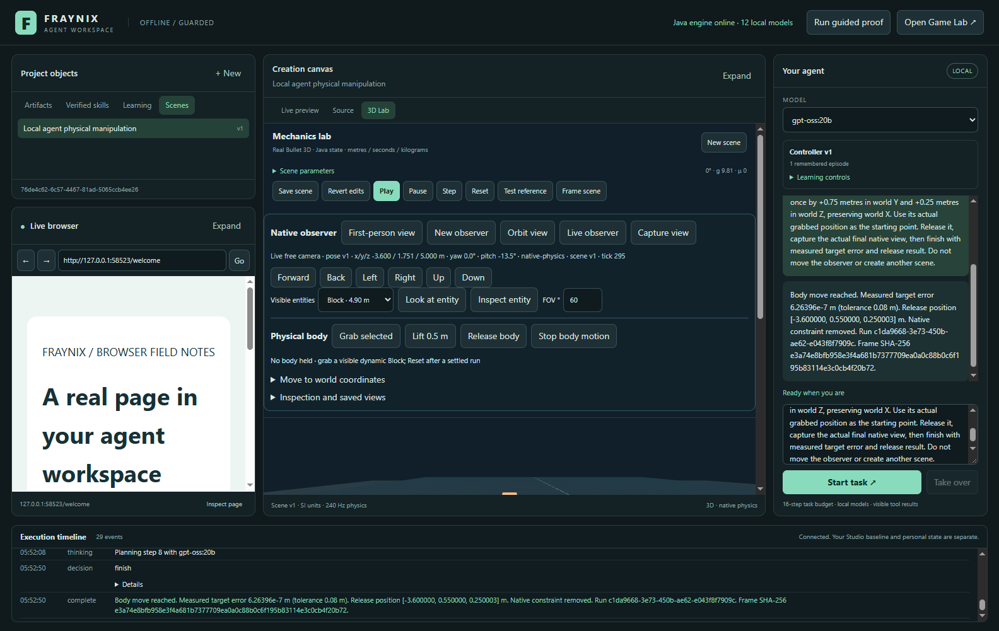
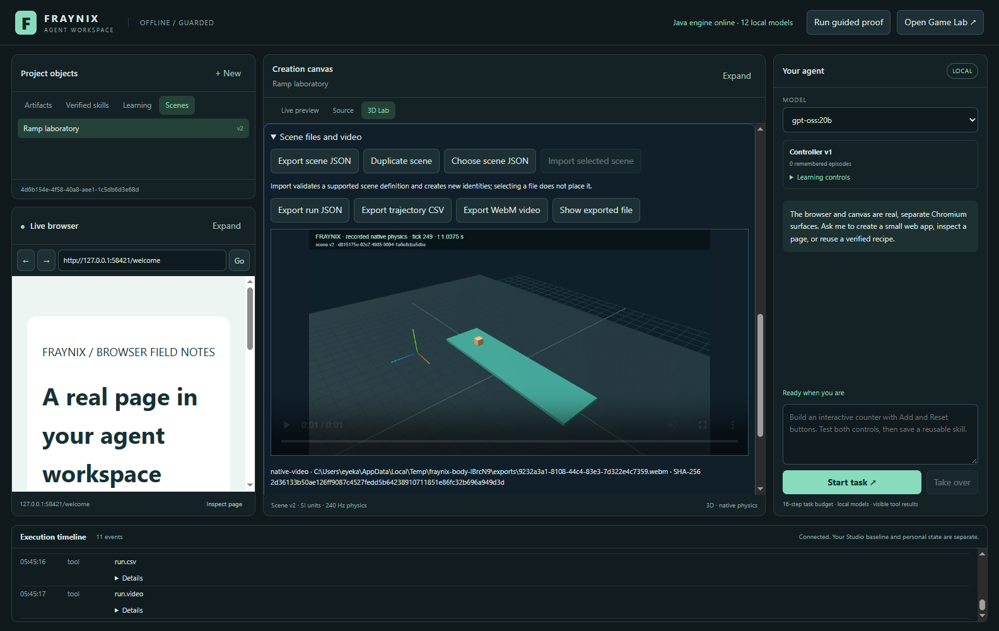

# Fraynix Agent Workspace · 015

## Real body control, portable scenes and recorded video

October 30, 2026. The agent and the operator can now **grab, move and release the actual dynamic block** through the native physics engine. A native constraint holds the body; a bounded moving target drives it through solver ticks. The body stays dynamic, collides with the ramp and retains its velocity when released. A target inside a solid surface produces a measured blocked outcome.

This edition also exports native scene JSON, complete run JSON, trajectory CSV and real silent WebM video. Supported scene JSON can be imported or duplicated with fresh identities and provenance. Choosing a file previews it; a separate Import action creates the scene. These are working functions inside the existing layout, not new empty pages.

Java owns world state, body control, timing, observations, validation and receipts. The existing Three renderer draws native poses and Chromium records actual frames. A video transformer is unnecessary. An optional local language model requests the same bounded actions used by the visible controls.

[Main entry](README.md) · [Previous observer edition](README-014.md) · [Offline explorer and video](docs/readmes/015/index.html) · [Verification](docs/readmes/015/verification.json) · [File inventory](docs/readmes/015/FILE_TREE.md) · [Actuator contract](docs/NATIVE_BODY_CONTROL.md) · [Formats and replication](docs/SCENE_INTERCHANGE.md) · [Edition history](docs/readmes/INDEX.md)

*Actual Windows app, October 30, isolated test project. The block is held 0.5 m above its starting height. Native motion reaches its target with a measured error stored in the evidence; the authored scene remains unchanged.*

## What is real about the grab

The actuator attaches a native point-to-point constraint to the dynamic block's center. It does not turn the block into a kinematic object and does not directly overwrite its position during movement. A commanded world-space anchor moves at at most 1.5 m/s while native Bullet integrates at 240 Hz. The body may lag, rotate or stop against contacts. The endpoint is measured afterward, with an explicit 0.08 m target tolerance.

The native constraint uses a 1.25 N·s per-axis impulse clamp, equivalent to 300 N per axis at this timestep. This limits that constraint's impulses; it is not a global bound on gravity, collision forces or total vector force. The current virtual actuator has a 6 m reach, 10 kg load limit and 2 m move limit. It is not a simulated human hand, a colliding avatar or hardware robot. Its native joint behavior follows the [Minie point-to-point constraint API](https://stephengold.github.io/Minie/javadoc/master/com/jme3/bullet/joints/Point2PointJoint.html).

Release removes the native constraint, records velocity at removal and advances 120 actual ticks, or 0.5 s. Gravity and contacts determine the result. Cancel removes the constraint and stops the owned run; it does not continue simulating after cancellation. The tests distinguish a normal release from a stopped simulation.

The full Java test run exposed a pre-existing physics-thread problem: creating a native world on one thread and updating it on another caused callback assertions. Each Bullet world now owns a dedicated worker for construction, updates, queries, constraints and destruction. Assertion-enabled native tests pass. Native failures also settle the operation as failed instead of leaving a misleading endless pending state.

## Review the visible workflow

1. Open **3D Lab** and a saved scene. Reset a previous experiment before a new manipulation.
2. Choose **First-person view**. The visible-entity selector defaults to a dynamic body when available. Select Block if needed.
3. Click **Grab selected**. A real native constraint attaches at the current body position; tick zero does not teleport the object.
4. Click **Lift 0.5 m**, or expand **Move to world coordinates**, enter X/Y/Z in metres and choose **Move held body**. **Use body position** fills the current coordinates. The UI shows actual completed solver ticks while movement runs.
5. Read the measured endpoint error and reached/blocked result. A completed command does not automatically mean the target was reachable.
6. Click **Release body**. The run records actual velocity, falling/contact response and the final state. The authored definition and its revision stay unchanged.
7. Use **Stop body motion** or agent **Take over** to cancel owned motion. Reset is required before a fresh manipulation run.
8. Select the recorded run and replay it. The engine re-executes the recorded native grab/move/release commands and compares the resulting final position with the original.

*Actual native attachment at tick zero. The same dynamic body and stable entity ID participate in the observation, constraint and saved run.*

## The control and evidence chain

~~~mermaid
flowchart LR
    Scene[Authored Java scene] --> Observation[Fresh observer / world / entity binding]
    Observation --> UI[Visible controls]
    Observation --> Model[Optional local request adapter]
    UI --> Intent[Durable action intent and ownership fence]
    Model --> Intent
    Intent --> Joint[Native constraint and bounded target]
    Joint --> Physics[Owned Bullet worker / 240 Hz ticks]
    Physics --> Result[Actual position / contacts / reached or blocked]
    Result --> Release[Remove joint / preserve velocity / simulate release]
    Release --> Run[Durable run and command receipts]
    Run --> Replay[Re-execute native commands]
    Run --> Files[JSON / CSV / actual WebM]
~~~

Actions require a fresh observation, correct observer ownership, run identity and current grip identity. Static surfaces, wrong owners, stale source, unsupported fields, excessive reach/load/movement and invalid coordinates fail before native movement. Exact successful operation retries return the prior receipt; an interrupted or pending intent is never blindly applied twice.

The first local-model development trial mixed observer/run/grip IDs and was rejected/cancelled. The model-facing body tools now accept semantic arguments only; the trusted host binds its task-owned identities and a fresh observation. Native API fences remain unchanged. In the passing run, the model attempted two repeat moves and the host rejected both before execution. The [initial failed trial](docs/readmes/015/initial-model-failure.txt) is retained.

An intent is checkpointed before the native effect. The completed receipt contains before/after physics, start/end ticks, requested target, measured error and outcome. Motion executes asynchronously on the clock, so the viewport can display genuine intermediate states. A process ending during an action leaves an interrupted record on restart. The old operation is not silently resumed or certified successful.

The local-model stages retain progress in the host. After grab, the next phase moves the body; after one movement, it releases; after release, it captures; then it finishes. These phases prevent the earlier failure of restarting a completed action sequence after it fell out of the language model's recent context.

## Current results

The actual manual fixture uses a flat native ramp so the lift and subsequent fall can be checked independently. It grabs at tick zero, moves the block +0.5 m vertically, releases and records 120 further ticks. The [evidence](docs/readmes/015/body-integration.json) retains the intermediate native state, complete run, export receipts, independent file hashes, imported identities and decoded-video measurements.

A separate collision test commands a target inside the ramp. Native contacts keep the block above the surface and the measured endpoint fails the 0.08 m target gate. This blocked action remains a real completed operation with an unsuccessful target outcome. It is not relabeled as successful movement.

The optional gpt-oss:20b fixture asks for one physical move of +0.75 m in world Y and +0.25 m in world Z, with X unchanged. It independently checks the command target, actual error, native release, unchanged authored scene/camera and final capture's run/tick binding. Model digest and actual tool steps are retained in [live evidence](docs/readmes/015/live-body.json). The fixture is a development/regression case, not an untouched holdout.

An earlier screenshot exposed a numerical reporting error: the model described travel distance as target error even though the physical target had been reached. The host now constructs the displayed result exclusively from matching native motion/release/final-frame receipts. The model's own numerical prose is retained as unverified audit data rather than displayed as a measurement. The [reporting regression record](docs/readmes/015/reporting-regression.json) retains the discrepancy and correction.

Physical episodes still use completed-unverified in the artifact-oriented learning ledger. This edition implements and tests physical control; it does not claim a trained embodied policy, new Ollama weights, unrestricted robotics or automatic recursive learning from storing observations.

## Exports: video, data, scene files and code

| Format/function | Implemented behavior | Reuse boundary |
|---|---|---|
| Scene JSON | Portable fraynix.scene version 1: parameters, generated native geometry, units/frame, source identity and geometry hash | Recreates the supported authored ramp/block definition, not arbitrary meshes or a post-action body snapshot |
| Run JSON | Native source definition, actual samples, final state, actuator commands, outcomes and hashes | Full evidence export; foreign run-file import is not yet implemented |
| Trajectory CSV | Native tick/time, XYZ, velocity, quaternion, contacts and downhill displacement | Can be imported through the measurement mapper; classify engine-generated data as synthetic |
| WebM | Real VP8 video at 960×540, nominal 30 fps, up to 30 s of recorded motion | Silent visual export, not an interactive scene or generated world video |
| PNG | Existing native observer capture with source/run/tick/pose and image hash | Source-linked still image; historical replay stays read only |
| Native scene duplicate | Reuses the same validated definition with new scene/entity identities and an import receipt | Equivalent supported geometry, not shared mutable identity |
| HTML/CSS/JS artifacts | Existing creation canvas saves runnable files and tests actual behavior | Separate artifact workflow; importing a scene does not grant executable tool privileges |
| Java/C/Go source export | Planned typed specification/compiler backends with real builds/tests | No claim that arbitrary physics or uploaded data automatically converts into correct executable code |

Exported files are saved under the selected project's exports directory. **Show exported file** reveals the actual file. Every export has a receipt sidecar and manifest entry containing file bytes, SHA-256, source identity and date. Agent tools accept native IDs rather than arbitrary output paths. The default project remains private under ~/.fraynix-agent-workspace/projects/default.

*Actual app export. The WebM is decoded and played inside the existing file panel. The independent fixture checks dimensions, visible block pixels, completion, source tick range and playback duration.*

[Play/download the actual WebM](docs/readmes/015/media/body-motion.webm) · [Open the offline viewer with video](docs/readmes/015/index.html) · [Sample portable scene](docs/readmes/015/examples/native-scene.json) · [Actual recorded run](docs/readmes/015/examples/native-run.json) · [Actual trajectory CSV](docs/readmes/015/examples/native-trajectory.csv)

Video frames come from actual recorded native samples. At nominal 30 fps, the renderer selects source samples along the native timeline, renders the real geometry and adds tick/time labels. The final sample is retained. Chromium encodes those frames; no diffusion model is involved. This is a visual reconstruction of recorded poses, not a new physics solve or proof of causality. The run JSON retains the numerical source.

## Import, absorption, creation and replication

The useful architecture is **parse → validate → retain source/provenance → create typed components → run tools → measure the result → retain reusable evidence**. “Absorbing a file” should mean extracting supported information into those explicit contracts. It should not mean treating file text as instructions, giving it tool authority or claiming its contents were trained into model weights.

Current scene import accepts only the native ramp/block schema. Units and coordinates must match; parameters must be complete and bounded; geometry must match the generated definition and its hash. Extra executable/instruction fields are rejected. Import creates a separate scene and entity mapping with a normalized source-package digest. It does not overwrite the currently running simulation. The user resets active physics explicitly before importing or duplicating.

Replication has three different meanings here. A **scene duplicate** preserves supported physical parameters and geometry while minting fresh IDs. A **native run replay** re-executes the stored actuator commands and checks its final position within 0.0001 m on the tested backend. A **video export** renders historical poses without creating an interactive simulation. A pretty video alone does not establish that a cloned simulation behaves the same way.

The existing CSV measurement pipeline retains original source/mapping hashes and explicit units/time direction. It can compare native output with measured observations. The earlier real-recorded-data fit remains rejected by its declared tolerance; this actuator milestone does not change that verdict.

The next import family should be bounded glTF/GLB assets: parse geometry/materials in a resource-limited loader, retain file hashes/licenses/transforms, create explicit mesh/collision components, reject unsupported animation/physics assumptions and test native contacts. Then add image/audio/document extraction adapters with source spans, units and uncertainty. Arbitrary PDF/video/mesh imports do not currently become manipulable physics objects.

Foreign run-package import should validate a versioned command schema, remap original entity roles to fresh identities, replay within tick/force limits and independently compare trajectories before declaring replication. Code-generation backends need typed intermediate representations, dependency declarations, builds, tests and controlled execution. These are subsequent complete milestones; no placeholder UI is exposed for them.

## Verification and reproduction

[Current verification](docs/readmes/015/verification.json) records **143 passing Java tests**, **19 desktop units**, **127 workflow checks** across the current body/observer/native/browser/canvas/data/learning suites and **six independent local-model assertions**. A fresh checkout repeats the offline build, Java/unit checks and body/file/video workflow. Nine new actuator tests check real dynamic constraint behavior, intermediate ticks, release/momentum, collisions, ownership/stale/grip fences, retries, cancellation, interruption and native command replay. Three new interchange tests cover equivalent geometry with fresh IDs, provenance/restart, corrupt/unsupported data rejection and active-physics preservation.

The actual desktop body/export workflow has ten passing checks. It exercises visible controls, true native motion, original-scene preservation, actual JSON/CSV bytes, independently recomputed file hashes, video decoding/pixels/playback, native replay, explicit file import and the same typed clone/import tools available to the agent. Other shared browser/canvas/observer/measurement/calibration/learning paths are regression tested; their results are preserved separately from the local-model fixture.

~~~powershell
$env:JAVA_HOME = 'C:\Program Files\Eclipse Adoptium\jdk-21.0.10.7-hotspot'
.\gradlew.bat check installDist :workspace-engine:installDist --offline
cd workspace-desktop
npm.cmd test
npm.cmd run test:body
npm.cmd run test:live-body
~~~

Offline builds need the established dependency caches. The live test uses an already installed local gpt-oss:20b by default; FRAYNIX_LIVE_MODEL can select another available local model. Tests use isolated projects and run Electron suites sequentially. No model weights, paid provider, Docker/WSL stack or private user scene is installed or copied for this milestone.

Source baseline: **683b7af**. [Canonical hashes](docs/readmes/015/file-inventory.json), [current regression evidence](docs/readmes/015/regressions/INDEX.md), [Obsidian map](docs/obsidian/native-body-and-files.canvas), [memory](docs/PROJECT_MEMORY.md) and [development log](docs/DEVELOPMENT_LOG.md) preserve continuity. Editions 001–014 remain historical snapshots.

Next: general scene/component storage and bounded mesh import; owned physical navigation with collisions and stuck recovery; portable run-package replay; then tick/entity-aligned physical policy development, separate evaluation, promotion and rollback. The engine remains the backbone; learned models remain adapters where they add measurable value.
