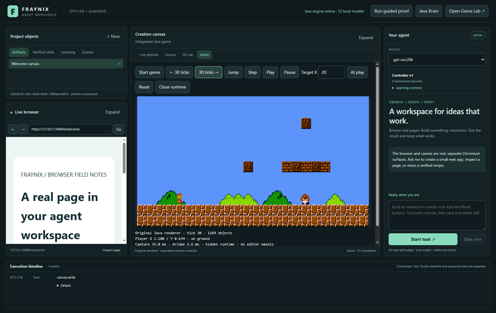
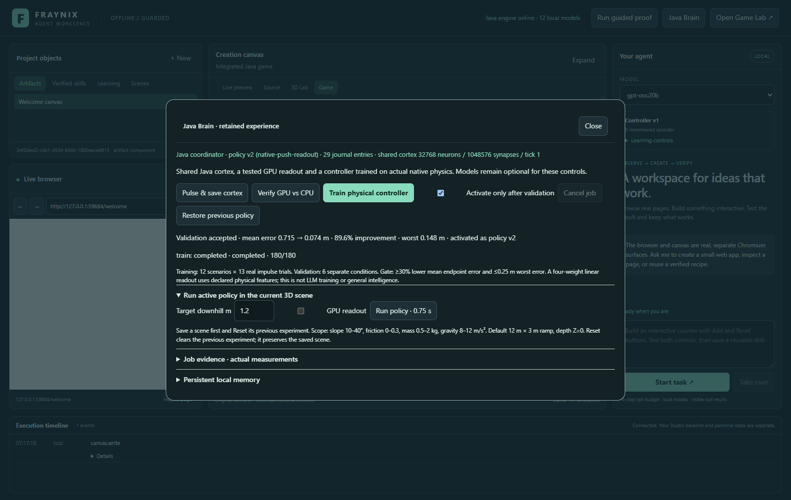
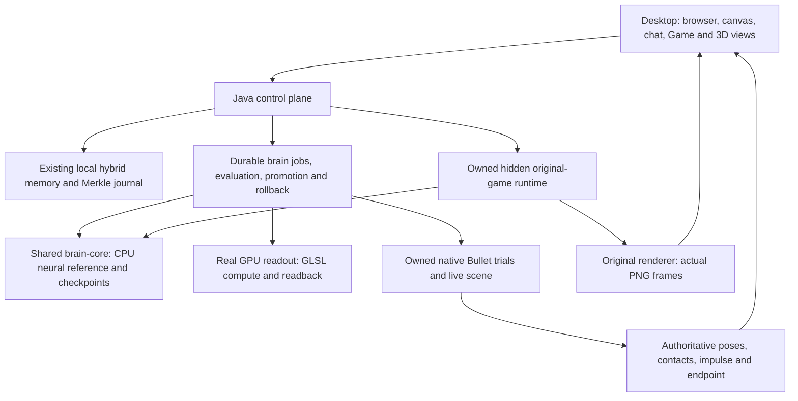
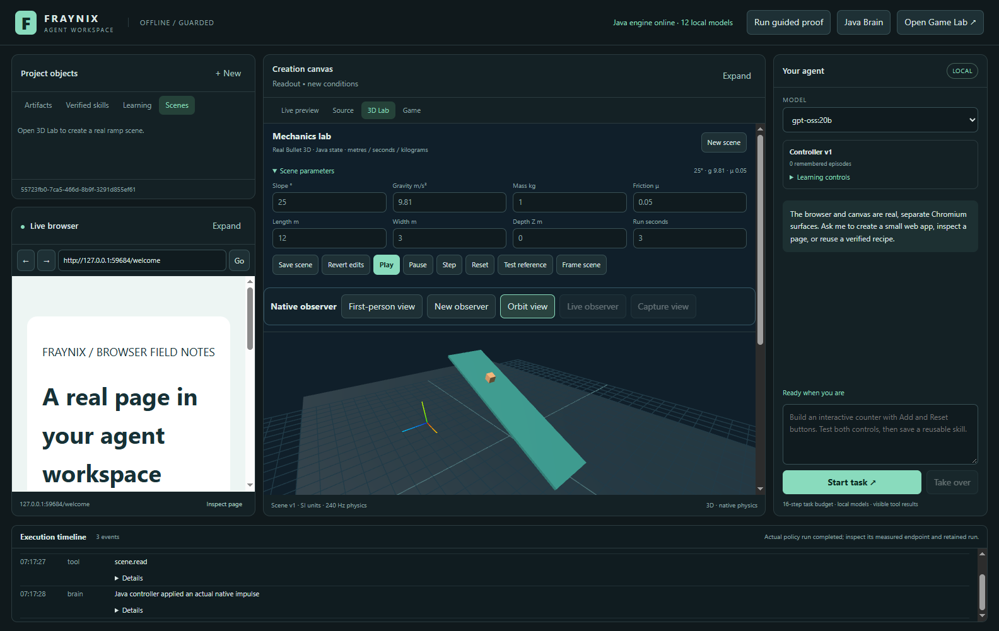

# Fraynix Agent Workspace · 016

## Java becomes a shared brain, with measured physical learning

October 30, 2026. This edition keeps the existing browser, creation canvas, agent conversation and execution timeline. It adds an integrated view of the original Java game, a shared nervous-system module, Java-owned durable jobs, automatic local memory retrieval, a real GPU compute primitive and a small physical controller that retains validated weights after restart.

The practical proof is a task with a physical consequence: choose a bounded impulse so the block finishes at a requested downhill distance after 0.75 seconds. Twelve training conditions produce real native experience. Six different conditions evaluate the frozen candidate. Mean endpoint error falls from **0.715 m to 0.074 m**, a **89.6% reduction**; the worst validation error is **0.148 m**. The accepted policy becomes version 2 and survives restart. Rollback restores baseline weights as version 3. These results concern a four-weight readout with engineered physical features, rather than a general intelligent controller or language-model training.

[Entry point](README.md) · [Offline interactive explorer](docs/readmes/016/index.html) · [Edition history](docs/readmes/INDEX.md) · [Architecture and contracts](docs/JAVA_BRAIN_RUNTIME.md) · [Verification](docs/readmes/016/verification.json) · [Obsidian map](docs/obsidian/java-brain-runtime.canvas)



Actual application in an isolated test project on October 30. The original sprites, scene and Java renderer are displayed in the center Game tab. The old editor is available separately when needed.

## What the six architecture steps deliver now

| Step | Implemented and tested | Remaining scope |
|---|---|---|
| Shared nervous system | `brain-core` contains the existing Java spiking computation, CPU readout, training and checksummed neural checkpoint. Legacy `nervous.NeuromorphicCore` remains a compatibility facade. The workspace and game depend on the same implementation. | The diagnostic cortex and trained physical readout remain separate controllers; spike activity alone is not task improvement. |
| Game runtime interface | `ControlledRuntime` supplies observations and bounded steps. The original game accepts commands without initializing its editor. Its loop and graphics context live in an owned child JVM. | Rendering still needs an OpenGL context. This is not a graphics-free game server or a port of the game to Three.js. |
| Integrated Game view | Actual 960×540 original-renderer PNG frames, step/left/right/jump, play/pause, AI target, reset and close. Real player positions, tick and pixels are checked. | PNG readback/encoding and desktop polling limit display rate. Native-window reparenting is not used. |
| Java coordination | Durable queued/running/completed/cancelled/interrupted/failed brain jobs, progress, content-hash journal records, bounded history, separate native trials, policy promotion fences and rollback. | The existing language-model/browser/canvas task loop still runs in Electron. This release does not claim that all orchestration has moved into Java. |
| Neural GPU compute | Real GLSL 4.3 matrix-vector multiplication through the installed OpenGL driver, checked against the Java CPU reference. Actual device and transfer-inclusive timings are retained. | The entire spiking cortex and LLM are not GPU implementations. GPU use is optional and not automatically faster. |
| Outcome-based learning | Actual impulses, native contacts, positions and ticks produce training labels. Fixed separate conditions gate activation. Active CPU/GPU readout can drive the current native 3D scene, retain its receipt and replay the original impulse. | This bounded push task does not establish adaptive Mario navigation, unseen object manipulation or continual autonomous source modification. |

## Use the application

1. Build and start the existing workspace using the commands below. No Docker, WSL, CUDA installation, new model weights or cloud provider is needed for these new controls.
2. Select **Game** in the creation canvas. The original Java game opens inside the workspace. Use **30 ticks →**, **← 30 ticks**, **Jump** and **Step** for fixed-step control. **Play** runs continuous simulation; **AI play** uses the existing legacy gameplay controller toward Target X. **Pause** stops it. **Reset** reloads the original playable scene.
3. Select **Java Brain** in the header. **Pulse & save cortex** computes and checkpoints the shared 32,768-neuron / 1,048,576-synapse diagnostic core. Its checkpoint resumes from its previous tick. This pulse is explicitly separate from learning the physical task.
4. Select **Verify GPU vs CPU**. The actual installed GPU executes three workloads, including dimensions that do not align to a workgroup. Open evidence for device, numerical error and CPU/GPU costs. An unavailable backend produces a failed job rather than simulated GPU results.
5. Select **Train physical controller**. Java performs 180 real native operations: 156 search trials, 12 fitted training trials and 12 validation trials. With activation enabled, only a passing candidate replaces the active policy. Cancel stops the job without activating a partially trained candidate.
6. Open a saved **3D Lab** scene. For this policy use a default 12 m × 3 m ramp at Z=0; slope 10–40°, friction 0–0.3, mass 0.5–2 kg and gravity 8–12 m/s². Reset the previous experiment, open Java Brain, choose a target of 0.4–1.8 m and select **Run policy · 0.75 s**. Optional **GPU readout** evaluates the same weights on the GPU. Java applies a real impulse, steps physics and stores the actual endpoint error. The unrelated frictionless-from-rest formula is marked inapplicable.
7. Close and reopen the app. The active policy, completed jobs and saved memory remain. Use **Restore previous policy** to produce a new version containing previous weights. Completed native runs remain available for replay and existing JSON/CSV/video export.

```powershell
$env:JAVA_HOME = 'C:\Program Files\Eclipse Adoptium\jdk-21.0.10.7-hotspot'
.\gradlew.bat check installDist :workspace-engine:installDist --offline
npm.cmd --prefix workspace-desktop ci --offline
npm.cmd --prefix workspace-desktop start
```

Offline commands assume the pinned dependencies are already cached. A first installation needs its normal dependency downloads. Windows x64/JDK 21/OpenGL 4.3 is the environment verified for the new GPU/embedded adapter. The existing application launcher remains available; the original Studio repository is untouched. Personal state stays under the workspace's project directory, outside Git.



## How the runtime fits together



The workspace is one visible application with several owned runtimes. Java is more than a pop-out editor: it owns durable entities, native world state, model routing, memory, physical evaluation and now these neural jobs. Electron remains useful for real browser hosting and the established creation UI. A separate process for the original renderer keeps its legacy graphics lifecycle independent; ownership, a private capability and a parent-process watchdog prevent it from becoming an unmanaged second editor.

The current adapter preserves the renderer rather than attempting a second implementation of every sprite, animation and game component. Measurements are **4.9 ms average / 6 ms maximum desktop frame-fetch round trip** in twelve immediate requests; actual frame capture/encoding is about **24.3 ms** for the tested frame. These are local fixture measurements, not a total interaction latency or frame-rate guarantee. Capture is periodic, the renderer and HTTP transport add work, and the desktop polls while the Game tab is active. Native-window reparenting is not the foundation.

## What the physical controller really learns

The controller is a single linear neural readout with four trainable weights. Its declared input is `[1, target/2, gravity*sin(angle)/10, gravity*friction*cos(angle)/10]`. Java batch gradient descent fits the selected physical training labels. The command is a clipped ±4 m/s change in downhill velocity, applied as a native central impulse of `mass × deltaVelocity`; the simulation does not teleport the block to its requested endpoint.

For each training condition Java evaluates thirteen candidate impulses from −2 to +4 m/s in 0.5 m/s steps. It selects solely by actual endpoint error. Training covers slopes 10/20/30/40° and friction 0/0.15/0.3 with varying mass, gravity and target. The frozen readout is then evaluated at slopes 15/25/35° and friction 0.05/0.25 with different mass/gravity/target combinations. These are separate development validation cases; repeated work on this suite can overfit it. A future benchmark should be locked outside development.

Acceptance requires at least 30% lower mean error than a zero-impulse baseline and no validation error above 0.25 m. Both conditions passed. Baseline is deliberately simple and explicitly identified. The result is useful evidence of retained task learning, not a comparison against a strong analytical or learned-control competitor. Each trial retains its definition, impulse, native samples, final position and independently recalculated residual. Full evidence links below allow inspection without trusting a changing activity display.



The native physics uses 240 Hz fixed steps. The learned task ends at tick 180. Policy runs mark their intervention, retain source scene/version and distinguish endpoint goal acceptance from simulation completion. Replay reuses the saved impulse and original scene, rather than consulting whatever policy happens to be active later. Geometry outside the tested ramp contract is rejected.

## GPU results, with complete measured costs

Actual device: **NVIDIA GeForce GTX 1660 Ti/PCIe/SSE2 / 4.3.0 NVIDIA 560.94**. Float outputs must differ from the CPU reference by no more than 0.0002. The test includes uploads, buffer creation, dispatch, synchronization, readback and the worker handoff; it does not measure only shader time. No model/driver/CUDA download was performed.

| Rows × columns | Max CPU/GPU difference | CPU mean ms | GPU mean ms incl. transfers |
|---|---:|---:|---:|
| 5 × 7 | 0.00000000 | 0.00238 | 0.14977 |
| 65 × 33 | 0.00000000 | 0.07670 | 0.20029 |
| 1024 × 128 | 0.00000000 | 0.41894 | 0.95676 |

These small workloads are slower on the GPU after overhead. Keeping a CPU reference and an optional GPU backend is therefore the useful result here. Larger batched workloads, persistent buffers and end-to-end learning tasks need their own measurements before changing the default. The shader is GLSL and the graphics driver/native bindings perform GPU execution; Java ownership does not make this zero-dependency or Java-bytecode-only hardware.

## Persistent memory without another database stack

The application already had Java hybrid HDC/lexical/graph retrieval, durable artifact/episode records and a Merkle append-only journal. This edition uses those mechanisms rather than introducing a second database to obtain the same first capability.

In **Java Brain → Persistent local memory**, save a source note or retrieve matching past notes/artifacts. Notes are immutable UTF-8 files named by SHA-256, bounded to 128 notes and 4,000 characters each. Restart reindexes these notes and verifies their content hashes. Retrieval returns sources, scores, a character budget and journal head/root. Before **every actual model planning step**, Java retrieves context automatically with a 2,400-character text budget. The model receives it as untrusted source data, followed by the current task and host rules. It cannot install a handler, grant file authority or prove that a test passed.

The real `gpt-oss:20b` integration check saved an arbitrary acceptance marker, closed the desktop, reopened it and asked the model to retrieve that marker without including it in the current prompt. The returned value matched the saved note; source count, context size, journal receipt and admitted model digest were recorded. This demonstrates retrieval after restart. It does not make finite model context unlimited or guarantee recall of every past event. Existing graph references are useful structured indexing, rather than an automatically complete ontology of the codebase.

Local hosting gives this application control of its own files, processes, retention and orchestration. Model context length, hardware capacity and operating-system permissions still exist. Local model inference avoids per-request provider charges but consumes local hardware and power. MCP is a possible future tool adapter; it does not remove website authentication, access controls or paywalls. No additional unrestricted shell, reverse-engineering suite, autonomous source mutation or pretend multi-agent workers are installed in this release.

## Durable jobs, recovery and authority

Java owns one brain worker at a time. Job intents and phase updates are checkpointed as existing FactoryWorld entities; the journal records hashes of saved job payloads. Failed or cancelled jobs do not promote a partial candidate. On startup a job left queued/running is marked interrupted, requiring a fresh run rather than falsely claiming completion. Maximum retained brain jobs is currently 16; exhaustion is explicit. Promotion checks the active parent version, preserves old policy records and stores the accepted evaluation. Rollback creates a new version; it does not rewrite history.

The shared diagnostic cortex saves dimensions, membrane/threshold/weights/calcium, spike history, routing and random state in an atomically replaced SHA-256-checked binary checkpoint. Replay tests continue the original and restored cores identically and reject a changed byte. The physical readout has its own versioned learned weights and evaluation; it is not silently substituted for the legacy cortex. Merkle/hash integrity is local tamper detection under the existing file trust model, not an externally anchored claim that all machine activity is authentic.

The Game runtime has a loopback-only capability, bounded command queue/arguments and its own project subdirectory. The embedded runtime never starts against the original Studio project or the optional legacy editor's private data. Closing the desktop closes its owned game runtime; a parent watchdog also handles abrupt termination. Browser/preview content receives none of these private control capabilities.

## Verification and source map

- [Release summary and limits](docs/readmes/016/verification.json)
- [Actual UI controls, restart, shutdown and timing](docs/readmes/016/brain-game-integration.json)
- [Full native training and separate validation outcomes](docs/readmes/016/brain-learning-evidence.json)
- [CPU/GPU reference comparison](docs/readmes/016/gpu-compute-evidence.json)
- [Original renderer runtime test](docs/readmes/016/embedded-game-evidence.json)
- [Real local-model memory retrieval after restart](docs/readmes/016/live-memory.json)
- [Current regression suite](docs/readmes/016/regressions.json)
- [Canonical inventory of 441 source/asset files](docs/readmes/016/file-inventory.json) and [file tree](docs/readmes/016/FILE_TREE.md)
- [Fresh checkout and documentation checks](docs/readmes/016/verification.json)

Tests cover actual computation, native outcomes, real rendered frames, restart/rollback/cancellation, byte corruption, bounded memory, old functionality and owned-process cleanup. The current run passes **151 Java tests, 19 desktop unit tests and 137 workflow assertion groups**, plus the real local-model retrieval check. Tests use isolated temporary projects. Screenshots are actual dated app captures, not proposed designs. [Earlier edition 015](README-015.md) preserves the body/import/export implementation and its evidence; the [recorded-data calibration in edition 013](README-013.md) remains rejected.

```text
fraynix-modules/brain-core/        Shared Java neural computation and persistence
fraynix-modules/brain-gpu/         Actual OpenGL compute adapter
src/main/java/nervous/            Legacy compatibility and gameplay integration
src/main/java/runtime/            Hidden original renderer and game control
workspace-engine/.../BrainService.java       Durable jobs, learning, evaluation, policy
workspace-engine/.../EmbeddedGameClient.java Owned child runtime and transport
workspace-engine/.../WorkspaceStore.java     Existing kernel memory + bounded context
workspace-engine/.../SceneStore.java         Authoritative live policy runs/replay
workspace-desktop/renderer/brain-game.js     Integrated view and thin controls
```

## Next complete milestones

1. **Stronger physical evaluation.** Compare against an analytical controller and a stronger learned baseline, freeze a fresh external test set, vary geometry and disturbances, retain failed cases and require no regressions after restart. Extend from one impulse to closed-loop sensing/action before making navigation or manipulation learning claims.
2. **Learning in the original game.** Align actual player/body/contact and object identities with ticks, encode goals such as collecting a mushroom, record obstacle failures and train a bounded policy with separate levels. Keep existing gameplay heuristics and physical-readout learning labelled separately until this passes.
3. **More Java task ownership.** Move task graphs, tool intent/effect reconciliation and model-agent supervision behind Java's durable interfaces. Keep browser presentation/input in the desktop. Demonstrate interrupted-task recovery with real effects and budgets before unattended execution.
4. **GPU work that pays for itself.** Add persistent buffers/batched workloads only after parity, resource cleanup and transfer-inclusive end-to-end benchmarks show useful gains. A full spiking GPU backend needs its own deterministic or tolerance-defined reference tests.
5. **Broader tools and scenes.** Add typed adapters for new import formats, compiler processes and MCP services one functioning vertical slice at a time. Imported prompts stay data; generated code needs real build/execution checks, provenance and rollback. Browser tool fixtures and a content hash alone do not establish that new skills are safe or useful.

The larger vision is still the user's local Tycho/Fraymus workspace: a Java-owned environment where an agent sees actual state, acts through real tools, observes consequences, remembers evidence and improves measurable behavior. This edition supplies a small working instance of that loop while retaining the current application's design. Expansion should make that loop broader and more reliable, with each new claim tied to a real task result.
