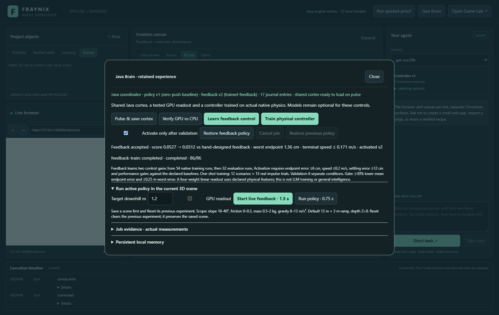
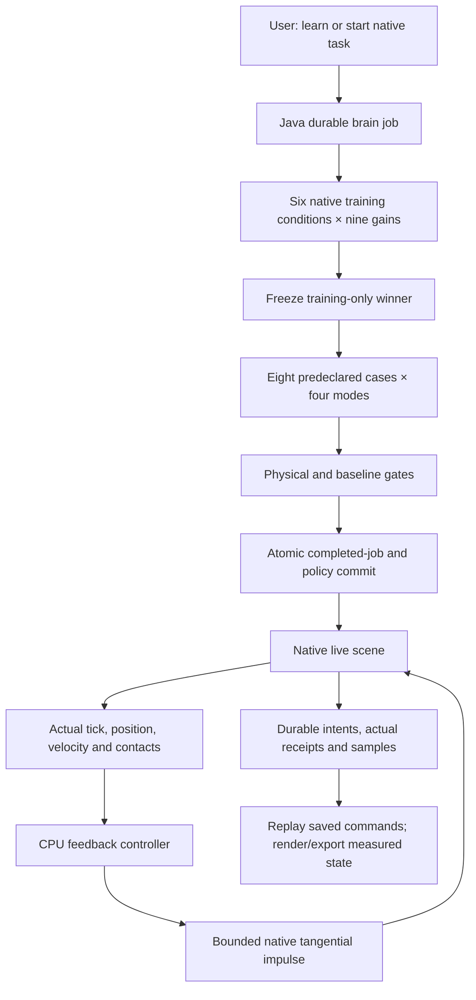
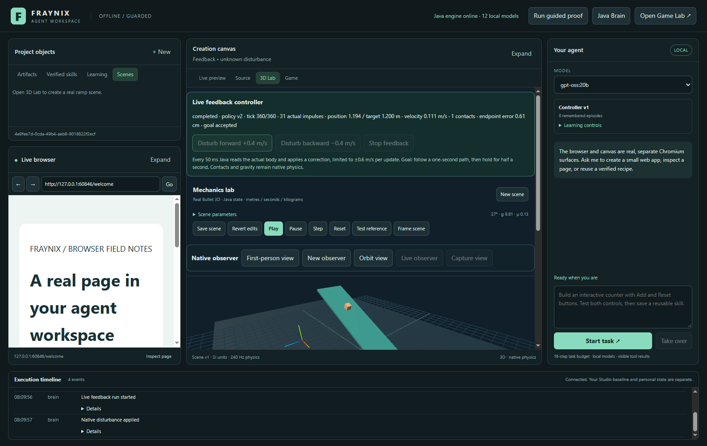

# Fraynix Agent Workspace · 017

## From one action to a physical feedback loop

October 30, 2026. The Java controller now observes the native block repeatedly and corrects its motion while physics continues. It can recover from an impulse applied during the run, follow a one-second trajectory and hold near its goal for another half-second. It keeps the original workspace layout, integrated Game view, browser, canvas, chat, memory, body controls and exports.

This edition learns **two feedback gains through actual native trial search**, rather than new language-model or spiking-cortex weights. A fixed evaluation suite was committed before the first experiment. On eight different evaluation conditions, the selected gains reduce the declared position/speed score by **40.9% against a hand-designed feedback controller** and **90.5% against feedforward control**. Worst endpoint error is **1.36 cm**; maximum terminal tangent speed is **0.171 m/s**. The exact task, score and finite horizon matter: this is a bounded physical-control result, not general game intelligence or indefinite stable manipulation.

[Entry point](README.md) · [Offline explorer](docs/readmes/017/index.html) · [Runtime contract](docs/CLOSED_LOOP_CONTROL.md) · [Edition history](docs/readmes/INDEX.md) · [Full evidence](docs/readmes/017/verification.json) · [Obsidian map](docs/obsidian/closed-loop-control.canvas)



## What works in the app

| Capability | Actual behavior |
|---|---|
| Learn feedback control | Java evaluates nine gain pairs on six native training cases, freezes the training winner, then runs four controller modes on eight predeclared evaluation cases. All 86 trials use real Bullet physics. |
| Live closed-loop run | Every 12 native ticks, the controller reads actual position and velocity and applies a bounded tangential impulse. Contacts, rotations and full native state remain in observations/receipts. |
| Disturb and recover | Forward/back buttons apply a real ±0.4 m/s velocity impulse. The controller receives the resulting state, without a future disturbance schedule. |
| Pause, step and stop | Existing scene Pause/Play/Step controls operate the live run. Stop feedback persists cancellation and stops tick advancement. |
| Replay and export | A completed run replays its saved actual control/disturbance commands. Native JSON export retains those commands, source policy and physical outcome. Existing trajectory/video facilities remain available. |
| Retained learning | Accepted gains survive restart. Feedback rollback creates a new version with previous gains. The earlier one-shot policy is a separate record and remains available. |
| Atomic promotion | Policy activation and the completed job commit together in one existing FactoryWorld transaction/checkpoint, preventing a cancellation from relabelling an already activated result. |

No new page is an empty placeholder. The **Java Brain** dialog and **3D Lab** gain working controls; the integrated original Java game remains in its existing Game tab. This phase does not change Mario's controller, add new chat tools, train an LLM or replace the renderer.

## Try the new loop

1. Start the workspace with the normal launcher. Open **3D Lab**, create or select a scene and save it. Use the default 12×3 m ramp at Z=0. The accepted domain is slope 10–40°, friction 0–0.3, mass 0.5–2 kg, gravity 8–12 m/s² and downhill target 0.4–1.8 m.
2. Open **Java Brain → Learn feedback control**. The candidate is activated only when the fixed gates pass and activation is enabled. Otherwise the previous controller remains active. The hand-designed feedback baseline is usable before training and is labelled as such.
3. Reset a previous experiment, choose a target and select **Start live feedback · 1.5 s**. The dialog closes and the existing native 3D view displays the run. Progress reports actual tick, policy version, impulse count, distance, tangent velocity and contact count.
4. During the run, select **Disturb forward** or **Disturb backward**. Java applies a physical impulse and records measured velocity before and after it. The next feedback step responds to the new state. The controller does not teleport the block to its target.
5. Use **Pause**, **Step** and **Play** for closer review. The task is intentionally short: 360 simulation ticks, with a one-second motion and half-second hold. The 50 ms control interval is simulation time; Windows scheduling, file persistence and rendering do not provide hard real-time wall-clock guarantees.
6. After completion, inspect endpoint, terminal speed and maximum error during the last quarter-second. A completed run can still miss its goal; the UI distinguishes completion from acceptance. The frictionless-from-rest check is inapplicable when the controller intervenes.
7. Select the saved run and **Replay**. Replay applies the original recorded impulses even if the active policy has since changed. Export its actual run JSON through the existing controls. Restart to inspect retained gains/history, or use **Restore feedback policy** to restore previous gains as a new version.


The screenshot is from an isolated current-release project, not a mockup. Actual sample/tick/impulse receipts are linked below. The controller acts in the native world; Three renders its authoritative poses.

## The experiment was fixed before testing

Protocol source was committed as `58ef53a51e0d706b4709e7a889958afe23fd1481` before the first native feedback experiment. Training cases, evaluation cases, candidate gains and acceptance rules have not been changed since that commit. Their packaged UTF-8 SHA-256 hashes accompany each job and live run.

- [Training cases](workspace-engine/src/main/resources/feedback/training-v1.json): six combinations of slopes 12/22/32°, friction 0.04/0.2, varied mass, gravity, target and actual disturbances.
- [Evaluation cases](workspace-engine/src/main/resources/feedback/evaluation-v1.json): eight different combinations of slope, friction, mass, gravity and target, with different impulse timing/direction/magnitude.
- [Contract and gates](workspace-engine/src/main/resources/feedback/contract-v1.json): nine gain pairs, control budgets, objective and acceptance limits.
- [Complete native trials and selection](docs/readmes/017/feedback-evidence.json): all training candidates and evaluation results, including samples, impulse receipts, source definitions and final states.

This is a **predeclared local development evaluation**, not a hidden third-party or external scientific benchmark. The source and fixtures are public to repository readers. Repeated development on these cases can overfit them; a genuinely independent test collection remains a next gate. Candidate selection reads training outcomes only; the evaluation runner applies future kicks without supplying their schedule to the controller.

## Four controllers, one native task

All modes receive the same scenario definitions and disturbances. They use the same 240 Hz native solver, 20 Hz control opportunity and actuator cap. The comparison includes:

1. **Zero control:** no corrective actuator impulses.
2. **Feedforward:** an analytical smooth trajectory and gravity/friction compensation, without position/velocity-error feedback.
3. **Hand-designed feedback:** the same feedforward calculation plus fixed proportional/derivative gains `kp=25`, `kd=10`.
4. **Selected feedback:** gains chosen solely from actual training scores; this run selects `kp=49`, `kd=10`.

The reference path is `target × (3u² − 2u³)` for the first second, followed by a constant target. Analytical gravity/friction compensation is an engineered model, rather than learned physics. Feedback adds `kp × position error + kd × velocity error`. Each requested velocity correction is clipped to ±0.6 m/s; native central impulse is `mass × correction` along the ramp tangent. At 2 kg that is at most 1.2 N·s per control update. This bounds the commanded actuator impulse, not all contact/gravity forces or instantaneous physical force.

The training objective, in equivalent metres, is:

```text
score = absolute endpoint error
      + (0.15 seconds × absolute terminal tangent speed)
      + (0.5 × maximum position error during the final 0.25 seconds)
```

This penalizes crossing the target at high speed and drifting during the hold, rather than rewarding a lucky single endpoint. Native samples independently determine each term. The following table is recomputed from the recorded physical trials:

| Mode | Mean endpoint error m | Mean terminal speed m/s | Mean settling maximum m | Mean score m |
|---|---:|---:|---:|---:|
| zero | 2.483885 | 4.751443 | 2.483885 | 4.438544 |
| feedforward | 0.209206 | 0.082522 | 0.211552 | 0.327360 |
| analytical-feedback | 0.019804 | 0.114903 | 0.031418 | 0.052748 |
| candidate | 0.007516 | 0.104877 | 0.015829 | 0.031162 |

Acceptance requires all evaluation endpoints within 0.06 m, terminal tangent speeds within 0.2 m/s and last-quarter-second position errors within 0.12 m. Candidate mean score must be no more than 0.005 m above the hand-designed feedback baseline and improve at least 50% against feedforward. These are the original predeclared gates; acceptance does not imply perfection, dominance on every individual case or indefinite stability.

## Learning, execution and authority



Java owns the controller, native worlds, training/evaluation jobs, activation, rollback and live scene. The desktop presents controls and the existing browser/canvas/chat. New feedback policies have their own version history; the four-weight one-shot readout from [edition 016](README-016.md) stays separate. This release optimizes two gains through finite native search. It does not update the diagnostic spiking cortex or local language-model weights, invent new executable tools or mutate trusted source from retrieved notes.

Live control records a pending intent before applying an impulse and a measured receipt afterward. A restarted unfinished run becomes interrupted and is not silently resumed. A matching active-run disturbance operation ID cannot apply twice; reuse with different input or a stale run is rejected. Stop persists a cancelled outcome and halts physics advancement. Completed replay applies recorded commands in their original tick/order; it does not retrain or ask the current controller to improvise.

Policy/job activation now shares one transaction and checkpoint. Cancellation and the final activation check serialize under the Java coordinator. A committed completed job rejects a late cancellation request. This change also covers the earlier one-shot training path. It closes a race where the policy could become active just before the worker labelled the job cancelled.

The workspace still has a finite 16-job history budget. The physical actuator is a virtual ramp-aligned motor/impulse source; it is not an articulated robot or a desktop mouse. The native contact count is observed and logged; the current control law uses position, tangent velocity and declared physical parameters. Learned image recognition, colliding avatars and full computer automation are separate capabilities.

## Verification, reproducibility and development findings

The existing `gpt-oss:20b` memory regression also passes four real-model assertions after restart; see [its evidence](docs/readmes/017/live-memory.json). Feedback training itself needs no language model.

The current source passes **155 Java tests, 19 desktop unit tests and 149 workflow assertion groups**. The fresh-checkout result is recorded separately in [verification](docs/readmes/017/verification.json). All tests use isolated private projects and preserve the original Studio, installed models and user scenes.

- [Full native training/evaluation evidence](docs/readmes/017/feedback-evidence.json)
- [Visible recovery, measured impulses, export, replay, stop, restart and rollback](docs/readmes/017/feedback-integration.json)
- [Current regression summary](docs/readmes/017/regressions.json)
- [Release verification, limits and clean checkout](docs/readmes/017/verification.json)
- [Canonical source/asset inventory](docs/readmes/017/file-inventory.json) and [file tree](docs/readmes/017/FILE_TREE.md)
- [Current runtime contract](docs/CLOSED_LOOP_CONTROL.md), [previous shared-brain contract](docs/JAVA_BRAIN_RUNTIME.md) and [working map](docs/obsidian/closed-loop-control.canvas)

Native velocity components are single-precision floats. Independent score reconstruction allows 0.0000001 m for serialized float rounding; actual goal and promotion limits are unchanged. An early UI test found the feedback rollback button could be clicked before the saved policy loaded. It now starts disabled and becomes available only after Java supplies its current version. Job detail polling also caches unchanged records rather than repeatedly transferring the complete trial archive.



To reproduce with cached dependencies:

```powershell
$env:JAVA_HOME = 'C:\Program Files\Eclipse Adoptium\jdk-21.0.10.7-hotspot'
.\gradlew.bat check installDist :workspace-engine:installDist --offline
npm.cmd --prefix workspace-desktop test
npm.cmd --prefix workspace-desktop run test:feedback
npm.cmd --prefix workspace-desktop start
```

A first installation needs the normal pinned dependency downloads. Docker, WSL, cloud APIs, CUDA installations and new model weights are unnecessary for this phase. Windows x64/JDK 21 is the verified environment. Existing optional local-model and GPU functions remain available; their presence does not make feedback training dependent on them. Historical numbered READMEs and their snapshots stay unchanged.

## Next complete milestones

1. **Broader physical robustness:** independently collected evaluation cases, different geometry, sensing error/delay, friction changes, sustained contact constraints and stronger optimizers. Freeze each protocol before results and retain failures.
2. **Closed-loop manipulation/navigation:** extend observation/action contracts beyond the single ramp tangent, with reachable goals, collisions, explicit success/failure and safe recovery. Do not transfer this gain result to a robot or Mario without new evidence.
3. **Original-game learning:** align player, mushroom, obstacle/contact and failure identities with actual game ticks; train and evaluate on separate levels. The Game tab remains functional, but this release does not claim those new policies.
4. **Java task graphs:** migrate durable tool intents, effect reconciliation, recovery and model-agent supervision behind Java contracts while retaining browser hosting/presentation in the desktop.
5. **Experience-driven policy updates:** turn retained live failures into versioned training datasets with provenance, source-policy fencing and evaluation/rollback. Current fixed-suite retraining is deterministic; repeated unchanged runs are not spontaneous new learning.

The larger design remains a local agent workspace that acts on real state, measures consequences and retains useful improvements. This phase adds a complete, bounded observation/action feedback loop and stronger evidence for it, while leaving broader claims to their own working implementations and tests.
