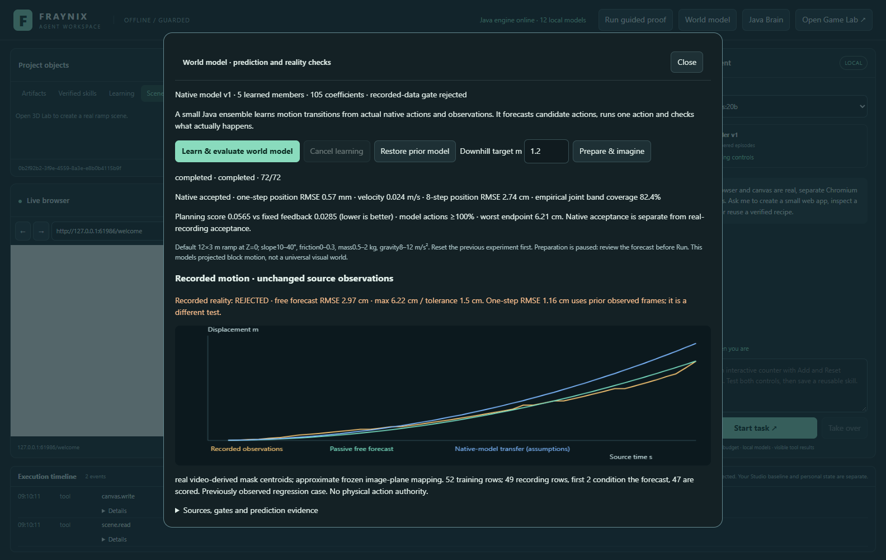
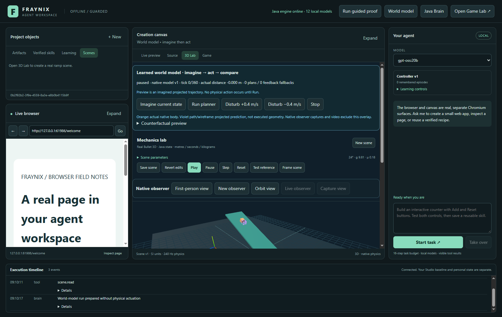
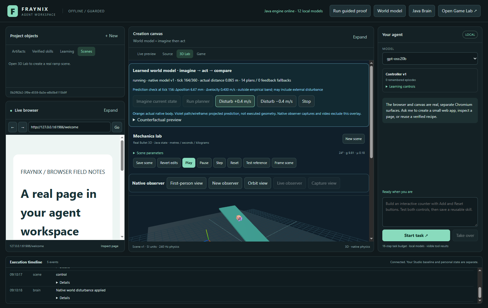
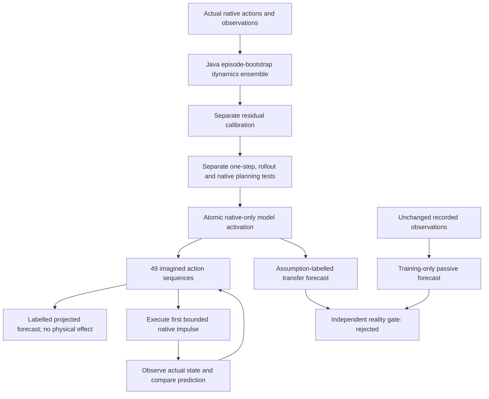
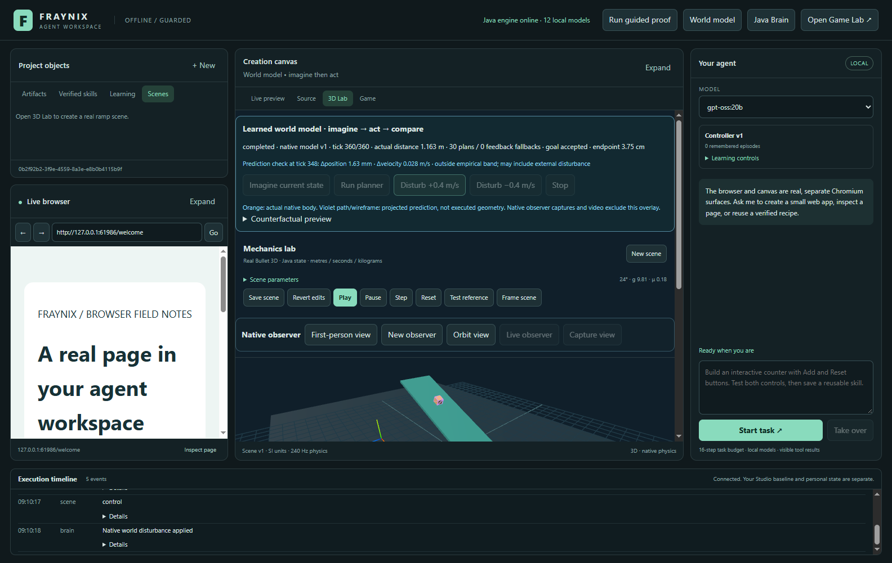

# Fraynix Agent Workspace · 018

## A learned world model that imagines actions and checks reality

October 30, 2026. Java now learns action-conditioned state transitions from native observations, predicts candidate futures, chooses an action, observes its actual consequence and records prediction error. The existing workspace gains a **World model** control and a projected forecast beside the actual body. A separate recorded-motion experiment compares predictions with the unchanged real observations already in the project.

This is a small, structured numerical world model: five fitted ensemble members, seven engineered input features and three outputs, totaling **105 learned coefficients**. It models projected block travel, tangent velocity and a bounded contact estimate in the native ramp environment. The renderer displays that learned projection; it does not supply authoritative motion. The shared Java brain, original Game, browser, canvas, chat, memory and previous feedback controller remain available.

Three results define the current boundary:

- Native one-step position RMSE: **0.57 mm** over 256 separate test transitions. Eight-step, 0.4-second rollout position RMSE: **2.74 cm**.
- Learned planning meets its predeclared native gates, with worst endpoint error **6.21 cm**. The existing feedback controller still has a better aggregate tracking score: **0.05647 for planning versus 0.02848 for feedback**, where lower is better.
- Recorded reality remains **rejected**. The passive free forecast has **2.97 cm RMSE** and **6.22 cm maximum error**, exceeding the unchanged 1.5 cm all-point tolerance. Native-model transfer to those recordings is also imperfect; it is displayed rather than treated as validated physical control.

[Entry point](README.md) · [Offline explorer/video](docs/readmes/018/index.html) · [World-model contract](docs/WORLD_MODEL_REALITY.md) · [Edition history](docs/readmes/INDEX.md) · [Verification](docs/readmes/018/verification.json) · [Obsidian map](docs/obsidian/world-model-reality.canvas)



## What works

| Function | Actual behavior |
|---|---|
| Learn a local transition model | Native action/observation episodes fit an ensemble in Java. Separate cases calibrate empirical error bands; further cases test prediction and planning. |
| Imagine without acting | Prepare a paused native scene, evaluate 49 two-block action sequences and inspect seven constant-action alternatives. Tick, position and velocity remain unchanged during preview. |
| See the forecast | Violet paths, interval edges and a wireframe indicate projected future motion. The orange body shows actual native state. The projection is labelled and excluded from native observer captures/video. |
| Plan, execute and compare | Execute only the first action, observe actual state after 12 solver ticks, compare it with the previous prediction and plan again. External impulses can create visible prediction surprises. |
| Abstain or fall back | Unsupported states reject. Excessive uncertainty or unsupported candidate futures produce a labelled existing-feedback fallback; fallback counts are retained. |
| Check recorded observations | A passive model fits only the recorded training trajectory. Free rollout, teacher-forced one-step prediction, constant-velocity baseline and native-model transfer are scored separately. |
| Retain and reproduce | Learned coefficients, source hashes, uncertainty calibration, forecasts, actual commands and innovations persist. Cancellation, rollback, native command replay, JSON export and actual WebM are tested. |

The new functionality lives inside the current application. It adds no placeholder environment, pretrained video transformer, cloud service, new database or hardware driver. Language-model calls are optional for the surrounding workspace; this learning/planning loop runs without one.

## Use World model

1. Start the application with the normal launcher and open/save a **3D Lab** scene. For this model use the default 12×3 m ramp at Z=0, slope 10–40°, friction 0–0.3, mass 0.5–2 kg, gravity 8–12 m/s² and target 0.4–1.8 m. Reset an earlier experiment before preparing another.
2. Open **World model → Learn & evaluate world model**. The Java job collects native experience, fits the ensemble, calibrates bands, evaluates separate native transitions/rollouts and compares learned planning with the fixed feedback controller. Recorded-data evaluation has its own status.
3. Review both statuses. A model can be accepted for the native simulation while the recorded-data forecast is rejected. The real-data plot displays observed positions, passive free forecasts and native-model transfer under declared assumptions.
4. Choose a downhill target and select **Prepare & imagine**. The native world starts paused. The violet path and wireframe show a projected future, not executed geometry. Expand **Counterfactual preview** to compare the predicted result of seven repeated constant actions. The actual planner evaluates 49 two-block sequences.
5. Select **Run planner**. Every 50 ms of simulation time, Java acts once and replans from actual position, tangent velocity and observed contact state. The live panel shows model version, actual ticks, plan count, fallback count and measured prediction residuals.
6. Apply **Disturb +0.4 m/s** or **Disturb −0.4 m/s**. These are real impulses in the native simulation. An unexpected change may fall outside the empirical prediction band; the next plan uses the resulting actual state. Pause, step or stop using the existing scene controls and the World model panel.
7. Replay a completed run to re-execute its saved commands. Export native JSON or video through existing controls. Restart to inspect retained learned coefficients and run history. **Restore prior model** creates a new version of the previous availability/model state; previous feedback and one-shot policy histories are separate.



Preview requires the matching run, current tick and actual native-state digest. Changing velocity at the same paused tick invalidates the preview. The UI removes expired preview geometry and explains how to refresh it. Run always replans from current observations rather than executing an old preview as an approved command.

## What is learned

The numerical state is downhill displacement, tangent velocity and a contact score. Context supplies the known slope, gravity, friction and mass. The seven features include a constant, normalized velocity/action, gravity projected along the ramp, friction projected against motion and contact, a smooth velocity-sign feature and observed contact support. These are engineered physical features; the model does not discover its own visual ontology or physical units.

Each ensemble member learns three linear readouts: displacement change, next tangent velocity and next contact estimate. Ridge regression fits them from actual native transitions. Displacement change is added to current displacement, allowing translation along the same ramp. The contact estimate is clipped to 0–1 and carried into imagined rollouts; it is an estimated support score rather than a calibrated probability or full collision model.

Five deterministic bootstrap fits resample whole training episodes, preserving the fact that adjacent observations are related. A separate calibration split supplies the 90th percentile absolute errors for each motion output. A one-step radius is the larger of that empirical residual scale and twice ensemble standard deviation. Multi-step display bands grow with horizon and ensemble spread. These are empirical diagnostics with declared evaluation, not guaranteed confidence or physical safety bounds.

The broad idea of uncertainty-aware dynamics ensembles and sampled model-based control has an established research basis, including [Chua et al., *Deep Reinforcement Learning in a Handful of Trials using Probabilistic Dynamics Models*](https://proceedings.nips.cc/paper_files/paper/2018/hash/3de568f8597b94bda53149c7d7f5958c-Abstract.html). This implementation uses small engineered-feature ridge models and its own tests; it is not a reproduction of that paper's deep-network implementation or benchmark results.

## Fixed native experiment

Protocol commit `a1729a97e81ad12f6e43b93e054d416b2af136a3` predates the first model experiment. The following files and gates remain unchanged:

- [Training conditions](workspace-engine/src/main/resources/world-model/training-v1.json): eight conditions × four episodes × sixteen transitions = **512 fitting transitions**.
- [Calibration conditions](workspace-engine/src/main/resources/world-model/calibration-v1.json): four different conditions × two episodes × sixteen transitions = **128 calibration transitions**.
- [Evaluation conditions](workspace-engine/src/main/resources/world-model/evaluation-v1.json): eight further conditions × two episodes × sixteen transitions = **256 test transitions** and thirty-two eight-step rollouts.
- [Contract and acceptance](workspace-engine/src/main/resources/world-model/contract-v1.json): fitting budget, seeds, candidate actions, horizon, uncertainty limits and all native/recorded gates.

Each transition executes a bounded native impulse and twelve actual 240 Hz solver ticks. Seeded exploratory actions include braking limits to stay inside the declared state domain. Episode provenance retains case/episode identity, native entity IDs and before/after poses, velocities and contacts. Candidate fitting uses training only; calibration supplies residual scales and evaluation supplies the reported measurements.

There are 56 collection worlds and 16 closed-loop planning comparison worlds: **72 native worlds total**. The new conditions are predeclared local development cases, not an external hidden benchmark or proof of broad real-world generalization. Parameters vary within the declared domain; geometry remains fixed.

| Native test | Learned model | Action-aware kinematic reference |
|---|---:|---:|
| One-step position RMSE m | 0.00056629 | 0.00487874 |
| One-step velocity RMSE m/s | 0.02440779 | 0.17874505 |
| Eight-step position RMSE m | 0.02742957 | Not used as this gate |
| Eight-step velocity RMSE m/s | 0.10433044 | Not used as this gate |

The kinematic reference already includes the commanded velocity impulse, then assumes constant velocity over the next interval. Thus the learned model is compared with an action-aware simple baseline. Eight-step rollout RMSE uses the end of a 0.4-second imagined sequence starting from one actual state, without replacing its intermediate predictions with observed states.

Empirical **joint** position-and-velocity band coverage is **82.4%**. Calibration uses marginal residual scales; joint coverage is reported directly and is not relabelled a 90% guarantee. Native acceptance requires one-step position/velocity RMSE ≤0.008 m/0.08 m/s, eight-step RMSE ≤0.08 m/0.25 m/s, RMSE ratios ≤0.7 against the kinematic reference and joint coverage ≥0.8.

## Planning inside the learned model

At each decision, the planner evaluates seven first-block actions × seven second-block actions. Each block lasts four model steps, giving a horizon of eight steps/0.4 seconds. Every member predicts its own trajectory. The cost combines reference-position error, reference-velocity error, action cost and uncertainty. Only the first bounded action is executed; the rest remain counterfactuals.

The reference task is the same one-second cubic trajectory and half-second hold introduced in [edition 017](README-017.md). Native impulses stay bounded to ±0.6 m/s per control update. Future disturbance schedules are kept in the experiment runner and are never supplied to the model or planner.

Planning acceptance is separate from prediction accuracy. The predeclared gates allow mean score within 0.04 m of the fixed `kp=49`, `kd=10` feedback baseline, maximum endpoint error 0.08 m, tangent speed 0.25 m/s, settling error 0.15 m and at least 80% learned-model actions. The native test uses **100% model actions**. The learned planner passes those gates, while the simpler feedback controller remains better on mean tracking score. It remains available as the default earlier controller and a labelled fallback.



Prediction errors bind the source tick/model to an actual later native observation. A surprise means a residual exceeds the empirical band; external impulses can cause that without indicating the model predicted an impossible action. The run retains both the forecast and actual event history for inspection.

## Recorded reality is a separate, failed gate

The user chose the existing recorded motion case. It comes from externally recorded Delfys75 videos and supplied masks, associated with [*Learning Physics From Video*](https://arxiv.org/abs/2410.01376). This app uses the already committed derived trajectories and frozen image-plane mapping, with the qualifications documented in [the original case](docs/datasets/delfys75-013/README.md). No raw recording, mask, observation, unit conversion, source selection or camera scale is changed.

The two recordings supply 52 training rows and 49 evaluation rows. This extension fits constant acceleration from training second differences. The first two evaluation positions initialize displacement/velocity; they are declared conditioning and excluded from scoring. All **47 subsequent forecasts** are scored. No evaluation-specific parameter fit, time shift or rescaling is performed.

Three different prediction questions are retained:

| Method | Conditioning and interpretation | Current result |
|---|---|---|
| Passive free forecast | First two evaluation points only; then open-loop constant-acceleration forecast | RMSE 2.97 cm; maximum 6.22 cm |
| Passive one-step | Uses the preceding two actual recorded positions at every step | RMSE 1.16 cm; this does not establish free-rollout accuracy |
| Native-model transfer | Learned native dynamics with zero action, nominal 20°/9.81 m/s²/μ=0/1 kg/contact-score=1 assumptions, interpolating predictions to source timestamps | RMSE 9.83 cm; assumptions are not physical calibration |

The unchanged 0.015 m all-point tolerance rejects the passive free forecast. That rejection is preserved even though it improves over constant-velocity forecasting. This is a previously observed regression recording, not a new untouched scientific holdout. Native-model acceptance does not grant physical action authority or erase the earlier [edition 013 rejected fit](README-013.md).

The useful result is an executable boundary between imagination and observation: source-labelled real curves, reproducible forecasts and a visible failed gate. Additional calibration references and independently collected recordings are needed to determine how camera mapping, release conditions, surrogate geometry or model structure contribute to the gap. The current data do not isolate those causes.

## Runtime ownership and evidence



Java owns learned coefficients, model versions, source digests, native state, action validation, uncertainty diagnostics and evaluation. The desktop owns the views and existing browser/canvas surfaces. The shared spiking cortex, feedback gains, one-shot readout and new dynamics model remain distinct mechanisms. A language model does not fabricate observations or decide whether the numeric gates passed.

Native control saves a pending plan before the physical impulse and a measured receipt afterward. Unfinished persisted runs become interrupted on restart. Cancellation stops native advancement. Replay executes original saved commands rather than asking a new model to recreate them. Model activation and the completed job commit together through the existing FactoryWorld checkpoint machinery. Rollback restores prior model availability/coefficients as a new version without modifying the other policy histories.

The current source passes **160 Java tests, 19 desktop unit tests and 164 workflow groups**, with separate current local-model memory evidence. Tests independently recalculate prediction errors, baselines, coverage, recorded residuals and native impulse changes; check source split membership, source digests, unsupported state rejection, coefficient persistence, preview immutability, cancellation, rollback and replay; and decode actual exported video. The forecast overlay is excluded from native-only observer/video output.

- [Complete native experience, coefficients, calibration and evaluations](docs/readmes/018/world-model-evidence.json)
- [Actual UI/preview/physics/reality/source checks](docs/readmes/018/world-model-integration.json)
- [Actual native video without prediction overlay](docs/readmes/018/media/world-native.webm)
- [Native run with forecasts, innovations and command history](docs/readmes/018/examples/native-world-run.json)
- [Current regression summary](docs/readmes/018/regressions.json)
- [Real local-model memory regression](docs/readmes/018/live-memory.json)
- [Release limits, clean checkout and documentation checks](docs/readmes/018/verification.json)
- [Canonical source inventory](docs/readmes/018/file-inventory.json)
- [Source file tree](docs/readmes/018/FILE_TREE.md)



## Run and extend

```powershell
$env:JAVA_HOME = 'C:\Program Files\Eclipse Adoptium\jdk-21.0.10.7-hotspot'
.\gradlew.bat check installDist :workspace-engine:installDist --offline
npm.cmd --prefix workspace-desktop test
npm.cmd --prefix workspace-desktop run test:world-model
npm.cmd --prefix workspace-desktop start
```

Cached pinned dependencies support the offline commands; first setup requires their normal downloads. The numerical learning and planning code is Java CPU code with no new dependencies. Native Bullet and the established renderer retain their existing dependencies. No Docker, WSL, cloud inference, CUDA install or model-weight download is required for this phase. Windows x64/JDK 21 is the verified environment. Tests use isolated projects and preserve original Studio, user scenes and shared model services.

The next complete milestones are: obtain independent calibration/evaluation recordings for the failed reality gate; extend state prediction to more objects, geometry and contact transitions with explicit uncertainty; test sensing noise/delay and changing conditions; connect provenance-backed live episodes to controlled retraining; and migrate more durable agent task/effect coordination into Java. Original-game learning and broader navigation/manipulation require their own observations, actions and held-apart outcomes. The working world model supplies a concrete prediction–action–observation loop on which to build those extensions.
