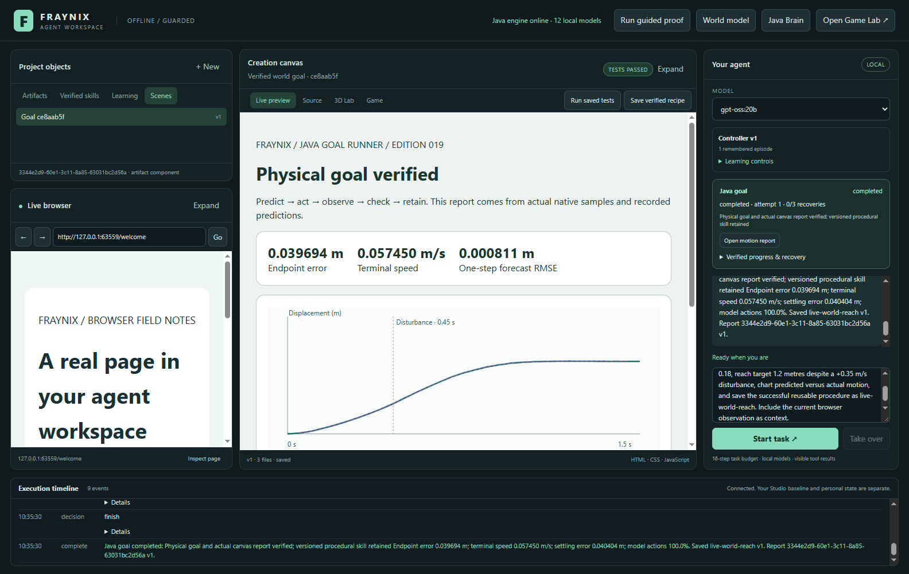
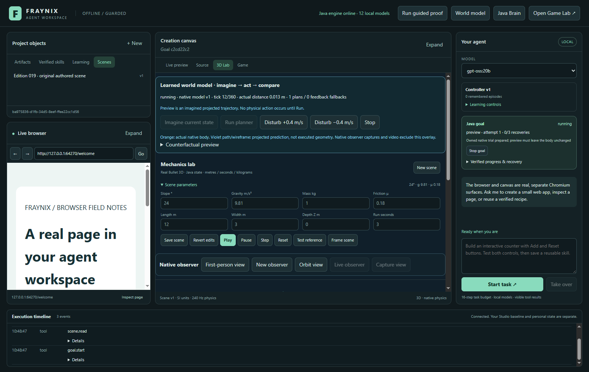
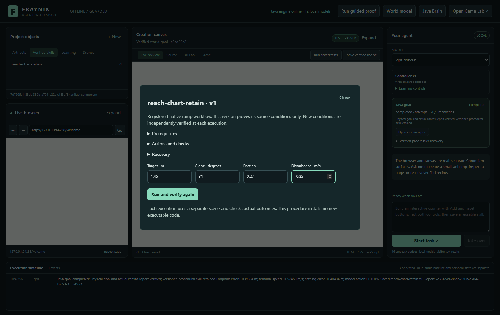
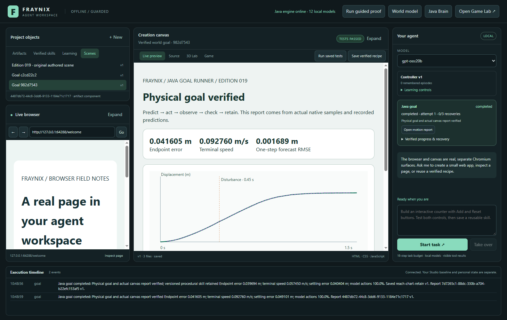
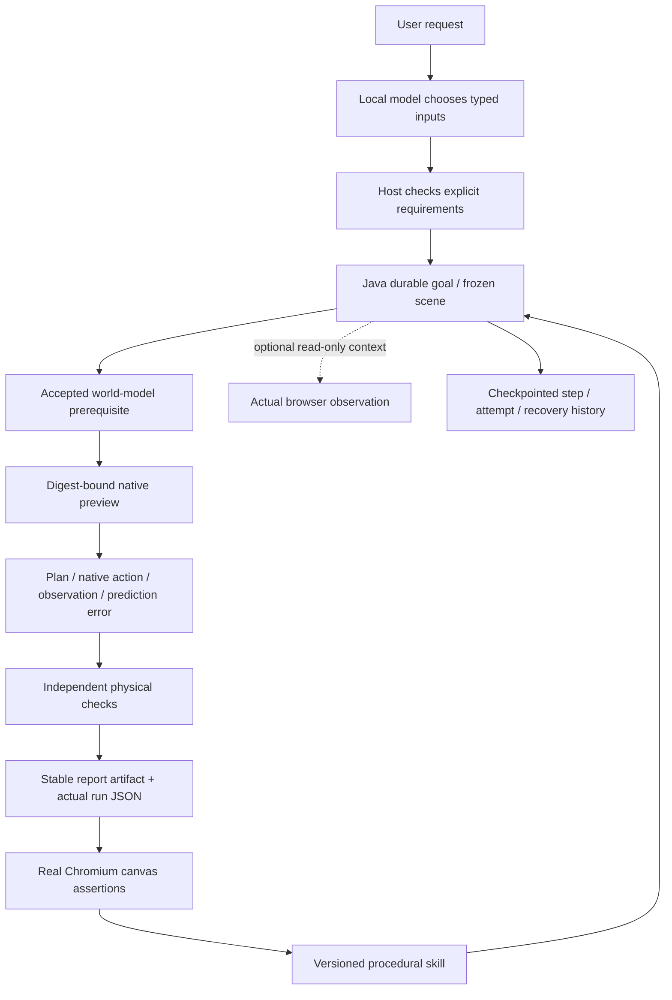

# Fraynix Agent Workspace — edition 019

**A tool performs an action. A skill completes a task using actions, checks and recovery.**

Edition 019 turns the existing native world-model demonstration into a durable Java task. Chat can request prediction, target-reaching despite a disturbance, an actual motion chart and a retained procedural skill. Java executes the workflow, checks the physical outcome and requires a passing test in the actual canvas before completing it. A saved procedure survives restart and verifies its result again under changed conditions.

[Start](README.md) · [Offline interactive explorer](docs/readmes/019/index.html) · [Full runtime contract](docs/GOALS_AND_SKILLS.md) · [Verification](docs/readmes/019/verification.json) · [Source tree](docs/readmes/019/FILE_TREE.md) · [Obsidian map](docs/obsidian/goals-skills.canvas) · [Previous edition](README-018.md)



All current screenshots are actual October 30, 2026 application captures from isolated test projects. The browser and canvas are real Chromium surfaces; the block's motion comes from native physics. Fixture geometry and recorded results are identified below. These are measured local development cases, not a hidden external benchmark or proof of general real-world autonomy.

## What changed

The LLM now selects a registered physical task through native tool calling. A shared Java goal runner owns frozen conditions, task state, prerequisites, effects, outcome checks and recovery. The controller maintains physical timing without requiring an LLM call for each frame. The desktop performs the browser/canvas effects and presents actual progress. Versioned procedural skills retain successful ways of completing this particular task.

| New function | What it actually does |
|---|---|
| Chat → world model | `world.model` reads actual learned-model status/domain. `goal.start` selects target, slope/friction, disturbance and optional skill retention. The host checks explicit request values before starting. |
| Durable Java goal | Freezes a separate scene, ensures an accepted native model, previews plans, runs native control, reconstructs physical gates and writes a stable report. State survives the short model session. |
| Actual browser context | When requested, observes the current browser and retains its URL/source hash. The content remains untrusted context and supplies no physics evidence or executable authority. |
| Actual report verification | Opens the pinned artifact in the real canvas and runs seven assertions against the result, run/goal bindings, chart series and residual rows. Java checks version, content hash and receipt. |
| Procedural skill | Stores a registered procedure kind, version, defaults, prerequisites, actions, success gates, recovery policy and verified source goal/run/report. It installs no new executable code. |
| Changed-condition reuse | Runs the saved version through fresh prediction, action and checks. New commands respond to current state rather than replaying the earlier impulse sequence. |
| Recovery | Explicit resume restarts incomplete physics as another recorded attempt. Completed physics and stable report identity are reused when only desktop verification was interrupted. |

This is one implemented procedural task family, `world-reach-report-v1`. The browser participates as optional context and the canvas as a verified output. Arbitrary browser navigation workflows, general data-processing procedures and user-authored executable workflow graphs remain future task families.

## Try the complete request

Start **Launch-Agent-Workspace.bat** with the existing JDK 21/Node setup. Docker and WSL are unnecessary. Select an installed eligible local Ollama model; `gpt-oss:20b` is the model verified for this edition. Reset a previous unrelated experiment before starting the new goal; saved authored scenes and recorded runs are retained.

Enter:

> Predict how this native block moves using the world model. On a 24 degree slope with friction 0.18, reach target 1.2 metres despite a +0.35 m/s disturbance, chart predicted versus actual motion, and save the successful reusable procedure as reach-chart-retain. Include the current browser observation as context.

1. Chat selects the typed task. Explicit physical values, a specifically named retained procedure and requested browser context must not disappear into model defaults. Missing requirements reject before any goal starts, giving the model a concrete repair message.
2. Java freezes the selected source scene into a separate task scene. If no source is selected, the existing native defaults apply except for requested changes. The original authored source stays unchanged.
3. If necessary, an owned prerequisite job runs the existing edition 018 native world-model training and evaluation. A retained accepted model is reused on later tasks. The recorded-data gate remains separate.
4. The native scene begins paused. Java previews 49 candidate plans using the actual state digest and checks that the body has not moved. Then the 20 Hz controller acts and replans through 240 Hz native solver ticks.
5. One disturbance is applied at tick 108, or 0.45 s of simulation time. The full trial lasts 360 ticks, or 1.5 s. The scheduler's wall-clock rate is not a hard real-time guarantee.
6. Java checks physical completion, writes the displacement chart/raw JSON, and waits for the actual canvas assertions. The right panel shows the durable step, attempt, recovery count and meaningful history.
7. On success the final chat answer contains Java's measured results and exact saved skill/report identity. The agent cannot declare a skill saved merely by printing that phrase.



If interrupted, select **Resume saved task**. **Stop goal** halts the owned native motion. An interrupted run is retained as evidence and is never relabelled successful. Three explicit resumes are allowed, with a 180-second budget per attempt.

## Measured results

The two cases and unchanged acceptance gates were written in the [edition 019 contract](workspace-engine/src/main/resources/goals/contract-v1.json) before their first execution. They were not committed as an independent hidden benchmark. Both use the existing native model and default 12 × 3 m ramp at Z=0. The new acceptance gates reuse edition 018's existing endpoint/speed/settling/model-use limits.

| Case | Slope / friction | Target / disturbance | Endpoint error | Terminal speed | Forecast RMSE |
|---|---|---|---:|---:|---:|
| Initial task | 24° / 0.18 | 1.2 m / +0.35 m/s | 0.039694 m | 0.057450 m/s | 0.000811 m |
| Reused skill / changed condition | 31° / 0.27 | 1.45 m / -0.35 m/s | 0.041605 m | 0.092760 m/s | 0.001689 m |


Each result independently reconstructs actual velocity changes from before/after native states, the twenty-nine forecast residuals from measured displacement, endpoint error from final position and the single disturbance from tick/operation identity. Both cases use thirty control plans and 100% learned-model actions. Different commands under the changed condition demonstrate adaptive execution; this is not evidence that LLM weights changed or that the skill taught a new general physics law.

The underlying model remains the edition 018 ensemble of five engineered-feature ridge models, with 105 learned coefficients. Its earlier independent native evaluation and separately rejected recorded-reality forecast are preserved. The existing feedback controller still had the better mean tracking score in edition 018. This release adds task completion and retention; it does not claim a stronger physics model.


The green series is actual native displacement. Violet is the next 50 ms forecast aligned to the corresponding measured tick. Orange marks the scheduled actual disturbance. RMSE is computed from those recorded forecasts and measurements; it is not a confidence interval. The report also contains goal/run identity, source hash, native-only scope and an expandable table of all twenty-nine forecast checks. Its `run.json` and `procedure.json` are real files alongside the report HTML.

## Use a retained skill

Open **Verified skills** and select the procedural version. Inspect prerequisites, actions and recovery; change slope, friction, target or disturbance; select **Run and verify again**. This path works without a language-model call once the procedure exists. A new goal records the exact skill version and independently checks the new result.



The changed-condition test uses a 31° slope, friction 0.27, target 1.45 m and a −0.35 m/s disturbance. Its outcome is a separate verified goal. Saving that successful condition under the original skill name creates version 2; saving the same goal/name again returns the same version. Version 1 and its evidence remain intact.



Procedural versions are registered workflow data, not an unrestricted code installer. Existing **tested web artifact recipes** remain available beside them. Reusing an HTML recipe creates/tests a web artifact; reusing this native procedure runs a durable physical task. The library shows the kind/version through its inspector and execution path.

## How the layers work together



Java owns goals/procedures as FactoryWorld entities, using the existing atomic checkpoint machinery. SceneStore owns native scene/run records; BrainService owns model jobs and promotion; WorkspaceStore owns versioned files and passing test receipts. The control server serializes goal transitions with competing native mutations. While a goal owns the physics/model state, manual reset, scene changes, competing impulses, calibration application and model rollback reject with a clear message.

Desktop effects are registered host handlers. Private goal/effect claims require a fresh nonce and expire after thirty seconds. Claim/ack routes never enter the model's catalog. A forged passing boolean, wrong nonce, expired receipt, changed report version or missing canvas assertion cannot complete the goal. Retried report verification is allowed; arbitrary external writes do not gain an exactly-once guarantee.

After a process restart, active goals become **interrupted** and await explicit resume. If physics was unfinished, recovery creates another recorded native attempt from frozen conditions. If physics completed and only report verification was interrupted, recovery reuses that exact run and report identity. Native impulses are not silently replayed to recover a missing desktop acknowledgment. Checkpoints, per-effect identity and native receipts reconcile the registered operations; there is no single distributed transaction across all files and effects.

## The whole application remains available

| Existing area | Current function |
|---|---|
| Browser and creation canvas | Real browsing, typed browser actions, live HTML/CSS/JavaScript, source editing, versions and actual interactive tests. |
| Local model and memory | Existing admission/digest checks, bounded automatic retrieval, immutable notes, hybrid local memory and journal verification. |
| Java brain | Shared CPU nervous-system module, durable neural jobs, measured physical policies, independent evaluations and rollback. Optional GPU readout remains a separately tested backend. |
| Native 3D Lab | Authored entities, gravity/friction/mass, native Bullet contacts, actual observations, feedback, learned prediction and recorded command replay. |
| Physical object interaction | Existing bounded grab/move/release constraint, collisions, target/outcome checks and native receipts. The new ramp goal uses controlled impulses, not an articulated robot hand. |
| Original game | Existing integrated offscreen Java game runtime and preserved optional Game Lab/editor, with separate project state. This goal does not train arbitrary game-playing behavior. |
| Data and export | Versioned CSV observations, native comparisons, one-parameter calibration with separate validation, native scene import/clone, JSON/CSV/PNG and actual WebM export. |
| Skills | Tested web artifact recipes plus the new versioned native procedural workflow. Imported text never installs a privileged handler. |

The current left browser/library, center canvas/source/3D/Game, right chat and bottom timeline layout is preserved. Original Studio, the separate Chandra app, personal runtime data and installed Ollama model stores are untouched. This remains the independent private `eyeoverthink/Fraynix-Agent-Workspace` project.

## Verification and reproducibility

The current source passes **165 Java tests**, **21 desktop unit tests**, **178 workflow assertion groups**, and **five actual `gpt-oss:20b` goal assertions**. The live chat test calls `goal.start` once and then `goal.read`, checks exact request parameters, actual browser context, native outcomes, report binding, retained skill and the passing canvas receipt in the saved episode. The final answer's numeric values come from Java evidence.

The new workflow checks cancellation, changed-condition reuse, immutable version 2/idempotent saving, original-source preservation, native mutation ownership, wrong/invented/expired host receipts, restart during physics, restart during report verification and renderer errors. Unit checks cover domain/field rejection, source versions, preservation of foreign native runs, durable intent, finite explicit recovery, cancellation and stable effect identity. Native serialized float comparisons use a 2×10⁻⁶ numeric reconciliation tolerance; the physical acceptance gates are unchanged.

An independent clean source checkout of `7bb9d6a` passes the offline build, all 165 Java tests, 21 desktop units and 61 combined body/Game/Brain/feedback/world/goal UI groups. No user project or personal model weights were copied. The already pinned Electron45.1.0 executable was reused from the local dependency cache after offline dependency installation. The offline documentation viewer is checked at wide and390px layouts.

Build and run the checks from the checkout:

```powershell
.\gradlew.bat check installDist :workspace-engine:installDist --offline
npm.cmd --prefix workspace-desktop test
npm.cmd --prefix workspace-desktop run test:goals
npm.cmd --prefix workspace-desktop run test:live-goals
pwsh -NoProfile -File scripts/Verify-Documentation.ps1
```

Offline build assumes the pinned dependencies are already cached. The chat test needs an already installed eligible local model and running Ollama. The registered Java workflow and retained skill reuse do not require cloud inference. Tests create isolated temporary project directories; they copy no live user project, browser profile or personal model weights. Electron integrations run sequentially.

- [Release verification and limits](docs/readmes/019/verification.json)
- [Native/browser/canvas/skills/recovery evidence](docs/readmes/019/goals-integration.json)
- [Actual local-model chat evidence](docs/readmes/019/live-goals.json)
- [Existing local memory regression](docs/readmes/019/live-memory.json)
- [Complete regression summary](docs/readmes/019/regressions.json)
- [Standalone actual motion report](docs/readmes/019/examples/verified-motion-report.html)
- [Actual native goal run](docs/readmes/019/examples/native-goal-run.json)
- [Typed procedure parameters](docs/readmes/019/examples/procedure-parameters.json)
- [Canonical source inventory](docs/readmes/019/file-inventory.json)

## Limits and next steps

Recorded real-world action use remains **unauthorized**. The fixed Delfys free forecast still fails its unchanged 0.015 m gate; the earlier measured RMSE is about 0.02971 m and maximum error 0.06215 m. Passing native task gates does not validate a real actuator, visual world model or broader physical environment. No pretrained video transformer is needed for the current deterministic world logic; the structured dynamics model still uses known physical context and engineered features.

Budgets are one active goal, 64 retained goals, 32 procedural-version records, eight versions per skill name, three explicit resumes per goal and 180 seconds per attempt. The existing 16-job brain history cap remains. Budgets stop with a reason instead of deleting history. Frozen task content changed outside the task is rejected; cancel and begin a new request for different conditions.

Next, add a second independently tested procedure family—such as local data import → checked transformation → chart/report—using the same durable runner principles. Then connect browser research and artifact build/test tasks through registered typed procedures with their own checks and recovery. Keep effects and evidence bound to the actual task rather than treating retrieved text as executable authority.

Experience-derived improvements should use completed/failing goal records to create versioned training cases, hold separate evaluation cases, compare against the existing strong controller and retain rollback. This edition records reusable procedures and adapts execution from actual observations; it does not perform online LLM fine-tuning or claim general recursive self-improvement. Broader multi-object physics, sensing uncertainty, more contact states, calibrated real observations and original-game learning remain further measured milestones.

[Development log](docs/DEVELOPMENT_LOG.md) · [Project memory](docs/PROJECT_MEMORY.md) · [Scenario roadmap](docs/SCENARIO_ENGINE_ROADMAP.md) · [Edition history](docs/readmes/INDEX.md)
