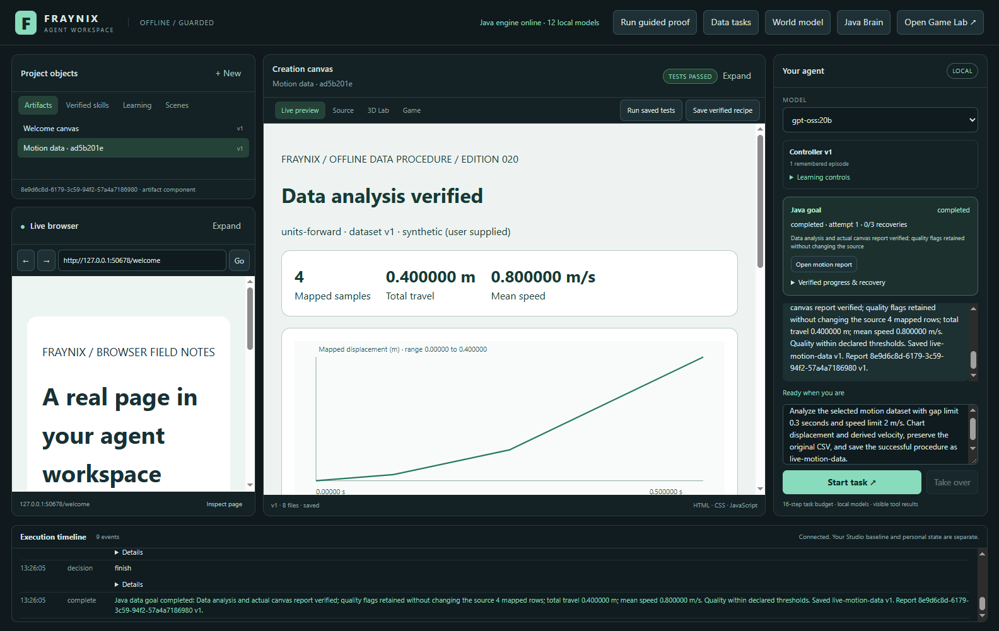
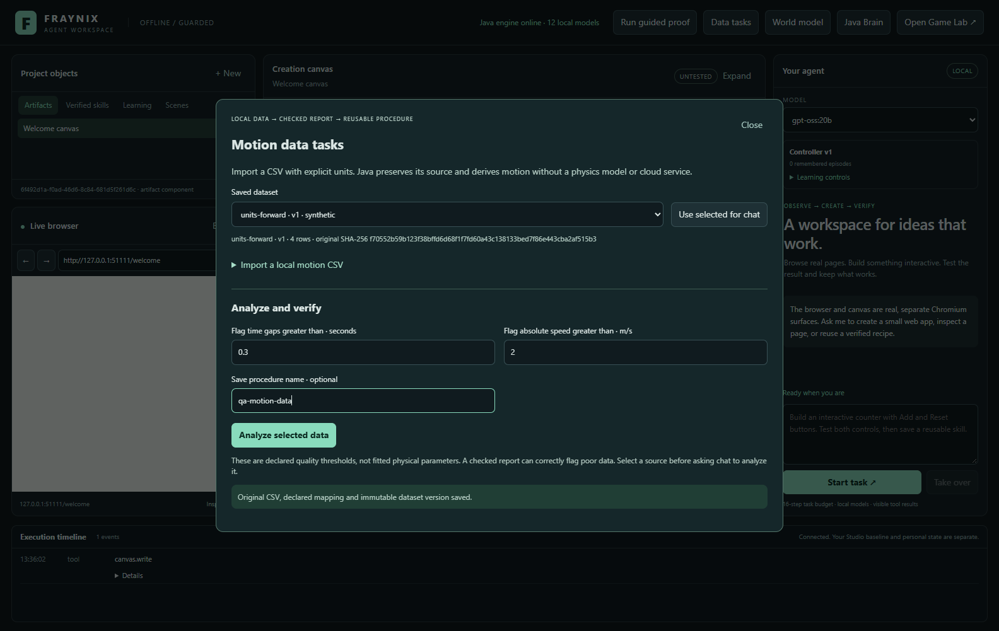
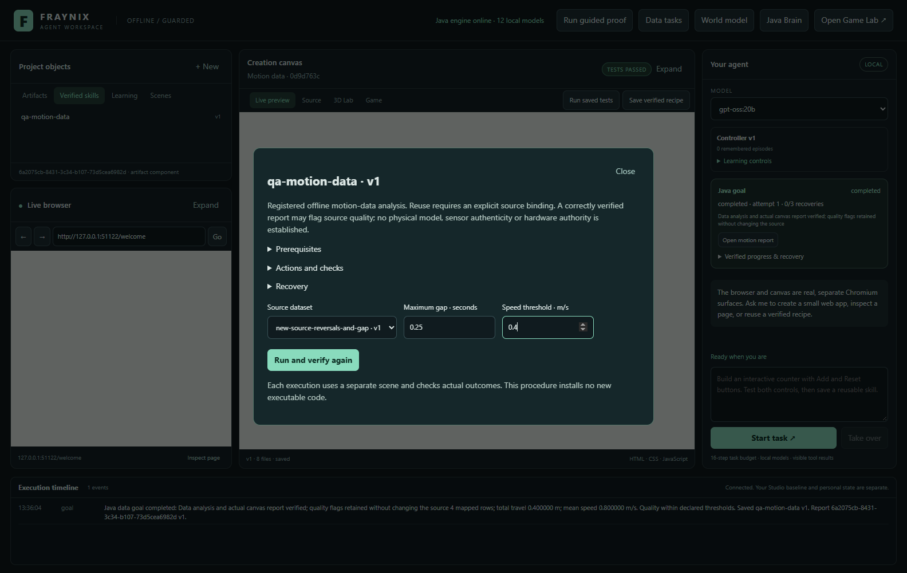
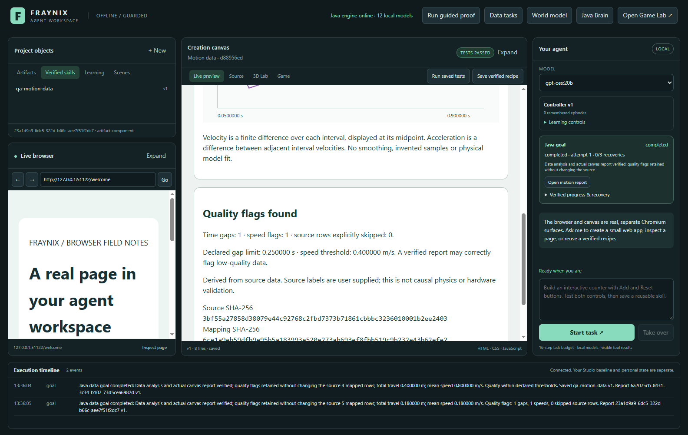
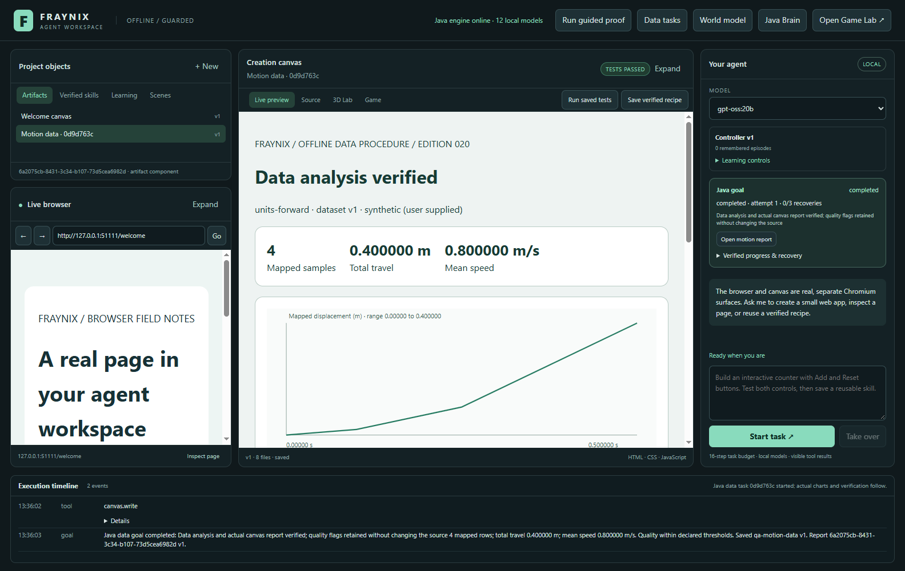
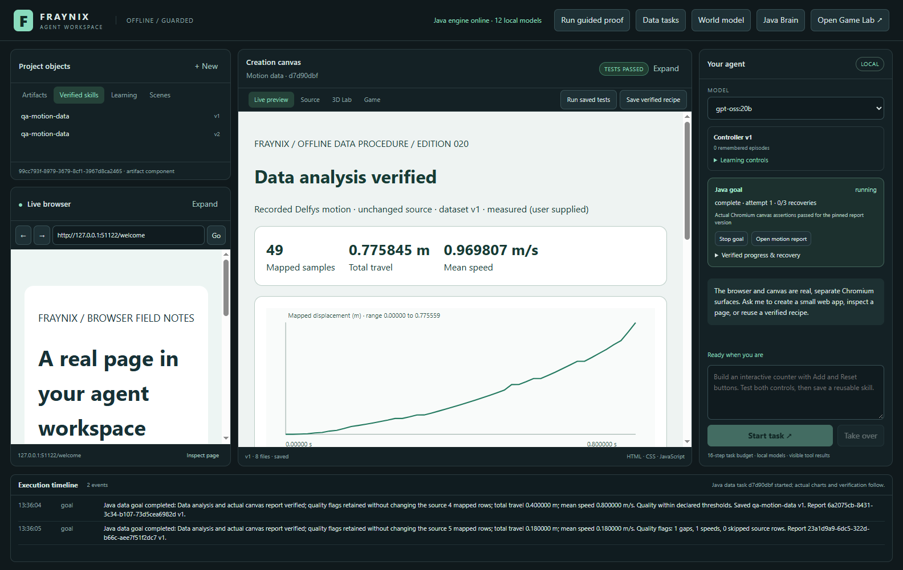
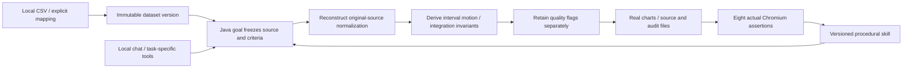

# Fraynix Agent Workspace — edition 020

**A reusable procedure now completes an offline data task as well as a physical task.**

Edition020 adds local motion CSV → explicit units and source checks → derived motion and quality flags → actual charts and audit files → a verified, versioned procedural skill. Java owns the durable task. Chat can select it and later reuse the named procedure on another selected source. Direct analysis and saved-skill execution require no model call, cloud service or native physics run.

[Start](README.md) · [Offline explorer](docs/readmes/020/index.html) · [Runtime/data contract](docs/MOTION_DATA_PROCEDURES.md) · [Release evidence](docs/readmes/020/verification.json) · [Source tree](docs/readmes/020/FILE_TREE.md) · [Obsidian map](docs/obsidian/motion-data-procedures.canvas) · [Previous edition](README-019.md)



These are actual October30,2026 application screenshots from isolated test projects. The two small numeric cases are declared synthetic fixtures. The recorded-motion example comes from the unchanged extracted Delfys file already present in edition013. Source labels remain user supplied; derived motion and threshold checks do not authenticate an instrument or establish physical-world control authority.

## What works now

| Function | Current behavior |
|---|---|
| Local data entry point | **Data tasks** opens a CSV importer and saved-dataset selector without requiring a 3D scene. |
| Explicit mapping | Choose time/displacement columns, units, source label, note and missing-value policy. Optional offset, source-unit origin and direction are explicit. Units are never guessed. |
| Source integrity | Preserve the original CSV, immutable dataset version and mapping. Reconstruct all normalized rows from raw source and check source/mapping/version hashes. |
| Actual computation | Derive interval velocities and acceleration between interval midpoints; calculate duration, signed displacement, total travel, mean speed and peaks. No smoothing, invented samples or fitted physics. |
| Honest quality result | Record every declared gap/speed exceedance and skipped-source count. A correctly verified task can report **Quality flags found**. |
| Actual output | Generate displacement and velocity charts plus original/normalized CSV, numeric JSON and provenance files. Eight real Chromium assertions gate completion. |
| Retained procedure | Save a registered data procedure with defaults, prerequisites, actions, checks, recovery and source evidence. Reuse binds a new dataset/version and recomputes everything. |
| Durable recovery | Explicit resume keeps the frozen source version and stable report identity, even if a newer dataset version has since been imported. |
| Separate ownership | A data task neither acquires physics/model ownership nor cancels an unrelated native experiment. The existing physical goal retains its ownership guard. Verified body-action completion is now retained through background observer refreshes; stale progress cannot replace a successful release receipt. |

The original browser/library, center canvas/source/3D/Game, right chat and bottom timeline design remains. The new entry point and procedural fields extend that design. Existing world-model goals, object manipulation, integrated original game, brain jobs, local memory, measurements/calibration and actual export tools remain available.

## Try it step by step

1. Start **Launch-Agent-Workspace.bat** using the existing JDK21/Node setup. Open **Data tasks → Import a local motion CSV**. Docker and WSL are unnecessary.
2. Choose a file. For a transparent first test, use the [synthetic ms/cm example](docs/readmes/020/examples/original.csv). Choose `time_ms` as time, milliseconds as its unit, `distance_cm` as displacement and centimetres as its unit. Mark this example **Synthetic**, and retain a note identifying its source.
3. Review the mapping. The default preserves time/displacement origin and sign. Optional mapping uses seconds for time offset, original source units for displacement origin and ±1 for direction. A new chosen file resets coordinate defaults and requires its units again.
4. Import it. The original source and normalized rows become an immutable dataset version with SHA-256 provenance. Importing a later version retains the earlier one. A source filename is data, never a filesystem execution request.
5. Set gap limit0.3s and absolute-speed limit2m/s. Enter a procedure name such as `motion-data-analysis` if you want to retain it. Select **Analyze selected data**. Java creates a durable goal, computes the analysis, opens the actual report and verifies it in the canvas.
6. Alternatively, select a saved dataset and choose **Use selected for chat**, then ask the local model to perform the task. An absent selection produces an actionable error instead of a fabricated source.



Chat example:

> Analyze the selected motion dataset with gap limit0.3 seconds and speed limit2m/s. Chart displacement and derived velocity, preserve the original CSV, and save the successful procedure as motion-data-analysis.

For maximum clarity in natural-language requests, separate the value from its unit and use “gap limit 0.3 seconds” and “speed limit 2 m/s.” The host checks explicitly requested thresholds and named retention before starting. The native tool schemas contain only the relevant semantic options.

## Reuse it on another file

Import/select the [changed ms/mm example](docs/readmes/020/examples/changed-source.csv), then open the saved procedure under **Verified skills**. Choose that dataset, gap limit0.25s and speed limit0.4m/s. Select **Run and verify again**. The inspector shows data-specific source/threshold fields; native slope/friction controls remain exclusive to the physical procedure family.



Or ask:

> Reuse the motion-data-analysis procedure on the selected motion dataset with gap limit 0.25 seconds and speed limit 0.4 m/s. Report the quality flags and preserve the new original CSV.

The host resolves a uniquely named procedure against the real registry and binds its exact version. A request for `version N` selects that version; otherwise it selects the highest version of the named procedure. The model sends task options rather than copying internal identities or unrelated physics fields. When no unique binding exists, explicit name/version selection remains required.

Reuse creates a new goal, recomputes from the new source and verifies the new report. It does not reuse earlier numeric results or silently relabel the source. A distinct verified goal saved under the same name creates immutable version2; saving the same goal/name again returns the same version. Names cannot cross between physical and data procedure families.



## Measured results

The [edition020 contract](workspace-engine/src/main/resources/goals/data-contract-v1.json) was written before first execution in the working tree. These are local development cases, not an external hidden benchmark. Original CSV values, mappings and thresholds were not changed to make results pass.

| Case | Samples / duration | Total travel | Mean speed | Gap / speed flags | Quality result |
|---|---|---:|---:|---|---|
| Synthetic ms/cm | 4 / 0.500s | 0.400000m | 0.800000m/s | 0 / 0 | Within declared thresholds |
| Reused skill, new ms/mm source | 5 / 1.000s | 0.180000m | 0.180000m/s | 1 / 1 | Flags retained |
| Existing recorded motion | 49 / 0.800s | 0.775845m | 0.969807m/s | 0 / 0 | Within declared thresholds |


For the first case, four samples span0.5s, total travel/net displacement are0.4m and mean speed is0.8m/s. Unequal intervals produce actual segment velocities0.2,0.533333… and1.2m/s. The changed five-row case spans1s, travels0.18m but has net displacement0.08m because of reversals. Its0.6s gap exceeds the declared0.25s limit; its0.5m/s segment exceeds the0.4m/s limit. The checked task correctly reports failed quality.

Java's integration checks reconstruct signed displacement and absolute travel from the derived velocities. Test code separately computes interval differences, thresholds and summary values from retained normalized rows. Source hash checks and original CSV comparisons establish that data were preserved; exact canvas assertions establish that the bound report actually opened and contained the expected rows/series/status.



## Recorded motion, with its limits intact

The recorded example analyzes all49 rows of the existing [Delfys extracted validation CSV](docs/datasets/delfys75-013/validation.csv), unchanged. It spans0.8s, has net mapped displacement about0.775559m, total travel about0.775845m and mean speed about0.969807m/s. Under declared0.05s gap and5m/s speed thresholds it has no exceedances. This says only that those two descriptive checks pass.



Segment-average velocities are finite differences, not direct velocity sensor readings. Acceleration is derived between segment midpoints and can amplify tracking noise; this recording's peak absolute derived value is about135.31m/s². The app preserves and exposes that value rather than smoothing it into a more plausible physical narrative. The report does not establish that it is an accurate physical acceleration measurement.

This descriptive analysis uses all49 rows. It is not a new forecasting holdout, model fit or replacement for edition018's two-point conditioning/47-point evaluation. The earlier free-forecast RMSE about0.02971m and maximum error0.06215m still fail the unchanged0.015m gate. Source hashes, the frozen edition013 dataset and that rejected physical-model claim remain intact. No real-world actuation authority is added.

## How the task works



The Java GoalRunner now supports two registered families: `world-reach-report-v1` and `motion-data-report-v1`. Each has concrete steps, prerequisites and outcome verification. The model selects and explains; Java owns durable state and validates effects; the desktop performs the registered canvas action. Imported notes, titles, CSV cells and procedure text grant no handler authority.

The data path checks frozen source/version/mapping hashes, reconstructs SI rows and skipped row numbers from original CSV, calculates interval-average velocities and midpoint acceleration, and checks integration identities. An unrepresentable derivative rejects instead of being clipped or replaced. With only two source points there is one velocity, a visible point marker and no fabricated acceleration estimate.

A data goal does not reset, step, acquire or cancel native physics. The control plane applies the existing native ownership guard only to physical goals. There is still one active Java goal at a time because that task owns the report verification effects. Both families retain the existing finite history/recovery budgets.

## Eight real audit files

| File | Meaning |
|---|---|
| `index.html` | Actual displacement/velocity charts, summary, quality result, provenance and mapped rows |
| `original.csv` | Source text preserved exactly |
| `normalized.csv` | Source row, time in seconds and signed displacement in metres |
| `normalized.json` | All mapped rows with source identity |
| `intervals.json` | Source-row pairs, interval/midpoint times, displacement differences and velocities |
| `accelerations.json` | Derived differences between adjacent segment velocities |
| `quality.json` | Every declared interval gap/speed exceedance |
| `summary.json` | Metrics, method, mapping, source hashes and thresholds |

The published [standalone actual report](docs/readmes/020/examples/verified-data-report.html) opens offline. Its accompanying files are copies of the actual tested artifact, not explanatory placeholders. Source/title/note text is escaped in HTML. Existing Source view and versioned artifact tooling remain available.

## Persistence, checks and recovery

The goal freezes the exact dataset version, not “whatever file is latest.” A later import can create v2 while a waiting task retains v1. On process loss, the task becomes interrupted and requires explicit resume. Recovery recomputes from the same frozen source or reuses the retained analysis and stable report entity; it does not silently change units, threshold or source to obtain a passing result.

Eight actual canvas assertions check the verified-data verdict, goal/source bindings, mapped row count, two chart series, honest quality status and scope. Java verifies report version/content hash and the stored exact assertion receipt. Forged passing booleans, stale/foreign claims, cancelled work and edited report content cannot promote a verified skill. The existing private nonce/expiry mechanism stays outside the model's catalog.

Bounds remain UTF-8 CSV≤256KiB,2–2048 source rows,≤32 columns, at least two retained rows, strictly increasing finite mapped time, supported units/frame limits and existing artifact budgets. Procedure/history/version/recovery caps remain unchanged. The numeric threshold range limits represent supported input values, not declarations of physical validity.

## Validation

The current suite passes **175 Java tests**, **22 desktop unit tests** and **190 workflow assertion groups**. Four new live `gpt-oss:20b` assertion groups cover two complete conversations: create a data procedure, then reuse it on another selected dataset with changed criteria. Existing actual native-goal and memory conversations remain regression checks.

The new Java checks cover unequal intervals, reversals, mapping offsets/origin/direction, source/mapping/row corruption, overflow, two-point behavior, explicit missing rows, escaped source text,2048-row artifact budgets and coexistence with paused native physics. App checks use real file inputs/import controls, actual chart assertions, retained/rebound skills, immutablev2/idempotency, unchanged49-row recorded data, cancellation, forged host receipts, restart against a frozen old source and cross-family name rejection.

The live reuse test exposed model confusion from a shared mixed-family schema. The task interface now presents only relevant options and binds the requested named procedure from the actual registry. That correction passed the real create/reuse conversations; it does not silently replace failed model output with a fabricated success.

An independent clean source checkout of `3ae0871` passes the offline build, all 175 Java tests, 22 desktop units and 73 critical UI workflow groups. All 476 canonical implementation hashes match. No user project or personal model weights were copied; the existing pinned Electron45.1.0 executable was reused after offline dependency installation. The companion passes wide/390px source/module/image/report checks with no external requests.

```powershell
.\gradlew.bat check installDist :workspace-engine:installDist --offline
npm.cmd --prefix workspace-desktop test
npm.cmd --prefix workspace-desktop run test:data-goals
npm.cmd --prefix workspace-desktop run test:live-data-goals
pwsh -NoProfile -File scripts/Verify-Documentation.ps1
```

Offline build assumes pinned dependencies are cached. Chat tests require an already installed eligible local model and running Ollama. Tests use isolated projects and run Electron integrations sequentially. Personal projects, browser profiles, credentials and installed model weights are not copied into the repository.

- [Release verification and limits](docs/readmes/020/verification.json)
- [Actual data/import/chart/skills/recovery checks](docs/readmes/020/data-goals-integration.json)
- [Actual local-model create and named reuse](docs/readmes/020/live-data-goals.json)
- [Native-goal live regression](docs/readmes/020/live-goals.json)
- [Memory live regression](docs/readmes/020/live-memory.json)
- [Full regression summary](docs/readmes/020/regressions.json)
- [Standalone actual data report](docs/readmes/020/examples/verified-data-report.html)
- [Original synthetic CSV](docs/readmes/020/examples/original.csv)
- [Changed synthetic CSV](docs/readmes/020/examples/changed-source.csv)
- [Actual normalized CSV](docs/readmes/020/examples/normalized.csv)
- [Numeric intervals](docs/readmes/020/examples/intervals.json)
- [Numeric acceleration estimates](docs/readmes/020/examples/accelerations.json)
- [Actual source summary/provenance](docs/readmes/020/examples/summary.json)
- [Canonical source inventory](docs/readmes/020/file-inventory.json)

## Review continuity and next steps

The user's edition019 review was launched from its published checkout into a separate persistent `review-019` project. Its chat request is ready to create the native `review-world-reach` procedure. Edition020 development and test installations are separate, so the open review runtime and original default project remain intact. Historical README editions001–019 and frozen datasets remain unchanged.

The next useful task family is browser/source research → a bounded creation artifact → real build/test or canvas verification → a retained procedure with source-specific checks. Keep it registered and auditable rather than allowing imported instructions to install privileged handlers. Then turn verified goal successes/failures into versioned training cases and evaluate proposed changes against separate cases before promotion and rollback.

This edition adds descriptive data computation and reusable task knowledge. It does not perform online LLM fine-tuning, claim unrestricted code execution, validate general reality or extend the learned model to arbitrary physics. Broader physical environments, calibrated sensing, actual browser interaction procedures and evaluated experience-derived policy changes remain distinct implementation milestones.

[Runtime contract](docs/MOTION_DATA_PROCEDURES.md) · [Shared goals](docs/GOALS_AND_SKILLS.md) · [Development log](docs/DEVELOPMENT_LOG.md) · [Project memory](docs/PROJECT_MEMORY.md) · [Edition history](docs/readmes/INDEX.md)
