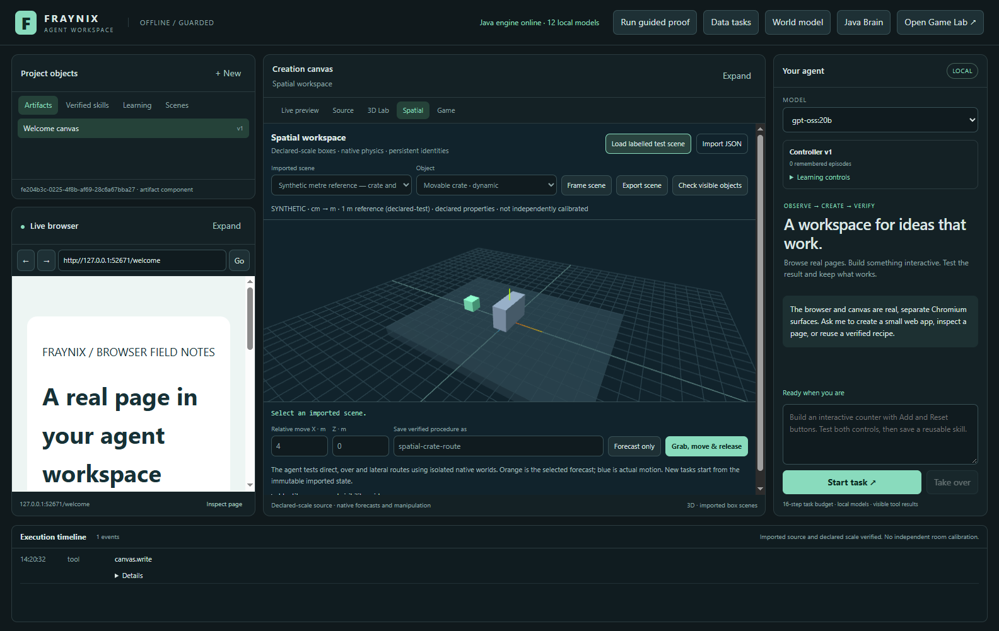
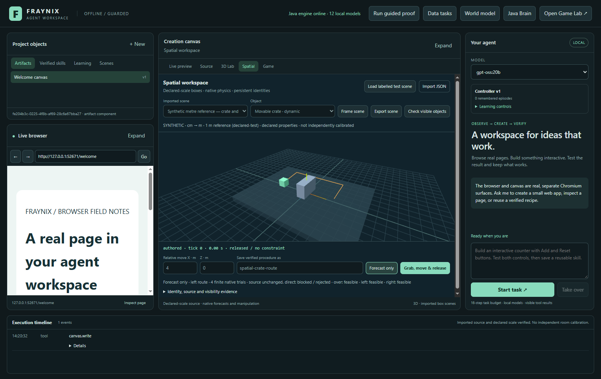
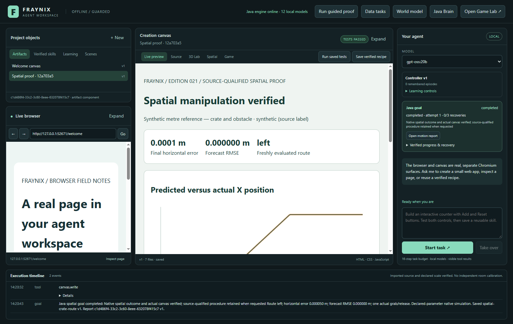
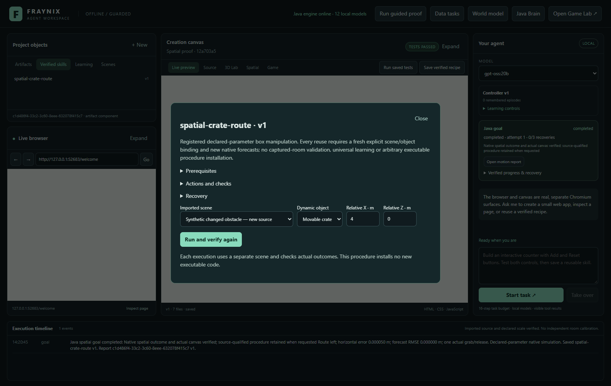
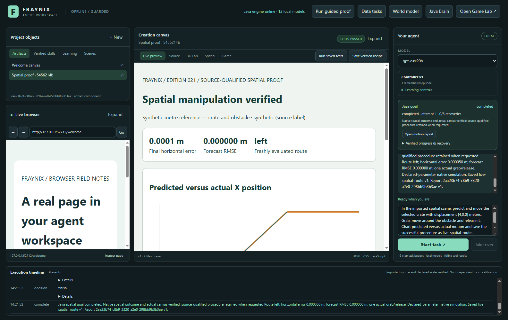
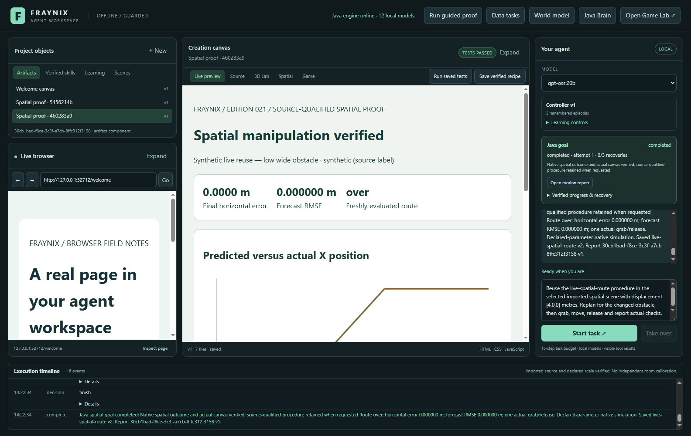
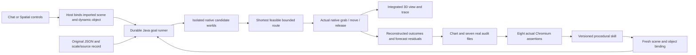

# Fraynix Agent Workspace — edition 021

## From an imported scene to a verified physical task

Edition 021 completes the first source-qualified spatial workflow: import a declared-scale scene, retain its object identities, forecast a bounded physical task, actually grab/move/release a body, compare prediction with motion and save a procedure that can be rebound to another scene. It extends the current application rather than replacing its game, Java nervous system, learned ramp predictor, browser or creation canvas.

This edition follows the user's choice of **a clearly labelled test scene first**. The scene is synthetic: a floor, obstacle and movable crate with explicit centimetres, a declared one-metre reference and stated physical properties. It is not a scanned room, authenticated sensor dataset or demonstration of physical-world actuation. That distinction stays visible in the interface, data and report.

The visible proof matters because an action description alone cannot establish completion. Here, the direct route really stops at the obstacle. Native forecasts find a feasible alternative, a real constraint transports the crate, gravity/contact act after release, independent checks reconstruct the outcome and the actual Chromium canvas verifies the report. A retained skill has evidence behind it.

| Edition record | Link |
|---|---|
| Current source baseline | `a752c99e5a43e72aa56f6c56d11db3add5c2f9f9` |
| Previous edition | [020 — offline motion-data procedures](README-020.md) |
| Offline interactive guide | [Open the edition 021 explorer](docs/readmes/021/index.html) |
| Complete import/runtime contract | [Spatial worlds](docs/SPATIAL_WORLD.md) |
| Current engineering map | [Obsidian note](docs/obsidian/29-spatial-world.md) · [JSON Canvas](docs/obsidian/spatial-world.canvas) |
| Acceptance and results | [Declared checks](workspace-engine/src/main/resources/spatial/acceptance-021.json) · [verified evidence](docs/readmes/021/verification.json) |

## Review it in the running application

Use the workspace launch procedure below. The open edition 019 review remains isolated in its own checkout/project; building this release does not alter that review's jars, scene or data. To review the new Spatial tab, launch this checkout with a separate project directory.

1. Choose **Spatial** beside **3D Lab**. The layout retains the left browser, central creation surface and right agent conversation.
2. Choose **Load labelled test scene**. Read the source band: synthetic, cm converted to metres, declared reference and properties, not independently calibrated.
3. Select the movable crate from the object menu or click it in the rendered view. Selection never stamps an object into the scene. Static objects can be inspected but clear the host's actionable selection.
4. Leave the horizontal relative movement at X=4 m and Z=0 m. Enter a procedure name if you want a passing task retained.
5. Choose **Forecast only**. Orange shows the selected native forecast. The displayed body remains at its original position. The candidate summary identifies the direct route as blocked.
6. Choose **Grab, move & release**. Watch the actual native body move. Blue records actual motion; the status shows native ticks and whether a real constraint is attached.
7. Java checks the result and opens the motion report. The task completes only after eight real canvas assertions pass.
8. Open **Verified skills**, select the saved procedure and inspect its prerequisites, actions, checks and recovery. Import a changed scene and explicitly bind its scene/object before running the skill again.

For chat, import and select the dynamic object first, then send:

> In the imported spatial scene, predict and move the selected crate with displacement [4,0,0] metres. Grab, move around the obstacle and release it. Chart predicted versus actual motion and save the successful procedure as spatial-crate-route.

After importing and selecting a changed scene:

> Reuse the spatial-crate-route procedure in the selected imported spatial scene with displacement [4,0,0] metres. Replan, move, release and report the actual checks.

The installed local `gpt-oss:20b` was used for the recorded chat checks. No replacement provider, new model weights or cloud world-model service was installed. Ollama chooses and explains semantic task options; Java owns durable execution and outcome checks. The host supplies actual selected IDs and saved procedure identity rather than asking the model to manufacture them.

## Actual results, including the blocked action

| Synthetic task | Selected route | Final horizontal error | Terminal speed | Forecast max error | Result |
|---|---|---:|---:|---:|---|
| Initial 1 kg crate, tall narrow obstacle | left | 0.000050192 m | 0.000048937 m/s | 0.000000000 m | Passed |
| Reused skill, 1.5 kg crate, low wide obstacle | over | 0.000000119 m | 0.000000435 m/s | 0.000000000 m | Passed |

Direct-route prediction in the first scene fails: 2.549998408879567 m final horizontal error. That rejected forecast is retained in the full native audit.


These are local development fixtures, not an untouched benchmark. In the first scene, a straight constrained move cannot reach the requested destination because the obstacle blocks it. The finite planner chooses a shorter feasible lateral route. In the second scene, the obstacle becomes lower and wider, and the crate's mass increases from 1 to 1.5 kg. Reusing the same named procedure produces a new forecast and selects an over route. The source/object IDs and native run change; the skill does not copy the previous route or receipt.

The very small forecast residual is expected: prediction and execution use the same declared native solver and initial conditions. It establishes a consistent action/execution pipeline. It does not show that a neural model learned unknown mechanics, that inferred material values are correct or that a real room would behave identically. The separately learned ramp predictor and its previously rejected recorded-data action validation remain unchanged.

## Screenshots from the actual application

All current images below were captured on 2026-10-30 from real application sessions using isolated, labelled synthetic fixtures. Each image links to its original file. They are not mockups or generated product illustrations.

[](docs/readmes/021/images/spatial-import-021.png)

Actual synthetic scene import: explicit centimetres, declared metre reference, qualified source and persistent objects.

[](docs/readmes/021/images/spatial-forecast-021.png)

Actual isolated native forecasts: blocked direct route and feasible alternatives, with displayed state unchanged.

[](docs/readmes/021/images/spatial-moving-021.png)

Actual native constraint holding and moving the crate; no viewport teleport.

[](docs/readmes/021/images/spatial-completed-021.png)

Actual released crate and native motion trace after verified completion.

[](docs/readmes/021/images/spatial-report-021.png)

Actual predicted-versus-actual chart and passing eight-assertion report.

[](docs/readmes/021/images/spatial-skill-021.png)

Actual saved procedure inspector with explicit changed-scene/object binding.

[](docs/readmes/021/images/spatial-chat-021.png)

Actual gpt-oss:20b chat completes and retains the spatial procedure.

[](docs/readmes/021/images/spatial-chat-reuse-021.png)

Actual named chat reuse binds a different source and verifies a newly selected over route.

## How the whole system fits together



The shared Java goal runner now has three registered families. `world-reach-report-v1` uses the accepted learned ramp predictor and native feedback controller. `motion-data-report-v1` reconstructs imported CSV normalization, derives motion and preserves quality flags. `spatial-manipulation-v1` operates on imported box scenes using native forward forecasts and actual constraint motion. Their source bindings and ownership differ; their durable progress, report verification and finite recovery use the same tested infrastructure.

The spatial runtime is separate from the authored ramp store. Existing scene files keep their format and behavior. The original game can still run through its integrated view and preserved editor. The browser remains a real Chromium surface; the canvas remains an executable local artifact surface. This new spatial view adds a functioning environment for structured observation and action rather than replacing the app with a different product.

The Java nervous system and its CPU/GPU computation remain available, but this edition does not route the task through a newly trained neural manipulation policy. Native prediction and explicit verification provide the baseline that such a policy would later have to outperform under independent evaluation.

## What is imported, and what is rejected

The supported data format is `fraynix.spatial-scene` version 1. It requires explicit m/cm/mm units and a right-handed Y-up frame. A scale reference contains two source-space points, a known length in metres, tolerance and basis. The importer checks the declared conversion. It always records independent calibration as false in this version.

Each source supplies its kind, a note and a physical-property basis. `synthetic`, `measured-user-label` and `unverified` are qualified source labels; a measured label records the user's assertion rather than authenticating collection. A file's appearance cannot prove mass, friction or restitution. Those quantities remain explicit numeric inputs.

Each box supplies a unique source ID, label, position, unit quaternion, dimensions, mass, friction and restitution. The importer converts geometry to SI and creates stable runtime UUIDs from the new import identity and source IDs. Restart preserves those identities. A separate import receives new IDs while retaining equivalent source content. The original JSON text and SHA-256 accompany the normalized definition.

The package is bounded to 128 KiB, 2–32 boxes, at least one static surface and 1–8 dynamic bodies. Unknown or executable fields, implicit units, inconsistent reference lengths, duplicate IDs, invalid quaternions, nonnumeric material properties and mesh/splat declarations reject before actuation. Mesh and Gaussian-splat import are not hidden behind placeholder buttons; they are explicitly outside this completed box-scene slice.

**Export scene** writes the original source text exactly and creates a real local receipt. It can be reimported without changing its source hash. The report also retains a normalized SI scene and full native state. A new import intentionally receives fresh runtime identities; it never silently aliases an existing imported scene.

## What the native forecast and action actually do

Each candidate creates a separate Bullet world containing all imported boxes and declared properties. It evaluates one of four waypoint sequences: direct, over, left or right. Conservative extents generate alternatives; actual native outcomes decide whether each candidate reaches and settles. The selected route minimizes waypoint path length among passing candidates, with a 16 m path bound.

This is a finite candidate planner. It can reject a scene that would be solvable with a more sophisticated route search. It does not promise arbitrary navigation or object manipulation. The completed task family supports a selected dynamic object and a 0.1–6 m horizontal displacement ending at the imported source height.

Execution begins a separate owned trial from the immutable import. It settles for 120 ticks, attaches a real point-to-point constraint, moves the anchor at at most 1.2 m/s, permits 96 settling ticks per waypoint, removes the constraint without changing velocity and advances 240 further ticks. Constraint impulse is limited to 300 N per axis times dt. A manipulation is bounded to 6,000 ticks, or 25 simulated seconds. The backend is Minie 9.0.3 / Libbulletjme 22.0.3, single precision, fixed 240 Hz.

Acceptance requires horizontal error ≤0.1 m, vertical error ≤0.15 m, terminal speed ≤0.25 m/s, each waypoint endpoint error ≤0.08 m and maximum aligned forecast error ≤0.02 m. Exactly one actual grab and one velocity-preserving release must be recorded. Java reconstructs endpoints and residuals from actual positions, events, samples and final native state. A model's claim that it succeeded cannot satisfy those gates.

The displayed view consumes native transforms; it does not calculate authoritative motion. Camera orbit and zoom affect the view only. Visibility checks distinguish known objects from the sampled ray-visible subset. An occluded crate retains its identity without being described as currently seen. This is native-state geometric perception, not recognition of arbitrary photographs or screen pixels.

## Durable tasks, reusable skills and recovery

The scene store atomically replaces its private project state and retains at most 32 imports and 32 runs. Task intent binds exact source/version/hash, object and displacement before effects. Stable native effect IDs derive from goal and attempt. The report binds a specific artifact version and content hash, then uses the existing private host claim/acknowledgment lease and actual canvas test receipt.

Cancellation stops owned spatial work and releases native resources. It does not promote a failed or cancelled result into a successful skill. Process loss marks unfinished work interrupted. Explicit resume creates a separate recorded native attempt when physical work was incomplete; completed matching work can be reused during report recovery. Recovery is limited to three explicit resumes and a 180-second attempt budget.

A saved procedure records its registered family, version, defaults, prerequisites, actions, success checks, recovery policy and source evidence. It retains a relative movement task rather than installing arbitrary executable code. Every reuse requires explicit new scene/object binding and fresh forecasts and checks. That is useful procedural memory; it is not online language-model weight training or proof of general recursive self-improvement.

## Reports, files and reproducible review

Each passing task creates seven real files: `index.html`, `original-scene.json`, `normalized-scene.json`, `native-run.json`, `prediction.json`, `motion.csv` and `verification.json`. The report plots predicted/actual X versus native time. Raw JSON and CSV preserve all three position components, velocities, selected waypoints, rejected candidates and final body states. Use the workspace's Source tab to inspect the artifact files or the linked standalone example below.

- [Release verification and limits](docs/readmes/021/verification.json)
- [Actual import, motion, reuse and recovery evidence](docs/readmes/021/spatial-integration.json)
- [Actual local model create and named reuse](docs/readmes/021/live-spatial.json)
- [Existing data chat regression](docs/readmes/021/live-data-goals.json)
- [Existing native-goal chat regression](docs/readmes/021/live-goals.json)
- [Broad regression summary](docs/readmes/021/regressions.json)
- [Standalone actual spatial report](docs/readmes/021/examples/verified-spatial-report.html)
- [Original synthetic scene](docs/readmes/021/examples/original-scene.json)
- [Normalized SI scene](docs/readmes/021/examples/normalized-scene.json)
- [Full actual native run](docs/readmes/021/examples/native-run.json)
- [Native candidate forecasts](docs/readmes/021/examples/prediction.json)
- [Aligned actual/predicted motion CSV](docs/readmes/021/examples/motion.csv)
- [Reconstructed outcome metrics](docs/readmes/021/examples/verification.json)
- [Changed synthetic source](docs/readmes/021/examples/changed-scene.json)
- [Canonical source inventory](docs/readmes/021/file-inventory.json)
- [Full implementation file tree](docs/readmes/021/FILE_TREE.md)

The working checkout passes **183 Java tests / 36 classes**, **23 desktop unit tests** and **204 workflow assertion groups** across the existing suites plus the new spatial suite. Actual `gpt-oss:20b` checks pass 4 spatial create/reuse groups, 4 existing data groups and 5 existing native-goal groups.

An independent source checkout of `a752c99` passes the offline build, 183 Java tests, 23 desktop units and 87 critical UI groups, including the full new spatial/restart proof. All 487 canonical implementation hashes match. Dependency setup used `npm ci --offline --ignore-scripts` and the existing pinned Electron45.1.0 binary; no user project or model weights were copied. The offline companion passes wide/390px navigation, filter, map, source search, gallery and standalone-report checks without external requests.

The implementation inventory records canonical UTF-8/LF hashes for text and exact hashes for binary assets. It excludes user projects, credentials, dependency directories and model weights. Published editions 001–020 and their snapshot assets remain frozen. The edition 013 recorded dataset is preserved. Development corrections and failed local test attempts stay in engineering logs; their failures are not relabelled as successful validation.

## Build and launch

Install JDK 21 and the pinned Node/Electron dependencies using the repository's existing setup. The current computer already has them. From the repository root in PowerShell:

```powershell
$env:JAVA_HOME = 'C:/Program Files/Eclipse Adoptium/jdk-21.0.10.7-hotspot'
.\gradlew.bat check installDist :workspace-engine:installDist --offline
npm.cmd test --prefix workspace-desktop
npm.cmd run test:spatial --prefix workspace-desktop
npm.cmd run test:live-spatial --prefix workspace-desktop
$env:FRAYNIX_WORKSPACE_PROJECT = "$env:USERPROFILE/.fraynix-agent-workspace/projects/review-021"
npm.cmd start --prefix workspace-desktop
```

The `--offline` build assumes dependencies have already been cached. The live chat check requires the installed `gpt-oss:20b` to be available through local Ollama. It is separate from deterministic native/UI checks. Use a separate project path for review rather than pointing a new checkout at an active project's database.

## Vision, value and next gates

The useful direction is a local environment in which requests connect to persistent entities, explicit observations, real actions, measured outcomes and retained procedures. Spatial import moves that idea beyond a fixed game or ramp. It supplies a common identity and provenance layer that future captured geometry, datasets, creation tools and controllers can share.

The next gate is a separately collected scene with a known measurement, uncertainty and clear material assumptions. Native task success must remain separate from capture authenticity and physical validity. Collider/mesh support should arrive only as a complete import, coordinate conversion, rendering, collision and export workflow. More diverse manipulation and navigation tasks need independent evaluation cases and measured failure handling before a learning-based controller is promoted.

The world-model references discussed with the user remain useful design inputs: persistent spatial representations, action conditioning, source geometry and richer sensory models. They do not remove the need for explicit state or independent physical evidence. Generated video or Gaussian rendering could later serve as a sensory layer while Java retains authoritative geometry, actions and verification. This edition installs none of those external model stacks and makes no claim of their performance.

The immediate proof is now concrete: a selected imported object can be predicted, moved through actual native constraints, released, checked, charted and used as the source of a procedure that recomputes under changed conditions. The next edition should expand the evidence and task domain while preserving that complete loop.
