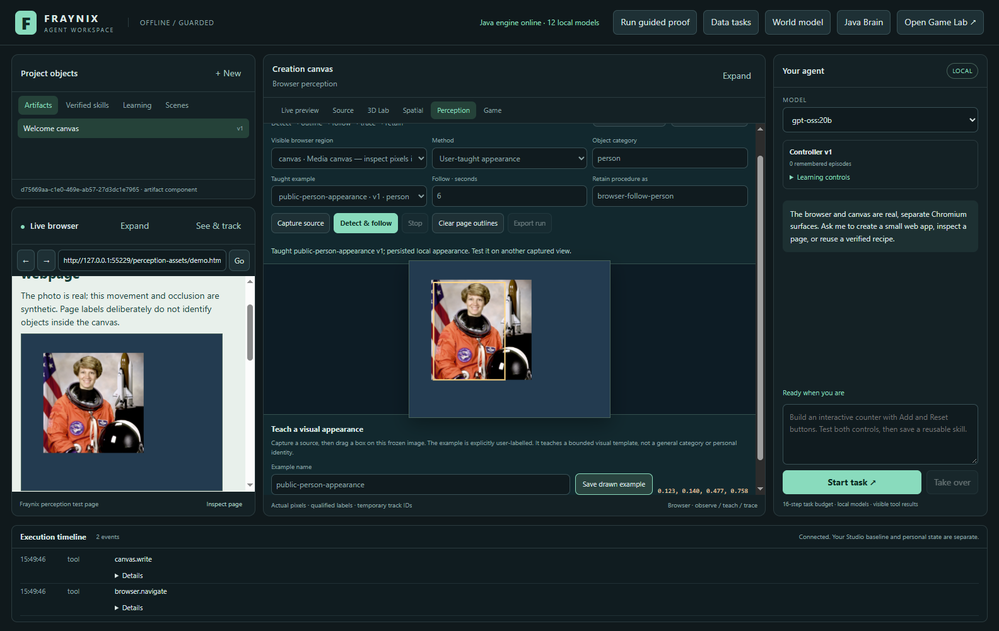
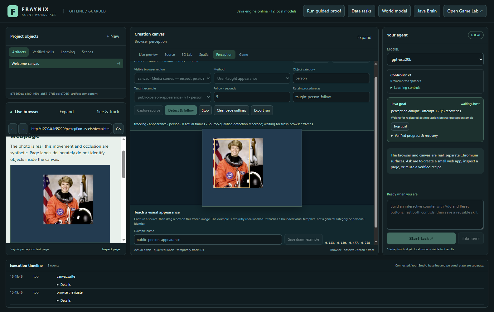
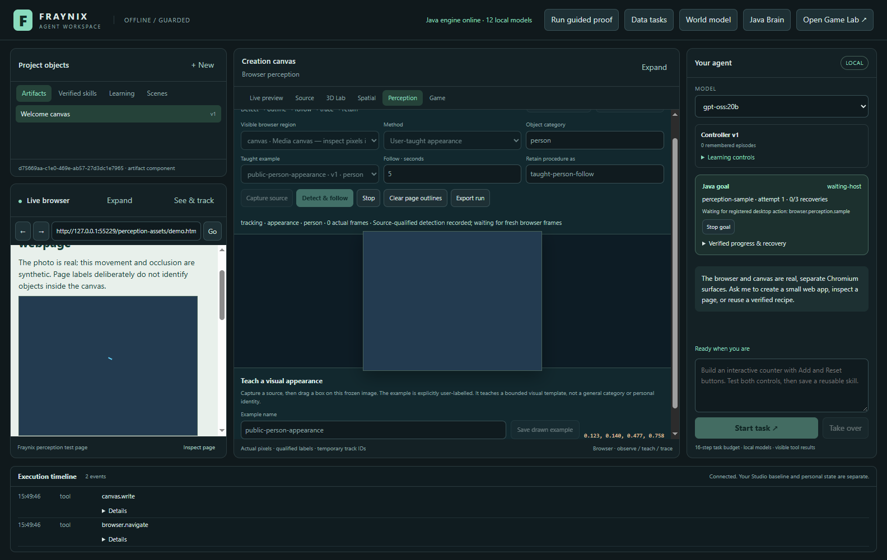
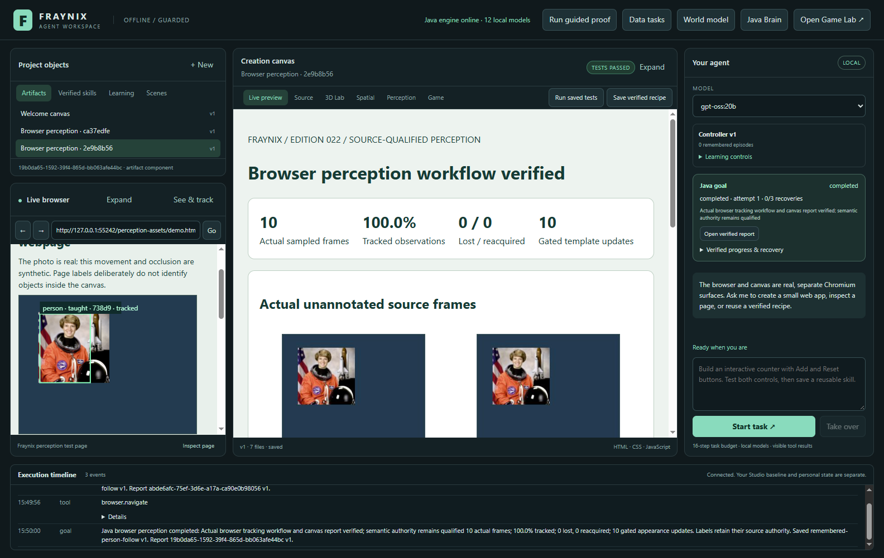
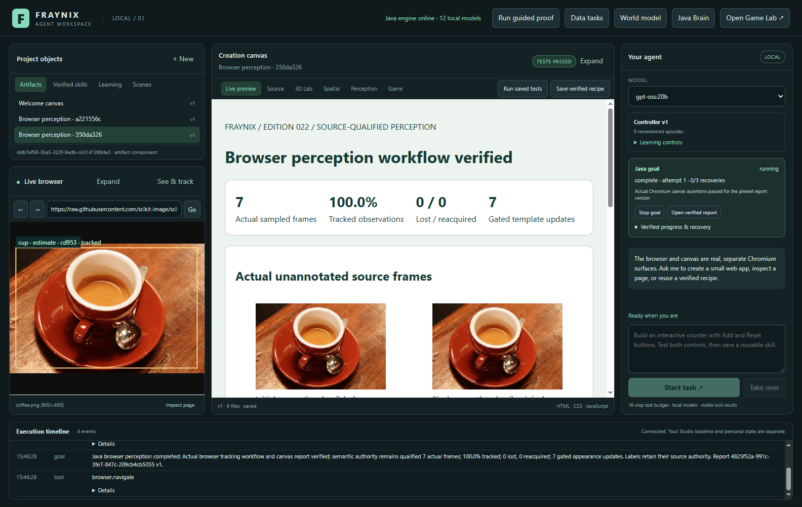
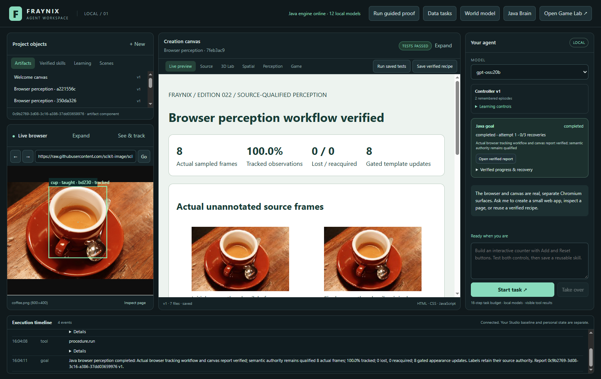
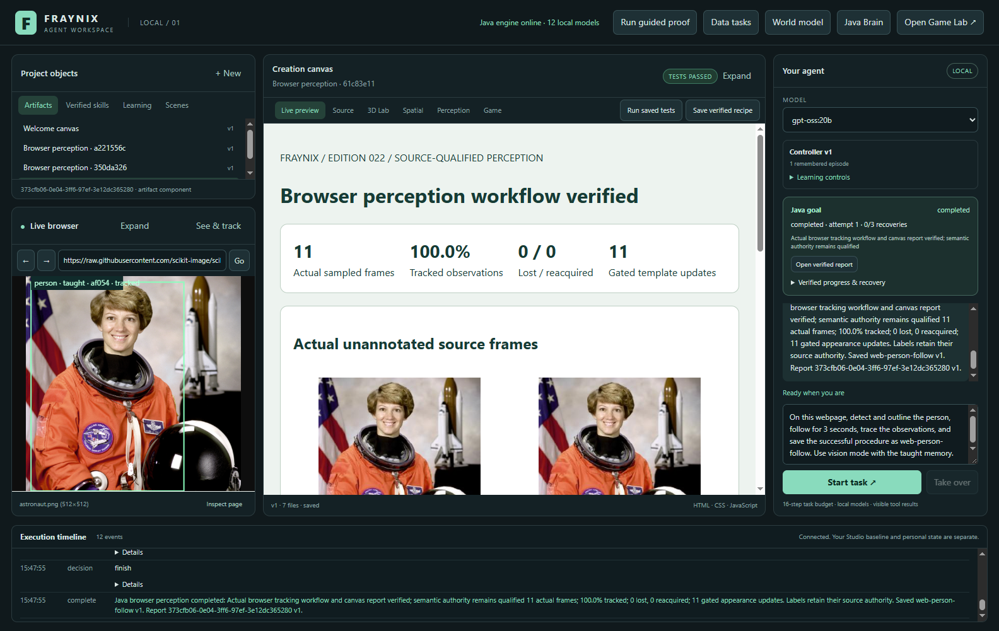
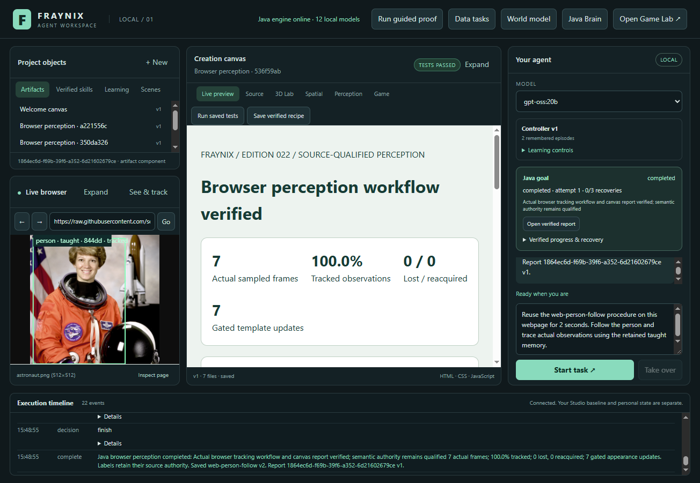
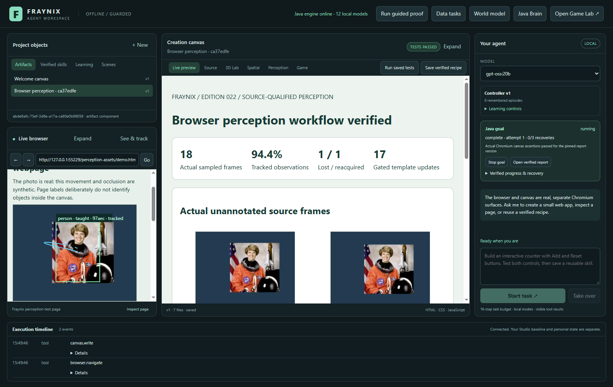

# Fraynix Agent Workspace · edition 022

**Browser perception that can be corrected, remembered and checked.**

2026-10-30 · [Repository entry](README.md) · [Edition history](docs/readmes/INDEX.md) · [Offline interactive guide](docs/readmes/022/index.html) · [Runtime contract](docs/BROWSER_PERCEPTION.md) · [Previous edition](README-021.md)

Edition 022 gives the agent a real observation loop over its browser. It captures
rendered pixels, asks an already installed local vision model for generic objects,
outlines them, follows their visible appearance and draws a trace of actual
observations. You can correct a box by drawing on a frozen capture. Java retains
that example and checks it before making another model guess on a later matching
view. A successful workflow can become a reusable, versioned procedural skill.

This is a concrete step toward your original vision: an agent that shares a
visible environment with you, observes state, acts through real interfaces,
remembers useful procedures and improves from evidence. The browser becomes
another observed surface alongside the game, native physics world, imported
spatial scene, local datasets and creation canvas. It does not require a generated
video world or replacing the Java engine with a transformer.

There is an important measured limit. A stable tracker can follow an inaccurate
initial model box. We therefore report model box accuracy separately from workflow
completion. The raw cup estimate fails its reference-box gate; an explicit user
correction transfers successfully through the Java appearance memory. The release
preserves both results. This is bounded appearance learning, not general object
intelligence, face identification or LLM weight training.

## What you can use now

| Request or action | Implemented behavior | Evidence and practical limit |
| --- | --- | --- |
| Detect a person or cup in the browser | Real Chromium image capture and local vision inference | Generic category estimate; precise boundaries need checking |
| Outline and follow | Java appearance matching over fresh captures, with page overlay | Temporary track IDs within a run; bounded scale/position search |
| Trace motion | Page-space centers from observed boxes | Trace breaks when the object is lost; hidden motion is not invented |
| Teach a correction | Draw a rectangle on a frozen source and save its category/name | Explicit user-labelled 192-value RGB appearance example |
| Remember after restart | Persist examples and match them before a later model call | Tested scale transfer; arbitrary pose/background changes remain unproven |
| Follow a page label | Track an actual DOM element rectangle | Text such as a profile name is a page claim, not a face recognition result |
| Ask through chat | Local model chooses a typed Java perception goal | Host binds actual source; Java executes, stores and verifies the workflow |
| Retain and reuse a skill | Save the registered workflow after passing report checks | Each reuse captures a new source and verifies a new result |
| Inspect or export | Actual source-linked report, JSON, CSV and teaching provenance | Workflow and semantic authority remain separately labelled |

The core remains local. The tested chat model is `gpt-oss:20b`; the tested vision
detector is `gemma3:latest`, both already installed through Ollama. No new model
weights or runtime libraries were installed for this edition. Browsing a public
HTTPS image uses the network; the bundled practice page, tracking, teaching,
storage and reports can operate locally. The DOM and explicitly taught-appearance
methods do not require vision inference.

## Start and review step by step

1. Run `Launch-Agent-Workspace.bat` from this checkout. JDK 21, Node.js and the
   pinned desktop dependencies are required. Docker and WSL are not required.
   Keep a separate project path when running a review build so it does not open
   the original Studio or your default personal project.
2. Open **Perception**, or use **See & track** beside the real browser. Click
   **Load labelled demo** to open the bundled practice page. Its photographs are
   real; its movement, resize and hiding controls are synthetic development cases.
3. Choose the visible canvas or image region, select **Vision + taught memory**,
   enter `person` or `cup`, and choose an installed vision model. **Capture source**
   displays the real unannotated browser capture. **Detect & follow** runs the task.
4. Inspect the result rather than assuming every model estimate is correct.
   Model estimates use qualified labels. Source, object IDs and uncertainty show
   the actual source binding and run. Hiding the object should produce a lost
   state with no current outline. Showing it again can produce reacquisition.
5. To teach, capture again and drag a rectangle around the object in the frozen
   preview. Enter the category and a distinct example name, then **Save drawn
   example**. The app retains that exact capture, box and descriptor. It does not
   pretend that a label written by the model was human ground truth.
6. Use **User-taught appearance** for the selected example, or return to ordinary
   **Vision + taught memory**. Matching retained examples take priority before
   another model call. Reopen the app or change the displayed scale to inspect
   what transfers and where another correction is needed.
7. Name the procedure to retain it after all checks pass. Open its skill inspector
   for reuse on a newly selected region. **Export run** saves real JSON. The report
   opens in the actual creation canvas and contains source-linked thumbnails and
   the observed trace. The original source PNGs remain private project data.

You can also use chat after choosing a browser region:

> On this webpage, detect and outline the person, follow for 3 seconds, trace the
> observations, and save the successful procedure as web-person-follow.

Then:

> Reuse the web-person-follow procedure on this webpage for 2 seconds.

The tested chat chooses one registered start or reuse action. It does not create
an imitation animation, invent source IDs or use an old successful report as the
new result. The saved procedure owns its detector policy. The model supplies
semantic choices such as duration and category; the host supplies the exact
registry identity and fresh browser source.

## The architecture behind the visible behavior

```mermaid
flowchart LR
    User[Request or drawn correction] --> Chat[Local chat model]
    Chat --> Goal[Durable Java goal runner]
    Browser[Actual Chromium browser] --> Capture[Unannotated source capture + hash]
    Capture --> Memory[Versioned taught appearance memory]
    Memory -->|strong distinct match| Tracker[Pure Java appearance tracker]
    Memory -->|no accepted match| Vision[Admitted local vision model]
    Vision -->|qualified category / box estimate| Tracker
    Goal --> Capture
    Tracker --> Observe[Tracked / lost / reacquired observations]
    Observe --> Overlay[Pointer-transparent outlines and broken trails]
    Observe --> Report[Actual source and trace report]
    Report --> Check[Java reconstruction + Chromium assertions]
    Check -->|passing workflow| Skill[Versioned registered procedure]
    User -->|explicit labelled box| Memory
    Skill -->|fresh source on reuse| Goal
```

Java owns the durable goal, appearance descriptors, original frame hashes,
sequence checks, budgets, tracking state, recovery and verification. Electron owns
the real browser/canvas surfaces and screenshot/overlay adapters. The language
model selects and explains a task. It does not decide that a hidden object was
seen or that an inaccurate box is correct. This preserves the same separation
already used for physical goals, data reports and spatial manipulation.

`VisionDetector` sends actual image bytes to the admitted local Ollama model,
requests structured generic categories and boxes, validates ranges and retains
the raw response. Object-agnostic foreground proposals help with flat-border
images; other views use the complete selected capture. Proposals are upscaled
for inference and mapped back. None of this makes model grounding infallible.

`PixelTracker` uses an eight-by-eight RGB descriptor: 192 values, normalized
correlation, bounded multiscale search, original-anchor checking, competing-peak
rejection and cautious high-confidence updates. These computations are pure Java
CPU code. A correlation score measures appearance similarity, not the probability
that an object is a person. The original descriptor remains an anchor against
drift. Explicit teaching creates an immutable named version; later matches use
the latest version per example name. This is useful persistent learning for a
specific visual appearance, with a small inspectable state.

The overlay is hidden while capturing so the tracker cannot learn its own boxes.
Its closed shadow root separates annotation from page content, and pointer
transparency leaves controls usable. Page-space coordinates include the actual
crop and scroll. Navigation changes the document identity; stale selected elements
are invalidated. A captured frame is not interchangeable with a later frame from
another page, even if the URL or text looks similar.

## Measured results and the failed accuracy case

| Actual observation check | Reference overlap (IoU) | Gate | Result |
|---|---:|---:|---|
| Gemma3 raw HTTPS person estimate | 0.854522 | 0.5 | Accepted |
| Gemma3 raw HTTPS cup estimate | 0.339020 | 0.5 | Rejected; retained |
| Taught person, scaled local fixture after restart | 0.988310 | 0.7 | Passed |
| Taught person, real HTTPS image after restart | 0.997072 | 0.7 | Passed |
| Taught cup, real HTTPS image | 0.996644 | 0.7 | Passed |

The moving fixture recorded 18 actual observations, 1 lost and 1 reacquired, with 94.4% tracked. Its current hidden-object box was absent. Explicit recovery passed as attempt 2. The trace contains observed coordinates, not an invented invisible path.

The reference rectangles and acceptance thresholds are retained in the release
evidence. They were declared after pilot inspection of these development photos;
this is not an untouched generalization benchmark. Raw-model reference overlap
must reach 0.5 to count as accepted in this small check. Taught transfer must reach
0.7. The thresholds were not lowered to erase the cup failure.

The moving local fixture checks a different question: can the real UI teach,
follow, lose, reacquire, export, restart and reuse a procedure? It uses real photo
pixels with labelled synthetic motion. A public HTTPS photograph checks that the
adapter works on an actual remote image page. Neither proves general tracking of
unseen people across cameras, changing viewpoints or moving video.

The report's `semanticGroundTruthVerified` remains false. Its passing workflow
means source/hash/sequence, observed/lost states, tracking fraction and actual
report assertions passed. It is deliberately insufficient to claim general
recognition accuracy. Person boxes refer to the generic category and temporary
track IDs. Names on a page remain page-supplied text; the app does not infer a
person's identity from a face.

## Persistence, interruption and reusable skills

`browser-perception-v1` is the fourth task family in the shared Java goal runner.
Its durable steps prepare a source, wait for detection, sample actual frames,
reconstruct the run, create a report and verify the actual canvas. The desktop
receives leased sampling effects. Java accepts acknowledgements only for the
stored sequence, exact frame ID, hash and source. An already persisted sample can
be acknowledged again after a lost response without becoming a duplicate frame.

While the goal owns browser observation, unrelated navigation, clicking and typing
are blocked by the host. The page's own animation still runs. If the document
reloads or capture fails, the run is interrupted and its owned tracker is stopped.
No failed task becomes a skill. Process restart marks a live run interrupted;
explicit resume takes a fresh capture and records another attempt. Old and new
source bindings remain in the history, with new temporary IDs.

A skill is a registered procedure with prerequisites, execution, checks and
recovery. It is not arbitrary downloaded code. Its retained defaults specify how
to detect/follow, and its provenance links the completed run and tested report.
Reusing it on a new selected region recomputes the result. Changed duration is
honored. Appearance-only procedures retain their taught category rather than
silently relabelling a person template as another object.

Current limits are 2–30 seconds, at most 120 samples per run, six model objects,
32 runs, 32 examples, eight versions per name, and 512 retained source frames within
128 MB. The original frame loader checks headers, dimensions, byte limits and
SHA-256 before decoding. This edition is a bounded observation workflow, not a
high-frame-rate video processor or unlimited unattended monitoring system.

## Validation and corrections made during development

The working checkout passes **194 Java tests / 37 classes**, **25 desktop units** and **219 workflow assertion groups**. The new actual interface suite contributes 15 groups. Actual installed local models pass 7 perception workflow/correction/chat groups; raw grounding outcomes remain separately reported above. Existing live chat regressions pass 4 spatial, 4 data and 5 native-goal groups.

An independent checkout of `1af00ff` passes the offline build, 194 Java tests, 25 desktop units and 102 critical actual UI groups. All 503 canonical source/asset hashes match. Setup used offline dependency installation and the existing pinned Electron45.1.0 binary; no private project or model weights were copied. The offline companion passes wide/390px navigation, filters, source search, image decoding and the standalone actual report without external requests.

The checks exercise actual windows and surfaces, real file controls, drag teaching,
source invalidation, loss/reacquisition, restart, report assertions and chat tool
calls. Java tests cover source immutability, ambiguity rejection, changed scale,
sequence retries, stale timestamps, hash tampering, interrupted reload and release
of an owned tracker after host failure. Tests preserve failed runs for inspection.

Several real defects were corrected: source metadata needed a defensive copy;
failed host effects needed to release the tracker; skill dialogs had to close
before browser capture; stale offscreen selection needed replacement; retries
needed their stored expected sequence; and an empty optional example name needed
normalization before Java. A saved procedure name also had to remain distinct
from a taught visual example name. The typed reuse schema now exposes semantic
options while the saved procedure retains its detector configuration.

## Actual screenshots

Actual drawing on a frozen browser capture teaches an explicitly user-labelled appearance.

Actual browser canvas with real photo pixels and labelled synthetic movement: outlines follow Java observations.

Actual hiding test: the outline disappears and the trace breaks instead of inventing hidden motion.

After process restart, ordinary vision mode uses retained taught memory on the resized fixture.

Actual HTTPS cup image: the raw local-model estimate is coarse and fails the independent reference-box gate.

Actual HTTPS cup after explicit correction: Java memory transfers the user-drawn appearance.

Actual gpt-oss:20b chat completes a fresh-source perception goal and retains the named procedure.

Actual named chat reuse after browser resize: new capture/run and newly verified report.

Actual standalone perception report with retained source frames, observed/lost trace and qualified authority.

## Files and export formats

The report contains real `index.html`, `perception-run.json`, `source-frames.json`,
`detection.json`, `motion.csv` and `verification.json`, plus taught-example records
when used. HTML embeds bounded actual thumbnails; private original PNGs remain
linked by hash. JSON retains the observations, uncertain states and provenance.
CSV exports the recorded track centers and state, rather than generated motion.
These complement existing native scene packages, run exports, decoded WebM and
data/spatial reports. A common JSON syntax does not make all formats executable
or interchangeable; each importer still validates its own contract.

The full source tree and canonical source hashes are in the linked inventory.
New implementation files are concentrated in the Java engine, browser adapter,
perception panel, goal bridge and tests. Existing game sources, physics assets,
licenses and historical editions remain present. Private projects, chats, model
weights and dependency folders are excluded from Git.

- [Release verification and limits](docs/readmes/022/verification.json)
- [Actual UI, teaching, loss, restart and recovery](docs/readmes/022/perception-integration.json)
- [Actual HTTPS estimates, corrections and local-agent chat](docs/readmes/022/live-perception.json)
- [Completed corrected-cup review and fresh-source reuse](docs/readmes/022/perception-cup-review.json)
- [Fixed development reference boxes and gates](docs/readmes/022/acceptance-022.json)
- [Broad regression summary](docs/readmes/022/regressions.json)
- [Existing spatial chat regression](docs/readmes/022/live-spatial.json)
- [Existing data chat regression](docs/readmes/022/live-data-goals.json)
- [Existing native-goal chat regression](docs/readmes/022/live-goals.json)
- [Standalone actual browser perception report](docs/readmes/022/examples/verified-perception-report.html)
- [Complete actual perception run](docs/readmes/022/examples/perception-run.json)
- [Source frame hashes and metadata](docs/readmes/022/examples/source-frames.json)
- [Actual detection/teaching provenance](docs/readmes/022/examples/detection.json)
- [Observed center trace CSV](docs/readmes/022/examples/motion.csv)
- [Reconstructed workflow metrics](docs/readmes/022/examples/verification.json)
- [Taught appearance descriptor](docs/readmes/022/examples/taught-appearance.json)
- [Canonical source inventory](docs/readmes/022/file-inventory.json)
- [Full implementation file tree](docs/readmes/022/FILE_TREE.md)

## The next development gates

1. **Broader real observations.** Collect appropriately licensed or consented
   sequences with changed lighting, background, scale, viewpoint and occlusion.
   Separate correction cases from evaluation cases before tuning. Measure recall,
   overlap, false reacquisition, identity switches and complete latency.
2. **Better local detection where needed.** Compare a specialized installed local
   detector with the current vision-model path on those fixed cases. Promote it
   only if it improves measured outcomes and preserves source boundaries. Do not
   infer capability from a model's advertised vision flag alone.
3. **Time-aware tracking and interaction.** Add a tested motion prior, multiple
   distractors and longer observation sessions. Connect verified observations to
   bounded browser actions only after fresh-target and changed-page tests pass.
4. **Perception connected to the physical world.** Link a calibrated observation
   to an explicit spatial entity with scale, coordinate transform and uncertainty.
   A browser photo is not automatically a physical collider or a measured 3D world.
5. **Evidence-based improvement.** Turn failures and corrections into versioned
   cases. Evaluate candidate trackers independently, retain the previous version
   and roll back regressions. LLM fine-tuning or GPU kernels are optional later
   choices justified by measured shortcomings, not prerequisites for this loop.

This release establishes a useful bridge: actual visible input, persistent local
correction, measured tracking, durable execution and reusable procedures in the
same application. The next milestone is better performance on unfamiliar real
sequences, with those results surviving independent checks and restart.

Source baseline: `1af00ff13a6372e4305c2c114e0b4c141ec79b29`. Historical README001–021 and their snapshots remain
frozen. The recorded-reality rejection from earlier editions remains unchanged.
Primary references and photo credits are in the [perception contract](docs/BROWSER_PERCEPTION.md)
and [fixture license note](licenses/PERCEPTION_FIXTURES.md).
