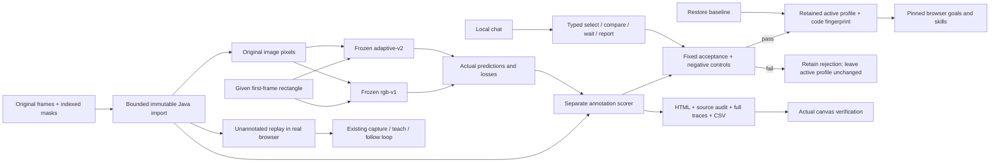
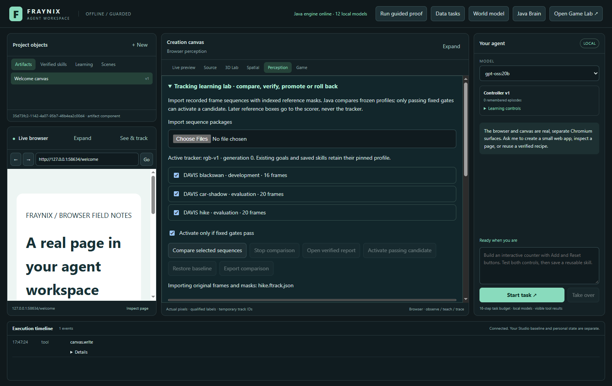
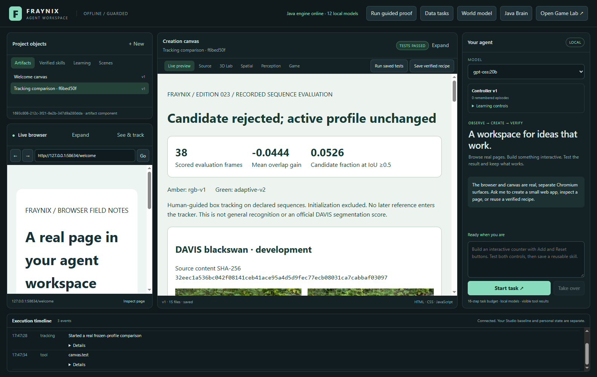
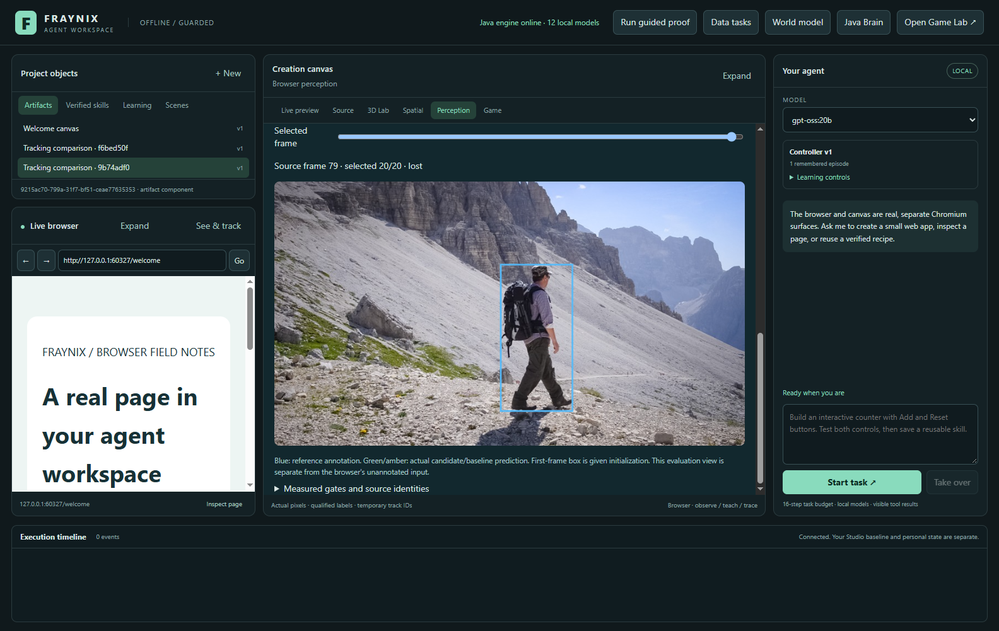
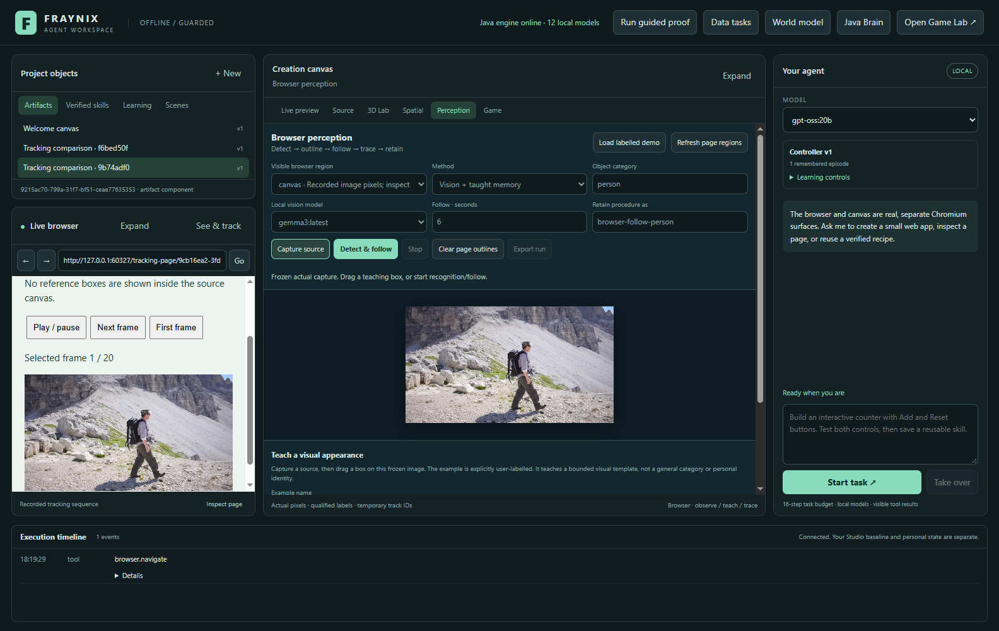
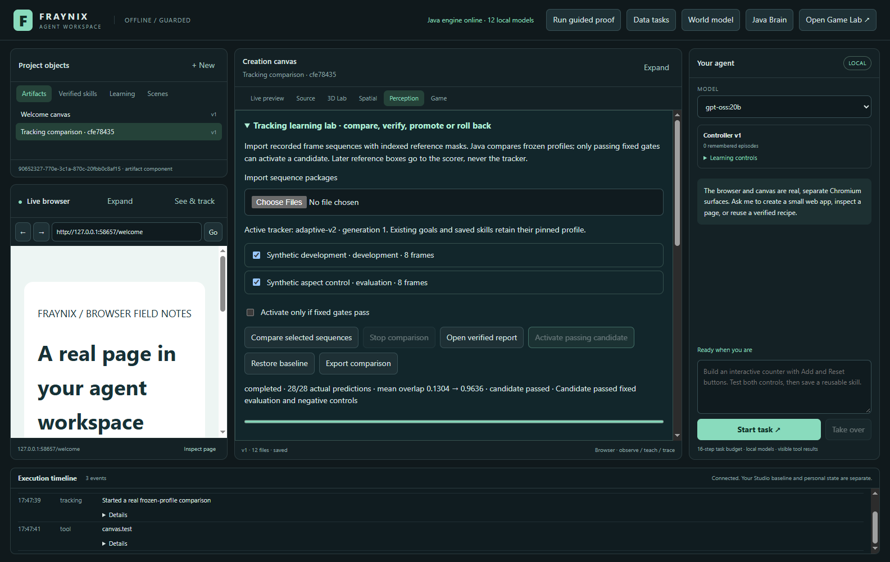
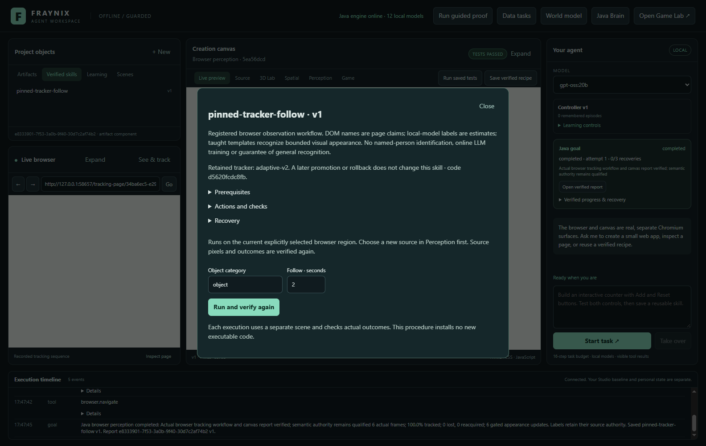
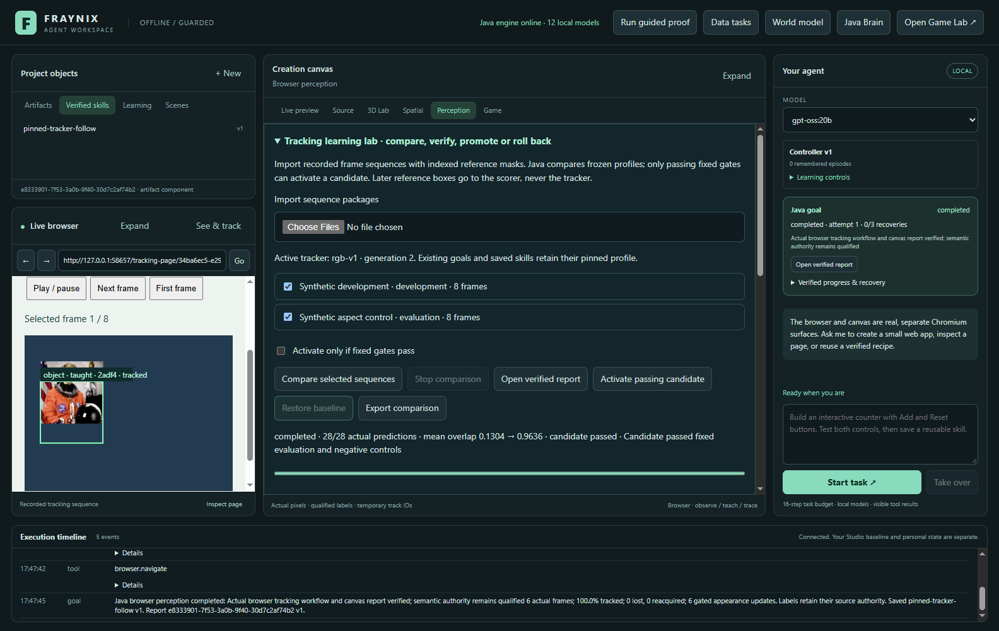
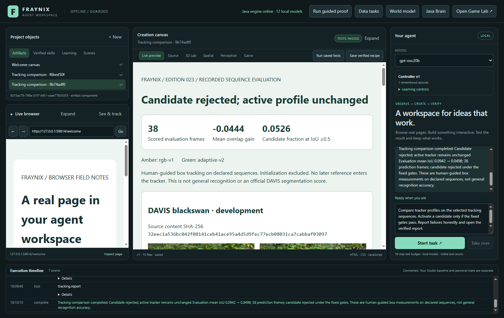

# Fraynix Agent Workspace · edition 023

**Real-sequence evaluation, measured profile changes and retained skills.**

2026-10-30 · [Repository entry](README.md) · [Edition history](docs/readmes/INDEX.md) · [Offline interactive guide](docs/readmes/023/index.html) · [Tracking contract](docs/TRACKING_EVALUATION.md) · [Previous edition](README-022.md)

Edition 023 connects the perception system to original recorded frames and human
annotations, then asks a question that matters for useful self-improvement:
does a proposed change actually track better on different footage? Java now
imports immutable sequence data, runs two installed CPU implementations, scores
every prediction, applies fixed promotion gates and retains its decision. The
app can restore a prior profile and preserve the implementation used by an
existing goal or saved skill. Chat can request and complete the full comparison
and report workflow through typed tools.

The first real-data answer is **no**. The candidate improves on the development
clip and passes synthetic lifecycle controls, but performs worse on the two
reserved clips. The gate rejects it and the default remains `rgb-v1`. This
edition delivers the working evaluation, retention and recovery system; it does
not claim that general visual tracking has been solved. Both trackers lose the
target often in these recorded cases, and that limitation is preserved in the
data, charts and chat response.

That result changes the next engineering task. More activity, new weights or a
larger tool list would not establish better perception. We have a specific
failure set to learn from, a baseline to beat and a repeatable way to reject a
change that looks good only in a familiar demonstration. The existing browser
detector, explicit appearance teaching, game engine, physics worlds, data tasks,
creation canvas and procedural skills remain available.

## What works in this edition

| Function | Actual implementation | Practical boundary |
| --- | --- | --- |
| Import recorded observations | Original JPEG/PNG frames and indexed masks with exact hashes | Explicit sequence-package format; no arbitrary MP4 import claim |
| Compare tracker profiles | Real pure-Java CPU prediction from pixels and first-frame initialization | Two installed reviewed implementations, not arbitrary imported executable code |
| Measure accuracy | Every selected prediction scored against a separate reference | Human-guided box overlap, not generic category accuracy or official segmentation metrics |
| Decide whether to activate | Fixed gain, coverage, regression, false-visible and negative-control gates | Local acceptance on declared cases, not a universal guarantee |
| Retain and roll back | Private atomic state, profile generation and history | Partial or failed comparisons cannot become active |
| Preserve saved behavior | Profile plus helper-class fingerprint pinned to goals and skills | Changed implementations need fresh verification |
| Inspect recorded frames | Original pixels, separately labelled reference and saved prediction | Given first-frame initialization is disclosed; lost predictions have no current box |
| Replay in the browser | Original selected frames in an actual Chromium canvas | Presentation interval is not an assumed source capture FPS |
| Ask through chat | One Java comparison, waiting, real report and guarded completion | The model supplies no predictions or gate thresholds |
| Export evidence | Full job JSON, source metadata, traces, CSV and standalone report | Original full research image/mask data remains private |

The pipeline uses the existing JDK and desktop dependencies. No model weights,
new runtime libraries, Docker setup or WSL installation were added. The tracker
computation is Java CPU code. The actual chat model verified here is the already
installed local `gpt-oss:20b`. Ollama vision inference remains an optional,
separate source of category and box estimates from edition 022; this experiment
initializes from the supplied annotation and does not use a vision model to
manufacture a favorable starting box.

## Review the application

1. Run `Launch-Agent-Workspace.bat` with JDK 21, Node.js and the pinned desktop
   dependencies installed. Use a separate project directory for a review build.
   Original Studio data and earlier review projects remain independent.
2. Open **Perception → Tracking learning lab**. Expanding the lab uses the center
   pane for the experiment. Closing it returns to normal capture, detection,
   following and explicit appearance teaching.
3. Import the frame packages. The study uses one development sequence and two
   evaluation sequences. Inspect their role labels, frame counts and source
   metadata before starting. The app does not infer source authenticity from a
   title or a filename.
4. Choose **Compare selected sequences**. Progress reports completed predictions
   out of the actual total. The two profiles process every selected prediction
   frame. A loss counts as zero overlap; it is not removed from the score.
5. Inspect the real report in the creation canvas. The large heading says whether
   the candidate passed or was rejected. The report includes the development and
   evaluation cases, actual source thumbnails, every-frame overlap charts and
   latency measurements. Passing canvas assertions verifies that report's
   observable structure and identity; it does not turn a failed accuracy gate
   into a success.
6. Return to the lab to inspect a recorded frame. Blue is the published reference.
   Green or amber is the saved prediction for the chosen profile. The first
   frame is labelled as given initialization. A missing predicted box means
   the tracker reported loss.
7. **Open actual frame replay in browser** displays the original selected images
   in the browser's canvas. Its input pixels contain no reference overlay. Use
   ordinary Perception to capture this canvas and teach a visual example, just
   as on another webpage.
8. Keep automatic activation enabled only when you want the fixed gate to choose
   a passing profile. Disable it to review first. **Activate passing candidate**
   remains unavailable for a failed comparison. **Restore baseline** preserves
   the comparison, records rollback and affects future default runs.

The app saves completed comparisons and profile history. A stopped or interrupted
comparison remains a partial record and cannot be promoted. Restart does not
silently resume a partially completed experiment. An explicit new run records
another comparison of the same immutable inputs and installed code.

## Preparing the recorded research cases

Original data is deliberately separate from Git, model stores and normal project
data. The committed preparation script downloads only the declared ZIP members
from the official DAVIS archive, checks its version/range, verifies member CRCs
and records exact image/mask SHA-256 hashes. It does not download the entire
832 MB archive. The default location below is an example, not an automatic scan
of the user's drives:

```powershell
python scripts/Prepare-TrackingResearch.py --split development --output "$env:USERPROFILE/.fraynix-agent-workspace/research/tracking-023"
python scripts/Prepare-TrackingResearch.py --split evaluation --output "$env:USERPROFILE/.fraynix-agent-workspace/research/tracking-023"
```

For the release experiment, the development call ran first. Predictor/scorer
source was frozen in Git before the evaluation call. Do not use an evaluation
download to tune a new candidate and then describe the same data as unseen.

The source archive's Terms of Use specify **CC BY-NC 4.0**. The selected sequences
are attributed to the DAVIS authors; they are not listed as external-source
exceptions in the same archive. Research screenshots and thumbnails are credited
derivatives, distinct from the independent application code. See the complete
[research attribution](licenses/TRACKING_RESEARCH.md) and the
[official download page](https://davischallenge.org/davis2017/code.html).

The package format declares a source, license, sequence, split and object ID.
Frames contain original encoded images, indexed masks, source frame ordinals and
hashes. Java derives the reference box from the chosen mask object's extent.
It uses only the first frame's reference to initialize prediction. Later masks
are read by the scorer after prediction; they are never passed into the tracker.

## Architecture: observations, experiments and decisions



`TrackingLab` owns private datasets and persistent experiment state. It accepts
ordered bounded uploads, checks hashes, prevents exact image overlap across
development/evaluation cases, runs a single background comparison and retains
its result. Each comparison stores the source bindings, profile identities,
per-frame predictions, reference boxes, accuracy, loss and processing times.

`TrackingEvaluation` separates initialization, prediction and reference scoring.
It does not reset a tracker after failure. `TrackingGuards` runs actual identical
appearance and full-hide negative controls using separate synthetic images.
`TrackingPresentation` produces the report from those records, without asking a
language model to invent a graph or describe an unmeasured improvement.

`TrackerIdentity` fingerprints the outer predictor and its computational helpers,
including feature extraction, geometry and factory code. This extends the earlier
outer-class identity metadata without changing the frozen prediction or scoring
algorithm. New goals capture that aggregate identity. Existing goals keep it
even if the default changes, and retained procedures carry it into later uses.

The browser replay is another view of imported images. The evaluation overlay is
separate from its unannotated source canvas. Normal browser source identity,
capture hashing, loss handling and navigation guards remain in force. A reference
annotation on an inspection screen does not become evidence that a model saw the
object correctly.

## The first decision, including the failure

| Sequence / role | Baseline mean IoU | Candidate mean IoU | Candidate IoU≥0.5 fraction |
|---|---:|---:|---:|
| blackswan / development | 0.823485 | 0.913815 | 1.000000 |
| car-shadow / evaluation | 0.141412 | 0.099697 | 0.105263 |
| hike / evaluation | 0.047065 | 0.000000 | 0.000000 |
| Pooled evaluation | 0.094239 | 0.049849 | 0.052632 |

**Rejected.** Mean-overlap gain is -0.044390; it must be at least +0.03. Candidate coverage is 5.26%; it must reach 65%. Negative controls pass, but do not compensate for the accuracy failure.


The declaration was committed before execution, with the given initialization
excluded from scored predictions before the first test. Candidate and scorer
source were frozen at `69efdf6f5f1f11b5d5fbe58b109c35f8b9f2e9ad`; file identities
were recorded at `06b640a` before the reserved source download. The original first
decision is retained alongside the later full app proof.

The first-frame box is supplied by the human annotation protocol. The experiment
uses 16 uniformly selected development frames and 20 frames from each evaluation
clip. That gives 15 development and 38 evaluation predictions per profile, or
106 actual predictions across both profiles. These selected-frame results are
not a score over every original video frame. Original capture FPS is unknown;
no physical speed, duration or 3D calibration is inferred from frame indices.

Mean IoU measures rectangle overlap. The candidate must gain at least 0.03 over
the baseline, avoid a per-sequence loss greater than 0.05, reach IoU 0.5 on at
least 65% of its prediction frames, avoid increasing low-overlap visible
predictions and pass the negative controls. Merely abstaining on every difficult
frame cannot pass the coverage and mean-overlap requirements.

Both trackers struggle on the reserved cases. The candidate's useful development
gain does not transfer. We therefore retain the rejection and leave the normal
profile unchanged. No frame was removed, gate lowered or candidate retuned after
seeing this result. Later identical-code/source executions are reproducibility
and software checks, not new candidates selected against the same data.

This is human-guided box tracking derived from published masks. It is not official
DAVIS segmentation J/F scoring, generic category recognition, face identification
or an independently collected hardware-sensor validation. It provides a concrete
next failure set while keeping those claims separate.

## Positive lifecycle controls and persistent skills

The separate software control changes the aspect ratio and position of the
existing public-domain photograph with generated masks. It is explicitly
synthetic. There the candidate passes the same fixed gates. With automatic
activation disabled, the baseline remains active until the real activation
button is clicked. Java rechecks the sources and code, records generation 1
and activates the candidate in that isolated test project.

The app then captures the actual replay browser, accepts a drawn appearance
example and completes a real perception goal using `adaptive-v2`. Its retained
skill stores the profile and complete implementation identity. Restoring the
global baseline records generation 2. Running the saved skill again through its
actual inspector captures a fresh source and still uses its pinned candidate
implementation. A process restart retains the comparison, rollback and skill.

That verifies the version lifecycle. It does not override the rejected real-data
experiment or justify activating this candidate in the normal review project.
If a retained implementation changes in a future build, preflight rejects the
stale fingerprint and requires fresh verification. Legacy procedures without a
recorded fingerprint retain the baseline default.

## Actual chat completion

After selecting sources, the tested request is:

> Compare tracker profiles on the selected tracking sequences. Activate a
> candidate only if the fixed gates pass. Report failures honestly and open the
> verified report.

The local model performs one comparison start, waits, opens/tests the actual
report and completes with the rejection intact. Java decides acceptance. The
model cannot send alternate thresholds, dataset bindings or fabricated
predictions. Read/advance/report stages restrict repeated inspection and duplicate
starts. The final response is written from actual stored metrics, not a free-form
model success claim.

The computation episode is verified because its data processing and actual report
checks completed. Its scientific accuracy gate is separately false. This is the
same distinction already used for data-quality flags and qualified model boxes.
Stopping a chat cancels its owned comparison; durable work remains inspectable
if a chat ends early.

## Validation and actual screenshots

The working checkout passes **206 Java tests / 39 classes**, **29 desktop units** and **233 workflow assertion groups**, including 8 new recorded-data groups and 6 synthetic lifecycle groups. Actual local-model regressions pass 4 tracking groups, 7 perception groups, 4 spatial groups, 4 data groups and 5 native-goal groups.

An independent checkout of `687575e` passes the offline build, 206 Java tests, 29 desktop units and 116 critical actual UI groups. All 524 canonical implementation hashes match. Tests create fresh projects and use the same hash-verified public research cache; no personal app database or model weights are copied. Offline dependency setup reuses the existing pinned Electron45.1.0 binary. The companion passes wide/390px navigation, filters, source search, all image decoding and the actual standalone report without external requests.

[](docs/readmes/023/images/tracking-import-023.png)

Actual original-frame/mask import with distinct declared roles. DAVIS research data, CC BY-NC4.0.

[](docs/readmes/023/images/tracking-decision-023.png)

Actual report: the real-data candidate is rejected and the active profile remains unchanged. Report assertions are separate from accuracy acceptance.

[](docs/readmes/023/images/tracking-reference-023.png)

Actual recorded-frame inspection separates the published reference and saved prediction. DAVIS research data, CC BY-NC4.0.

[](docs/readmes/023/images/tracking-browser-023.png)

Original recorded frames replay in the actual browser; the source canvas excludes evaluation references. DAVIS, CC BY-NC4.0.

[](docs/readmes/023/images/tracking-promotion-023.png)

Separate explicitly synthetic aspect control: actual manual activation after fixed gates pass. Not the real-data performance result.

[](docs/readmes/023/images/tracking-pinned-skill-023.png)

Actual retained-skill inspector shows the pinned candidate implementation from a synthetic software control.

[](docs/readmes/023/images/tracking-rollback-023.png)

Actual rollback in the synthetic control project restores baseline and retains comparison/history.

[](docs/readmes/023/images/tracking-chat-023.png)

Actual gpt-oss:20b completes the recorded-sequence workflow and reports its rejection honestly. DAVIS report thumbnails, CC BY-NC4.0.

## Source, reports and limits

The implementation and test inventory contains every inherited source/asset plus
this edition's Java lab, identity guard, report/replay builder, typed desktop
bridge, focused interface, preparation script and regression tests. It preserves
the full game and native physics code. Model weights, personal project state,
dependency folders and original research data are not committed.

Imports are limited to 5–128 selected frames, 24 MB original bytes and a 34 MB
package. Exact repeated image bytes currently reject. There are at most 12
datasets, 16 comparisons and 64 recent profile-history events per project. These
are bounded experiments, not an unlimited unattended video-analysis service.

Reports include standalone HTML, comparison metadata, source summaries, accuracy
CSV and the protocol, plus separate source and complete per-profile trace JSON
files for each case. Splitting the traces keeps files within the existing artifact
limits. The three-case proof has 15 actual files. Full original images and masks
remain in the private project, linked by hash. The preparation script and source
metadata allow the declared inputs to be obtained and checked again.

- [Release verification and limits](docs/readmes/023/verification.json)
- [Original first reserved decision](docs/readmes/023/first-reserved-result.json)
- [Frozen predictor/scorer source identities](docs/readmes/023/profile-023.json)
- [Fixed pre-execution protocol](docs/readmes/023/acceptance-023.json)
- [Development-only results](docs/readmes/023/development.json)
- [Actual recorded-data app workflow](docs/readmes/023/tracking-integration.json)
- [Separate synthetic activation/rollback/skill proof](docs/readmes/023/tracking-controls-integration.json)
- [Actual local chat workflow](docs/readmes/023/live-tracking.json)
- [Broad regression summary](docs/readmes/023/regressions.json)
- [Legacy perception live regression](docs/readmes/023/live-perception.json)
- [Spatial live regression](docs/readmes/023/live-spatial.json)
- [Data live regression](docs/readmes/023/live-data-goals.json)
- [Native-goal live regression](docs/readmes/023/live-goals.json)
- [Actual standalone comparison report](docs/readmes/023/examples/verified-tracking-report.html)
- [Comparison metadata and trace index](docs/readmes/023/examples/comparison.json)
- [Source summaries](docs/readmes/023/examples/datasets.json)
- [Every prediction overlap CSV](docs/readmes/023/examples/accuracy.csv)
- [Reconstructed gate decision](docs/readmes/023/examples/verification.json)
- [Canonical source inventory](docs/readmes/023/file-inventory.json)
- [Full implementation tree](docs/readmes/023/FILE_TREE.md)
- [Original frame/mask identities: dataset-0.json](docs/readmes/023/examples/dataset-0.json)
- [Original frame/mask identities: dataset-1.json](docs/readmes/023/examples/dataset-1.json)
- [Original frame/mask identities: dataset-2.json](docs/readmes/023/examples/dataset-2.json)
- [Complete actual profile trace: trace-0-adaptive-v2.json](docs/readmes/023/examples/trace-0-adaptive-v2.json)
- [Complete actual profile trace: trace-0-rgb-v1.json](docs/readmes/023/examples/trace-0-rgb-v1.json)
- [Complete actual profile trace: trace-1-adaptive-v2.json](docs/readmes/023/examples/trace-1-adaptive-v2.json)
- [Complete actual profile trace: trace-1-rgb-v1.json](docs/readmes/023/examples/trace-1-rgb-v1.json)
- [Complete actual profile trace: trace-2-adaptive-v2.json](docs/readmes/023/examples/trace-2-adaptive-v2.json)
- [Complete actual profile trace: trace-2-rgb-v1.json](docs/readmes/023/examples/trace-2-rgb-v1.json)

## The next implementation gates

1. **Learn from these failures as development cases.** Diagnose changing shape,
   viewpoint, background and temporal displacement. Keep the rejected candidate
   and its traces as evidence rather than resetting the history.
2. **Add stronger temporal observations.** Evaluate local feature correspondence,
   motion prediction and drift/reacquisition checks on development data. Measure
   incorrect visible predictions as well as losses; confidence alone is not
   ground truth.
3. **Declare new independent evaluation footage.** Freeze the next implementation
   before looking at its evaluation results. Reusing these clips for development
   means they cannot remain an unseen test for that next candidate.
4. **Promote only measured useful improvement.** Keep the old profile, source
   bindings and rollback. Measure complete latency including capture and transfer
   before describing a controller as real-time. GPU work is a later comparison,
   not evidence of accuracy by itself.
5. **Connect reliable perception to actions.** Bind observed objects to fresh
   browser controls or calibrated spatial entities with explicit coordinates and
   uncertainty. A 2D rectangle is not automatically a physical collider or a
   verified 3D object.

The platform now has a real local path from observations to a measured decision,
with persistent behavior and a way back. Better visual performance is the next
measured goal. Source baseline: `687575efe15369c66f3ff6b7d8b4258f1a388ef5`. Historical README001–022 snapshots
and the recorded edition 013 data remain frozen.
