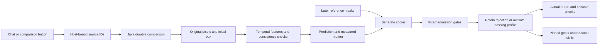
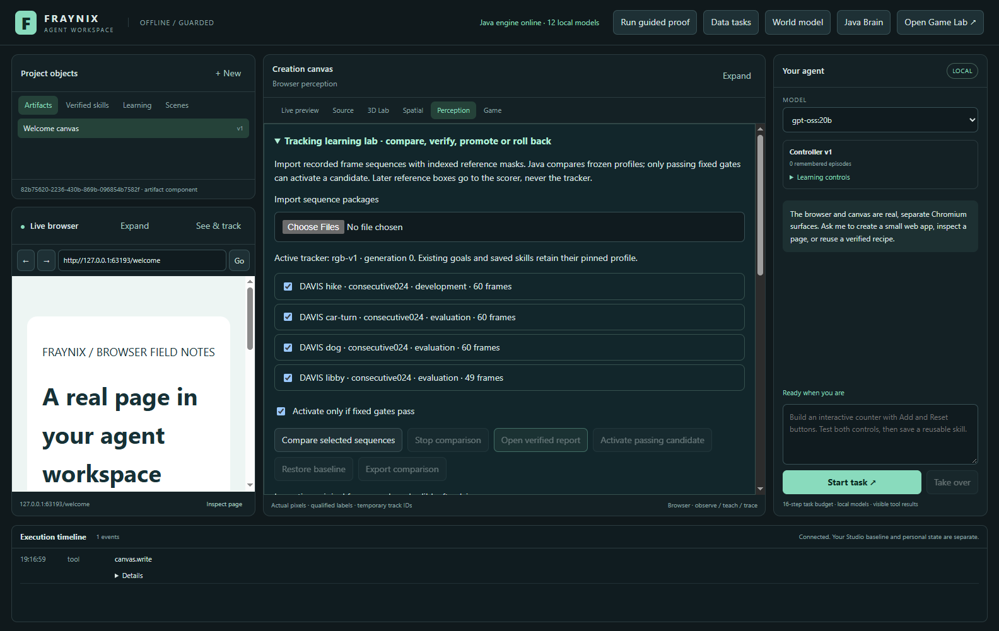
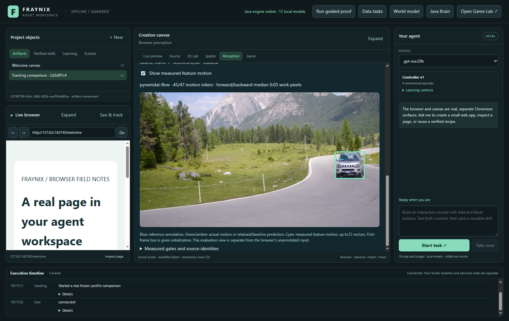
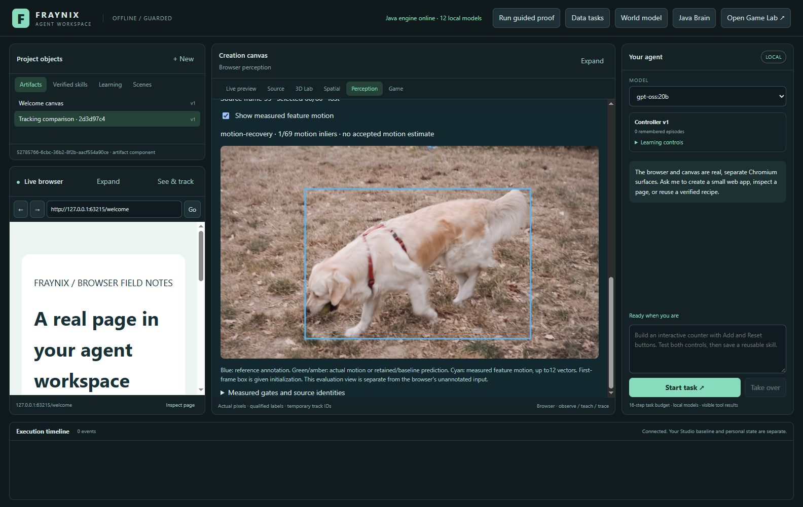
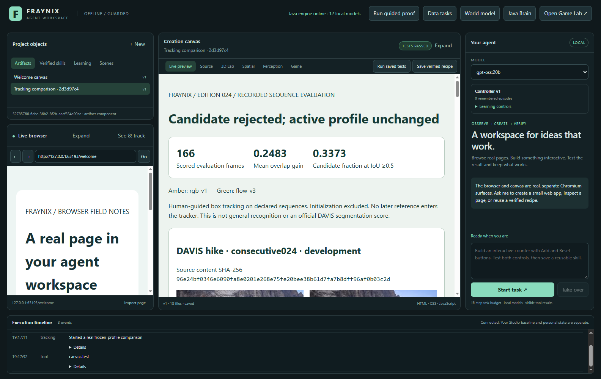
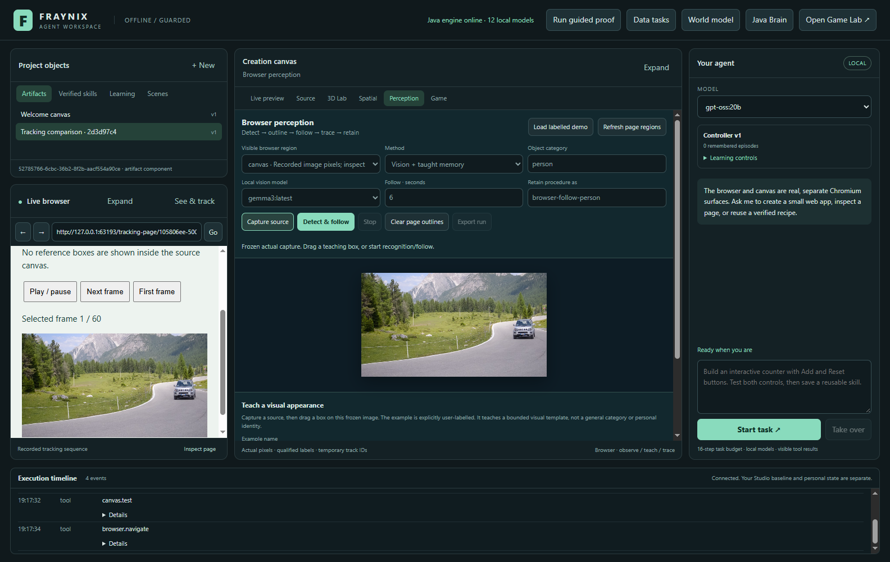
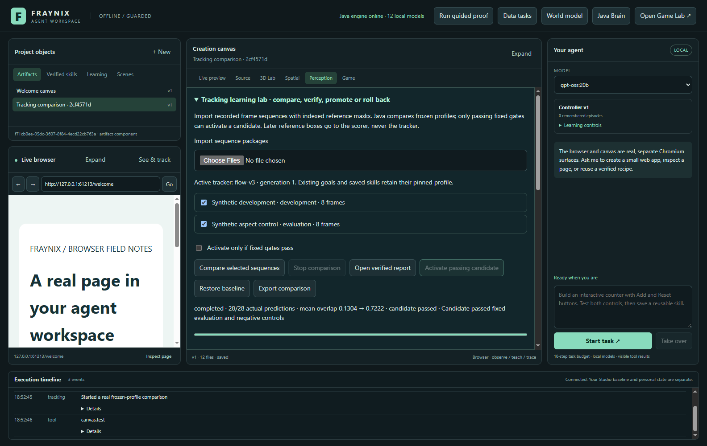
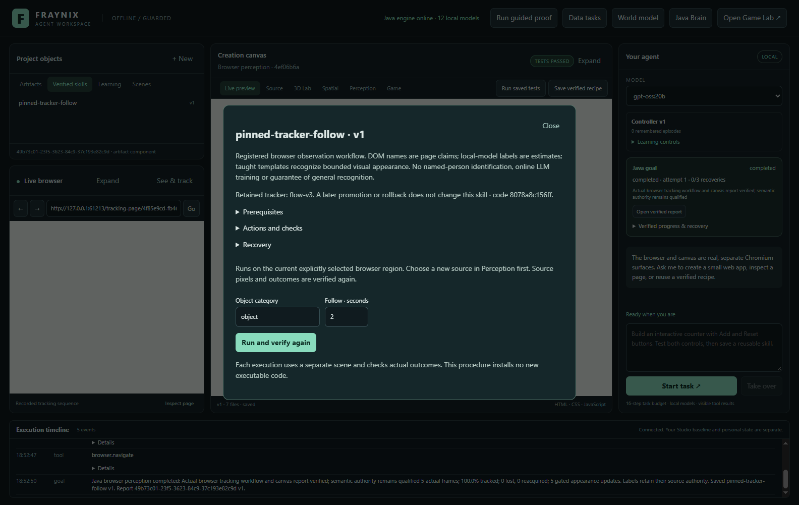
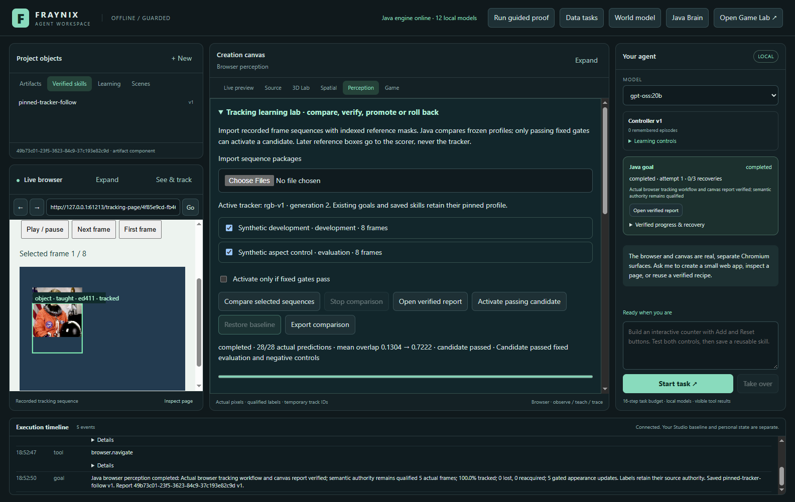
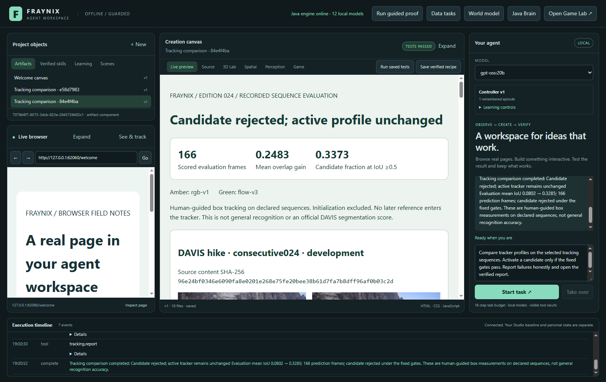

# Fraynix Agent Workspace · edition 024

**Real motion tracking in Java, measured on new footage, with the first result kept intact.**

2026-10-30 · [All editions](docs/readmes/INDEX.md) · [Previous edition 023](README-023.md) · [Offline explorer](docs/readmes/024/index.html) · [Temporal tracking contract](docs/TEMPORAL_TRACKING.md) · [Obsidian map](docs/obsidian/temporal-tracking.canvas)

This edition adds a working temporal tracker to the local agent environment. It follows image features between frames, checks their consistency, exposes the actual measured motion and retains lost/reacquired observations. The app still contains the game, Java brain, native physics, 3D/spatial views, browser, creation canvas, persistent goals, data tools and saved skills. Their layout and ownership remain intact.

The new candidate improves all three newly reserved clips. Pooled mean intersection-over-union rises from **0.080183 to 0.328527** across 166 predictions, with no per-sequence regression. It **fails the unchanged activation gates**: only 33.73% of predictions reach IoU 0.5 against a 65% requirement, and four visible predictions have IoU below 0.1 against baseline's zero. Baseline therefore remains active in the real-data comparison. These measurements establish a useful improvement and a remaining reliability problem; they do not establish general visual accuracy.

The complete implementation source baseline is `cc4c68a27b882170d13499ac2876df2ea6c16b77`. The predictor, adapter, admission implementation and controls were frozen earlier at `34c81f086b77f43e191e191e3f52f3851dd5d7f0`, before downloading the new evaluation images. No candidate tuning followed the first result. This numbered README and its assets preserve that release evidence.

## What changed and why

The earlier trackers searched independently for similar-looking rectangles. That could lose a person or vehicle when appearance changed. The new `flow-v3` uses the previous accepted pixels and observed feature motion to update location and scale. A feature must match in both directions and retain sufficient local image correlation. Inconsistent features are removed before geometry changes. On loss, the last accepted state stays available for explicit recovery.

This calculation runs directly in Java on the CPU. It does not need an image-generation transformer, a new model download, OpenCV native binaries, Docker or WSL. The optional local LLM continues to choose and explain registered workflows. Java supplies the tracking, durable state, numerical checks and activation decision. The browser and canvas display real inputs and results.

| Addition | Working behavior | Current boundary |
|---|---|---|
| Temporal image features | Four pyramid levels, distributed corners, iterative patch motion and forward/backward checks | Assumes sufficient texture and locally consistent appearance/motion |
| Robust geometry update | Median translation and bounded isotropic scale from consistent points | Keeps box aspect ratio; does not segment arbitrary object shape |
| Explicit recovery | Lost frames retain the last accepted state; motion or stricter appearance recovery can reacquire | Specific occlusion/reappearance controls pass; difficult real clips still lose the target |
| Measured motion overlay | Cyan feature vectors, actual inlier count and round-trip error alongside reference/prediction boxes | Up to12 diagnostic vectors, not dense flow or a semantic confidence map |
| Installed-profile continuity | Older profiles remain available to existing goals and skills | A new comparison uses flow-v3; old verification cannot silently certify changed code |
| Real new-footage study | Original consecutive frames, frozen code, all predictions scored, retained first decision | Small public DAVIS subset, human-guided initial box, not an official benchmark score |

## Run and review

Use **Launch-Agent-Workspace.bat** from this checkout with JDK 21 and Node.js 22.12 or newer. First setup prepares the pinned desktop dependencies; the documented offline path works after those are cached. Choose an eligible installed Ollama model for chat. `gpt-oss:20b` is the local model actually checked for the tracking workflow. The tracker itself runs without a language-model call.

The original Studio and default/private projects remain separate. Tests and the edition review use their own project directories. Do not point two processes at the same project. Source code and reusable documentation belong in Git; model weights, credentials, original research packages and personal conversations do not.

To inspect the new footage:

1. Open **Perception → Tracking learning lab**. Expanding the lab uses the center pane; close it to return to ordinary browser detection and teaching.
2. Import the four edition 024 sequence packages: development `hike`, evaluation `car-turn`, `dog` and `libby`. If using a project with previous imports, select only this development/evaluation group. There is one development case and up to three evaluation cases per comparison.
3. Press **Compare selected sequences**. The progress count comes from actual predictions. Automatic activation is conditional on every fixed gate; it cannot turn a rejected comparison into an accepted profile.
4. Open the actual report. Inspect each sequence's chart, source thumbnails, losses, overlap coverage, latency and reconstructed decision. The report's own passed display tests establish that the report works; the accuracy verdict remains separate.
5. Return to the frame inspector. Select the candidate or baseline, move the source-frame slider and toggle **Show measured feature motion**. Blue is the published reference; green/amber is the recorded prediction; cyan shows measured feature motion. Lost predictions have no current predicted box.
6. Choose **Open actual frame replay in browser**. The browser canvas shows original frames without reference overlays. Its play/pause and frame controls work. Ordinary Perception captures this source independently; the evaluator's annotations never become hidden tracking input.
7. Use **Export comparison** to retain the complete actual job. The artifact library also retains the standalone report and audit files. Passing synthetic controls can activate a profile and demonstrate **Restore baseline**, saved-skill reuse and restart; those controls are labelled separately from the rejected real-data result.

After selecting the sources, chat can run the same workflow:

> Compare tracker profiles on the selected tracking sequences. Activate a candidate only if the fixed gates pass. Report failures honestly and open the verified report.

The actual local-model check uses one typed comparison, waits for Java and opens/tests the real report. The host binds the selected dataset IDs. The model cannot invent thresholds, replace predictions or promote through narration. Its final answer comes from the recorded comparison, including rejection.

## Actual results on original footage

| New reserved sequence | Predictions | Baseline mean IoU | flow-v3 mean IoU | Candidate IoU≥0.5 | Lost / very-low-overlap visible |
|---|---:|---:|---:|---:|---:|
| car-turn | 59 | 0.101549 | 0.537575 | 0.542373 | 0 / 2 |
| dog | 59 | 0.124050 | 0.220363 | 0.203390 | 32 / 0 |
| libby | 48 | 0.000000 | 0.204526 | 0.250000 | 28 / 2 |
| Pooled | 166 | 0.080183 | 0.328527 | 0.337349 | 60 /4 |

**Rejected.** Mean-overlap gain+0.248345 passes the+0.03 gate and no sequence regresses. Coverage and the false-visible condition fail. Duplicate, disappearance and reappearance controls pass; they cannot override those failures.


Development used the first 60 consecutive hiking frames. Its 59 predictions score 0.833151 mean IoU for flow-v3 against 0.075620 for rgb-v1 and 0.030134 for adaptive-v2. Candidate coverage there is 100%, with no losses. That development success is disclosed separately from the lower new-footage performance.

The new study contains 229 original frames across four cases. Four initial frames supply given rectangles; the remaining 225 predictions per profile produce 450 actual predictions. Of these, 166 per profile belong to the three reserved cases. Every remaining selected frame contributes to the score. A lost prediction counts as zero. There are no resets on failure, selectively omitted frames or later reference inputs.

Baseline loses 144 of the 166 reserved prediction frames, while the candidate loses 60. The candidate also has four very-low-overlap visible predictions. More frequent visible output is useful only when its geometry remains trustworthy, which is why the unchanged false-visible condition matters. The car clip exposes late geometric drift; the harder dog motion and deformation expose losses and limited recovery.

Edition 023 used uniformly spaced frames. This edition uses consecutive frames because the new method measures temporal correspondence. Do not subtract the old edition's score from this one and describe that as a controlled gain. The controlled comparison above gives both profiles the same new pixels and initial geometry. The recorded frame ordinals remain available; original capture FPS is not asserted.

Wall-clock latency includes verification/decode of each image and CPU tracking. It excludes browser capture, network, language-model planning, initial setup and reference scoring. Faster operation is not claimed universally: appearance recovery can be substantially slower than a successful motion update. Per-sequence median and 95th-percentile timings stay in the actual traces/report rather than being replaced with one idealized frame rate.

## How the Java tracker works

Images preserve aspect ratio at up to 480 pixels on the longest side. A four-level grayscale pyramid makes larger image displacements manageable at coarser resolution. A grid proposes spatially distributed corners inside the current disclosed rectangle; nearby duplicate points are suppressed. The tracker solves local movement in 9×9 patches, checks reverse movement, and measures local patch correlation.

Points with round-trip error above 1.5 work pixels or correlation below 0.75 are rejected. At least eight consistent points and a sufficient fraction of the proposed set are required. Median displacement and pairwise distance ratios estimate translation and bounded isotropic scale. The shape model remains a rectangle with its original aspect ratio. A near-exact second appearance can require abstention; the tested duplicate case does not prove unrestricted identity discrimination.

On loss, the tracker preserves its last accepted image and geometry. It can check returning motion against that state or use a stricter instance of the retained appearance matcher. Controls verify full disappearance, no invented current box and recovery after four hidden frames. The real-footage failures show that recovery remains limited.

The algorithmic foundation follows standard local optical-flow principles described in the primary [OpenCV guide](https://docs.opencv.org/4.x/d4/dee/tutorial_optical_flow.html). This repository implements the calculation in Java and does not call OpenCV. No GPU speedup, neural training or semantic category confidence is implied by the motion vectors. The source and helpers appear in the [canonical inventory](docs/readmes/024/file-inventory.json) and [full tree](docs/readmes/024/FILE_TREE.md).



## Goals, skills and continuity

The Java goal runner already owns durable tasks, source conditions, progress, effects, recovery and verifiers. A skill retains a procedure with prerequisites, actions, checks and recovery; it does not simply replay a tool call and assume success. The tracking profile and its aggregate implementation fingerprint are part of a retained browser procedure's defaults.

This edition keeps `rgb-v1`, `adaptive-v2` and `flow-v3` installed. Old jobs retain their own candidate/protocol and code identities. A later promotion or rollback does not rewrite an active goal or saved skill. A changed installed implementation fails the saved procedure's preflight instead of borrowing old verification. The previous predictor/scorer source files remain byte-for-byte equivalent under their recorded text normalization.

Separate actual UI controls prove the positive path: a clearly synthetic aspect sequence passes the fixed gates; the user-facing button activates flow-v3; an actual browser capture and drawn teaching example complete a Java perception goal; the retained skill pins flow-v3 and its code; rollback restores rgb-v1; the same saved skill still uses flow-v3 on a fresh capture; the history and skill survive process restart. That establishes working software behavior. It does not override the failed real-sequence gates.

Persistent state is held in the project's private `tracking-lab/` store. Original images, masks, declared roles, per-member identities and canonical package identity are retained. The app limits source history, frame/byte counts, comparisons and profile history. Import retries accept only identical frames, incomplete imports cannot commit, changed sources reject, and interrupted or cancelled comparisons cannot promote partial results. Imported labels remain declarations; they do not install handlers or grant authority.

## Why this is a useful agency foundation

The application gives an agent a stable place to observe, act, check results and retain a proven way of working. A chat request can become a Java-owned task, a visible action, a measured outcome and a reusable procedure. That is a concrete advantage of integration: observations, tools, physical state, browser surfaces and verification share explicit identities and lifecycle rules.

Java is a practical host for this design because the existing runtime already owns simulation, computation and persistence. It is not the only language capable of durable orchestration, and a game engine is not a prerequisite for ordinary browser control. The game and physics environment add something valuable here: controlled experiments, visible state, repeatable actions and measurable failure conditions that can support learning and creation workflows.

The strongest next proof is improved completion of unfamiliar tasks after experience, with independent evaluation and retained behavior after restart. Changed activity, stored episodes or newly generated code are not sufficient on their own. This edition advances the observation layer and records exactly where it still fails. The LLM explains and selects; Java executes and checks; controllers handle timing; verifiers decide success.

Related work exists: [DeepMind's SIMA 2](https://deepmind.google/blog/sima-2-an-agent-that-plays-reasons-and-learns-with-you-in-virtual-3d-worlds/) studies instruction-following agents in virtual 3D environments, and [AutoGen's state interfaces](https://microsoft.github.io/autogen/dev/user-guide/agentchat-user-guide/tutorial/state.html) support persistent agents and teams. These are context for the design direction, not comparative evaluations of this application. Fraynix's practical proposition is the combination implemented here: local Java-owned execution, an integrated visible environment, retained procedures and explicit outcome checks that the user can inspect.

The broader application still supports the existing native physical goals, constrained grab/move/release, source-qualified spatial scenes, motion-data reports, browser teaching, real artifact creation/testing and saved procedures. Those capabilities provide several routes for a request to become a complete local task. Their existing evidence remains linked through the [edition index](docs/readmes/INDEX.md); this tracking study does not revalidate them as universal real-world intelligence.

## Validation, reproducibility and evidence

The working checkout passes **210 Java tests / 40 classes**, **29 desktop units**, **237 workflow assertion groups** and **24 actual local-model groups**. The new recorded-footage UI has 9 groups; the synthetic lifecycle has 6. Actual local chat passes4 tracking,7 perception,4 spatial,4 data and5 native-goal groups.

An independent checkout of `cc4c68a` passes the offline build, 210 Java tests, 29 desktop units and 120 critical actual UI groups. All 534 canonical implementation hashes match. It uses the same checksum-verified public research cache, with no copied personal app database or model weights. Offline dependency setup reuses the pinned Electron45.1.0 executable. The companion is checked at wide and 390px sizes for navigation, filters, source search, image loading and the real standalone report without external requests.

The [pre-execution protocol](docs/readmes/024/acceptance-024.json) was declared at 727fda4. Source freeze 34c81f0 and its hash record cab4d02 precede the new downloads. A test replaces every later annotation while retaining pixels and confirms identical predictions. The first completed comparison is retained even though its surrounding first UI test subsequently encountered a departing-page timing race. The corrected test waits for actual navigation/catalog completion; it does not change prediction, scoring or thresholds. Later UI and local-model runs reproduce the first accuracy exactly.

Development and evaluation source identities remain disjoint in the chosen comparison. Both trackers receive only original pixels and their disclosed first rectangle. The scorer reads later annotations after prediction. Synthetic software controls are separate from the recorded-footage result. Passing canvas assertions and a completed computation episode establish working execution/reporting, while the numerical accuracy verdict remains rejected.

Useful commands after dependency preparation:

```powershell
.\gradlew.bat check installDist :workspace-engine:installDist --offline
cd workspace-desktop
npm.cmd test
npm.cmd run test:tracking
npm.cmd run test:tracking-controls
npm.cmd run test:live-tracking
cd ..
.\scripts\Verify-Documentation.ps1
```

A further three-group migration check creates a fresh project with the actual published edition 023 runtime, then opens it in edition 024. The complete old comparison remains identical, the inspector chooses its original profile, its report retains protocol 023, and its original passing profile can still activate/roll back. This uses only generated synthetic source packages, without copying a personal app database. To reproduce that additional check, prepare a separate checkout of `readme-023`, build it, set `FRAYNIX_LEGACY_023_CHECKOUT` to its path, and run `npm.cmd run test:tracking-migration` after the current synthetic-control test. The ordinary app does not need that older checkout.

The public research data can be prepared separately with Python's standard library:

```powershell
python scripts/Prepare-Tracking024.py --split development --output C:/path/to/research/tracking-024
python scripts/Prepare-Tracking024.py --split evaluation --output C:/path/to/research/tracking-024
```

Use a separate data folder; original packages do not belong in Git. The checked-in frozen profile is required before the evaluation preparation command. Preparation uses verified ZIP byte ranges, member CRC and exact SHA-256 identities; it does not fetch the full 832MB archive. The [official DAVIS source](https://davischallenge.org/davis2017/code.html) and archive Terms of Use apply. Original research images and documentation derivatives retain the noncommercial source terms described in [research attribution](licenses/TRACKING_RESEARCH.md). This dataset does not relicense the independent Java implementation.

- [Release verification, tests and scope](docs/readmes/024/verification.json)
- [Actual cross-version migration](docs/readmes/024/tracking-migration.json)
- [Measured failure onsets and final geometry](docs/readmes/024/failure-analysis.json)
- [Original first new-footage decision](docs/readmes/024/first-evaluation.json)
- [Frozen computation identities](docs/readmes/024/profile-024.json)
- [Pre-execution protocol](docs/readmes/024/acceptance-024.json)
- [Development-only results](docs/readmes/024/development.json)
- [Actual recorded-footage app workflow](docs/readmes/024/tracking024-integration.json)
- [Synthetic lifecycle, pinned skill and restart](docs/readmes/024/tracking-controls-integration.json)
- [Actual local chat workflow](docs/readmes/024/live-tracking024.json)
- [Broad regression summary](docs/readmes/024/regressions.json)
- [Live perception regression](docs/readmes/024/live-perception.json)
- [Live spatial regression](docs/readmes/024/live-spatial.json)
- [Live data regression](docs/readmes/024/live-data-goals.json)
- [Live native-goal regression](docs/readmes/024/live-goals.json)
- [Actual standalone report](docs/readmes/024/examples/verified-tracking-report.html)
- [Comparison metadata and trace index](docs/readmes/024/examples/comparison.json)
- [Source summaries](docs/readmes/024/examples/datasets.json)
- [Every prediction CSV](docs/readmes/024/examples/accuracy.csv)
- [Reconstructed decision](docs/readmes/024/examples/verification.json)
- [Canonical source inventory](docs/readmes/024/file-inventory.json)
- [Full implementation tree](docs/readmes/024/FILE_TREE.md)
- [Original member identities: dataset-0.json](docs/readmes/024/examples/dataset-0.json)
- [Original member identities: dataset-1.json](docs/readmes/024/examples/dataset-1.json)
- [Original member identities: dataset-2.json](docs/readmes/024/examples/dataset-2.json)
- [Original member identities: dataset-3.json](docs/readmes/024/examples/dataset-3.json)
- [Full actual profile trace: trace-0-flow-v3.json](docs/readmes/024/examples/trace-0-flow-v3.json)
- [Full actual profile trace: trace-0-rgb-v1.json](docs/readmes/024/examples/trace-0-rgb-v1.json)
- [Full actual profile trace: trace-1-flow-v3.json](docs/readmes/024/examples/trace-1-flow-v3.json)
- [Full actual profile trace: trace-1-rgb-v1.json](docs/readmes/024/examples/trace-1-rgb-v1.json)
- [Full actual profile trace: trace-2-flow-v3.json](docs/readmes/024/examples/trace-2-flow-v3.json)
- [Full actual profile trace: trace-2-rgb-v1.json](docs/readmes/024/examples/trace-2-rgb-v1.json)
- [Full actual profile trace: trace-3-flow-v3.json](docs/readmes/024/examples/trace-3-flow-v3.json)
- [Full actual profile trace: trace-3-rgb-v1.json](docs/readmes/024/examples/trace-3-rgb-v1.json)

## Actual screenshots · 2026-10-30

Recorded-source images are credited DAVIS research derivatives under CC BY-NC4.0. Synthetic acceptance/rollback/skill controls use the existing public-domain NASA photograph and are explicitly labelled. Screenshots show actual application states; they are not generated product mockups.

[](docs/readmes/024/images/tracking-import-024.png)

Actual four-case import:229 original consecutive frames with development/evaluation roles. DAVIS research derivatives, CC BY-NC4.0.

[](docs/readmes/024/images/tracking-reference-024.png)

Actual car-turn prediction with measured cyan feature motion and separate blue reference. An illustrative frame, not a substitute for full-sequence scores. DAVIS, CC BY-NC4.0.

[](docs/readmes/024/images/tracking-loss-024.png)

Actual later dog frame: candidate lost, with no invented current prediction. Reference is evaluation-only. DAVIS, CC BY-NC4.0.

[](docs/readmes/024/images/tracking-decision-024.png)

Actual report retains the improved mean overlap and failed unchanged reliability gates. Working report assertions do not imply accepted accuracy.

[](docs/readmes/024/images/tracking-browser-024.png)

Actual original-frame browser replay and independent source capture; no reference overlay enters the source canvas. DAVIS, CC BY-NC4.0.

[](docs/readmes/024/images/tracking-promotion-024.png)

Separate explicitly synthetic aspect control passes fixed gates and manually activates flow-v3. This is software lifecycle evidence.

[](docs/readmes/024/images/tracking-pinned-skill-024.png)

Actual saved-skill inspector retains flow-v3 and its implementation identity from the synthetic software control.

[](docs/readmes/024/images/tracking-rollback-024.png)

Actual synthetic-control rollback restores baseline without rewriting the comparison or saved skill.

[](docs/readmes/024/images/tracking-chat-024.png)

Actual gpt-oss:20b workflow opens/tests the real report and states the rejected new-footage decision. DAVIS report thumbnails, CC BY-NC4.0.

## Next steps and acceptance gates

1. **Reduce geometric drift.** Develop foreground-aware feature selection and stronger shape/aspect handling on the now-known failure cases. Preserve these frozen traces so progress can be compared honestly.
2. **Improve recovery.** Evaluate occlusion, rapid deformation and distractors with explicit lost states, tested reacquisition and limits on false visible boxes. A returned rectangle needs evidence, not optimistic extrapolation.
3. **Reserve different footage.** Declare new clips before collecting them, freeze the next candidate and score every prediction. Keep the coverage, regression and false-visible conditions fixed or declare a separately justified protocol before results.
4. **Measure complete tasks.** Test whether better observations improve browser-following and source-qualified manipulation tasks under changed conditions, with durable goals, new-source skill reuse and independent success checks.
5. **Consider acceleration after correctness.** Keep the Java CPU reference, compare any future GPU implementation numerically and include transfers/capture in workload timing. Rendering on a GPU does not establish faster neural or tracking computation.

These are implementation and evidence gates, not a forecast of general recognition or autonomous self-training. Edition 025 is the next unused snapshot after publication. Editions 001–023, the original recorded 013 data and the first 024 result remain preserved. The practical aim remains the same: a local agent that can observe the environment, complete a task, verify what happened and retain useful skills without hiding failures.
