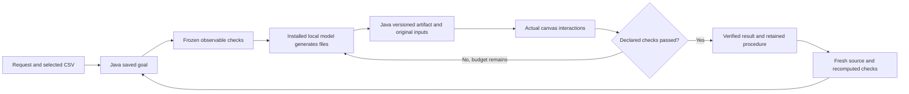
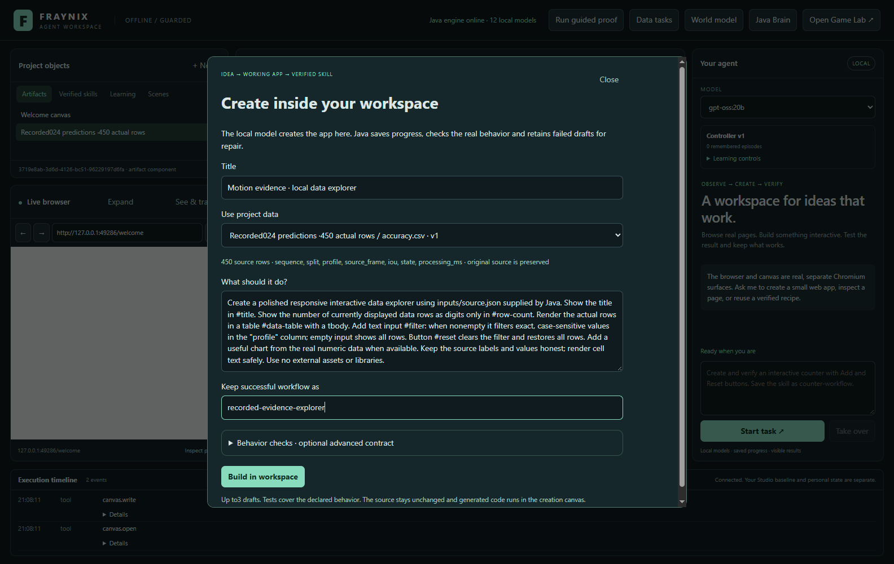
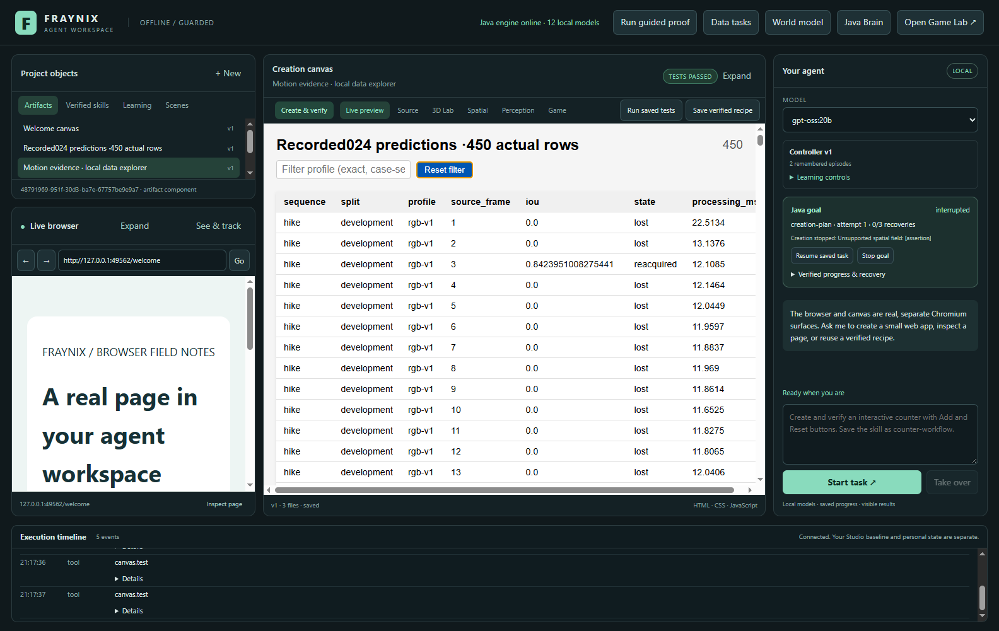
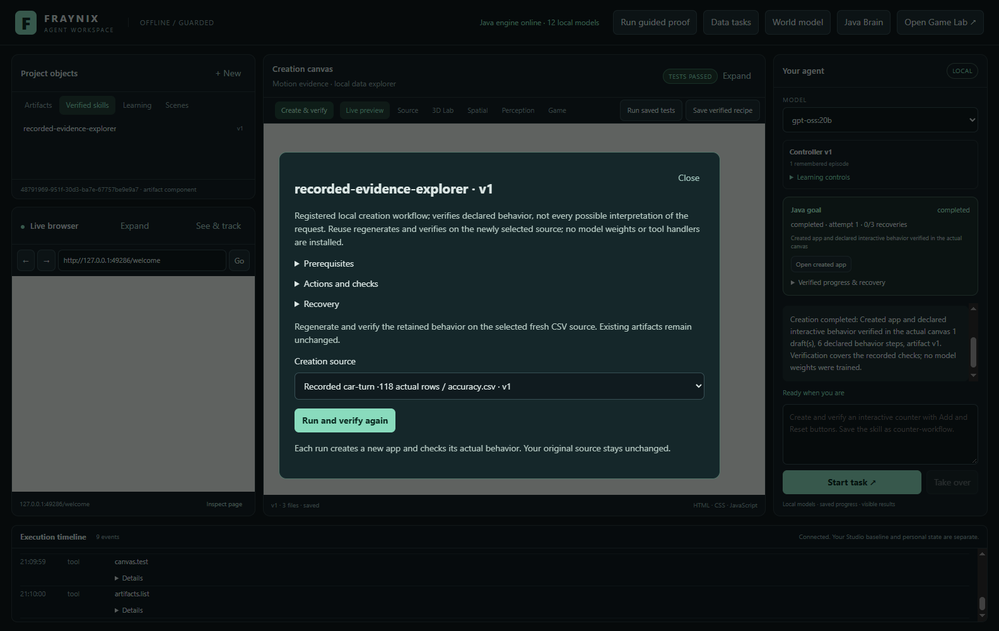
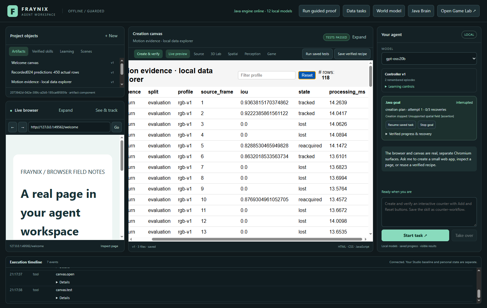
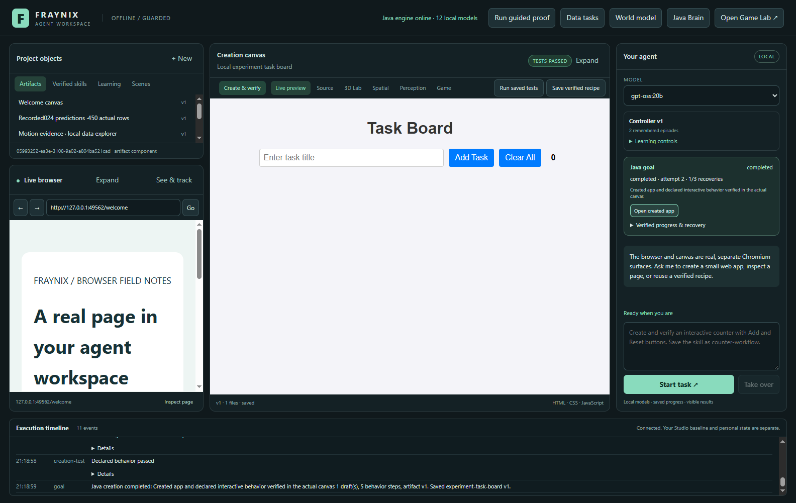
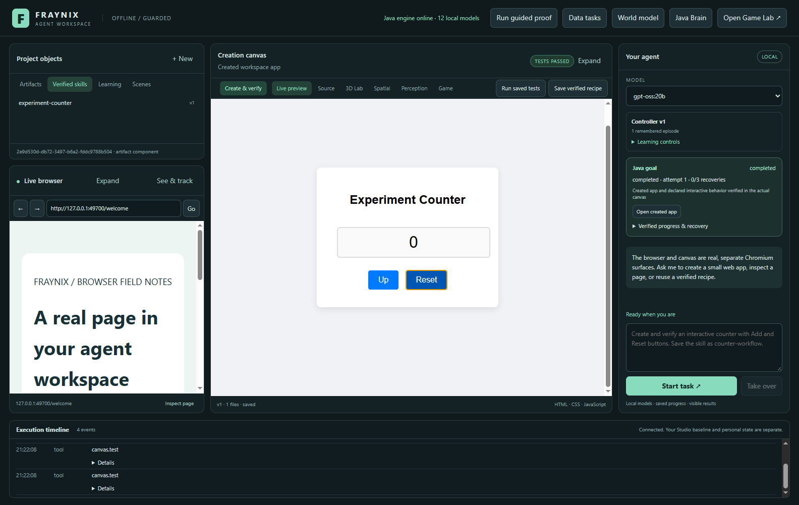
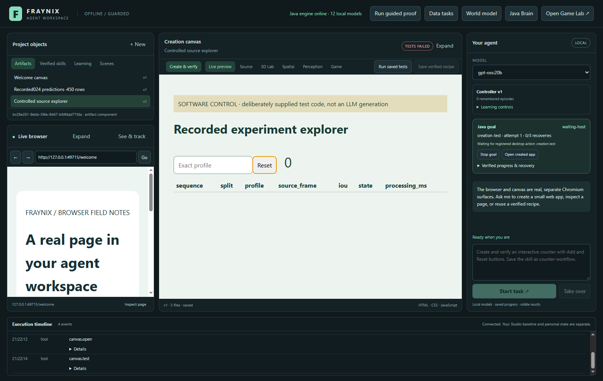
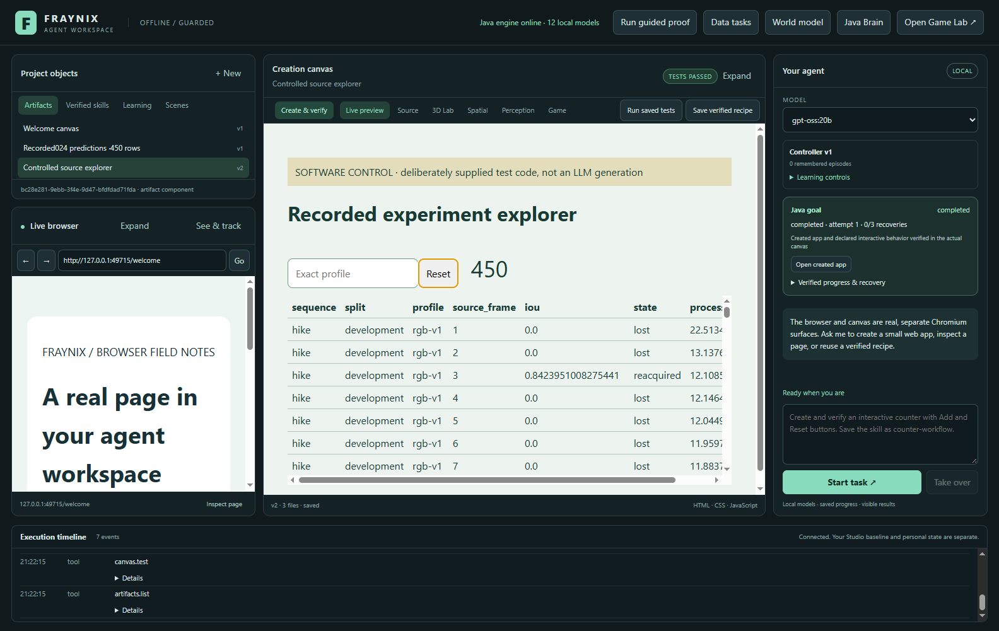
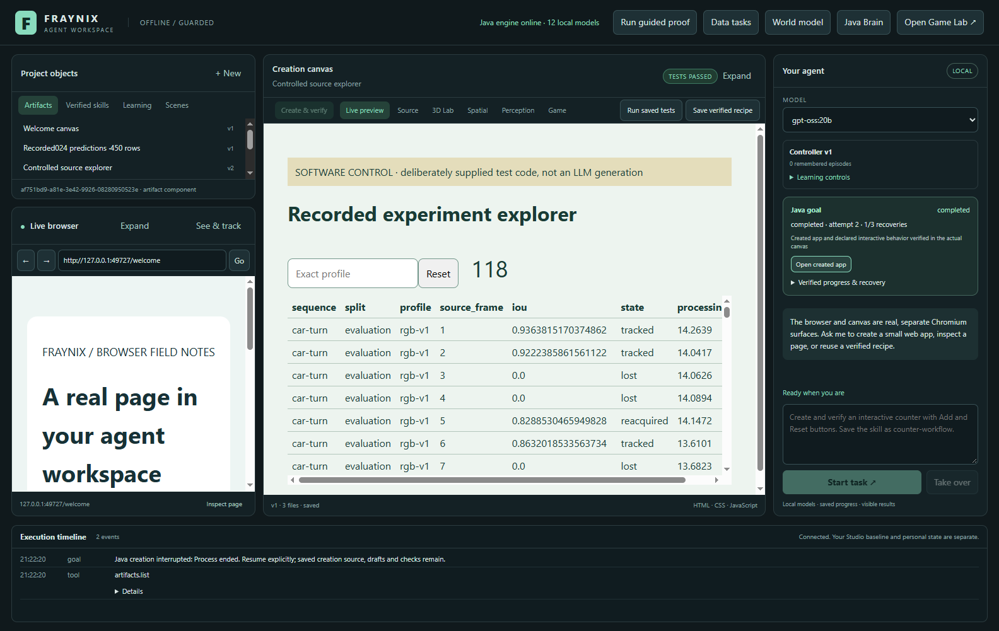

# Fraynix Agent Workspace · Edition025

**The workflow becomes the content: request → runnable app → actual checks → retained procedure.**

2026-10-30 · local development on the user's machine. This edition extends the
existing application without replacing its design. The starting point is
[edition024](README-024.md), preserved under [readme-024](https://github.com/eyeoverthink/Fraynix-Agent-Workspace/tree/readme-024).
This snapshot is linked as [readme-025](https://github.com/eyeoverthink/Fraynix-Agent-Workspace/tree/readme-025).
Open the [offline visual guide](docs/readmes/025/index.html),
[edition history](docs/readmes/INDEX.md), [creation contract](docs/DURABLE_CREATION.md)
or [complete source inventory](docs/readmes/025/FILE_TREE.md).

## What changed

The existing canvas could already run generated applications. Edition025 gives
creation the same durable Java ownership as registered physical, data and
perception tasks. A request now becomes a saved goal with an explicit source,
model, behavior contract, draft history and recovery rules. The local model writes
real HTML/CSS/JavaScript. Actual Chromium interactions determine whether the
declared behavior works. Failed observations can drive a bounded revision. A
passing workflow can become a versioned procedure and run on fresh data.

The first content is the application's own recorded work: the450-row prediction
trace published in024. The local model builds an interactive explorer of those
actual rows. Java supplies the original data, computes expected counts and tests
filtering and reset. A second run binds a118-row car-turn subset, so the retained
workflow must adapt instead of copying its first result. A separate standalone
task board exercises contract planning before code generation.

This is a practical interpretation of the user's vision. The application does
not need a feed of prepared articles or scenes to be useful: its requests,
observations, experiments and creations become navigable work. External footage,
websites and datasets still supply observations when the task needs them. The
workflow produces content with provenance, and that content supplies material for
the next task. Useful autonomy must be judged by completed tasks, accurate checks
and recovery when conditions change.

## Why this foundation matters on a modest budget

A self-built integrated environment can be valuable without a large training
budget. Java owns persistent entities, goals, transactions and registered
execution. The desktop provides a real browser, visual canvas and controls. The
local model participates through bounded tool calls and generation. Physical
controllers handle timing; checks establish outcomes. Together these allow a
local agent to do work in an environment the developer can inspect and extend.

This establishes integration and ownership. It does not establish parity with
large generative world models, general object understanding or unrestricted
competence. Nor does the architecture establish that nobody else is building
agents with tools, memory or simulation. The particular value here is the
combination implemented and measured in this application: persistent work, visible
effects, editable state and a retained record of what actually succeeded.

Budget should guide the next experiments. Reuse installed models, solve complete
tasks and measure failure before adding heavyweight infrastructure. A local
generation has no cloud API bill in this phase, but it uses the machine's memory,
compute, electricity and time. Java is the application backbone; it does not
remove those resource limits or automatically turn GPU rendering into neural
training. No new model weights or runtime dependencies were installed for025.

## The whole application today

| Area | Current function | Evidence boundary |
|---|---|---|
| Local chat | Select an admitted installed model, request actions, receive a result tied to observations | A selected model must prove task reliability; listed capability alone is insufficient |
| Browser | Real navigation, observations and registered interactions in an embedded surface | Web content is data; it cannot install privileged handlers |
| Creation canvas | Runnable HTML/CSS/JS, editable source, versioned artifacts and actual behavior tests | Tests establish the declared cases, not every interpretation of a request |
| Durable creation · new | Saved request/source/checks, model generation, bounded repair, restart and fresh-source procedural reuse | Real model output and deliberately supplied software controls are recorded separately |
| 3D physics and manipulation | Declared scenes, forces, contacts, grab/move/release, native execution and forecasts | Same-solver agreement is not independent physical validation |
| World model | Prediction and observed-motion comparison, recorded-data calibration and retained quality decisions | Narrow task models and explicit conditions; no universal learned dynamics claim |
| Data tasks | Source-preserving imports, motion calculation, charts, quality flags and procedures | Source units, mapping and thresholds determine validity |
| Game Lab | Preserved Java game/editor, assets, live play/control and brain integration | Legacy full editor remains a separate window; runtime embedding is future work |
| Browser perception | Page-stated labels, model estimates, taught appearance and tracking traces | Category/appearance tracking is not named-person recognition |
| Temporal tracking | Frozen Java candidates, original recorded frames, scored predictions and gated activation |024 improved overlap but failed reliability gates; baseline remains active |
| Memory and skills | Episodes, source evidence, artifact recipes, registered procedures and recovery | Retained procedures are distinct from executable host tools and LLM weight updates |

The Java nervous system and CPU/GPU compute experiments remain available in the
source. Their activity must be evaluated against useful task performance before
claiming learned competence. This phase connects creation to measured outcomes;
it does not rename orchestration as neural self-training.

## How to try the new flow

1. Launch **Launch-Agent-Workspace.bat** from this checkout. Use the independent
   successor project directory. Docker and WSL are not required.
2. Select an eligible installed local model. **gpt-oss:20b** is the actual verified
   model for the live025 proof; other models require their own verification.
3. Open an existing artifact containing a CSV, then choose **Create & verify**.
   Alternatively select **No source** for a standalone application.
4. Describe the desired behavior. The default data request builds an exact-value
   filter, real table and reset. Choose an optional retained workflow name.
5. Keep the advanced checks if they describe the request, or leave them blank.
   With blank checks, the model declares a contract before generating code.
6. Choose **Build in workspace**. Watch the existing goal card and timeline.
   The created app appears in the same canvas. Failed drafts remain visible as
   artifact versions; repair attempts cannot silently weaken the frozen checks.
7. After completion, use the app and inspect its source and actual test receipt.
   Open the retained procedure under **Skills**, choose a fresh CSV and run it.
8. After an interruption, use the goal card's **Resume**. Completed passing
   interactions are reused; changed sources and externally revised artifacts
   require a separately revised task.

Chat can enter the same workflow with **Create and verify**. For example:

> Create and verify a task board with input #task-title, an #add-task button,
> visible cards, digit-only #task-count and a #clear button. Adding a nonempty
> task increments the count; clear removes all cards and resets it. Save the
> skill as experiment-task-board. Use no external libraries.

The dialog is the clearest way to select a source and inspect its contract. Chat
uses the currently selected artifact's non-reserved CSV when present. Use a
standalone artifact or explicitly choose No source when no dataset is intended.
The new routing phrase preserves the older general creation path for existing
requests. Procedural reuse is available in the existing Skills inspector.

## What Java and the model each do

The current adapter requests one complete HTML document with inline CSS and
JavaScript. It uses the existing adapter's native function naming and maps that
document to Java's validated file contract. This avoids ambiguous nested file
maps. Java's file contract supports18 generated files, while this local adapter
currently submits one document plus Java-supplied inputs.

The model supplies code through a private output contract, not arbitrary host
commands. Java injects the source files after generation, pins model metadata,
checks the leased effect and commits a versioned artifact. The desktop opens
that artifact and performs real click/fill interactions. Java checks the exact
receipt and determines completion. A statement such as “it works” cannot replace
those observations.

The source CSV stays unchanged. Java stores source/version/content identities and
derives source-dependent counts from original cells. The generated app fetches
`inputs/source.json`; it must not invent rows or replace reserved input files.
The artifact can read files under its own version path. Canvas requests outside
that path remain blocked, and imported strings do not gain tool authority.

One shared goal runs at a time. Creation permits at most three drafts across
recovery,24 behavior steps,600 seconds per attempt and three explicit resumes.
Generated code is bounded to18 files and64K characters; source/parser and existing
storage budgets also apply. These bounds prevent an unnoticed endless loop.
A failed third draft remains interrupted with evidence; no procedure is promoted.

## Retention, recovery and what learning means here

A creation procedure retains the request, check templates, model choice,
prerequisites, source evidence and recovery rules. Data procedures require a
fresh selected source. Java computes new expectations and the model creates a
new artifact that must pass actual checks. This is a reusable way of working,
distinct from copying an existing artifact recipe.

Java persists draft intent before writing and reconciles a stable effect on
restart. It can test a saved untested version or reuse an existing passing
receipt without repeating successful interactions. It retains the recovered
attempt in draft history. Stop cancels the owned model request and task; late
results cannot create a completed artifact or saved procedure. Editing a bound
source or created version interrupts the original task instead of silently
adopting the new state.

This is procedural retention and outcome-driven repair. LLM weights remain
unchanged. The next evidence for learning is better results on new tasks after
restart, compared with a fixed baseline and with regressions rejected. Changing
weights, generating code or accumulating memories alone would not establish that.
Contracts also have limits: a model can propose weak checks or create an app that
passes a narrow case. The live proof therefore additionally compares actual
displayed table cells with original source values. Broader task suites and
independent contract review remain next steps.

## Results and verification

The final working checkout passes **218 Java tests / 41 classes**, **33 desktop units**, **245 workflow assertion groups** and **31 actual local-model groups**. The creation controls contribute8 groups; actual local creation contributes5 and chat contributes2.

An independent checkout of `558df56` passes the offline build, 218 Java tests, 33 desktop units and 128 critical actual UI groups. All 543 canonical implementation hashes match. No personal database or model weights were copied. The pinned Electron45.1.0 executable is reused from the dependency cache. The offline guide is checked wide and at390px, including navigation, filters, inventory search, screenshots and the source-preserving standalone app.

| Actual workflow | Drafts | Result |
|---|---:|---|
| 450-row source explorer | 1 | completed; actual checks passed |
| Fresh118-row procedural reuse | 1 | completed; actual checks passed |
| Standalone model-planned task board | 1 | completed; actual checks passed |
| Chat-driven counter | 1 | completed; two increments/reset independently checked |
| Deliberately broken software control | 2 | initial failure retained, repaired v2 passed |
| Restart software control | 1 | passing receipt reused after restart |

Two kinds of evidence are intentionally separate. The controlled workflow supplies
deliberately broken/fixed HTML to prove real failure, versioned repair and restart
mechanisms. It is labelled **software control**, with no claim that the model
wrote that code. The live workflow uses the actual installed local model and
retains its generated files, model digest, goal history and real browser checks.
Original024 prediction rows are reused as content; this is not a new tracking
evaluation, a new visual training set or a promotion of flow-v3.

The first canvas run exposed a genuine defect: the artifact's policy blocked its
own source-data request. That failure was preserved and the final implementation
allows only its own version path. A restart test also needed to wait for the
actual Resume acknowledgement before inspecting the terminal state. These are
recorded development corrections, not successful results invented after failure.

The first live-model attempt also remains in the evidence. Its first filter
failed, its repair referenced an undefined variable, and the next response had
no native output call. Java interrupted it and retained no skill. The final
generation prompt puts failed checks and script errors first, requires the native
output call explicitly and gives only creation file output an8192-token budget;
other tool plans keep their4096-token budget. The later reported live proof is a
separate attempt after those corrections. It does not erase the earlier failure.

Two further development attempts exposed output-shape errors before any app
was admitted, another used an undefined source global, and an early chat attempt
returned no native contract call. Their
interrupted states are retained in the development-attempt record. Native names
now follow the existing adapter, and file output is a single explicit HTML string.
These development trials changed code between attempts; they are not a measured
success-rate benchmark. A malformed response still stops with evidence instead
of being treated as executable content.

After the runtime contract explicitly distinguished source files from JavaScript
globals, both source-bound creations completed in one draft each. The test
continuation reopened those genuine completed goals and compared every displayed
cell against all450 and118 original rows. It corrected the collapsed-field
interaction and explicitly waited for asynchronous source readiness before
independent filtering. Completed generation was preserved, then the standalone
model-planned task ran. The live evidence describes this continuation; it does
not present earlier failed trials as successful.

The older physical body UI test timed out once waiting for its release result;
no release tool event was recorded. The unchanged diagnostic repeat passed all
ten groups, and the independent checkout runs that original workflow again.
The cause was not reproduced. The regression-deviation record retains this
observation; the final suite totals describe passing runs, not first-attempt
success rates.

Implementation baseline: `558df563ad12f1479f5f7a094bd09832d3121cb9`. Hashes use canonical UTF-8/LF for text and
exact bytes for binary assets. See the [verification record](docs/readmes/025/verification.json)
and [source inventory](docs/readmes/025/file-inventory.json). Private conversations,
runtime databases, weights, credentials and original research packages stay
outside this publication. The source CSV and its research attribution remain
available in the historical024 snapshot and [license notes](licenses/TRACKING_RESEARCH.md).

## Actual dated screenshots

Actual Create & verify dialog: published450-row source, requested behavior and source-derived checks before generation. Local gpt-oss:20b proof.

Actual locally generated data explorer in the existing canvas. Independent checks compare displayed cell values with original source rows.

Actual saved-procedure inspector binds a fresh118-row recorded subset. Source-derived expectations are recomputed by Java.

Actual local-model generation on the fresh source, with new artifact identity and real passing behavior checks.

Actual standalone task board: local model declares a contract before code, then creates and verifies it.

Reopened actual chat-created counter and retained goal/skill. Independent checks read its actual display value through two increments and reset; no conversation text is replayed.

SOFTWARE CONTROL: deliberately supplied broken reset fails in actual Chromium. This code is a test fixture, not local-model output.

SOFTWARE CONTROL: the same artifact reaches v2 after a genuine failed receipt, with all frozen checks passing.

SOFTWARE CONTROL: a real process restart reuses the passing artifact/receipt without repeating generation or completed interactions.

## Development sequence and next gates

| Step | State | Completion evidence |
|---|---|---|
| Retain the integrated app and state boundaries | Implemented | Existing functions and regression checks remain available |
| Make creation a durable registered Java task | Implemented025 | Actual generation, write, interactions, repair controls and recovery |
| Turn the app's own trace into usable content | Implemented025 | Actual450-row explorer and fresh118-row procedural reuse |
| Compose registered task families | Next | One request imports/selects data, performs a declared physical/data task, builds a result app and survives cancellation/restart |
| Review contracts independently | Next | Deliberately misleading/weak contracts are rejected on a separate evaluation suite |
| Improve visual recovery and shape handling | Planned separate candidate | Freeze new code/gates before different footage; retain024 rejection |
| Learn useful policies from experience | Planned measured experiment | Better task outcomes than fixed baseline on unfamiliar cases, retained after restart, with rollback |
| Broader physical reality and 3D import | Planned calibrated evidence | Independent scale/units/contacts and observed-vs-predicted motion with uncertainty |
| Embedded legacy game runtime | Planned compatibility work | Offscreen/state adapter latency, focus, resize and lifecycle measurements |
| Neural/GPU compute expansion | Planned measured backend | CPU-reference agreement and end-to-end workload timing including transfers |

The next implementation should compose already registered abilities into one
durable task, rather than add another disconnected panel. A useful proof is:
select observations, calculate or predict an outcome, create an interactive
explanation from actual results, test the interactions and retain the procedure.
Each stage needs explicit source bindings and its own success criteria. A resumed
task must reuse verified work and recover only the failed stage.

In parallel, visual intelligence should improve through different declared
recordings and explicit failure analysis. The024 candidate's improved overlap
did not satisfy reliability gates, so baseline remains active. Those failures
are now experienced development material. A changed candidate needs new frozen
identities and new evaluation footage; reusing the old cases cannot establish
fresh generalization.

The longer vision remains a local environment where agents can observe,
manipulate, create, test and retain useful behavior across simulation, data and
web tasks. This edition adds one complete and inspectable creation capability.
Its value grows when several such capabilities reliably complete a request
together. Each expansion should earn its claim through actual outcomes.

## Evidence and source navigation

- [Release verification and scope](docs/readmes/025/verification.json)
- [Actual browser repair/restart controls](docs/readmes/025/creation-integration.json)
- [Retained initial live-model failure](docs/readmes/025/first-live-failure.json)
- [All retained development failures and test corrections](docs/readmes/025/development-attempts.json)
- [Actual local model generated apps and receipts](docs/readmes/025/live-creation.json)
- [Observed regression timeout and actual repeat](docs/readmes/025/regression-deviations.json)
- [Actual chat-driven creation and independent checks](docs/readmes/025/live-creation-chat.json)
- [Broad regression summary](docs/readmes/025/regressions.json)
- [Live tracking regression, retained rejection](docs/readmes/025/live-tracking024.json)
- [Live browser perception regression](docs/readmes/025/live-perception.json)
- [Live spatial regression](docs/readmes/025/live-spatial.json)
- [Live data regression](docs/readmes/025/live-data-goals.json)
- [Live native-goal regression](docs/readmes/025/live-goals.json)
- [Standalone source-preserving explorer](docs/readmes/025/examples/verified-explorer.html)
- [Offline export provenance](docs/readmes/025/examples/export-provenance.json)
- [Original generated explorer source](docs/readmes/025/examples/generated-explorer/index.html)
- [Exact Java-injected source CSV](docs/readmes/025/examples/generated-explorer/inputs/source.csv)
- [Actual original explorer receipt](docs/readmes/025/examples/generated-explorer/actual-receipt.json)
- [Original fresh-source app](docs/readmes/025/examples/fresh-source-explorer/index.html)
- [Original task board](docs/readmes/025/examples/task-board/index.html)
- [Original chat counter](docs/readmes/025/examples/chat-counter/index.html)
- [Canonical inventory](docs/readmes/025/file-inventory.json)
- [Full source tree](docs/readmes/025/FILE_TREE.md)

- [Obsidian engineering note](docs/obsidian/33-durable-creation.md) and
  [Canvas map](docs/obsidian/durable-creation.canvas)
- [Current project memory](docs/PROJECT_MEMORY.md) and [development log](docs/DEVELOPMENT_LOG.md)
- [Edition025 plan](docs/EDITION_025_PLAN.md) and [runtime contract](docs/DURABLE_CREATION.md)
- [Previous frozen edition024](README-024.md), [all editions](docs/readmes/INDEX.md)
  and [original Studio lineage](https://github.com/eyeoverthink/Fraynix-Studio)

Run the existing offline Java build, desktop units and actual workflow tests as
described in the repository entry point. `test:creation` exercises controls;
`test:live-creation` requires the admitted installed local model. The offline
HTML guide has no CDN, remote fonts or runtime-service requirement. The application
is local first; normal browsing and optional providers retain their own network
requirements. No public site or cloud generation service was added for025.
