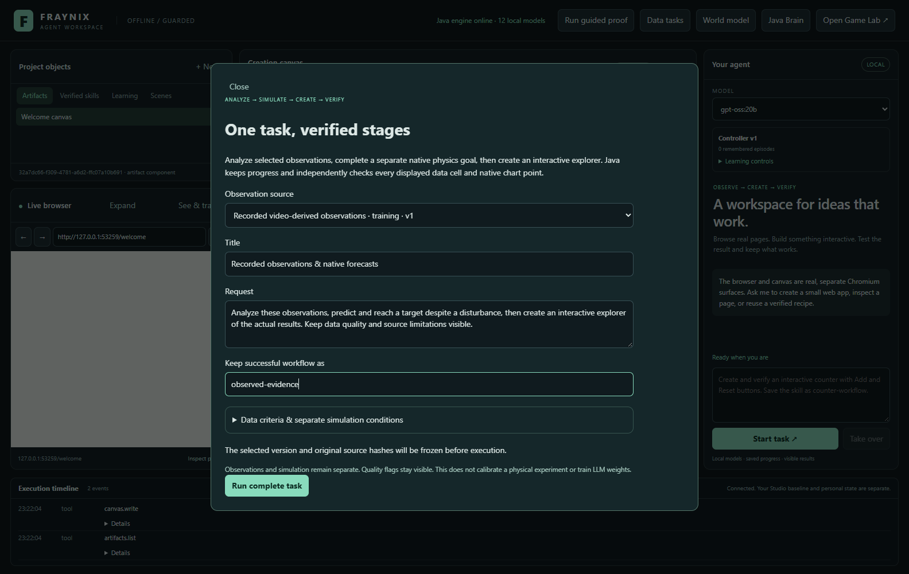
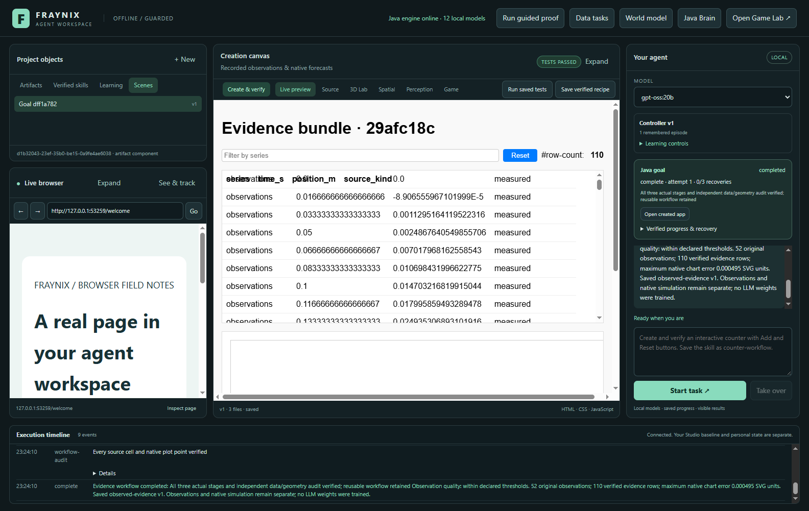
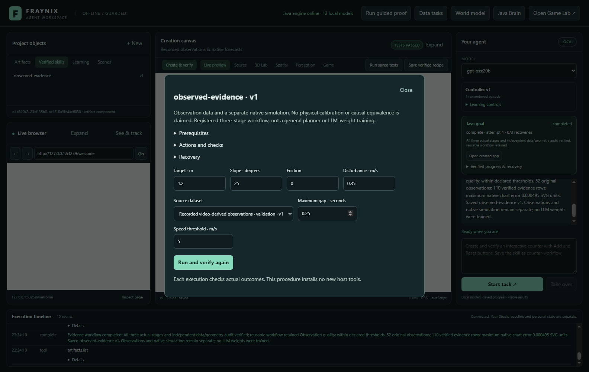
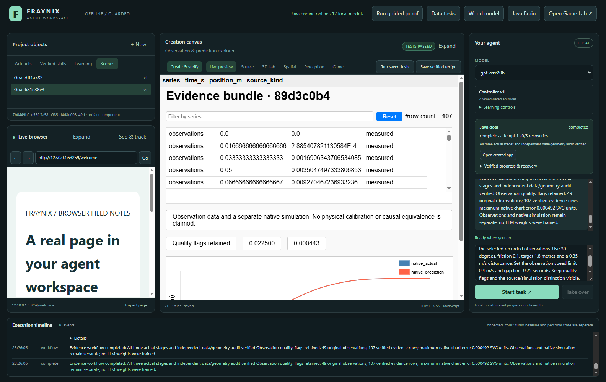
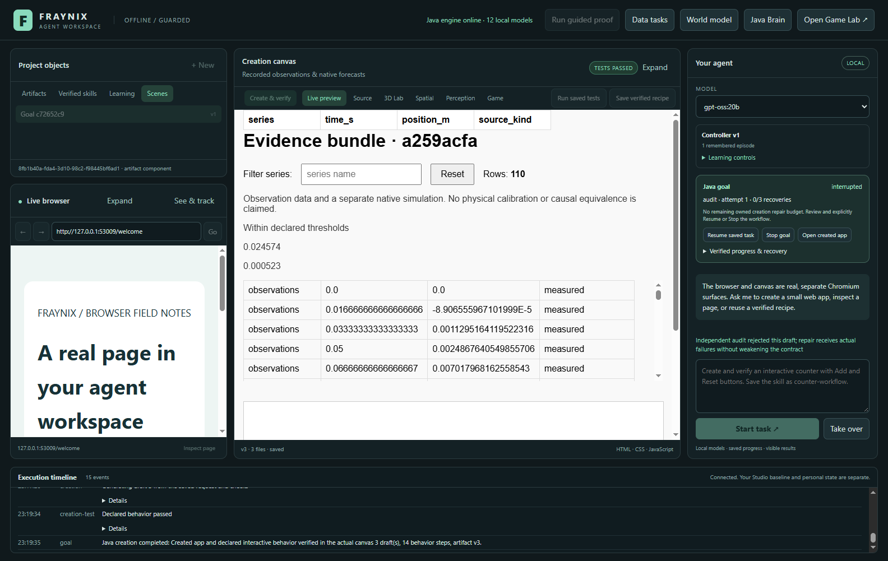
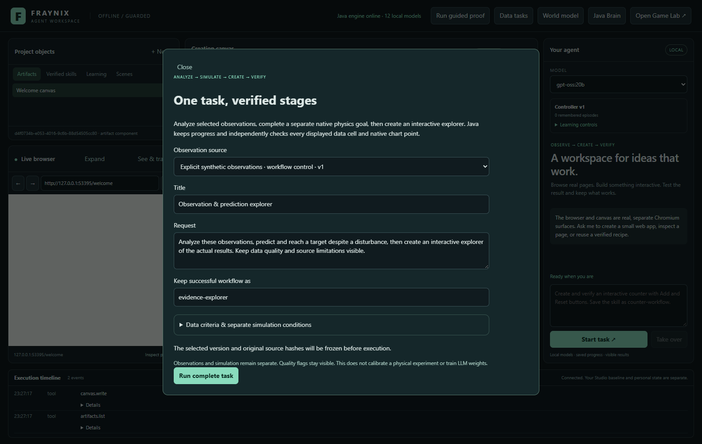
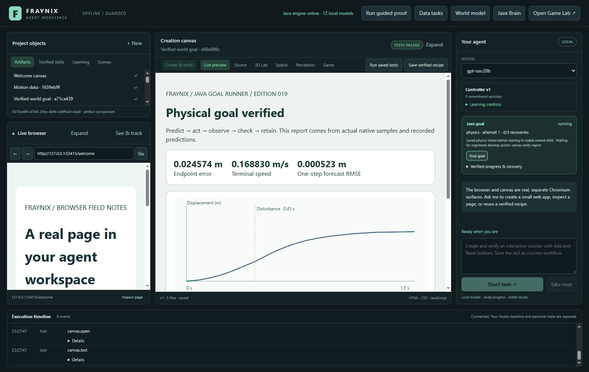
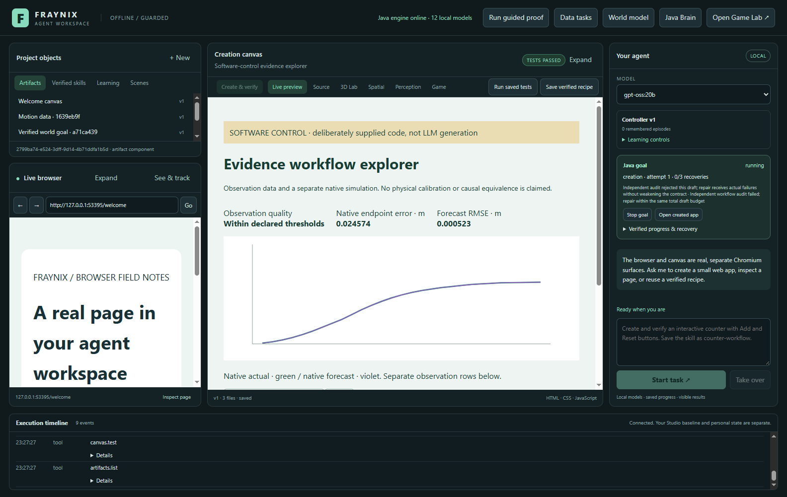
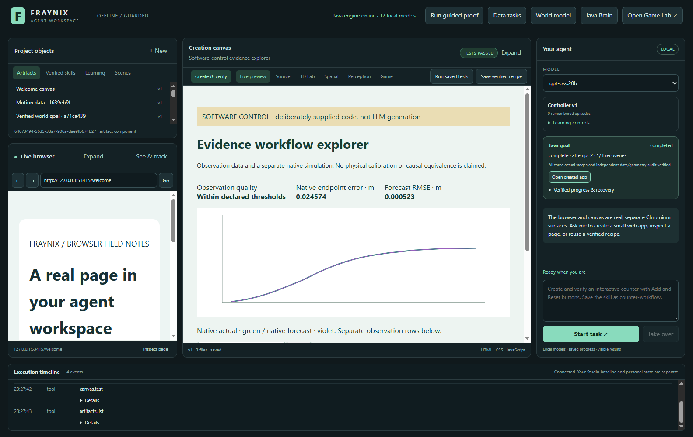

# Fraynix Agent Workspace · Edition026

**One request → actual observations → native prediction and control → locally created content → independent verification → reusable workflow.**

2026-10-30 · local development on the user's machine. This extends the same
application and preserves its design. Start with [edition025](README-025.md),
preserved under [readme-025](https://github.com/eyeoverthink/Fraynix-Agent-Workspace/tree/readme-025).
This edition is linked under [readme-026](https://github.com/eyeoverthink/Fraynix-Agent-Workspace/tree/readme-026).
The [offline visual guide](docs/readmes/026/index.html),
[runtime contract](docs/EVIDENCE_WORKFLOWS.md),
[full source tree](docs/readmes/026/FILE_TREE.md),
[Obsidian map](docs/obsidian/evidence-workflows.canvas) and
[edition history](docs/readmes/INDEX.md) provide different views of the same implementation.

## What the application now completes

Earlier editions established durable Java goals for data, physics and creation.
Edition026 joins those registered capabilities into one complete evidence task.
Java freezes the request, selected observations, native conditions, model and
success checks. It supervises three owned children, verifies each real outcome,
builds a source-preserving evidence bundle and asks the installed local model to
create an interactive explorer of that evidence. A separate check reads the
actual rendered table and SVG geometry. Only a completed parent can become a
retained whole-workflow skill.

The live demonstration uses unchanged recorded video-derived observations from
the existing edition013 dataset. The native block experiment remains a separate
simulation. The generated explorer presents source rows, data-quality status,
native forecast/actual traces and actual endpoint/prediction errors. Reusing the
saved procedure binds a different recorded trial, changes angle/friction/target
and applies stricter quality criteria. Java recomputes counts and chart scale
from the new evidence rather than reusing a screenshot or a previous answer.

This implements another part of the original vision: the workflow itself creates
useful content inside the environment. Data, experiments, reports, generated apps
and retained skills connect to each other. The agent participates in the app's
state and execution. It can produce inspectable work and use verified outcomes
as inputs to another task. The environment still needs observations, declared
goals and trustworthy checks; the interface does not make those requirements
disappear.

## Why this is useful on an independent budget

The value is the integration and ability to inspect and extend it locally. Java
owns persistent goals, entities, source bindings, registered actions and
recovery. Native physics handles the physical timing. Electron hosts the browser
and visual canvas. An already installed local model writes the requested
content. None of this phase requires training a large model, a cloud generation
service or a new GPU purchase.

A modest project can make meaningful progress by completing narrow tasks well:
preserve the source, run an experiment, build a useful interface, catch wrong
output and recover without repeating completed physical effects. The practical
advantage is control over the whole execution path. Java is a suitable backbone
for this application because its durable runtime already owns that path; using
Java alone does not establish higher intelligence or better performance than
other systems. Those claims need measured comparisons.

This repository does not claim uniqueness, frontier-model parity, unrestricted
autonomy or general scene understanding. It records a concrete local result,
including failures. A complete task with checks is stronger evidence of useful
agency than a chat answer claiming that work was done.

## Existing design, fuller behavior

| Area | Current role | How026 connects it |
|---|---|---|
| Chat and installed models | Local conversations and explicit tool requests | Routes an evidence workflow or exact named retained procedure to Java |
| Shared Java runtime | Durable goals, task families, transactions and recovery | Owns a parent, stable children, frozen inputs and completion |
| Data tasks | Original CSV, SI mapping, derivatives and quality reports | Verifies every selected observation before bundling it |
| 3D/native world model | Prediction, disturbance, control and measured outcomes | Executes the existing native goal and retains its actual run |
| Canvas and creation | Real local HTML/CSS/JS and actual browser tests | Creates an explorer from the Java-supplied evidence |
| Skills | Versioned registered procedures | Retains the complete verified workflow and binds fresh inputs |
| Browser/perception/tracking | Real pages, qualified observations, teaching and traces | Preserved; this phase does not change tracking computations or promote a rejected profile |
| Legacy Game Lab/nervous system | Existing game, physical and learning experiments | Preserved; this workflow does not replace their interface or claim new game-policy learning |

There is no extra main workspace page. **Create & verify** exposes **Run a
complete evidence task**. The existing goal card shows parent progress, its
current child, completed stages and recovery. Completed stage reports and the
created app can be opened. The shared Skills library exposes fresh observation
binding and explicit native-condition changes.

## Walk through the task

1. Start the desktop with a separate project directory. Choose an installed local
   model in the existing model selector. The recorded test used `gpt-oss:20b`;
   actual admitted model digests are retained in the evidence.
2. Open **Data tasks** and import UTF-8 CSV with explicit time/distance columns
   and units. Qualify the source as measured or synthetic. Select it for chat,
   or choose it directly in the complete-task dialog.
3. Open **Create & verify → Run a complete evidence task**. Give the explorer a
   title and request. Select a saved-procedure name if successful work should be
   retained. Expand the conditions only when changes are wanted.
4. Start the complete task. Its data child reconstructs the original observations
   and tests the real report. Quality warnings remain recorded outcomes.
5. Its native child predicts and drives the block toward the declared target,
   applies the requested disturbance and verifies the actual endpoint/report.
6. Java builds the bundle from the original observations and native run. The
   local model generates real interactive code; existing browser checks exercise
   its filter, reset, count, metrics and qualified labels.
7. A separate audit reads every table cell and both native SVG point lists. Java
   checks those observations against the original bundle. Actual failure can
   drive another bounded creation draft with the same contract.
8. A verified complete task retains the whole workflow. Open **Verified skills**,
   choose it, bind a fresh dataset and change declared conditions if needed.
   Reuse performs new work and verifies it again.

For chat, use an explicit request such as:

```text
Run an evidence workflow on the selected observations. Predict and reach the
target despite a disturbance, create an explorer and save as observed-evidence.

Reuse evidence workflow observed-evidence on the selected observations.
Use 30 degrees, friction 0.1 and target 1.8 metres. Set speed limit 0.4 m/s.
Keep quality flags and the source/simulation distinction visible.
```

Chat extracts supported declared conditions and routes to the registered runner.
It does not install arbitrary executable procedures from a message. Ambiguous
reuse names are rejected; the Skills inspector offers explicit selections.

## The source and simulation remain separate

The explorer displays this exact qualification:

> Observation data and a separate native simulation. No physical calibration or causal equivalence is claimed.

The recorded source comes from previously published video-derived centroids and
frozen scale assumptions. Original files and provenance are unchanged. The
simulation has declared native parameters, actual control, a disturbance and
recorded state. Presenting both in one explorer does not establish that the
native model explains the recorded physical experiment.

The original edition013 physical-calibration rejection remains in force. The
edition024 new-footage tracking candidate also remains rejected: better mean
overlap was insufficient to pass its unchanged coverage/error gates. This phase
does not retune either result. The two recorded trials used here establish fresh
source binding and content fidelity, not newly held-out physical prediction.

The first source contributes52 observation rows; the second49. Each task adds29
native actual rows and29 native prediction rows. All110 or107 evidence rows must
appear unchanged in the rendered table. The original observation CSV is retained
separately. Filtering changes the visible selection, not the underlying evidence.

## What the independent audit verifies

The Java-built bundle contains `evidence.csv`, `original-observations.csv`,
`evidence.json` and an explanatory index. Metadata binds source identity,
conditions, actual native run/hash, goal identities and forecast metrics. The
model receives the normalized table and an explicit runtime contract, with real
same-artifact source loading and no implied global variable or remote library.

Fourteen frozen browser checks verify declared interface behavior and the exact
qualified metrics. The independent audit then compares all displayed string
cells in their original order and checks both29-point native traces. The frozen
SVG coordinate contract is:

```text
viewBox = 0 0 800 300
yMax = max(1.8, targetM + 0.2)
x = 40 + 720 * timeSeconds / 1.5
y = 260 - 220 * positionMetres / yMax
maximum coordinate error = 0.02 SVG units
```

The host supplies actual DOM/SVG observations, not a passed flag. Java decides
whether the outcome matches. A deliberately altered table demonstrates why both
layers matter: its counts and controls pass, but the independent cell audit
rejects it. The second version receives that actual failure and must satisfy the
same checks. This is numeric rendering fidelity, not general visual recognition.

## Durability, ownership and failure

The parent lives in a separate FactoryWorld workflow checkpoint while children
and retained procedures use the existing shared goal registry. Each stage input
is saved before its child starts. Stable parent/stage-derived identities reconcile
an interrupted start without creating a duplicate goal. Completed stages retain
their real artifacts and are revalidated before reuse.

After process restart the parent requires explicit Resume. Completed native
physics is reused when verified. An incomplete physical stage follows the
existing explicit new-attempt recovery, preserving the prior recorded attempt.
Stop cancels the owned child, revokes outstanding effects and prevents a late
generation result from retaining a skill. Detached child control is rejected.
Source or artifact edits are preserved and cause a visible interruption rather
than silently rebinding the task to changed evidence.

One workflow reserves the shared runner, including while interrupted. Budgets are
20 parents, three child goals each, three total creation drafts across repair,
three explicit parent resumes and1200seconds per attempt. Existing child limits
also apply. An exhausted task stays visibly failed/interrupted. Retention never
weakens its success checks.

The first live026 run exposed a reverse-lock acquisition during progress polling.
Thread dumps and its interrupted project were retained. The correction keeps
goal-list polling out of the workflow lock; actual integration now polls both
lists concurrently. An accidentally early test launch during the rebuild was
stopped and excluded. These attempts are documented as development failures,
not successful trials or erased history.

A later actual-model attempt passed the table and behavior checks but used a
path `d` attribute on SVG polylines. All three drafts had zero actual trace
points. Independent audits rejected every draft and no workflow skill was
retained. Exact original drafts and the interrupted task are published. The
subsequent instructions and repair feedback specify the correct `points`
attribute and actual expected/observed point counts; geometry gates and the
three-draft budget remain unchanged. The final two tasks pass in one draft each.

Another correction keeps audit memory separate from browser-test receipts. A
workflow audit now records its own artifact reference and outcome; legitimate
canvas receipts remain the basis for the episode's tested status. The final
live check verifies that the retained episode includes its successful audit and
that the execution timeline contains no workflow errors. The earlier complete
content run, which exposed that logging mistake, remains development evidence.

## Measured results and verification

The working checkout passes **225 Java tests / 42 classes**, **37 desktop units**, **253 software workflow assertion groups** and **13 actual local-model groups**. The latter recheck shared data/native goals and the new complete workflow; unchanged older live-model suites are not counted again.

An independent checkout of `b641c00` passes offline build, 225 Java tests, 37 desktop units and 136 critical actual UI groups. All 551 canonical implementation hashes match; no private database or model weights were copied.

| Task | Creation drafts | Evidence rows | Quality within criteria | Maximum native chart error |
|---|---:|---:|---|---:|
| First recorded trial | 1 | 110 | True | 0.000494637 SVG units |
| Chat skill reuse, changed trial/conditions | 1 | 107 | False | 0.000491547 SVG units |

Software controls separately verify an altered cell is rejected, a second version passes, fresh-source reuse changes row counts, completed native execution survives a real restart, and canceled late results cannot retain a skill.

The real-model result and explicitly supplied software controls are separate
evidence. Controls prove cancellation, repair and restart lifecycle. They do not
prove model generation. Actual local-model code, original sources and receipts
are preserved so the live result can be independently inspected.

Generated interface polish varies. These checks establish the declared
interactions, source values and numeric chart geometry; they do not grade every
layout choice or guarantee that every generated app fits every viewport. Actual
screenshots retain the model's output, including those presentation limits.

## Actual application captures

[](docs/readmes/026/images/workflow-contract-live-026.png)

Actual complete-task dialog, recorded observations and separate simulation contract before local generation.

[](docs/readmes/026/images/workflow-completed-live-026.png)

Actual gpt-oss:20b explorer: all110 source/native rows and both native traces independently checked.

[](docs/readmes/026/images/workflow-skill-live-026.png)

Actual retained whole-workflow skill inspector with fresh recorded observations selected.

[](docs/readmes/026/images/workflow-reused-live-026.png)

Actual chat reuse: another recorded trial,107 rows, changed native conditions and stricter quality flags retained.

[](docs/readmes/026/images/workflow-svg-failure-live-026.png)

Actual rejected local-model attempt: all three drafts used path d on a polyline, leaving no actual trace points. No workflow skill was retained. Preserved before clearer syntax guidance; no gate was lowered.

[](docs/readmes/026/images/workflow-contract-control-026.png)

SOFTWARE CONTROL: actual dialog with an explicitly synthetic small source; supplied test code is not model output.

[](docs/readmes/026/images/workflow-native-control-026.png)

SOFTWARE CONTROL: actual existing native-stage report, backed by real native execution.

[](docs/readmes/026/images/workflow-audit-rejected-control-026.png)

SOFTWARE CONTROL: superficial behavior passes, but a deliberately altered displayed value fails independent verification; no skill retained.

[](docs/readmes/026/images/workflow-completed-control-026.png)

SOFTWARE CONTROL: same created artifact reaches its second version after actual audit failure, without replaying completed physics.

[](docs/readmes/026/images/workflow-recovered-control-026.png)

SOFTWARE CONTROL: real restart reuses completed data/native outcomes and stable child identities before completing creation.

## Export, reproduce and inspect

The publication preserves the original locally generated HTML/CSS/JavaScript,
injected source CSV/JSON, original observations, Java bundle, native run, actual
browser receipts, parent/child metadata and independent audit. The standalone
offline example adapts only local source-fetch transport to embedded exact JSON;
its provenance lists both original and exported hashes. Original generated files
remain separate and exact. No code or picture is presented as model output when
it was a software control.

From the repository on Windows with the existing Java21 toolchain and cached
dependencies:

```powershell
.\gradlew.bat check installDist :workspace-engine:installDist --offline
cd workspace-desktop
npm ci --offline
npm test
npm run test:workflow
npm run test:live-workflow
```

Live tests require the admitted installed model and a running local Ollama
service. Offline dependency checks use the existing pinned Electron binary; a
fresh machine must obtain dependencies first. Run native integrations in sequence
and never replace installed JARs while a checkout's desktop is running. Review
projects use separate directories; original user data and older review windows
stay intact. Do not copy model weights or personal runtime databases into Git.

Source baseline: `b641c0070febb7d6cc2fe56174e1f2f573720c97`. The [canonical inventory](docs/readmes/026/file-inventory.json)
includes inherited assets, wrappers and implementation files with UTF-8/LF text
or exact binary hashes. The full file tree, executable tests and offline guide
make the published system inspectable beyond screenshots. Historical001–025
records and the frozen013 observations remain unchanged.

- [Release verification and scope](docs/readmes/026/verification.json)
- [Actual software repair/recovery controls](docs/readmes/026/workflow-integration.json)
- [Actual local-model source, parent/children, receipts and audits](docs/readmes/026/live-workflow.json)
- [Retained development failures](docs/readmes/026/development-attempts.json)
- [Actual exhausted SVG attempt, no promotion](docs/readmes/026/live-svg-failure.json)
- [Broad regression summary](docs/readmes/026/regressions.json)
- [Actual shared data-goal regression](docs/readmes/026/live-data-goals.json)
- [Actual shared native-goal regression](docs/readmes/026/live-goals.json)
- [Standalone exact-source explorer](docs/readmes/026/examples/verified-explorer.html)
- [Transport-only export provenance](docs/readmes/026/examples/export-provenance.json)
- [Original generated first explorer](docs/readmes/026/examples/recorded-explorer/index.html)
- [Exact injected evidence CSV](docs/readmes/026/examples/recorded-explorer/inputs/source.csv)
- [Original recorded observations](docs/readmes/026/examples/recorded-explorer-bundle/original-observations.csv)
- [Java evidence metadata](docs/readmes/026/examples/recorded-explorer-bundle/evidence.json)
- [Actual first receipt](docs/readmes/026/examples/recorded-explorer/actual-receipt.json)
- [Original changed-condition explorer](docs/readmes/026/examples/changed-explorer/index.html)
- [Full source inventory](docs/readmes/026/file-inventory.json)
- [Full source tree](docs/readmes/026/FILE_TREE.md)

## Next implementation gates

1. **More useful complete workflows.** Add one registered pipeline around a real
   user task, such as comparing several observation files, producing a chart and
   a portable report. Freeze the source contract and acceptance checks before
   execution. Reuse must bind genuinely different inputs and preserve failures.
2. **Better perception.** Use experienced tracking failures as development
   material. Freeze a new candidate before different declared footage. Promote
   only after independent coverage, overlap and error gates pass;026 has not
   repaired that rejected tracker by generating a better-looking report.
3. **Task-level planning.** Expand beyond the fixed three-stage composition only
   when typed prerequisites, ownership, budgets and rollback are explicit. Test
   planning against a fixed composition and retain unsuccessful plans.
4. **Outcome-based learning.** Turn verified successes and failures into versioned
   training/evaluation cases. Compare candidate changes with the retained
   baseline on separate cases, then promote or roll back. Whole-workflow reuse
   today is useful memory; it does not update LLM weights.
5. **Calibrated physical reality.** Obtain independently measured units and
   conditions, fit using training observations and evaluate on separate trials.
   Report uncertainty and rejection honestly. More physics or a GPU backend
   helps only when complete workload and prediction measurements justify it.

These are acceptance gates, not a promise that a particular next edition will
solve all five. The immediate foundation is a local application whose agent can
complete, inspect, recover and retain an actual multi-stage task while keeping
the source of each claim visible.
