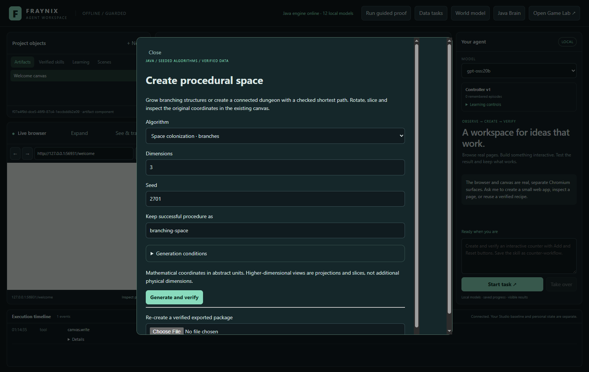
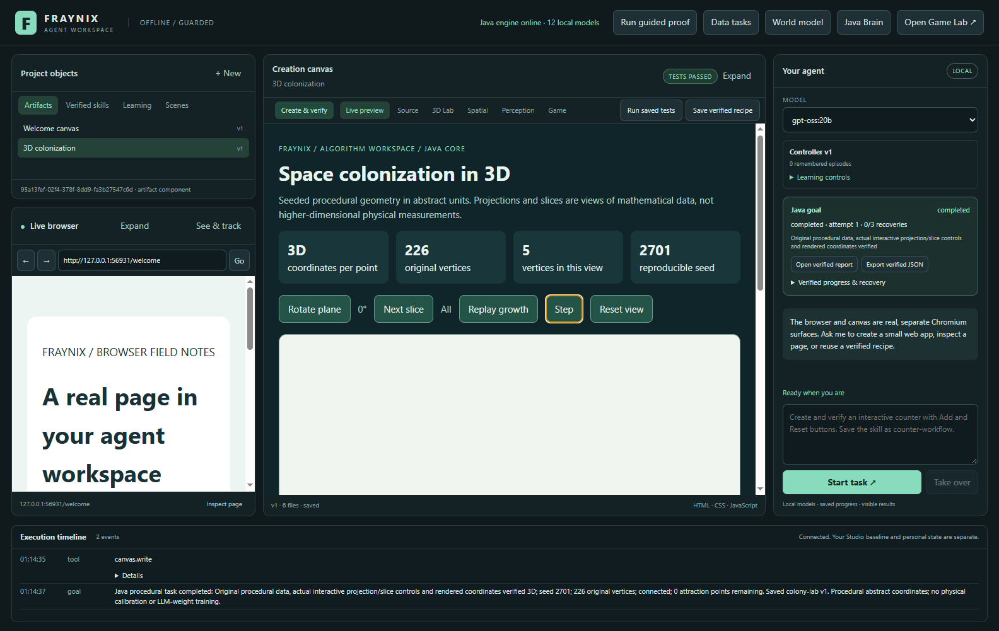
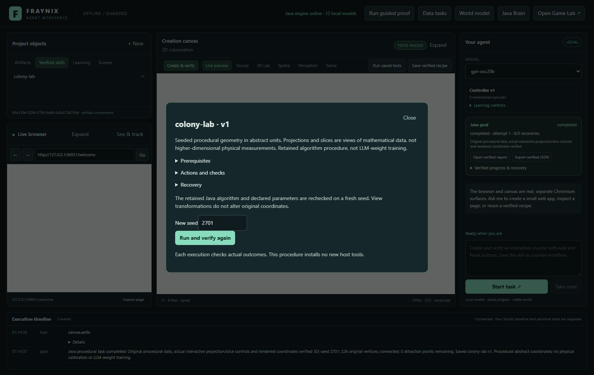
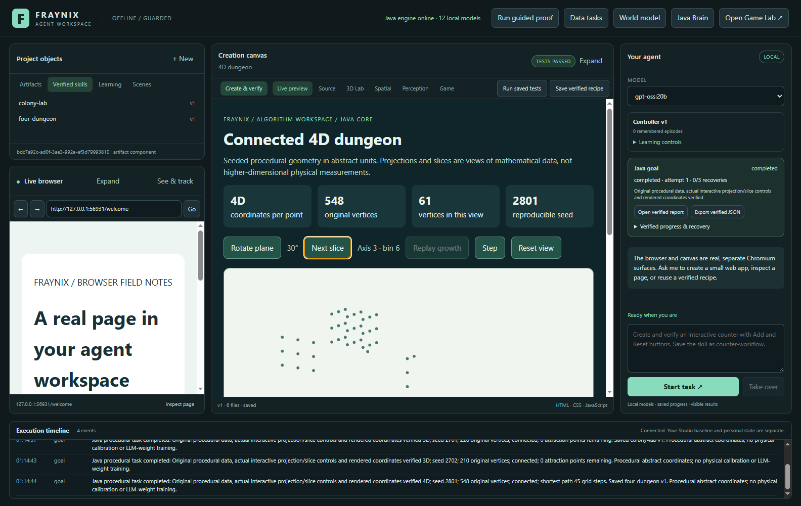
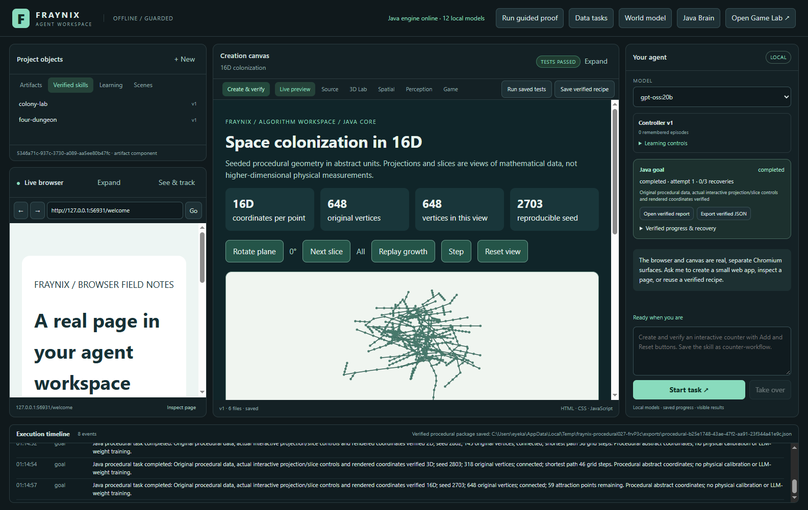
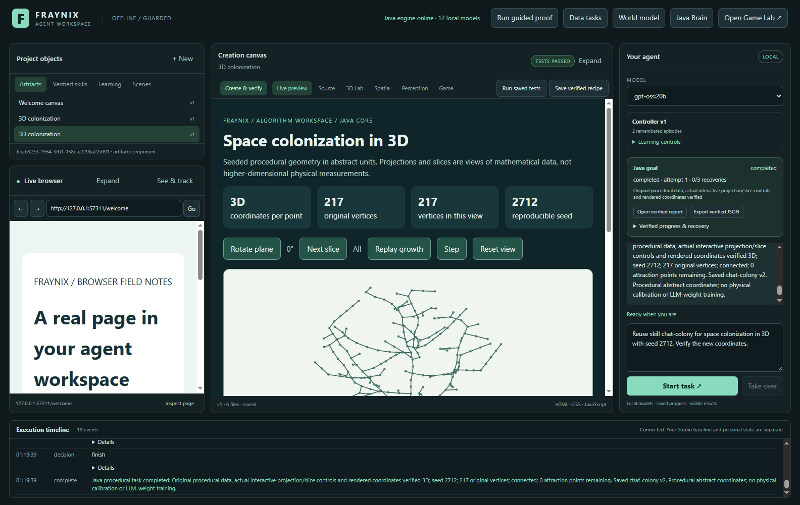
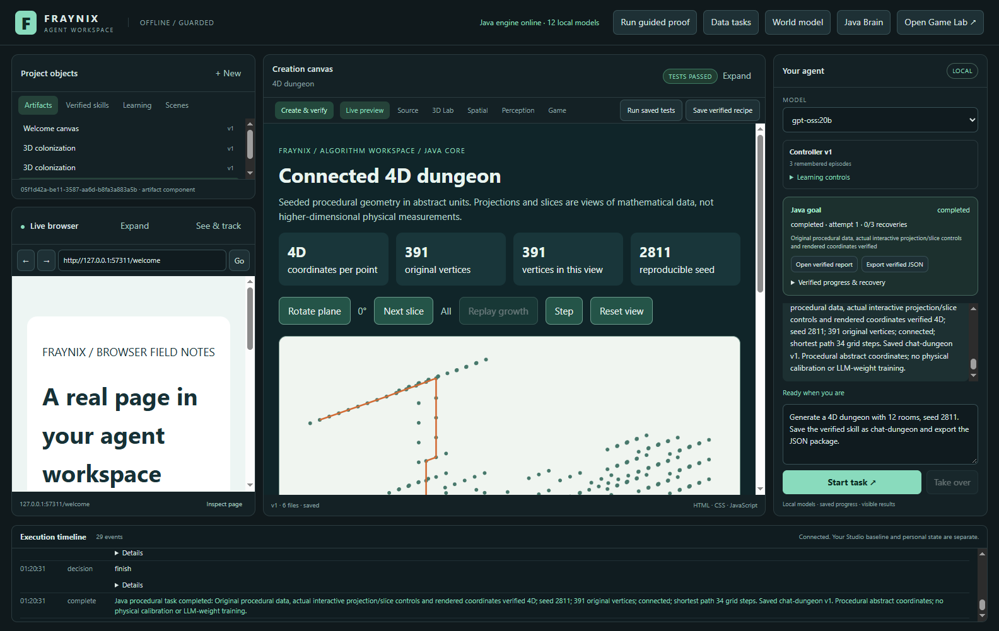
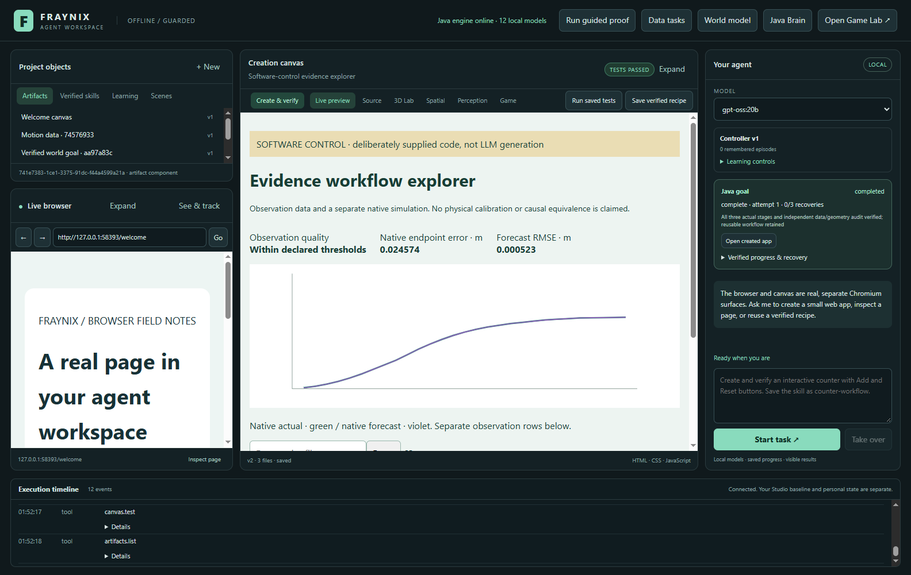
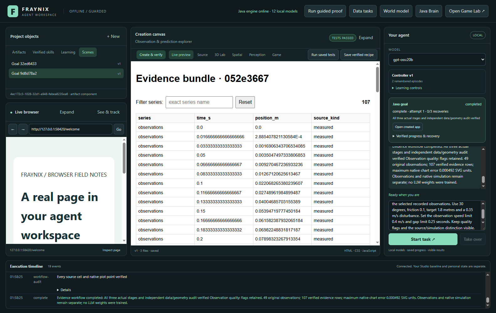

# Fraynix Agent Workspace · Edition 027

**Seeded worlds from Java mathematics, with actual agent actions and verified views.**

2026-10-31 · [Previous 026](README-026.md) · [Edition history](docs/readmes/INDEX.md) · [Offline interactive guide](docs/readmes/027/index.html) · [Runtime contract](docs/PROCEDURAL_SPACE.md) · [Tutorial analysis](docs/PROCESSING_ALGORITHM_REFERENCE.md)

This edition follows the user's suggestion to study Processing and procedural algorithms, starting with space colonization and mapping. It adds an independently written, JDK-only geometry module to the existing application. The model can request a branching structure or connected dungeon, Java computes the original coordinates, the existing canvas displays them, and real browser observations verify the result before a reusable skill is retained. A second change makes new generated evidence explorers pass explicit narrow-layout checks alongside their existing numerical checks.

The application keeps its current design: Java owns durable tasks, data and completion; the desktop hosts the browser and canvas; the local model chooses bounded semantic actions. Original game, native physics, measured-data, world-model, browser, perception, tracking and creation functions remain available through their existing interfaces.

## What changed

| Addition | Working behavior | Practical value |
|---|---|---|
| `geometry-core` | Finite vectors, plane rotation and projection, seeded space colonization and BSP maps | Original coordinates can be inspected, reproduced and exported without a new algorithm runtime library |
| `procedural-space-v1` | Shared Java compute/report/view-verification/completion lifecycle | Chat and UI use the same durable task |
| Actual view controls | Rotation, higher-axis slices, growth replay and grid-path stepping | Visible actions have a checked relation to source data |
| Reusable procedural skills | Versioned defaults and compiled-kernel identity, fresh-seed execution | Procedures survive restart; reuse verifies a new result |
| Portable JSON | Real project export and reconstruction import | Data move without installing executable tools or trusting imported success claims |
| `responsive-v1` | Actual 780px/390px measurements checked in Java | Generated explorers must keep columns aligned and controls usable |

The geometry module's production runtime uses only Java 21 and runs on its CPU worker. Existing GPU/native subsystems remain separate; this edition does not claim GPU acceleration for these algorithms. The whole application retains its existing desktop, rendering, serialization and native-physics dependencies. No Processing library, new model weights, cloud generation service, Docker or WSL was added.

## Try it in the app

Use **Create & verify → Create procedural space**. Choose space colonization or BSP dungeon, dimensions and seed. Generation conditions expose the finite algorithm parameters; the simple defaults work without a lengthy setup. A retained procedure name is optional.

Select **Generate and verify**. The shared goal card shows compute, report and real browser verification. Completion requires genuine original data and a passing view audit. The report opens in the existing canvas, with source count, coordinate table, declared scope, seed and verification status. Rotate a coordinate plane, select a last-axis slice, replay branch growth or step through the dungeon route. Reset returns to the full original view.

Use **Verified skills** to inspect the retained procedure, choose another seed and run it. The original artifact remains unchanged. A new task must recompute and verify its own data and view. This retains a way of performing a task; it does not update language-model weights.

On a completed task, **Export verified JSON** writes the actual package into that project's exports folder and reports its path. In the procedural dialog, choose that file under **Re-create a verified exported package**. Java verifies the definition and kernel identity, reconstructs the seeded data and checks the result in a new task.

With the already-installed local model selected, try these actual acceptance requests:

> Generate space colonization in 3D, seed 2711, 128 attractors. Save the verified skill as chat-colony.

> Reuse skill chat-colony for space colonization in 3D with seed 2712. Verify the new coordinates.

> Generate a 4D dungeon with 12 rooms, seed 2811. Save the verified skill as chat-dungeon and export the JSON package.

A missing native tool response can be retried at most twice within the existing 12-turn budget; ordinary text never executes an action. The model routes through typed registered tools. Java supplies the geometry and the report, and checks the result independently of the model's answer.

## How colonization works

A seed generates attraction points in a bounded canopy. Each active point chooses its nearest eligible node within an influence radius. Nodes combine unit directions toward assigned points, normalize the sum and add a fixed-length segment. Reached points stop attracting growth. When no node has an eligible influence, a nearest-target bootstrap can advance toward the canopy.

The data retain every node's original coordinates, parent and generation, plus attraction points, consumption and per-iteration growth. Java checks parent ordering, segment lengths and attraction accounting. A finite iteration or vertex budget can end growth with points remaining. The report states that count and stop reason; successful verification does not mean every attraction point was reached.

The implementation supports 2–16 mathematical dimensions, at most 512 attraction points, 128 iterations and 1,024 vertices. An N-component vector is real data, but does not imply N physical dimensions. The display has four recorded orthographic projections at 0/30/60/90 degrees and last-axis slices. Original coordinates remain available in JSON and CSV. Each frame is fitted to the display; measure lengths in original coordinates rather than screen pixels. Projection, scaling and filtering are presentation operations rather than edits to the underlying structure.

Growth replay uses actual recorded generations. Changing a seed yields a new deterministic structure; it is not evidence of a controller learning from reward. Future optimisation should benchmark exact nearest-neighbour search against an indexed implementation without silently changing results.

## How the map works

BSP recursively divides a bounded grid along a long axis, places disjoint rooms within leaves and retains their bounds. This implementation connects room centres through a minimum spanning tree with Manhattan corridors. The result includes every floor cell, room and corridor, not merely a rendered picture.

Independent checks cover bounded/disjoint rooms, complete declared room coverage, corridor endpoints and adjacency, room-graph connectivity, full floor reachability and minimal path length. Tests also run a separate JavaScript breadth-first search against actual exported cells. A route therefore has a concrete relation to the stored grid.

Dungeon generation supports 2–4 dimensions and at most 65,536 possible cells, 4,096 floor cells and 24 rooms. Dense 16D grids would have unacceptable growth in memory and work; that request is rejected. A 4D map can be projected and sliced. When a path leaves the current slice, the viewer omits the hidden-layer connection instead of drawing a false shortcut.

This is verified grid navigation. It has not yet compiled those cells into native Bullet colliders, spawned an embodied player or measured physical traversal. Those are explicit next gates, preserving the distinction between a mathematical map and a playable physical scene.

## What the videos contributed

The supplied playlist exposed 32 entries. The full available automatic captions, chapters and descriptions of its first three entries were reviewed; this is not a claim to have watched every frame of the entire playlist. Raw transcripts remain private research. The detailed [reference analysis](docs/PROCESSING_ALGORITHM_REFERENCE.md) links each source and records implementation differences.

The [space-colonization tutorial](https://www.youtube.com/watch?v=Y6QLhjvytXk) provides attraction-driven growth and parameter control. Our kernel uses unit-direction summation, whereas that tutorial describes inverse-distance weighting. The [BSP tutorial](https://www.youtube.com/watch?v=Pj4owFPH1Hw) provides the room-partitioning approach; our MST connectors and independent verification are explicit adaptations. The [map tutorial](https://www.youtube.com/watch?v=gsG731XItNU) uses reference-image adjacency rules and minimum-conflicts repair. That third technique is future work, distinct from the current BSP implementation.

[Processing's PVector](https://processing.org/reference/PVector) is a 2D/3D vector abstraction. We used its public API as design context. No Processing source or binary dependency was copied. The primary colonization reference is [Runions, Lane and Prusinkiewicz 2007](https://www.algorithmicbotany.org/papers/colonization.egwnp2007.html). This edition implements mathematical concepts directly and records attribution; it does not claim to have invented them or reimplemented all of Processing.

## The agent's role


Explicit dimensions, seed, rooms and attraction count are preserved before execution. Java freezes normalized inputs and the compiled kernel's hash. Calculation runs on an interruptible worker. Progress, source identity and stable report references persist across interruption. Resume is explicit; cancellation prevents late computation from retaining a skill or writing a new artifact.

Completion requires the exact pinned report version and registered browser test receipt. The host measures every reset SVG vertex's identity and coordinates in Chromium. Java compares them with its projection within 0.002 SVG units. The first development integration exposed a reload/data-load race; observations now come from the tested document before another navigation. A rejected view interrupts rather than endlessly renewing the claim. The failure remains recorded.

Portable packages include format/schema, kernel identity, full definition, original data and hash. Import independently reconstructs the data; supplied metrics are not proof. Different kernel identities reject rather than silently reinterpret an old package. This path does not install source code, model weights or new privileged tool handlers.

## Readable generated evidence

Edition 026 independently checked every source cell and actual native chart point. Numerical accuracy alone does not make an explorer usable. New UI/chat workflows now freeze a responsive profile before generation.

A hidden, unprivileged browser loads the exact artifact at 780px and 390px. It uses the existing restricted canvas session and never rewrites generated styles. Java checks document/table bounds, semantic column order, header/first-row alignment, minimum 12px table text and filter/reset size and bounds. Layout errors feed the same three-total-draft repair budget as content errors. Source distinctions, row counts, SVG tolerance and quality flags remain unchanged.

A deliberately supplied control has correct data and plots but floating absolute headers. It passes content gates and fails the actual layout gate; no skill is retained. A second version using a normal wrapping semantic table passes. Actual local-model generation is tested separately. This targeted profile is not a complete accessibility or general design-quality audit. Historical direct-API workflows keep their previous contract.

## Verified results

The working checkout passes **243 Java tests / 45 classes**, **41 desktop units**, **266 software workflow groups** and **18 actual local-model groups**. Full per-suite results and scope are preserved. An independent offline checkout passes 243 Java tests, 41 units and 149 actual critical UI groups. All 568 canonical implementation hashes match.

| Actual Java case | Dimensions | Original vertices |
|---|---:|---:|
| colonization | 3 | 226 |
| colonization | 3 | 210 |
| dungeon | 4 | 548 |
| dungeon | 4 | 548 |
| dungeon | 2 | 143 |
| dungeon | 3 | 318 |
| colonization | 16 | 648 |

Actual gpt-oss:20b completes three procedural requests, including fresh-seed skill reuse and JSON export. Actual generated recorded-data explorers use [2, 1] draft(s); both pass actual780/390 geometry while retaining stricter source-quality flags. Software controls separately demonstrate correct-number/bad-layout rejection and same-artifact repair, export reconstruction, explicit restart recovery and cancel guards.

Evidence includes successful outcomes and development failures. The initial responsive run completed its first explorer but exhausted all three reuse drafts: data-table was attached to tbody instead of TABLE and controls were only 21px high. No reuse was promoted. A second run passed its first explorer in one draft, then exhausted reuse after correcting body order but retaining friendly header labels instead of literal field names. Both complete failed runs and original drafts are preserved. The final contract supplies literal header names and expected/observed feedback for each column. Later instructions state the exact table structure and 32px control styling; the original thresholds and three-draft limit remain unchanged. Initial helper errors and real model repair attempts are labelled. Repaired results are not counted as independent held-out scientific evaluations. Recorded 013 observations remain unchanged and serve as content alongside a separate declared-parameter simulation; this is not new calibration.

## Actual application images

These are dated app captures. Procedural controls call genuine Java algorithms; chat captures use the installed local model. Software layout controls are labelled. No concept art is used as execution evidence.

[](docs/readmes/027/images/procedural-contract-027.png)

Actual existing Create flow with explicit algorithm, seed, dimension and bounded conditions.

[](docs/readmes/027/images/procedural-colony3d-027.png)

Actual Java3D colonization, all original branch coordinates and passing browser view checks.

[](docs/readmes/027/images/procedural-growth-027.png)

Actual replay of recorded growth generations; view filtering preserves original data.

[](docs/readmes/027/images/procedural-skill-027.png)

Actual shared Skills inspector reuses the retained algorithm on a fresh seed.

[](docs/readmes/027/images/procedural-dungeon4d-027.png)

Actual4D BSP floor and independently checked grid route projected in the canvas.

[](docs/readmes/027/images/procedural-slice4d-027.png)

Actual fourth-axis slice; hidden-layer route connections are omitted.

[](docs/readmes/027/images/procedural-colony16d-027.png)

Actual16-component colonization data projected on a2D display, not16D physical reality.

[](docs/readmes/027/images/procedural-chat-reuse-027.png)

Actual gpt-oss:20b chat reuses a retained procedure with another seed.

[](docs/readmes/027/images/procedural-chat-dungeon-027.png)

Actual local-model request completes a4D dungeon and exports its verified JSON package.

[](docs/readmes/027/images/responsive-completed-control-027.png)

SOFTWARE CONTROL: real browser second-version repair passes source, plot and780/390 layout gates.

[](docs/readmes/027/images/workflow-reused-live-027.png)

Actual gpt-oss:20b evidence workflow reuse passes new780/390 layout checks with stricter source-quality flags preserved.

## Build, run and verify

Use Java 21 and the existing pinned desktop dependencies. From the repository root:

```powershell
.\gradlew.bat check installDist :workspace-engine:installDist
cd workspace-desktop
npm ci
npm start
```

First setup needs the declared dependencies. With them installed, use Gradle --offline and npm start/test without reinstalling. Independent offline verification installed cached packages with scripts disabled, then reused the existing pinned Electron 45.1.0 executable; it does not prove an unprepared computer can bootstrap without downloads. Model files remain outside Git. Select an actually installed Ollama model; the tested model is identified in the evidence. The procedural UI works without an LLM generating geometry. Local-model app generation took minutes on this machine; deterministic geometry and its view controls are separate from that inference latency. Per-suite timings are retained in the regression records.

The [runtime contract](docs/PROCEDURAL_SPACE.md) documents budgets and test commands. Run desktop units, `test:procedural`, `test:responsive`, then actual-model tests when the local service is available. Native application integrations run sequentially. Do not replace installed JARs while their app runs. Tests create separate temporary projects, preserving user state and existing review windows.

## Files and evidence

- [Verification and limits](docs/readmes/027/verification.json)
- [Actual geometry, UI, source data and receipts](docs/readmes/027/procedural-integration.json)
- [Actual typed local-model conversations](docs/readmes/027/live-procedural.json)
- [Actual layout negative control and repair](docs/readmes/027/responsive-integration.json)
- [Actual responsive local-model evidence workflows](docs/readmes/027/live-responsive.json)
- [Full regressions](docs/readmes/027/regressions.json)
- [Development failures and corrections](docs/readmes/027/development-attempts.json)
- [First actual local-model response failure](docs/readmes/027/development-live-first.json)
- [First exhausted responsive reuse, no promotion](docs/readmes/027/failed-responsive-first-run.json)
- [Second exhausted responsive reuse, no promotion](docs/readmes/027/failed-responsive-second-run.json)
- [Standalone exact-data space viewer](docs/readmes/027/examples/verified-space.html)
- [Original Java report](docs/readmes/027/examples/colony3d/index.html)
- [Original coordinate CSV](docs/readmes/027/examples/colony3d/coordinates.csv)
- [Original4D topology/path data](docs/readmes/027/examples/dungeon4d/extra.json)
- [Transport-only export provenance](docs/readmes/027/examples/export-provenance.json)
- [Full source inventory](docs/readmes/027/file-inventory.json)
- [Full file tree](docs/readmes/027/FILE_TREE.md)

The canonical inventory includes inherited wrappers, licences and assets plus new geometry/task code. Text hashes normalize line endings; binary hashes preserve exact bytes. Source baseline: `e302d47d3cb4e9a760a62fac63c1937a94caac62`. Documentation publication follows that source commit. The repository remains private at eyeoverthink/Fraynix-Agent-Workspace; Chandra is a separate application.

## Next steps and acceptance gates

1. **Reference-image map rules.** Extract adjacency constraints, respect pinned cells, run bounded conflict repair and report unresolved conflicts. Test new references before claiming general reconstruction.
2. **Compile maps into the existing world.** Declare grid-to-metre scale, create actual colliders/entities, spawn a controller and verify physical traversal.
3. **Improve spatial efficiency.** Profile assignment and export cost on frozen cases. Compare indexed search with the exact reference before promoting speed changes.
4. **Learn from measured tasks.** Evaluate parameter proposals on separate goals and conditions, preserve failures and allow rollback. Changing weights or policies needs performance evidence beyond procedure retention.
5. **Extend complete creation tasks.** Add tools around whole procedures with inputs, checks and recovery. Reference-image synthesis, calibration and tracking each need their own source-qualified gate.

The value is the connection: a local model selects an operation, Java executes and preserves it, and the same app shows and checks the result. This supports procedural environments and verifiable agent skills. Broad open-world understanding, unconstrained autonomy, photorealistic generated video and scientific fidelity require further evidence. Future editions should expand what the agent can demonstrably complete, with reproducible data and honest failures.
