# Fraynix Agent Workspace · Edition 028

**An image becomes a playable, measured world.**

2026-10-31 · [Previous 027](README-027.md) · [Edition history](docs/readmes/INDEX.md) · [Offline interactive guide](docs/readmes/028/index.html) · [Runtime contract](docs/REFERENCE_MAP_WORLDS.md)

One request now connects an original reference PNG, rules learned in Java, generated map cells, actual native colliders, a force-driven avatar and independently verified charts. The agent can retain the successful procedure and reuse it with another image. The existing workspace also compiles a selected layer of a verified 2D–4D dungeon into a playable physical scene while retaining every original coordinate.

The current design is preserved. Java owns data, durable tasks, simulation timing and outcome checks. The local model chooses semantic options through registered tools. The existing desktop hosts the browser, canvas, source editor and live world view. The same app still provides its game, spatial manipulation, perception, tracking, world-model, data and creation functions.

## The dimensional idea, made concrete

A scene can be a persistent network of points, objects, attributes, relationships and observations. A screen is one view of that state. Different projections can expose other relationships without changing the original data. This edition adds a concrete loop: choose a view or layer, act in a declared physical scene, measure the outcome and return that evidence to the agent.

| Part of the state | Meaning in this edition | How it is checked |
|---|---|---|
| Original map axes | Integer coordinates in the source 2D–4D dungeon | Original coordinate array and source hash retained |
| Selected layer | Explicit values for hidden source axes | Every compiled open cell belongs to that layer |
| Physical X/Y/Z | Metres in a right-handed native world | Actual rigid bodies, gravity and collision geometry |
| Time | Fixed-step simulation ticks and seconds | Ordered native samples; explicit 1×/4× execution rate |
| Motion | Position, velocity, distance and speed | Derived from the native body and original trace |
| Material/control variables | Declared friction, mass, force and impulse | Numeric bounds, units and actual applied-force records |
| Topology | Adjacency, pins, components and route | Independent edge, pin and flood checks |
| Memory | Sources, tasks, completed attempts and procedures | Persistent identities, hashes, recovery and re-verification |

Additional dimensions can represent time, features or parameters. Their semantics, units and transformations matter. The current physics has three spatial axes; a fourth dungeon coordinate selects another layer. Layer selection constructs a separately declared scene. It does not create a physical passage through a fourth spatial direction. The CERN comparison is useful as an analogy for tracking many variables and interactions; this release tests classical rigid-body navigation rather than particle physics.

This makes the potential practical: procedural environments, interactive data spaces and controlled experiments can share one state/action/evaluation architecture. Useful improvement still needs measured task performance, separate evaluation and rollback. More nodes or changing weights alone do not establish better behaviour.

## Try it in the existing workspace

Open **Create & verify → Reference image → playable world**, or use the **Maps** tab. **Load labelled test reference** provides an explicitly synthetic PNG with a declared floor colour. Choose a seed and dimensions, optionally keep a procedure name, then select **Generate, play & verify**.

Java checks the image, learns its tile rules, generates cells while preserving pins, compiles colliders and starts the native avatar. Setup controls collapse so the scene takes most of the view. Orange is the actual dynamic avatar. The live display reports simulation time, route progress, speed and contacts. When the task finishes, its report opens in the existing canvas with all source and trace files.

For your own map, choose a PNG and pixels-per-tile value. Java inspects the palette and counts. The most frequent colour is suggested as floor; confirm or change the walkable hex colours before selecting **Use this reference**. That explicit declaration determines passability. The original PNG remains available beside the generated result.

**Play manually** starts a separate native attempt from the immutable map. Focus the world and use WASD/arrows, or hold a direction button. Mouse drag rotates the camera and the wheel changes distance. Direction release or focus loss clears input; actual forces, friction and damping determine braking. **Stop** ends the owned motion. Agent play uses a measured feedback controller and an explicit simulation-speed label.

**World files and original dungeon layers** contains real JSON export/import and the verified-dungeon selector. Choose a completed dungeon, enter hidden-axis layers as JSON or leave the field empty for the documented automatic selection, then select **Compile original layer**. The original higher-dimensional data remain in the map package and report. **Agent play & verify** executes the physical route in that scene.

The existing **Verified skills** library shows the saved procedure's prerequisites, actions and recovery. Choose a fresh reference or compiled world and run it. **Use image for chat** makes the selected reference the chat source; selecting a compiled world binds that world instead. Source selection is explicit and visible.

## What Java learns from the image

The reference is an opaque tile/palette PNG, bounded to 256 KiB, 256 pixels per axis and 3–32 logical tiles per axis. An integer tile size of 1–16 pixels must divide the image. Java counts the dominant colour within each tile and records 2–8 classes. It rejects unsupported inputs rather than quietly treating a photograph as a labelled scene.

For each original cell, Java records which classes actually occur to its north, south, east and west. It retains class frequencies, the directional rule matrices, original cell coordinates and exact PNG bytes/SHA256. The suggested floor colour is a convenience for confirmation; physical material properties are declared separately.

Generation starts from a seeded frequency-weighted grid. Boundary, spawn/goal and user pins are hard constraints. A minimum-conflicts loop repairs editable cells using the observed directional rules. Its finite budget is eight restarts of at most 20,000 repair iterations each. The final result records the actual repair/attempt counts and unresolved-conflict reason when applicable.

An independent pass enumerates every directed edge, checks each pin and verifies the selected shortest walkable route. An impossible pair of pins stays impossible: its original constraints and failed grid remain recorded, physics does not start, and no successful skill is retained. The implementation does not silently carve a corridor to make a failed generation look successful.

The route contract connects spawn and goal. Other walkable islands may remain; the UI and report show both total and reachable floor counts. Output proportions are guided by source frequencies, not promised as exact copies. Local adjacency learning is a useful bounded map model, not general photographic reconstruction or proof of global structural similarity.

The approach follows the reference-image adjacency/minimum-conflicts idea reviewed in the [Programming Chaos map tutorial](https://www.youtube.com/watch?v=gsG731XItNU). [Edition027's reference analysis](docs/PROCESSING_ALGORITHM_REFERENCE.md) records what was reviewed and how the independent Java implementations differ. No Processing implementation, library or new algorithm runtime was copied or installed.

## Real physical compilation and play

The compiler maps logical grid X/Y to physical X/Z with gravity along Y. Declared scale is 0.6–1.2 metres per cell; friction is 0.05–1.2; the avatar is a 1 kg native sphere of radius 0.18 m. Gravity is 9.81 m/s². Blocked tiles become solid barriers. A greedy rectangle compiler preserves the blocked/open mask while reducing collider count, with a 512-object budget.

The existing Bullet runtime steps at 240 Hz. The avatar receives forces capped at 24 N. Automatic navigation reads actual position and velocity, selects the next checked waypoint and adjusts force. It never assigns another position after spawn. A bounded scheduled impulse tests recovery. The input unit is N·s, distinct from a requested velocity.

Manual controls run at 1× and agent demonstrations at 4× simulation speed. Each native attempt is bounded to 90 simulated seconds. Manual commands carry the current run ID and expire after 400 ms. Late inputs cannot control another session. Native motion and task progress remain separate from the local model's inference latency.

Verification checks the native trace rather than a finished animation: ordered ticks, original map binding, every sample's cell, vertical bounds, route progress, force limit, position-assignment instrumentation, endpoint error and terminal speed. Success requires all route waypoints, no blocked-cell samples, no position reassignment after spawn, endpoint error at most 0.2 m and terminal speed at most 0.2 m/s. A manually stopped or failed run is not promoted as agent success.

Colours do not measure friction, mass or fluid behaviour. Blocked-colour regions compile into declared solid barriers. This edition provides a bounded classical navigation world; measured material calibration and richer interactions remain explicit future work.

## Retained 4D source, explicit physical layer

Completed 027 dungeons already contain real coordinates, rooms, corridors and checked paths. Edition028 preserves that entire source. A 3D or 4D dungeon supplies one coordinate for each hidden axis. Only cells in that declared layer enter the physical grid; unrelated layers are never unioned into a misleading flattened scene.

For automatic selection, Java enumerates layers and finds a deterministic two-flood route candidate per component, then chooses the longest candidate inspected. This is a finite selection heuristic, not an all-pairs diameter optimiser. The selected layers, method, original source goal/hash and all original vertices remain in the exported package. Actual physical play is verified again after compilation.

That is the bridge between the previous node view and this scene: the original data can support multiple views, while the physical controller acts in one explicitly defined frame. Additional scene/material dimensions can be added through named, tested variables rather than assigning physical meaning to an unnamed vector column.

## Agent, tools and skills

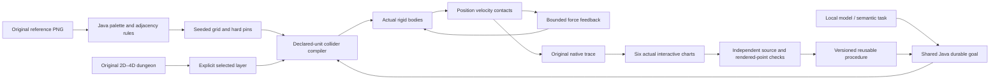

`map-world-v1` uses the existing goal runner. The local model selects semantic conditions through `map.read`, `map.start`, `goal.read` and registered procedure reuse. It supplies neither geometry nor success flags. Java owns source freezing, generation, execution, report identity and verification. A typed tool response is required; ordinary prose does not execute an action.

Try these task forms with an eligible installed local model:

> Build a reference-image map with seed 2805, width 12, height 12, impulse 0.35. Play and verify it and save skill as live-map-world.

> Reuse reference-map skill live-map-world on the newly confirmed image with seed 2806, width 12, height 12, impulse -0.3. Play the native world and verify its outcome.

> Play the selected native map with impulse 0.2 and save skill as live-layer-play.

Resume reuses completed native evidence and the stable report without repeating physical effects. An interrupted unfinished world starts a separately recorded attempt from its immutable definition. Cancellation stops owned motion and prevents successful retention. Sources, compiled definitions and completed/stopped traces persist; an interrupted in-memory native world is not resumed in place.

Learned adjacency is data extracted from the reference. The controller responds to measured feedback. The retained procedure is persistent procedural memory. These mechanisms have different roles; none updates Ollama's language-model weights in this edition.

## Metrics, charts and real files

The native trace includes tick/time, position, velocity, applied force, floor/wall contacts, route index, force effort and position-assignment count. Contact totals count sampled native contact observations within the declared 0.015 m threshold, rather than unique impacts. Force effort is the time integral of force magnitude in N·s; it is not mechanical work in joules. The report derives six metric series: remaining distance, speed, force, contacts, integrated force effort and travelled distance. Actual browser input switches each series. Java independently compares every rendered SVG coordinate in every frame against the original native data within 0.002 SVG units, then checks reset.

The live 3D avatar reads actual native positions. Software acceptance separately compares its rendered position with the authoritative final body state. Camera motion and projections change the view, not the underlying map or body coordinates.

The report contains full map/source JSON, run JSON, trace CSV and chart values/coordinates. Export writes a real playable-map JSON package. Import re-decodes the original image or reconstructs the original dungeon layer, regenerates cells and compares route/colliders before accepting a new identity. Imported metrics do not prove a physical run. No executable handler is installed from a package.

## Verified results and failures

The working checkout passes **253 Java tests / 47 classes**, **46 desktop units**, **275 software workflow groups** and **17 actual local-model groups**. Full per-suite results and scope are preserved. An independent offline checkout passes 253 Java tests, 46 units and 158 actual critical UI groups. All 580 canonical implementation hashes match.

| Actual workflow | Route waypoints | Endpoint error (m) | Blocked samples | Teleports | Six-chart point observations |
|---|---:|---:|---:|---:|---:|
| Original reference | 19/19 | 0.013366 | 0 | 0 | 1308 |
| Different reference / reuse | 19/19 | 0.013404 | 0 | 0 | 1302 |
| Original4D layer | 10/10 | 0.012887 | 0 | 0 | 690 |

Actual gpt-oss:20b separately completes three chat requests: creation, retained-procedure reuse on another image and physical play of a selected4D layer. Every episode has original native evidence, a passing source/trace result and six actual chart-frame checks. Native motion is fast; local model planning and final responses can take minutes. This edition does not promise real-time language-model reasoning.

Software controls use clearly labelled synthetic PNGs and actual Java/native/Electron execution. Actual local-model orchestration is a separate proof. These are acceptance cases, not a claim of held-out scientific generalisation or calibrated real-world material accuracy. The earlier 013 calibration and 024 tracking decisions remain intact.

The evidence preserves initial failures: the UUID value type, an exact-scope assertion mismatch, hidden advanced controls, an offscreen pointer-test correction, and the first live chat's short wait. A later existing-map chat omitted the requested impulse in twelve attempts and was rejected before any new physical run. The corrected schema exposes only existing-map options, the prompt gives required semantic fields and feedback shows exact expected/received values; strict verification remains unchanged. Those waits expired after Java physical tasks and chart verification completed but before final model responses. A subsequent host restart interrupted another actual chat at the same boundary; its completed native evidence and absent final chat completion are retained. Post-restart acceptance allows longer local inference while preserving production turn, physics and verification limits.

## Actual application images

These are real dated captures. Captions distinguish software controls from actual local-model requests. Original images, generated grids, physical traces and test receipts are linked separately.

[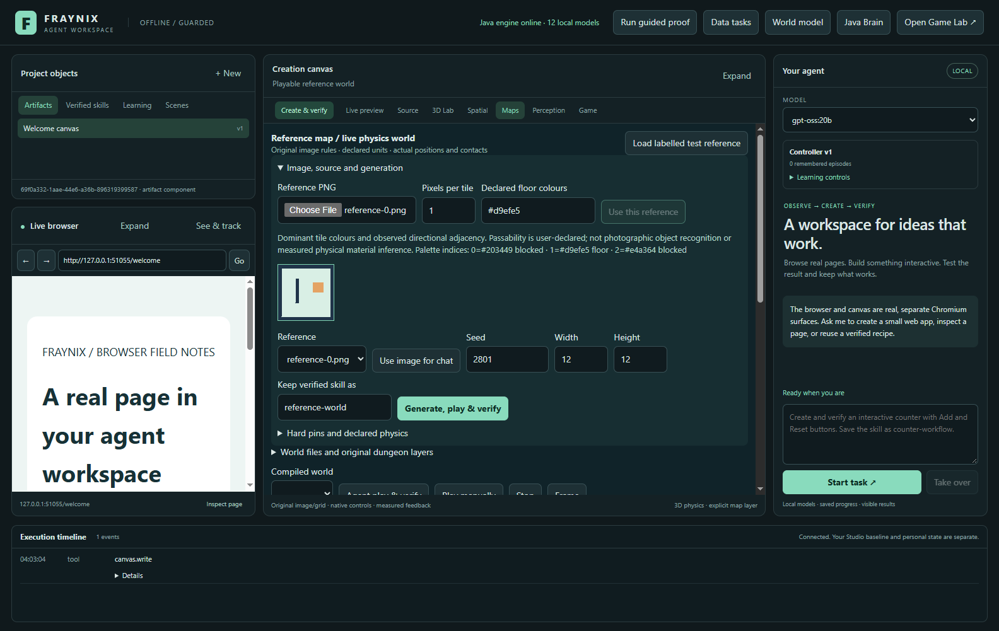](docs/readmes/028/images/map-reference-028.png)

SOFTWARE CONTROL: original uploaded labelled PNG, actual Java palette/rules and confirmed walkability.

[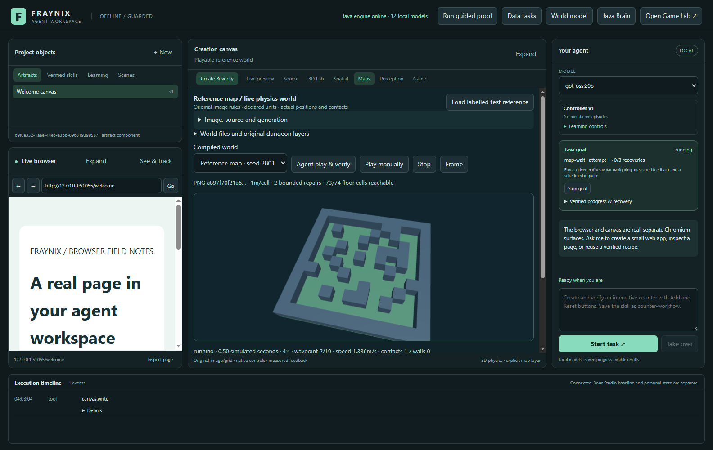](docs/readmes/028/images/map-native-moving-028.png)

SOFTWARE CONTROL: dynamic native avatar moving under measured force in the generated physical world.

[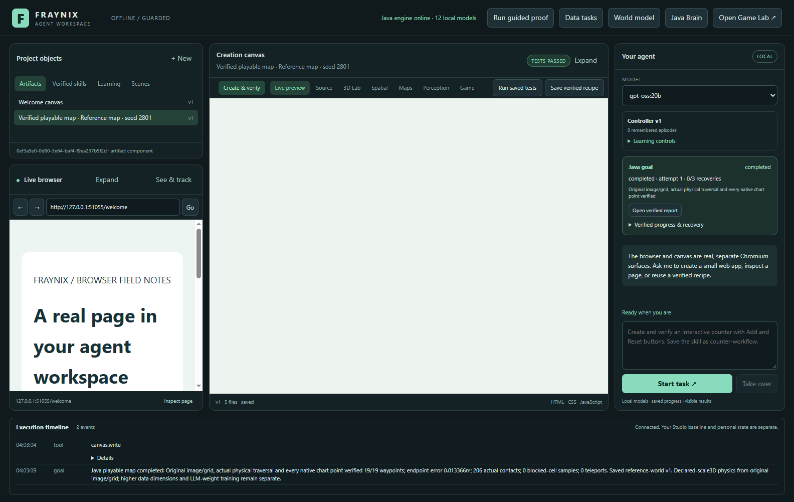](docs/readmes/028/images/map-native-completed-028.png)

SOFTWARE CONTROL: actual rendered3D avatar at its measured native endpoint; setup controls collapse for a larger world view.

[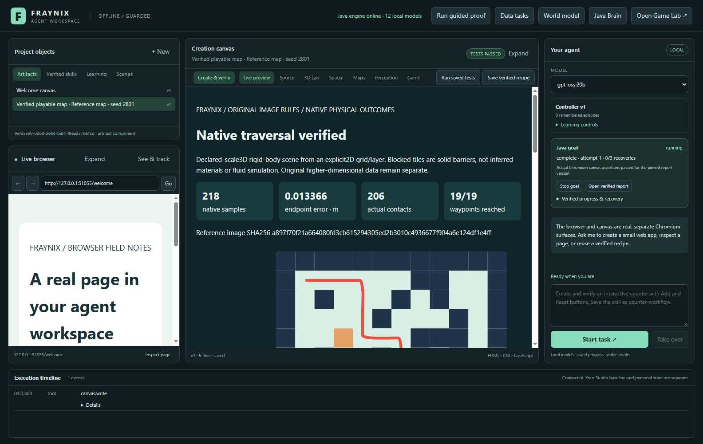](docs/readmes/028/images/map-native-report-028.png)

SOFTWARE CONTROL: original grid and actual native path, metrics and interactive chart in the existing canvas.

[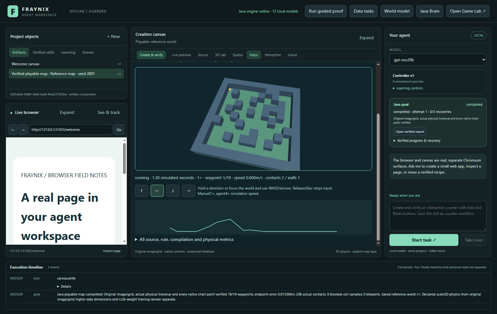](docs/readmes/028/images/map-manual-collision-028.png)

SOFTWARE CONTROL: held real input drives the dynamic body against a wall; native contacts, forces and braking are recorded.

[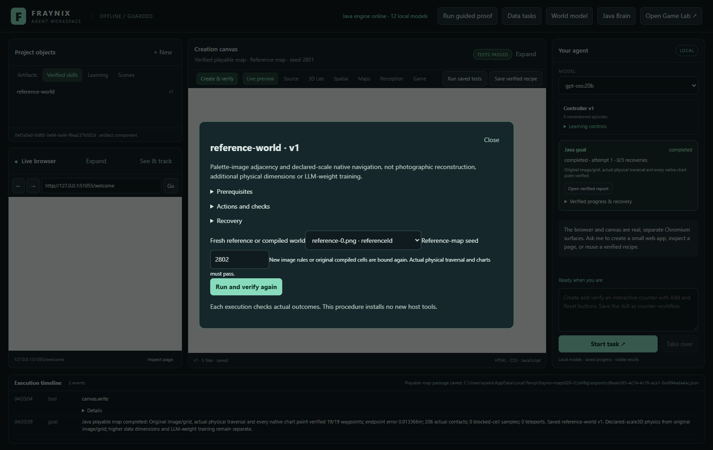](docs/readmes/028/images/map-reuse-skill-028.png)

SOFTWARE CONTROL: retained procedure inspector in the existing Skills library, with fresh reference and seed.

[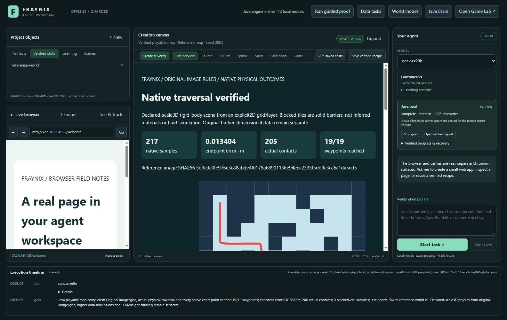](docs/readmes/028/images/map-reused-028.png)

SOFTWARE CONTROL: different uploaded palette/reference, changed seed and a new verified native traversal.

[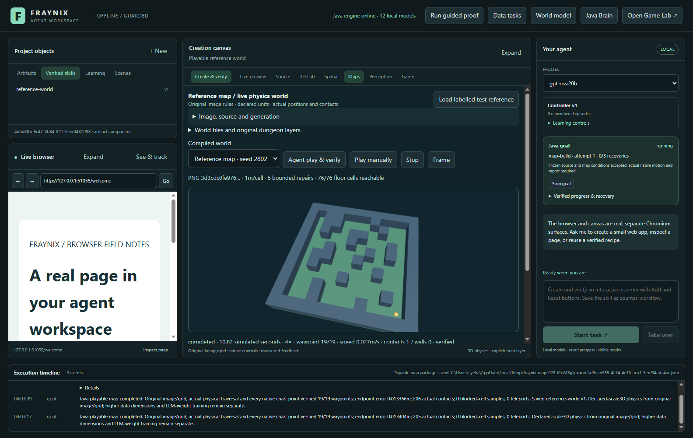](docs/readmes/028/images/map-conflicts-rejected-028.png)

NEGATIVE CONTROL: incompatible hard pins remain rejected; no native success or saved skill is manufactured.

[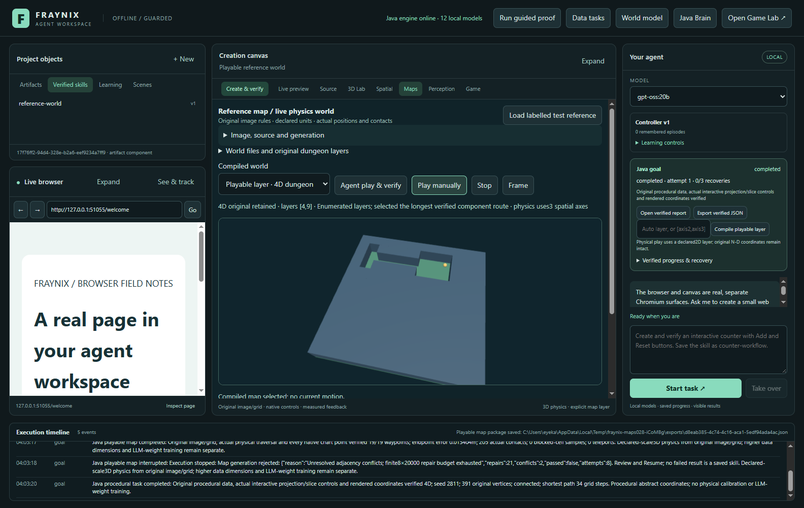](docs/readmes/028/images/map-four-dimensional-layer-028.png)

SOFTWARE CONTROL: real physical world compiled from one original4D dungeon layer; all higher-dimensional source data are retained.

[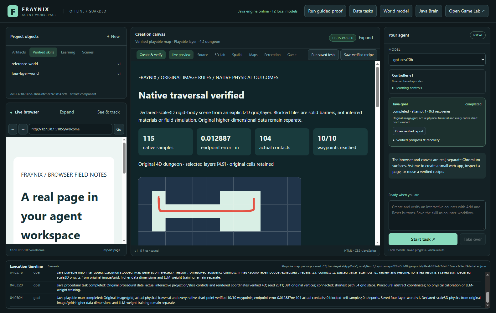](docs/readmes/028/images/map-layer-report-028.png)

SOFTWARE CONTROL: native traversal report for the selected4D layer, with original source and explicit layer provenance.

[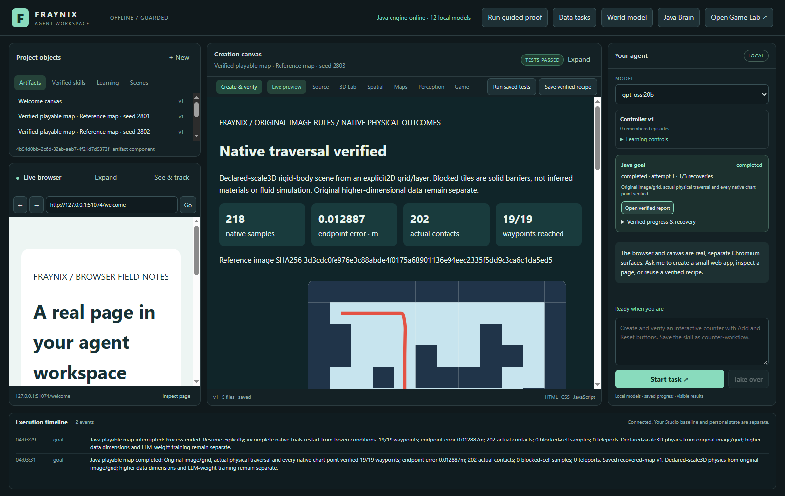](docs/readmes/028/images/map-recovered-028.png)

SOFTWARE CONTROL: actual process restart reuses completed native evidence and stable report without repeating physical effects.

[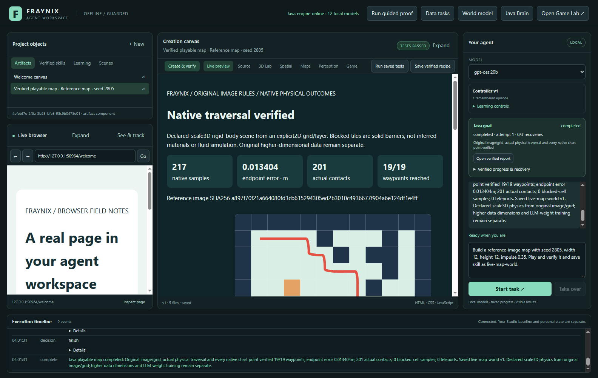](docs/readmes/028/images/map-chat-created-028.png)

ACTUAL LOCAL MODEL: gpt-oss:20b creates a map, runs native physics and retains a skill only after verified outcomes.

[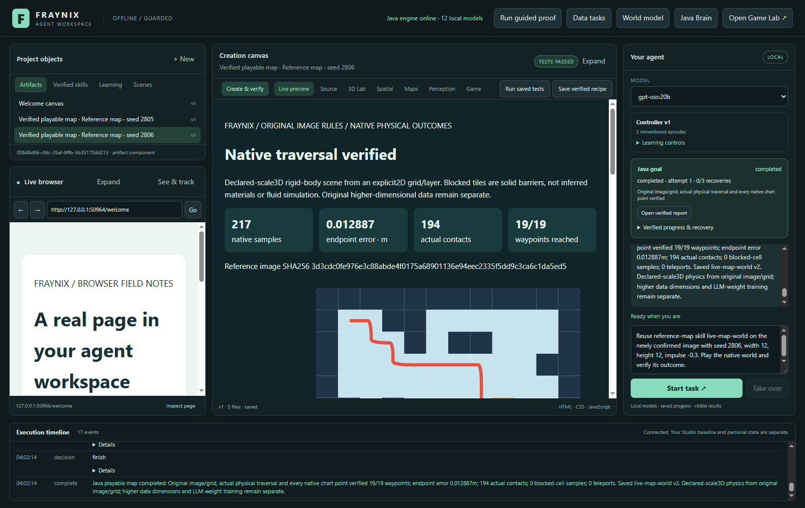](docs/readmes/028/images/map-chat-reused-028.png)

ACTUAL LOCAL MODEL: chat reuses the saved procedure on another uploaded image, seed and impulse direction.

[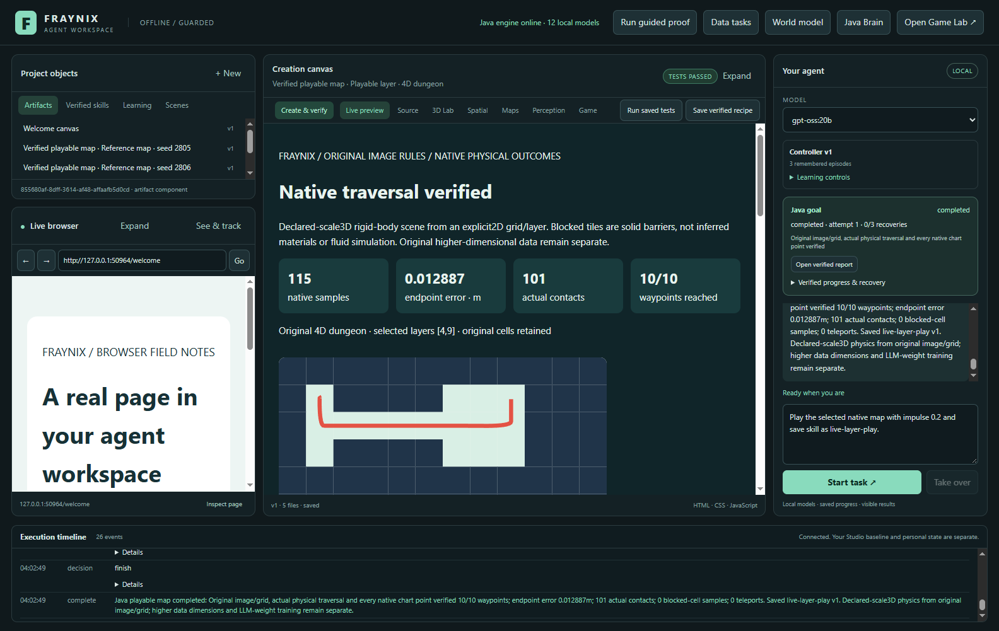](docs/readmes/028/images/map-chat-four-dimensional-028.png)

ACTUAL LOCAL MODEL: chat plays the selected original4D layer and saves a newly verified procedure.

## Run and verify

Use Java 21, Node and the existing pinned desktop dependencies. First setup installs declared dependencies; Docker, WSL, Processing and new model weights are not required for this addition.

```powershell
.\gradlew.bat check installDist :workspace-engine:installDist
cd workspace-desktop
npm ci
npm start
```

With dependencies cached, Gradle `--offline` and the installed desktop runtime work locally. Independent offline verification reused the existing pinned Electron executable after cached package installation; an unprepared machine still needs initial setup. Select a genuinely installed Ollama model for chat. Deterministic generation, manual play and native navigation do not require LLM-generated geometry or HTML.

```powershell
npm test
npm run test:maps
# Requires the already-installed local model:
npm run test:live-maps
```

Native application integrations run sequentially. Do not rebuild installed JARs under a running instance. Tests and review copies use separate project directories. Personal projects, model services and earlier review windows are preserved.

## Files, source and continuity

- [Verification and limits](docs/readmes/028/verification.json)
- [Actual mapping, manual play, source data and receipts](docs/readmes/028/maps-integration.json)
- [Actual typed local-model chats](docs/readmes/028/live-maps.json)
- [Full regressions](docs/readmes/028/regressions.json)
- [Development failures and corrections](docs/readmes/028/development-attempts.json)
- [Original observer test readiness timeout](docs/readmes/028/development-observer-readiness.txt)
- [Original actual chat timeout](docs/readmes/028/development-live-first.json)
- [Actual failed live acceptance records](docs/readmes/028/development-live-timeouts.json)
- [Actual refused compiled-map chat screenshot](docs/readmes/028/examples/compiled-map-chat-failed.png)
- [Actual host-restart interruption, no final chat completion claimed](docs/readmes/028/host-restart-interruption.json)
- [Completed native evidence during the second chat timeout](docs/readmes/028/development-timeout-native-state.json)
- [Original labelled PNG](docs/readmes/028/examples/reference-original.png)
- [Different labelled PNG](docs/readmes/028/examples/reference-fresh.png)
- [Standalone exact-data native report](docs/readmes/028/examples/verified-map.html)
- [Original Java report](docs/readmes/028/examples/original/index.html)
- [Original native trace CSV](docs/readmes/028/examples/original/trace.csv)
- [Preserved4D source/layer/map](docs/readmes/028/examples/four-dimensional-layer/map.json)
- [Rejected hard pins and failed map](docs/readmes/028/examples/rejected-map.json)
- [Actual manual wall-contact attempt](docs/readmes/028/examples/manual-run.json)
- [Transport-only export provenance](docs/readmes/028/examples/export-provenance.json)
- [Full source inventory](docs/readmes/028/file-inventory.json)
- [Full file tree](docs/readmes/028/FILE_TREE.md)

Source baseline: `899e0c6fede1dd0c7ab7035a5e5b943009f3ac43`. The inventory preserves inherited wrappers, licences and assets with canonical UTF-8/LF text hashes or exact binary hashes. Publication remains the private Fraynix-Agent-Workspace repository. Notes/logs record verified outcomes, failures and remaining work; numbered editions preserve their original evidence.

## Next gates

1. Add global map constraints and evaluate new references with declared success criteria, including component coverage and topology beyond local adjacency.
2. Add explicit native-world checkpoints for longer sessions, preserving velocities, contacts and controller state with restart verification.
3. Connect measured material and perception inputs to state with calibration and uncertainty; retain the difference between observed and declared properties.
4. Compare alternative navigation or learning policies on separate tasks, disturbances and maps, with promotion gates and rollback.
5. Broaden creation/material tools around complete procedures with real outputs and checks. Additional dimensional views should expose useful variables and relationships.

The practical value is a complete local loop: original data → explicit world state → physical action → measured outcome → verified reusable procedure. This gives the agent persistent state, physical actions and inspectable outcomes. Each next expansion should prove another complete task while preserving the existing workspace and its proven behaviours.
