# Fraynix Agent Workspace · Edition 029

**A playable route is one requirement. A connected world is another.**

2026-10-31 · [Previous 028](README-028.md) · [Edition history](docs/readmes/INDEX.md) · [Offline guide](docs/readmes/029/index.html) · [Global map contract](docs/GLOBAL_MAP_TOPOLOGY.md)

Edition029 adds explicit whole-map requirements to the existing Java image-to-physics pipeline. The agent can request that every floor cell connects, declare floor coverage and shortest-route bounds, generate within a finite budget, play the accepted world and retain the verified procedure. Sources, candidate seeds, measured graph properties and rejections remain inspectable.

The new reserved comparison is deliberately reported in full: **the old generator met these global criteria on1/12 cases; the new selector met them on5/12. All five accepted new worlds passed actual native physics. Seven cases remained rejected.** The implementation does not change their source cells, waive their constraints or present conditional native success as12/12 completion.

This continues the current app. Its Java runtime still owns source data, durable goals, physical timing and outcome verification. The existing desktop hosts browser/canvas views, live scenes and chat. The same tools, Skills library and recovery controls are used. No Processing runtime, algorithm package, model weights, cloud service, Docker or WSL was added.

## What changed from028

Edition028 learned directional tile adjacency from an original opaque palette-map PNG, generated pinned grids and verified a spawn-to-goal route. A valid route could coexist with disconnected floor islands. That original contract remains supported, including exact reconstruction of the published028 package.

Edition029 offers a separate `connected-grid-v1` contract. It checks all floor components and the original spawn/goal endpoints, measures coverage across the entire grid and verifies shortest-route bounds. This contract is explicit in generated records and native reports. Existing maps keep their original cells and requirements.

| Capability |028 contract |029 global contract |
|---|---|---|
| Original PNG bytes, palette and adjacency | Preserved and checked | Preserved and checked |
| Hard pins and blocked boundary | Required | Required, independently checked again |
| Spawn-to-goal route | Required | Exact endpoints and shortest distance required |
| Every floor cell reachable | Not required | Required when `connected=true` |
| Coverage / route bounds | Not part of generation | Original numeric requirements retained |
| Candidate search | Existing8×20,000 local repair budget | At most32 candidates,2×4,000 local repairs each |
| Candidate rejection evidence | Final failure | Every candidate measurement and reason |
| Physical outcome | Actual native trace and six charts | Same gates, plus rechecked topology |
| Retained procedure | Fresh-source route verification | Fresh-source global and physical verification |

The larger candidate search has a different compute budget. The comparison measures observed completion under those disclosed budgets; it does not prove equal-cost superiority, trained policy improvement or general photographic understanding.

## Try it

1. Open **Maps**, or **Create & verify → Reference image → playable world**.
2. Load a labelled reference from the library, or upload your own opaque palette PNG and confirm its floor colours. The library clearly labels synthetic test references.
3. Leave **Require global map checks** enabled. Set minimum/maximum floor fraction and shortest-route steps if needed. A fraction of0.30 means30% of all grid cells, including the blocked boundary.
4. Choose seed/dimensions and a procedure name, then select **Generate, play & verify**.
5. Watch the actual native avatar, then inspect the report's world-wide measurements, all candidate outcomes and six native-history charts.
6. Reuse the retained procedure from **Verified skills** with a different source and seed. The new use must pass again.

For a concrete accepted case, select **Courtyard and central barrier**, seed 2901,12×12 cells, floor fraction 0.30–0.75 and route18–64 steps. The frozen selector accepts candidate5. **Staggered walls and openings**, seed 2902 under the same contract, accepts candidate19. These are recorded acceptance examples, not claims that every seed succeeds.

For a transparent rejection, request route0–3 on a12×12 map. The original spawn and goal cannot be that close in grid distance. The system retains the failed grid and request, starts no physical world and saves no successful skill. The reserved narrow-hall seed 2901 remains rejected after32 candidates under the declared18–64 route and coverage contract.

Disabling the global option explicitly requests the earlier route-only contract. The app does not do that automatically to make a failed global request appear successful. A compiled existing world retains its source contract; changing generation requirements means generating a new world.

## What the selector actually does

The JDK-only `TopologyMap` takes original learned rules, dimensions, requested seed, hard pins and an immutable constraints record. Candidate1 uses the original seed. Subsequent candidate seeds use the documented deterministic offset104729 modulo1,000,000,001. Each local candidate has at most two restarts of4,000 repair iterations. Overall bounds are32 candidates and256,000 repairs, with cooperative interruption.

Candidate cells are never modified by the global selector. There is no corridor carving, disconnected-cell deletion, palette relabelling or source replacement. The selector evaluates each original candidate and either accepts it or tries another deterministic seed. Geometrically impossible route/coverage bounds and fixed incompatible pin pairs stop early, retaining the candidate and reason.

The independent audit enumerates directed adjacency edges, checks original fixed pins/boundaries and traverses the complete floor graph. It computes:

- **Floor cells and coverage:** walkable cells divided by all cells, including boundaries.
- **Reachable cells:** floor cells reached from the original spawn.
- **Components:** every distinct four-neighbour floor region, including isolated cells.
- **Shortest route:** grid distance between the original spawn and goal; the stored route must match those endpoints and distance.
- **Edges, cycle rank and dead ends:** actual graph properties, with cycle rank `edges − floor cells + components` and dead ends of degree one.
- **Violations:** independently counted adjacency and fixed-pin errors.

All required checks must pass together. A cached `passed` flag, a convincing drawing or a short route in some unrelated component cannot substitute for those checks. Before native play, retained records are audited against their original PNG and requested contract. Import reconstructs the source, deterministic candidate selection, grid and colliders and compares the complete definition. Recomputing an outer JSON hash cannot make forged topology metrics valid.

The new contract records a compiled kernel identity. A saved global procedure cannot silently switch to a different implementation. Future changed algorithms need explicit versioning or migration. The earlier no-contract generator preserves its original behaviour and old package reconstruction.

## Agent responsibilities and retained skills

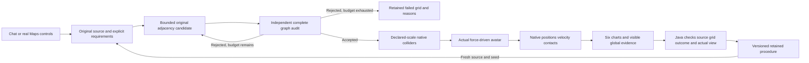

The local model chooses typed semantic options. Java owns geometry, topology, physics timing, durable state and outcome checks. Chat uses the existing `map.read`, `map.start`, `goal.read` and procedure interfaces. It does not supply grids, result coordinates, executable host handlers or success flags.

Try this with the confirmed courtyard reference:

> Build a fully connected reference-image map with seed 2901, width 12, height 12, minimum floor fraction 0.3, maximum floor fraction 0.75, minimum route steps 18, maximum route steps 64, impulse 0.35. Play and verify it and save skill as live-global-map.

After confirming the staggered-wall reference:

> Reuse reference-map skill live-global-map on the newly confirmed image with seed 2902, width 12, height 12, impulse -0.3. Keep the fully connected contract, minimum floor fraction 0.3, maximum floor fraction 0.75, minimum route steps 18, maximum route steps 64. Play the native world and verify its outcome.

The host checks each explicitly requested bound before starting a goal.

Partial reuse options preserve the saved global defaults. Sending only `connected:true` cannot reset a saved minimum route from18 to0. Chat cannot silently relax a retained bound unless the request explicitly changes it. Existing compiled-map play accepts only its physical impulse and optional retention name, keeping its cells and original global contract fixed.

Actual gpt-oss:20b creation, fresh-source reuse and compiled-world play are checked separately from deterministic software controls. Each successful chat episode requires genuine Java outcome and browser verification receipts. Model inference can take minutes; the physical controller operates at its own fixed timing. This edition learns source adjacency and retains procedures; it does not update Ollama weights.

## Native physics and actual report verification

The physics contract is preserved from028: declared0.6–1.2m cells, native floor/wall colliders, a1kg sphere of radius0.18m, gravity9.81m/s² and a force limit of24N. The feedback controller reads actual position and velocity. Only spawn assigns body position. Manual input uses real forces, run-bound ownership and400ms expiry.

Native success still requires every route waypoint, endpoint error≤0.2m, terminal speed≤0.2m/s, zero blocked-cell samples and zero post-spawn position assignments. Global correctness is an additional requirement, not a replacement for physical verification. The report retains original native trace CSV and JSON.

Six actual chart controls expose distance to goal, speed, force, contact samples, integrated force effort and travelled distance. Java compares every rendered SVG point with its native source within0.002SVG units. A real button exposes the complete candidate record; the private host verifies that the data are visible and match the original topology evidence exactly. Labels alone are insufficient.

Contact totals are sampled native contact observations within0.015m, not unique impacts. Force effort is the time integral of force magnitude in N·s, not mechanical work in joules. Physical parameters remain declared values, not properties measured from the image.

## Reserved-reference results, including failures

The four new PNGs, original cell rows, palette declarations and three seeds per source were committed before first evaluation. The six kernel/admission source hashes, candidate budget and per-case thresholds were frozen in [the profile](docs/TOPOLOGY_PROFILE_029.json). Development used the two earlier028 examples. The first reserved results remain unchanged; no parameter tuning followed their inspection.

| Reserved original source | Seed |028 passes global criteria |029 passes global criteria | Candidates | Actual native outcome |
|---|---:|---|---|---:|---|
| courtyard | 2901 | no | yes | 5 | passed |
| courtyard | 2902 | yes | yes | 9 | passed |
| courtyard | 2903 | no | yes | 6 | passed |
| staggered | 2901 | no | no | 32 | not started: global rejection |
| staggered | 2902 | no | yes | 19 | passed |
| staggered | 2903 | no | yes | 16 | passed |
| halls | 2901 | no | no | 32 | not started: global rejection |
| halls | 2902 | no | no | 32 | not started: global rejection |
| halls | 2903 | no | no | 32 | not started: global rejection |
| islands | 2901 | no | no | 32 | not started: global rejection |
| islands | 2902 | no | no | 32 | not started: global rejection |
| islands | 2903 | no | no | 32 | not started: global rejection |


The aggregate comparison is **1/12 →5/12 globally accepted**, with **5/5 conditional native passes and7/12 unresolved global requests**. Narrow halls and separated patches remain difficult for this local-adjacency candidate distribution. More candidates or looser requirements were not applied after seeing those failures.

The result demonstrates useful constraint enforcement and improved observed completion on this small suite. It does not establish universal map generation or measured real-world fidelity. The references share a declared two-colour palette; these cases test changed layouts and source bytes, not palette novelty. The references are now published and available in the app library; future independent evaluation needs new cases. There is no automatic policy promotion or model-weight training in this release.

The offline evaluation explorer lets you filter accepted/rejected cases, inspect original PNGs, compare the old and selected grids, read graph measurements and view actual native outcome data. Rejected cases show their reasons and lack of native execution. Original evaluation JSON retains all12 denominators and complete candidate histories.

## Verification and development corrections

The working checkout passes **262 Java tests / 50 classes**, **48 desktop units**, **285 software workflow groups** and **21 actual local-model groups**. All denominators and scope are retained. An independent offline checkout passes 262 Java tests, 48 units and 168 critical UI groups. All 593 canonical source hashes match.

The ten new actual UI groups cover original reference-byte hashes, explicit global inputs, real native movement, all six charts and visible topology data, physical/source reconstruction import, changed-reference retained skill, impossible bounds, honest budget exhaustion, actual process restart without repeated physical effects, preserved028 package play and cancellation.

Development failures are retained: a UI test started against the previous installed build, the initial report used a summary element outside the actual action catalogue, an equality assertion targeted a full JSON block, a source-panel readiness race, a redundant reload/compositor capture race and a legacy empty-topology probe. The final implementation uses the real supported button, visible-data equality checks, an empty-data guard and actual readiness. No numerical, native or frozen global gate was weakened.

## Actual screenshots

These are dated application captures. Software controls and actual local-model requests are labelled separately. Sources, grids, traces, candidate histories and receipts are linked independently.

[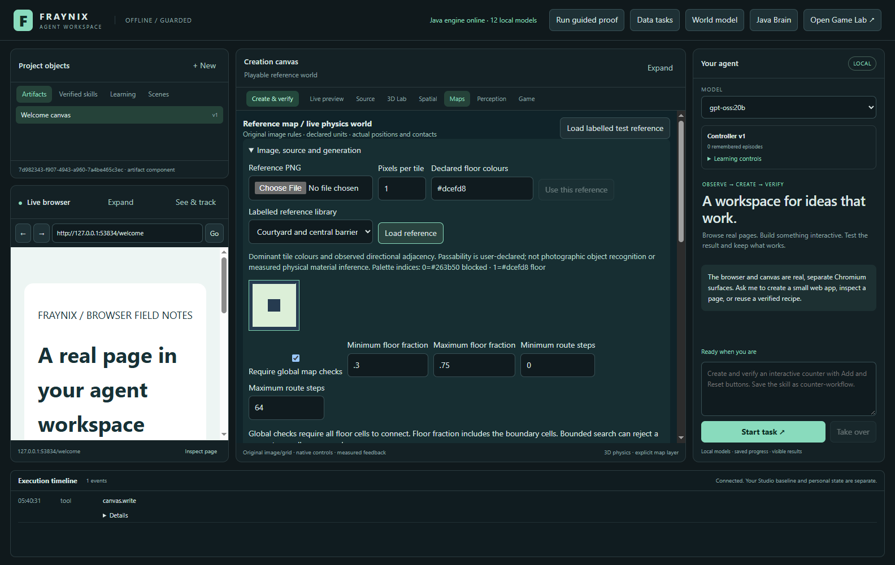](docs/readmes/029/images/topology-contract-029.png)

SOFTWARE CONTROL: actual committed reference PNG and global contract controls in the existing workspace.

[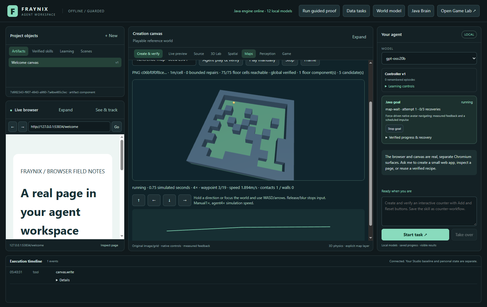](docs/readmes/029/images/topology-native-moving-029.png)

SOFTWARE CONTROL: actual native avatar under bounded force in the globally checked world.

[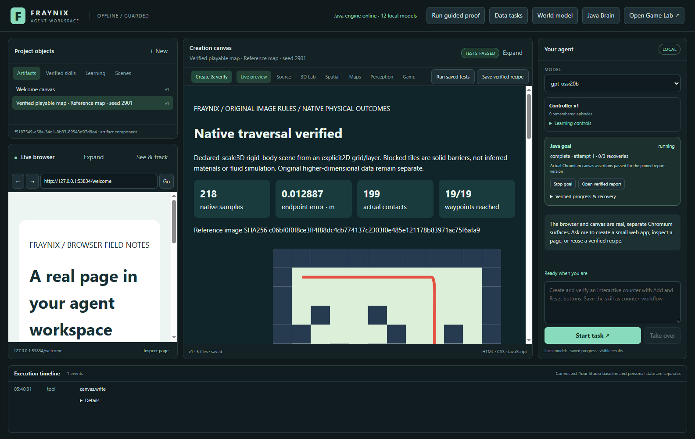](docs/readmes/029/images/topology-completed-029.png)

SOFTWARE CONTROL: physical outcome and Java-verified whole-map report.

[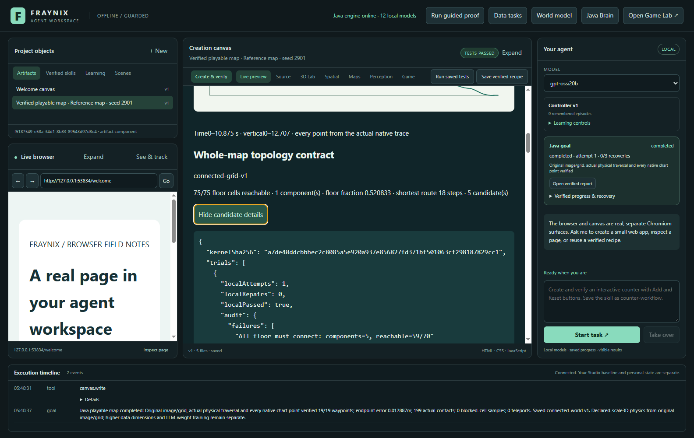](docs/readmes/029/images/topology-candidates-029.png)

SOFTWARE CONTROL: visible original contract, candidate measurements and rejection reasons.

[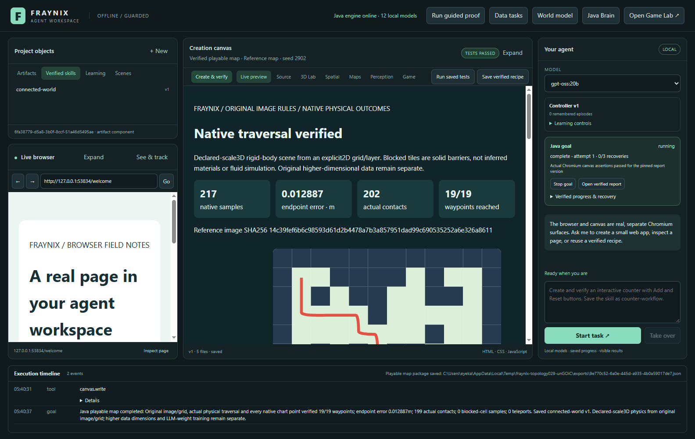](docs/readmes/029/images/topology-reused-029.png)

SOFTWARE CONTROL: retained procedure physically verifies another original reference and seed.

[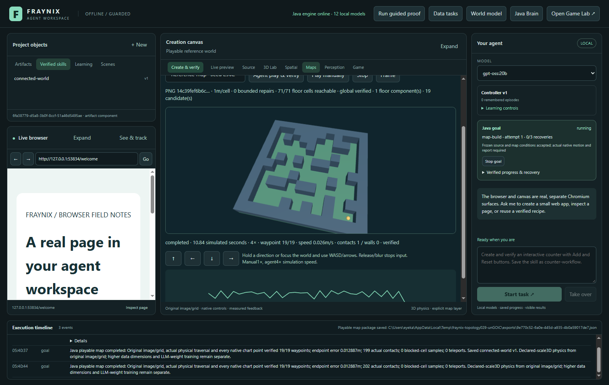](docs/readmes/029/images/topology-impossible-029.png)

NEGATIVE CONTROL: impossible route bound is retained and rejected before native play.

[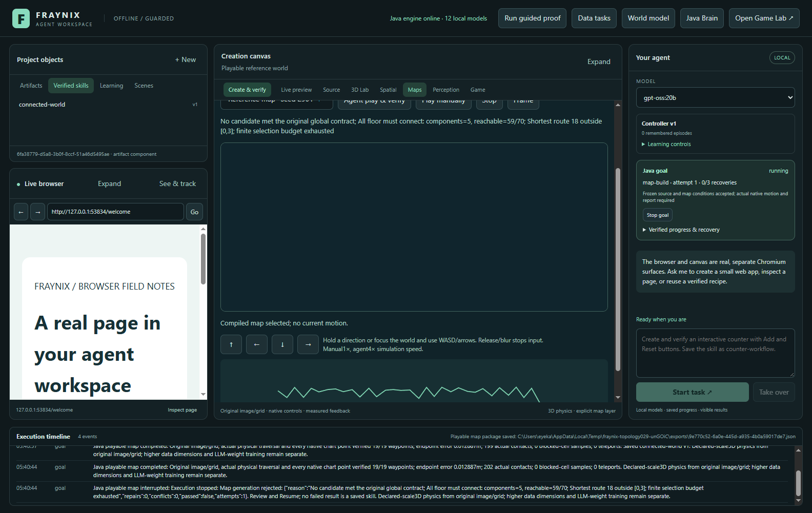](docs/readmes/029/images/topology-budget-rejected-029.png)

NEGATIVE CONTROL: actual reserved narrow-hall request remains rejected after32 candidates.

[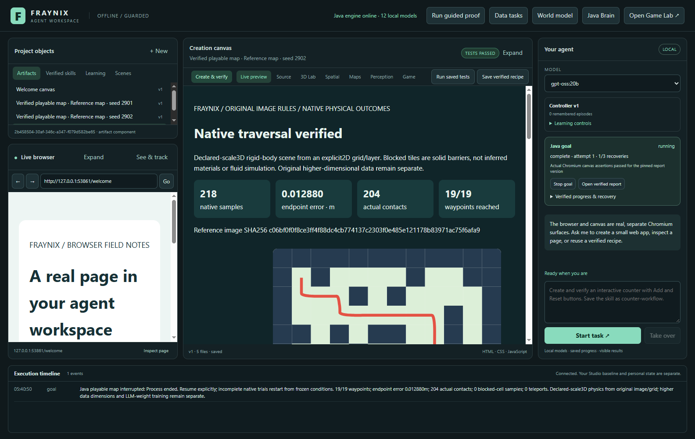](docs/readmes/029/images/topology-recovered-029.png)

SOFTWARE CONTROL: actual process restart reuses completed native evidence and stable report.

[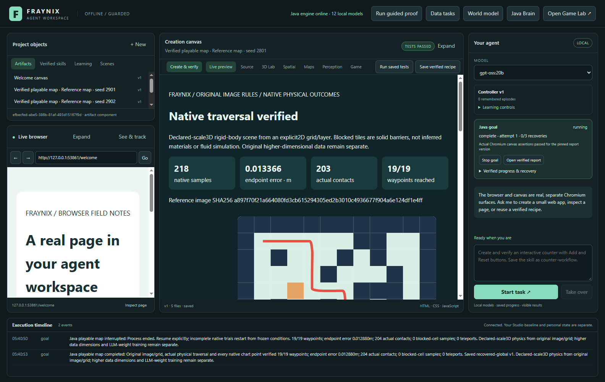](docs/readmes/029/images/topology-legacy-preserved-029.png)

SOFTWARE CONTROL: original published028 package still reconstructs and physically plays under its original requirements.

[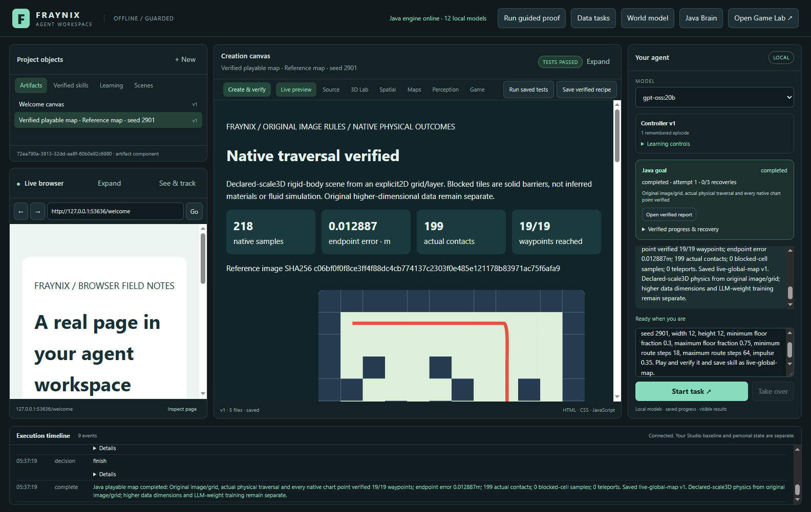](docs/readmes/029/images/topology-chat-created-029.png)

ACTUAL LOCAL MODEL: gpt-oss:20b creates, plays, verifies and retains a globally constrained map.

[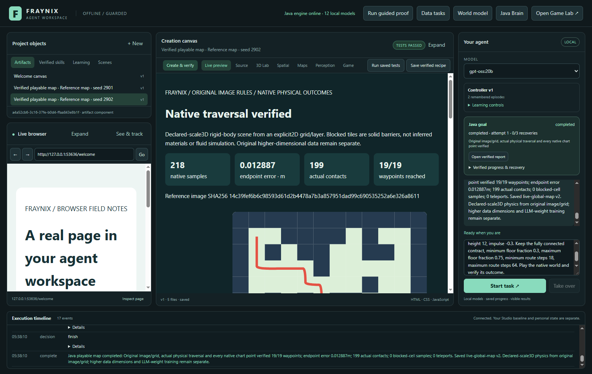](docs/readmes/029/images/topology-chat-reused-029.png)

ACTUAL LOCAL MODEL: fresh-reference skill reuse preserves every original global bound.

[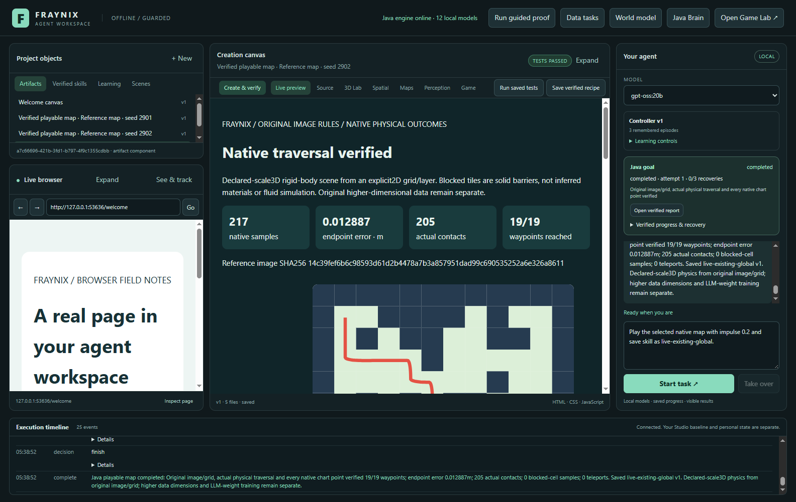](docs/readmes/029/images/topology-chat-existing-029.png)

ACTUAL LOCAL MODEL: selected compiled world plays without regenerated cells or weakened topology.

## Run it locally

The existing Java21/Node setup is unchanged:

```powershell
.\gradlew.bat check installDist :workspace-engine:installDist
cd workspace-desktop
npm ci
npm start
```

First setup needs the declared dependencies. With those cached, Gradle `--offline` and the installed desktop runtime work locally. The independent offline checkout reused the existing pinned Electron45.1.0 executable after cached package installation; this does not claim an unprepared machine needs no setup.

```powershell
npm test
npm run test:topology
# Requires the already-installed admitted local model:
npm run test:live-topology
```

The original map and procedural tests remain available. Native app integrations run sequentially with separate projects. Installed JARs are not rebuilt under a running test instance. Existing review028 and personal projects remain separate from the new review project.

## Sources, evidence and continuity

- [Verification and exact limits](docs/readmes/029/verification.json)
- [Full twelve-case Java evaluation, including every rejection](docs/readmes/029/evaluation.json)
- [Original first-evaluation map/native state](docs/readmes/029/first-evaluation-state.json)
- [First-run and repeated-evaluation provenance](docs/readmes/029/evaluation-provenance.json)
- [Frozen kernel/budget/profile](docs/readmes/029/profile.json)
- [Actual complete topology UI/recovery/legacy evidence](docs/readmes/029/topology-integration.json)
- [Actual local-model requests and verified episodes](docs/readmes/029/live-topology.json)
- [Full regression scope/results](docs/readmes/029/regressions.json)
- [Development corrections and retained failures](docs/readmes/029/development-attempts.json)
- [Offline original-data evaluation explorer](docs/readmes/029/examples/evaluation.html)
- [Offline exact-data native report](docs/readmes/029/examples/verified-map.html)
- [Original native trace CSV](docs/readmes/029/examples/original/trace.csv)
- [Original global map and candidate history](docs/readmes/029/examples/original/map.json)
- [Unresolved reserved case](docs/readmes/029/examples/unresolved-map.json)
- [Impossible route request](docs/readmes/029/examples/impossible-map.json)
- [Original reference declarations and hashes](docs/readmes/029/examples/references/reserved-cases.json)
- [Preserved original028 package outcome](docs/readmes/029/examples/legacy028/map.json)
- [Transport-only export provenance](docs/readmes/029/examples/export-provenance.json)
- [Full source inventory](docs/readmes/029/file-inventory.json)
- [Full source tree](docs/readmes/029/FILE_TREE.md)

Executable source baseline: `cb13a611395087b5ff949298a1cdd41f934c2eb0`. The inventory preserves inherited licences, wrappers and assets, using canonical UTF-8/LF hashes for text and exact binary hashes. Publication remains the private Fraynix-Agent-Workspace repository. Earlier numbered editions,013 data and024 source hashes/rejected tracking decision remain intact. Memories and logs record measured outcomes and pending gates.

## Where this takes the world-state idea

A persistent scene can expose several views of the same state. Global topology gives that state another explicit property: whether space is connected and navigable as a whole. The agent can ask for that property, act in its physical projection and inspect evidence of the outcome. Coordinates, time, materials, graph relationships and uncertainty remain variables with defined meanings.

The physical world still has three spatial axes. Original higher-dimensional dungeon coordinates remain complete and select explicit layers as described in028. This edition adds no extra physical directions or particle-physics claim. Its value is the shared local request → state → action → measurement → retained-procedure loop.

## Next acceptance gates

1. Add verified native checkpoints that preserve velocities, controller state and in-progress physical traces through interruption, without replaying effects.
2. Develop a separate topology-aware proposal method for the seven unresolved cases, with new reserved references, fixed compute budgets and independent evaluation. Keep this frozen result as the comparison record.
3. Connect calibrated perception/material observations to scene state with uncertainty and explicit units.
4. Compare navigation/learning policies on separate tasks with promotion gates and rollback, then broaden creation tools around complete measured procedures.

Each next step should complete another useful task while preserving the current application, original data and honest failure evidence.
