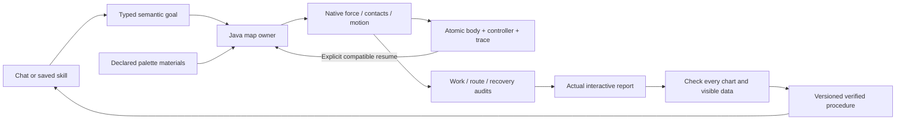
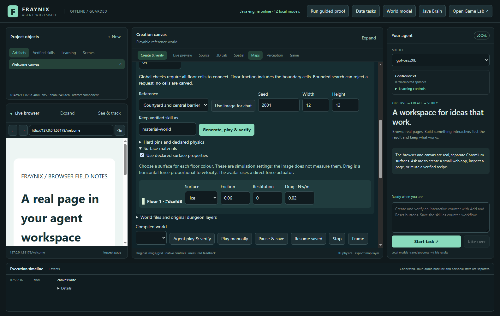
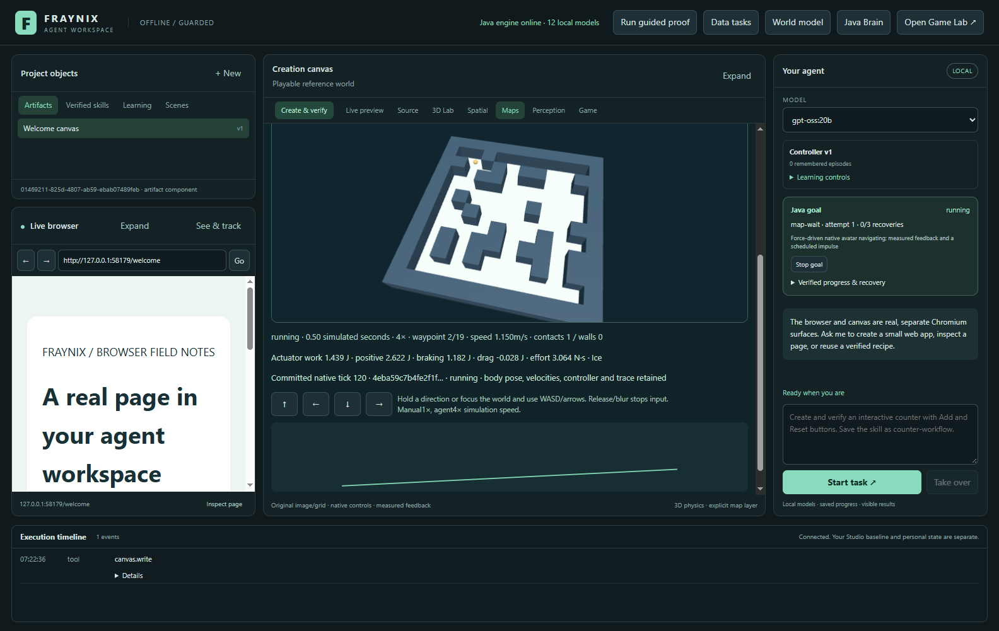
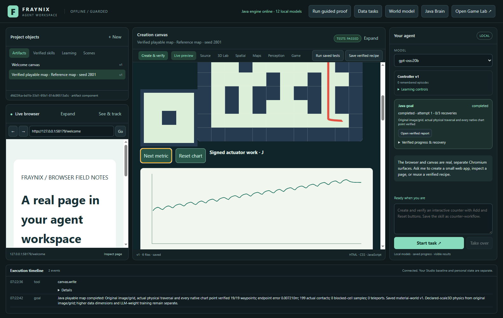
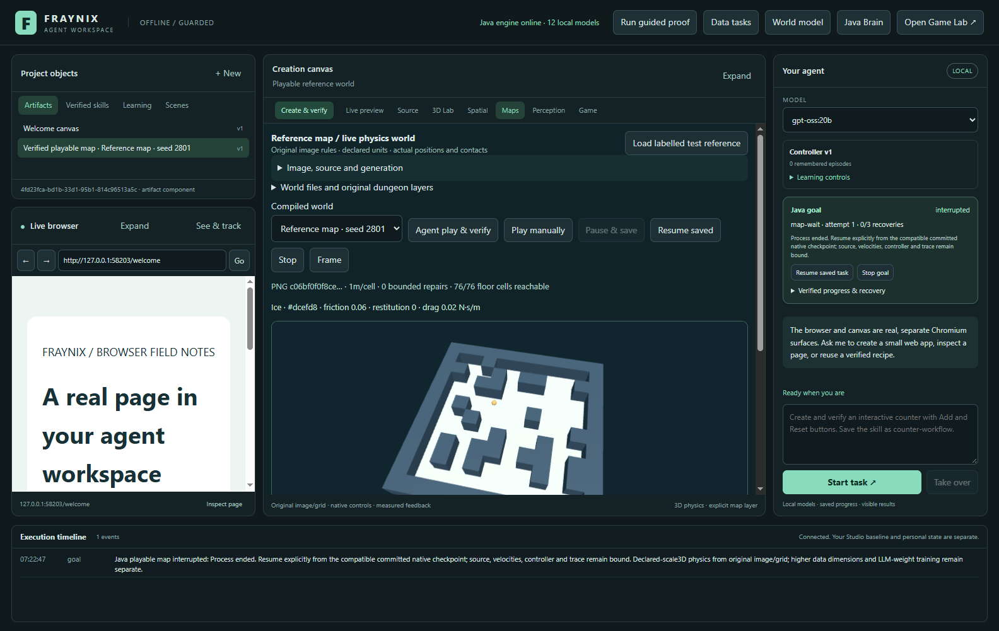
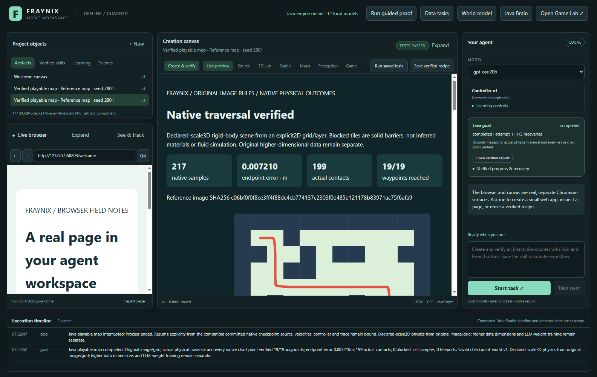
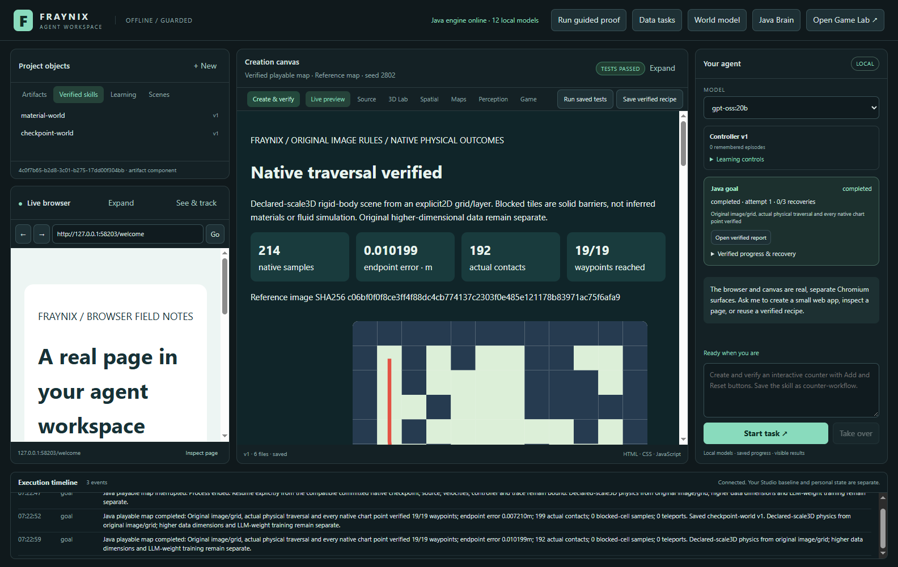
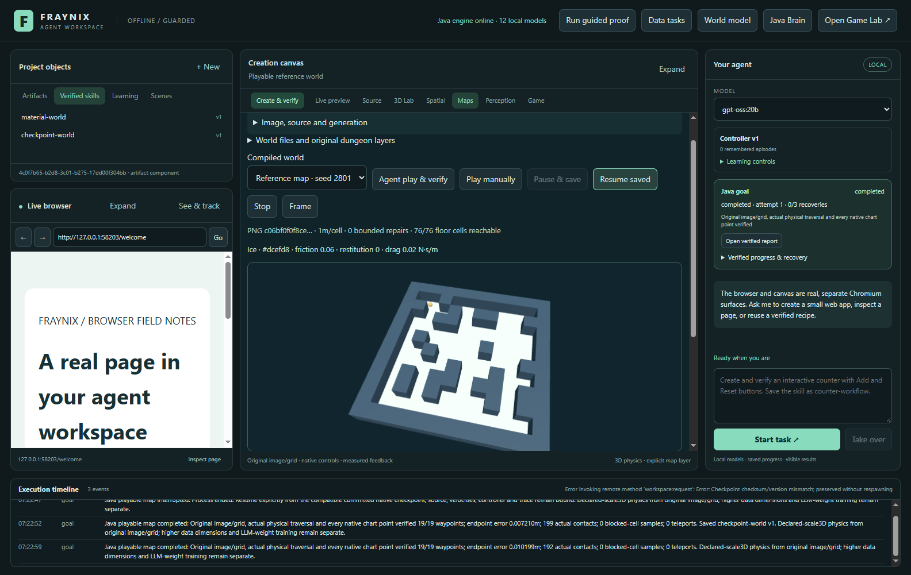
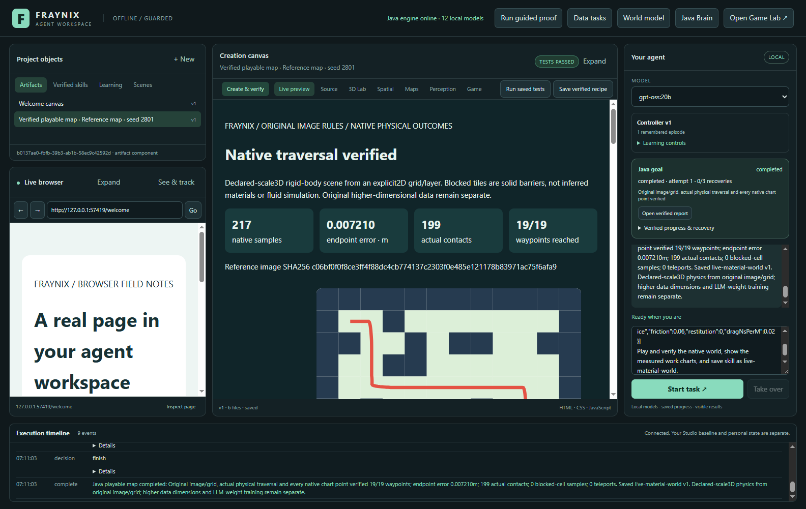
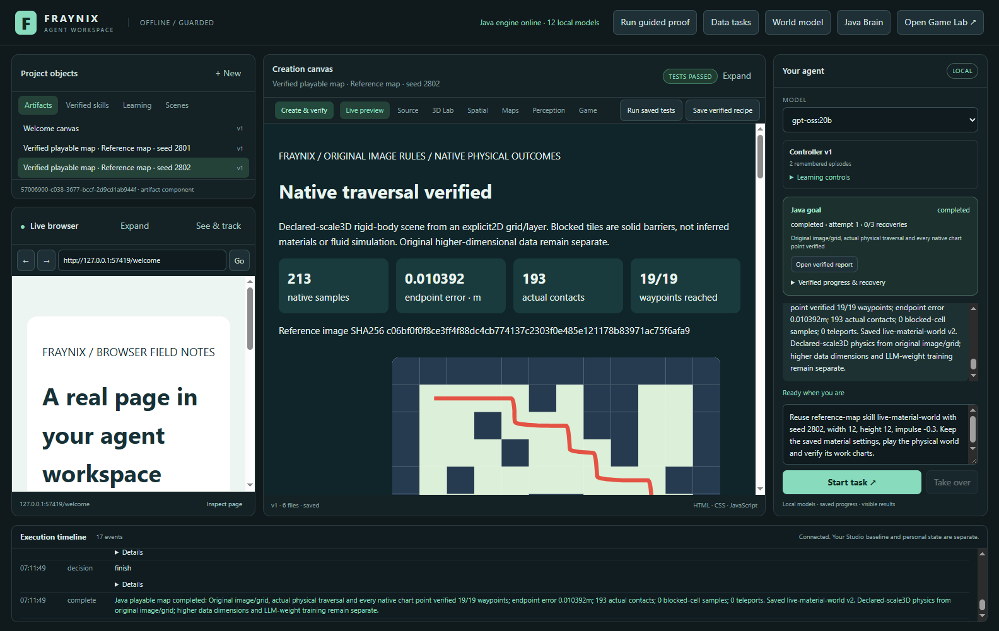

# Fraynix Agent Workspace — edition 030

**Recover a moving native world. Declare its surfaces. Measure the work.**

2026-10-31 · [Previous: edition029](README-029.md) · [All editions](docs/readmes/INDEX.md) · [Offline interactive guide](docs/readmes/030/index.html) · [Original verification](docs/readmes/030/verification.json) · [Obsidian map](docs/obsidian/native-map-recovery.canvas)

The agent already had a real environment: original image-derived maps, native physics, typed tools, persistent goals and reusable procedures. This edition makes an interrupted map task recoverable **while its body is moving**. It also adds declared surface properties and independently reconstructed work measurements. Chat, Maps, Skills, the live browser and the creation canvas retain their existing design.

The important result is a complete loop: request a world, act through native physics, commit its actual state, interrupt the process, resume the same task, verify the outcome and retain the procedure. The screenshots below show the application doing those things. They are not generated interface mockups or generative-world video.

Source baseline: `033a2543f51d56b247e33c1e9cc1d2f206562135`. The repository remains private `eyeoverthink/Fraynix-Agent-Workspace`. Earlier numbered editions and frozen source/evaluation records are preserved.

## What works now

| Function | Actual behavior | Evidence |
| --- | --- | --- |
| Native checkpoints | Preserve pose, quaternion, linear/angular velocity, controller waypoint, settling count, disturbance and complete committed trace | [Actual interrupted and resumed run](docs/readmes/030/recovery-materials-integration.json) |
| Explicit recovery | Continue the same goal/run and committed prefix; clear held inputs; refuse edited or incompatible checkpoints | [Native recovery receipt](docs/readmes/030/examples/recovered/run.json) |
| Declared materials | Floor-class friction/restitution become actual native collider properties; Java applies bounded-coefficient viscous drag | [Original material definition](docs/readmes/030/examples/original/map.json) |
| Work and effort | Reconstruct signed/positive/braking work, drag/gravity work, kinetic energy and force effort from actual ticks | [Complete raw native trace](docs/readmes/030/examples/original/full-run.json) |
| Real reports | Nine interactive SVG charts and exact visible material/work/checkpoint data are checked against Java originals | [Standalone report](docs/readmes/030/examples/original/index.html) |
| Existing chat and Skills | Actual local Ollama creates a material world and reuses its retained settings on a new seed and opposite impulse | [Both actual model episodes](docs/readmes/030/live-materials.json) |
| Exports and import | Full plain run JSON, lossless native evidence package, measured CSV and independently reconstructed world JSON | [Original export data](docs/readmes/030/examples/export-provenance.json) |

These are declared synthetic worlds. Palette colours establish explicit classes and passability; the image does not measure friction or identify real substances. The navigation controller remains the same feedback controller. The added measurements expose how surfaces affect its performance; this edition does not claim it learned an optimal routing policy.

## Review it step by step

1. Open **Maps**, load a labelled reference or confirm the floor colours of your own palette PNG. The reference library and global topology controls from029 remain available.
2. Open **Surface materials**, enable declared properties and choose a preset for each floor colour. Stone, Ice and High drag have visible numeric values; custom numeric settings remain bounded.
3. Choose the seed, scale and disturbance, then **Generate, play & verify**. Java creates real floor/wall colliders and a dynamic sphere; the viewport displays its measured position.
4. Use **Pause & save** during manual play. Use **Resume saved** to continue it. For an interrupted shared task, use **Resume** in the Java goal card.
5. Inspect the verified report. Cycle through distance, speed, force, contacts, force effort, travel, signed actuator work, signed drag work and kinetic energy.
6. Save/reuse the verified procedure through the existing **Skills** interface. A new run is physically executed and independently checked; old success is not substituted for a new result.
7. Use **Export world JSON** or **Export full run**. Importing a world reconstructs its original source, cells, material patches and colliders before admission.

Map actions now queue. A quick world selection followed by Play no longer silently drops the second click while the first request is still completing.

## What a checkpoint contains

The native owner samples every12 ticks and commits every120 ticks, or0.5 simulated seconds, plus pause/completion boundaries. The corresponding live observation becomes available only after the atomic checkpoint succeeds. Uncommitted steps can be lost after process termination; the committed trace is retained exactly.

The envelope binds the actual payload with canonical SHA-256, original map/run, compiled implementation, JDK/platform and the actual Minie artifact containing the native Bullet binaries. It stores position, orientation, both velocities, tick, controller progress, settling count, work integrals, original trace and disturbance history. A checksum detects unintended changes; it is not an authenticity signature.

On explicit Resume, Java validates the source and checkpoint, creates a native world at the saved state, records its **actual initialized body** and compares that with the committed boundary before continuing. A queued disturbance is never blindly replayed. The verifier checks its actual before/after velocities and work as well as its scheduled tick and amplitude.

This covers the current single dynamic map-avatar world. Contact manifolds and solver caches are rebuilt by Bullet. The subsequent trajectory is measured within declared tolerances, rather than promised bitwise identical. In the native comparison test, position difference after600 further ticks was **2.3324006561187697e-07 m**, velocity difference **5.364432793330597e-06 m/s**, and actuator-work difference **-2.1442880978383982e-05 J**. [Original comparison and rebound measurements](docs/readmes/030/native-comparisons.json)

The app test actually terminates **its own Java child** while the body is moving at committed tick **840**. A new process restores the committed prefix, explicitly resumes the same goal/run with attempt1, completes the native task and verifies the new report. Exactly one scheduled disturbance remains in the whole run. This is evidence for process-interruption recovery; storage and hardware failure guarantees require additional work.

Completed runs are reused without repeating physical effects. Existing saved reports are checked against their original hash/source binding and reverified without rewriting their historical contents. Original029 report evidence is part of the compatibility tests.

## Materials are physical parameters

The optional material declaration binds a walkable palette index. Same-class rectangles compile actual native floor patches without changing source cells or topology. Unspecified classes retain the declared default surface. The total collider budget is512 including the avatar.

| Parameter | Supported range | Meaning |
| --- | --- | --- |
| Friction | 0.05–1.2 | Assigned native floor contact property |
| Restitution | 0–0.95 | Assigned native floor restitution; an actual rebound test checks its effect |
| Viscous drag | 0–8 N·s/m | Horizontal Java force `-c × velocity` |
| Cell scale | 0.6–1.2 m | Declared physical cell width |
| Avatar | 1 kg; radius0.18 m | Current sphere actuator/body |
| Actuator | Maximum24 N | Direct horizontal force, controlled from measured position/velocity |

The actuator is a direct force source. Its braking authority is not replaced by a wheel/foot traction formula. Gravity, collisions and rotation come from the existing native backend. The renderer does not integrate another approximation of the world.

The three fixed development surface trials all pass the native route gates. They use the same original reference and controller with declared parameter changes. Their complete original runs and reconstructed integrals are retained. They are development comparisons, not an unseen policy evaluation.

| Declared friction / drag (N·s/m) | Time (s) | Signed actuator work (J) | Drag work (J) | Force effort (N·s) |
| --- | ---: | ---: | ---: | ---: |
| 0.06 / 0.02 | 10.7833 | 16.937734 | -0.619853 | 49.230681 |
| 0.85 / 0.25 | 11.1292 | 31.789214 | -7.436863 | 59.924433 |
| 1.1 / 6 | 16.1875 | 141.080068 | -123.912330 | 121.139985 |


[Original three-case data and full native runs](docs/readmes/030/material-trials.json) · [Independent measurement convention](docs/NATIVE_MAP_RECOVERY.md)

## Work is different from force effort

Force effort integrates actuator-force magnitude over time, in **N·s**. Signed mechanical work uses force dotted with measured displacement, in **J**. Positive work and braking-work magnitude are separate counters; their difference reconstructs signed actuator work.

Every tick preserves `[tick,Fx,Fz,dx,dz,dragFx,dragFz,dy]`. The separate work verifier reconstructs the integrals, checks every sampled position against the displacement sum, recomputes kinetic energy from linear/angular velocity, verifies force bounds and checks the scheduled impulse's measured velocity change. Altered counters and missing/duplicate integration ticks are rejected.

The convention is discrete force dot actual step displacement. Contact/damping work is not individually resolved. The reported residual is a diagnostic, not a closed energy-conservation proof. A passing work audit establishes reconstruction of the recorded quantities.

The full run export preserves all ticks. Reports include a lossless gzip/base64 JSON package with raw byte count and SHA, compact chart-sample JSON and measured CSV. Existing per-file/total artifact limits still apply; an oversized report cannot become a retained successful skill. The native run remains available in the project for inspection/export.

## Chat, skills and recovery share one runtime



The LLM selects semantic conditions. Java maintains the durable task, physical timing, source identity, action execution and checks. The desktop provides the browser, canvas and input. A saved procedure contains checked defaults and recovery behavior; it does not install arbitrary executable tools.

Two actual `gpt-oss:20b` requests create and reuse a material world. Both have verified native outcomes, all nine chart frames, exact visible work/material data and verified learning episodes. A changed seed and opposite impulse execute a fresh world/run. This is procedural retention; Ollama weights were not trained.

The first live reuse attempt exposed a real integration defect: the model repeatedly invented retained material overrides, which the guard refused. It reached the unchanged12-turn limit. The final schema omits unrequested material replacement for a bound skill, the prompt preserves host defaults, and repair feedback shows the retained values. Explicit replacement materials remain supported. The actual repeated test passes without raising the budget or weakening physical gates. [Retained development failures and corrections](docs/readmes/030/development-attempts.json)

## Validation and preserved behavior

The independent offline checkout passes **272 Java tests / 51 classes**, **51 desktop units** and **177 critical UI workflow groups**. The two actual local-model episodes add **four checks**. These scopes overlap where stated; they are not added into an invented unique-test total. Native and desktop checks pass on the release source; all canonical source hashes are compared independently before freezing.

The native tests include moving/rotating restoration, work continuity, stale-key expiry, checksum/code/source rejection, real surface effects, actual restitution, uninterrupted-versus-resumed comparison and original published-report compatibility. The app checks include real file export/import, actual process termination, same-run recovery, all charts, saved-skill reuse, manual controls, edited-file byte preservation and cancellation.

Earlier global topology algorithms and their frozen source identities are unchanged. Published029 reference cases are now explicitly seen regression data. Their prior acceptance/rejection record remains untouched. New runtime behavior is not relabelled as another first reserved evaluation. Earlier numbered READMEs,013 calibration data,024 tracking hashes and the rejected tracking-promotion decision remain preserved.

Existing personal projects, local model weights and prior review windows are separate. Tests use isolated projects. Native app integrations run sequentially; build outputs are not replaced under an active test instance. No new model weights, cloud account, Docker, WSL, Processing runtime or algorithm package was added.

## Actual dated application captures

[](docs/readmes/030/images/materials-controls-030.png)

SOFTWARE CONTROL: actual surface presets and declared parameter controls. Captured 2026-10-31T14:22:36.667863+00:00.

[](docs/readmes/030/images/materials-native-moving-030.png)

SOFTWARE CONTROL: real native force-driven motion over compiled material patches. Captured 2026-10-31T14:22:37.443820+00:00.

[](docs/readmes/030/images/materials-report-030.png)

SOFTWARE CONTROL: original image, actual route and verified native outcome. Captured 2026-10-31T14:22:43.164772+00:00.

[](docs/readmes/030/images/materials-signed-work-030.png)

SOFTWARE CONTROL: signed actuator-work chart computed from native tick measurements. Captured 2026-10-31T14:22:44.324003+00:00.

[](docs/readmes/030/images/checkpoint-moving-030.png)

SOFTWARE CONTROL: moving body before deliberate termination of this test app’s Java child. Captured 2026-10-31T14:22:45.597550+00:00.

[](docs/readmes/030/images/checkpoint-interrupted-030.png)

SOFTWARE CONTROL: new process loads interrupted native state and requires explicit Resume. Captured 2026-10-31T14:22:47.438665+00:00.

[](docs/readmes/030/images/checkpoint-resumed-report-030.png)

SOFTWARE CONTROL: same-run recovery completes and verifies the original-plus-resumed trace. Captured 2026-10-31T14:22:52.961831+00:00.

[](docs/readmes/030/images/materials-skill-reuse-030.png)

SOFTWARE CONTROL: saved procedure reuses material defaults on a new seed and verifies a new run. Captured 2026-10-31T14:22:59.379833+00:00.

[](docs/readmes/030/images/checkpoint-manual-paused-030.png)

SOFTWARE CONTROL: actual keyboard motion followed by Pause & save. Captured 2026-10-31T14:23:00.093724+00:00.

[](docs/readmes/030/images/checkpoint-edited-refused-030.png)

NEGATIVE CONTROL: edited checkpoint is refused and its exact bytes preserved. Captured 2026-10-31T14:23:00.799178+00:00.

[](docs/readmes/030/images/materials-chat-created-030.png)

ACTUAL LOCAL MODEL: gpt-oss:20b requests the declared material world and retains its verified procedure. Captured 2026-10-31T14:11:03.828753+00:00.

[](docs/readmes/030/images/materials-chat-reused-030.png)

ACTUAL LOCAL MODEL: saved-skill reuse changes seed and impulse while retaining exact material values. Captured 2026-10-31T14:11:50.058418+00:00.

## Code and data map

```text
workspace-engine/src/main/java/fraymus/workspace/
  MapCheckpoint.java    canonical payload + runtime/backend identity + atomic commit
  MapMaterials.java     validated palette properties + same-class native floor patches
  MapPhysics.java       native body initialization, forces, contacts and tick measurements
  MapRecovery.java      independent comparison of actual restored body and trace boundary
  MapWork.java          independent position / work / kinetic-energy / impulse audit
  MapStore.java         single owner, durable runs, pause/resume and source packages
  MapReport.java        nine actual charts, exact visible data, CSV and lossless raw evidence
  GoalRunner.java       same-run recovery, report reuse and verified procedure retention
workspace-desktop/
  goals.cjs             semantic preservation and legitimate canvas observation receipts
  policy.cjs            typed material schema and bound-skill override control
  renderer/map-panel.js material controls, native view, queued actions and recovery controls
docs/
  NATIVE_MAP_RECOVERY.md state, units, compatibility and measurement contracts
  readmes/030/          complete dated evidence and offline guide
  obsidian/             linked notes and native recovery map
```

[Every canonical implementation file and hash](docs/readmes/030/file-inventory.json) · [Full file tree](docs/readmes/030/FILE_TREE.md) · [Engineering contract](docs/NATIVE_MAP_RECOVERY.md)

## Run and test locally

The existing Java21 and Node setup remains. Dependencies must be installed/cached before an offline build. The independent checkout uses the pinned existing Electron executable after offline dependency installation; this does not claim a fresh computer needs no setup.

```powershell
.\gradlew.bat --offline check installDist :workspace-engine:installDist
cd workspace-desktop
npm ci
npm test
npm run test:recovery-materials
# Uses the already-installed admitted local Ollama model:
npm run test:live-materials
```

For a separate review project, set `FRAYNIX_WORKSPACE_PROJECT` to a new dedicated directory before `npm start`. Keep original projects and databases separate when changing checkouts. Model services and weights remain local and outside Git. The application still uses its declared Electron/Three/native Bullet dependencies; the new material, checkpoint and accounting logic adds no external runtime dependency.

## Next step: native pushable-object planning

The next useful proof is: **“Move this crate to that location, choose a valid approach, detect if it is wedged, recover, and verify the final object state.”**

That needs complete dynamic-body observations, collision-aware pushing poses, a bounded task planner, native force execution, progress/jam checks and a recovery strategy. Object motion must come from contact forces, and success must be checked against the object's actual final position and speed. Each additional body and constraint also needs complete checkpoint state before its interruption recovery can be claimed.

After manipulation, persistent layer transitions can connect verified scenes, and controller candidates can be compared on separate evaluation tasks with versioned promotion and rollback. Additional coordinates remain explicit data dimensions; additional physical directions need their own mathematical model. Parameter changes alone will not be labelled useful learning.

This continues the original vision: the application's own environment, actions, measurements and retained procedures become the working content. Each expansion should complete a real task, preserve failures and make the result inspectable.
