# Fraynix Agent Workspace — edition 031

## A task that changes another object

The agent can now approach a crate, push it around an obstacle through actual
native contacts, detect a measured stall, recover within its original force
budget, verify the final result and retain a reusable procedure. The existing
Spatial view, Java goal card, local chat, creation canvas and verified Skills
library remain the application. The new task lives inside that design.

[Previous: edition030](README-030.md) · [Edition history](docs/readmes/INDEX.md) ·
[Offline interactive guide](docs/readmes/031/index.html) ·
[Engineering contract](docs/NATIVE_PUSHING.md) ·
[Actual verification](docs/readmes/031/verification.json) ·
[Source inventory](docs/readmes/031/FILE_TREE.md) ·
[Obsidian map](docs/obsidian/native-pushing.canvas)

This is a concrete step toward your vision: an agent whose observations, tools,
physical environment, memory and checks belong to one local application. Its
actions change a persistent world that the same agent can inspect. The app's
flow produces useful content—scenes, trajectories, plans, measurements, reports
and reusable procedures—rather than relying on a fixed stream of demonstration
content to imitate agency.

The exact boundary matters. This release implements declared-scale box pushing
on a flat floor, with finite planning/control/recovery budgets. It is not a
general-purpose learned world simulator, unrestricted robot controller or new
language-model training system. The fixtures below are clearly labelled
synthetic development cases. Their results come from real native simulation and
real app controls, not prewritten success animations.

## What works now

| Capability | Implemented behavior | Evidence |
| --- | --- | --- |
| Reachable approach planning | Search joint crate/pusher configurations; every push needs a standing pose the pusher can actually reach | Original source, returned plan and second-pass plan checks |
| Contact-driven action | Bounded force acts only on the pusher; a separate dynamic crate moves through Bullet contacts | Every native tick records recipient, force, both displacements and contacts |
| Recovery | A real contact stall triggers retreat and reapproach; force may increase only within the original maximum | Original jam window, recovery targets/events and measured final state |
| Durable execution | Pause or process interruption commits both dynamic bodies, full controller, plan, trace and recovery state | Same goal/run/attempt, exact committed prefix and actual initialized-body comparison |
| Real observations | Spatial rendering, paths and object queries read committed actual native transforms | Native tick, persistent role IDs, positions, velocities and ray visibility |
| Verified report | Six working chart modes plus original plan/intent/recovery data are independently checked | Every rendered chart point and exact visible data precede skill retention |
| Retained skills | A versioned procedure rebinds fresh roles, preserves defaults, replans and reruns physics | Actual Skills form and actual local-model reuse on a new scene |
| Usable files | Original scene JSON, complete native run JSON, measured CSV and lossless packed evidence | Real export/file-import controls and exact decompression/hash checks |

The previous grab/move/release task remains available. Pushing does not fake that
task by dragging the crate with a hidden constraint. The new controller applies
no direct crate force and performs no pose or velocity replacement after native
initialization. The pusher is explicitly an upright sliding actuator, with zero
angular factor; that modelling choice is part of the declared contract.

## Try it step by step

1. Start the app with the existing Windows launcher, or follow the offline setup
   below. Open **Spatial** in the centre workspace.
2. Expand **Push an object through native contacts**. Select **Obstacle turn** and
   choose **Load pushing scene**. The imported scene is labelled synthetic and
   declared-scale. The crate and pusher are separate dynamic objects with distinct
   stable IDs. The source bytes stay unchanged.
3. Leave relative X at **3 m**, Z at **0 m**, gentle pushing limit at **8 N** and
   maximum force at **32 N**. Choose **Plan only**. Orange shows the planned crate
   route. The original plan includes the pusher's walking approaches and standing
   positions; no native actuation occurs during this step.
4. Choose **Push & verify**. The pusher approaches, aligns with the actual crate,
   makes native contact and pushes through the turn. The live viewport shows
   actual body motion and paths, native time, current action, contacts, recovery
   count and committed checkpoint tick.
5. Wait for the verified report. Its controls switch among crate distance, speed,
   actual pusher force, native pair contacts, force effort and signed work. The
   floor-plane diagram overlays the plan and both actual paths. The full original
   plan, events, intent, checkpoint and verification remain inspectable.
6. Open **Verified skills**, choose `contact-crate-route`, select a fresh
   **High friction / recovery** source and run it. The original 8/32 N defaults
   remain visible. The low initial cap now physically stalls. The controller
   retreats, reapproaches and completes within the original maximum.
7. For interruption review, use **Pause & save both bodies**, then **Resume saved
   push** or the existing Java goal card. Restart also requires explicit Resume;
   opening a saved project does not silently actuate a world. **Stop goal**
   abandons a task without retaining a failed procedure.
8. **Export full push run** writes the complete settled native attempt as plain
   JSON. **Export scene** writes original scene source. **Import JSON** accepts a
   supported scene file; reports supply downloadable CSV and packed evidence.

An ordinary chat request also works after choosing actual roles in Spatial:

> Push the selected crate X 3 Z 0 metres using initial force 8 N and maximum force
> 32 N. Plan a reachable approach, verify the actual contact-driven motion and
> charts, and save skill as live-contact-crate.

For reuse on a fresh selected scene:

> Reuse pushing skill live-contact-crate on the selected fresh crate, X 3 Z 0
> metres. Keep its saved force defaults. Verify the new native outcome and
> measured recovery charts.

These are actual local-model acceptance requests from this edition. Local
generation can take minutes; the language model does not run the 240 Hz physical
control loop. Java owns timing and durable execution while the model chooses
semantic parameters and explains the checked result.

## How the system fits together

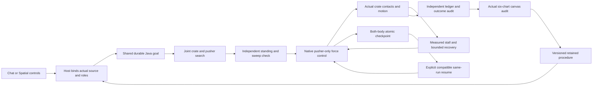

The model cannot supply privileged scene/body IDs, fabricated trajectories,
replacement HTML or success flags through the new typed tool schema. The host
supplies real selected roles. Explicit targets and force limits are preserved;
reuse rejects invented changes to retained defaults. `push.read` returns real
source/native knowledge. `push.start` delegates the complete registered procedure
to Java. The shared `goal.read`, `goal.resume`, `goal.cancel` and `procedure.run`
interfaces retain their existing roles.

Java searches at most 8,192 configurations and 12 pushes. It uses conservative
footprints and swept-path checks: a geometrically open crate path is insufficient
when the pusher cannot stand behind it. Native execution then follows actual
positions and velocities, aligning before contact and compensating for declared
friction within the original force cap. A stall requires real contact and less
than 0.02 m progress over 240 ticks away from the target. Recovery is limited to
two attempts; total execution is limited to 60 simulated seconds.

The final crate must finish within 0.1 m of the requested horizontal target and
at no more than 0.2 m/s total speed. The tighter internal intermediate push gate
is 0.035 m. These final acceptance gates and force/recovery limits were preserved
while the development controller was corrected; failed attempts are retained.

## Measured results

| Actual app case | Pushes | Native time · s | Crate error · m | Maximum force · N | Jams / recoveries |
| --- | ---: | ---: | ---: | ---: | --- |
| Obstacle turn | 5 | 30.4000 | 0.03068603 | 25.95639 | 0 / 0 |
| Fresh high friction / skill reuse | 3 | 14.6667 | 0.02812738 | 29.61952 | 1 / 1 |
| Same-run restart | 5 | 30.3917 | 0.03072761 | 25.96061 | 0 / 0 |
| Insufficient cap · rejected | 3 planned | 13.2542 | 2.53195356 | 8.00000 | 2 / 2 |


These are fixed development and app acceptance cases, not a held-out policy
evaluation. The high-friction case deliberately changes actual declared contact
properties. Its recovery is triggered by measured native progress and contacts.
An otherwise identical insufficient-cap trial must fail honestly. No success
animation, manually authored endpoint or language-model statement substitutes
for the recorded physics.

The independent offline checkout passes **281 Java tests / 53 classes**, **56 desktop units** and **189 critical UI workflow groups**. These include the new twelve pushing groups and the prior shared app regressions. Separately, two actual installed gpt-oss:20b chat episodes pass four checks. These scopes overlap where stated; they are not summed into an invented unique-test count. All canonical implementation hashes are compared independently before publication.

The actual process-kill test terminated only its own Java child while both bodies
were moving. The committed boundary was tick **840**. A newly started
process restored the same run and required explicit Resume. Its entire committed
sample prefix remained identical. Independently measured restoration errors were
**0 m position**, **0 velocity**, with quaternion
equivalence checked to 1e-6. Both body states, action progress, stall/recovery
phase and counters were restored rather than replacing the task with a new run.

Native contact caches rebuild after restart. A continuation can differ slightly
in floating-point contact trajectories; this release does not serialize the
native solver's complete internal memory or promise bitwise future identity.
The checkpoint cadence is 120 ticks / 0.5 simulated seconds, with 12-tick samples
and additional commits at pause/settlement. Uncommitted tail steps are discarded.

Independent verification reconstructs both horizontal positions from every
controlled tick and recomputes signed pusher work and force effort. Work is in
joules; force effort is in N·s. This is actuator accounting, not a claim to
reconstruct every contact/damping energy exchange. The evidence retains original
parameters and full native force/displacement/contact/action ledgers.

## Controls that must reject

- **Unreachable standing pose:** a naive crate-only path exists, but the pusher
  cannot reach its required side. Planning rejects before native actuation; no
  run or retained skill is created.
- **Insufficient force:** the 8 N maximum remains 8 N through both measured
  recovery attempts. The native task fails and keeps its evidence without
  promoting a skill or silently raising the budget.
- **Edited checkpoint:** modifying saved body velocity without a valid checksum
  is visibly refused. Exact edited bytes remain available for inspection. No
  fresh body is substituted as a successful continuation.
- **Changed runtime/source:** native tests refuse incompatible code identity or
  original source binding. Recovery requires the matching compiled/runtime
  contract.
- **Cancellation:** stopping an active or paused task stops/abandons owned effects
  and cannot retain a new success. Existing browser, canvas and earlier task
  interfaces remain accessible.

Development failures are part of the record. The first corner controller left
perpendicular drift; actual pre-contact alignment, a tighter intermediate target
and declared-friction feedforward corrected that behavior. A test initially read
a closed panel's `innerText`; it now opens/reads the actual evidence correctly.
Full-app testing found a repeated interrupted-goal notification could reselect an
old scene; selection now follows a new task once and respects the next imported
source. The new Spatial Resume route was corrected to use the existing Java-goal
dispatcher. Original logs and failed attempts are retained in the snapshot.

[Development record](docs/readmes/031/development-attempts.json) ·
[Original full native example](docs/readmes/031/examples/original/full-run.json) ·
[Recovered example](docs/readmes/031/examples/recovered/full-run.json) ·
[Reused high-friction example](docs/readmes/031/examples/reused/full-run.json)

## Real dated screenshots

[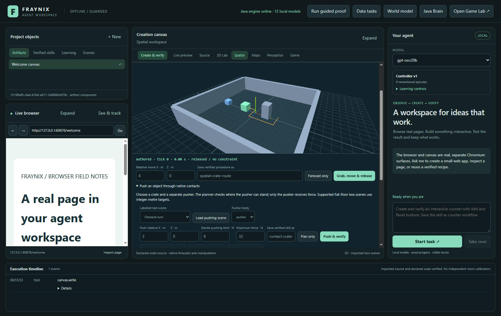](docs/readmes/031/images/push-approach-plan-031.png)

SOFTWARE CONTROL: joint configuration search plans reachable standing approaches without native actuation. Captured 2026-10-31T15:55:54.335190+00:00.

[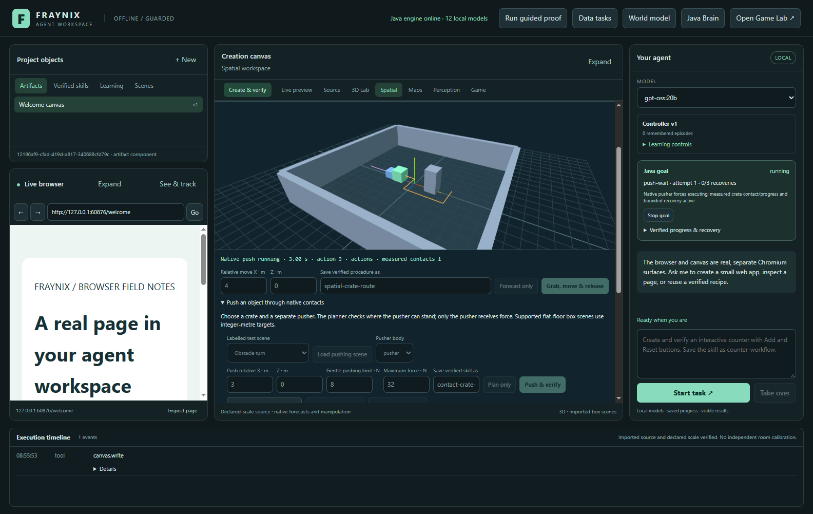](docs/readmes/031/images/push-native-contact-031.png)

SOFTWARE CONTROL: separate actual pusher and crate moving through native contact around an obstacle. Captured 2026-10-31T15:55:55.736351+00:00.

[](docs/readmes/031/images/push-verified-report-031.png)

SOFTWARE CONTROL: original planned and actual two-body paths plus a passing physical report. Captured 2026-10-31T15:56:07.544114+00:00.

[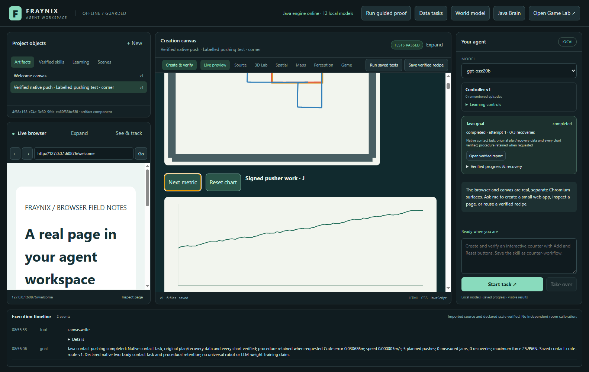](docs/readmes/031/images/push-work-chart-031.png)

SOFTWARE CONTROL: signed actuator work chart from original native tick measurements. Captured 2026-10-31T15:56:08.539898+00:00.

[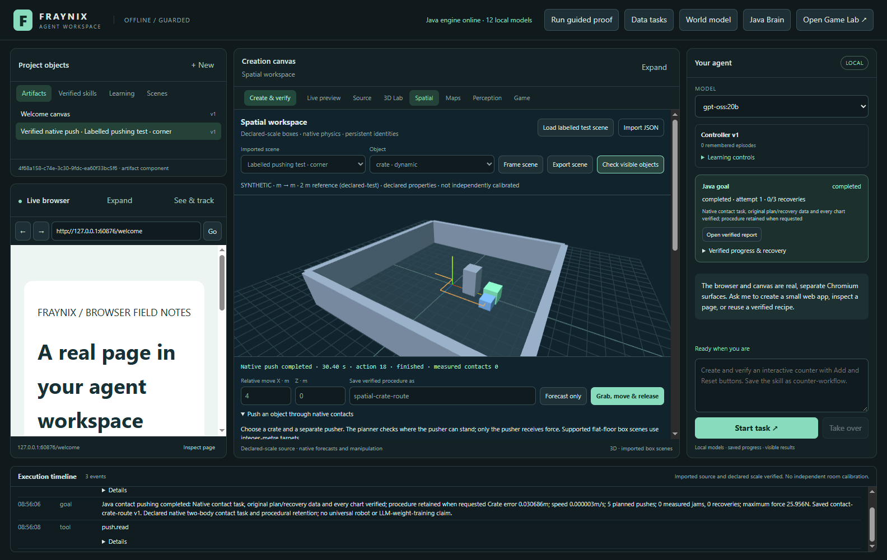](docs/readmes/031/images/push-native-observation-031.png)

SOFTWARE CONTROL: actual committed body transforms and qualified geometry-based visibility. Captured 2026-10-31T15:56:08.926670+00:00.

[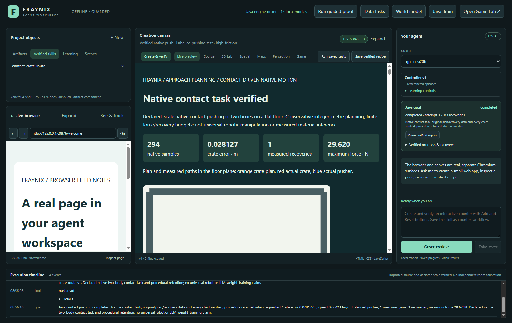](docs/readmes/031/images/push-reused-recovery-031.png)

SOFTWARE CONTROL: saved-skill reuse completes a fresh high-friction task after a measured jam and bounded recovery. Captured 2026-10-31T15:56:17.069337+00:00.

[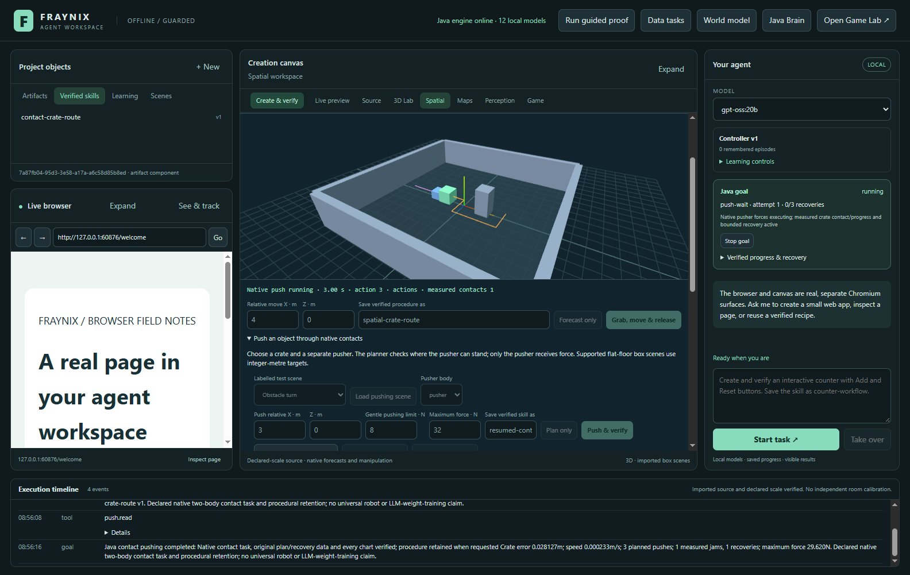](docs/readmes/031/images/push-two-bodies-moving-031.png)

SOFTWARE CONTROL: both actual native bodies moving before this test Java child is deliberately terminated. Captured 2026-10-31T15:56:18.747516+00:00.

[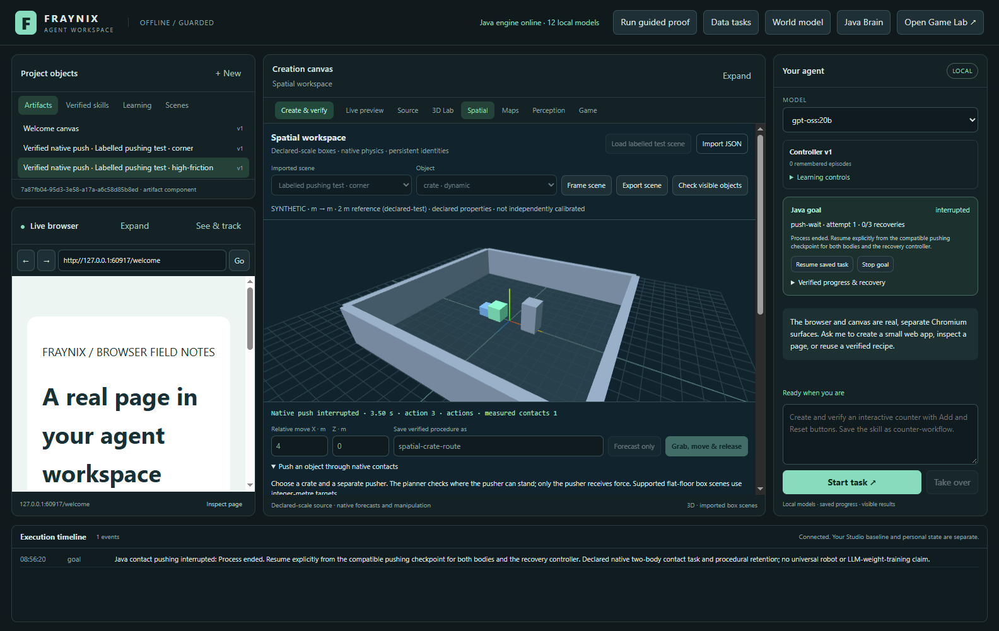](docs/readmes/031/images/push-interrupted-031.png)

SOFTWARE CONTROL: a new process loads the committed native state and requires explicit Resume. Captured 2026-10-31T15:56:21.414598+00:00.

[](docs/readmes/031/images/push-resumed-report-031.png)

SOFTWARE CONTROL: the same goal/run resumes, verifies both initialized bodies and completes with its original trace prefix. Captured 2026-10-31T15:56:33.403552+00:00.

[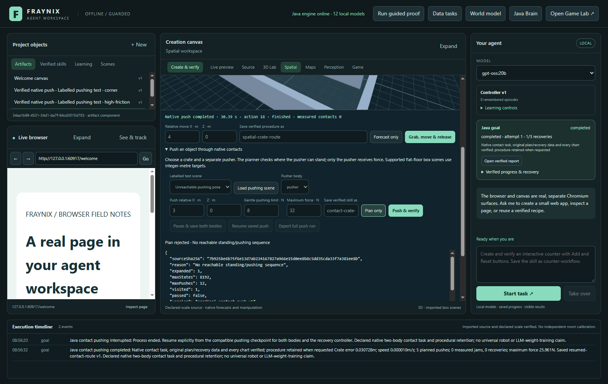](docs/readmes/031/images/push-unreachable-standing-031.png)

NEGATIVE CONTROL: a naive crate path is insufficient when the pusher cannot reach a standing pose. Captured 2026-10-31T15:56:34.010450+00:00.

[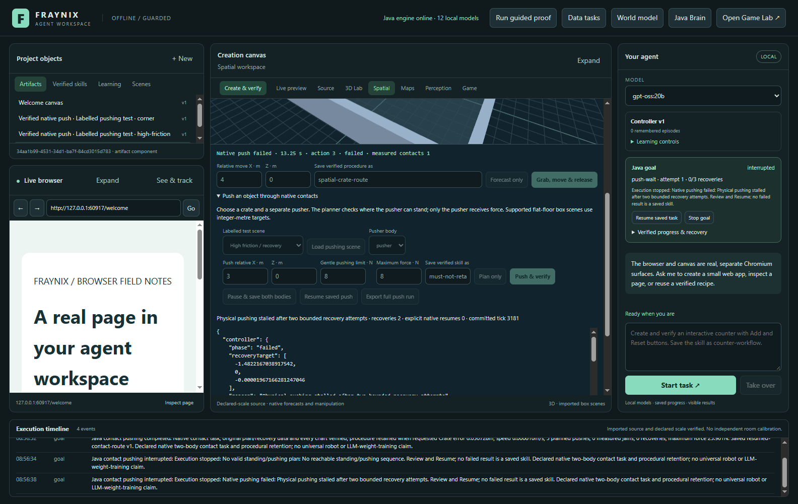](docs/readmes/031/images/push-insufficient-force-031.png)

NEGATIVE CONTROL: an insufficient 8 N maximum remains bounded, fails after two recoveries and retains no skill. Captured 2026-10-31T15:56:39.012499+00:00.

[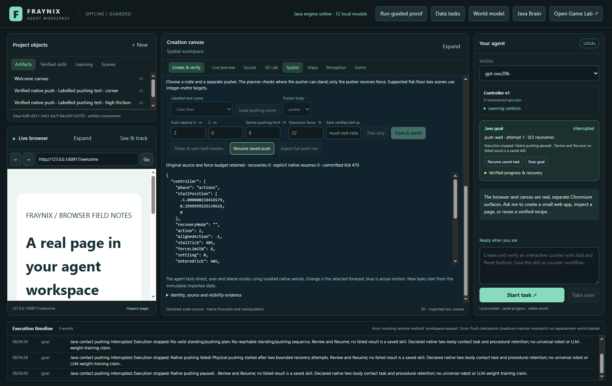](docs/readmes/031/images/push-edited-checkpoint-refused-031.png)

NEGATIVE CONTROL: the actual Resume control refuses an edited checkpoint without replacing its bytes or spawning fresh bodies. Captured 2026-10-31T15:56:41.016495+00:00.

[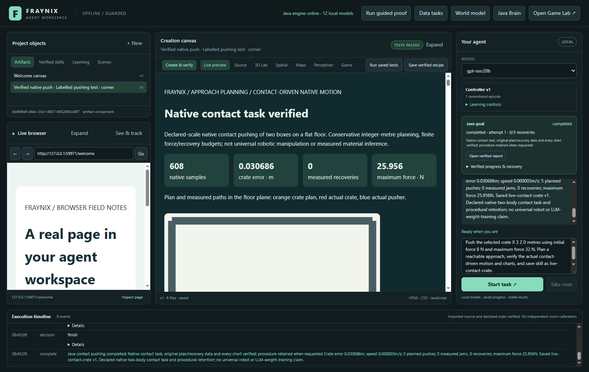](docs/readmes/031/images/push-chat-created-031.png)

ACTUAL LOCAL MODEL: installed gpt-oss:20b chooses the registered pushing task and retains its verified procedure. Captured 2026-10-31T15:45:10.408250+00:00.

[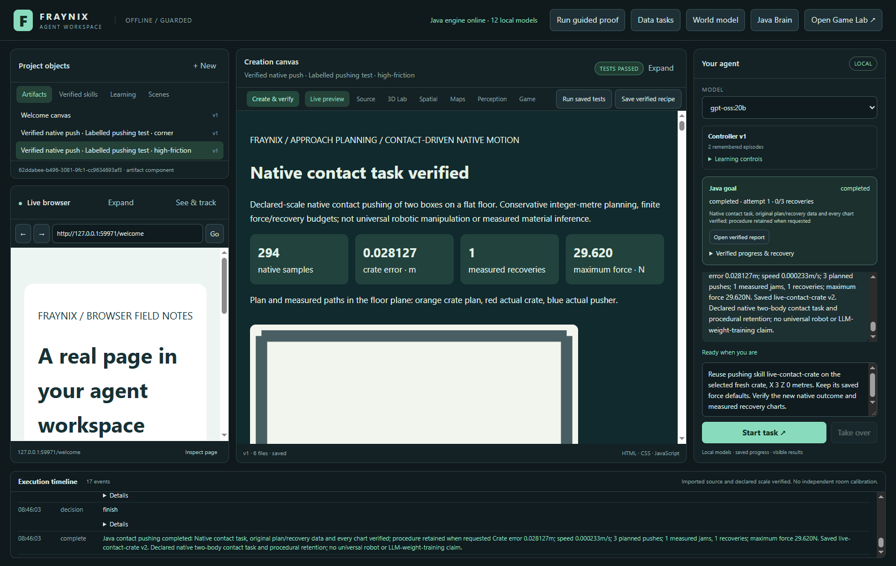](docs/readmes/031/images/push-chat-reused-031.png)

ACTUAL LOCAL MODEL: chat reuses saved defaults with fresh roles and verifies new contact/recovery evidence. Captured 2026-10-31T15:46:04.021746+00:00.

## Files and offline operation

The source baseline is **914e299a725c10a74e0b9483c109449195bb9739**. The canonical inventory includes actual new
Java implementation, desktop integration and acceptance tests alongside inherited
modules, native wrappers and licences. No new external runtime library, cloud
provider, model weights, Docker or WSL was added by this edition. Java/JDK runs
the orchestration and planner; the existing native Bullet/Minie backend supplies
rigid-body physics; the existing Electron/Three surfaces provide presentation.

```text
workspace-engine/src/main/java/fraymus/workspace/
  PushPlan.java          joint configuration search and independent plan audit
  PushPhysics.java       pusher-only native forces and measured jam recovery
  PushCheckpoint.java    canonical, source/code/backend-bound two-body state
  PushStore.java         one native owner, commits, pause/resume and evidence
  PushVerify.java        independent native ledger, recovery and outcome checks
  PushReport.java        six actual charts, original data and lossless package
  PushScenes.java        explicitly labelled synthetic development sources
  GoalRunner.java        shared durable procedure ownership and retention
  WorkspaceServer.java   registered local operations
workspace-desktop/
  goals.cjs / policy.cjs / main.cjs
  renderer/spatial-panel.js / goals-panel.js / app.js
  test/pushing.test.cjs
  test/pushing-integration.cjs
  test/live-pushing.cjs
docs/NATIVE_PUSHING.md
README-031.md
docs/readmes/031/        immutable edition snapshot and offline guide
```

For an existing configured checkout on Windows:

```powershell
.\gradlew.bat --offline check installDist :workspace-engine:installDist
cd workspace-desktop
npm.cmd test
npm.cmd start
```

The existing launcher and dependency setup remain documented in the root README.
An offline build needs the already populated Gradle/npm/native caches; a clean
machine still needs the pinned dependencies installed. Local chat needs an
installed compatible Ollama model. The software-only native controls do not
require language-model inference. Tests launch isolated temporary projects and
do not reuse a personal database. Private runtime state, credentials, model
weights and personal conversations remain outside Git.

Source scene export is original JSON, full run export is complete plain JSON,
and reports include measured CSV plus compact display JSON and a compressed
lossless native package. The packed data has an exact decompressed-byte SHA-256;
the app test decompresses and compares it independently. This release does not
add a pushing-specific video encoder or general CAD/mesh importer. Existing
scene/video capabilities remain separate from the new supported box-scene
contract.

## Vision and the next proof

The useful advantage is integration: the agent can request a task, act in the
same runtime it observes, notice a physical failure, recover, prove the outcome
and retain a checked procedure for another source. That closes more of the
perception/action/memory loop than a disconnected chat pane. It also makes
failures inspectable rather than hiding them behind generated explanations.

The next phase should measure generalization before expanding claims. Freeze a
new evaluation matrix with different masses, friction, obstacles and starting
conditions; measure success rate, effort, contact/recovery cost and failure
reasons. Compare a frozen baseline to a candidate on separate cases. Promote
only a measured improvement and keep rollback. Broader geometry, rotation,
layer transitions and real calibrated sensor observations need their own
declared contracts and tests.

Persistent skills and better task completion are already useful. A stronger
learning claim requires actual performance improvement on reserved tasks after
restart, with source/version provenance and an undo path. Additional neural
activity or changing weights alone would not establish that. The existing app
can be the environment, tool engine and evaluation backbone for that next proof.

Published editions001–030 remain unchanged, including earlier data and rejected
tracker decisions. This edition adds a new source/evidence record and keeps
separate earlier review applications and private project state intact.
