# Fraynix Agent Workspace — edition 032

## Experience that has to prove useful

The app can now run a frozen native-physics experiment, select a pushing-force
setting from actual training outcomes, compare it with the existing controller
on separate reserved scenes, and verify the complete result in its real canvas.
The first candidate is **rejected**. The original profile stays active.

That is a useful step toward an evolving agent: it can produce and retain
physical experience, measure a proposed change and refuse an inadequate result.
A faster run alone does not justify changing the system's baseline. This edition
adds the machinery for that decision inside the existing local application.

[Previous: edition031](README-031.md) · [Edition history](docs/readmes/INDEX.md) ·
[Offline interactive guide](docs/readmes/032/index.html) ·
[Native experience contract](docs/NATIVE_EXPERIENCE.md) ·
[Actual verification](docs/readmes/032/verification.json) ·
[Canonical source tree](docs/readmes/032/FILE_TREE.md) ·
[Obsidian map](docs/obsidian/native-experience.canvas)

The original Spatial view, shared Java goal runner, browser, creation canvas,
local-model chat and verified Skills remain. There is no replacement application
or placeholder page. The new experience panel displays actual bodies in private
native trial worlds while preserving the authored scene selection. It records
training, evaluation, failures, checkpoint recovery and explicit profile use.

## The measured answer

Four candidate initial caps—8,16,24 and32N—each ran four training scenes. Training
selected **24N**. Eight reserved scenes then compared the unchanged **8N** baseline
with that frozen24N candidate, retaining the same32N maximum for both arms.

| Reserved case | Baseline | Candidate | Baseline score · s | Candidate score · s |
| --- | --- | --- | ---: | ---: |
| eval-light | pass | pass | 12.591667 | 12.412500 |
| eval-corner | pass | pass | 30.275000 | 29.208333 |
| eval-heavy-friction | pass | pass | 15.591667 | 11.475000 |
| eval-rough-corner | pass | pass | 33.370833 | 29.200000 |
| eval-mass | pass | pass | 13.950000 | 12.541667 |
| eval-obstacle | fail | fail | 60.000000 | 60.000000 |
| eval-z-axis | fail | fail | 60.000000 | 60.000000 |
| eval-force-negative | fail | fail | 60.000000 | 60.000000 |


The candidate saves **1.367708333 simulated seconds** per case on the predeclared
penalized-time objective. Its force-effort ratio is **1.262196165**. Success
remains **5/8 → 5/8**. The frozen gates require
at least6/8 successes and no more than1.25 times baseline effort, among other
checks. The result fails those gates, so **`baseline-031`,8/32N remains active**.
The limits were committed before the trials and were not relaxed after inspection.

This is not a claim of successful controller promotion or general intelligence.
It is one bounded parameter selected from actual physical outcomes, followed by
an honest reserved evaluation. It does not train Ollama weights. The environment,
measurements, procedures and decision are all real parts of the application.

## What is implemented

| Function | Actual behavior | Evidence |
| --- | --- | --- |
| Frozen experiment | Four training/eight reserved scenes, four candidate caps and fixed gates precede execution | Freeze commit8938672, original resource hash and unchanged031 source hashes |
| Native experience | Actual pusher-only forces move separate crates through native contacts across varied conditions |32 complete original native runs, force/displacement/contact ledgers and failures |
| Training-only selection | Candidate chosen from16 training trials; selection commits before evaluation | Original selection, training scores, trial ordering and independent recomputation |
| Reserved comparison | Eight paired baseline/candidate trials, same source and original physical limits | Full paired table, native metrics and original gate decision |
| Real report | Three interactive paired charts,72 visible cells and exact original data independently audited | Genuine canvas receipt before Java goal completion |
| Persistence | Same goal/job/attempt survives a real Java child termination after training | Committed trial prefix and selection retained; incomplete native trial resumed |
| Profile authority | Passing gates and verified report required; prior active ID recorded for rollback | Actual early/rejected-promotion refusal and separately labelled rollback software control |
| Explicit use | A new task opts into the actual active profile and records its provenance | Real UI and chat baseline-profile push with recovery and retained skill |
| Complete files | Actual lossless export contains the original job and all32 native runs | Decompression/raw-byte SHA-256 and comparison against every committed original |

The native031 controller is preserved byte for byte. Its planning, alignment,
force application, native timing, final0.1m/.2mps checks and two-recovery budget
remain fixed. Edition032 changes the experiment around it. This separates a
measured parameter choice from changing the engine or redefining success.

## Try the complete workflow

1. Start the existing app and open **Spatial**. Expand **Learn from native pushing
   experience**. The panel explains the fixed split and active profile. No
   imported personal scene is required to run this labelled synthetic experiment.
2. Choose **Train & evaluate**. The existing Java goal card owns progress and
   cancellation. The viewport displays the current actual native trial's bodies,
   time and contacts; the panel names the split, case, arm and completed count.
3. Java runs16 training trials. It commits the selected cap and original training
   scores before executing any of the16 paired reserved trials. The language
   model cannot supply a preferred answer or change the cases/gates.
4. The actual comparison opens in the creation canvas. Use **Next metric** to
   switch between penalized native time, actual force effort and measured jams.
   Orange is baseline; green is candidate. **Reset chart** restores the first
   mode. The table retains passing and failing cases side by side.
5. Inspect the original selection, gates and trial provenance below the table.
   The native run IDs, exact hashes, success flags and reasons stay available.
   The candidate's rejection remains visible, even though the experiment itself
   completed and its report passed verification.
6. Return to Spatial. The **Saved experiment** selector reopens earlier completed comparisons after later tasks or a restart, without changing current task ownership. **Activate passing profile** remains disabled for this
   result. The server also refuses a direct promotion request; changing the UI
   cannot bypass the original native gates. The active profile remains8/32N.
7. **Export all native trials** writes a real lossless file. It includes every
   original native attempt, not just successful trajectories or summary scores.
   A source inspector can load a labelled frozen case into Spatial for review.
8. On a fresh ordinary pushing task, check **Use active evaluated force profile**.
   The actual current settings appear in the force controls. Java records the
   profile on the goal. For this edition that means the retained8/32N baseline,
   not the rejected24N candidate. Existing verified pushing skills still work.
9. Restart during an experiment and use **Resume saved task**. Completed native
   trials and the original training choice are reused; only the incomplete owned
   trial continues from a compatible checkpoint. **Stop goal** cancels work and
   cannot activate a profile.

Actual accepted local-chat requests from this edition:

> Learn a pushing force profile from actual training experience and evaluate the
> reserved cases. Show the original paired charts and keep the baseline when the
> candidate fails.

After choosing a fresh high-friction crate/pusher source:

> Push the selected crate X 3 Z 0 metres using the active evaluated force profile.
> Verify the actual native contact motion and save skill as profile-contact-route.

Both requests were completed by the installed `gpt-oss:20b` through typed tools.
The host summary uses the actual decision and native evidence. Ordinary model
text cannot manufacture a passing experiment or silently omit the requested
profile binding. Local inference and the complete experiment take time; this
is not a real-time language-model control loop.

## Design committed before results

The fixed design is recorded in [the frozen contract](docs/PUSH_032_FROZEN_CONTRACT.json)
and the [original suite](workspace-engine/src/main/resources/push-evaluation032.json).
Commit **8938672** precedes all native trials. Cases vary masses, floor/crate
friction, obstacle placement and X/Z direction. They are synthetic declared
physical scenes. The evaluation cases are reserved from selection, not secret
data or independently measured real-world observations.

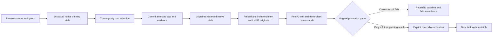

Failed tasks receive the original60s time penalty for selection/comparison;
successful tasks use actual native completion time. This prevents a fast failure
from looking like a useful improvement. Ties prefer a lower cap. Force effort
remains an actual measured integral in N·s, including failed attempts. It is not
energy in joules. The32N original maximum applies to walking, pushing, braking
and recovery in both arms.

The remaining gates require no loss of a baseline success, no extra jams among
paired successful tasks, at least.5s mean penalized-time improvement and no case
regressing by more than.25s. The candidate passes some checks and fails others;
all values remain in the original decision. No gate is hidden to make the result
look better.

## What the failures teach us

Five new reserved scenes succeed with both settings. The changed-obstacle and
Z-direction corner cases exceed the native15s push-leg budget. The deliberately
heavy/high-friction negative control exhausts two bounded recovery attempts.
The full result preserves those reasons and the original poses, velocities,
orientations, forces, contacts, action progress and recovery events.

Edition031's narrower demonstrations still pass. The new suite asks more of the
same controller, exposing a geometric/generalization limit that a global force
cap cannot fix. Increasing force can make successful cases faster while spending
more effort on tasks that still fail. That is exactly why selection and reserved
evaluation belong in the agent's workflow.

The next controller should use these now-seen failures as development and
regression cases, improve contact/turn control and be tested against a different
frozen evaluation set. Rerunning these same scenes after tuning would not be a new
unseen result. This edition retains the first decision rather than rewriting it.

## Recovery, integrity and activation limits

The original result of every trial lives in a separate native file with an exact
byte hash. Java reloads each one, checks source/roles/plan/force identity and
reconstructs its original native outcome. Training/evaluation ordering and
candidate selection are recomputed from original evidence. Edited bytes, changed
sources, altered metrics or incompatible suite/code are refused.

The actual restart test ended only its own Java child after training, with
**19 settled trials committed**. A fresh process loaded the same
selection and prefix and required explicit Resume. It completed the same job
and attempt without replaying settled trials or selecting from reserved outcomes.
The partial native trial uses031's both-body/controller/trace checkpoint.
Native contact caches rebuild; bitwise future trajectory identity is not promised.

Activation checks the original reserved decision and genuine canvas receipt,
records the profile and prior active ID, and supports exact rollback with a
current-profile guard. The actual candidate in this edition does not qualify.
Successful end-to-end activation of a genuinely passing candidate is therefore
**not claimed**. The actual refusal path is tested on native evidence. A separate
persisted-profile rollback test is clearly labelled a software transaction
control; it is not promoted native-performance evidence.

New pushing tasks must opt in visibly or through an explicit chat request.
Explicit force values cannot silently conflict with the active profile.
Previously retained pushing procedures preserve their own verified defaults.
The experiment installs no new executable tool from imported text or model output.

## Validation and original evidence

Independent offline checkout: **284 Java tests / 54 classes**, **61 desktop units**, **199 critical UI workflow groups**. These include eight new experience checks, two saved-report restart checks and the prior shared app workflows. Two separately tested actual installed gpt-oss:20b chat episodes add four checks. Scopes overlap where stated and are not added into an invented unique-test count. Canonical implementation hashes are compared independently before publication.

[Independent checks](docs/readmes/032/regressions.json) ·
[Actual UI workflow](docs/readmes/032/force-learning-integration.json) ·
[Actual local-model episodes](docs/readmes/032/live-force-learning.json) ·
[Original experiment data](docs/readmes/032/examples/original/data.json) ·
[Complete lossless native export](docs/readmes/032/examples/native-experience.json) ·
[Development record](docs/readmes/032/development-attempts.json)

The first Java compile caught an invalid compound `var` declaration and was
corrected. Reporting gained an explicit distinction between a verified experiment
and an accepted candidate, plus native failure reasons and live body display.
No selection objective, case, success/effort gate, maximum force, physical budget
or candidate result was changed after inspection. The two actual model requests
and full UI workflow pass without substituting generated demo outcomes.

## Real dated screenshots

These are actual incremental acceptance captures from this edition. Some precede
the final saved-experiment selector; the restored-library capture uses the final
UI. The native controller and frozen suite stayed unchanged. Capture source
commits are retained in the image manifest.

[](docs/readmes/032/images/force-frozen-controls-032.png)

SOFTWARE CONTROL: installed frozen cases and original baseline, before native training. Captured 2026-10-31T22:17:27.970655+00:00.

[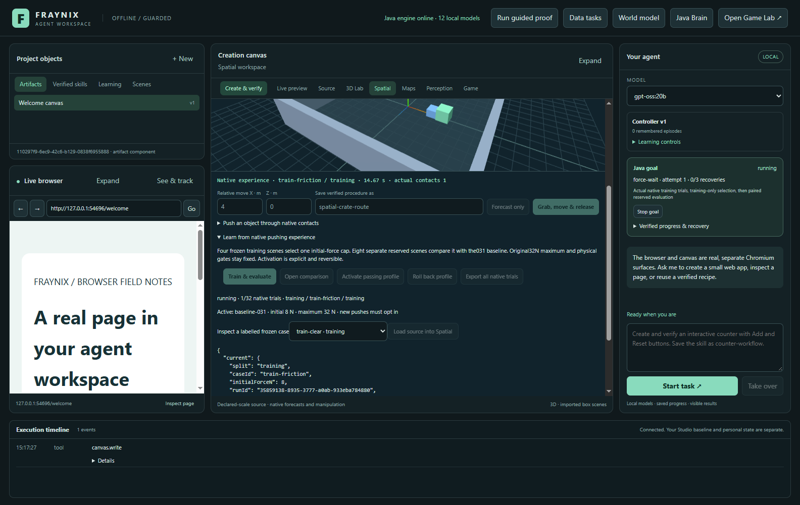](docs/readmes/032/images/force-actual-training-032.png)

SOFTWARE CONTROL: actual committed native bodies and contacts during a labelled training trial. Captured 2026-10-31T22:17:32.313112+00:00.

[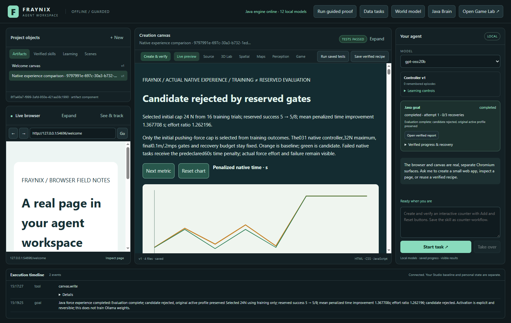](docs/readmes/032/images/force-rejected-report-032.png)

SOFTWARE CONTROL: original reserved paired comparison, visible failure cases and rejected candidate. Captured 2026-10-31T22:19:25.658238+00:00.

[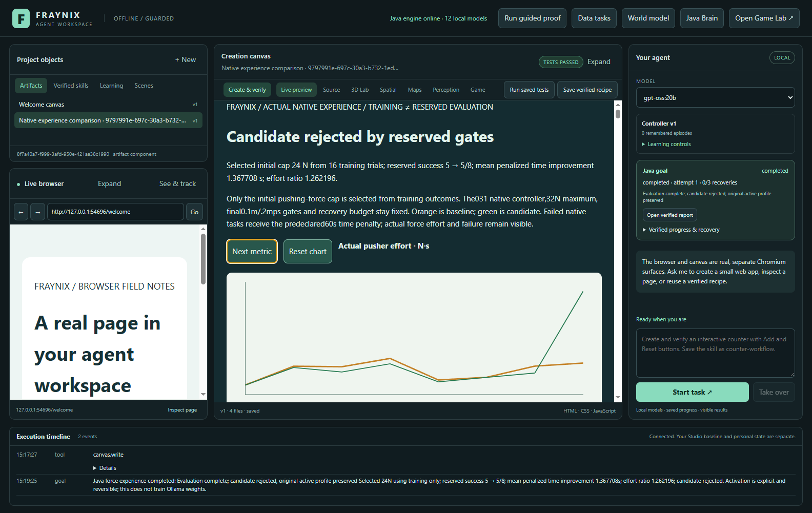](docs/readmes/032/images/force-effort-chart-032.png)

SOFTWARE CONTROL: actual measured effort explains a failed promotion gate despite faster time. Captured 2026-10-31T22:19:25.951470+00:00.

[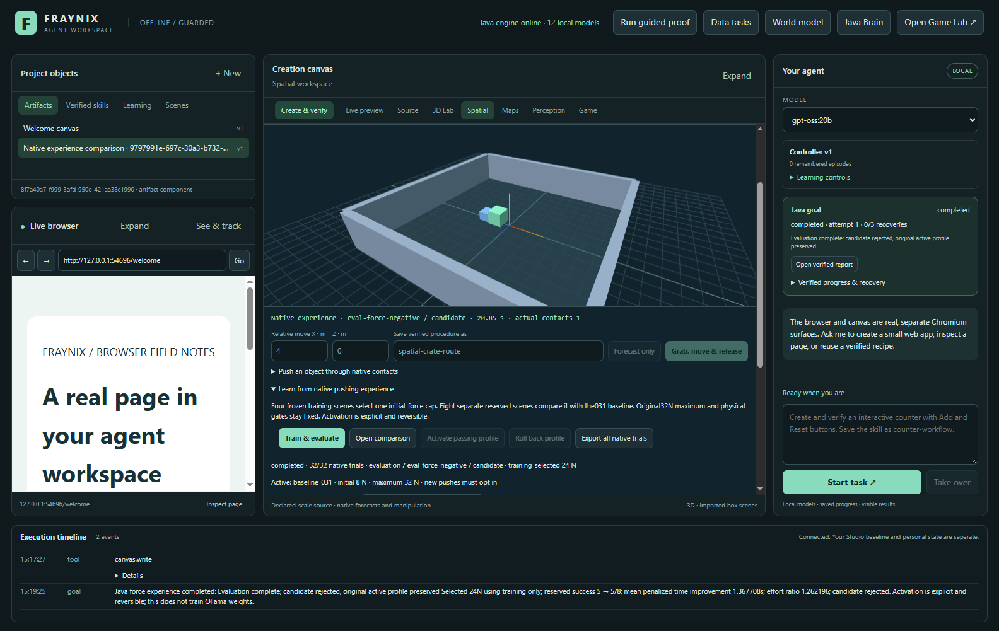](docs/readmes/032/images/force-promotion-refused-032.png)

NEGATIVE CONTROL: original gates refuse candidate activation and retain baseline8/32N. Captured 2026-10-31T22:19:29.594330+00:00.

[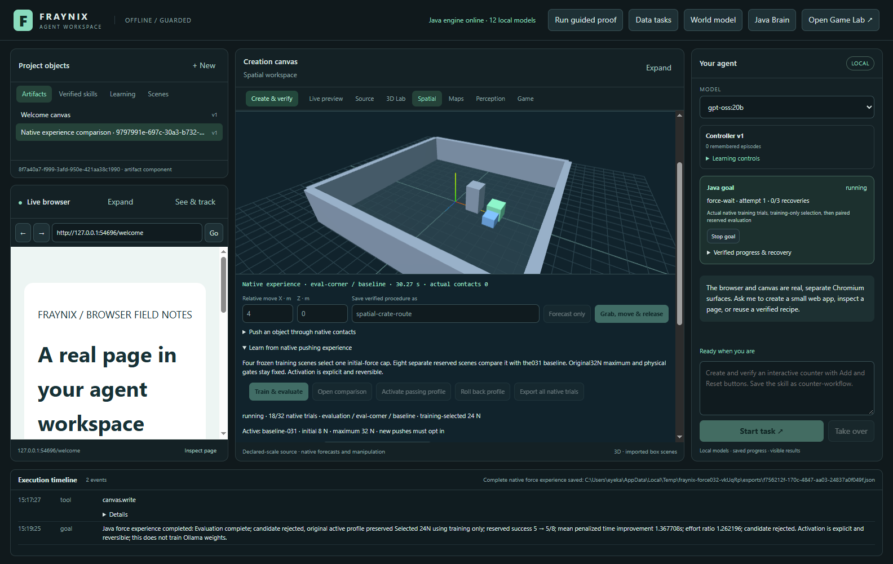](docs/readmes/032/images/force-before-crash-032.png)

SOFTWARE CONTROL: native evaluation after training before this test Java child is deliberately terminated. Captured 2026-10-31T22:20:40.396393+00:00.

[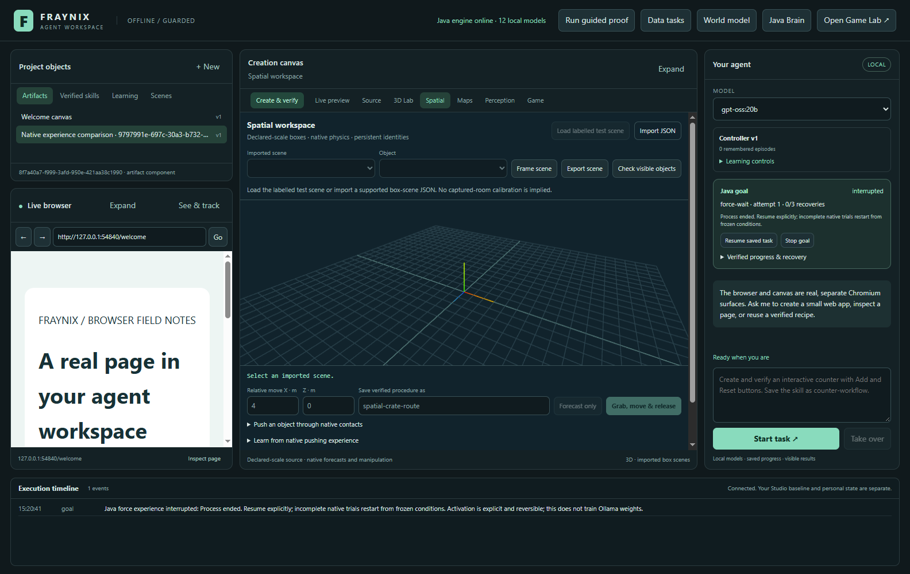](docs/readmes/032/images/force-interrupted-032.png)

SOFTWARE CONTROL: new process retains selection and settled trials and requires explicit Resume. Captured 2026-10-31T22:20:42.240749+00:00.

[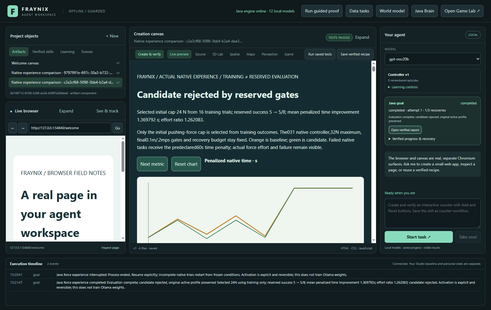](docs/readmes/032/images/force-resumed-report-032.png)

SOFTWARE CONTROL: the same goal/job/attempt resumes without repeating settled native trials or reselecting from reserved outcomes. Captured 2026-10-31T22:21:48.109764+00:00.

[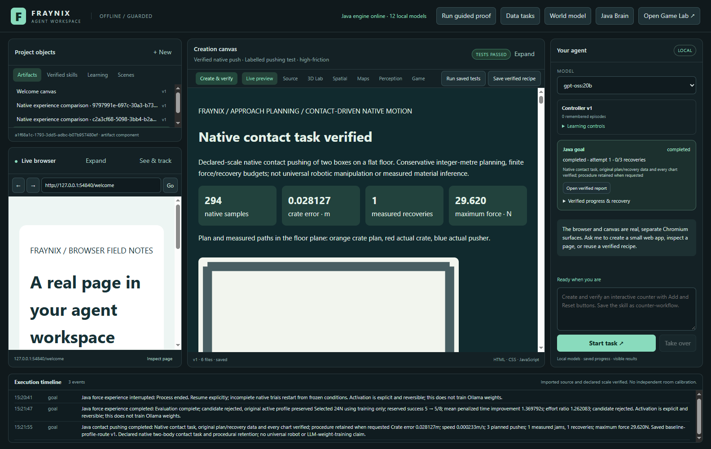](docs/readmes/032/images/force-baseline-opt-in-032.png)

SOFTWARE CONTROL: fresh actual high-friction push explicitly uses the retained baseline, recovers and saves its checked skill. Captured 2026-10-31T22:21:55.407056+00:00.

[](docs/readmes/032/images/force-library-restored-032.png)

SOFTWARE CONTROL: a new process opens an older saved comparison after later tasks without replaying physics or changing active goal ownership. Captured 2026-10-31T22:22:35.087489+00:00.

[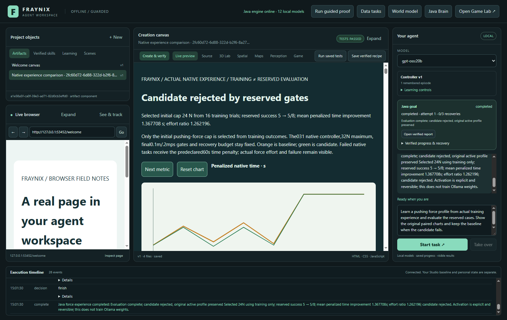](docs/readmes/032/images/force-chat-rejected-032.png)

ACTUAL LOCAL MODEL: installed gpt-oss:20b completes the frozen experiment and reports the genuine candidate rejection. Captured 2026-10-31T22:01:30.449654+00:00.

[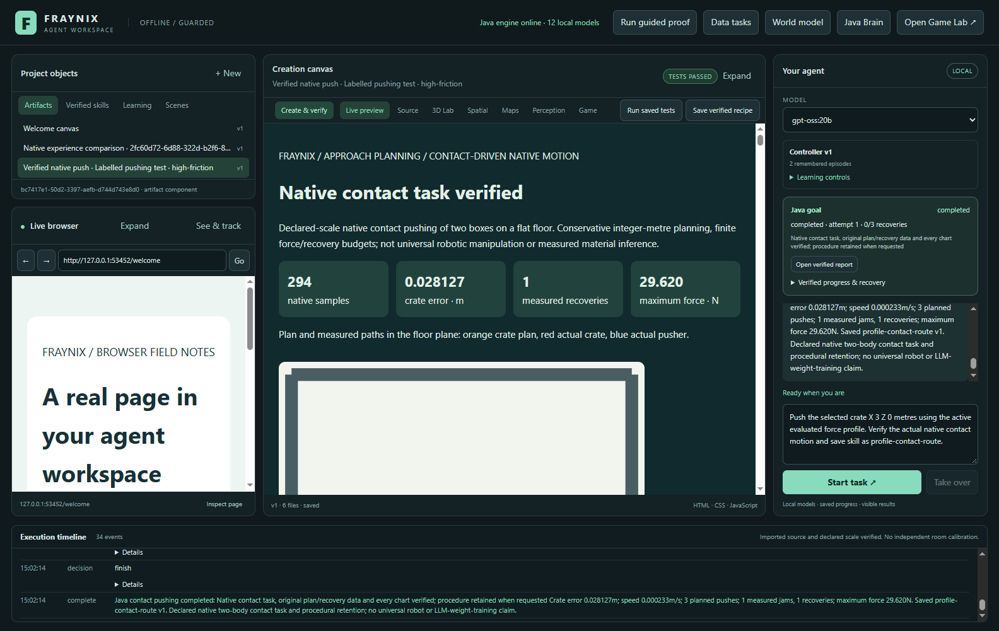](docs/readmes/032/images/force-chat-baseline-use-032.png)

ACTUAL LOCAL MODEL: a second chat opts into the real active baseline and retains a verified contact-pushing procedure. Captured 2026-10-31T22:02:14.633639+00:00.

## Source, files and local operation

Source baseline: **8b1d214d34f2620e2dc9227d6cccca2888353ea5**. No new runtime dependency, model weights, cloud
provider, Docker or WSL was added. Java/JDK owns the new experiment and decisions;
the existing Bullet/Minie backend provides native physics and the existing
Electron/Three/browser/canvas surfaces provide presentation. The preserved031
native sources are verified byte-identical against their published inventory.

```text
workspace-engine/src/main/resources/push-evaluation032.json
workspace-engine/src/main/java/fraymus/workspace/
  PushLearning.java         fixed design, training selection and reserved gates
  PushLearningStore.java    original native trials, recovery and profile registry
  PushLearningReport.java   paired report and independent actual-view audit
  GoalRunner.java           existing shared durable procedure ownership
  WorkspaceServer.java      registered private local operations
workspace-desktop/
  renderer/force-learning-panel.js
  goals.cjs / policy.cjs / main.cjs
  test/force-learning.test.cjs
  test/force-learning-integration.cjs
  test/live-force-learning.cjs
docs/PUSH_032_FROZEN_CONTRACT.json
docs/NATIVE_EXPERIENCE.md
docs/readmes/032/            frozen evidence, guide and original files
```

Use the existing Windows launcher. With populated dependency caches:

```powershell
.\gradlew.bat --offline check installDist :workspace-engine:installDist
cd workspace-desktop
npm.cmd test
npm.cmd start
```

An offline build requires the existing pinned caches; a clean machine needs the
normal dependency setup first. Software/native controls work without model
inference; chat needs an installed compatible Ollama model. Tests use separate
temporary projects. Private databases, credentials, models and personal browser
state stay outside Git. Earlier review apps and published001–031 remain intact.

Private experiment state lives under `<project>/push-learning/`. Each native
trial has original JSON plus native checkpoint state. The UI export contains the
original job and all32 full native runs in a lossless gzip/base64 package with a
decompressed-byte SHA-256. The report keeps concise data/table/chart files, so it
does not force a language model to ingest every raw physics sample. This edition
does not add another video codec, mesh importer or foundation model.

## The next proof

The next step is not to call the rejected cap an improvement. It is to address
the two geometric failures, keep the physical negative control, then freeze new
conditions for evaluation before running the next candidate. Useful learning
requires better verified task performance after restart, with provenance,
separate evaluation and rollback. This edition supplies that experimental
backbone inside the same local agent application.
