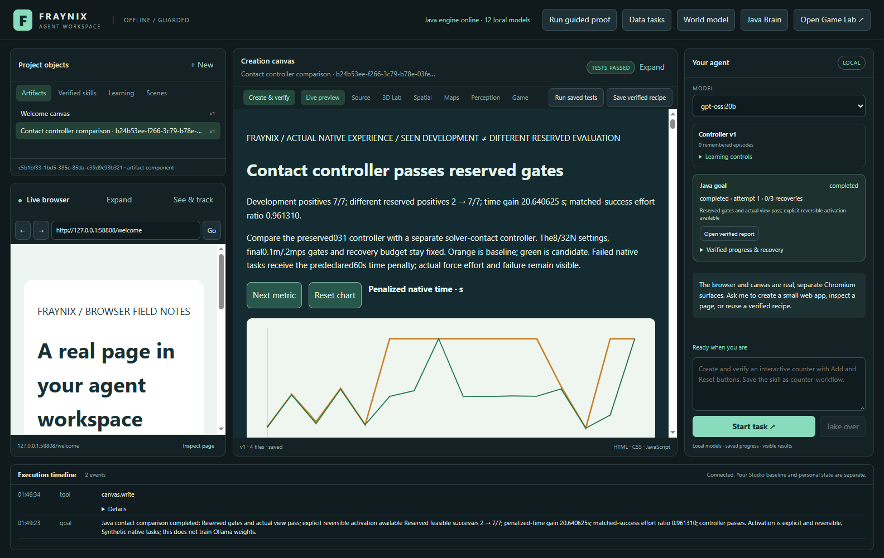
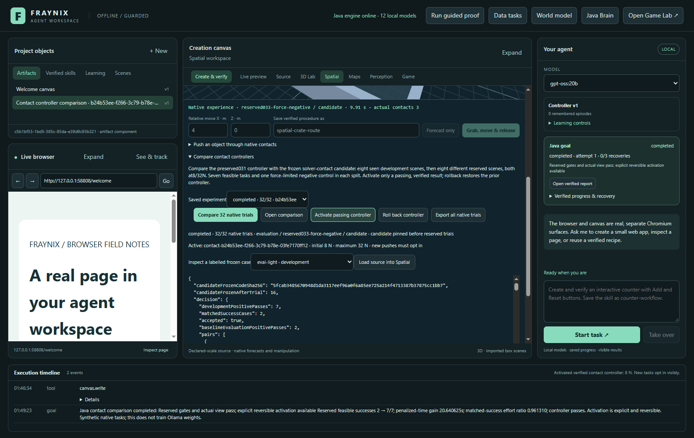
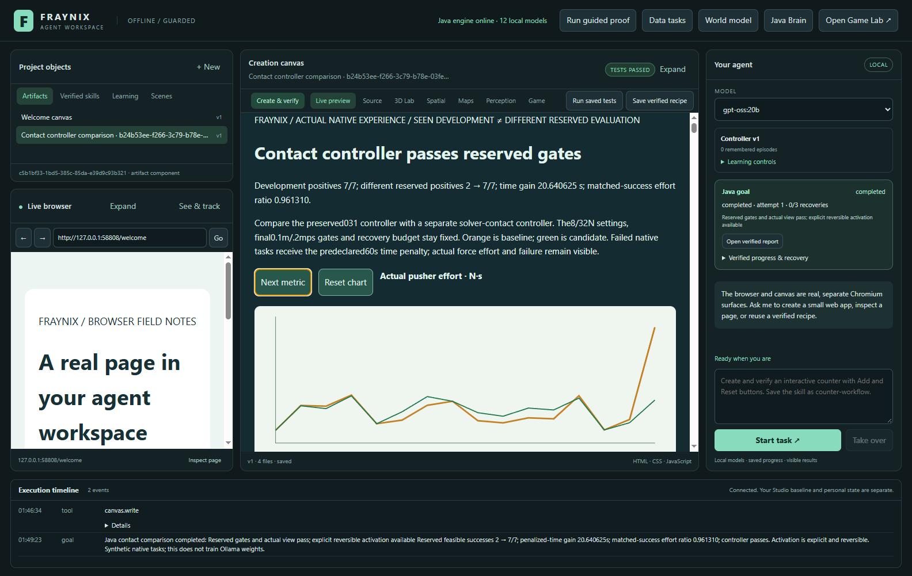
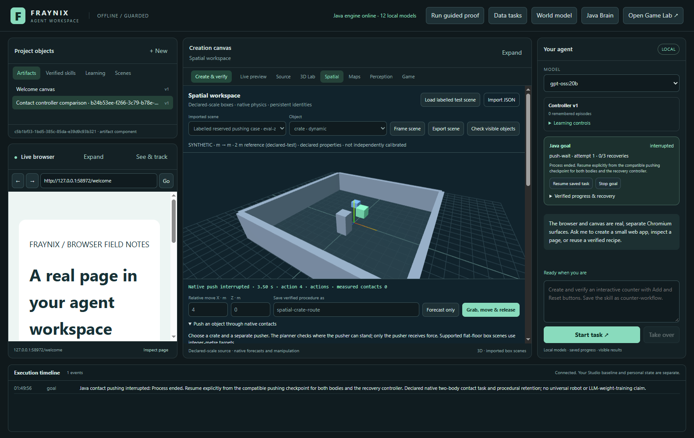
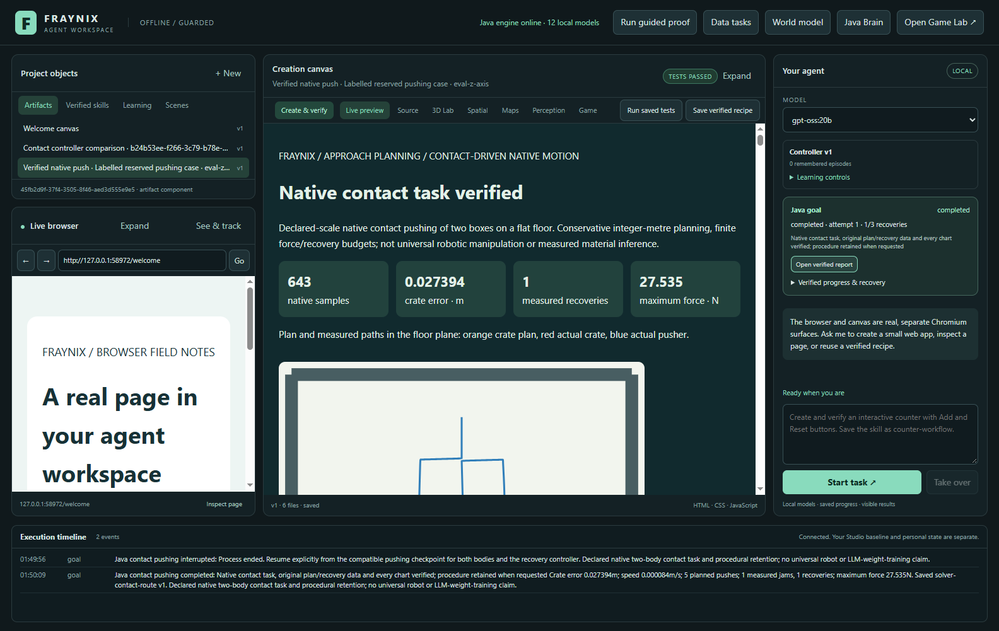
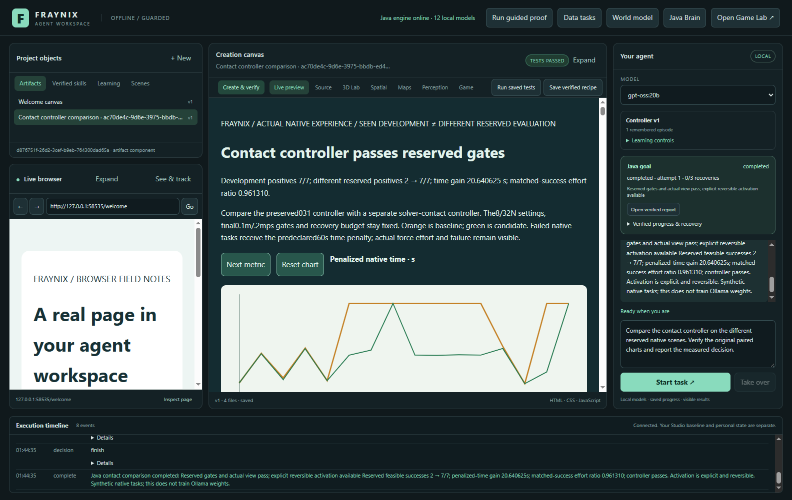
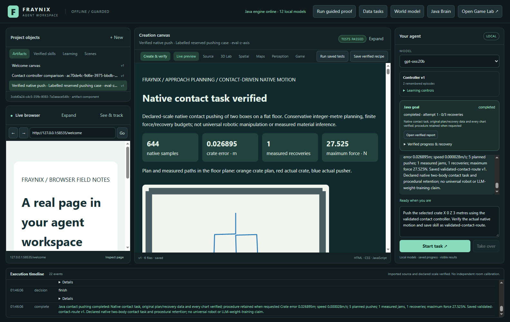
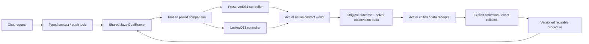

# Fraynix Agent Workspace — edition 033

## Contact that the controller can actually observe

**2026-11-01 · Java-owned local agency · a measured controller improvement**

[Release source](https://github.com/eyeoverthink/Fraynix-Agent-Workspace/tree/readme-033) · [Previous: 032](README-032.md) · [Edition history](docs/readmes/INDEX.md) · [Offline interactive guide](docs/readmes/033/index.html) · [Native contract](docs/CONTACT_CONTROLLERS.md) · [Original evidence](docs/readmes/033/verification.json) · [Source inventory](docs/readmes/033/FILE_TREE.md)

Edition032 produced an important failure: changing the initial pushing force was insufficient. Its selected24N cap completed five of eight reserved tasks, exactly as many as the baseline, and exceeded the effort gate. The app correctly kept its original controller. That result, its original raw runs and its numbered README remain unchanged.

Edition033 addresses the observed cause. A separately versioned Java controller reads actual persistent solver contact manifolds and positive normal impulses, then uses target-aware lateral feedback. It still moves the crate through forces applied only to the pusher. The original controller remains executable. On eight different reserved scenes frozen before measurement, feasible successes increased from **2/7 to7/7**. Both controllers correctly failed the separate force-limited negative control. Counting that control, task completion is2/8 versus7/8. This is a useful, bounded improvement on declared synthetic scenes.

The current result is **accepted under the original frozen gates**. Average penalized native time improves **20.640625000 seconds**. Effort across the **two cases both controllers successfully complete** has a ratio of **0.961310070**; all eight evaluation cases together have an effort ratio of **0.845199840**. Both are reported because repairing a failed task can require additional work. These definitions and gates were frozen before the result was inspected. The failed-task60s penalty is a comparison score, not a claim that every failed run physically lasted60s.

The image is an actual dated application capture from a labelled synthetic native experiment. [Capture provenance and original PNGs](docs/readmes/033/images.json) distinguish app checks and actual local-model chat. There are no generated product screenshots in this edition.

## What you can do now

Open **Spatial**, expand **Compare contact controllers**, and run **Compare32 native trials**. Java executes eight seen development scenes and eight different reserved scenes, running the preserved baseline and locked candidate on each. The scene view shows committed native body state during execution. It does not animate a prerecorded success or move a mesh independently of physics.

When the complete comparison and its actual canvas receipt pass, **Activate passing controller** records the exact controller, native implementation identity, original suite, decision hash and verified report. New pushing tasks must opt in with **Use active validated contact controller ·8/32N**. The active profile is visible. Ordinary unrequested tasks retain baseline behavior. **Roll back controller** restores the exact prior version, with an append-only activation history. There is no automatic promotion from a model's opinion.

A successful opted-in push can retain a named procedural skill. That skill stores the original controller provenance and force defaults. Reuse binds fresh imported crate and pusher roles, plans their actual geometry, executes physical actions and checks a new report. If its required controller has been rolled back, the app refuses silent substitution. Reactivating the validated version permits reuse. Retention here means an executable, checked procedure and its policy binding; it does not mean an Ollama parameter update.

The existing app remains one workspace: chat selects typed operations, Java owns persistent tasks and native physics, Spatial displays live state, the canvas holds checked artifacts, browser tools provide a separate observation surface, and Skills retains completed procedures. The Game Lab and earlier data/perception/world-model functions remain available. No replacement dashboard or disconnected demonstration was added.

## Review it step by step

1. Launch with `Launch-Agent-Workspace.bat`. Use a separate project directory for experiments; preserve your private project and existing reviews.
2. Open Spatial and expand Compare contact controllers. Inspect the labelled case selector, fixed8/32N settings and current active controller before starting.
3. Run the comparison. The32 native trials use a private experiment world; authored scene selection remains separate. Watch actual crate/pusher motion and the current case/arm.
4. Open the verified comparison. Inspect all16 paired development/evaluation rows, switch between time, actual force effort and measured jams, and inspect the original JSON. Java checks all144 visible cells and both chart lines in every mode.
5. Activate only a passing comparison. Inspect the active version and its evidence. Then choose a case and load its source into Spatial; these are declared synthetic parameters in metres and seconds.
6. Select distinct crate/pusher roles, opt in to the active validated contact controller, choose a displacement and give the skill a name. The validated controller keeps8N initial and32N maximum; incompatible manual force changes are refused.
7. Start the push. Inspect actual contact/impulse evidence and both trajectories. The independent outcome verifier and all six original pushing charts must pass before a procedure is retained.
8. Reopen an older comparison from Saved experiment after other tasks. Opening historical evidence must not replay physics, activate a controller or take ownership of a current task.
9. Export all native trials to a lossless JSON/gzip package. It includes every complete original run, both physical negative controls and the full comparison job. The package's raw SHA-256 and byte count can be independently checked.
10. Try rollback and explicit reactivation. Existing tasks retain their frozen version. A saved candidate skill cannot silently run under a different active controller.

## What changed inside Java

The preserved031 controller used a transient contact query. On some resting contacts that query reported zero, even though the solver had a real pusher/crate manifold. A stalled task could therefore miss the condition needed to begin its bounded recovery. Separately, following only the crate's instantaneous side position allowed a small sideways error to persist near the target. The old obstacle case stopped just outside its unchanged internal endpoint tolerance.

The new `ContactPhysics` reads native manifold body IDs, points, separation and positive normal impulses from the pinned existing physics runtime. Samples retain these actual values and the older probe result side by side. Contact count is reconstructed from qualifying solver points; it is not inferred merely from two bounding boxes looking close. `ContactVerify` checks the declared observation method, finite impulse/distance values and sample counts, in addition to the original force/displacement/work/outcome verifier.

The controller also adjusts lateral velocity using the actual target error, bounded before it enters the pusher feedback. It does not write a desired crate pose or velocity. The original planner still searches reachable crate/pusher standing configurations and swept paths. The actuator still applies force only to the pusher; Bullet resolves contact-driven crate movement. The original source and compiled-code identities bind checkpoints and policy provenance.

The candidate source was locked at commit `57dec5e`, after seen development and before the different reserved trials. The reserved suite and gates were already committed at `c461a97`. [Frozen contract](docs/CONTACT_033_FROZEN_CONTRACT.json) and [candidate source lock](docs/CONTACT_033_CANDIDATE_LOCK.json) preserve those choices. The candidate was not tuned after the reserved results were read. Later integration and presentation repairs do not alter that locked native algorithm or its gates.

| Boundary | Edition033 behavior |
| --- | --- |
| Controller versions | Preserved031 baseline and separate `solver-contact-controller-033-v1` |
| Initial / maximum force |8N /32N in both comparison arms |
| Integration | Existing240Hz native physics |
| Physical duration | Original60s total and15s per leg |
| Recovery | At most two original bounded recoveries |
| Endpoint / terminal speed | Original0.1m /0.2m/s final gates |
| Internal approach endpoint | Original0.035m tolerance |
| Actuator | Force on pusher only; contact moves the crate |
| Activation | Actual native decision plus genuine canvas receipt; explicit and reversible |
| Saved skill | Original validated controller and force defaults; new run must verify again |

There are no new dependencies, model weights, paid providers, Docker or WSL requirements. “Java-owned” describes state, execution and verification ownership. The existing app still uses its native Bullet/Minie physics backend and Electron/Three.js presentation; this edition does not relabel those dependencies as newly written pure Java.

## The measured comparison

The eight old032 evaluation cases are now **seen development data**. Seven feasible cases pass the candidate, including the previously failed obstacle and Z-direction cases; its physical force-negative case still fails. Those successes informed the implementation and do not count as fresh generalization.

Eight different033 evaluation definitions were frozen before candidate measurement: offset obstacle, Z turn, negativeX, negativeZ, heavier turn, light clear route, diagonal target and insufficient-force control. Seven are feasible under the declared budget. The eighth deliberately exceeds it. Static plan admission and dynamic physical completion are different checks: a standing route can exist while force limits prevent success.

| Different reserved case | Baseline | Candidate | Baseline score · s | Candidate score · s |
| --- | --- | --- | ---: | ---: |
| reserved033-offset | fail | pass | 60.000000 | 29.195833 |
| reserved033-z-turn | fail | pass | 60.000000 | 29.087500 |
| reserved033-reverse-x | fail | pass | 60.000000 | 29.404167 |
| reserved033-reverse-z | fail | pass | 60.000000 | 29.200000 |
| reserved033-heavy-turn | pass | pass | 34.354167 | 33.150000 |
| reserved033-light-clear | pass | pass | 12.179167 | 12.183333 |
| reserved033-diagonal | fail | pass | 60.000000 | 19.187500 |
| reserved033-force-negative | fail | fail | 60.000000 | 60.000000 |

Promotion requires all seven feasible development cases, all seven feasible reserved cases, at least one additional reserved success, at least2s mean penalized-time improvement, matched-success effort ratio at most1.1, no baseline-success regression, and correct failure of both physical negatives. Candidate acceptance passed these unchanged gates. The first headless result and later actual app repetitions are retained. [All original outcomes and reasons](docs/readmes/033/native-outcomes.json) include failures rather than removing them from the record.

The matched-success effort gate covers only two evaluation pairs. That is a useful efficiency check where both methods succeed, but it is a small sample. The all-case effort ratio includes failed runs and their termination behavior, so it answers a different question. Neither ratio is mechanical energy, battery consumption, or evidence of real-robot efficiency: the recorded quantity is integrated pusher force magnitude in N·s. Sampled normal impulses are a separate diagnostic and are not summed into an invented energy estimate.

These reserved scenes are now seen regression cases. Future development must keep them as regression evidence and freeze different evaluation conditions before making another improvement claim. A seven-case success result does not establish arbitrary manipulation, rotating bodies, nonflat ground, visual scene understanding, calibrated real-world contact or safety on a physical robot.

## Interruption, recovery and actual retained skills

`ContactStore` and `ContactCheckpoint` preserve both actual bodies: position, quaternion, linear/angular velocity, controller state, original plan, integration/work counters and the exact committed sample prefix. Checkpoints are atomic, checksummed and bound to native source/runtime identity. A new process marks an incomplete task interrupted and requires explicit Resume. Corrupt or incompatible evidence is refused and preserved.

The actual app test terminates its own Java child during a candidate push. After restart, the same goal, native run and attempt remain. Explicit Resume restores both initialized body positions/velocities with zero measured initialization error, preserves every previously committed sample and completes the original task. This establishes compatible state restoration and actual successful continuation; it does not promise bit-identical future native trajectories across every contact-cache rebuild or machine.

That resumed Z-direction task retains `solver-contact-route`. The app then rolls back, verifies that the controller-bound skill refuses substitution, reactivates the original validated version, imports fresh roles with a changed direction, and runs the skill again. The new native outcome and six actual charts are checked again. This is procedural memory that survives process loss, with versioned evidence and recovery.

## Chat is involved in execution

Two actual installed `gpt-oss:20b` chat episodes are tested separately. The first request asks to compare the contact controller on the different reserved scenes. The model calls the registered `contact.compare` tool once with empty arguments. Java owns the suite, candidate identity, execution and gates; the model cannot inject easier cases, trajectories, success flags or substitute HTML.

The host exposes actual task progress and returns the original Java summary after completion. A completed comparison is distinct from accepted improvement, and accepted improvement is distinct from user activation. The model does not auto-activate the candidate. After visible activation, a second chat explicitly requests the validated contact controller for the selected crate. The host preserves that semantic requirement and binds actual selected roles. The task completes and retains `validated-contact-route` with native contact provenance. That second episode first supplied an unrelated force-profile flag three times; the host rejected each mismatch before admitting the requested controller. Those repairs remain in the actual episode record. One physical start was admitted, and the original12-turn/two-native-response-retry limits remain unchanged.

Example requests:

> Compare the contact controller on the different reserved native scenes. Verify the original paired charts and report the measured decision.

> Push the selected crate X 0 Z 3 metres using the validated contact controller. Verify the actual native motion and save skill as validated-contact-route.

Select a scene and distinct dynamic roles first. The explicit controller flag cannot be silently dropped; saved procedures preserve their exact evaluated version. Tools perform actions, while the skill coordinates planning, execution, verification and recovery.

## Architecture and inspectable source

| Component | Responsibility | Source |
| --- | --- | --- |
| Native candidate | Solver contact sensing and bounded lateral feedback | [ContactPhysics.java](workspace-engine/src/main/java/fraymus/workspace/ContactPhysics.java) |
| Independent sensor audit | Reconstruct recorded contact counts and reject altered authority | [ContactVerify.java](workspace-engine/src/main/java/fraymus/workspace/ContactVerify.java) |
| Version routing | Preserve old runs; explicitly route selected candidate tasks | [PushRuntime.java](workspace-engine/src/main/java/fraymus/workspace/PushRuntime.java) |
| Durable comparison | Stable trial IDs, raw hashes, code pin, native jobs, registry history | [ContactStudyStore.java](workspace-engine/src/main/java/fraymus/workspace/ContactStudyStore.java) |
| Fixed decision | Separate seen/reserved data, negative controls and frozen gates | [ContactStudy.java](workspace-engine/src/main/java/fraymus/workspace/ContactStudy.java) |
| Actual view audit | Exact144 cells and both polylines in three modes | [ContactStudyReport.java](workspace-engine/src/main/java/fraymus/workspace/ContactStudyReport.java) |
| Task / skill ownership | Versioned controller binding, completion and explicit resume | [GoalRunner.java](workspace-engine/src/main/java/fraymus/workspace/GoalRunner.java) |
| Existing app controls | History, activation, rollback, full export and source inspection | [contact-study-panel.js](workspace-desktop/renderer/contact-study-panel.js) |

The [canonical file inventory](docs/readmes/033/file-inventory.json) covers **640 implementation files** across inherited engine modules, desktop sources, tests and scripts. It records canonical UTF-8/LF hashes or exact binary bytes. The [Obsidian canvas](docs/obsidian/contact-controllers.canvas) and [engineering notes](docs/obsidian/41-contact-controllers.md) link to actual repository files. The offline HTML needs no CDN or engine and retains the original paired report, source search, status filters, architecture selection and dated screenshots.

## Validation and development record

Independent offline checkout: **295 Java tests / 58 classes**, **66 desktop units**, **209 actual UI workflow checks**. Two actual installed gpt-oss:20b chat episodes add four checks. Test scopes overlap where stated; these counts are not added into an invented unique-case total. Canonical implementation hashes are independently compared before publication.

The new checks cover actual paired native outcomes, unchanged historical source hashes, solver-authority/count tampering, force-only actuation, moving-body and mid-recovery restart, corrupt/incompatible checkpoint refusal, real Chromium chart/data behavior, genuine positive activation/rollback, fresh-role procedural reuse, full original export, cancellation/history and actual local-model tool calls. Earlier world-model, browser, tracking, data, creation, workflow, map and physics paths are checked in the independent checkout. Private project databases and model weights are excluded.

The development record is retained. A mechanical GoalRunner splice initially duplicated stop/cancel/resume branches and failed compilation; it was corrected before app verification. The first measured candidate passed the frozen native gates. A larger lossless native report exposed the generic file cap; a verified internal bounded report path preserves public creation limits. A subsequent source-loading race selected the old scene; the conservative planner refused its invalid target. Case loading now keeps Spatial busy and tests bind a genuinely new scene. The independent corruption fixture was updated for the two guarded panels. Presentation or test-helper corrections are recorded with their original failure logs, without rewriting the candidate's locked source, changing gates, discarding physical failures or claiming an unfinished check passed. [Development attempts](docs/readmes/033/development-attempts.json) and [verification evidence](docs/readmes/033/verification.json) distinguish those stages.

The complete original native package can be exported from the app and inspected offline. It includes all32 raw runs, source definitions, plans, original samples, force integration ledgers, failures, solver diagnostics and comparison provenance. Source code, JSON results and native state have different purposes: exporting a scene or a trace is not automatically a portable trained neural policy. Existing artifact/scene/data exports remain separate facilities; this edition does not claim every imported file becomes executable knowledge.

## What this unlocks next

The next proof should broaden manipulation while keeping measurable boundaries. First freeze new multi-contact and obstacle conditions, then compare a controller that anticipates contact transitions or orientation against this033 baseline. Preserve negative controls and add a feasible-task effort measure with enough matched successful cases to support a stronger efficiency conclusion. Keep contact diagnostics, native state and visual observations qualified separately.

After that, add richer multi-body and rotational tasks with observation/action schemas, bounded timing, actual failure detection, checkpoint recovery and independent outcome verification. A camera detector or imported real observation must retain calibration and uncertainty; a rendered object name must not become photographic recognition by assertion. A real-room or robot connection needs measured dimensions, timestamps, parameters and validation against observations.

Learning should continue as a generator/verifier process: retain actual failures, propose a versioned change, freeze different evaluation cases, run both controllers, promote only verified gain, and keep rollback. Java provides durable ownership and a stable place for those rules. The LLM can select tasks and explain evidence, while a deterministic controller handles physical timing. A future learned predictor or neural controller must beat the appropriate simple baseline and retain improvement after restart before it is promoted.

The value of this edition is concrete: the same local app now demonstrates a real controller improvement, checks it through its actual user surfaces, retains its exact version in reusable skills, and continues a physical task after process loss. Broader intelligence remains a sequence of measured engineering steps. [Edition032's honest rejection](README-032.md) remains part of the evidence that makes this033 acceptance meaningful.
