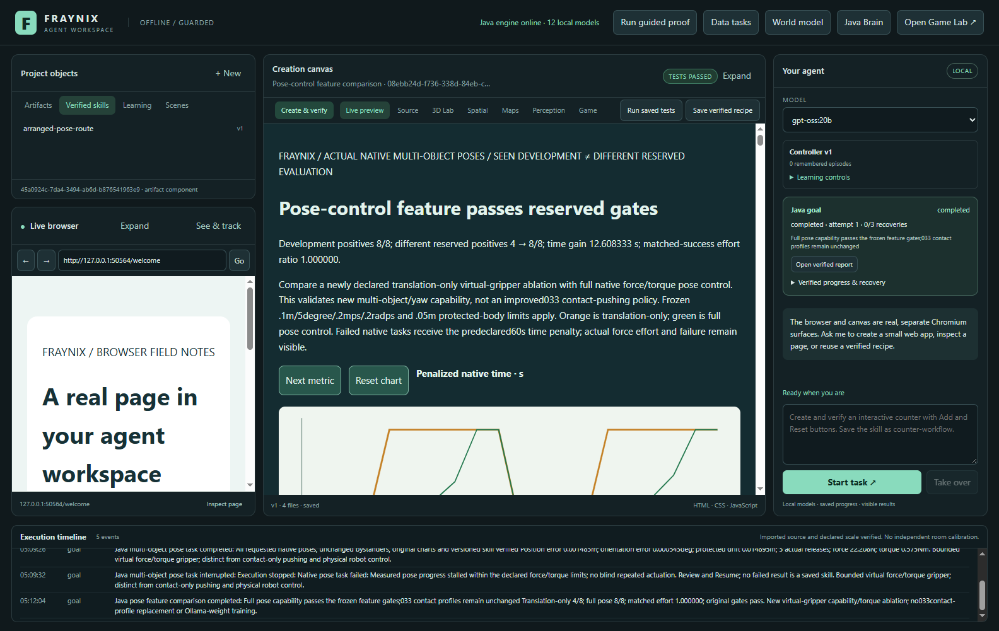
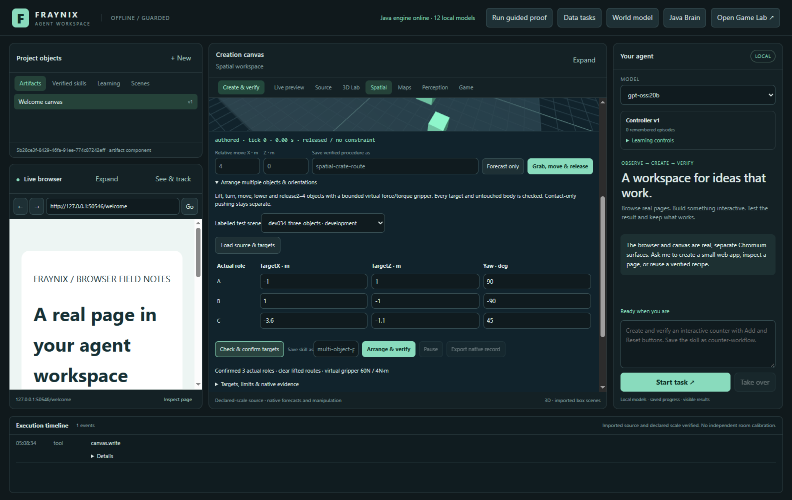
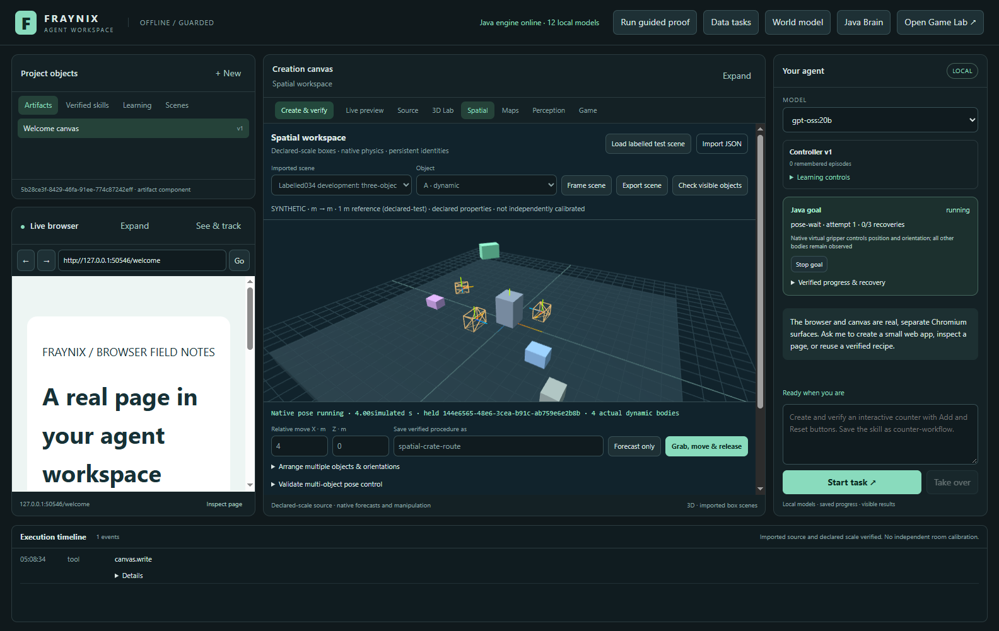
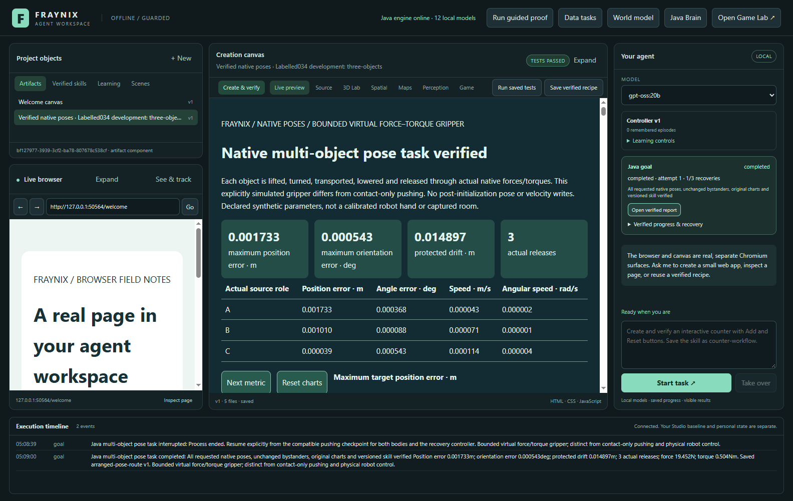
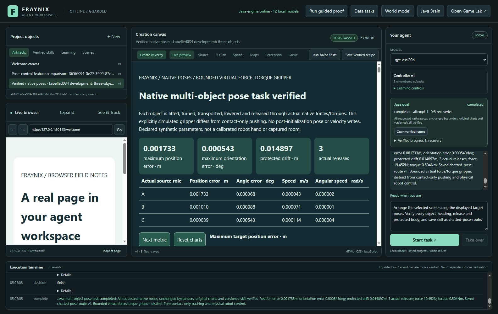
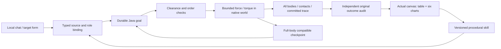

# Fraynix Agent Workspace — edition 034

## Arrange a world, observe every body, retain the procedure

**2026-11-01 · Java-owned local agency · native multi-object poses**

[Release source](https://github.com/eyeoverthink/Fraynix-Agent-Workspace/tree/readme-034) · [Previous: 033](README-033.md) · [Edition history](docs/readmes/INDEX.md) · [Offline interactive guide](docs/readmes/034/index.html) · [Runtime contract](docs/MULTI_OBJECT_POSES.md) · [Original evidence](docs/readmes/034/verification.json) · [Source inventory](docs/readmes/034/FILE_TREE.md)

Edition034 adds a complete task to the existing application: choose two to four box roles, specify their target positions and headings, check a collision-free order, physically lift/rotate/move/lower/release them, observe the other bodies, verify the original result and retain a versioned skill. Chat, Spatial, Java goals, the actual canvas report and the Skills library participate in the same workflow.

This is a **new bounded virtual force/torque gripper**, deliberately separate from edition033's contact-only pusher. The old pusher, contact controller, activation registry, force profiles and historical evidence remain executable and unchanged. Applying a virtual wrench directly to a selected rigid body allows a different task family; it does not show that the pusher learned to grasp, that a physical robot hand exists, or that an Ollama model acquired new weights.

On ten different reserved definitions frozen before measurement, full pose control completes **8/8 feasible cases**, versus **4/8** for a translation-only version of the same virtual actuator. Both arms fail the two deliberately infeasible force/torque controls. Counting those controls, completion is8/10 versus4/10. The four cases both arms successfully complete have an integrated-force-effort ratio of **1.000000000**. Across all ten cases the ratio is **1.043654413**. This is capability and torque-ablation evidence on declared synthetic scenes.



[Capture provenance](docs/readmes/034/images.json) identifies the actual application screenshots and local-model episodes. These are dated software captures, with synthetic scene parameters explicitly labelled. No generated product screenshots or prerecorded trajectories substitute for native motion.

## Review it in the existing app

1. Launch `Launch-Agent-Workspace.bat` with an isolated project for experiments. Keep personal runtime data separate from release review data. No new model downloads, paid APIs, Docker or WSL are required.
2. Open **Spatial** and expand the pose-arrangement controls. Select a labelled case and load its immutable source. Loading and target confirmation do not actuate physics.
3. Inspect the target table: source role, world X/Z and yaw in degrees. Advanced JSON exposes complete target positions and fixed wrench limits. Targets refer to actual imported roles rather than invented model IDs.
4. Confirm the targets. Java checks body roles, the floor, target clearance, lift clearance and a feasible ordering before creating a run. Wireframe targets are a view of that plan.
5. Run the task, optionally naming a new skill. Watch the real native bodies and the current gripper stage. Green-looking target geometry alone is insufficient: native movement and independent outcome checks must pass.
6. Open the original report. Inspect target position/heading errors, force, torque, effort and bystander displacement. The three-object example has15 actual table cells and six chart modes; every plotted coordinate is compared with Java's original data.
7. Open **Skills**, select the retained procedure and inspect its exact native controller version, targets and force/torque defaults. Choose a fresh source and run it again. Reuse is another verified physical task, not replay of an old success.
8. For the paired study, run the40 native trials. Twenty development trials precede the code pin and twenty reserved trials. Inspect all20 paired rows,180 cells and both chart lines in all four modes.
9. Export the comparison. Large evidence is saved as a hashed manifest and adjacent numbered parts. Keep those files together. The offline inspector verifies the original compressed and uncompressed bytes before reading it.
10. Stop a new task or reopen an older comparison. Historical viewing must not replay actuation, activate033 controllers or overwrite another goal's state.



The integrated app remains the product. Browser observation, web creation, data processing, procedural maps, the Game Lab, recorded-motion world models and earlier physics tools are still available. This edition adds controls inside Spatial and reuses the shared goal/skill interfaces. It does not replace them with a separate demonstration page.

## What Java actually executes

`PosePlan` binds source roles to concrete body IDs and searches a conservative order. It checks swept clearance using body size, obstacle geometry and a lift high enough for the declared route. Initial boxes are upright; yaw is supported. Target boxes must rest on the admitted axis-aligned floor. A blocked destination or impossible ordering is refused before a world or goal is created. Conservative rejection is preferable to implying an unsupported arbitrary manipulation planner.

`PosePhysics` creates a native Bullet world through the existing Minie backend. All imported dynamic boxes remain physical, including unselected bystanders. The controller advances through lift, turn, transport, lower and release/settle stages. It applies a bounded central force and torque only to the currently held body. Gravity, inertia, friction and contacts are resolved by the native physics engine. There are no post-initialization position, orientation or velocity writes during execution; compatible cold restoration is the explicit exception.

Each240Hz tick records the actuated body, force and torque, linear/angular work and every body's displacement and orientation. Samples retain positions, quaternions, velocities, angular velocities, controller state and actual persistent solver manifolds. These are machine observations of the declared simulated world. They are distinct from image recognition, a model describing an imagined scene or a renderer moving meshes independently.

Interactive pose runs target4× simulation playback. The viewport labels simulated seconds; processing load can slow playback without changing the native240Hz integration step. Study timing and failed-task penalties are simulation metrics, not claims about wall-clock response latency.

`PoseVerify` separately reconstructs that evidence. It checks authorized grip/release transitions, wrench limits, motion accounting, original source and plan, inactive-body drift, final position/heading/speed, bystander preservation and compatible restoration. Release must preserve the body's actual state. A task is not complete merely because its selected objects appear near their targets.

| Boundary | Edition034 behavior |
| --- | --- |
| Task |2–4 selected boxes, absolute positions and yaw targets |
| Source | Declared synthetic rigid-body geometry, metres, seconds and kilograms |
| Actuator | Selected-body virtual force/torque; separate from033 contact-only pushing |
| Normal wrench bounds |60N /4N·m; lower explicit limits are preserved |
| Native integration |240Hz; all dynamic bodies remain in the world |
| Time |60s total,12s per stage, measured stalled-progress stop |
| Final gates |≤0.1m position,≤5° orientation,≤0.2m/s and≤0.2rad/s |
| Protected/inactive bodies |≤0.05m drift and≤5° orientation change |
| Retention | Actual native verification plus original visible report receipt |
| Reuse | Exact controller/defaults and newly bound source roles; verify again |



Java owns durable execution and validation. Existing Bullet/Minie, Electron and Three.js remain dependencies; “Java-owned” does not relabel those libraries as newly written pure Java or direct GPU neural computation. This phase adds no transformer, external model, physics package or cloud service.

## The frozen measurement

The suite and gates were committed at `a28a75e` before development. Five native sources were locked at `e646bc6` after development and before the first reserved trial. [Frozen contract](docs/POSE_034_FROZEN_CONTRACT.json), [source lock](docs/POSE_034_CANDIDATE_LOCK.json) and [original suite](docs/readmes/034/frozen-suite.json) preserve those identities. The locked controller, planner, verifier, store and checkpoint were not retuned after reserved results were read.

Ten development definitions cover X/Z translation, heavier motion, retained heading, quarter/opposite/half turns, three selected objects and insufficient force/torque. Ten different reserved definitions change starting positions, masses, friction, dimensions or headings. They are paired with a translation-only actuator that uses the same native world, force cap, time budgets and independent final-pose verifier. Its angular controller is disabled; required rotations still fail the original heading checks.

| Different reserved case | Translation only | Full pose | Translation score · s | Full score · s |
| --- | --- | --- | ---: | ---: |
| reserved034-translate-x | pass | pass | 13.375000 | 13.375000 |
| reserved034-translate-z | pass | pass | 14.758333 | 14.758333 |
| reserved034-heavy-translate | pass | pass | 16.933333 | 16.933333 |
| reserved034-retained-heading | pass | pass | 16.933333 | 16.933333 |
| reserved034-quarter-turn | fail | pass | 60.000000 | 20.925000 |
| reserved034-opposite-turn | fail | pass | 60.000000 | 26.712500 |
| reserved034-half-turn | fail | pass | 60.000000 | 27.825000 |
| reserved034-three-objects | fail | pass | 60.000000 | 38.454167 |
| reserved034-force-negative | fail | fail | 60.000000 | 60.000000 |
| reserved034-torque-negative | fail | fail | 60.000000 | 60.000000 |


Feature acceptance requires every feasible development and reserved task, both negative types failing in both arms, no translation-success regression, at least four matched successful reserved pairs and matched force effort≤1.1. Those unchanged gates pass. Mean penalized native time improves **12.608333333s**. Failed-task60s values are comparison penalties, not assertions that every failed simulation ran for60seconds.

The matched effort ratio covers four successful pairs. The all-case ratio includes additional work needed for rotation and termination of failures, so it answers a different question. Integrated force magnitude in N·s is not energy or battery use; torque and work diagnostics are recorded separately. Neither ratio establishes calibrated robot efficiency or general learning. This evaluation tests a deliberately added actuator capability, not automatic controller selection or033 profile promotion.

The first headless40-run measurement retains every original result byte string, hash and failure. A later real app study has its own complete original export, job chronology and canvas receipt. [Development record](docs/readmes/034/development-attempts.json), [original outcomes](docs/readmes/034/native-outcomes.json) and [complete evidence](docs/readmes/034/examples/native-experience.json) keep those distinct. The reserved cases are now seen; future changes need different frozen evaluation conditions.

The [earlier nine-group app run](docs/readmes/034/initial-ui-provenance.json) also retains its complete separate export. It precedes the final moving-observation check and capture-wait refinement. Repeating these same cases validates integration; the repetitions are not counted as additional unseen evaluation cases. The full original final UI proof is preserved in a byte-hashed lossless archive alongside its readable index.

## Interruption, observation and procedural memory

The actual desktop test waits for measured angular motion and then terminates only its own Java child. After restart, all four dynamic bodies, their velocities, held-body controller and committed trace are restored under the same goal/run/attempt. Resume is explicit. The retained prefix remains exact. Corrupt or incompatible checkpoints are refused and preserved for inspection. SHA-256 here detects accidental changes; it is not a cryptographic signature against someone rewriting both state and its hash.



Observation tools now distinguish the authored source from committed native state. Pose visibility/ray checks return the moving positions and quaternions from that state; the integration test independently matches them to the original native trace. During private paired experiments the viewport uses that experiment's actual bodies and targets. Source selection does not supply substitute observations.

A new goal currently starts from its **immutable imported source**. Continuing an interrupted run restores its moving state, but starting a new goal does not silently chain from a previous goal's final world. Persistent cross-goal world ownership is a proposed next phase. The distinction is exposed to chat rather than hidden behind an overstated continuous-world claim.

A saved `spatial-arrange-v1` procedure retains the native controller identity and original target/wrench defaults. Roles are resolved again on a fresh imported scene. The visible Skills test preserves original defaults; the chat reuse test additionally requests the new scene's displayed targets explicitly. Both execute a fresh native world and verify it again. An insufficient-force task retains no procedure.

## Actual local chat, including the failure that was repaired

Three real `gpt-oss:20b` episodes exercise comparison, three-object arrangement with retention, and reuse on a different source. The model chooses typed tools. Java owns timing, native progression and durable verification. The host supplies source/name/version bindings and cannot accept model-provided gates, code, outcome flags or replacement reports.



The first model test completed comparison and arrangement, but failed reuse: it repeatedly supplied `saveSkillName`, which would create a new retained skill even though only reuse was requested. The host refused all such calls and the unchanged12-turn limit stopped it. The repair narrows offered tool arguments when no new save is requested and explicitly instructs reuse to omit that field. A subsequent missing parser alias was caught immediately, corrected and retained in the development record. Neither failure was turned into a successful model episode or used to relax physical gates.

The final three real model episodes pass. Original admitted calls and bounded repairs are preserved in [actual chat evidence](docs/readmes/034/live-poses.json); the failed earlier run remains in the development record. The procedure reuse calls the registered procedure rather than starting a replacement pose task.

| Final actual episode | Admitted task / wait | Bounded rejected calls before completion |
| --- | --- | ---: |
| Frozen comparison | `pose.compare`, `goal.read` |3wrong-stage calls |
| Arrangement and new skill | `pose.start`, `goal.read` |5calls missing the requested new save name |
| Reuse on changed source/targets | `procedure.run`, `goal.read` |0 |

These are completed workflows with recorded recovery, rather than a first-attempt accuracy claim. Rejected calls do not authorize physical effects or change the requested success criteria.

Model summaries remain unverified text. The displayed completion is built from Java's actual task evidence, including pose error, protected-body drift, release count and maximum force/torque. Local orchestration and retained procedures are working capabilities; this edition does not train the model's weights or establish open-ended autonomous generalization.

## Files, exports and independent inspection

The new task has native planning, execution, verification, checkpoint/store, request admission, individual report and study owner/report classes. Desktop changes provide bounded tools, source/target binding, Spatial controls, versioned Skills, actual observations and complete evidence export. [Canonical file tree](docs/readmes/034/FILE_TREE.md) and [hash inventory](docs/readmes/034/file-inventory.json) cover **661 implementation paths**, including inherited assets and tests.



Individual reports expose original JSON/CSV data and all-body trajectories. Comparison export includes every complete native run, failed controls, frozen suite, exact job and source/code identities. Ordinary exports retain their20MB cap. Only the registered native comparison route supports a bounded64MB transport, divided into10MB hashed parts when needed; each saved part still passes the ordinary bound. Keep the original manifest and every adjacent `.part.bin` file.

Inspect it offline with:

```powershell
node scripts/Inspect-PoseExport.cjs docs/readmes/034/examples/native-experience.json
```

The reader checks filenames, size bounds, each part hash, reconstructed compressed bytes, decompressed byte count and raw SHA-256. Missing or modified parts are refused. The complete package is not replaced by a selected summary. The offline guide and standalone original reports use no CDN, model service or Java engine. [Obsidian map](docs/obsidian/multi-object-poses.canvas) links the actual modules.

## Validation and next acceptance gate

Independent offline checkout: **304 Java tests / 62 classes**, **72 desktop units**, **219 actual UI workflow checks**. Three actual installed gpt-oss:20b chat episodes add four checks. Counts overlap where stated and are not combined into an invented unique-case total. Canonical implementation hashes are independently compared before publication.

The actual app also tests blocked geometry before actuation, physical insufficiency, no skill on failure, compatible angular-motion continuation, exact original chart cells/coordinates, fresh-role reuse, export reconstruction, Stop/history and moving-state observations. Desktop transport tampering tests use an explicitly labelled random-data software fixture; that fixture is not counted as native physics evidence. Earlier published numbered editions and their assets are checked unchanged.

The next useful phase is a **durable world across goals**: commit a verified final state as a versioned world revision, bind the next request to it, invalidate stale observations, and support explicit revert/import without resetting secretly. Freeze different sequential arrangements before development and include interrupted ownership, changed targets, blocked routes and failure recovery. A verifier must distinguish continuing a world from starting a fresh experiment.

After that, broaden geometric and perceptual conditions: non-upright starts, more difficult obstacles/contact transitions, independent sensor calibration and uncertainty, then learned controllers evaluated against this reference. Each is future work, with source-lock and different reserved cases required before claiming improvement. More rendered dimensions, changing weights or visually plausible movement alone will not establish those capabilities.

The value of this edition is concrete: the same local application can accept an intent, bind real entities in its declared world, execute measurable physical actions, recover its state, test its output and retain a procedure that must prove itself again. Its flow produces the evidence and reusable content.
