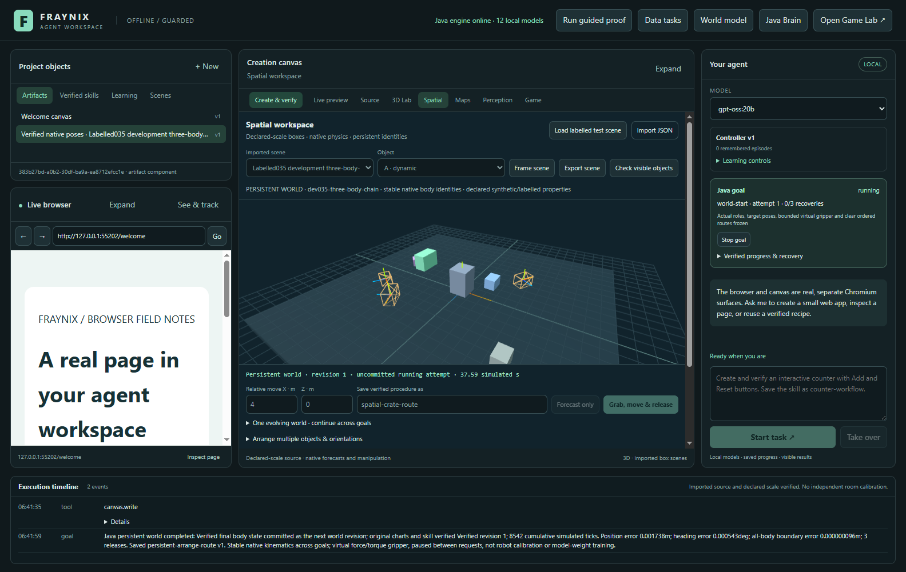
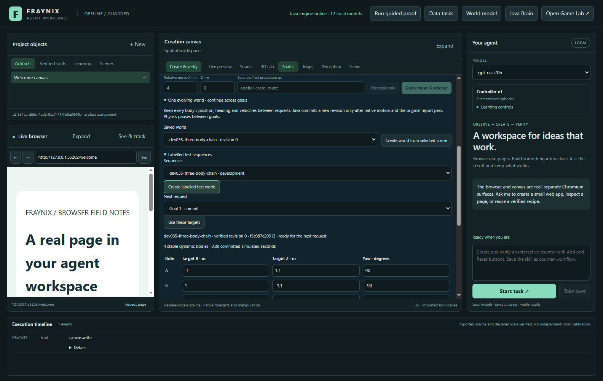
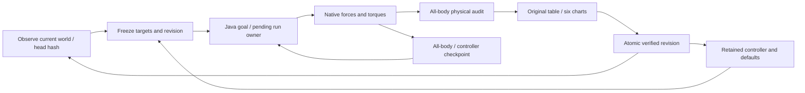
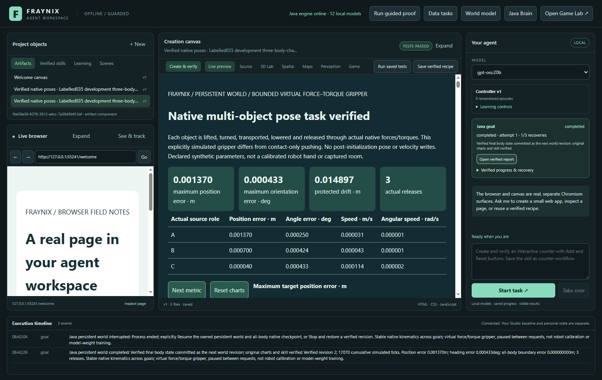
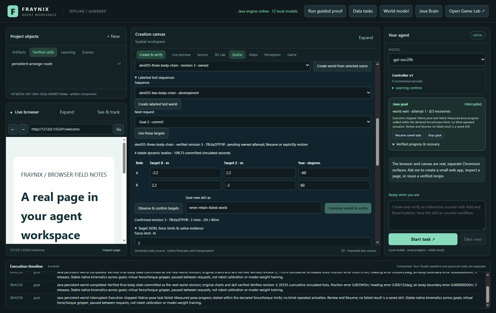
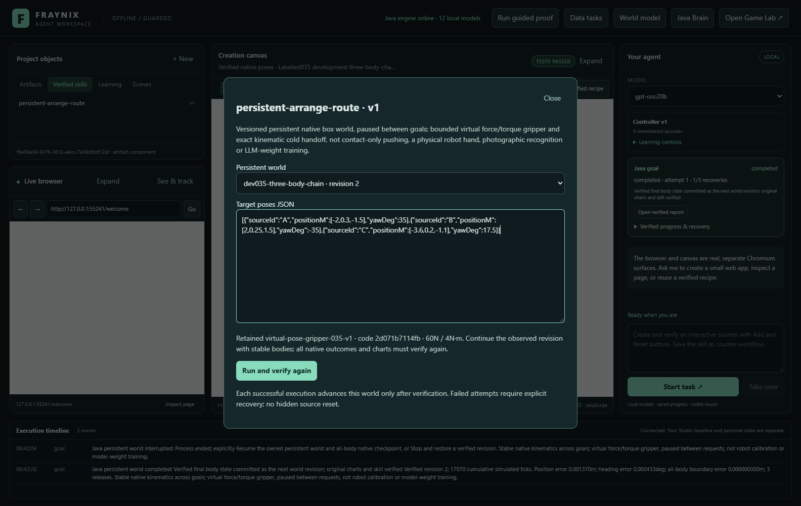

# Fraynix Agent Workspace — edition 035

## One world, successive goals, verified continuity

**2026-11-01 · local Java agency · state that survives the next request**

[Release source](https://github.com/eyeoverthink/Fraynix-Agent-Workspace/tree/readme-035) · [Previous: 034](README-034.md) · [Edition history](docs/readmes/INDEX.md) · [Offline interactive guide](docs/readmes/035/index.html) · [Runtime contract](docs/PERSISTENT_WORLDS.md) · [Original evidence](docs/readmes/035/verification.json) · [Complete source tree](docs/readmes/035/FILE_TREE.md)

Edition034 completed individual multi-object pose tasks, but every new task started from an immutable imported scene. Its interruption recovery preserved a running task; it did not preserve one evolving world across separate completed requests. That boundary remains recorded in its unchanged README and source.

Edition035 adds that missing layer. A persistent world has stable body identities, a verified revision history, complete body kinematics and an owned pending attempt. After a successful request, the **next request starts from the previous verified final positions, orientations, linear velocities and angular velocities**. It does not silently reload the original object layout. Chat, the shared Java goal runner, Spatial, actual canvas reports and the visible Skills library participate in this same world.

This is a bounded simulated rigid-body world controlled by an explicit virtual force/torque gripper. Physics pauses between goals. Each native task reconstructs the solver from the retained kinematic state, including velocities; solver contact warm-start caches are not serialized. We demonstrate measured cold handoff and durable world ownership, rather than claiming bit-identical equivalence to an uninterrupted native solver, physical robot control or an Ollama weight update.



The screenshot is an actual software capture. The viewport identifies verified revision1 and an **uncommitted running attempt**, with a cumulative simulation clock already beyond the first goal. The imported source was not reset. [Dated capture provenance](docs/readmes/035/images.json) distinguishes desktop controls and actual local-model chat.

## The practical change

One request can arrange three objects and save a skill. A second request can move and rotate them again, using their actual first result. A third request can reuse the retained controller and change the targets. Bodies that are not selected remain physical and protected by the original drift gates.

Each completed goal creates a new verified world revision. Its record binds the prior revision, stable frame, native run, canonical native evidence hash, measured outcome, actual report and original chart receipt. The history is inspectable after restart. A failed or interrupted attempt has a separate pending owner; it does not become a successful revision merely because the agent says it finished.

The preserved034 imported-scene pose path remains available as a separate tool. Contact-only pushing,033 controller activation, maps, creation, recorded-data tasks, browser perception, the Game Lab and earlier world-model experiments remain in the same application. The new controls live inside Spatial; there is no replacement application or detached success animation.

| Situation | Edition035 behavior |
| --- | --- |
| Next successful goal | Starts from the current verified frame, with all body velocities retained |
| Old observation | Revision/hash mismatch refuses a start before a new physical effect |
| Running or interrupted task | Pending goal/run owns the uncommitted world |
| Native failure | Verified head stays unchanged; no skill is retained |
| Resume | Same goal, run, attempt, body/controller state and committed trace prefix |
| Stop | Ends owned effects; does not silently reset or commit |
| Explicit restore | Appends a labelled state-restoration revision and preserves earlier history |
| Duplicate commit after recovery | Returns the existing matching revision; does not apply movement again |

## Try the complete workflow

1. Launch `Launch-Agent-Workspace.bat` in a separate experiment project. Existing private projects and prior review sessions remain separate. The verified release review uses its own project directory.
2. Open **Spatial → One evolving world**. Create a world from a supported selected scene, or expand **Labelled test sequences** and create a clearly labelled test world. Scene scale and physical properties remain declared data, not independent room calibration.
3. Inspect the world name, verified revision, abbreviated head hash, body count and simulation clock. Enter target X/Z positions and yaw headings for two to four roles. Advanced JSON exposes the complete targets and wrench bounds.
4. Choose **Observe & confirm targets**. This obtains the current revision and checks target order and swept clearance. Confirmation changes no physical state. Editing targets or limits invalidates the confirmation.
5. Optionally name a new skill, then choose **Continue world & verify**. Java owns native timing. The viewport displays actual committed native observations and distinguishes the pending attempt from the verified head.
6. Inspect the original report. Its15 cells in the three-object example and six metric modes must agree with the original native data before the world advances. Position, heading, speed, release, force/torque accounting and protected-body gates remain enforced.
7. Return to Spatial, change the targets and confirm again. The second goal starts from the first final body state. Returning to the tab preserves the active world view; authored-source movement tools are inactive while that world is selected.
8. Open **Skills**, choose the retained procedure, select the persistent world and inspect its current revision, controller pin, original force/torque defaults and target JSON. Reuse must verify a fresh native outcome before advancing the same world.
9. If an attempt is interrupted, use the existing **Resume saved task** control. If it fails or is stopped, explicitly abandon/restore a selected verified revision before making another request. The button names that action; no source reset occurs in the background.
10. Export the world and all referenced attempts. The package includes restored history and failed/cancelled attempts, rather than only successful endpoints. Inspect the original package offline with the supplied reader.



For a chat demonstration after confirming targets:

> Observe and arrange the persistent world using the displayed target poses. Verify every body and the committed world revision, and save skill as chat-world-route.

After changing the displayed targets and confirming the new revision:

> Observe and reuse the persistent world skill chat-world-route on the same world using the displayed target poses. Preserve its original force and torque defaults and verify the next revision.

The first actual local-model demonstration uses three requests in one world. [Original chat evidence](docs/readmes/035/live-persistent-world.json) retains admitted calls, bounded repairs, model metadata, native initialization frames and verified completions. These are real installed `gpt-oss:20b` episodes; no scripted model reply is counted as a chat success.

## How the world is stored and advanced

`WorldFrames` keeps the original declared geometry and every dynamic body's stable ID, position, quaternion and both velocities. It verifies immutable source/geometry separately from evolving kinematics. A derived scene is an engine input reconstructed from that frame; it is not a rewritten source file pretending that the original scene always had the new layout.

`WorldLedger` stores an atomic envelope and a hash-chained revision sequence. Each mutation locks its local ledger file, reloads and validates current state, checks the expected head, writes a forced staging file and atomically replaces the previous ledger. Separate store instances therefore cannot both advance from an old head. SHA-256 detects changed bytes and lineage; it is not a signature against an adversary rewriting the whole ledger and its hashes.

The shared Java runner first freezes the world binding, targets, controller identity and clear plan. It saves the goal and reserves the world under that goal/run. A pending lease blocks a replacement request even after the process ends. After native completion, the independent verifier checks original physical evidence. The host renders and checks the original report. Only then may Java append the next verified frame. Skill retention follows the verified commit.

Committing and saving the goal acknowledgement are separate durable operations. Commit uses the goal identity and original evidence to return the same existing revision if recovery repeats that acknowledgement. It refuses changed evidence for the same identity. This handles the narrow interruption window without repeating physical effects.



Physics runs at the existing240Hz step, with interactive playback targeting4× simulation time. Charts and clocks report simulated seconds, not wall-clock latency. Native limits remain60N/4N·m,60seconds total and12seconds per stage. Final gates remain0.1m position,5° orientation,0.2m/s and0.2rad/s; inactive bodies retain0.05m/5° protection. Lower explicit force/torque limits are real constraints and can cause failure.

Sources remain bounded box scenes: two to four selected roles, at most eight dynamic bodies, supported flat floors, masses0.2–4kg and sides no larger than1m. Continuation admits settled native heights within0.05m of the upright resting height and a small near-upright quaternion tilt. It preserves those actual values rather than snapping bodies onto an ideal plane. Arbitrary upside-down manipulation, soft bodies and calibrated sensor-driven worlds remain future work.

## Measured continuity and different sequences

The suite and gates were frozen at commit `9efd27f` before development. Eight new native/frame/ledger/report sources were locked at `dccd93c` after development and before the first reserved native sequence. Those files and the preserved Pose/Push/Contact/Map implementations remain unchanged after measurement. [Frozen contract](docs/WORLD_035_FROZEN_CONTRACT.json), [candidate source lock](docs/WORLD_035_CANDIDATE_LOCK.json) and [original suite](docs/readmes/035/frozen-suite.json) preserve that chronology.

Four development sequences cover repeated two-body and three-body arrangements, a physical low-force failure after success, and a blocked next destination after success. Four different reserved sequences change initial positions, masses, friction or headings. Native state must pass unchanged physical gates at every committed step. Boundary position and velocity errors must stay within2×10⁻⁶ and orientation error within0.0001°. No stale commit or failed head advance is allowed.

| Different reserved sequence | Goal commits | Actual failure / no commit | Blocked before actuation | Final verified revision |
| --- | ---: | ---: | ---: | ---: |
| reserved035-two-body-chain | 3 | 0 | 0 | 3 |
| reserved035-three-body-chain | 3 | 0 | 0 | 3 |
| reserved035-force-negative | 1 | 1 | 0 | 1 |
| reserved035-blocked-next | 1 | 0 | 1 | 1 |


The first reserved result contains **eight verified native goal commits, one actual low-force failure with no head advance, and one blocked request refused before actuation**. Every expected outcome passes its original gate. [First exact-byte archive](docs/readmes/035/development/first-measurement/manifest.json) preserves18 original result/history files, including failures and summaries. That archive was assembled later and is labelled separately from the actual app export.

This is state-continuity and workflow evidence, not a learned-policy improvement against034. There is no claimed success-rate gain from a new neural model. These reserved sequences are now seen regression data; future controller changes require different frozen cases before claiming generalization.

The actual desktop test starts with four dynamic bodies and executes several goals on one world. It commits three successful revisions, demonstrates physical failure without a commit, restores explicitly, continues again, stops another attempt, then restores explicitly again. Its final history has revisions0–7 and six complete native attempts. Maximum observed boundary position error is **0.000000096156m**, below the frozen0.000002m gate. Linear and angular velocities are checked separately, not discarded just because bodies look still.



## Failure is part of the world, not a reset trigger

The desktop test terminates only its own actual Java child during observed goal-two rotation. The restarted app retains revision1 plus the pending second goal. A stale revision0 request is refused. A fresh replacement request is also refused because that interrupted goal still owns the world. Visible Resume restores all four bodies, velocities and held controller under the same goal/run/attempt, preserves the committed prefix, and advances to revision2 after verification.

A separate2N attempt physically stalls. It cannot lift the declared body under its original cap. The verified head remains revision3 and no skill is saved. Explicit **Abandon attempt & restore selected revision** records revision4 with the verified frame and preserves the failed native attempt. Restoring an older revision similarly appends a new labelled record. That operation changes saved state; it is deliberately not described as physical motion.



Stop behaves similarly: native effects end, the pending attempt stays visible, and a separate explicit restore releases that world for another task. Corrupt ledger/checkpoint evidence is refused and preserved for review. Geometry rejection occurs before a goal or native world is created. These are actionable recovery paths rather than success-shaped placeholders.

## Skills and local reasoning

`persistent-world-arrange-v1` procedures retain the exact native controller, code identity and original wrench defaults. Their named roles resolve to the same world bodies. New targets can be explicitly supplied, and every use must independently pass the native result and original report again. A saved skill is a checked procedure; it is not a new unrestricted host tool or a claim of model-weight learning.



The model may observe and choose semantic targets through `world.observe`, `world.arrange` and registered procedure reuse. The host binds the selected world, revision and hash. Models cannot supply success/commit flags, controller code, arbitrary source UUIDs or replacement HTML. Explicit observation can refresh that request's stale binding; an interrupted owned task still requires its existing recovery path. Actual completions are summarized from Java evidence, with the model's own summary retained as unverified text.

The three actual episodes complete revisions1,2and3 in the same world. Calls: world.observe → world.observe → world.arrange → goal.read; world.observe → world.observe → procedure.run → goal.read; world.observe → world.observe → world.arrange → goal.read. Bounded rejected-call counts: 0, 0, 0. Original details remain in the chat evidence; these counts are not a claim of universal first-attempt reliability.

The value is persistent agency with testable state: a local reasoning model can request a task, observe its consequences, retain a verified way of working and request a subsequent task in that resulting environment. The durable environment and verifiers carry continuity even though an individual LLM call has a finite context window.

## Complete files and honest limits

The package exports the complete world lineage and every referenced available native attempt, including abandoned failures and cancellations. Java re-audits committed native records and canonical hashes before exporting. The offline reader verifies compressed/raw byte hashes and record references. It explicitly distinguishes those checks from running native physics again.

```powershell
node scripts/Inspect-WorldExport.cjs docs/readmes/035/examples/persistent-world.json
```

Exports are lossless gzip JSON, with explicit original raw sizes and SHA-256. Ordinary transport remains limited to20MB; complete world history is bounded at256MB raw. Oversized histories are refused with instructions to export individual attempts, rather than silently truncating them. The current project limits are16 worlds,64 revisions per world,32 persistent-native attempts,64 shared goals and32 retained procedures with up to eight versions per name. Those limits preserve bounded execution and evidence; they are not an unlimited lifetime claim.

[Canonical source inventory](docs/readmes/035/file-inventory.json) covers **679 implementation paths**. The offline guide provides source search, implementation/planned filters, selectable module details, actual screenshots and the original resumed report. [Obsidian continuity map](docs/obsidian/persistent-worlds.canvas) links the actual Java and desktop files. There are no new dependencies, model weights, paid APIs, Docker or WSL requirements. Existing Bullet/Minie, Electron and Three.js remain explicit dependencies of the Java-owned workspace.

## Validation and next steps

Independent offline checkout: **309 Java tests/65 classes**, **77 desktop units**, **231 actual UI workflow checks**. Three real installed gpt-oss:20b chat episodes add four checks. Scopes overlap; counts are not combined into an invented unique-case total. Canonical implementation hashes are independently compared before publication.

The native tests cover full-body initialization, repeated goals, actual angular cold continuation, exact committed prefix, changed boundary velocity refusal, expected failure/no commit, blocked admission, stale writes across separate ledger instances, idempotent commit, explicit restore, corrupt-ledger preservation and full export with altered-native-record refusal. Software-only report fixtures in ledger unit tests are labelled; actual Chromium receipts are verified separately in the app tests.

During integration, the first UI helper needed to expand the labelled-test controls. A later actual app run exposed the Spatial-tab view reset: Java had correctly committed both goals, but the UI reopened authored source state. The view now preserves the active world, and the final actual sequence passed after that correction. Initial Java test declaration/UUID-type mistakes and the earlier source-guard fixture failure are retained in the [development record](docs/readmes/035/development-attempts.json). No native controller or reserved gate was retuned to fix those integration issues.

For edition036, the proposed next gate is **observation-driven world updates with uncertainty**. Import a calibrated observation as a proposed revision, compare it with the predicted world, measure discrepancy and refuse unexplained identity/scale changes. Freeze different sequences with delayed/missing observations and disturbances before developing the update policy. Keep simulated state, measured input and inferred estimates distinct.

Also useful: revision-aware manipulation skills that choose safe recovery from known failure categories; archival project rollover without losing referenced evidence; and broader non-upright/contact-rich tasks evaluated against the current reference. These are plans with acceptance gates, not implemented claims. Edition035's concrete result is one local, inspectable world that survives successive requests, failure, restart and verified reuse.
