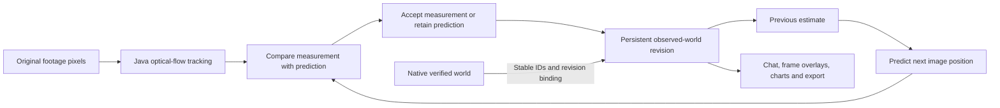
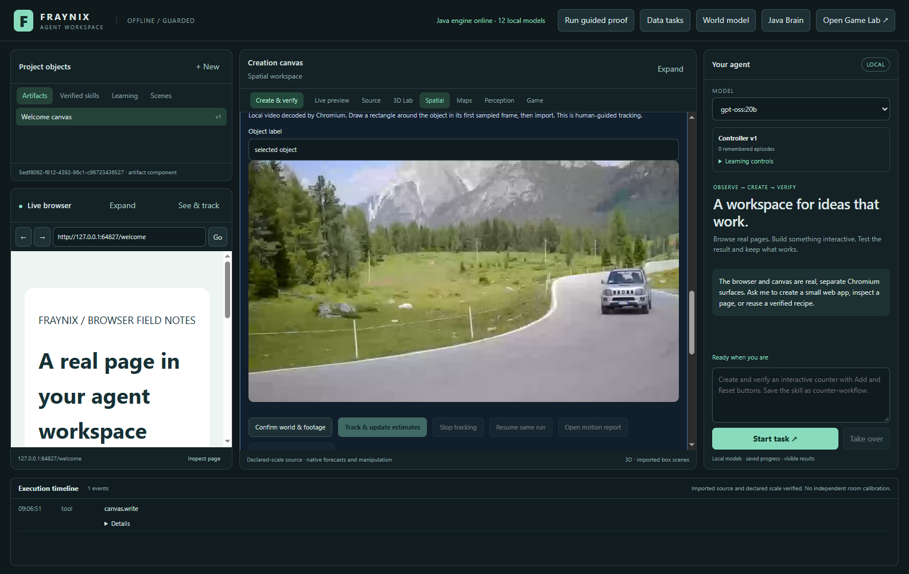
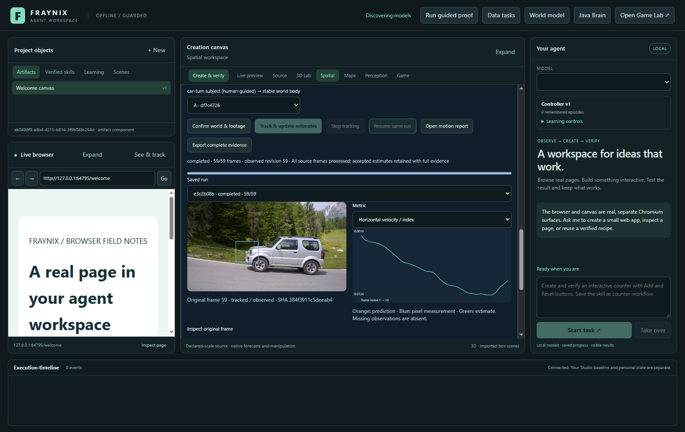
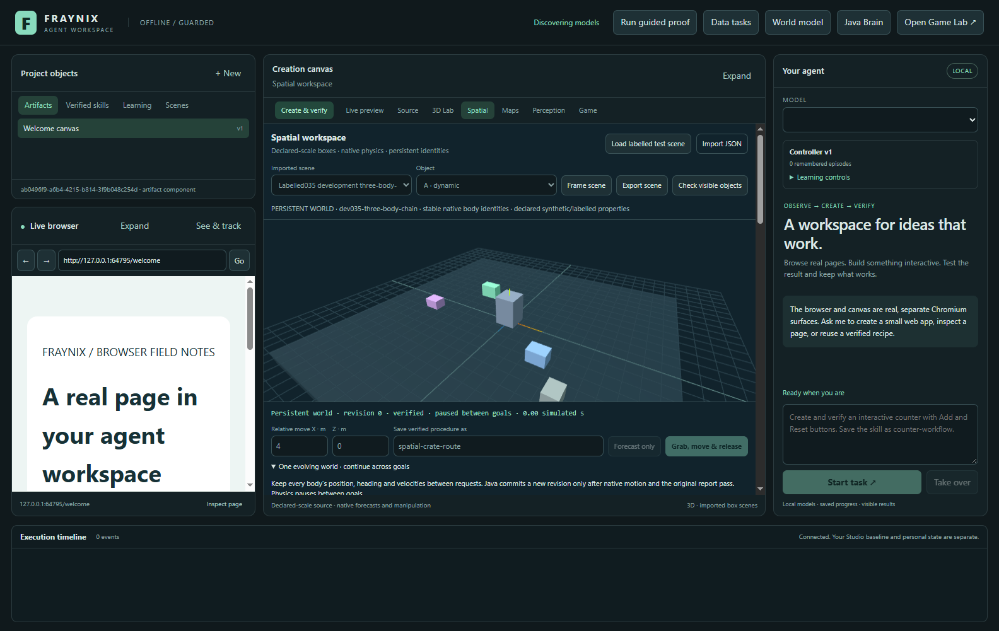
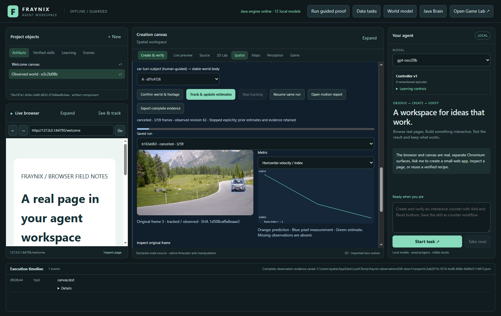
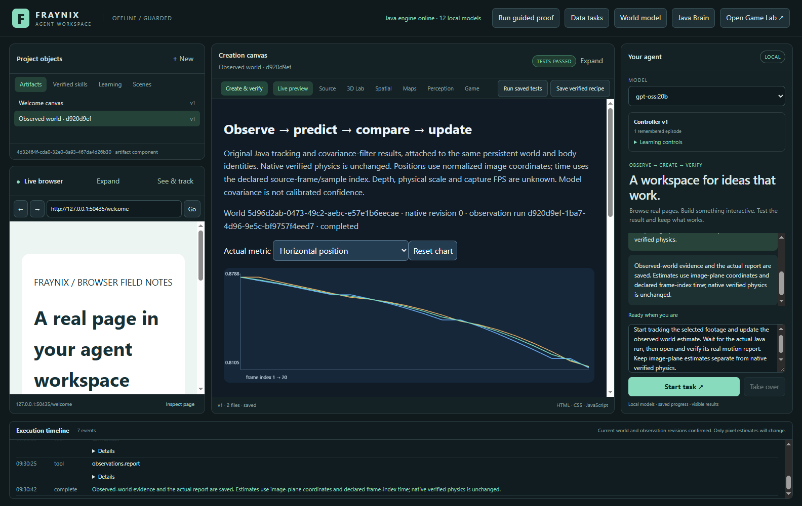

# Fraynix Agent Workspace — edition 036

## Real footage, predicted motion and one persistent observed world

**2026-11-01 · local Java perception and agency · measured evidence with explicit limits**

[Release source](https://github.com/eyeoverthink/Fraynix-Agent-Workspace/tree/readme-036) · [Previous: 035](README-035.md) · [Edition history](docs/readmes/INDEX.md) · [Offline interactive guide](docs/readmes/036/index.html) · [Observed-world contract](docs/OBSERVED_WORLDS.md) · [Verification](docs/readmes/036/verification.json) · [Complete source tree](docs/readmes/036/FILE_TREE.md)

Edition035 established one evolving native world across successive goals. It retained stable body identities, positions, orientations, velocities, verified outcomes and explicit recovery. Edition036 connects **real recorded images to those same saved world and body identities**. Java tracks actual pixels, predicts before reading each measurement, records prediction discrepancy and retains accepted estimates after interruption or restart.

This is an implemented workflow in the existing app: import footage, select an object, bind its identity, process frames, inspect overlays and charts, resume an interrupted run, ask the local model to operate or inspect it, and export the evidence. The observed state is an explicit estimate in the persistent world. It does not counterfeit a successful native physics goal.


The image is an actual app capture using DAVIS car-turn photographs. The first rectangle and subject label are supplied by the importer. Later annotations never enter the runtime. The visible box can drift; the original measurements and evaluation retain those errors. [Capture dates, provenance and attribution](docs/readmes/036/images.json).

## The change in practical terms

A user and agent can now refer to the **same existing world**, bind a real image object to one of its stable bodies and accumulate an observation history. The runtime separates three things that are easy to confuse:

| State | Source | Meaning |
|---|---|---|
| Native verified frame | Edition035 physics, actual forces/torques and outcome verification | The simulated bodies' committed physical state |
| Pixel measurement | Original imported JPEG/PNG pixels processed by Java flow-v3 | A human-seeded object's current image rectangle, which may be lost or incorrect |
| Observed estimate | A versioned position/velocity filter updated from accepted measurements | A persistent image-plane estimate, with explicit assumptions and provenance |

The observed estimate carries the same `worldId` and `bodyId`, its own observation revision, the exact native base revision/hash, original image SHA-256, source frame, dataset, run, predicted position, measured position, velocity, covariance and update status. Its history remains inspectable after the model conversation ends.

**Coordinates are normalized image x/y, and time is the declared source-frame or decoded sample index.** These test clips have unknown camera calibration, metric scale and capture FPS. We do not convert a car photograph into invented metres, mass, depth or a physically verified 3D pose. The native simulation remains available through its unchanged controls. This division allows later calibrated measurements to be added without confusing an image estimate with physical truth.



## Use it step by step

1. Launch **Launch-Agent-Workspace.bat** with JDK21 and the existing Node/Electron setup. The normal project remains local. No Docker, WSL, new model weights or paid provider is required.
2. Open **Spatial**. Create or choose a saved world in **One evolving world**. Existing labelled test scenes are explicitly synthetic; they provide stable body identities, not the source of the real footage.
3. Open **Real footage · observed world** beneath the saved-world controls. Choose a clean frame JSON package or a local video file.
4. For a video, wait for Chromium to decode its bounded sample sequence. Draw a rectangle around the desired object in the first displayed sample. Give it a label, then choose **Import selected footage**. The label is your declaration; the system has not independently recognized a person or object class.
5. Bind each imported rectangle to a distinct existing world body. Choose **Confirm world & footage**. The host pins both the native revision/hash and current observation revision.
6. Choose **Track & update estimates**. The original frame viewer shows the actual tracker box, orange prior prediction and green updated position. Use the frame slider to inspect earlier evidence.
7. Switch between horizontal position, vertical position, prediction discrepancy, model uncertainty and horizontal velocity charts. Positions and velocities use the displayed image/index domain.
8. Use **Stop tracking** to end processing without deleting accepted history. After an interrupted process, **Resume same run** reconstructs its tracker/filter from the original pixels and exact saved prefix.
9. Open **Motion report** for the saved artifact, or **Export complete evidence** for the world history and referenced sources. Returning to the same project retains the estimate independently of chat context.



For local video, the imported sources are decoded JPEG samples. The source description records container duration, sample count and resizing. The video container itself is not embedded in the observation export; retain the original separately. This is bounded recorded-video processing, not a live camera stream, and sample indices do not claim the original capture FPS.

The JSON format, required fields, bounds and complete command-line examples are in the [runtime contract](docs/OBSERVED_WORLDS.md). Unknown fields, later reference masks and supplied success values are refused. A malformed or altered image cannot silently become a new observation.

## What Java actually computes

The existing **flow-v3** tracker remains unchanged. It uses pyramidal optical flow, forward/backward motion checks and appearance checks on CPU pixels. A first-frame rectangle initializes each object. Subsequent tracking receives images only. One to four distinct objects can be bound to stable bodies; multi-object software controls verify separate identities and atomic per-frame revision updates.

`ObservationFilter` maintains position and velocity on two axes. It first predicts from the prior state and index interval, propagating covariance under a constant-velocity/acceleration-noise assumption. It then measures innovation against the actual tracked image position. An accepted observation corrects the estimate; a missing or rejected observation preserves a labelled prediction and growing uncertainty. Invalid time ordering and gaps above30 source indices are refused.

The fixed innovation gate rejects sufficiently abrupt disagreements. It cannot detect every gradually drifting rectangle. Model covariance describes the filter's assumptions; it is **not calibrated semantic confidence or guaranteed real-world error**. Correlation is a match score, not the probability that the agent has identified the correct object.

The LLM does not perform the pixel arithmetic or set the acceptance thresholds. Java computes the trace and persists state. The desktop displays original images, hosts video decoding and exposes registered tools. The report charts derive from saved results, with complete trace data available separately.



Footage attribution: DAVIS2017 dataset authors, [original source archive](https://data.vision.ee.ethz.ch/csergi/share/davis/DAVIS-2017-trainval-480p.zip), [CC BY-NC4.0](https://creativecommons.org/licenses/by-nc/4.0/), as stated in the archive README. The local-video test is a disclosed derivative of those photographs. Dataset attribution is separate from the application source licenses.

## First reserved footage results — including the limitations

Development used the already-seen DAVIS car-turn clip plus labelled synthetic controls. It was not called unseen. The protocol was committed in `19c207d`, and candidate sources were locked in `1dd0f07` before reserved footage was fetched.

The initial reserved names, drift-chicane and drift-straight, were refused because archive `SOURCES.md` lists them as external-source exceptions. **No images, masks or measurements were fetched for those clips.** Metadata-only amendment `85f546c` declared car-roundabout and bus before downloading their pixels. All algorithm sources and numeric gates stayed unchanged. The original refusal log, original contract commit and amendment are preserved; this was not a substitution based on performance.

Each reserved case uses60 original consecutive photographs. The first reference rectangle is disclosed as initialization and excluded from scoring. Every subsequent frame counts, including any loss as zero box overlap. Later references are loaded by a separate test scorer only after the runtime trace is complete.

| Sequence | Role | Scored frames | Mean box IoU | IoU ≥0.5 coverage | Accepted measurements | Visible IoU <0.1 |
|---|---|---:|---:|---:|---:|---:|
| car-turn | Previously seen development | 59 | 0.537575 | 54.24% | 59 | 2 |
| car-roundabout | First reserved result | 59 | 0.728986 | 91.53% | 59 | 0 |
| bus | First reserved result | 59 | 0.898862 | 98.31% | 59 | 0 |

These are human-guided rectangle measurements on a small declared subset, not an official DAVIS segmentation score or general recognition accuracy. Neither new sequence had a tracker loss; all118 post-initialization reserved measurements produced observed-state updates. The original image/member checksums and per-frame references, boxes, errors and trace are preserved in the [first-measurement evidence](docs/readmes/036/first-measurement/manifest.json).

| Reserved sequence | Mean prior-prediction reference error | Mean updated-estimate reference error | References within nominal 2σ |
|---|---:|---:|---:|
| car-roundabout | 0.064717 | 0.064741 | 23.73% |
| bus | 0.026455 | 0.024281 | 81.36% |

Errors are Euclidean distances in normalized image coordinates, not metres. The bus update reduced error on this clip. Car-roundabout's update was slightly worse than its prior prediction. Its23.73% nominal2σ coverage also exposes substantial uncertainty underestimation. **The filter is not demonstrated to improve every prediction, and its uncertainty is not calibrated.** We preserved these first outcomes and did not retune the candidate afterward. Retaining this evidence is useful precisely because a successful software workflow does not establish reliable perception in every frame.

## Interruption, ownership and the evolving world

The observation store uses an atomic forced write/rename, checksum envelope and hash-chained observation revisions. It retains exact source hashes and complete per-frame tracker/filter output. Each accepted frame adds one revision containing all accepted object updates. Prediction-only frames remain in the run trace and do not fabricate a measured revision.

The actual app test killed Java during processing, reopened the same isolated project and found the same interrupted run and retained estimates. Visible Resume replayed original pixels, reproduced the exact committed prefix and continued that same run. A generation check prevents an old stopped worker from committing after an immediate resume. Synthetic loss and abrupt-mismatch controls exercise the missing/rejected paths separately from footage accuracy.



Native revision/hash and observed revision are checked before starting. A later native-world revision makes old estimates stale. The UI labels that condition, and resume under the wrong head is refused. A fresh, explicit binding can start a new observation run. The original native body kinematics stay unchanged throughout observation processing; the app does not claim that watching a car physically moved a simulated box.



## Chat is connected to the same evidence

Installed **gpt-oss:20b** was tested in two actual local-model episodes. The first used registered `observations.read`, `observations.start`, `observations.wait` and `observations.report` tools to process real-video-derived pixels and advance saved estimates. The second retrieved those estimates and their actual report without starting a duplicate run. Both retained verified report evidence with zero recorded repairs.

The model cannot submit world IDs, arbitrary measurements, custom thresholds or success values through these tools. The host binds the visible source/world selection. Readouts distinguish last accepted positions from later missing/rejected predictions, identifying their run and dataset coordinate frame. Ordinary `world.observe` also includes the separately qualified observed estimate, so the observation layer is available through the existing world interface. Native manipulation tools continue to act from verified simulation state.



This establishes local model orchestration and retrieval of measured state. It does not establish semantic scene understanding, independent object discovery, learned policy improvement, updated Ollama weights or consciousness. No cloud call or new model download was needed.

## Complete evidence, exports and reproduction

The observation export retains the selected run, every other observation run for that world—including stopped/failed attempts—every referenced dataset and imported frame, the complete observed history and the native world lineage. Gzip transport includes exact original raw length and SHA-256. Capacity errors refuse export rather than silently omitting earlier evidence.

```powershell
node scripts/Inspect-ObservedWorld.cjs "C:\path\to\observed-world.json"
```

The offline inspector validates original frame bytes, source hashes, stable body references, frame order and history links. It does not independently rerun Java tracking or recompute Java canonical event hashes. Original video containers and private research datasets remain outside Git. This release includes source acquisition/preparation code, numeric evidence, source hashes, actual screenshots and attribution.

To reproduce reserved footage acquisition after the committed source lock:

```powershell
python scripts/Prepare-Observations036.py --split reserved --output "$env:USERPROFILE/.fraynix-agent-workspace/research/observations-036"
```

The script reads verified ZIP byte ranges, checks original member sizes/CRC and preserves existing source bytes. `ObservationFootageEvaluation` in the test source tree prepares clean runtime packages and isolated scorer references. [Source tree](docs/readmes/036/FILE_TREE.md) and [first-result provenance](docs/readmes/036/first-measurement/manifest.json) link the complete implementation.

Explicit bounds are16 datasets,24 runs,1–4 objects per source,5–96 complete frames per import,32MB original pixel bytes per package,2,048 observed revisions,24MB persistent metadata,40MB original pixels/64MB raw full export and the desktop's20MB transport limit. These are bounded local experiments; archival/rollover and unlimited continuous operation are future work. Existing dependencies are retained openly; no new runtime library, OpenCV, learned detector or Processing dependency was added.

## Validation and what comes next

Independent offline checkout: **318 Java tests/67 classes**, **81 desktop unit tests**, **243 actual UI workflow checks**. The two actual local-model episodes add four checks. These scopes overlap and are not combined into an invented unique-case total. Java and native code match the full offline build at f91a1d0. Final desktop changes passed 81 unit tests and reruns of the affected footage, video and persistent-world workflows. The unchanged 40-trial native pose comparison retains its earlier source commit. The grip test now waits for scene creation; all physical assertions remain intact. [Full validation record](docs/readmes/036/verification.json).

Actual UI coverage includes real-file import, current-world binding, a real Java kill, exact-prefix resume, all five panel/report chart modes, original frame inspection, complete source export/inspection, Stop and stale-state refusal. A separate Chromium test encodes18 original DAVIS photographs as a disclosed lossy video derivative, decodes that file through the actual app, draws the initial rectangle with real pointer input and tracks its imported samples. The video test does not claim the derivative's sampling rate was the original camera rate.

Initial development corrections are retained in the [development record](docs/readmes/036/development-attempts.json): a byte-hash helper mismatch, a Windows text-decoding mistake corrected before publication, the older world-observation unit fixture needing the new read-only estimate response, stronger Stop/Resume ownership and complete multi-run export guards, and a legacy grip-test scene-readiness race. Final host-only checks also preserve HTML footage-creation routing and qualify last accepted measurements versus later predictions. No locked algorithm changed after the reserved measurements. All001–035 published snapshots and protected native world/tracker sources remain unchanged.

**The next useful gate is calibrated observation, camera-motion separation and empirically tested uncertainty.** Establish a known plane/scale and timing in a new recording; separate camera movement from object motion; test fresh occlusion, distractor and delayed-frame sequences; and request re-observation when confidence is unsupported. Evaluate those changes against the retained036 reference, on different frozen cases, before accepting a new policy. Shared pointing/language references and counterfactual physical planning can then use grounded measurements with fewer hidden assumptions.

Edition036's concrete result is a local agent workspace that follows real recorded pixels, compares prediction with measurement, retains an evolving observed state on the same world identities, survives interruption and exposes the complete evidence to the user and agent.
