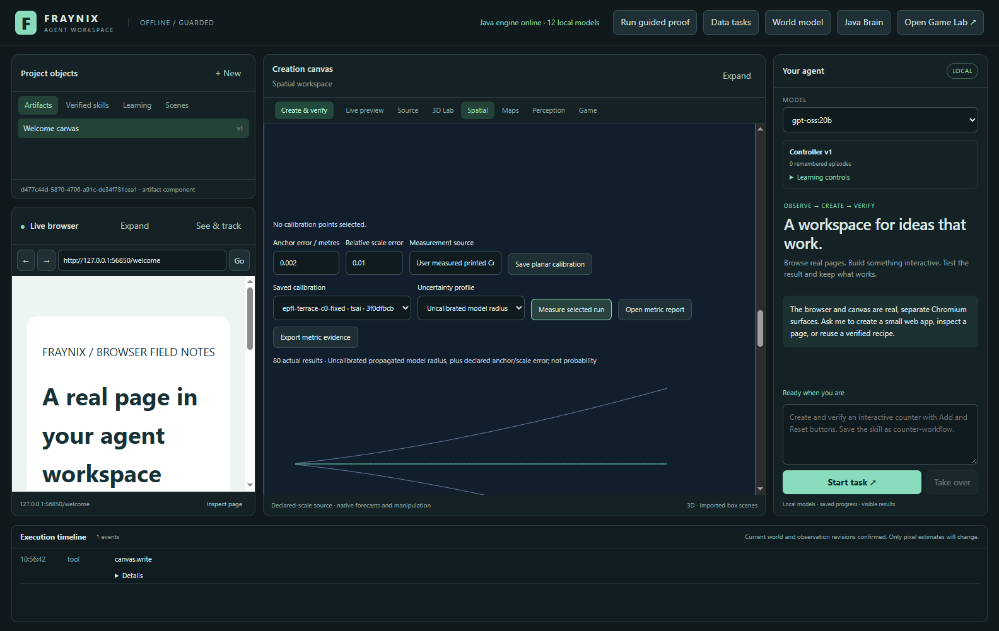
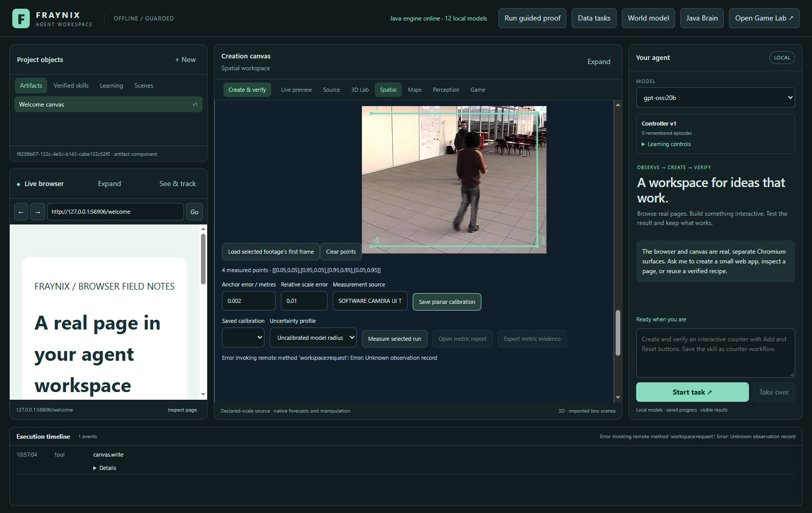
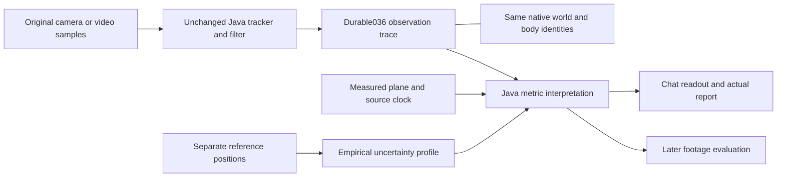
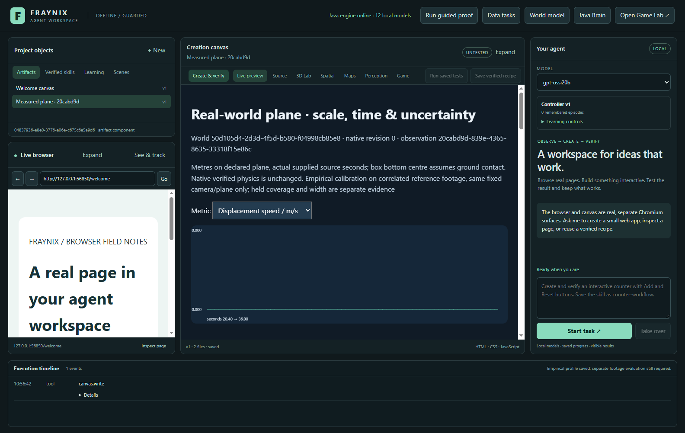
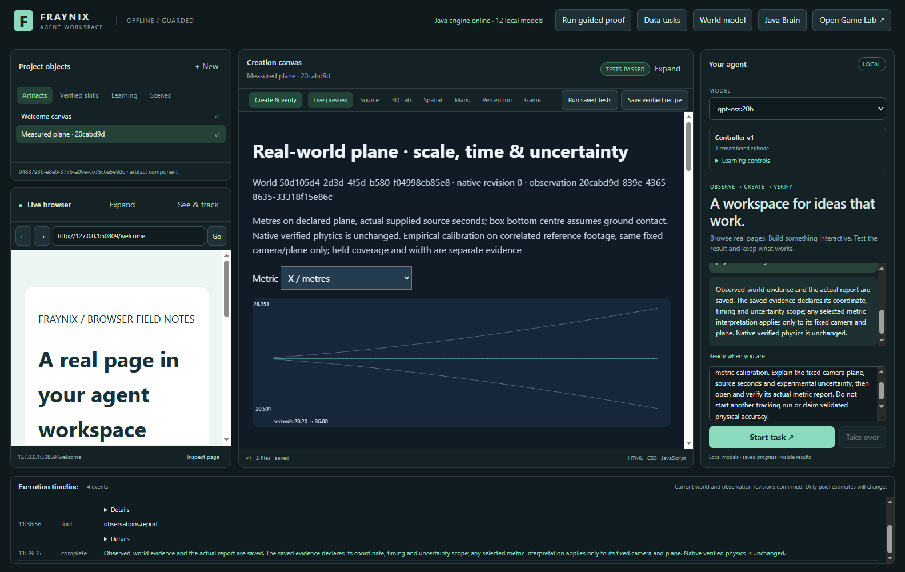

# Fraynix Agent Workspace · edition 037

**A measured plane, a real camera, and uncertainty that must earn its claim.**

[Entry point](README.md) · [Previous036: observed worlds](README-036.md) · [Edition history](docs/readmes/INDEX.md) · [Offline explorer](docs/readmes/037/index.html) · [Runtime contract](docs/METRIC_WORLDS.md) · [Complete verification](docs/readmes/037/verification.json)

Edition037 adds a Java layer that interprets actual tracked pixels in metres on a declared plane, retains source time in seconds, fits an empirical uncertainty profile from explicit reference observations, and evaluates that profile against separate footage. It also adds local webcam preview and bounded capture inside the existing workspace. The user's **12 ×12 inch Cricut cutting mat** supplies a practical reference rectangle: **0.3048 ×0.3048 metres**.

The central result is deliberately specific: the controls and persistence work, but **the first reserved public-footage profile fails its accuracy gates**. One later clip has12.5% empirical coverage and1.6285m mean radius; another is refused at import because the declared starting box projects outside the image. Both original results remain in this edition. A working calibration workflow does not make a weak tracker physically accurate.



*Actual app capture,2026-11-01. EPFL CVLAB terrace footage, human/reference-guided initial rectangle. Plane calibration and source timing are supplied; prediction-only rows are explicit. This is a research interpretation, not a successful tracking demonstration.*

## What changed

| Function | Actual behavior | Evidence and limits |
| --- | --- | --- |
| Perspective-plane calibration | Four clicked corners map normalized image coordinates to declared world-plane coordinates through a Java homography solver | Convexity/degeneracy checks, corner reconstruction, outside-plane refusal; no inferred height |
| Ruler calibration | Two endpoints establish scale and axes on a declared front-facing plane | Correct image-aspect handling; perspective requires four corners |
| Supplied camera geometry | Java can interpret an explicit Tsai camera model and intersect its rays with ground z=0 | Used with published EPFL parameters; source unit convention and ground-contact assumptions are stated |
| Real clocks | Immutable timestamp records bind every sampled image to seconds, camera key and source checksum | Metric views refuse absent/non-increasing timing and camera mismatch |
| Metric interpretation | Original036 trace becomes planar positions, propagated sigma, radius and displacement speed | Existing tracker/filter and verified native world are untouched |
| Empirical uncertainty | First calibration run supplies a90% residual-quantile multiplier from12–96 later reference points | Seed excluded; calibration is experimental, not a probability guarantee |
| Separate evaluation | Completed different runs retain immutable residuals, coverage and mean radius | Same-run evaluation and overwritten first results are refused |
| Local camera | Explicit preview, Stop and capture of up to40 sampled frames within20seconds | No microphone, no automatic import; actual elapsed media time retained |
| Chat connection | Typed observation read/report tools include the selected metric interpretation | Host pins IDs and measurements; the model cannot fit references or authorize camera access |
| Complete evidence | Saved report, numeric JSON and full original-image observation export | Independent reader recomputes projection/radius and verifies source links/hashes |

No new model, dependency, cloud endpoint, Docker or WSL installation was added. The Java algorithms use the existing runtime. The desktop still hosts the real browser and creation canvas; existing physics, saved skills, world history and original Game Lab remain available.

## Review it in the app

Start the existing launcher described in the [entry README](README.md). Select **Spatial**, create or choose a saved persistent world, then expand **Real footage · observed world** and **Measured world · camera, scale & uncertainty**. The new feature extends those panels instead of replacing the workspace design.

For a cutting-mat recording:

1. Place the camera so the printed rectangle and the intended object's ground contact are visible. Keep the camera fixed. The12-inch preset refers to the printed measurement rectangle, which may differ from the plastic mat's outer border.
2. Open **Local webcam** and click **Start local preview**. Preview uses the physical camera locally. It creates no dataset or recording. It never requests microphone access.
3. Click **Capture up to40 frames** when ready. The sampler retains actual `mediaTime` seconds; frame spacing can vary. The maximum capture window is20seconds, with at least five complete samples required. Slow frames are not assigned invented FPS. Stop interrupts capture without importing a partial recording.
4. The first-object selection opens automatically. Draw the initial rectangle around the object above. This is explicit human guidance; a label does not establish semantic recognition or a person's identity.
5. Use **Load selected footage’s first frame**, then click the mat's corners in perimeter order: origin, width corner, opposite corner, height corner. The source frame is preserved behind the numbered points.
6. Check width12, height12 and Inches. Enter a measurement-source note and realistic anchor/relative-scale error estimates. The default2mm and1% are declared assumptions, not values measured by the camera. Save the planar calibration.
7. Explicitly **Import selected footage**, bind its object to the saved world's stable body identity, confirm world and footage, then track. Only the observed layer changes. Pixel measurements cannot silently teleport a verified physics body.
8. Select the saved calibration and **Measure selected run**. Review missing/prediction-only rows as well as positions. Open the metric report or export evidence. Camera Stop releases the video tracks independently of the saved recording.

A new preview gets a new camera key. Reusing a calibration after moving the camera, changing the mat plane, or changing the imaging geometry is invalid. To reuse the same plane across multiple captures during one fixed preview, keep its camera key. A stored key is an explicit declaration, not an automatic camera-motion detector.



*Actual pointer interaction and camera pipeline test. The software camera displays public EPFL footage; its imposed12-inch rectangle tests the controls and unit conversion only. It is **not** an image of the user's mat and does not validate physical scale on that scene.*

## Local videos and existing observations

The existing local-video importer now saves Chromium's decoded container times with a new camera key. Those times support metres/second when geometry is supplied; they are not a hardware exposure-clock certificate. Very long videos whose96-sample bound would leave gaps over five seconds remain usable through the original036 image-coordinate path. Select a shorter segment for metric timing.

Original036 frame packages, run recovery and image-coordinate reports remain supported. Metric metadata lives alongside the old observation store. It does not rewrite old imported frames, accepted observation revisions or native checkpoints. Existing private projects are not silently switched to a shared database. The normal edition037 review uses its own project; older review data remains preserved.

Imported037 packages contain the original sampled image bytes, original frame ordinal, source/camera/timing note and one timestamp per image. Initial object rectangles remain the only tracking labels supplied to the runtime. Later references live outside the production tracker. Invalid timestamps are rejected before the host starts an import; Java also enforces the stored binding.

## How Java interprets the scene

The camera plane is a coordinate frame with declared dimensions. A four-corner homography solves eight unknown coefficients, tests its corner reconstruction and refuses degenerate or crossed corners. Results outside the selected quadrilateral are unprojectable. The ruler variant uses image aspect ratio so a rectangular image does not distort the inferred scale.

For this edition the contact point is the **bottom centre of the tracked rectangle**. The filter's centre estimate plus the last accepted box height yields that point. If tracking is lost or a measurement is rejected, the row remains prediction-only and retains the last accepted height assumption. Objects above the plane, feet hidden behind obstacles, camera movement and changing perspective can invalidate the contact interpretation. This is not full3D reconstruction or a physical contact sensor.

A numerical projection Jacobian propagates the existing position covariance into metres. A0.01m sigma floor prevents vanishing numerical intervals. Radius adds declared anchor error and a relative-scale term proportional to distance from the plane origin. Without an empirical profile, the displayed multiplier is2 and the report explicitly calls it uncalibrated. Displacement speed uses successive interpreted positions divided by their actual timestamp difference; it has no independent calibrated velocity interval.

World ID, body ID, native revision/hash, source dataset hash, source-image hash, trace hash, geometry hash and runtime identities stay attached to the evidence. A later native world revision marks the old interpretation stale. The historical report remains readable; it never gains authority over a changed physical state.



[Canonical file tree](docs/readmes/037/FILE_TREE.md) · [Source explorer](docs/readmes/037/index.html#sources) · [Obsidian map](docs/obsidian/measured-worlds.canvas)

## Calibrate uncertainty, then challenge it

A reference JSON supplies `source` and `references`, each containing a later frame `ordinal`, `bodyId` and `positionM:[x,y]`. The visible panel can fill the body ID when exactly one body is tracked. References must come from an independent measurement/annotation source; copying the displayed prediction into the reference field proves nothing.

Fit operates only on a completed trace. It computes Euclidean error divided by propagated sigma, takes rank `ceil((n+1)×0.9)` capped at n, and saves the first multiplier, references, source and scores. The initial seed is excluded. Repeated fitting of the same run/geometry is refused. Reference ingestion cannot change tracking or create executable skills/tools.

Evaluation requires a separate completed run and retains the first result. It counts unprojectable rows as uncovered, reports mean radius separately from coverage, and uses fixed gates of at least80% coverage and no more than1m mean radius for these research cases. All declared reserved cases must complete and pass. Those coarse research gates are not proposed as acceptable tabletop accuracy; a30cm cutting mat will require a much tighter application-specific tolerance.

The samples are temporally correlated and come from one fixed camera. The90% label describes the calibration target; it is not a distribution-free or universal confidence guarantee. Neither a low training residual nor very wide bounds establish useful accuracy. Profiles stay visibly experimental; no automatic native-action promotion was added.

## First new-footage results, including failures

The [protocol](docs/readmes/037/frozen-contract.json) was committed at6faa54e before implementation. Candidate4d80927 fixed the Java interpretation, unchanged tracker/filter and evaluation preparer before reserved extraction. Source metadata, camera XML and initial undefined reference rows had been inspected; no decoded footage or defined reference positions had been examined before declaration. Three non-overlapping windows use an explicit earliest-continuous-identity rule; no case was selected for its result.

The new source is [EPFL CVLAB multi-camera pedestrian footage](https://www.epfl.ch/labs/cvlab/data/data-pom-index-php/), terrace1 camera0. The published camera is fixed and the stated/AVI frame rate is25fps. Every fifth source frame is decoded,81 samples per declared window. Supplied Tsai geometry uses the terrace millimetre convention, interpreted with×0.001 metres; annotations are250mm ground-grid cell centres. That unit convention, the ground-plane/contact assumption and coarse±125mm per-axis reference quantization limit the interpretation. This is not certified metrology.

| Predeclared window | First outcome | Physical-reference result |
| --- | --- | --- |
| Calibration, start500 | Tracker loses the small pedestrian; prediction-only trace retained |16 references; multiplier0.04640818530609554. This small multiplier reflects very large base covariance, not tracking improvement |
| Later A, start2500 | Complete80-step trace, same fixed source camera |16 references; mean error2.716537518m; coverage12.5%; mean radius1.628467199m. **Rejected** |
| Later B, start3500 | Initializer selects a ground point whose projected box is outside the image; x2 is negative | Existing normalized-box validator refuses import.16 opportunities remain unscored refusal. **Required case failed** |

The original initializer/preparer, refusal log, first traces, reference scoring and report files are preserved. The second case was not replaced by a more convenient person or camera. The first case was not retuned after its score. Later UI/harness corrections did not change locked Java algorithms or gates. Original movies and personal runtime state remain outside Git; dated research screenshots are attributed to EPFL.

[First-result archive](docs/readmes/037/first-measurement/manifest.json) · [Later A original result](docs/readmes/037/first-measurement/terrace-later-a.first.json) · [Later B refusal](docs/readmes/037/first-measurement/terrace-later-b.first-failure.json)

## What was actually tested

The independent offline checkout passes **324 Java tests across 69 test classes**, **83 desktop unit checks**, and **82 actual UI assertions across 6 groups**. These cover metric derivation/export integrity, camera capture/denial/Stop, observation recovery, local video, original browser/canvas behavior and45 varied creation/control cases. **3 actual gpt-oss:20b assertions** verify typed metric retrieval/reporting. All709canonical implementation source/assets match. The real-footage performance result remains rejected; workflow passes do not change it.

The first concurrent full Java runs were interrupted by a Windows restart and are preserved as **interrupted**, not passes. Recovery uses a single Gradle worker, one test process per class and a512MiB test heap, without changing/skipping assertions. The completed recovery result is the release evidence. The exact [test execution settings](docs/readmes/037/test-execution.init.gradle) are included.

```powershell
.\gradlew.bat check --offline --no-daemon --no-parallel --max-workers=1 --init-script docs/readmes/037/test-execution.init.gradle
cd workspace-desktop
npm test
npm run test:metrics
npm run test:camera-metrics
```

The physical USB camera separately passed preview at640×480, one video track, zero audio tracks, zero captured samples and explicit Stop. Only that metadata was saved. No personal webcam image, device identifier, microphone sample or user's mat photograph is included in this repository. Actual mat scale/tracking still needs the user's placed reference and recording.

The independent export reader checks original image hashes, source/body/clock links and every exported projection/radius numerically. Its corrupt-position test refuses altered evidence. It checks consistency, not authorship signatures or real-world accuracy. Run it with `node scripts/Inspect-MetricWorld.cjs <export.json>`. The report provides X, Y, radius and speed views plus every original frame/body row. The offline companion exposes the real first-result curves, source inventory and dated screenshots without a CDN.





*Actual application reports and local-model interaction, with experimental uncertainty qualification retained. A successful report check is not a passed physical benchmark.*

## Next implementation gates

1. **Controlled mat evaluation.** Record a fixed view of the actual12-inch mat, independently mark object contact positions and hold out a later recording. Set centimetre-scale position/width tolerances before fitting. Verify corner placement sensitivity and time alignment. Keep personal images local.
2. **Small-object tracking and re-observation.** The first results identify a concrete weakness: sparse features and nonrigid pedestrians. Add an explicitly versioned candidate with recovery and compare against these now-seen development cases; reserve genuinely new footage for evaluation. Fix offscreen seed handling without rewriting037's first refusal.
3. **Camera/plane change detection.** Compare static background/anchor geometry, invalidate scale when the camera moves, and require re-calibration. A user-entered key alone cannot detect drift or a raised object.
4. **Calibrated dynamics.** After stable metric tracking, compare predicted motion against held physical observations, model contact/friction changes, and test uncertainty under occlusion and disturbance. Separate position, velocity and multi-step prediction performance.
5. **Safe observation-to-action experiments.** Only after explicit error/latency gates pass should observations update a physical goal's authority. Keep native simulation, observed estimates and inferred hypotheses distinct, with rollback and fresh-state verification.

The direction remains the same: a local environment where the agent observes, predicts, acts, checks and retains experience on durable world identities. Edition037 makes the measurement boundary concrete. Useful evolution now requires better measured behavior under those tests, rather than treating changing weights, a large scene graph or a visually plausible overlay as proof of understanding.
