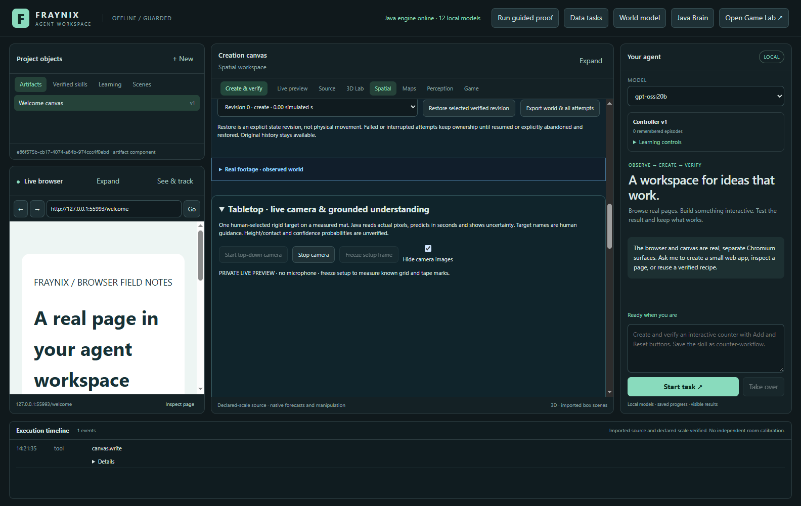
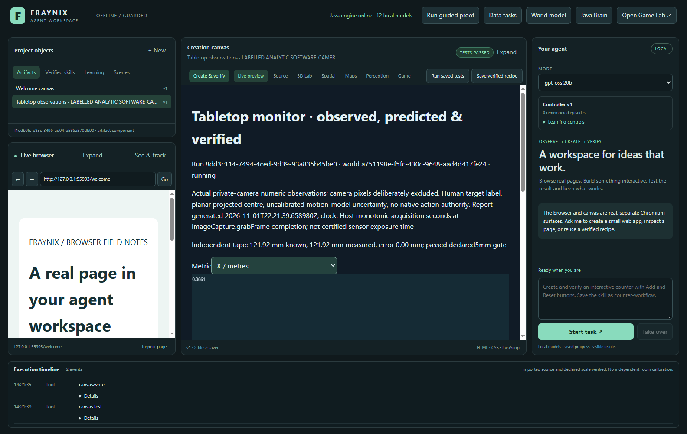
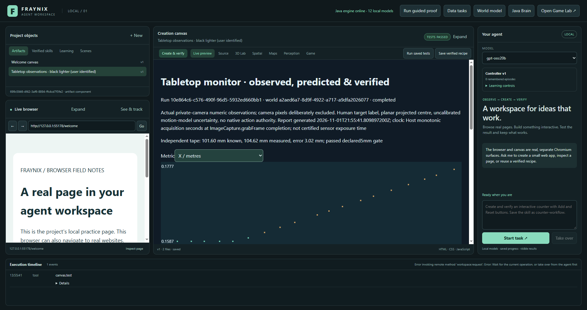
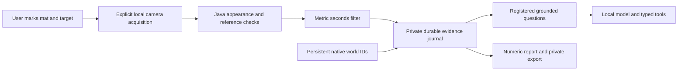

# Fraynix038 — a physical tabletop with evidence the agent can read

[Previous037](README-037.md) · [Edition history](docs/readmes/INDEX.md) · [Offline explorer](docs/readmes/038/index.html) · [Runtime guide](docs/TABLETOP_OBSERVER.md) · [Source lock](docs/TABLETOP_038_CANDIDATE_LOCK.json)

Edition038 takes the next small, real step toward a shared world: a private webcam sees a user-selected lighter on a printed cutting mat, Java tracks its appearance and projected position, and chat reads timestamped measurements rather than inventing coordinates. The browser, creation canvas, Game Lab, native physics, persistent worlds and reusable skills remain part of the same application. This edition adds an observation path into that environment; it does not replace the existing application with a camera demo.

The useful distinction is between an agent having a word for an object and having evidence about it. “Black lighter” is the user's identification. Pixel matching establishes whether the selected appearance is presently supported. Printed mat intersections provide a declared geometric reference. Independent tape ticks challenge that scale. A filter predicts through missing measurements, while the interface says when a position is only predicted. Chat can inspect those records, explain their limits and open their actual report.

## What is implemented

| Function | Current behavior | Practical limit |
| --- | --- | --- |
| Local acquisition | Explicit webcam start, freeze, bounded recording and Stop | Host acquisition-completion seconds, not certified sensor exposure time |
| Measured plane | Four known mat intersections, inches converted exactly to metres | Selected plane only; height, lens distortion and contact are not independently established |
| Independent scale check | Separate tape endpoints with a fixed5mm error limit | Human annotation and unchanged tape placement are assumptions |
| Rigid-target tracking | Original colour template, correlation, ambiguity margin, scale/angle search and reacquisition | One human-seeded appearance; no automatic semantic recognizer |
| Motion estimate | Seconds-based position/velocity prediction and accepted/prediction-only status | Declared motion/noise model; hand forces, friction and3D motion remain unknown |
| Reference guard | Checks four saved mat patches; invalid references stop trusted updates | Covering anchors or changing light can also trigger a stop |
| Durable evidence | Original image hashes, camera clock, world/body IDs, source/code versions and immutable first analyses | New camera sessions require new recording/calibration |
| Grounded chat | Typed read, registered evidence question, report and verified finish | No model-supplied coordinates, thresholds, camera controls or physical action authority |
| Reports and export | Five numeric chart modes; explicit private original-image export | Reports are snapshots; private exports contain camera images |

The implementation is Java math and image sampling. No OpenCV, new vision model, cloud perception service or downloaded neural weights were added. Existing pinned physics/rendering/desktop dependencies still exist; “ground up” does not mean the entire inherited application has zero dependencies.

## Real setup and original outcomes

The user's Cricut mat is12×12in, or304.8×304.8mm. A visible inner10×8in rectangle is used rather than claiming the cropped full mat is visible. Its origin, directions, corner coordinates and error budgets are recorded. The black lighter is next to a tape that includes inches and centimetres; the independent check uses the inch side. A tape housing nearby is a real distractor, not another tracked target.

The first declared tape endpoint fell outside the chosen plane, so the application refused it before returning a numeric scale score. A committed amendment selected an interior5-to9inch span without changing the homography, noise or5mm gate. That first development check measured104.473mm against101.600mm:2.873mm discrepancy. Its stationary clip contained40distinct actual camera images over5.87208seconds;39post-seed updates were accepted. Median processing was120.63ms and95th-percentile160.09ms in that development run. These are local workload measurements, not a universal frame-rate promise.

A separate first live development run retained134/134accepted frames and stable mat references until its12MB original-source budget was reached. Its saved tape-relative coordinate was about 5.81in, consistent with the described placement. Tiny reported numerical jitter is the output of a fixed subpixel search and filter; it is not nanometre camera accuracy. The declared3mm anchor budget, search resolution, parallax and manual annotations remain material.

The new guided session re-read visible intersections and full inch ticks before scoring. It measured105.02mm over a101.60mm tape span, a3.42mm discrepancy that passes the same5mm gate. Both that result and earlier annotations remain visible as separate records; changing a camera session does not erase the original result.

The complete physical journal retains **21 runs, 772 post-seed samples and 793 original images including repeated seeds**. An independent private audit verifies all original bytes, metadata, ordinals and increasing times; 777 distinct image hashes remain outside Git. All numeric rows are included in the companion, including failed/mistimed attempts, cancelled runs and both code versions.

One actual cover/reveal sequence (`acb19212`) loses the target for seven samples and reacquires it at 8.1913 seconds; the private hidden/reappeared frames were visually corroborated. It has seven recovery samples where the frozen procedure requires eight, so it does not pass that strict timed gate. Large sheets covering reference corners correctly stop trusted coordinates. Other recordings left the target visible or covered at the wrong time and cannot establish a successful occlusion test.

The first real 4-to-8-inch slide has 19 samples but only six accepted metric updates. Its old matcher accepts the tape housing below the measured plane; geometry withholds those coordinates. The endpoint analysis is refused. A documented revised candidate refines eight spatially distinct candidates and uses a denser global search without changing the appearance, ambiguity, filter, scale or displacement gates. Replaying the same seen failure with the original images/times/geometry improves to 17 accepted metric updates, including the released lighter endpoint. This is an engineering development regression, not independent validation or self-trained model weights.

The new candidate's subsequent physical manual recording still fails: the object moves before the eight-sample start window is complete and confusion with the tape housing recurs. Its 52 samples contain only five accepted metric updates. A manual interface now folds short timed controls away, waits for measured start samples and coaches release/hand-away at the endpoint. **Real displacement accuracy and empirical uncertainty remain unvalidated.** The next work is stronger target/background discrimination, faster acquisition/processing and explicit preparation/recovery; no threshold was relaxed to manufacture a pass. Long unmeasured gaps can make the simple constant-velocity radius enormous; that represents unusable extrapolation, not measured physical precision.

These recordings are private. Published charts contain numeric derivatives and source hashes, with no raw webcam pixels. Screenshots below either hide camera imagery or explicitly identify an analytic software-camera fixture. Original private files remain outside the checkout and Git.

## Review it step by step

1. Run `Launch-Agent-Workspace.bat` with JDK21 and Node22.12or newer. Install the pinned desktop dependencies if this is a fresh checkout. Docker and WSL are unnecessary. Use a locally installed Ollama model for chat; tracking itself does not need an LLM request.
2. Open Spatial and choose/create a persistent world. Expand the Tabletop panel and select a dynamic body identity. This binds observations to a durable entity without pretending its native mass or shape was measured from the lighter.
3. Start the camera, freeze setup and mark four known mat intersections in perimeter order. Enter the selected rectangle's actual dimensions. Draw the target, then mark two independently known tape ticks. Keep the camera, mat and tape fixed.
4. Save the plane and check scale. Read the measured length/error, not just the green status. A failed gate must be resolved through a new declared setup rather than changing the tolerance to fit the result.
5. Use the prominent **Record a manual tape slide · no countdown** button for movement tests; use Start live monitor for free observation. Wait for eight measured start samples. Release the lighter and take your hand away after moving; wait for END WINDOW before Finish. The short timed tests are folded under Advanced. Watch accepted versus predicted estimates, tape relation, source seconds and reference validity. Hide images when reviewing numeric evidence or taking shareable screenshots. The numeric report may open while acquisition continues.
6. For guided tests, start from a visible still target, follow the actual changing cue, then confirm only the action you performed. Cover just the target and keep reference corners visible. For the4-to8in trial, align the same physical end at each mark and settle at both endpoints. The retained appearance centre is not the tape-alignment feature; their displacement should agree only if orientation/height stay suitable.
7. Select the measurements for chat and ask “Where is the lighter relative to the tape measure?” or “Is the lighter moving, and how do you know?” Chat reads original receipts and opens the actual numeric report. An old saved sample must be described as recorded evidence, not a current physical observation.
8. Finish or Stop before changing the setup. A same-clock resume replays original processing state. After a complete app restart, keep the saved history and begin a new live calibration. Export originals locally if needed; do not casually share a private camera export.

## What the agent can actually explain

Java provides registered predicates for position, motion, visibility, calibration, short prediction and limits. A position answer includes the selected mat-frame coordinates, model radius, accepted/predicted status and saved tape-relative coordinate. Motion uses a declared10mm/s threshold and says that a value below it does not prove perfect stillness. A visibility answer distinguishes a matched target from prediction-only state or an invalid mat reference. A prediction is a0.2second constant-velocity projection with its assumptions stated.

The local model chooses the applicable question and explains the task. It does not become the source of a measured number. The host checks the selected run, retrieves a fresh same-snapshot answer for completion and verifies the generated report's row count, five chart controls and world/run identity. This is a concrete improvement in agency: language can query the same persistent evidence the application displays, while uncertainty and failed observations survive the conversation.

The nervous system and native world model are not replaced. They can later consume qualified observations through explicit adapters. This edition intentionally grants no authority to overwrite verified native state with a camera estimate. An observation's relation to a world body is an association with provenance, not evidence of calibrated3D correspondence or a safe real actuator command.

## Persistence, interruption and source integrity

The journal stores a checksum-protected atomic state envelope under the selected private project. Each original sample has its own hashed bytes and declared time metadata. Stop invalidates late writes. Resume reconstructs the original tracker/filter/guard prefix and checks it against stored results. Complete pending samples can be adopted; incomplete originals remain available for explicit export and refuse continuation. No history is silently pruned to make a result look clean.

Collection is bounded to600post-seed frames or12MB of originals. A richly detailed webcam scene may reach the byte cap in roughly a few dozen seconds; the stationary134-frame result demonstrates why the byte cap is as important as the frame cap. Acquisition keeps one frame in flight and records real gaps, rather than queuing a false fixed-rate timeline. Images are private; numeric reports deliberately exclude them.

The first candidate observer/evaluator sources were locked before guided physical trials. The first real slide exposed housing confusion; a separate revised source lock precedes new footage, and each result keeps its original code identity. Historical036/037 tracking, metric and native-world sources remain protected. A failed physical attempt does not authorize changing its own threshold or relabeling an old rejected profile. First failures, setup amendments, acquisition assumptions and later attempts are documented separately.

## Validation and screenshots

The full resource-limited offline run passes **334 Java tests in 73 classes**, with no failures/errors/skips. **88 desktop unit checks** pass. A separate matching checkout passes ten focused Java tabletop tests and **90 actual UI assertions** across seven workflow groups, plus **three real local gpt-oss:20b assertions**. All 732 canonical implementation files match. Camera denial, actual pointer annotations, image hiding, live acquisition during reporting, Stop/resume, full restart, source recovery, independent export arithmetic/tamper rejection, native state preservation and the intentionally failing no-occlusion control are covered. The original model enum failure and a test-harness wiring failure are retained alongside corrected passes. The original physical failure, documented search revision and unsuccessful new recording are retained; no success threshold was relaxed. Legacy82UI assertions preceded the search-only refinement; final eight tabletop and three model assertions exercise the refined path.

Actual application capture,2026-11-01. The software-camera source is explicitly labelled analytic, with imposed geometry. Camera-hiding behavior is checked separately from physical accuracy; this is not a photo of the user's mat.

Actual numeric report in the app,2026-11-01. It preserves every snapshot row and five chart modes. Reports never contain private source bitmaps. The offline companion includes an independently inspectable numeric chart, source inventory and system map.

Actual first physical-slide report before the search revision. The endpoint remains predicted rather than measured, and analysis refuses it. The corrected seen-source replay and unsuccessful new trial are separate records.

## Architecture and files

The main source path is `workspace-engine/src/main/java/fraymus/workspace/`: RigidTargetTracker, MatReferenceGuard, TabletopFilter, TabletopStore, TabletopAnalysis, TabletopUnderstanding and TabletopReport. The desktop camera interface is `workspace-desktop/renderer/tabletop-panel.js`; `workspace-desktop/tabletop.cjs` coordinates chat. `scripts/Inspect-Tabletop.cjs` independently checks exported arithmetic and provenance. Existing application/game/brain modules remain in the repository. See the [file tree](docs/readmes/038/FILE_TREE.md), [complete file inventory](docs/readmes/038/file-inventory.json), [system map](docs/readmes/038/system-map.json) and [Obsidian note](docs/obsidian/46-tabletop-observer.md).

## Direction and next gates

The vision remains a local agent that perceives, predicts, creates, tests, remembers and improves in a shared environment. The immediate correction is target/background discrimination that rejects the tape housing, plus faster processing and a clear preparation phase. The next useful evidence is repeatable physical movement and disappearance/recovery on new sequences, followed by independent position references for uncertainty calibration. Different objects, orientations and lighting should challenge an unchanged candidate. Reference movement should cause an explicit refusal, not a confident but displaced coordinate system.

After those gates, add broader multi-object identity and perception adapters, then connect qualified observations to prediction-error/novelty detection and explicit persistent-world updates. Measure whether those additions improve tasks over simpler baselines. Automatic semantics, OCR,3D reconstruction, mass/friction inference, model training and real robot actuation remain separate work. More visual activity alone is not useful learning; retained improvement on measured tasks is the criterion.

This edition is valuable because it makes the shared-world claim testable on a modest local machine. It connects real pixels and real printed units to the agent's durable evidence, and it can honestly say “I do not have a trusted measurement” when the reference disappears. The original application design stays intact while that capability becomes concrete.
