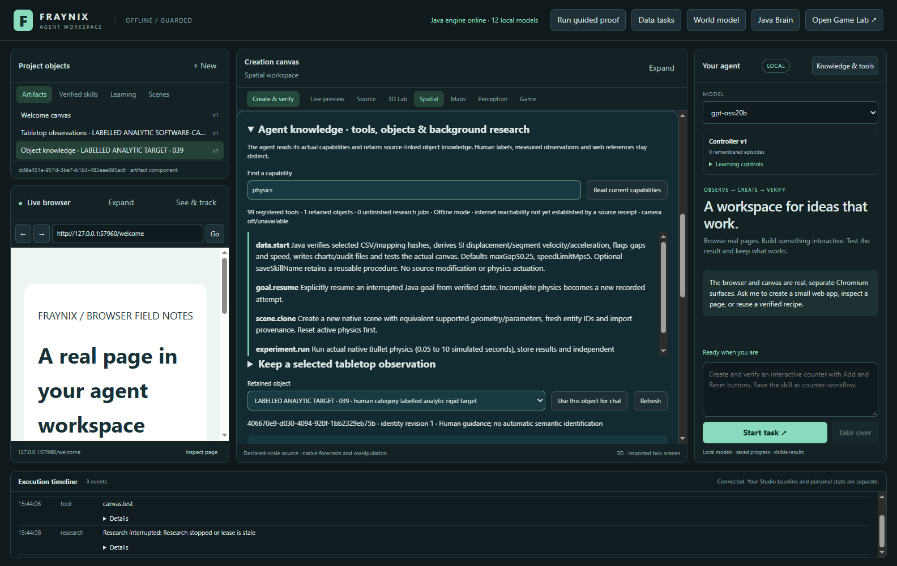
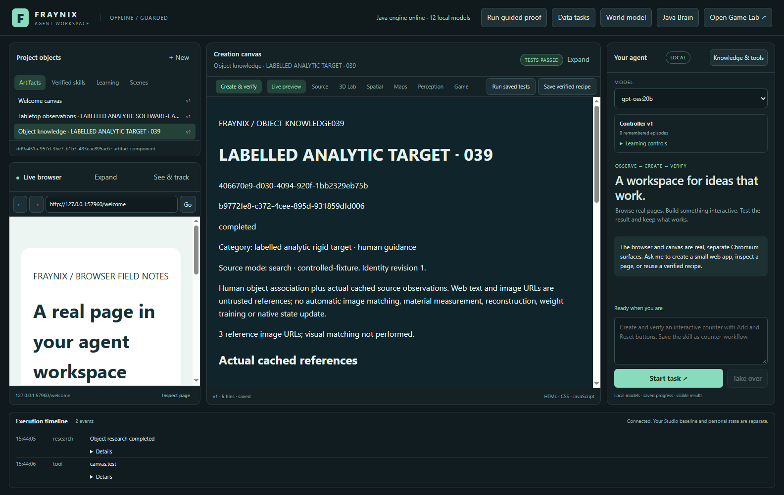
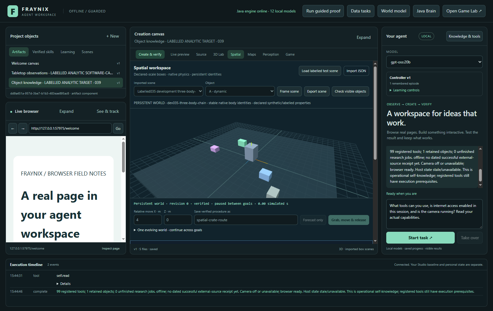
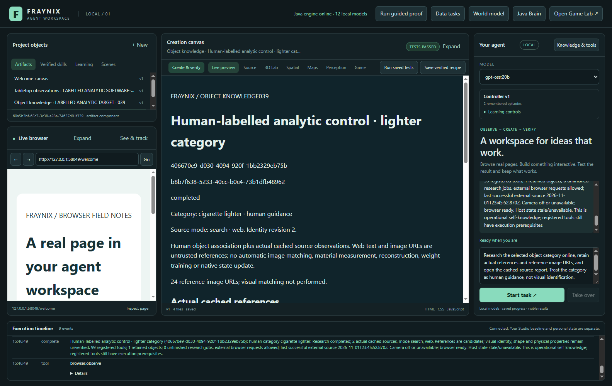
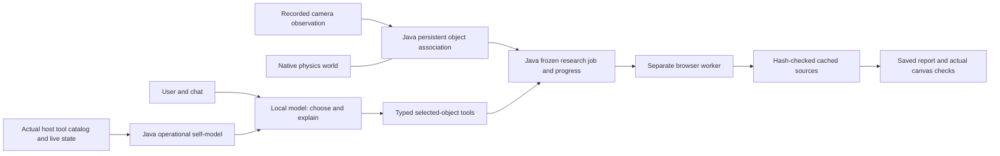

# Edition039 · The agent knows its tools and retains object knowledge

Fraynix Agent Workspace now connects a recorded object to a durable identity, a human category, actual background web research and a checked report. The local model receives the app's current operational state automatically. The browser and canvas remain working parts of the existing application, and the Java physics world remains intact.

This implements the first part of the user's next direction: the agent should know what it can do, remember the object it is discussing, and pursue a related research task while other work continues. The result is a functioning knowledge workflow inside the app. Automatic image recognition, product matching, multidimensional reconstruction and language-model training are future work with separate evidence requirements.

[Previous038: actual tabletop evidence](README-038.md) · [Offline interactive guide](docs/readmes/039/index.html) · [Operation and limits](docs/OBJECT_KNOWLEDGE.md) · [All editions](docs/readmes/INDEX.md) · [Verification](docs/readmes/039/verification.json) · [Complete source inventory](docs/readmes/039/FILE_TREE.md)

## What changed

| Working addition | What it does | Evidence boundary |
| --- | --- | --- |
| Operational self-model | Registers the actual99-tool host catalog, reports local model discovery, current browser/camera/network state and execution receipts | A registered tool still has prerequisites; network allowed does not prove a service is reachable |
| Automatic planning context | Supplies a compact Java-generated self-context before every model planning request | The current task still has explicit typed tool stages and limits |
| Persistent object knowledge | Retains a UUID, human label/category, original observation hashes and native world/body association | Human association establishes the label; native IDs alone do not identify a physical item |
| Background web research | Runs one separate real browser worker, searches publicly and caches bounded actual source pages and image URLs | Sources are candidates, and image URLs are references; no visual match is computed |
| Durable recovery | Saves completed steps, resumes interrupted work, cancels with generation fencing and checks cached-source hashes | Failed attempts remain visible; corrupt evidence cannot be silently accepted |
| Checked cached report | Opens a saved artifact, verifies exact identities/source count and links to escaped local source pages | Passing report checks establishes workflow integrity, not semantic or physical truth |

No new external package is required for these additions. Java implements the new knowledge journal, self-model, routing and report generation; the existing Electron browser handles actual websites. The broader application already uses pinned graphics/physics/browser dependencies. This edition does not claim that all existing infrastructure is bare Java.

## Try it in the application

1. Launch with **Launch-Agent-Workspace.bat** using JDK21 and Node22.12 or newer. Docker and WSL are not required. Ollama supplies installed local models; no model weights are included in Git.
2. Keep the normal project and camera state. Open **Spatial → Tabletop**, choose a recorded run with actual captured frames and inspect its source/measurement status. A camera need not be activated to use recorded evidence.
3. Click **Knowledge & tools** beside Your agent. Search for `browser`, `physics` or `memory`, then click **Read current capabilities**. The panel reads the actual catalog and current host state.
4. Expand **Keep a selected tabletop observation**. Enter an object name and human category. Choose a new object or explicitly associate this observation with an existing object in the same world/body. Click **Keep selected observation**.
5. Select the retained object for chat. Its UUID and exact recording provenance persist. Repeating the same recording binding does not create another object.
6. Ask, “What tools can you use, is internet access enabled, and is the camera running?” The local model reads actual state through `self.read`; it does not answer from a generic capabilities prompt alone.
7. Ask, “Research the selected object category online, retain references, and open the cached-source report.” Outside offline mode, the task searches in the separate browser, reads real result pages and verifies the report. The visible browser is available for your own work throughout.
8. Review sources and failed attempts. Use **Open actual source in browser** for an explicit live visit. Use the report citations for the already-cached text. Cancel or resume saved work using the visible controls.

The category is supplied by you. Calling the target “a cigarette lighter” does not mean the system has recognized a lighter from pixels. The report records that distinction. If a recording contains only prediction, old observations or failed calibration, the knowledge view preserves that status rather than upgrading it to a current measurement.

## Actual screens

Actual2026-11-01 app capture. The target is explicitly labelled analytic software-camera footage. The panel displays the real99-tool registry and a retained human-associated object. The existing browser, canvas, chat and design remain visible.

Actual app report on controlled local source pages. The exact object/job IDs and three cached references were tested in the real canvas. This image demonstrates browser-worker/report behavior, not public connectivity or physical object recognition.

Actual gpt-oss:20b conversation with offline mode enabled. Host facts distinguish available tools, current camera state and lack of external-source evidence. The model is local; no cloud inference provider was used for this check.

Actual local-model public search/source workflow. The human cigarette-lighter category is attached to a labelled software control for this test. It is not a recognition result on the user's private lighter footage. See the verification record for exact result URLs, failed steps and source hashes.

## One system, explicit responsibilities

The model chooses a registered tool. Java maintains state, provenance, budgets and recovery. The desktop performs browser actions and displays results. Controllers continue to handle physical timing; verifiers continue to check actual outcomes. A webpage cannot turn itself into a tool declaration or physical measurement.

The self-context is generated before every planning request, including existing task routes. It includes the registered tool count, current allowed tools, fresh host state, selected object, durable research progress and the last dated successful external-source receipt. A capability query can discover tools beyond the current stage; execution still follows the matching task route and prerequisites. Each new knowledge-planning turn records the model admission and self-context hash for review.

This is useful operational awareness: “I have these registered actions, this selected object, this unfinished job, and this evidence.” It does not establish a subjective inner experience. Persisting explicit state solves continuity problems that should not depend on one model conversation's context window.

## Object memory and source boundaries

Each retained object has a stable UUID and identity revision. Observation bindings retain the run, native world/body, tracker-code, geometry and original image hashes. Its label and category explicitly say human guidance. A new run does not silently become the same physical object because it uses the same simulated body. The user must associate it explicitly.

Changing a label/category increments the identity revision. A research job keeps its frozen category/query and original revision. If the category changes while it runs, a completed result becomes completed-stale. The old evidence remains available and is not relabelled as current knowledge.

The journal lives inside the selected project's private knowledge-039 directory. It uses a checksum envelope, file locking and forced atomic metadata replacement. Source documents are immutable hash-addressed files with separate text hashes. A restart marks running work interrupted; Resume continues from the last acknowledged step. Cancellation changes the generation and rejects a previous worker's late callback. Source corruption is refused without erasing the original history.

Current limits are64 objects,64 jobs,32 observation bindings per object,256 cached documents and4MB metadata. Reaching a limit stops new work rather than silently deleting memory. This is a bounded first implementation, not unlimited storage or unrestricted parallel agents.

## Real background research

The worker first tries Google, then Bing when no source plan is obtained. It attempts up to three returned source pages. Each page retains its requested and final URLs, response status, capture time, bounded text, text hash and up to12 reference-image URLs/alt labels. Search failures, human verification and unreadable pages remain part of the job. Source pages can fail even after a successful search; completion requires at least one usable cached source.

The browser worker uses a separate fresh session with no privileged preload, Node access, camera/microphone permission, popup or download authority. It obeys offline mode and rejects production local/private address destinations. It cannot move the visible browser to a result page. The only external query content is the human category plus the reference-search wording; private camera pixels are never sent.

Images are URL references in039. They can include site graphics or icons; object relevance is not established. They are not downloaded for comparison, recognized as the observed object or converted to a3D mesh. Cached source text is escaped in reports. It can contain incorrect statements or attempted instructions; it does not gain authority over the model's registered tool stage or native state.

One worker runs at a time, with120 seconds per attempt,20 seconds per individual capture and at most three interrupted/resumed attempts. There is no challenge bypass. Explicit URL ingestion remains labelled provided-urls, separate from search. Network permission, a dated successful fetch and present reachability of an arbitrary website are three different facts.

## Validation and retained failures

The complete offline check passes **341 Java tests in74 classes**, with no failures or skips. A separate matching-source checkout passes seven focused Java checks, **94 desktop checks**, **65 actual UI assertions** and **six real gpt-oss:20b assertions** across the new knowledge and existing tabletop routes.

The machine-readable [verification record](docs/readmes/039/verification.json) reports the completed test counts, model and source inventory. Eight actual Electron/Java workflow checks cover visible association, capability discovery, image processing concurrent with research, full restart, exact-prefix resume, report/citation integrity, cancellation and preservation of original native/observed histories. Java checks cover stale identities, lease fencing, corrupt-cache refusal, escaped text and self-state truthfulness. Desktop checks cover routing, tool schemas, URL boundaries and selection ownership.

Real gpt-oss:20b checks exercise offline capability chat and actual public research/reporting. Controlled local pages are labelled fixtures and cannot establish public internet reachability. Public test publication retains URL/status/hash metadata; full third-party source text stays in the local project cache. Earlier setup mistakes and failed development attempts remain recorded alongside corrections.

Edition038's physical results remain unchanged. The last tape discrepancy was3.018mm over101.6mm; physical displacement and empirical uncertainty remain UNVALIDATED, with lighter/tape-housing confusion still unresolved. This edition does not improve that tracker, train weights, promote a physical controller or convert a web description into verified mass/friction. Original private recordings remain outside Git.

## Where this leads

The user's larger idea is a persistent spatial agent that can see, reason, act, create and evaluate outcomes within one environment. This edition adds a needed bridge: observations can now own retained knowledge and real task progress, while the local model can inspect the system it actually inhabits.

The next integration should give the game runtime, spatial renderer and observed objects one shared entity/transform interface, with separate source-qualified observation and simulation states. Orthographic2D and perspective3D views can then display the same identity through different cameras. Sprite/tile imports should preserve coordinates, units and components and survive a tested save/reload cycle before becoming agent actions.

Higher-dimensional features can represent time, uncertainty, hypotheses, relationships or control parameters. A4D feature graph is not evidence of an additional physical spatial dimension. Likewise, one flat camera view cannot reveal hidden object geometry without assumptions or more observations. The app should label unknown depth and compare reconstructions against independently known measurements.

For useful improvement, retain task experiences, compare candidate methods on separate new cases, promote only measured improvements and keep rollback. The immediate perception gate remains new lighter motion/occlusion footage with independent positions and stronger background discrimination. A later reconstruction gate should compare multiple calibrated views of a known object. Neural computation and changing weights would need their own CPU-reference, persistence and held-out task tests.

These are implementation gates, not claims of completed general intelligence. The advantage of the current architecture is concrete: local models, explicit Java state, a real environment, actual tools and checks can participate in one workflow with continuity across restart.

## Source and release continuity

The [complete inventory](docs/readmes/039/file-inventory.json), [system map](docs/readmes/039/system-map.json), [offline guide](docs/readmes/039/index.html) and [Obsidian map](docs/obsidian/object-knowledge.canvas) describe this edition. New core sources are KnowledgeStore, SelfModel, KnowledgeReport, research-worker.cjs, knowledge.cjs and the Knowledge panel. The original perception/math/native engine sources and published README001–038 remain preserved.

Publication continues in [Fraynix-Agent-Workspace](https://github.com/eyeoverthink/Fraynix-Agent-Workspace), independently of the historical Chandra/Studio applications. The release is tagged readme-039 only after its documented checks. Model weights, credentials, personal browser state and private camera originals are excluded.
