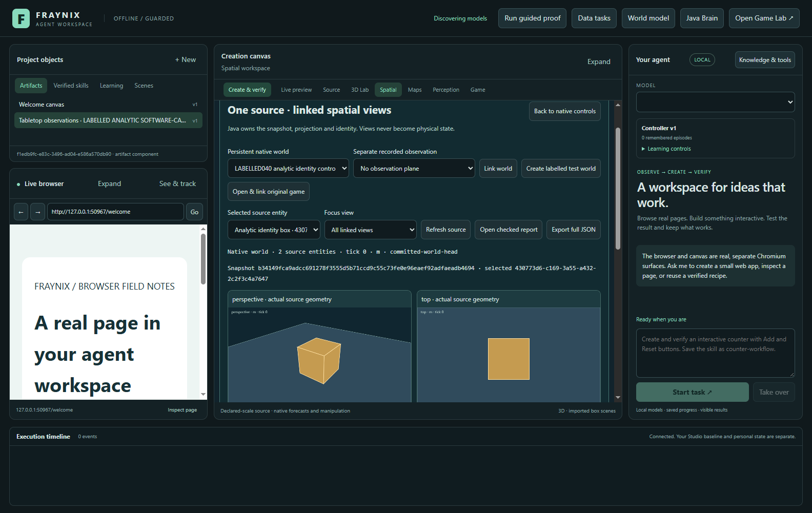
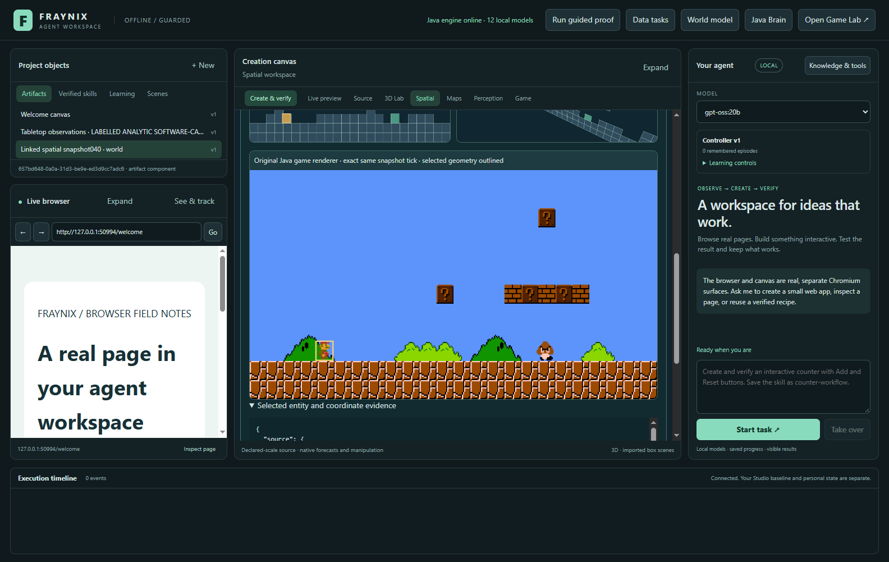
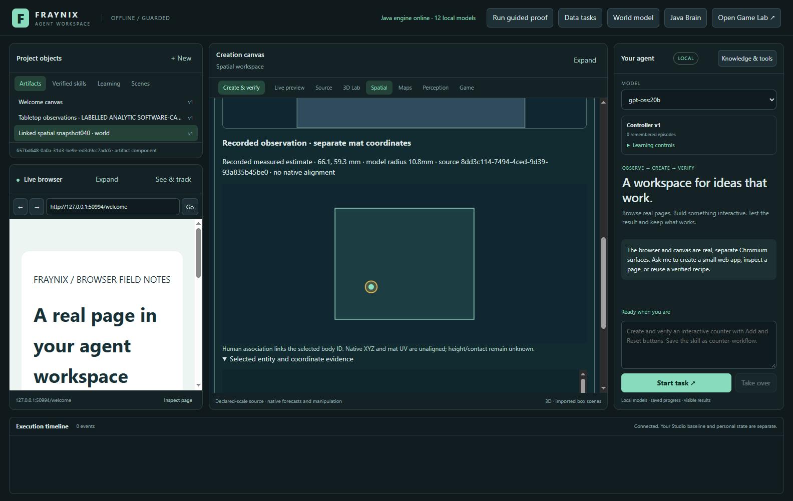
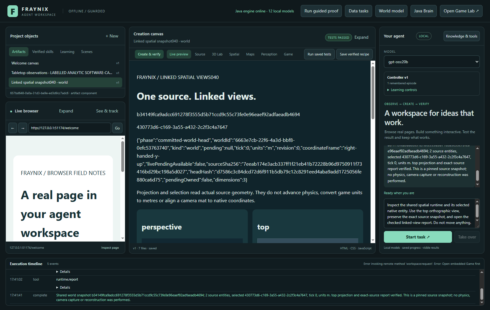
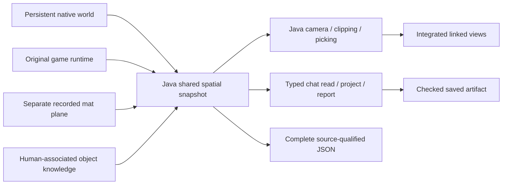

# Fraynix Agent Workspace ·040

**One Java-owned spatial interface. Linked views. Exact source identities.**

[Previous039](README-039.md) · [Edition history](docs/readmes/INDEX.md) · [Offline illustrated guide](docs/readmes/040/index.html) · [Operation](docs/SHARED_SPATIAL_RUNTIME.md) · [Verification](docs/readmes/040/verification.json) · [Complete implementation tree](docs/readmes/040/FILE_TREE.md) · [Obsidian map](docs/obsidian/shared-spatial-runtime.canvas)

Edition040 brings the preserved game, persistent native simulation and recorded tabletop observations into one integrated spatial inspection workflow. Java supplies the source snapshots, camera calculations, clipping, picking and identities. The desktop draws those results inside the existing workspace. Chat can inspect the selected source and produce a checked report using real registered tools.

The practical improvement is continuity of meaning. An object selected in a top view is the same object selected in perspective, front or side. A native pose carries the world revision and physical units that produced it. A game sprite retains its original game UUID, transform and component names. A recorded lighter estimate carries its observation source and uncertainty qualifications. These facts become available together without silently treating a camera estimate as a simulated body or a sprite layer as depth.

This edition implements a shared read interface, rather than merging distinct physics solvers. The original game and the native 3D controller continue running their own actual logic. Their observations are adapted into a consistent envelope that states where every value came from. The new views do not invent geometry, physical measurements or capabilities that those sources do not contain.

## What you can use

Open **Spatial**, then **Linked views**. Select an existing persistent world and press **Link world**. Alternatively, **Create labelled test world** creates a real native world from the retained declared scene. The title explicitly identifies it as a test scene. It is useful for learning the interface without suggesting a real room was reconstructed.

Native worlds offer perspective, top, front and side cameras. Selecting a visible box in any camera preserves its source UUID, and the same selection is highlighted throughout. **Focus view** enlarges one camera. **Refresh source** reads the actual current state. **Back to native controls** returns to the existing native manipulation interface so the new inspection mode remains part of the application you already use.

Actual edition040 capture, November1,2026: a declared single-box control loaded through the real world ledger. Its source tick is zero. This screenshot demonstrates integrated projection and selection; the box is not a reconstructed webcam object. The companion evidence retains the actual UUID and complete state used for the views.

**Open & link original game** starts the actual preserved Java game runtime and binds its current session. Two geometric views appear alongside the original rendered raster. **Step left**, **Step right** and **Jump** delegate bounded inputs to the existing controller. **Play** and **Pause** use the existing runtime controls. The test checks that a right step advances exactly30 ticks and moves the same player UUID, with changed original pixels.

Actual edition040 capture, November1,2026: the existing renderer supplies the embedded game image. The selected player outline comes from the matching Java snapshot. Flat projected quads expose source geometry, while the original raster preserves textures, animation and sprite appearance. A perspective view of planar game geometry does not make the game a physically three-dimensional world.

## Three coordinate systems, explicitly qualified

| Source | What the interface retains | What remains unknown or separate |
| --- | --- | --- |
| Persistent native world | Right-handed Y-up metres, quaternions, source IDs, declared body properties, ledger revision and ticks | Declared simulation properties are not independently measured real-world properties |
| Original game | Actual XY position, signed scale, rotation, components, sprite data, game session/tick and matching raster hash | Legacy game units are not calibrated SI; render layer is not physical Z |
| Recorded tabletop plane | Original run/body/geometry/code/image hashes, source seconds, planar metre estimate and prediction status | Height, contact and native-frame alignment remain unknown |

The native adapter checks the ledger before and after reading the native runtime. A matching pending run can supply live poses, clearly labelled **uncommitted-native-attempt**. Otherwise the interface exposes the committed world head and reports that a pending attempt exists without claiming its live state is available. A dedicated real native test pauses a running attempt, compares every pose with the actual native snapshot, and confirms another run ID cannot replace that state.

An optional **Separate recorded observation** can show a previously bound tabletop recording below the native views. Its point and model radius belong to the declared mat frame. Selecting its associated body preserves identity linkage, but does not align the mat with the native world. The recorded source time and receipt time remain distinct, and a prediction-only position is labelled accordingly.

Actual edition040 interface capture, November1,2026, using the explicitly labelled analytic software-camera fixture. No personal camera image appears here. The fixture tests source preservation and coordinate separation; it does not establish tracking accuracy on the user's lighter. The original physical038 movement/uncertainty gates remain unvalidated.

## Chat participates in the same runtime

Select a spatial source first, then ask:

> Inspect the shared spatial runtime and its selected entity. Use the top orthographic view, preserve the exact source snapshot, and open the checked linked-view report. Do not move anything.

The agent receives three actual typed tools. `runtime.read` uses the user's selected source and pins its snapshot. `runtime.project` chooses one of the registered camera names. `runtime.report` creates the real saved report from that pinned source and opens it in the canvas. The host checks the snapshot hash, selected UUID, rendered view count and compact table row count before recording a verified workflow.

The model cannot supply arbitrary replacement poses, camera pixels, success flags or a different source UUID through these tools. The summary prioritizes the selected entity and includes at most16 entity rows; full report/export data still retains every source entity. This avoids the earlier failure mode of sending a multi-megabyte scene dump into a limited language-model context.

Every planning stage receives fresh operational context: actual registered tools, current source binding and selected entity. That builds on edition039's self-model and object memory. It is operational awareness of available interfaces and retained state. It does not establish subjective consciousness, automatic visual recognition or independent physical understanding of an unfamiliar object.

Actual local `gpt-oss:20b` task capture. Its evidence records the model digest, requested compute settings, source hash, tool sequence and checked report. The first pre-restart native task completed; the following game task was interrupted. The frozen verification distinguishes that partial attempt from completed post-recovery validation.

## How the implementation works

`SpatialRuntime040` owns bindings, compact summaries, snapshot integrity, task pins and persisted selection. `SpatialProjection040` computes camera bases, quaternion-transformed corners, near/far and viewport clipping, perspective or orthographic projection, and ray-based identity picking. It reuses the existing geometry mathematics while preserving the original physics and perception implementations.

The original-game adapter executes on the game's owner thread. One spatial response contains coherent source transforms, tick/session evidence and the original PNG/hash. The shell draws native polygons on an ordinary canvas, and displays the game's actual matching raster separately. Filled faces use depth ordering; the new geometric view does not claim a full textured renderer or per-pixel depth buffer.

All changes are inside this independent repository. The [inventory](docs/readmes/040/file-inventory.json) names every canonical implementation source and asset; the [preservation audit](docs/readmes/040/legacy-preservation.json) identifies the existing integration files changed for040. Previous numbered READMEs and their frozen snapshot assets remain historical records.

## Files, continuity and recovery

**Export full JSON** creates a real local file containing complete source-qualified entities. The standalone JavaScript inspector independently checks its canonical SHA-256, unique identities, finite poses, quaternions and source-specific coordinate rules. Altering a coordinate without updating the checksum is refused. Checksums establish internal consistency; they do not grant authority to replace a world or prove physical truth.

Saved reports contain `index.html`, `summary.json`, per-view JSON and `snapshot-gzip.json`. The compressed evidence retains its original byte count and SHA-256. It includes the complete source snapshot without private camera pixels. This makes a report portable for inspection while keeping its qualification: native simulation, original game state and recorded observation are distinguishable.

Binding, selection and focus are atomically persisted in the project's separate `spatial-runtime-040/state.json`. They survive a full desktop restart for a durable native world. Snapshot caches are process-local and are not silently restored as current. An old game session requires explicit reopening and rebinding. A selection made against an older moving source is rejected; pause the source and refresh before picking.

Bounds are explicit:4096 game entities,32 native entities,16 cached snapshots and at most two pinned task snapshots. Viewport dimensions are limited to160–4096 pixels. Visible linked views refresh at most once per second and stop polling when hidden. A long model task uses its pinned source while the display can inspect newer snapshots. A task pin is released when the task finishes or fails.

## Validation after the restart

The complete offline baseline passes **351 Java tests in77 classes**, with no failures or skips. The final ownership-metadata correction is checked by ten focused spatial tests and the final-source app/model workflows; the verification retains both source revisions and that qualification.

Final-source validation also passes **100 desktop checks,85 actual UI assertions and three real local-model assertions**, plus two desktop-width checks. All eight model planning calls requested CPU-only operation with four threads; an actual Ollama residency read reported zero GPU memory. All759 canonical implementation files/assets match the independent checkout.

The [verification JSON](docs/readmes/040/verification.json) records exact completed checks, source revisions and scope. Analytic tests independently verify camera projection, perspective scaling, orthographic depth invariance, quaternion corners, clipping and picking. Real native tests cover committed/live ownership, identity/configuration restart, observation separation, stale selection and altered exports. The actual original game test checks transforms, components, raster hash and bounded movement.

Desktop checks exercise typed schemas and task routing. Actual Electron checks operate the visible controls, export real files, verify real report content, restart the app, select the same box in four views, and step the preserved game. Separate local-model tasks verify actual tool planning and checked reports. These are workflow and consistency results; they do not turn a test fixture into a physical-camera accuracy result.

During development Windows restarted unexpectedly. The retained event has bugcheck code zero and does not establish a cause. The interrupted model trace is retained rather than counted as passing. Recovery added an explicit host-only CPU planning option and preserved the source checkpoint on actual GitHub main before continuing. No global Ollama settings, BIOS configuration or personal recordings were changed.

For conservative tool planning, set `FRAYNIX_WORKSPACE_PLAN_CPU_ONLY=1` before launching. `/api/plan` then requests zero GPU layers, four CPU threads and no retained model after each call. The original game still uses its renderer. Other inference paths are outside this switch. CPU planning can take longer; the verification records the actual requested options rather than assuming execution settings.

## Run and review

Use JDK21 and Node22.12 or newer. **Launch-Agent-Workspace.bat** builds the checked-in Java modules and starts the desktop workspace. Initial setup needs the pinned dependencies; an installed completion-capable local Ollama model supplies agent planning. Docker and WSL are not required. Personal projects and model weights stay outside Git.

1. Open **Spatial → Linked views** and link a persistent world.
2. Compare all four cameras, then enlarge **Top** and select the object.
3. Open the checked report and export the complete JSON.
4. Ask chat to inspect the shared spatial runtime and report from the exact source.
5. Explicitly open/link the original game, step right once and compare its raster with its selected source identity.
6. Optionally link an existing recorded observation, keeping its separate mat frame and limitations visible.

The complete test commands and results are in the verification record. Heavy native, game and model checks run serially. Isolated test projects use labelled fixtures; they never share the user's active review database. The private camera history remains on the user's machine, and review handoff uses a distinct preserved copy.

## Direction and next acceptance gates

The broader goal remains a local agent that can perceive, reason, create, act and evaluate within a continuing environment. Spatial state, browser data, generated artifacts and physical observations can share identities and provenance while retaining their different coordinate systems and authority. Java gives the application a durable execution backbone; useful agency comes from completed verified tasks and recovery, rather than the programming language alone.

The next physical step is explicit frame registration and better object discrimination. A user-declared mat-to-native alignment should retain units, landmarks, residuals and uncertainty, then be checked against new measured positions. Lighter-versus-tape-housing confusion needs new target/background cases and occlusion footage before stronger tracking claims. Unknown depth should remain unknown until a calibrated multiview or depth source measures it.

After registration, a useful demonstration would select a real recorded object, compare its measured motion with a simulated hypothesis, expose the residuals, and retain an accepted procedure across restart. Promotion must use independent cases and preserve rollback. Later sprite/mesh imports, multiple cameras, reconstruction and neural policies should enter through the same source-qualified interfaces, with their own tests and budgets. This edition prepares that shared interface; it does not claim those later gates are already solved.
