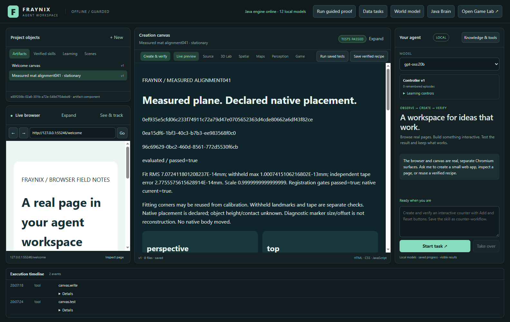

# Fraynix Agent Workspace ·041

> **Edition041 implementation checkpoint, not the completed release.** Full Java360/78classes,106desktop and9visible software-camera workflow checks pass. Actual model/broader regressions remain pending. First real registration passes its reference gates. The fresh4to8inch movement trial passes with6.377mm vector error; its first result is retained. Fresh occlusion has only its initial8samples and is not scored. [Current checkpoint](docs/ALIGNMENT_041_PROGRESS.json).

**Measure the plane. Declare its native placement. Test what the camera actually observed.**

[Previous040](README-040.md) · [Edition history](docs/readmes/INDEX.md) · [Operation](docs/MEASURED_ALIGNMENT.md) · [Declared contract](workspace-engine/src/main/resources/alignment-041-contract.json) · [Candidate source lock](docs/ALIGNMENT_041_CANDIDATE_LOCK.json)

Edition041 connects the measured cutting-mat plane to the existing native spatial interface and adds a recorder for fresh physical movement and occlusion tests. The application keeps the distinctions that make this useful: reference measurements, simulated geometry, a human-associated object, observed target features, predicted positions and independent test outcomes each retain their own evidence.

The new view is inside the existing workspace. Java performs the plane registration, source checking, target matching, motion estimation and projection. The desktop supplies the actual camera frames and visible controls. Chat can read the selected registration/trial and open its exact-source checked report. The original game, native physics, browser, creation canvas, saved procedures and older camera records remain available.

The first real setup uses the user-confirmed12 ×12-inch cutting mat, dual-unit tape and black lighter. The visible measured rectangle spans ten columns and eight rows. Four printed-grid intersections fit the calibration, three other intersections act as withheld checks, and a separate four-inch tape interval checks scale. The camera image remains private. Exact numeric annotations were committed before calculating the first result.

## What the first alignment establishes

The first registration passed its declared gates. Its maximum withheld-grid residual was **0.383975 mm**, and its independent tape-length discrepancy was **2.403976 mm** over a known101.6 mm interval. The fitted in-plane scale was1.0000000000000002. These are source-specific consistency checks with the recorded annotations.

The nearly zero fit residual is expected because its fitting landmarks reuse the calibration corners. It is not a physical accuracy measurement. The declared3 mm annotation budget remains in force; target height, camera parallax and contact are unmeasured. A small withheld residual does not turn the system into a calibrated sub-millimetre instrument. Fresh movement and occlusion outcomes are separate evidence and must be scored independently.

The native placement is explicit. By default, the chosen mat corner becomes the virtual origin, across the mat follows native+X, and upward on the mat follows native−Z on a declaredY=0 plane. That gives the observation a defined place in the existing right-handedY-up scene. It does not claim the system measured the mat’s pose in a physical room or reconstructed the lighter’s height.

This is a useful bridge between observation and simulation. A point measured in mat metres can be displayed in native coordinates and compared with a hypothesis, without replacing the actual native body pose. The same retained body association carries the human label, while the observation marker states its current source, measurement/prediction status and limits. Native objects are not silently moved to follow a camera estimate.

## Use the measured view

Open **Spatial → Measured mat alignment** after linking a persistent native world. Start the camera and freeze a fresh source frame. Select four known grid corners in perimeter order: origin, across, opposite, up. Enter their measured width/height. Add at least three other known grid intersections as independent checks, specifying their distances from the chosen origin. Mark two known tape positions and declare inches or centimetres.

Draw the actual target and a background example such as the tape housing. Advanced controls expose the declared native origin/basis and exact numeric annotations. The source description records what was measured and how the marks were read. Save/check registration to retain an immutable result. A failed result remains in the history; correcting the source annotations produces another record.

Four Java projections show the registered surface diagnostics alongside actual native geometry. A small highlight identifies the mapped target point when usable. Its size and visual offset are drawing choices, not measured object geometry. Unknown height/contact remain unknown. Camera/mat reference failure or a changed native revision suspends registered measurement instead of inventing a replacement coordinate.

## A recorder that waits for the person

The earlier short timed cues were difficult to follow consistently. Edition041 uses manually acknowledged phases and fixed windows. After a hold window is captured, the recorder pauses and waits. The person can prepare the next physical condition before clicking the next button. The program records what happened; it does not presume that a button press made an object disappear or move.

For movement, leave the lighter uncovered. Align the same metal end at the start mark and take your hand away. Begin the trial. It saves eight post-seed start samples and pauses. Click **Start moving**, move to the end mark, release the lighter and remove your hand. Click **At end mark; hand away**. It saves the next eight frames as the endpoint window and pauses. Finish recording.

For occlusion, begin with the lighter visible and hand away. After eight initial frames, cover only the lighter, keeping the reference corners visible. Click **It is covered** after the cover is in place. Eight hidden frames are saved, then the app waits. Uncover the lighter and remove your hand; click **Visible again; hand away**. It captures eight revealed frames. Finish recording.

There is no countdown to race. There is also no search for a favourable later window. The first designated frames are the evaluation windows, including failed observations. A stationary control captures twelve post-seed frames. All recordings preserve original source bytes and actual acquisition-completion times, with a bounded single-flight processing loop.

## What counts as passing

| Check | Fixed requirement | What it does not establish |
| --- | --- | --- |
| Registration | Fit RMS≤3 mm, withheld max≤5 mm, tape discrepancy≤5 mm, scale0.98–1.02 | Measured room pose, object height or certified metrology |
| Stationary | Twelve measured post-seed frames, jitter RMS≤3 mm | Absolute position accuracy |
| Movement | Eight measured start and eight measured end frames; vector error≤10 mm against independent tape displacement | Accuracy of unreferenced positions while the hand obscures the target |
| Occlusion | Zero accepted hidden measurements,≥80% measured recovery in the eight revealed frames, return error≤10 mm | General recognition or arbitrary occlusion robustness |
| Report workflow | Exact snapshot, registration/trial identity, landmark rows and four actual Java views checked in the canvas | A successful physical trial when its recorded result failed or is unscored |

Capture completion is a separate status from evaluation. Original frames must be independently annotated with their exact hashes and actual visibility. Movement additionally needs confirmation that the same physical end is at the declared marks. Predictions cannot supply ground truth. Contradicted or unresolved physical conditions remain unscored; the first result is immutable.

The visible software-camera test deliberately presses the hidden-phase button while its target stays visible. The app retains those frames and refuses to claim occlusion success. That is an important control: a polished interface or a completed progress bar must not manufacture evidence of a physical capability.

## Target tracking without drifting onto the background

The new Java matcher uses a fixed human-seeded colour/edge template and fixed negative/background examples. Candidate searches are constrained to the measured mat. Bounded local search expands for recovery after loss, with appearance, colour, ambiguity and background margins controlling acceptance. The template is not updated from scored frames.

This targets a known failure in earlier footage: the tracker could confuse the black lighter with part of the tape housing. The new matcher has to distinguish their actual pixel features, and the source guard has to verify that the mat/camera reference still holds. Similarity scores describe matching. They are not a product identity, semantic label or probability that an object is a lighter.

Motion estimates use actual host-monotonic ImageCapture completion seconds. They are not claimed sensor exposure timestamps. The retained constant-velocity filter predicts planar motion when measurement is absent and grows its model radius. That radius remains uncalibrated until separately referenced footage establishes coverage and width. A predicted point can remain useful for display while still being clearly labelled as a prediction.

## Java ownership and integration

`MatRegistration041` computes a planar similarity transformation in an explicit orthonormal native basis. `MatTarget041` extracts immutable target/background features and performs bounded candidate search. `Alignment041Store` retains calibration, originals, source clocks, phases and exact replay fences. `MatTrials041` evaluates fixed windows against independently supplied references. `Alignment041Report` produces the actual numeric report and registered diagnostics through the existing Java projection code.

The world ledger and native controllers retain action authority. The new subsystem has no native write interface. It checks the world revision/hash before capture and again before accepting a row. A late camera generation, changed clock/session, altered original or changed source ownership is refused. If a process ends, the saved prefix is interrupted; restarting does not silently reopen a camera session or relabel an older image with a new phase.

Registered observation markers are added only to derived display snapshots. Actual native entities retain their original IDs, positions, rotations and ticks. This is the next practical application of edition040’s shared interface: measured source points can participate in the same spatial inspection workflow while preserving uncertainty and provenance.

## Chat and retained evidence

Ask chat to inspect the **measured mat alignment** or retained manual trial. `alignment.read` pins the current registration/trial evidence; `alignment.report` opens its real saved report. These tools accept no model-supplied identities, measurements, reference labels, camera commands or success flags. The actual host context includes the selected registration/trial IDs and registered capabilities.

A report includes residuals, actual sampled motion, CSV, source-qualified view JSON and a complete compressed numeric snapshot. The host checks its exact source identities in the actual canvas. A verified read/report workflow can correctly report a failed physical experiment. The workflow status is not substituted for physical success.

Numeric JSON exports are real local files. The standalone inspector independently verifies canonical snapshot and registration hashes, source relationships, finite planar values and increasing ordinals/times. The private originals remain in the project’s `alignment-041/frames` directory. No personal camera pixels enter the report, model prompts or Git documentation. Published camera examples use labelled analytic controls or numeric-only views.

## Continuity, validation and next gates

The candidate and observer/evaluator/source hashes were committed before fresh physical scoring. The first real reference annotations were separately committed before calculating registration. Initial development and test-harness failures remain in the evidence history. Previous001–040 documentation and original038 physical failures remain preserved.

Focused validation covers independent geometry, actual pixel movement/occlusion controls, phase/generation fences, replay/source corruption, fixed windows, restart, projection and exported evidence. Desktop checks cover typed tool limits and actual report assertions. The visible test exercises ImageCapture through a labelled camera source, real UI controls, source refusal, local files and full restart. Physical and local-model outcomes are recorded separately from those controls.

The next acceptance gate is demonstrated performance on genuinely new movement and occlusion footage, with the original first results retained. Only then can a source-specific improvement be reported. Broader target variation, lighting, rotation, camera changes, multiple objects and depth need their own independent cases. A measured registration does not solve all of those problems.

The longer direction remains one local environment in which an agent can observe, compare hypotheses, create, act and check outcomes across continuing tasks. This edition strengthens the observation-to-world bridge. Later policy learning should demonstrate better held-out task outcomes with rollback, rather than treating new diagrams, changing weights or retained labels as proof of intelligence.

## Fresh physical checkpoint ·2026-11-01

The refreshed camera session retained the same measured grid and passed registration. The person confirmed the same metal end at4in, uncovered and hand away. The first8post-seed frames are now saved under trial131fd959-57fa-4bba-9944-0c267402bbb4. All8target detections were accepted and every mat-reference check was stable. Each unannotated original was inspected independently: the lighter remained visible by the4in mark. The app is paused until the person starts moving. No distance or occlusion success is claimed.

Actual acquisition intervals averaged approximately1.46seconds in this window. The UI schedules at most5Hz, but complete durable replay, source checking and view updates currently reduce observed throughput. Reacquisition-after-gap labels preserve that timing limitation. This checkpoint does not establish smooth realtime tracking or calibrated uncertainty. Performance work should retain these originals and fixed first outcomes before attempting improvement.

The full isolated Java run passes360tests across78classes with no failures, errors or skips. Subsequent changes affect camera-session invalidation and chat wiring only; Java observer/evaluator sources remain exact. Independent final desktop checks pass106tests, and the visible labelled camera workflow passes9checks. Actual CPU-only model and broad integration runs are still pending; this edition is not yet tagged/frozen.

## First fresh movement result

The same metal end moved from4in to8in with the lighter uncovered. The first result passes its declared10mm movement-vector gate: **6.376571mm error** against the independent101.6mm reference. All16fixed endpoint samples were measured; no endpoint mat-reference failures occurred. Observed endpoint-mean displacement was approximately107.83mm with a small lateral component. This is one source-specific result, with human-confirmed marks and each original endpoint frame inspected independently. It is not zero-error metrology or a general motion benchmark.

The trial retains8start frames,9transition frames and8end frames. The first eight endpoint frames count even if unfavourable; transition predictions cannot supply ground truth. A new occlusion trial has saved its8visible baseline frames and is paused for the user. Its hidden/revealed results remain pending. [Numeric physical evidence](docs/ALIGNMENT_041_PHYSICAL.json) includes actual positions, timestamps, source hashes, acceptance flags and the immutable evaluation, without private camera bytes.

## Screenshots and offline guide

These actual application captures use the explicitly labelled analytic software-camera control, not personal webcam photographs. Private real-camera originals remain outside Git.

The measured setup, source description and reference checks in the integrated workspace.

The saved report opens in the real canvas and passes five source/identity assertions. Its control is labelled; it is not substituted for the fresh physical movement result.

[Offline system, residual and motion explorer](docs/readmes/041/index.html) · [All773implementation sources](docs/readmes/041/FILE_TREE.md) · [Current validation scope](docs/readmes/041/verification.json) · [Obsidian system map](docs/obsidian/measured-alignment.canvas). The guide works without a CDN and has passed actual1440/390-width checks for layout, module selection/filtering, source search, numeric sample selection and screenshots. Model/broad QA and occlusion are explicitly pending; this snapshot is not frozen or tagged yet.
