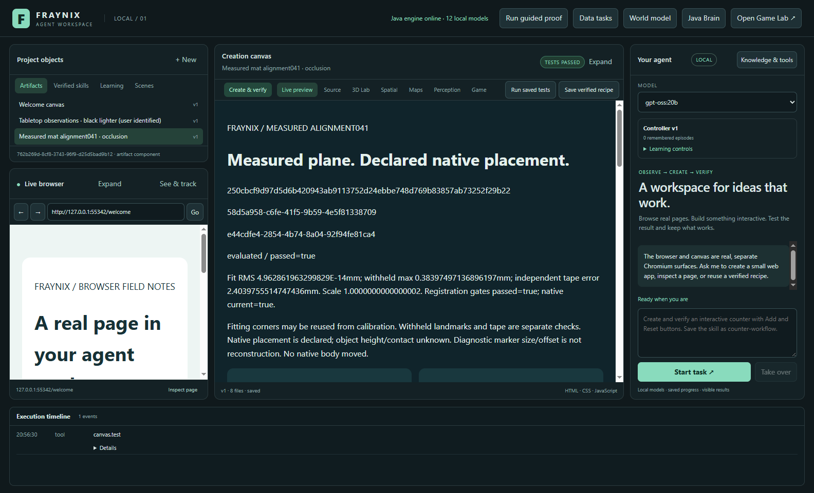
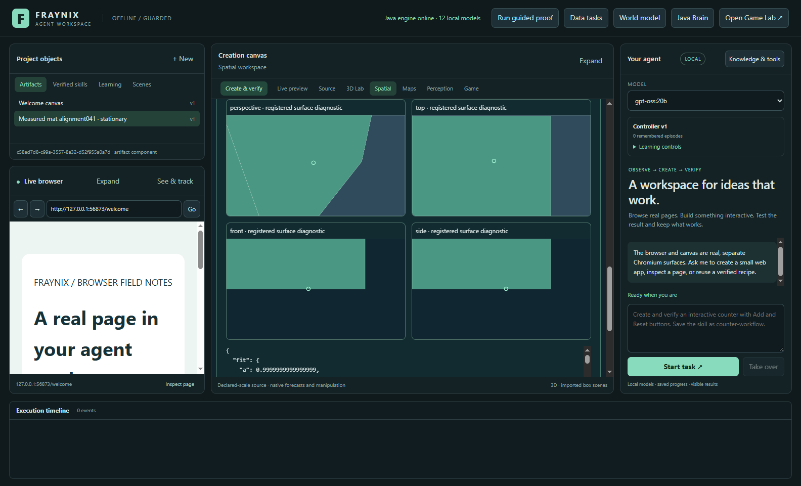

# Fraynix Agent Workspace ·041

> **Fresh physical results:** registration passed its reference gates; four-inch movement passed with **6.38 mm vector error**; occlusion had **0/8 hidden measurements and 8/8 revealed recoveries**. Validation passed: **360 Java tests, 106 desktop tests, 94 visible workflow checks and three actual local-model checks**. [Evidence and scope](docs/readmes/041/verification.json).

**Measure the plane. Declare its native placement. Test what the camera actually observed.**

[Previous040](README-040.md) · [Edition history](docs/readmes/INDEX.md) · [Operation](docs/MEASURED_ALIGNMENT.md) · [Declared contract](workspace-engine/src/main/resources/alignment-041-contract.json) · [Candidate source lock](docs/ALIGNMENT_041_CANDIDATE_LOCK.json)

Edition041 connects the measured cutting-mat plane to the existing native spatial interface and adds a recorder for fresh physical movement and occlusion tests. The application keeps the distinctions that make this useful: reference measurements, simulated geometry, a human-associated object, observed target features, predicted positions and independent test outcomes each retain their own evidence.

The new view is inside the existing workspace. Java performs the plane registration, source checking, target matching, motion estimation and projection. The desktop supplies the actual camera frames and visible controls. Chat can read the selected registration/trial and open its exact-source checked report. The original game, native physics, browser, creation canvas, saved procedures and older camera records remain available.

The first real setup uses the user-confirmed 12 × 12-inch cutting mat, dual-unit tape and black lighter. The visible measured rectangle spans ten columns and eight rows. Four printed-grid intersections fit the calibration, three other intersections act as withheld checks, and a separate four-inch tape interval checks scale. The camera image remains private. Exact numeric annotations were committed before calculating the first result.

## What the first alignment establishes

The first registration passed its declared gates. Its maximum withheld-grid residual was **0.383975 mm**, and its independent tape-length discrepancy was **2.403976 mm** over a known 101.6 mm interval. The fitted in-plane scale was 1.0000000000000002. These are source-specific consistency checks with the recorded annotations.

The nearly zero fit residual is expected because its fitting landmarks reuse the calibration corners. It is not a physical accuracy measurement. The declared 3 mm annotation budget remains in force; target height, camera parallax and contact are unmeasured. A small withheld residual does not turn the system into a calibrated sub-millimetre instrument. Fresh movement and occlusion outcomes are separate evidence and must be scored independently.

The native placement is explicit. By default, the chosen mat corner becomes the virtual origin, across the mat follows native +X, and upward on the mat follows native −Z on a declared Y=0 plane. That gives the observation a defined place in the existing right-handedY-up scene. It does not claim the system measured the mat’s pose in a physical room or reconstructed the lighter’s height.

This is a useful bridge between observation and simulation. A point measured in mat metres can be displayed in native coordinates and compared with a hypothesis, without replacing the actual native body pose. The same retained body association carries the human label, while the observation marker states its current source, measurement/prediction status and limits. Native objects are not silently moved to follow a camera estimate.

## Use the measured view

Open **Spatial → Measured mat alignment** after linking a persistent native world. Start the camera and freeze a fresh source frame. Select four known grid corners in perimeter order: origin, across, opposite, up. Enter their measured width/height. Add at least three other known grid intersections as independent checks, specifying their distances from the chosen origin. Mark two known tape positions and declare inches or centimetres.

Draw the actual target and a background example such as the tape housing. Advanced controls expose the declared native origin/basis and exact numeric annotations. The source description records what was measured and how the marks were read. Save/check registration to retain an immutable result. A failed result remains in the history; correcting the source annotations produces another record.

Four Java projections show the registered surface diagnostics alongside actual native geometry. A small highlight identifies the mapped target point when usable. Its size and visual offset are drawing choices, not measured object geometry. Unknown height/contact remain unknown. Camera/mat reference failure or a changed native revision suspends registered measurement instead of inventing a replacement coordinate.

## A recorder that waits for the person

The earlier short timed cues were difficult to follow consistently. Edition041 uses manually acknowledged phases and fixed windows. After a hold window is captured, the recorder pauses and waits. The person can prepare the next physical condition before clicking the next button. The program records what happened; it does not presume that a button press made an object disappear or move.

For movement, leave the lighter uncovered. Align the same metal end at the start mark and take your hand away. Begin the trial. It saves eight post-seed start samples and pauses. Click **Start moving**, move to the end mark, release the lighter and remove your hand. Click **At end mark; hand away**. It saves the next eight frames as the endpoint window and pauses. Finish recording.

For occlusion, begin with the lighter visible and hand away. After eight initial frames, cover only the lighter, keeping the reference corners visible. Click **It is covered** after the cover is in place. Eight hidden frames are saved, then the app waits. Uncover the lighter and remove your hand; click **Visible again; hand away**. It captures eight revealed frames. Finish recording.

There is no countdown to race. There is also no search for a favourable later window. The first designated frames are the evaluation windows, including failed observations. A stationary control captures twelve post-seed frames. All recordings preserve original source bytes and actual acquisition-completion times, with a bounded single-flight processing loop.

## What counts as passing

| Check | Fixed requirement | What it does not establish |
| --- | --- | --- |
| Registration | Fit RMS≤3 mm, withheld max≤5 mm, tape discrepancy≤5 mm, scale0.98–1.02 | Measured room pose, object height or certified metrology |
| Stationary | Twelve measured post-seed frames, jitter RMS≤3 mm | Absolute position accuracy |
| Movement | Eight measured start and eight measured end frames; vector error≤10 mm against independent tape displacement | Accuracy of unreferenced positions while the hand obscures the target |
| Occlusion | Zero accepted hidden measurements,≥80% measured recovery in the eight revealed frames, return error≤10 mm | General recognition or arbitrary occlusion robustness |
| Report workflow | Exact snapshot, registration/trial identity, landmark rows and four actual Java views checked in the canvas | A successful physical trial when its recorded result failed or is unscored |

Capture completion is a separate status from evaluation. Original frames must be independently annotated with their exact hashes and actual visibility. Movement additionally needs confirmation that the same physical end is at the declared marks. Predictions cannot supply ground truth. Contradicted or unresolved physical conditions remain unscored; the first result is immutable.

The visible software-camera test deliberately presses the hidden-phase button while its target stays visible. The app retains those frames and refuses to claim occlusion success. That is an important control: a polished interface or a completed progress bar must not manufacture evidence of a physical capability.

## Target tracking without drifting onto the background

The new Java matcher uses a fixed human-seeded colour/edge template and fixed negative/background examples. Candidate searches are constrained to the measured mat. Bounded local search expands for recovery after loss, with appearance, colour, ambiguity and background margins controlling acceptance. The template is not updated from scored frames.

This targets a known failure in earlier footage: the tracker could confuse the black lighter with part of the tape housing. The new matcher has to distinguish their actual pixel features, and the source guard has to verify that the mat/camera reference still holds. Similarity scores describe matching. They are not a product identity, semantic label or probability that an object is a lighter.

Motion estimates use actual host-monotonic ImageCapture completion seconds. They are not claimed sensor exposure timestamps. The retained constant-velocity filter predicts planar motion when measurement is absent and grows its model radius. That radius remains uncalibrated until separately referenced footage establishes coverage and width. A predicted point can remain useful for display while still being clearly labelled as a prediction.

## Java ownership and integration

`MatRegistration041` computes a planar similarity transformation in an explicit orthonormal native basis. `MatTarget041` extracts immutable target/background features and performs bounded candidate search. `Alignment041Store` retains calibration, originals, source clocks, phases and exact replay fences. `MatTrials041` evaluates fixed windows against independently supplied references. `Alignment041Report` produces the actual numeric report and registered diagnostics through the existing Java projection code.

The world ledger and native controllers retain action authority. The new subsystem has no native write interface. It checks the world revision/hash before capture and again before accepting a row. A late camera generation, changed clock/session, altered original or changed source ownership is refused. If a process ends, the saved prefix is interrupted; restarting does not silently reopen a camera session or relabel an older image with a new phase.

Registered observation markers are added only to derived display snapshots. Actual native entities retain their original IDs, positions, rotations and ticks. This is the next practical application of edition040’s shared interface: measured source points can participate in the same spatial inspection workflow while preserving uncertainty and provenance.

## Chat and retained evidence

Ask chat to inspect the **measured mat alignment** or retained manual trial. `alignment.read` pins the current registration/trial evidence; `alignment.report` opens its real saved report. These tools accept no model-supplied identities, measurements, reference labels, camera commands or success flags. The actual host context includes the selected registration/trial IDs and registered capabilities.

A report includes residuals, actual sampled motion, CSV, source-qualified view JSON and a complete compressed numeric snapshot. The host checks its exact source identities in the actual canvas. A verified read/report workflow can correctly report a failed physical experiment. The workflow status is not substituted for physical success.

Numeric JSON exports are real local files. The standalone inspector independently verifies canonical snapshot and registration hashes, source relationships, finite planar values and increasing ordinals/times. The private originals remain in the project’s `alignment-041/frames` directory. The application’s chat/report tools contain numeric evidence; private originals were separately inspected during development. Personal camera images are absent from Git and app tool prompts. Published camera examples use labelled analytic controls or numeric-only views.

## First fresh physical outcomes · 2026-11-01

| Experiment | First retained outcome | Meaning |
| --- | --- | --- |
| Withheld grid | Maximum residual **0.384 mm** across three separate points | Consistency with the annotated plane, with a declared 3 mm budget |
| Independent tape | **2.404 mm** discrepancy over 101.6 mm | Separate scale check; fitting corners alone do not certify accuracy |
| Four-inch movement | **6.377 mm** vector error; **16/16** fixed endpoint measurements | Passes the predeclared 10 mm limit in this particular setup |
| Fully covered target | **0/8** accepted target measurements | The pale cover did not become a false lighter detection |
| Revealed target | **8/8** measured recoveries; no reference failures | Recovered the stationary target in all eight fixed revealed frames |

The movement trial kept eight start, nine transition and eight end frames. The person moved the same metal end from 4 to 8 inches, uncovered, then removed their hand. Its observed endpoint-mean displacement was approximately 107.83 mm with a small lateral component, compared with the independent 101.6 mm reference. The error is reported rather than rounded away.

The separate occlusion trial kept eight visible, eight genuinely covered and eight revealed frames. Every unannotated original was inspected before the first evaluation. The small cover obscured the lighter without obscuring the reference corners. The source guard remained stable throughout. A computed return error near zero comes from recovering the same discretized template centre on a stationary object. It is not a claim of near-zero physical position error.

Both first evaluations are immutable. Neither the observer nor its scoring gates were retuned after seeing these results. A button press alone is not a visibility reference: the labelled software-camera control deliberately leaves the object visible during its nominal hidden phase, and remains **unscored**. The earlier edition038 displacement/uncertainty failures stay preserved and **UNVALIDATED**. New source-specific results do not rewrite them.

[Numeric physical evidence](docs/readmes/041/physical-evidence.json) retains positions, actual source times, hashes, acceptance flags and first evaluations without camera bytes. The initial registration and trial UUIDs can be followed into the private project’s originals. [Pre-score source lock](docs/ALIGNMENT_041_CANDIDATE_LOCK.json), [reference annotation lock](docs/ALIGNMENT_041_FIRST_ANNOTATIONS_LOCK.json) and [camera/chat amendment](docs/ALIGNMENT_041_UI_AMENDMENT_1.json) explain the exact versions used.

## Performance and uncertainty limits

Actual acquisition intervals averaged approximately **1.46 seconds** in the first eight-sample hold. The UI schedules at most 5 Hz, but durable prefix replay, source checking and view updates currently reduce observed throughput. The interface’s scheduling ceiling is not the measured frame rate. Long gaps are labelled as reacquisition, so the display does not imply continuous measured motion while it was paused or waiting.

The next engineering priority is to profile this complete path. A useful optimization should avoid recomputing already verified tracking history while retaining original-byte checks, source/generation fences, restart reconstruction and exact results. View refresh can be decoupled from observation without changing physical ground truth. The acceptance gate should compare exact outputs and complete acquisition latency, then measure genuinely fresh movement and occlusion sequences.

Target height, contact, room pose, perspective/parallax effects and calibrated probability remain outside this result. The retained filter’s radius is a declared model budget. Empirical uncertainty coverage needs separately referenced positions, not just a plausible-looking radius or a successful endpoint test. Multiple targets, rotation, lighting changes, camera movement and other covers also need new cases.

## Validation and preservation

The complete independent Java check passed **360 tests across 78 classes**, with zero failures, errors or skips. All Java sources remain identical to the tested candidate. The later amendment changes camera-session invalidation and chat wiring only. Final desktop checks pass **106 tests**. The independent visible workflow passes **nine checks**, including actual ImageCapture, fixed windows, source refusal, real report/export, independent checksum rejection, restart and stale-camera refusal.

Actual **gpt-oss:20b** read/report/finish execution passes three checks. All planning calls carry CPU-only/four-thread receipts and the actual selected registration/trial IDs. The host supplies 104 registered tools. User-started recording continues during planning; the model cannot create camera measurements or reference labels. The pinned summary names its sample/time rather than pretending an old snapshot is a live stream.

The existing browser/canvas, broader creation/control, object knowledge, original game and shared spatial views pass **85 additional visible checks**, for **94 total** with the nine new alignment checks. Measured-view layout checks pass at desktop widths 1600 and 1100; the offline guide passes at 1440 and 390. Mobile app support is not claimed. [Verification scope](docs/readmes/041/verification.json) separates completed controls, actual model execution and physical outcomes. Development and initial harness failures are retained as original-byte proof archives rather than replaced with a clean success story.

All **773 canonical implementation files/assets** match the separate source checkout. Of 759 previous files, 749 are unchanged. Ten explicit integration files connect the new subsystem and update its test/packaging paths. The original physics, game, neural math, earlier tracker/filter/calibration and shared projection code retain their prior implementations. [Inventory](docs/readmes/041/FILE_TREE.md) and [preservation receipt](docs/readmes/041/legacy-preservation.json) show that boundary.

The prepared production review uses a distinct copy of the closed camera-test project: **1,741 retained files / 76,629,858 bytes**, each compared by SHA-256. Original earlier projects and recordings remain preserved. The camera was released after these completed tests; a restart never silently begins another recording. Continue from the saved registration and selected trial instead of creating an empty new project or sharing a live database between processes.

## Screenshots and offline guide

The first capture uses the explicitly labelled analytic software-camera control. The physical-result capture shows actual numeric evidence, with personal camera images hidden. Native browser/canvas surfaces are captured through the app’s composite screenshot path; no private camera photograph was edited for publication.

Measured setup, source description and reference checks inside the existing workspace.

The fresh physical occlusion result opens as a saved report in the real canvas, with five checked source/identity assertions. Its physical outcome remains distinct from the report workflow’s verification status.

Actual local gpt-oss:20b workflow on the labelled software-camera control. It does not substitute for the separately scored physical tests.

The labelled control’s same source shown through four Java projections; marker geometry is diagnostic.

[Offline system, residual and motion explorer](docs/readmes/041/index.html) · [Complete implementation inventory](docs/readmes/041/FILE_TREE.md) · [Obsidian system map](docs/obsidian/measured-alignment.canvas). The companion has no CDN dependency. Its module selection/filtering, file search, landmark residuals, sample selection, image loading and wide/narrow layouts are checked in an actual browser.

## Next edition and the continuing vision

1. Profile and improve actual capture throughput while keeping exact original/result replay and the existing source fences. Publish complete latency, not just isolated matcher timing.
2. Run new held-out movement, rotation and occlusion cases with independent references. Retain the first failures and measure uncertainty coverage before calling the radius calibrated.
3. Extend human-associated objects into better perceptual descriptions and multiple-target identity, with explicit evidence and correction paths. A template and a human label do not establish automatic semantic recognition.
4. Let the Java goal runner use measured prediction errors to choose bounded follow-up observations and verified procedures. Keep physical observations, simulated hypotheses and action authority explicit.
5. Evaluate learned policies on separate conditions with rollback and retained experience. Useful learning means improved task outcomes after restart, not merely changing weights or saving a new label.

The direction remains one local environment in which an agent can observe, compare hypotheses, create, act and check outcomes across continuing tasks. This edition gives measured plane observations a declared place in that environment and demonstrates two fresh physical tasks. It is a concrete connection between the camera and the world, with its remaining limits visible.
