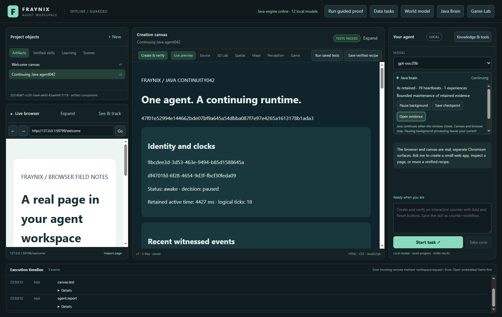
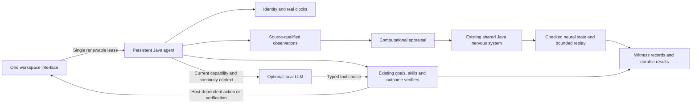
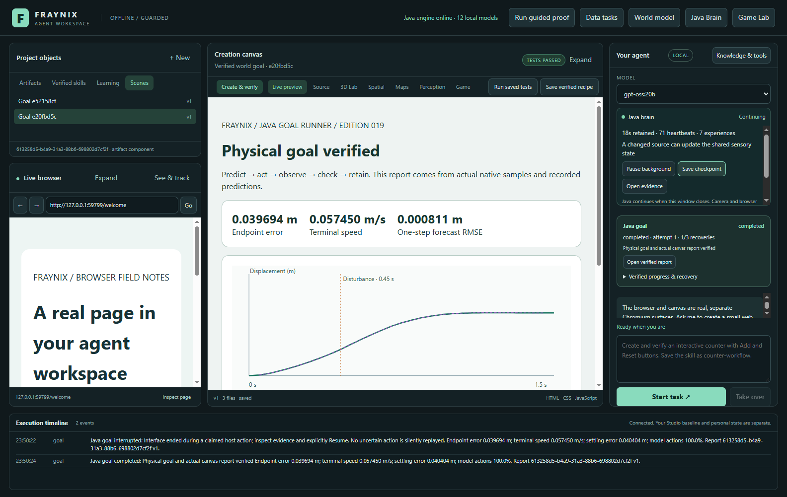
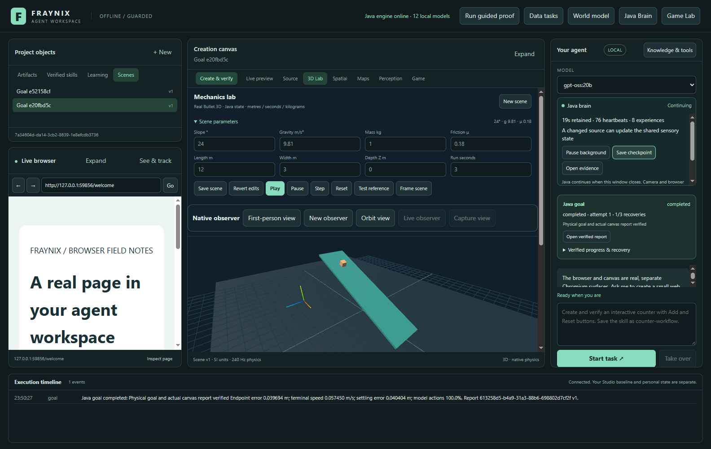
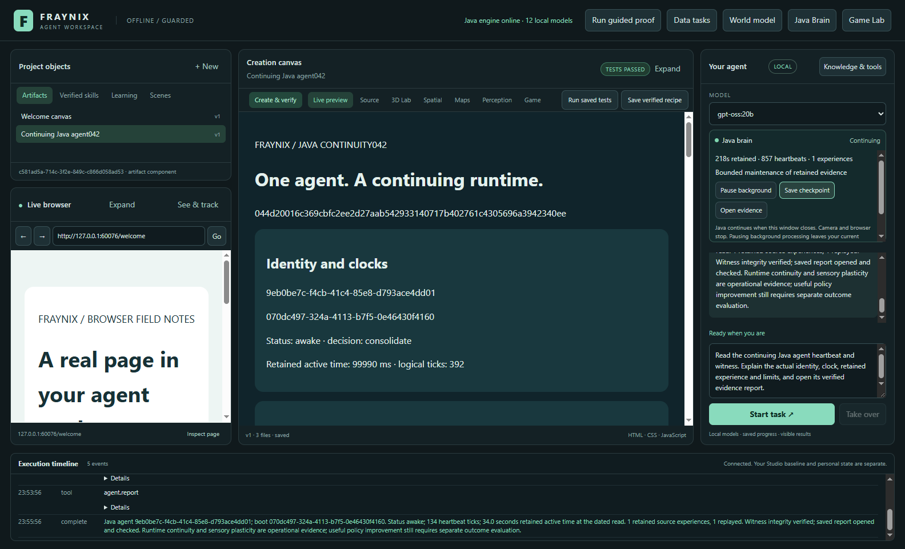
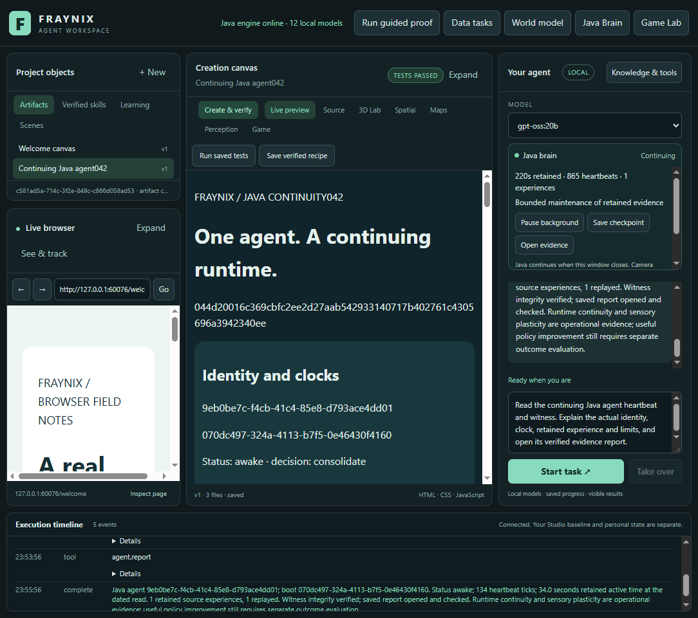

# Edition042 · one continuing Java brain, one integrated workspace

**Java now keeps the agent running when the interface closes.** Identity, real clocks, source-qualified sensory state, neural checkpoints, bounded replay and witness records belong to a headless Java runtime. The existing browser, canvas, chat and physics views remain in the same app.

[Previous: measured alignment and physical tests](README-041.md) · [Offline interactive guide](docs/readmes/042/index.html) · [Operation and recovery](docs/CONTINUING_JAVA_AGENT.md) · [Evidence](docs/readmes/042/verification.json) · [Edition history](docs/readmes/INDEX.md)

This edition follows the user's decision to retain Java and own the computational logic. It adds no inference framework, neural library or separate editor. It reuses the shared Java nervous system and existing goal, memory, world-model and verification infrastructure. The complete application still has its established Electron/Chromium presentation and native Bullet physics dependencies. “No new dependency” does not mean those existing components disappeared.

## The change that matters

Before this edition, the desktop started its Java server and terminated it when the window closed. Durable files survived, but the active agent's process did not. Now the desktop starts or reconnects to a project-owned Java process. Closing the window detaches its interface lease. Java goals can continue; browser, canvas, webcam and original-game host activity stop. Reopening reconnects to that same live Java boot.

If Java or Windows stops, reopening restores the last checked agent checkpoint with the same agent identity and a new boot identity. It records that distinction instead of treating downtime as thought or simulated activity. A restart still requires actual initialization and, when requested, loading an optional language model. This release removes a window-lifetime reset; it does not claim every operation has zero startup cost.

*Actual042 desktop in an isolated lifecycle-test project. The new controls live inside Your agent. The report is real Java-generated HTML/JSON, opened and checked in the existing canvas. No personal camera footage is displayed.*

The visible app remains recognizable: project objects and verified skills, live browser, creation canvas, chat, 3D Lab, shared spatial views, maps, perception, original game integration and execution timeline. The continuing brain card is compact by default. Expanding it focuses the existing agent column on its clock and controls; collapsing it restores the ordinary introduction and learning controls. It does not add another application window. The header’s **Game Lab** button now opens the existing integrated original renderer, with its native window hidden and editor uninitialized, instead of launching the separate editor. Legacy editor sources are preserved.

## What Java owns

| Responsibility | Implemented behavior | Evidence boundary |
| --- | --- | --- |
| Project ownership | Exclusive file lock before stores open; private loopback connection; installed Java JAR fingerprint | Another process or incompatible build cannot silently take over the same project |
| Identity | Stable agent UUID, separate UUID for every Java boot | Continuing identity is a stored operational identity, not subjective awareness |
| Clocks | Wall receipts, per-boot monotonic elapsed time, retained active time, actual heartbeat count | Camera seconds and simulation ticks remain separate clock domains |
| Sensory processing | Existing shared32,768-neuron Java cortex receives bounded operational/native and accepted-camera features | Neural activity/plasticity is computation, not demonstrated general intelligence |
| Appraisal | Actual heap pressure, collection delay, source change and observation freshness affect background work | No invented body temperature, feelings or calibrated confidence |
| Experience | Up to128 source-qualified sensory records, each replayed at most once | Replay is an old experience, never a fresh measurement |
| Persistence | Checked state envelope, immutable hashed neural files, atomic committed pointer | Work after the last committed checkpoint may be lost in a crash |
| Witness | Segmented owned Merkle journal, parent links and exact checkpoint-prefix anchor | Integrity verifies content and order, not whether a source claim is true |
| Goals and skills | Existing Java tasks, saved procedures, policy evaluations and explicit recovery remain authoritative | A successful sensory update cannot promote a task policy on its own |

The low-level nervous system remains the owned `brain-core` implementation: leaky integrate-and-fire neurons, synaptic plasticity and binary checkpoint validation. The background adapter shares `BrainService`'s existing cortex. It does not create a competing brain that forgets foreground changes. Existing physical-controller learning, world-model experiments and promotion/rollback rules remain separate and operational.

## Clocks, heartbeat and a useful background process

The nominal heartbeat is250ms. A separate scheduled worker collects bounded facts on a nominal one-second cadence. These are best-effort desktop schedules, not hard real-time guarantees. The clock reports measured elapsed time even when a callback is delayed. It never fabricates missing callbacks to make the heartbeat count look continuous.

Wall timestamps date evidence. A monotonic clock measures elapsed time within one boot. Retained active time combines checkpointed earlier activity and this boot's elapsed time. Native simulation ticks describe native simulation, and camera source seconds describe that recording. None is silently substituted for another. Turning the app back on tomorrow does not add a day of invented processing.

Resource appraisal changes behavior. High measured heap occupancy or slow collection suppresses background neural work. A changed source can feed the shared sensory state; idle retained experiences can be replayed within the fixed budget. Alertness and progress summarize these conditions. Failed/cancelled outcomes retain their own witness evidence rather than receiving a successful-goal reward. No unattended browsing, camera activation, model calls or arbitrary code mutation is started by the heartbeat.

This is a concrete foundation for the user's “subconscious” idea: a continuing local computational process with memory and observable effects. It establishes an operational background process. Felt emotion, consciousness and unrestricted self-improvement are not results established by these tests.

## Real observations keep their original meaning

The measured041 observer remains intact. Its accepted Java frame route can supply this runtime with original image hash, trial/ordinal, source seconds, receipt time, reference validity and numeric plane estimate. Raw camera pixels stay in private project storage and do not enter the new chat tools or reports.

A recent reference-valid, measurement-accepted receipt may be marked fresh. Hidden or prediction-only samples are not fresh measurements. Accepted-frame retries cannot renew freshness. Old recordings, boot restoration and elapsed time alone cannot produce a fresh camera observation. Native positions and mat-plane positions remain separate sensory features, preserving the distinction between a simulated body and a measured projection.

The earlier physical results still have their original scope: the041 movement first result passed its declared endpoint gate and the recorded occlusion trial recovered its measured target. Older038 displacement/uncertainty failures remain unvalidated. This edition performs lifecycle and controlled-observer regressions; it does not claim new measured camera accuracy, semantic lighter recognition, recovered depth/contact or calibrated uncertainty coverage. [The preserved041 evidence](docs/readmes/041/physical-evidence.json) remains the reference for those particular physical trials.

## Try it step by step

1. Start the existing workspace normally with the project's start script. Java will start or reconnect to the owner of that project. Use a separate explicit private project copy when reviewing an upgrade; do not point two builds at the original live data.
2. Expand **Java brain** inside **Your agent**. Read its retained active seconds, actual heartbeat count, experience count and scheduling reason.
3. Choose **Pause background**. The sensory/replay worker pauses; the clock and explicitly started Java tasks remain available. Choose **Resume background** to resume that work.
4. Choose **Save checkpoint**. Java verifies the witness and saves a checked state/neural pointer. Missing or changed evidence is retained and reported as needing attention.
5. Choose **Open evidence**. Java creates a dated report with exact identity, boot, clocks, appraisal, neural state and recent witnessed events. The real canvas checks its hash and IDs. The files include `snapshot.json` and a hash receipt.
6. Ask chat: **“Read the continuing Java agent heartbeat and witness, then open its verified evidence report.”** The local model receives actual Java continuity context and uses read → report → finish. It cannot supply identity, clock values or its own success flags.
7. Start a real Java physics goal. Close the window while it runs. Its Java computation can continue; a required canvas/browser stage waits for a host.
8. Reopen the same app/build/project. It reconnects to the same live boot. A waiting unclaimed report can be opened and verified by the restored interface. An already claimed, unfinished host action is interrupted and requires explicit **Resume**.
9. To stop Java itself, expand **Identity, memory and witness** and choose **Stop Java & close app**. Finish or stop active tasks/captures first. Opening the app again restores the checkpoint into a new Java boot.

*Actual native goal and saved procedure in the lifecycle test. The desktop was absent while Java advanced the task, then returned to verify its retained report.*

*Actual forced-process-termination recovery. The agent identity and checked results survive; the boot identity changes. Camera remains off.*

## A tool performs an action; a skill finishes a task

The new `agent.read` tool reads actual runtime state and verifies its witness. `agent.report` creates and opens the saved evidence report and checks the actual DOM. Both have empty argument schemas: a model cannot submit a fake observation, clock, identity, action permission or passing result.

The existing goal runner still provides the stronger unit of agency: frozen intent, actions, checks, durable progress and recovery. Its versioned procedures remain reusable across sessions. The new continuing runtime sits beneath that mechanism. It makes the task's owner durable across interface lifetimes; it does not replace verification with an optimistic chat answer.

Every model-planning request receives compact current Java identity, clock, status, witness and experience context alongside the existing registered tool inventory and bounded retrieved memory. The LLM chooses and explains within its tools. Java owns state and execution. Physical controllers own timing. Independent verifiers check outcomes. The browser/canvas host still supplies the presentation and surface-dependent actions.

*Actual gpt-oss:20b planning in the042 application. The three native tool stages use CPU-only planning with four threads; their receipts, saved artifact and verified episode are retained in the evidence archive.*

*Actual1100px-wide app capture. Chat and background controls remain in the same integrated interface.*

## Validation and reproducibility

Final independent validation passes **111 desktop checks, 109 actual UI checks and six actual local-model checks**, with app layouts at1600/1100px and the offline guide at1440/390px. Java coverage is **368 full-suite checks plus nine final focused checks**, covering369 distinct checks; the precise source/amendment qualification is retained in [the Java validation record](docs/readmes/042/java-validation.json).

The release evidence distinguishes Java unit/physics checks, actual process-lifetime tests, desktop policy tests, real UI behavior and actual local-model planning. [Verification](docs/readmes/042/verification.json) records final counts, source baselines, results and qualifications. Original failed development attempts are retained in compressed proof archives as well as the passing results; a later passing run does not rewrite those failures.

The lifecycle test starts a real Java owner, attempts a competing owner and mismatched build, closes the real desktop during a native goal, observes progress without it, reconnects, verifies and saves the procedure, interrupts a claimed host effect, rejects its stale receipt, explicitly resumes, forcibly terminates Java and restores the checked state. The visible stop control is also exercised. No simulation of that process boundary substitutes for the real processes.

Clock tests cover wall-time rollback and new-boot domains. Witness tests cover segment boundaries, exact prefix anchoring and corruption refusal. Neural tests cover actual shared-core updates, retained replay, foreground diagnostic changes and checkpoint restoration. Controlled camera outputs test freshness expiration, hidden measurements and duplicate-frame refusal. Resource-appraisal ablations verify that disabling work or changing pressure changes the scheduler's actual decisions.

Run the repository's Gradle checks, `npm test`, `npm run test:agent042` and, with the installed local model, `npm run test:live-agent042`. Run heavy checks serially. Keep model weights and private runtime projects outside Git. Stop the persistent Java owner before rebuilding its installed JARs, even if its window has already closed. [Detailed operation](docs/CONTINUING_JAVA_AGENT.md) explains ownership, clocks, budgets and recovery.

## Source map and next steps

The [complete implementation tree](docs/readmes/042/FILE_TREE.md), [canonical source inventory](docs/readmes/042/file-inventory.json), [interactive system map](docs/readmes/042/index.html) and [Obsidian continuity map](docs/obsidian/continuing-agent.canvas) connect the implementation to its evidence. The [contract](workspace-engine/src/main/resources/agent-042-contract.json) was committed before implementation. Published README001–041 and their snapshot assets are preserved.

The next architectural step is moving more surface-independent planning and skill scheduling into this Java owner. The interface should deliver user intent and render results while the runtime selects and resumes registered procedures. Browser/canvas-dependent tasks must still expose their real prerequisites and uncertainty. A hidden interface cannot be treated as an available camera or browser.

After that, connect experience to measured improvement: select candidate training cases from actual failures, compare a changed controller against a frozen baseline on unseen conditions, promote only after original gates pass, and retain rollback. Sensory replay must earn a useful role through an ablation against the existing simpler controller. Persisting activity alone cannot establish that benefit.

For physical perception, profile the actual full-frame path before increasing capture rate, then collect fresh held-out motion, rotation, lighting and occlusion sequences. Preserve original images, scale references, source clocks, failures and uncertainty. For creation, move another complete offline pipeline into Java with actual build/test receipts rather than exposing a large catalogue of disconnected tools.

That direction preserves the defining idea: the app's flow is itself a working environment. An agent can observe a source, propose an action, see a result, verify it and retain a useful procedure inside one visible workspace. Edition042 supplies a continuing Java owner for that loop. Future additions should prove better task outcomes while keeping the environment, tools, logic and evidence understandable and locally owned.
