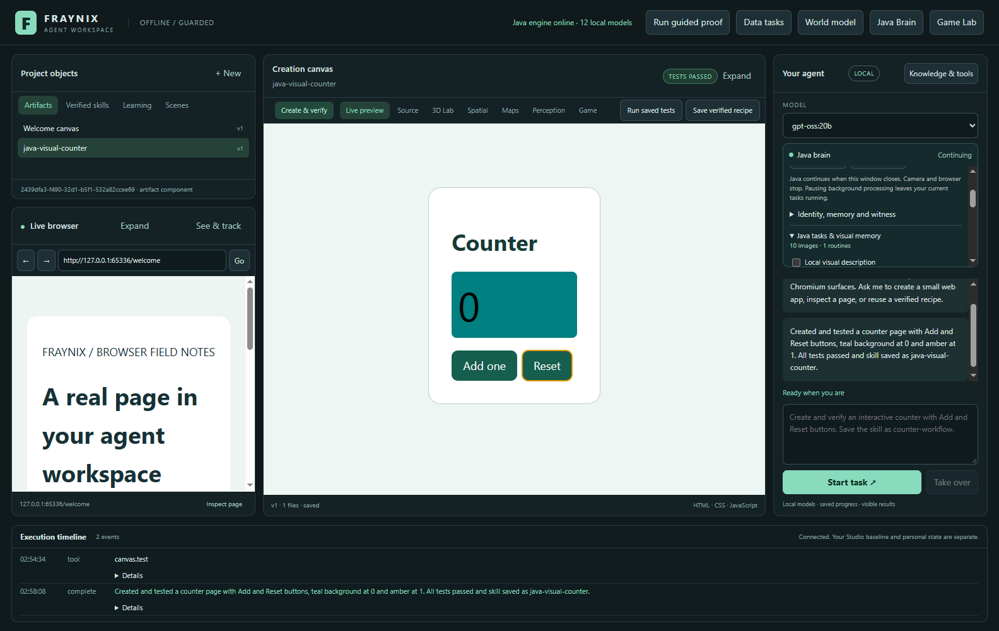
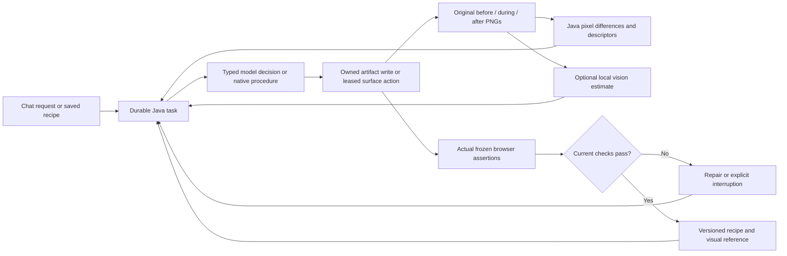
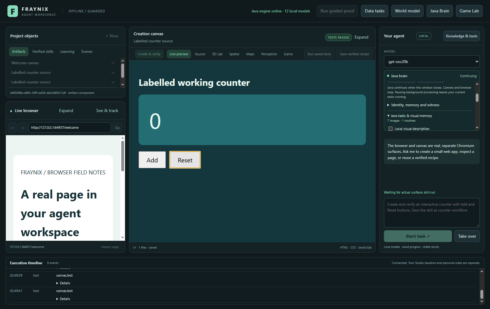
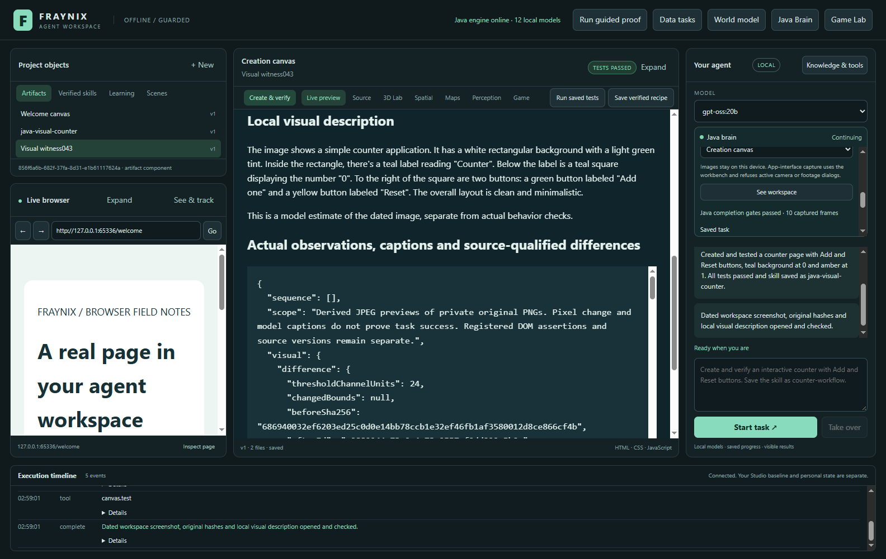

# Edition043 · The agent can look at its own work

2026-11-02 · [Previous: continuing Java brain042](README-042.md) · [Edition history](docs/readmes/INDEX.md) · [Offline visual guide](docs/readmes/043/index.html) · [Operating guide](docs/JAVA_VISUAL_AGENCY.md)

The next connection is between an action and what actually appeared on screen. Java now schedules ordinary browser/canvas conversations and saved-recipe tasks, retains original screenshots before and after their actions, records selected intermediate test states, and associates successful procedures with their dated visual evidence. An optional installed local vision model describes those pixels. The existing integrated workspace remains the application; this addition does not open another editor or camera window.

This follows the user's proposal to let the agent see its own work, notice visual patterns in routines and use those experiences in later tasks. It also advances the earlier decision to move the brain's coordination into Java. A screenshot is an observation of rendered output. Its source and timing, an action receipt, and an independent behavior check make it useful evidence for an agent. None of those alone establishes consciousness, general understanding, physical reconstruction or useful model-weight training.

## What changed

`Agency043` owns a durable queue, the selected recipe and its version, model decisions, artifact writes, stage transitions, repair limits, success checks and explicit recovery. The desktop hosts actual browser/canvas surfaces and executes Java-issued surface claims. It returns real images and actual browser test receipts. This is an implementation of task ownership, rather than an extra conversation panel that describes imagined actions.

The ordinary browser/canvas chat path now goes through this Java runner. Existing specialized Java physics, perception, calibration, world and continuing-agent routes retain their established adapters and checks. They have not all been rewritten into the new workbench runner. The original game engine, assets, multidimensional mapping, tracking and measured alignment algorithms remain in the repository. The source-preservation report identifies the integration files that changed.

The new controls sit inside **Java brain → Java tasks & visual memory**. **See workspace** is also beside the existing brain actions. Choose the app interface, creation canvas or browser page, and optionally an eligible installed local vision model. The interface retains the original main chat, browser, creation preview, source editor, scene tools and library. Task history includes an explicit Resume, Stop task and Visual evidence action. The recipe selector queues a previously tested procedure without requiring another planning-model call.



The image above is an actual application capture using a labelled software counter. It is not webcam footage, a rendered design mockup or evidence of new physical accuracy. The raw validation records distinguish model-authored artifacts from deterministic test controls.

## The action–observation loop



The Java queue admits up to four live workbench tasks and executes one foreground task at a time. A recipe task copies the actual saved files into a new artifact and runs the original saved assertions. An inspection task captures the chosen surface, optionally describes it, writes a real evidence artifact and checks that report in the creation canvas. These two modes do not need an LLM to select their stages. A workbench task asks the selected installed model for one typed action at a time; Java validates that action and decides which stage is allowed next.

When a requested counter includes Reset, this edition supplies an explicit independent contract: `#count` starts at zero, clicking `#add` must produce one, and clicking `#reset` must return to zero. The model cannot replace those checks with a weaker body-exists assertion. Other artifact requests still need declared behavior assertions; passing a small test suite does not prove every aspect of a natural-language request. Broader task-specific acceptance contracts remain a next step.

Artifact creation and revision occur in Java, using the existing versioned store and deterministic effect keys. A repair must refer to the task's actual artifact ID and current expected version. Repeating a native write after an interrupted receipt reconciles its original effect instead of creating an unnoticed duplicate. A saved recipe requires actual passing checks. A created artifact cannot finish before its current checks pass, and a requested skill must actually be saved before completion.

## What the screenshots contain

Original PNG bytes remain in the selected private project under `agency-043/screens/`. Each image has a checked metadata record containing task and action IDs, phase, interface session, sequence number, capture elapsed time, received wall time, actual URL/title, viewport dimensions, artifact ID/version where relevant, byte count and SHA-256. Intermediate test frames additionally retain the test index. The store verifies original hashes when reopening and when reading references. It rejects stale sequences and source/viewport mismatches, and retains damaged originals for inspection instead of silently replacing them.

The screenshots use actual Chromium surface capture. Whole-workspace observation combines the real shell and its native browser/canvas views, which an ordinary shell screenshot can omit. It is limited to this application's workbench. Whole-app capture refuses active camera/footage dialogs and camera streams. Camera frame provenance, physical measurements and consent-driven live capture continue through the existing separate source-qualified paths. No screenshot feature starts the webcam, takes a desktop-wide photograph or uploads an image to a cloud service.

Java decodes the PNG with JDK image APIs after checking the encoded byte and dimension budgets. It compares original full-resolution pixels using a declared channel-difference threshold of24 out of255. The result includes changed-pixel count, fraction, bounding rectangle and mean absolute channel difference. Different viewport dimensions produce a non-comparable result rather than a misleading motion score. This is digital change in a work surface, not an estimate of displacement in millimetres.

A second owned algorithm divides an image into16×12 spatial cells and records mean red, green, blue and edge activity in each:768 features. A bounded similarity lookup ranks up to three same-surface successful visual references. Low-contrast blank frames are not useful retrieval evidence. Similarity is an appearance score, not calibrated certainty, semantic object identity or authority to repeat an action. The current lookup compares final appearance; the ordered intermediate image sequence is retained as evidence, but temporal sequence recognition has not been implemented.

## Why intermediate images matter

A counter can go from zero to one and back to zero. Its before and after images can be identical while the intervening action genuinely changed its state. Keeping only the endpoints would discard the most useful observation. The host now captures selected actual test steps, including action steps, the first assertion and the final assertion. Those frames retain their source order and current artifact version and are linked to the exact test receipt.



The controlled test independently checks that the Add-state PNG differs from the final Reset-state PNG. Java only associates the resulting visual routine after current artifact checks pass. The memory stores original image hashes, artifact version, test hash and recipe binding. A later task can retrieve that reference, inspect its source, and choose a procedure with renewed checks. A visually similar image never directly bypasses those checks.

This is an initial procedural memory grounded in actual execution. It is useful without claiming a neural network has learned the task. The existing shared Java nervous system still owns its original sensory dynamics, replay and persistence. This edition adds a separate owned visual descriptor and evidence store; it does not silently replace the existing sensory-channel encoding or modify the language model's weights.

## The local visual model

The optional visual head uses an already installed Ollama model whose fresh metadata advertises both completion and vision, within a12GB weight budget. The selector prefers smaller eligible models. The actual local test uses `gemma3:latest` for image description and `gpt-oss:20b` for planning. No model download or new model framework is introduced.

The model receives a resized JPEG derived from a retained original. The caption records the original PNG hash, the model digest, request hash, duration and CPU settings. The original remains available for exact comparison. Image text and model captions are untrusted data. They cannot install a tool, grant access, change a frozen assertion or manufacture a successful task receipt. The response is bounded structured JSON with a description and up to twelve short visible text fragments.



All new Java workbench planning and vision calls request CPU-only execution with four threads. The visual model unloads after its request. That conservative configuration preserves the operating choice established after earlier unexplained machine freezes; it is not a conclusion about their cause. Model latency is real and visible in task status. Native recipe execution and screenshot differences remain available with visual description switched off. A failed visual request interrupts the task with its error instead of substituting an invented caption.

Ollama's documented image input and typed tool mechanisms supply the existing local model transport: [vision](https://docs.ollama.com/capabilities/vision) and [tool calling](https://docs.ollama.com/capabilities/tool-calling). Fraynix owns the queue, image descriptors, source checks, action validation, recovery, artifact storage and success decisions around that transport. Existing Java, Electron/Chromium, Bullet, JSON and renderer dependencies remain; this is not a claim that the complete application has zero external code.

## Try it step by step

1. Start the existing workspace launcher with Java21, Node22 and the installed dependencies. Docker/WSL are not needed. Reopen the intended private project explicitly; do not point two Java owners at one database.
2. Open **Java brain → Java tasks & visual memory**. Select an installed local visual model, or switch visual description off to use deterministic image evidence alone.
3. In chat, request a counter with Add and Reset, IDs `#add`, `#reset` and `#count`, then ask it to save a named reusable skill. Java owns the task and its checks. Observe the actual preview and execution timeline.
4. Choose **Creation canvas → See workspace** to retain a dated image of that result. The evidence artifact contains before/after previews, original hashes, source-qualified differences and the optional model description.
5. Choose the verified recipe and **Queue saved recipe**. Java recreates its actual files into a separate artifact, runs the frozen assertions and retains the visual sequence. It does not ask the model to pretend to execute the procedure.
6. Use **Visual evidence** on a completed task to inspect its original endpoint references and intermediate test images. The displayed previews are labelled JPEG derivatives; exact comparison uses private original PNGs.
7. Close/reopen the desktop to reconnect to the same live Java owner. If the interface disappeared during a claimed action, inspect the task and choose **Resume**. Java refuses stale acknowledgments and takes fresh observations. After a Java restart, retained tasks and image references are checked before reuse.

The interface does not automatically replay an uncertain browser click after a crash. A queued task can wait without a desktop; surface work needs an attached host. The new queue has bounded history and image retention. At its explicit limit it stops and asks for deliberate archiving rather than erasing evidence. This edition does not yet add an automatic archival policy.

**Take over** cancels running and queued work, including a chat start whose response is still in flight. A stopped request cannot submit a late replacement task. Closing the interface has a different meaning: Java may continue accepted planning, while surface actions wait for an attached host or require explicit recovery if their outcome became uncertain.

## Verification and preserved history

The [verification record](docs/readmes/043/verification.json), [Java checks](docs/readmes/043/java-validation.json), [source match](docs/readmes/043/source-match.json) and original proof archives retain the exact candidate and scope. The tests separate pure algorithm/unit boundary fixtures, actual Chromium interactions, and actual installed local-model inference. Failed development attempts are preserved separately from the successful final run. The independent checkout compares every canonical implementation source and asset, not just the new files.

After installing the pinned dependencies, the new focused commands are `npm run test:agency043` and `npm run test:live-agency043` from `workspace-desktop`. The latter requires the actual installed local planning and vision models. The recorded complete serial commands, run from the repository root, are:

```powershell
.\gradlew.bat --offline --no-daemon --max-workers=1 -I docs/readmes/043/development/serial-java.init.gradle check installDist :workspace-engine:installDist
node docs/readmes/043/development/serial-runner.cjs
```

The retained runner uses distinct temporary projects and checks each result before continuing. It includes actual external HTTPS browsing and local-model inference, so those groups need their corresponding services. Original logs and [failed-attempt explanations](docs/readmes/043/development/attempts.json) remain inspectable.

Coverage includes exact known pixel deltas, different viewport refusal, descriptor ordering, blank-image refusal, original-image tampering, stale session/sequence fencing, weak-test refusal, post-claim commit failure, explicit recovery, actual queue ordering, actual Add/Reset states, real app capture, Java restart and retained procedures. Existing UI, physics/game, world, knowledge, alignment and continuing-agent regressions remain part of release validation. The original live review's private project is preserved during installation; the new review uses a separately copied closed project with a full source/copy hash audit.

The complete Java run passed385 cases across82 classes. A subsequently added bounded recovery branch handles native tool-call parse rejection. All26 final focused checks passed, including all10 tests for that sole amended production class and its test; every other Java source byte is unchanged. This covers386 distinct cases, rather than claiming one final386-case run. The original complete-run log and final focused XML are retained. A malformed model response is never repaired into an action by guessing its intent: it is rejected, recorded and retried within the existing failure budget.

The earlier measured mat registration and movement/occlusion results keep their original source-specific meaning. No screenshot fixture promotes those physical gates. Older edition038 displacement failures and unvalidated uncertainty coverage remain historical evidence. This edition adds no fresh camera measurement, lighter recognition, room reconstruction, depth/contact inference or new real-world accuracy claim. Published numbered READMEs001–042 and their frozen snapshot assets remain unchanged.

The [complete file tree](docs/readmes/043/FILE_TREE.md) includes the implementation and tests. The [Obsidian note](docs/obsidian/51-java-visual-agency.md) and [canvas](docs/obsidian/java-visual-agency.canvas) connect this edition to the continuing Java brain, world and prior camera evidence. The offline guide uses actual recorded images and metrics; its slider explores retained observations rather than fabricating a live experiment.

## What should follow

First, evaluate whether retrieving a visual reference improves a task on unseen layout and wording changes. Freeze the tasks and acceptance criteria before comparing retrieval-on versus retrieval-off. Track completion, false success, repairs, latency and recovery. Promote a candidate only when it improves measured outcomes without weakening the checks. Retaining a successful example is an implemented memory feature; better performance from that memory is a separate experiment.

Second, add task-specific contracts beyond the counter and expose clearer selection of original screenshots and test stages. Extend sequence comparison only with explicit held-out tests: endpoint similarity cannot establish that the intervening order was correct. Keep direct DOM observations, rendered pixels and physics state correlated through common IDs while preserving their different authority and clocks.

Third, extend the unified Java runner to more specialized tools after preserving each tool's existing ownership, physical timing, failure checks and source qualifications. The controllers should continue to handle physical timing; the LLM should choose bounded intentions and explain decisions. Integrating an engine, browser, visual memory and continuing agent does not require an LLM to simulate a physics tick or decide whether its own action succeeded.

The longer-term direction remains the user's original local environment: one persistent world, observations of what the user sees, real action consequences, reusable skills, creation surfaces and measured improvement across restarts. Screenshots close another practical feedback path. The next value comes from demonstrating that this additional evidence changes decisions reliably on new tasks.
