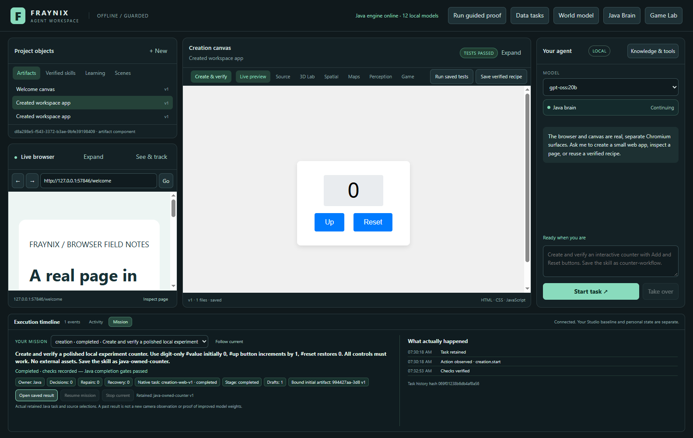
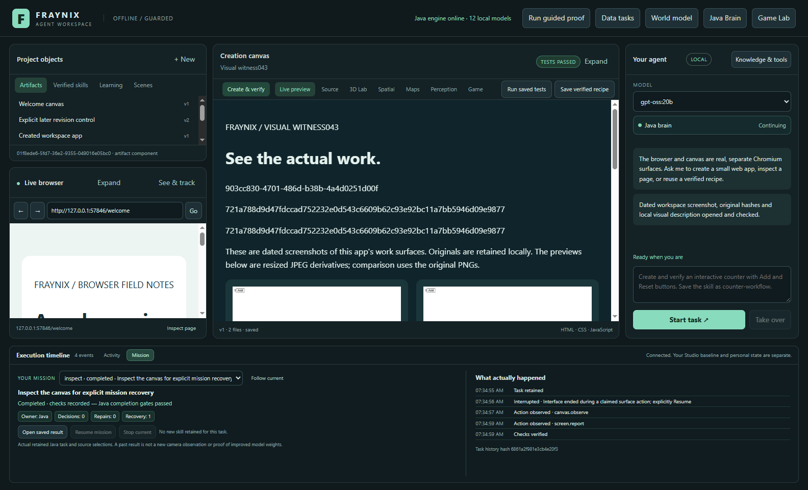
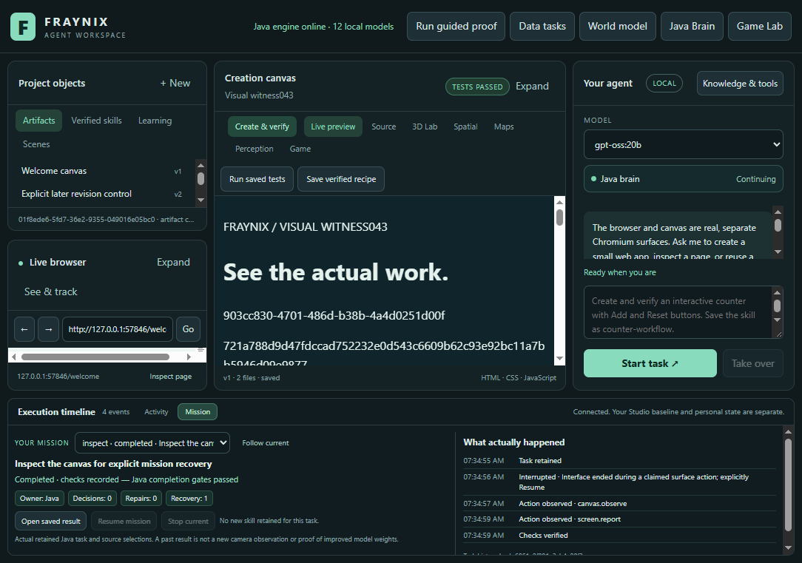
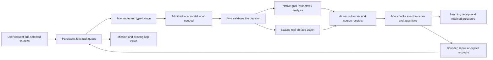
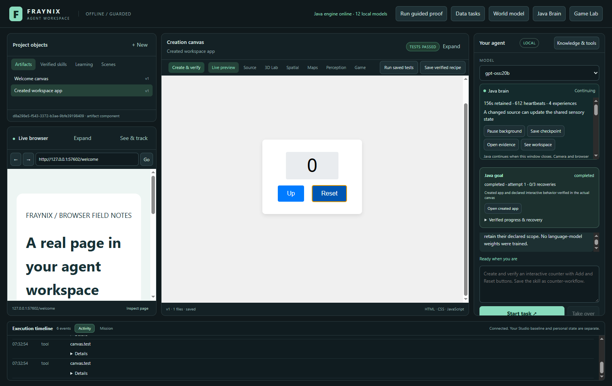

# Fraynix Agent Workspace · edition044

## One Java agent, one visible mission

**Chat, native experiments, data procedures, perception, creation and retained skills now share the existing Java task owner.** The app's Mission view connects a request to its real source, current child task, action history, checked result and reusable procedure. Accepted Java planning and code generation can continue when the desktop closes; the interface reconnects to the retained task.

Recorded November2,2026. [Previous edition043](README-043.md) · [All editions](docs/readmes/INDEX.md) · [Offline interactive guide](docs/readmes/044/index.html) · [Implementation inventory](docs/readmes/044/FILE_TREE.md) · [Verification](docs/readmes/044/verification.json) · [Full conceptual/production direction](docs/EDITION_044_VISION.md).

This remains the same independent successor to Fraynix Studio. The original game, Java nervous system, physics, browser, creation canvas and source-qualified camera work are preserved. The important change is coordination: the Java brain can retain the actual task across those capabilities, while the user can inspect what it is doing.

## What changed

Edition043 moved ordinary browser/canvas conversations and verified recipes into Java. Remaining specialized chat loops and native-procedure dispatch still lived in the desktop. Edition044 moves their active planning, route selection, stage rules, source bindings, child-task ownership, creation prompts and scheduling into Java too.

| Responsibility | Current owner and behavior |
| --- | --- |
| Understand the request | Java classifies the actual request and offers stage-appropriate registered tools to the admitted local model. |
| Preserve the task | The existing Java queue retains identity, source selections, semantic options, decisions, child IDs, waits, failures and explicit recovery. |
| Run physics or analysis | Existing Java/native controllers and stores perform their actual computations and preserve their original acceptance gates. |
| Generate an application | Java freezes observable behavior before code, admits the local model, validates its typed output and owns bounded repairs. |
| Interact with a surface | The desktop performs a leased browser/canvas/camera action and returns actual observations or test results. |
| Complete and learn a procedure | Java checks current evidence and records its passing receipt in the same learning episode before retaining a verified outcome or procedure. |
| Explain progress | Mission formats actual persisted Java facts. It does not manufacture a plan, percentage or passing state. |

The local LLM remains useful for semantic choices and generated content. Java does not replace its weights. Java owns the durable process around it: what is allowed next, which source is bound, what actually executed and which evidence can support completion.

## See the actual work



The existing timeline has **Activity** and **Mission** views. Activity retains the detailed execution events. Mission shows the current or selected saved task, its actual phase, Java decision/repair/recovery counts, bound selections, native child stage, saved skill and recent history. The history hash points to the retained task record.

**Follow current** returns to the active task. **Stop current** cancels the real Java task and its owned work. **Resume mission** performs explicit recovery for an interrupted compatible task. **Open saved result** opens the retained artifact version; a later revision is refused rather than presented as the original result. The existing browser, world/canvas and chat remain in one window.

Mission distinguishes a completed task with recorded checks from an ended source-inspection task. A retained result is a dated result, not a new webcam observation. A remembered lighter category remains human guidance or a candidate appearance association; it does not become verified identity because it appears in a dashboard.





These are actual app captures on labelled validation projects. The narrower layout retains usable controls and a scrollable mission/history area. Mission folds the expanded brain controls when opened, and avoids repeating the native-goal card beside the same mission facts. Activity restores the ordinary workspace layout.

## The shared Java path



`ChatPolicy044` contains the route/stage policy. `Domain044` owns specialized task context, native waits, source receipts and completion/recovery. `Procedure044` resolves retained skills against fresh actual selections. `CreationPlanner044` owns model contracts/code generation. They extend `Agency043`; they do not create another independent agent window or queue. [Detailed operating contract](docs/JAVA_CHAT_044.md).

The Java host calls registered internal Java methods directly. Browser/report work uses bounded authority tied to the actual parent, child and interface. A stale claim, changed source, weakened report assertion or fabricated success cannot substitute for the original evidence. Ordinary authenticated interface operations retain their existing ownership checks.

## Complete tasks, rather than disconnected tool calls

A tool performs an action. A skill completes a task using actions, checks and recovery. The same procedure registry now connects native target-reaching, motion-data reports, imported-object manipulation, browser perception, creation, evidence workflows, procedural spaces, image maps, pushing, pose arrangement and persistent-world tasks.

Reusing a skill selects its actual name/version. The current source must be bound again where required. Retained force, material and global-map constraints remain stable unless the request explicitly changes a supported value. Saved appearance procedures preserve their detector/category policy. A compiled map retains its compiled definition; changing generation requires selecting the reference source. A procedure is a registered supported workflow, not a newly installed privileged handler.

Existing evaluation tasks may complete and reject their candidate. Mission reports the task and its actual result; completion does not mean automatic model/controller promotion. Original held-out cases, stronger baselines, rejection records and rollback remain part of the implementation.

Current coordination follows the registered routes and their supported stages. Broader requests that combine unrelated domains still require a typed task-graph compiler and explicit cross-domain acceptance contracts. That planned layer should build on this shared owner, retained sources and real completion gates.

Task admission is bounded: four live/queued tasks,24 retained task records and a3.8MB task-history budget in the current store. These limits protect the existing machine and retained evidence. Automatic long-running history rotation is still production work; this edition does not claim unlimited unattended operation. Actual local-model latency and resource requirements are recorded with the workflow evidence.

## Try it

1. Start the workspace using the existing launcher with JDK21, Node.js and installed local Ollama models. Docker and WSL are not required. Preserve any live owner: stop Java through the app before rebuilding its installed JARs. The launcher also checks this condition.
2. Choose an actually available local model. The new end-to-end generation evidence uses **gpt-oss:20b**, with CPU-only inference and four threads. Other advertised models still need their own workflow validation.
3. Ask for a complete creation task, for example: “Create and verify a local counter. Show0, provide an increment button and a working reset. Save the skill as my-checked-counter.” Java freezes behavior before code; the actual canvas executes the checks.
4. Open **Mission** in the timeline. Inspect its goal, native child, original source selections, repair history and final result. Compare this with Activity's individual events.
5. Reuse the retained procedure by its actual name, then inspect the newly verified artifact. A new code-generating procedure can require another admitted generation; an existing saved artifact recipe can replay its original source without another chat-planning call.
6. For a data task, import/select a CSV through **Data tasks**, map its time/distance columns and units, then ask to analyze it with explicit gap/speed limits and retain a procedure. Reuse it on a different selected dataset and inspect the actual quality flags.
7. For native/world tasks, select the real scene or world and confirm the supported roles/targets first. Source versions, world revisions and physical acceptance gates remain authoritative. A changed selection or stale world head is not silently accepted.

Closing the desktop and pressing Stop have different purposes. Closing detaches the surface host; accepted Java planning/generation and compatible native work can continue, while browser/camera actions require the interface. Stop cancels the owned work and fences late responses. Claimed uncertain surface actions interrupt and require explicit resume. An interrupted tracker comparison has no native resume operation; retain its result and start a new explicit comparison.

During a user-started recording, an alignment/tabletop question can inspect and explain its actual current evidence. Starting a different task or taking over the observation's native-world binding remains refused. Chat does not start a camera or invent a completed physical evaluation. This distinction is covered by the actual local-model alignment regression and explicit conflicting-action refusals.



## What the app already connects

| Area | Functional foundation | Practical boundary |
| --- | --- | --- |
| Continuing Java brain | Persistent identity, independent clocks, shared neural core, retained experience/replay and integrity witness | Activity/plasticity is not proof of useful improvement or subjective awareness. |
| Game and physics | Integrated original game renderer,2D game logic, native3D experiments, contacts, manipulation, persistent-world tasks and independently checked outcomes | Normal Game Lab hides its native window and leaves the full editor uninitialized. Supported physical scenes/tasks remain bounded. |
| Spatial and mathematical views | Shared stable entities, perspective/orthographic views, owned2–16D procedural geometry and source-qualified map generation | Abstract dimensions/projections do not establish extra physical axes or photographic depth. |
| Reality observations | Recorded footage, tracking, scale/clock mappings, measured mat alignment and explicit uncertainty/failure records | Existing041 results and038 failures retain their exact source-specific scope. This release adds no new physical accuracy claim. |
| Browser and object knowledge | Real browsing, typed DOM actions, pixel tracking, human-associated objects and bounded source research | A web claim or candidate image reference is not confirmed physical identity. |
| Creation and skills | Runnable local files, actual behavior checks, versioned artifacts, retained recipes/procedures and fresh-source reuse | Generated previews remain isolated from privileged host execution. Arbitrary generated native programs are not enabled by this change. |

The full file tree and source inventory describe what is actually included. Existing browser, game, JSON and solver dependencies remain accounted for; the coordination and domain algorithms are owned application code. Owning Java logic does not imply that every dependency has been rewritten.

## What validation taught us

The independent full Java run passes **404 tests across84 classes, with zero skipped cases** on73b67c0. Final camera-ingestion and creation-output recovery amendments touch only the server and new creation worker/test.40 focused queue/domain/camera/creation cases and actual final camera/model/Mission workflows cover those amendments. All other Java source bytes match the full run:405 distinct Java cases covered, rather than a single405-case invocation. Desktop units and actual app workflows are recorded separately in the [verification bundle](docs/readmes/044/verification.json). Actual model receipts identify the model, source, compute options and task; controlled software fixtures are labelled separately from inference.

Development exposed real faults. A verified report initially lacked the corresponding learning-episode receipt; completion refused it, and a new queue-to-learning regression checks the repair. A native-goal claim could invert the scheduler's lock order; thread dumps identified the cycle, the claim/cancel paths were corrected, and the actual creation/reuse/reconnect workflow was rerun. Earlier startup and model-draft failures are retained as failures.

The model also declared input-value checks while generating a text counter. Actual Chromium checks rejected those drafts. Java's contract/repair prompt now explains the difference between a form field's value and displayed text. The original assertions were preserved. A passing badge came from the working implementation's actual interactions.

Fresh data-procedure reuse exposed another boundary: the model supplied an unrequested new skill name. Java refused the write. The stage-specific tool schema now hides saving options unless the request actually asks to save; the final actual-model run uses the changed selected dataset and preserves the original procedure. A wrong-stage generation response was refused; the creation worker now retains the refusal and retries stage/schema errors within the same three-attempt budget before any acknowledgment. A later alignment regression exposed a blanket busy check that blocked even explanations during recording; the final admission policy permits the two evidence-reading routes and retains the existing native-action exclusion.

Mission validation checks real result opening, refusal after a later revision, actual recipe recreation, source-text injection resistance, Stop, interruption on real close, explicit Resume, stale-claim refusal and both review widths. These checks establish the tested workflows and boundaries; they do not prove every possible model request succeeds.

With dependencies already prepared, reproduce the new worker and Mission cases sequentially from the repository root:

```powershell
.\gradlew.bat --offline --no-daemon --max-workers=1 -I docs/readmes/044/development/serial-java.init.gradle check :workspace-engine:installDist
Push-Location workspace-desktop
npm.cmd test
node.exe test/domain044-integration.cjs
node.exe test/mission044-integration.cjs
Pop-Location
```

The real-model case needs the installed `gpt-oss:20b` model. It creates its own separate validation project; the Mission case consumes that completed fixture. The original regression groups, individual run sources, raw outputs and complete/focused Java results are linked in the evidence bundle. Run expensive cases sequentially on the current machine.

## The next conception: a world the agent can work in

The useful direction is a coherent environment in which request, observation, action, consequence and memory remain connected. The application's evolving work becomes its content: a scene, browser investigation, data artifact or retained procedure that the user can inspect and continue.

“Dreaming” can become a concrete counterfactual experiment. Freeze an actual world revision, fork bounded candidate plans, simulate their consequences, compare goal error/contact/effort/protected-body drift, and retain rejected alternatives. Commit a chosen action only against the expected current world head. Compare its actual outcome with its prediction afterward. This extends the existing narrow native forecasts and transactions; it is a next acceptance gate, not a claim that arbitrary reality is already modelled.

After that, expand registered skills into typed task graphs with prerequisites, source requirements, actions, postconditions and recovery. Evaluate candidates on frozen new-condition cases against a relevant stronger baseline before promotion. Measure retrieval enabled/disabled on the same held-out tasks. Retain failures and make rollback practical. LLM-weight training remains a separate, explicitly evaluated pipeline.

Production work follows complete outcomes: offline data→analysis→interactive artifact→independent checks→retained procedure; reproducible supported-machine setup; resource budgets; robust restart; source-preserving import/export; and real compiler/build contracts before adding Java/C/Go execution targets. Forecasts depend on passing those gates, not on adding empty pages or assigning grander names to the same behavior.

The [full concept and sequencing document](docs/EDITION_044_VISION.md) connects these ideas to the current engine. The [offline guide](docs/readmes/044/index.html) maps implemented, verified and planned parts. [Obsidian notes and canvas](docs/obsidian/00-home.md) provide a repository-linked view. Earlier numbered editions remain immutable records of their own results.
