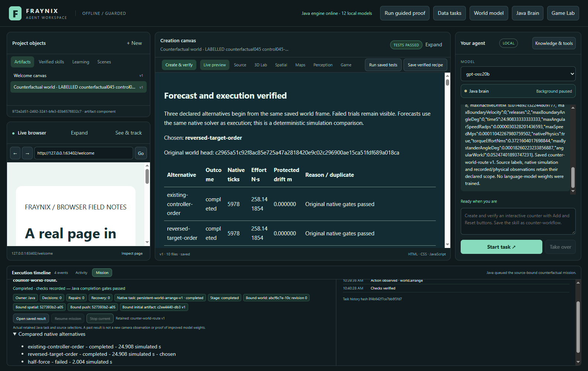
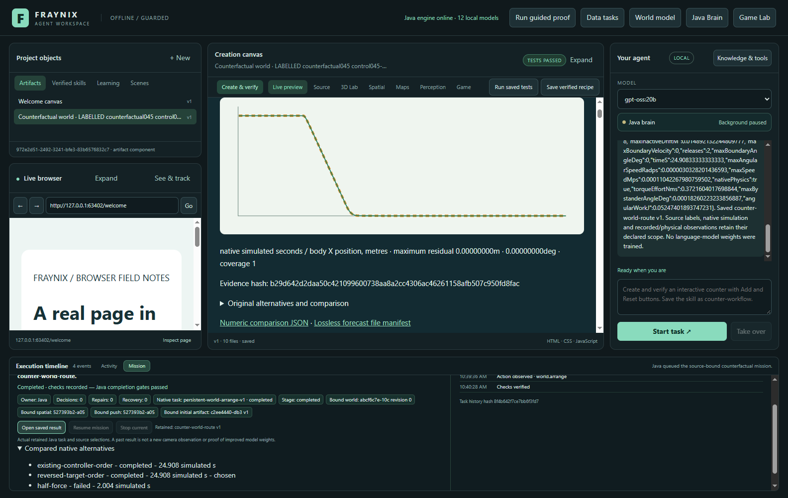
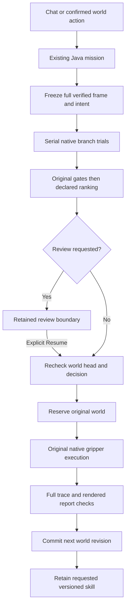
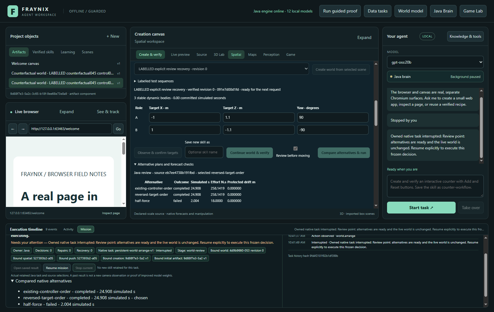

# Fraynix Agent Workspace · edition045

## Alternatives before action

**The Java agent can now test three possible manipulation plans in separate native worlds, keep their measured outcomes, select a verified candidate and carry it out in the persistent world.** The actual forecast, execution and rendered report must agree before the world advances or a requested skill is retained.

Recorded November2,2026. [Previous edition044](README-044.md) · [All editions](docs/readmes/INDEX.md) · [Offline interactive guide](docs/readmes/045/index.html) · [Verification](docs/readmes/045/verification.json) · [Complete source tree](docs/readmes/045/FILE_TREE.md) · [Concept and next gates](docs/EDITION_045_VISION.md).

This is the same local Java agent workspace, with its original game, continuing brain, browser, creation canvas, neural memory, multidimensional mapping, physics and qualified observation history. One existing Java mission owns the new comparison stage. Comparison and execution use the existing integrated application, queue and dependencies.

## What this edition adds

| Capability | Actual behavior |
| --- | --- |
| Native alternatives | Original target order, reversed order and half-force use start from the same complete verified world frame. |
| Inspectable choice | Only candidates passing the original native gates can win. Ranking uses ticks, translational force effort in N·s and declaration ordinal; torque metrics remain checked. Rejected, duplicate and failed alternatives remain recorded. |
| Prediction before movement | Forecasts use disposable native branches. They cannot reserve, move or commit the original world. |
| Review before moving | An optional checkbox, or an explicit chat request to review/forecast without movement, pauses after comparison. Resume rechecks the frozen decision and current world head before execution. |
| Actual execution | The selected plan uses the original virtual force/torque gripper, body identities, controller and world ledger. |
| Forecast versus outcome | All sampled body positions and orientations are compared; original pose/release/protected-body checks still apply. |
| Reusable method | A requested skill retains the original authority ceiling and counterfactual policy version. Reuse on another confirmed source computes fresh alternatives. |
| Recovery | Stop cancels owned forecast work. Restart retains completed traces and unfinished attempts. Explicit compatible Resume continues from verified state. |
| Evidence export | Original lossless forecast attempts, chosen actual run, source/plan/controller hashes, metrics and comparison are downloadable. A separate inspector reconstructs their numerical claims. |



All screenshots in this edition come from the actual application on explicitly labelled test geometry. They are not a captured room, live webcam result or generated product mockup.

## Try it step by step

1. Launch the workspace from its own checkout and private project. Keep the camera off unless starting a separate observation task intentionally.
2. Open **Spatial**, then **Persistent world**. Load the labelled multi-object example or a compatible existing persistent box world. The controller currently supports two to four target boxes, with other dynamic bodies protected.
3. Set the target poses and force/torque limits. **Observe & confirm targets** binds the actual world revision, head and role identities. A failed route preview must be corrected before running.
4. Optionally enter a new saved-skill name. Check **Review before moving** to inspect the predictions before action.
5. Click **Compare alternatives & run**, or send the equivalent request in chat after confirming the world and targets.
6. Open **Mission** to follow the Java parent, native child, source, alternatives and actual history. There is no invented completion percentage. During review, the main world remains unreserved and unchanged.
7. When satisfied with a reviewed decision, use **Resume mission**. A changed world head refuses that decision; observe and confirm a fresh task instead.
8. Open the saved result to inspect the six original pose charts, candidate table, source hashes, forecast-versus-actual chart and original traces. Use the canvas **Expand** control for wider tables and charts. Export the comparison from the persistent-world panel.
9. Reuse the retained versioned skill on a newly observed and confirmed compatible world. It forecasts again rather than treating the old decision as valid for the new source.

An explicit execution request:

> Compare alternative plans in this persistent world, execute the best verified candidate and check predicted versus actual motion. Save the skill as counter-world-route.

A request that pauses before movement:

> Compare alternative plans in this persistent world. Review before executing; do not move anything yet.

The second request requires an explicit Resume to move. Java recognises these registered counterfactual requests and maintains their stage rules. The workflow does not need a language model to invent source IDs, body positions, candidate results or completion evidence. Broader conversations and creation continue to use the existing local-model interfaces.



## How the computation works



`Counterfactual045` owns bounded branch trials and their checked durable records. `GoalRunner` adds a comparison/review stage to its existing persistent-world goal. `Agency043` and `Domain044` keep the chat parent waiting on that actual child. `CounterfactualReport045` extends the existing verified world report; the desktop performs real surface checks and displays the resulting facts.

The original `WorldPlan`, `WorldPhysics`, `WorldVerify`, `WorldLedger`, `WorldFrames`, `WorldNativeStore` and native checkpoint identity are preserved. This matters for old saved worlds, original physical gates and existing procedural versions. New counterfactual procedures additionally bind the comparison implementation and protocol hashes.

Each trial retains the complete source, plan hash, native definition, actual contacts, force and torque samples, termination reason and final all-body state. Forecasting writes only inside the project's `counterfactual-045` branches. Before any live effect, Java checks the original expected revision/hash and uses the existing ledger to acquire ownership.

The experiment is deliberately bounded: three declared candidates; ninety seconds of wall time per candidate; the unchanged native 14,400-tick ceiling; eight retained studies per project; and at most two explicit study resumptions. Existing shared goal/task budgets still apply. Hitting a budget produces a visible refusal or retained failure, never a simulated success. This first implementation does not silently delete evidence to make room.

## Measured results and what they mean

| Native configuration | Original order | Reverse order | Half force | Selected | Matched samples | Max residual |
| --- | --- | --- | --- | --- | --- | --- |
| Known control | completed / 5978ticks | completed / 5978ticks | failed / 481ticks | reversed-target-order | 499 | 0m / 0deg |
| reserved045-material | completed / 5977ticks | completed / 5977ticks | failed / 481ticks | reversed-target-order | 499 | 0m / 0deg |
| reserved045-pose | completed / 5991ticks | completed / 5991ticks | failed / 481ticks | reversed-target-order | 500 | 0m / 0deg |

The actual control mission took **51.93 seconds of wall time** on this validation machine, including three forecasts, selected execution and rendered report checks. This is a recorded end-to-end result, not a general hardware benchmark or a claim of real-time language-model reasoning.

These are original native test outcomes. Full forces are ceilings rather than continuously applied forces. See [first reserved summaries](docs/readmes/045/reserved-first-summary.json), [independent inspections](docs/readmes/045/reserved-independent-inspection.json) and the original lossless traces. The controller and selection gates were not tuned after these reserved results. The later report-placement change is recorded separately from the first-result source.

Forecast/execution agreement uses a position-residual ceiling of0.01m, orientation-residual ceiling of0.5degrees and at least95% matched sample coverage, declared before the new trials. The original native target, release, speed, protected-body and wrench gates remain required. The actual report must pass its original six checks plus seven additional frozen assertions; numerical chart points are checked against the native data too.

The candidate table reports protected **bystander** drift (`maxBystanderDriftM`): bodies outside the requested targets. The original pose summary reports **inactive-body** drift (`maxInactiveDriftM`), which also includes a target while it is released/inactive. Both retain their original gates and full numeric fields.

Displayed metrics are rounded; ranking uses the unrounded original values. Forecast/execution residuals describe agreement between two runs, separately from their nonzero target-placement errors.

The first control selected reverse order through a very small floating-point effort difference at equal completion time. That is evidence that the declared ranking ran, **not a meaningful performance gain**. A failed half-force trial is retained and cannot be selected or saved as successful learning. These independent lifted routes offer little order-dependent tradeoff. Useful future planning needs frozen tasks where route clearance, force profiles, disturbance recovery or stage dependencies actually change the outcome, then a comparison against the unchanged controller.

Forecasts and actual execution use the same native solver, controller and source frame. Zero residuals here establish deterministic integration consistency. They do not establish a learned world model, improved real-world accuracy, robot manipulation or trained LLM weights. Earlier camera/mat results retain their original qualifications; this edition makes no new webcam calibration claim.

## Restart, failure and changed conditions

A successful branch does not own the main world. If Java ends during forecasting, completed alternatives retain their original run IDs and hashes; an unfinished attempt stays in the evidence, and an explicit Resume can start a new trial from the same frozen source. No settled branch is needlessly rerun.

At **Review before moving**, all alternatives are already retained and no main-world reservation exists. The actual app test terminates Java at that boundary, reopens the project and uses the visible Mission Resume control. It checks the same parent/child identity, every forecast hash and a single final world commit.

A separate test changes the world head while review is paused. Resume refuses before creating an actual execution, pending reservation, successful revision or skill. Changing a report, decision, metrics, actual body state or rendered chart points is also refused. Cancellation and failed physical trials remain unsuccessful records.



## Verification and reproducibility

One complete serial Java run passes **412 cases across 86 classes**, with zero failures/errors/skips. **121 desktop unit cases**, **246 grouped actual native/UI checks** and **16 grouped real local-model checks** pass across the recorded source-specific runs; final source is `ad3882a1aa76f229bd872226882cf3fcd4f8843b`. The complete Java run is on `782ab94b679f35b37905d43f4bb51f4eecfebc42`, followed by seven focused native cases on `bf48619bf76339ed5a9ee9fcd51eddfd2084309f`. Java source is exact after that run. Desktop admission/Take over races were then fixed and covered by new transport tests, repeated actual queue/app/counterfactual workflows and the remaining actual-model/Mission cases. Unchanged native/manual groups and the earlier model check retain their actual sources in the run record; this is not a claim of one combined final invocation. Only the report's placement above the raw audit changed; forecasting, selection, physics, comparison mathematics and gates are byte-identical source. The existing model regressions use local `gpt-oss:20b`, CPU-only/four threads. The new explicit counterfactual mission itself makes **zero LLM planning calls**.

Actual application coverage includes world isolation, original13 report assertions, independent export and changed-metric rejection,1600/1100 layouts, one visible window, restart and fresh-source skill reuse, Take over, a real Java termination at review, explicit same-decision continuation and stale-head refusal. A separate actual native Java test interrupts forecasting midway and checks retained settled hashes and abandoned attempts. Original failed harness/compile attempts remain archived and are not counted as passing whole runs. Optional unavailable OS capabilities retain their stated test scope.

[Complete verification](docs/readmes/045/verification.json) · [Original Java XML audit](docs/readmes/045/java-validation.json) · [Source match](docs/readmes/045/source-match.json) · [Prior source preservation](docs/readmes/045/legacy-preservation.json).

The [frozen protocol](workspace-engine/src/main/resources/counterfactual045-protocol.json) and [preimplementation contract](docs/COUNTERFACTUAL_WORLD_045.md) preceded the experiments. The implementation candidate was committed before the first reserved material/pose outcomes. After the complete Java run, a presentation-only change moved the comparison above the raw audit; original first results remain intact and final focused/native UI checks cover that change. The reserved results are retained in full, including unsuccessful alternatives; they are not claimed as model training or generalisation to unseen real environments.

The [independent trace inspector](scripts/Inspect-Counterfactual045.cjs) uses Node's built-in compression and cryptographic functions. It verifies lossless original bytes and SHA-256, reconstructs all-body displacement, wrench/effort limits, protected drift, target/release checks, ranking and forecast/actual residuals. It does not contain a second physics solver or claim to independently reproduce Java's decimal canonical object hashing.

```powershell
node scripts/Inspect-Counterfactual045.cjs path/to/counterfactual-export.json
```

Build and run using the repository's existing Java21 and desktop dependencies:

```powershell
.\gradlew.bat --offline --no-daemon --max-workers=1 :workspace-engine:installDist
cd workspace-desktop
npm start
```

Use a distinct project directory for development or review. Do not replace installed Java files beneath an active Java owner. Stop/checkpoint it through the app before upgrading. The repository's original module and setup documentation remains available from the root README; this edition adds no dependency download requirement.

## Data, exports and ownership

Private projects keep the actual world ledger, branch checkpoints, original attempts, reports and saved procedures. The comparison export includes lossless original forecast and actual traces; the report links its numeric comparison, trace manifest and files. Existing scene JSON, run JSON, CSV and WebM exports remain available in their supported tools. This edition does not add arbitrary asset formats or convert an internet image into a physical collider.

Screenshots, numeric exports and model explanations serve different purposes. Screenshots establish what was presented. Native traces establish what the simulation did. Measured observations retain source/scale/uncertainty conditions. An explanation can cite these records; it cannot upgrade their meaning.

Credentials, model weights, camera originals and the user's live project are excluded from Git. Only labelled test evidence and reproducible source/documentation are published to the existing private repository. The earlier app and all numbered editions001–044 remain preserved.

## Why this is a useful advance

The app now has an explicit way to ask a bounded **what if?**, compare possible actions and connect the chosen forecast to an actual result. That makes the environment part of the agent's reasoning process. Its value comes from durable state, enforceable action contracts and inspectable outcomes, rather than a chat window claiming it understands a scene.

This still needs evidence of usefulness: lower failure rates, acceptable complete-task latency and reliable recovery under changing conditions. Owning the Java logic makes those questions measurable. The foundation is the ability to inspect and reproduce a useful task, including its failures.

## Next steps

1. **Typed skill graphs:** join verified procedures through declared sources, outputs, dependency versions and recovery branches; resume without replaying committed effects.
2. **Planning benefit:** compare success and total wall time against the unchanged controller on frozen additional tasks; promote only a measured useful policy.
3. **Measured observation correction:** carry registered real footage, scale and uncertainty into prediction-error checks, with separate evaluation and rollback.
4. **Broader physical tasks:** add manipulation, contact and uncertain starts only after preserving current gates and validating their new scope.
5. **Neural contribution:** test novelty or recovery improvements against simple baselines, retaining the CPU reference and measuring complete workloads.
6. **Production delivery:** reproducible supported-machine setup, bounded storage/history management, clear shutdown and the same integrated one-window presentation.

The [typed skill graph proposal](docs/readmes/045/SKILL_GRAPH_PROPOSAL.md) sets out source types, ownership, recovery and acceptance cases for the next implementation. It is a design proposal, not an installed handler.

See [the full concept and production direction](docs/EDITION_045_VISION.md), [Obsidian note](docs/obsidian/53-counterfactual-worlds.md) and [Canvas](docs/obsidian/counterfactual-worlds.canvas). Planned stages have acceptance gates; they are not placeholder product pages.
