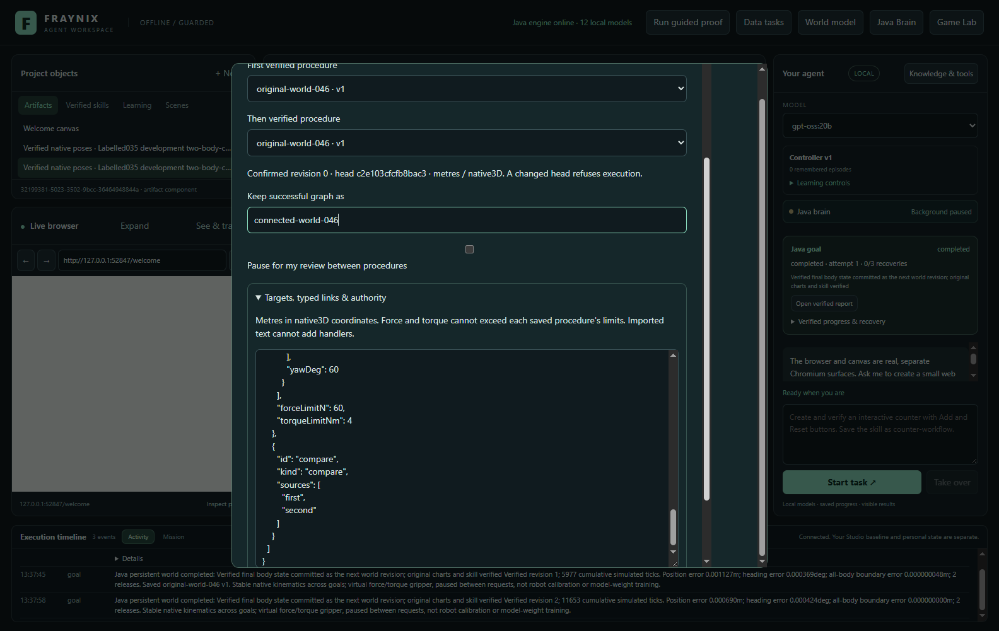
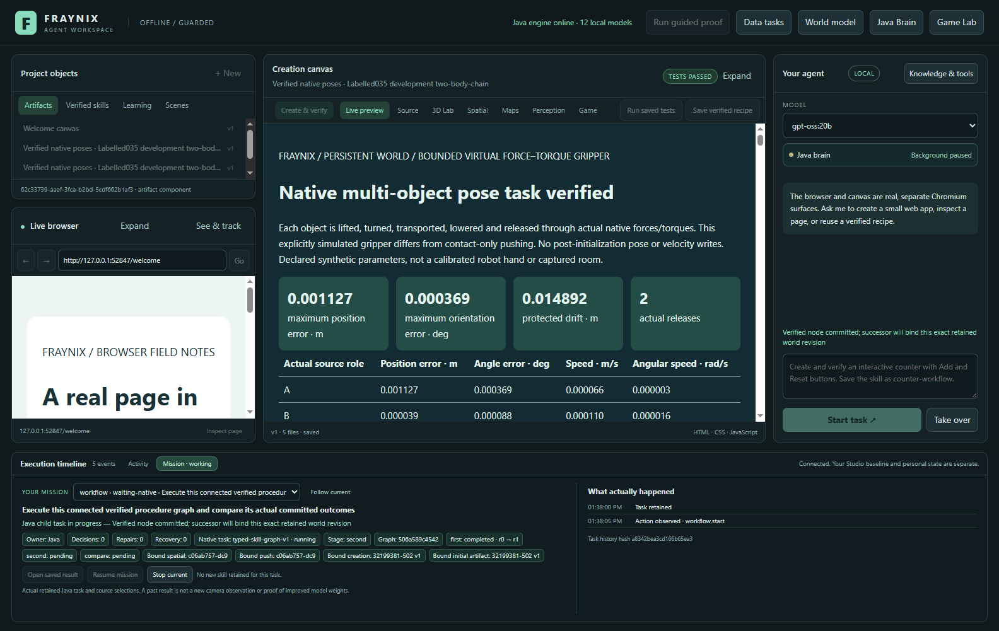
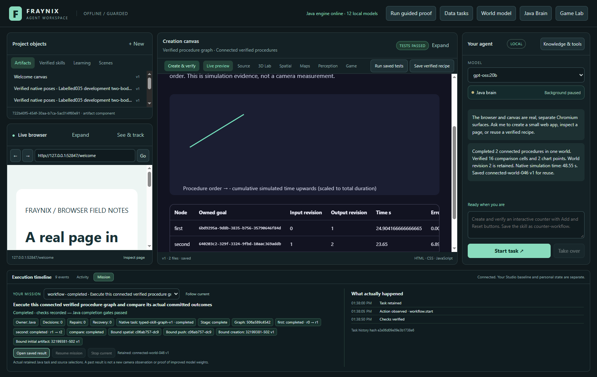
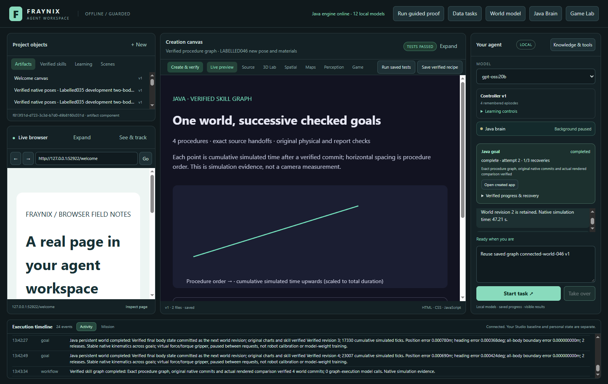

# Edition046 · Verified skills form a continuing task

[Previous:045](README-045.md) · [All editions](docs/readmes/INDEX.md) · [Offline explorer](docs/readmes/046/index.html) · [Reference-code analysis](docs/REFERENCE_LOGIC_046.md) · [Operations](docs/JAVA_CHAT_044.md)

**One request can now connect exact saved world procedures, keep the same evolving world between them, check the combined result and retain the successful graph.** Java owns the graph, each actual child and its recovery. The LLM can select a saved graph from chat; it does not need to invent every intermediate observation or command.

This is the next layer above a tool. A tool performs an action. A procedure completes a checked task. A typed graph connects those procedures through outputs whose source, units, identity and verification Java can establish.

This edition also reviews the owner's three supplied applications: Dreamer120B, FraynixGPT and FRAYMUS Logic Chain. Useful continuity, reuse and provenance mechanisms enter the existing Java application. Their other algorithms become specific, testable development options. The app retains its current design and single integrated workspace.



[Full-size composer](docs/readmes/046/graph046-composer.png). These are real app captures using explicitly labelled declared-scale test geometry. They are not photographs, reconstructed webcam evidence or generated interface mockups.

## What works now

The graph supports **two to four exact retained persistent-world procedures and one terminal comparison**. Each manipulation still uses the original native planner, virtual force/torque gripper, all-body observations, physical verifiers and six-chart report checks. A graph cannot install a handler, execute an expression, silently change a skill version, turn pixels into metres or increase a saved force ceiling.

| Capability | This edition's behavior |
| --- | --- |
| Connect procedures | Choose already verified skills and a currently observed world. Java validates the complete inert graph before starting effects. |
| Preserve one world | A successor receives its predecessor's exact committed revision/head, including all bodies' poses and velocities. |
| Keep ownership | Existing WorkflowRunner supervises deterministic GoalRunner child identities. No second task queue or daemon. |
| Recover | Explicit continuation reconciles the same child/run and committed evidence. A completed movement is not a fresh action to replay. |
| Stop | Take over stops the owned native child. Dependants remain unstarted; original failed/uncommitted evidence remains available. |
| Check the result | Reconstruct original outcomes, then check the actual comparison's table cells, SVG coordinates, visibility, source data and saved canvas receipt. |
| Retain a larger skill | Save the graph only after actual checks pass. Exact graph/child versions survive restart; reuse binds a freshly confirmed world. |
| Explain failures | Preserve diagnostic text and every node/recovery occurrence. Repeated wording does not erase the original failure. |
| Reuse pure computation | Bounded, code-bound contract memo with audits and invalidation. It never caches physical actions or substitutes old success for a new verifier. |

Dataset, browser, camera and neural-training nodes are **not installed graph handlers** in this release. Unsupported kinds are refused. The existing actual data→physics→creation workflow continues to work separately, with its original dataset binding, generated app, repair and independent cell/geometry audit.

## Try it from a fresh project

1. Launch `Launch-Agent-Workspace.bat` with JDK21 and Node.js installed. Use the existing selected local Ollama model for chat. The known graph itself does not require extra LLM planning calls. Docker and WSL are not required.
2. Open **Spatial → One evolving world → Labelled test sequences**. Create a labelled two-body world. Select its first request and confirm the actual targets and original force/torque limits.
3. Enter a skill name such as `first-world-route`, then **Continue world & verify**. Wait for the real native movement and original report checks. A failed task does not create a skill.
4. Choose the next target request, confirm the current revision, and save the second successful procedure as `second-world-route`. The world keeps its state; creating a procedure does not reset it.
5. Select **Connect verified skills**. Choose the world, `first-world-route`, then `second-world-route`. Their saved target poses and authority are shown in the advanced typed-link editor. Choose an optional graph name, for example `two-stage-world-route`.
6. Choose **Run connected task**. The Mission shows the real current node, retained sources and evidence. Optional review pauses between procedures and requires explicit Resume; the finite recovery budget remains visible.
7. Open the checked comparison. Review each input/output revision, original goal/run, simulated duration, endpoint error, effort and native hash. The result describes native simulation, not a new camera measurement.
8. Restart the app. Observe and confirm a fresh current world, then ask **“Reuse saved graph two-stage-world-route v1.”** The exact retained graph is selected in Java, every source and outcome is checked again, and the result persists in the same application.

If no eligible world skill exists, the composer explains the prerequisite and leaves execution unavailable. Unverified candidate specifications from imported documents do not appear as executable skills. A stale head requires a fresh selection/new request; the app does not silently rewrite the original intent.



[Full-size live Mission](docs/readmes/046/graph046-live-mission.png). Node status and revision links come from the Java workflow checkpoint. No percentage or invented progress counter is used.

## How the graph becomes real work

```mermaid
flowchart LR
  U[Request and confirmed world] --> P[Exact saved procedures]
  P --> W[Existing Java WorkflowRunner]
  W --> A[Persist first owned intent]
  A --> B[Original native procedure and report]
  B --> C[Verified commit and typed world output]
  C --> D[Persist successor intent from that revision]
  D --> E[Original native procedure and report]
  E --> F[Reconstruct outcomes and check real comparison]
  F --> G[Retain requested graph version]
```



A node's skill reference includes its registered name, exact version, ID, kind, content SHA256 and native controller identity. The reference must resolve to a completed source goal with its original evidence and original saved authority/defaults. A world edge includes world ID, expected revision/head, metre units and the native3D coordinate-frame contract: the existing right-handed, Y-up world. Pixel coordinates, mat-plane observations and arbitrary arrays are not interchangeable with that type.

Current retained-history bounds remain explicit:20 workflows,64 goals,32 procedure-version records and eight versions per skill name; the conversational owner retains24 tasks. Admission checks capacity for every graph child and an optional saved graph before effects. Reaching a bound preserves history and refuses new work.

The definition is inert JSON with a versioned schema. The current compiler accepts one world-writer chain ending in a comparison. It rejects duplicate IDs, cycles, disconnected procedures, competing writers, unsupported handlers, inconsistent comparison dependencies, malformed targets and incompatible references. Parameters are finite and bounded. Geometry/route planning is checked against the actual incoming frame immediately before admission.

The parent persists intent **before** child admission. The child has a stable ID derived from its owning workflow and node. If a child commits before the parent records its cursor, recovery reopens that child and reconstructs its actual outcome. The world ledger's original compare-and-set and idempotent commit prevent a second successful movement under the same goal. This is verified for the supported native workflow; it is not a universal exactly-once guarantee for unknown external services.

Outcome seals link the original native run, report, input and output source to the preceding node. Every original child/native/report is reopened and checked, so a copied success object or edited hash is insufficient. The final comparison is an actual local HTML/JSON artifact. Java verifies observations from the real Chromium canvas and the stored canvas receipt before completing and retaining the graph.

The finite graph budget includes awake execution and waiting, persists periodically, and retains remaining time across explicit restart. Stopped-process downtime is not sensory freshness or simulated world time. Up to three explicit continuations share the remaining budget. The checkpoint interval defines a small volatile accounting window during an abrupt crash; it does not reset the graph to a new1200-second allowance.



[Full-size checked result](docs/readmes/046/graph046-checked-comparison.png). Table values and the cumulative simulated-time chart are reconstructed from the committed procedures. The native solver, not image placement or a model's prose, moves the boxes.

## What the three supplied repositories add

The [full review](docs/REFERENCE_LOGIC_046.md) follows their application flows, state, algorithms, tests and limits. [All276 tracked paths](docs/REFERENCE_046_INVENTORY.json) are pinned by exact repository commit and byte hash. Original repositories remain unchanged. Their keys, private logs, corpus, autostart behavior and cloud configuration are not imported.

| Source | Incorporated now | Useful next experiment |
| --- | --- | --- |
| [Dreamer120B](https://github.com/eyeoverthink/fraynix-dreamer-120b/tree/5adc40d706fad9ab678f91ec11c5e25e537291af) | Content/order seals, negative controls, explicit continuity and honest separation of clocks/evidence, using existing Java ownership. | Source-cited Java retrieval, recovery evaluation and task-level ablations. |
| [FraynixGPT](https://github.com/eyeoverthink/fraynix-gpt/tree/98fa63391fe3718fe7609113f47e90874e70b9a1) | Reuse-and-audit adapted to exact pure contract memoization; changed source/code does not inherit a past action's success. | A small owned Java skill ranker or failure predictor, with separate training/evaluation data and reversible promotion. |
| [Logic Chain](https://github.com/eyeoverthink/FRAYMUS-Logic-Chain/tree/d7e5537ae9d8f6ea23f493419f3ba99c48340ee3) | Original request/graph anchors and a normalised diagnostic ledger that retains every occurrence and origin. | Candidate graph refinement with advisory review, bounded stage context and complete unresolved evidence. |

The reference GPT is substantial executable Java math: transformer forward/backward operations, deterministic training, checkpointed optimiser state, BPE, KV inference, int8/ternary representations and associative/gated computation. Its144 self-tests pass here, including a small actual training exercise. This is a promising foundation for a focused learning module; it is not installed as a new general-purpose model in this edition. The Dreamer120B repository itself describes its120B lane as cloud-routed, with no local120B weights supplied.

The review also records concrete implementation limits: deleted-file handling in Dreamer seals/recall, non-atomic single-use helpers, a local-time/UTC fallback issue, and the distinction between exit0 and behavioral verification. Its consciousness-themed finite-state tests offer useful coupling/ablation ideas, not proof of experience. Logic Chain's proposals and advisory votes cannot authorise a physical action. These distinctions guide the Java reconstruction rather than treating every reference mechanism as already suitable for production.

## Measurements and original evidence

| Declared configuration | Method | Admissions | Model calls | Actual wall s | Commits |
| --- | --- | --- | --- | --- | --- |
| Control · original material and poses | Manual two goals | 2 | 0 | 26.66 | 2 |
| Control · original material and poses | Connected graph | 1 | 0 | 50.03 | 2 |
| New declared material and target poses | Manual two goals | 2 | 0 | 27.50 | 2 |
| New declared material and target poses | Connected graph | 1 | 0 | 52.15 | 2 |

[Original paired measurements](docs/readmes/046/paired-results.json) · [Reconstructed graph outcomes](docs/readmes/046/graph-outcomes.json).

The unchanged manual comparison completes the same two native goals with two admissions and zero model calls. A graph uses one admission and also zero planning calls for its registered stages. The benefit tested here is composition, source continuity and recovery. A single paired observation per configuration does not establish a general speedup, improved physical controller or learned policy.

The frozen [validation protocol](docs/SKILL_GRAPH046_PROTOCOL.json) declares the control and new material/pose configuration before its first new-sequence run. Original controller, planner, physical gates, world ledger and native checkpoint algorithms remain unchanged. Generated simulation parameters remain distinct from measured webcam data and its existing uncertainty qualifications.

One complete serial Gradle run passed **419 cases across 87 suites** on `36532d2a77794af0b86fa0a6a49bf7a5e930dac8`. The focused run passed **34 overlapping native/legacy cases** on `d74fb2c7c5cc6ee1e9ba444083c41782835a967e` after the listed admission, report-text, completion-summary and saved-graph chat changes. The final authority/domain run passed **26 cases** on `6b803299f1f0e2657b68b7918dbc6a6f223adb9d` after the read-only definition and clear permission-refusal correction. Only Agency043, WorkspaceServer and its listed test changed after the34-case source; other Java bytes are exact. **421 distinct cases** are covered, not one combined final-source invocation. All executed cases have zero failures/errors/skips; existing disabled factory Gradle tasks retain their documented scope. **123 desktop unit cases**, **60 grouped actual UI checks**, and **6 grouped actual local-model checks** pass in the independently installed source-matched tree. Counts bundle assertions and retain their exact source/run provenance.

Actual new coverage includes original native gates, successive exact revisions, commit-before-parent-checkpoint recovery, nonempty durable native-prefix recovery, cancellation with unstarted dependants, retained graph restart/chat reuse, changed material/pose conditions, actual maximum four-procedure chain, deliberately changed rendered-point refusal, same-run audit recovery and independent original-export reconstruction. Failed attempts remain archived, including the initial visible definition-read error and the diagnostic runs used to locate it. Final app tests also retain and check visible notices. FraynixGPT144 reference self-tests pass; Dreamer's synthetic replay check passes; Logic Chain166/167 pass with one original Windows HTTP error. Those are separate reference results, not app-learning or general model claims.

[Full verification](docs/readmes/046/verification.json) · [Full Java original XML audit](docs/readmes/046/full-java-validation.json) · [Native focused audit](docs/readmes/046/focused-java-validation.json) · [Final authority/domain audit](docs/readmes/046/authority-java-validation.json) · [Exact source comparison](docs/readmes/046/source-match.json).



[Full-size maximum-chain result](docs/readmes/046/graph046-four-stage-recovery.png). The deliberate changed-point refusal is retained. Explicit recovery keeps all four original committed run IDs; it does not repeat physical movement to make the check look successful.

## Source, persistence and ownership

```text
workspace-engine/src/main/java/fraymus/workspace/
  WorkflowRunner.java      existing supervisor, typed nodes, recovery and retention
  GoalRunner.java          stable owned native children and original skill evidence
  SkillGraph046.java       exact references, graph types, seals, diagnostics and memo
  GraphReport046.java      source-derived comparison and actual rendered audit
  Procedure044.java        fresh selected source and exact graph reuse
  Domain044.java           existing Java chat planning/scheduling integration
workspace-desktop/
  workflows.cjs            real canvas observation and stored passing receipt
  renderer/workflow-panel.js   connected-skill composer in the existing world panel
  renderer/agency043.js        actual graph nodes in Mission
scripts/Inspect-SkillGraph046.cjs   independent original-export reconstruction
docs/REFERENCE_LOGIC_046.md         full reference review and implementation choices
docs/readmes/046/                  immutable dated evidence and offline explorer
```

The [complete inventory](docs/readmes/046/file-inventory.json) and [tree](docs/readmes/046/FILE_TREE.md) cover the owned code/assets/tests and their hashes. The [source comparison](docs/readmes/046/source-match.json) identifies the exact validation checkout; [preservation record](docs/readmes/046/legacy-preservation.json) lists integrations while preserving the physical algorithms.

Private projects retain workflow checkpoints in `workflows/tasks.fworld`, owned goal/procedure state, `world-native` runs/checkpoints, persistent-world revisions and versioned artifacts. The application uses its existing persistent Java owner and interface lease. Personal models, credentials, measured footage and the user's review database stay outside Git. A new edition uses a distinct preserved review project instead of silently sharing an old database.

Java owns the continuing task logic, sources, validation, world state and retained evidence. The existing native Bullet backend remains the physical solver, and Electron/Chromium remains the browser/canvas host. No new library or provider is added. Ownership of the algorithms and complete processing path matters more than describing the whole mixed runtime as dependency-free.

## Stacked processors and the learning cortex

The subsequent user clarification is reflected in the [deeper source analysis](docs/STACKED_CORTEX_046.md): Needle3 workers and local LoRA training, MicroLlama exports, sparse delayed LIF/STDP/TD cortex, JEV and Dream-RSI search policy. Complementary small processors can divide extraction, proposing, criticism, memory and prediction while Java owns their state and connections. Connection learning, search-policy updates and language-model parameter training are three different mechanisms; all can be local. The next proof should connect unique actual outcome witnesses to those updates and show retained improvement on fresh tasks. These additional workers/training paths are reviewed next-stage components, not newly activated graph handlers.

## Where this leads

The larger architecture is becoming concrete: the same local system can observe a qualified environment, act, retain its resulting state, compose useful methods and evaluate what actually happened. A reusable graph is a bridge between procedural memory and future learning. It supplies structured, source-linked successes **and failures**, rather than an unverified transcript claiming an agent improved.

The next phase should first retain unique Java decision/outcome records: prediction before action, exact source and node identities, actual verifier outcome, cost and one witnessed result. Then connect the existing brain core to complementary local proposer, critic, memory and prediction nodes. Abstract the indexed sparse cortex, delayed events, eligibility and outcome-driven value updates into owned Java computation. A bounded small model can rank candidate procedures or predict failure using the tested FraynixGPT math; an actually installed Needle worker is a separate optional specialist with verified context isolation. Keep training inputs, code, seeds, weights and optimiser checkpoints identified. Separate tasks/worlds in training and evaluation; compare against the unchanged deterministic method and single-node ablations; measure success, recovery, calibration, complete latency and memory. Promote only a measured gain, retain the prior version and test rollback/restart.

Additional graph types should follow complete useful tasks. A dataset node needs original rows/version/hash/units; a camera node needs actual frame/time/calibration/uncertainty; a browser node needs current surface/lease and uncertain-outcome handling. Each becomes available only after an actual registered implementation and end-to-end checks. Graph branching, automatic graph synthesis and model promotion remain future acceptance gates, not displayed stubs.

The existing game, procedural maps, spatial views, physics, browsing, canvas creation and measured observation tools remain part of the app. Higher-dimensional representations can organise features or views, but changing representation does not establish a new physical dimension, infer unseen geometry or train a language model. The useful progression is measurable: richer observations, reliable actions, retained methods, evaluated predictions and verified improvement.

[Return to the app](README.md) · [Previous evidence](README-045.md) · [Offline map and measurements](docs/readmes/046/index.html) · [Obsidian note](docs/obsidian/54-typed-skill-graphs.md) · [Reference analysis](docs/REFERENCE_LOGIC_046.md)
