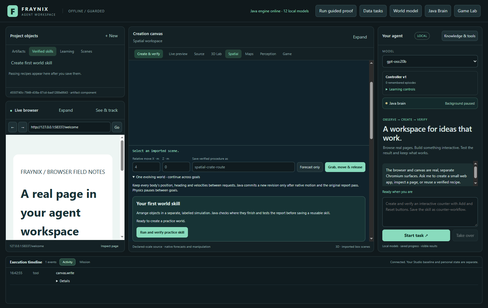
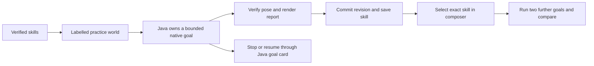
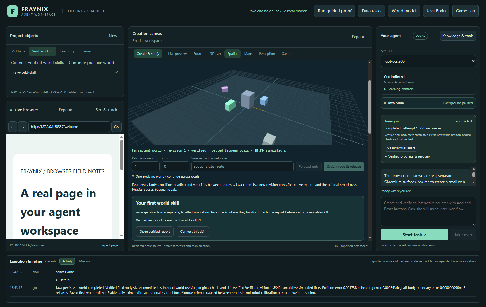

# Edition 047 · Your first verified world skill

2026-11-02 · [Previous edition](README-046.md) · [Edition history](docs/readmes/INDEX.md) · [Offline guide](docs/readmes/047/index.html) · [Phased plan](docs/EDITION_047_PLAN.md)

Fraynix puts the browser, creation canvas, 3D world and agent in one local workspace. Edition 046 connected saved procedures across world revisions. Edition 047 gives a new project a direct way to earn the first procedure from an actual run.

## Try the practice world

1. Launch with [Launch-Agent-Workspace.bat](Launch-Agent-Workspace.bat) using a fresh project directory. The ordinary Windows setup uses JDK 21 and Node.js 22.12 or newer.
2. Open **Verified skills → Create first world skill**. The empty graph composer offers the same action. This opens the guide in **Spatial** and explains the exercise before creating a world.
3. Click **Run and verify practice skill**. Java starts from the bundled, labelled 3D simulation. The native controller moves the objects toward declared poses, and the existing verifier checks the committed state and rendered report.
4. Follow the Java goal card for progress. If the checks pass, the guide displays the new world revision and the version of **first-world-skill**. **Open verified report** opens the actual result in the canvas.
5. Choose **Continue practice world** in the skill library, then **Connect this skill**. The composer selects the verified world and the exact retained skill version. It supplies two further targets from the same practice sequence. **Run connected task** executes the next two stages against successive world revisions. Give the graph a name to keep it after its own checks pass.



The exercise runs offline on the installed Java and desktop runtime. It uses a labelled synthetic scene and the existing Java and native controllers. The model picker belongs to the wider app and its chat workflows.

From this checkout in PowerShell, the following uses a separate practice project. Use `-Offline` after preparing the pinned desktop and Java dependencies.

```powershell
$env:FRAYNIX_WORKSPACE_PROJECT = Join-Path ([Environment]::GetFolderPath('UserProfile')) '.fraynix-agent-workspace/projects/review-047-practice'
.\Launch-Agent-Workspace.bat -Offline
```

## What the app checks



The guide imports a distinct labelled scene. The start request checks the confirmed world and hash, and Java independently validates the current revision when admitting motion. The normal goal runner owns Stop and Resume. A stopped exercise retains its attempt and permits another labelled practice world. Reports and the connection step appear only when the tracked goal returns a world commit, a report and a saved skill.

The composer takes the two remaining targets from the bundled practice sequence and checks the exact saved version in its catalog. A person can also select another world or edit the advanced targets through the regular composer. Java validates bindings, revisions, targets and force/torque ceilings before execution. The report records simulated motion and its checked outcomes. See the [edition 046 graph contract](docs/EDITION_046_CONTRACT.md).



[Open a captured report](docs/readmes/047/first-world-report.png) · [See the composed practice task](docs/readmes/047/first-world-connected.png) · [Validation receipt](docs/readmes/047/verification.json)

The fresh-project test reached revision 1 with three native releases, a checked report and one saved procedure. The two connected stages advanced that same world to revision 3. The desktop and Java engine then reopened the project with both saved skills and the same world head. A separate stopped run stayed at revision 0 and earned no skill. All 123 existing desktop tests passed.

## Next phases

**Memory that survives.** In the legacy Java engine audit, Carbon's restore path recovered vocabulary while dropping learned transition weights. A scratch repair retained every accumulator across a new JVM. The model still missed a trained continuation in the probe. Extract a bounded snapshot format and a read-only recall interface, then compare candidates with exact and lexical baselines on untouched tasks.

**An observation bench.** Pair the existing webcam with one ESP32-CAM and an independent Arduino sensor. A beam break can witness a crossing while a camera is occluded. A calibrated encoder can witness displacement. Record device clocks, align them to shared events, and measure the error and false reacquisition rate before accepting observations into the world.

**A disagreement inbox and world forks.** Preserve predictions before actions and pair them with independently verified outcomes. Let the agent try alternative procedures in disposable world branches, then evaluate changes with fresh trials and roll back when the candidate regresses.

**Offline creation skills.** Give the existing typed graph a complete local file workflow with schema validation, Java-owned transformation, tested outputs and exports that carry source hashes. A second source file after restart makes a stronger acceptance test than the first demo alone.

The [phased plan](docs/EDITION_047_PLAN.md) lists the acceptance criteria for each phase. The [file tree](docs/readmes/047/FILE_TREE.md) points to the implementation, checks and evidence.
