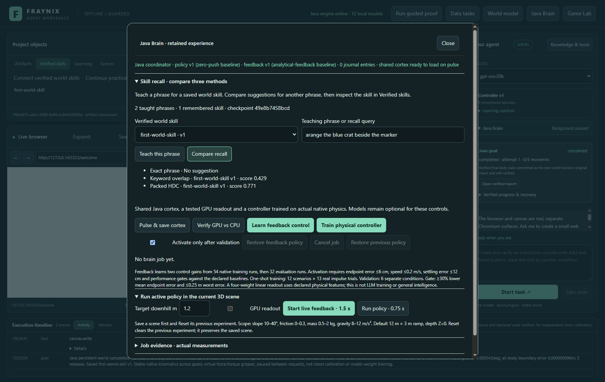
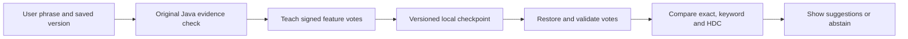

# Edition 048 · A Java memory for verified skills

2026-11-02 · [Previous edition](README-047.md) · [Edition history](docs/readmes/INDEX.md) · [Offline guide](docs/readmes/048/index.html) · [Evaluation contract](docs/EDITION_048_CONTRACT.md)

Fraynix can now remember how you ask for a saved world skill and compare three ways of finding it. Teaching and recall happen in Java Brain and are separate from the existing procedure scheduler. A similarity score helps you inspect a candidate. To use a skill, open **Verified skills** and select it through the normal workflow.

## Teach and compare

1. Start a separate practice project as shown in the [edition 047 guide](README-047.md). Earn the first verified world skill or open a project with another verified native world procedure.
2. Open **Java Brain → Skill recall · compare three methods** and choose the exact saved skill version.
3. Enter a phrase you use for that procedure and click **Teach this phrase**. Java rechecks the original procedure, controller identity and passing report. Repeating the normalized phrase for the same version leaves memory unchanged.
4. Enter a new phrase and click **Compare recall**. Each method either suggests a particular skill version or displays **No suggestion**. If the original report or procedure evidence changes, the suggestion is withheld.

## What the evaluation showed

The frozen comparison used 18 taught phrases for six synthetic skill labels, six exact controls, 18 held-out supported requests and 12 held-out unsupported or ambiguous requests. All methods saw the same examples. The exact controls resolved six of six through exact matching.

| Method | Correct on 18 supported | Missed | Wrong skill | Suggestions on 12 unsupported or ambiguous |
| --- | ---: | ---: | ---: | ---: |
| Exact phrase | 0 | 18 | 0 | 0 |
| Keyword overlap | 6 | 12 | 0 | 4 |
| Packed HDC | 13 | 4 | 1 | 4 |

HDC found seven more correct skills than keyword overlap and missed the frozen promotion gate because it made one wrong supported selection. It interpreted “give the visitors an unobstructed route through” as routing an object around an obstacle. Both approximate methods suggested protecting the reference marker when the request asked to remove it. These are useful cases for testing whether the next candidate can distinguish the requested action from the objects it mentions. HDC stays advisory. [Per-case results](docs/readmes/048/benchmark.json)

## Continuity in Java

The legacy Carbon probe showed that restoring the vocabulary was insufficient when the reconstructed weights were discarded. Edition 048 uses a dedicated checkpoint for skill memory. It stores each exact procedure reference, the taught examples and all 8,192 signed votes per skill. Projection packs the prototype into 128 Java longs and compares it using Hamming distance. The reader validates the bounds, checksum and reconstructed votes. The writer forces a temporary file before an atomic replacement. A query leaves the checkpoint bytes alone.

The desktop test teaches an actual native practice skill through the normal UI, reopens the app with a new Java boot, and compares the checkpoint bytes and recall result. It also exercises stale skill content, an altered report and a damaged checkpoint. [Restart capture](docs/readmes/048/skill-memory-048-restored.png) · [Validation receipt](docs/readmes/048/verification.json) · [Source tree](docs/readmes/048/FILE_TREE.md)

## Next experiments

For recall, test a separate action check against the four false suggestions before expanding scope. Freeze a new set of misleading requests before selecting any thresholds. For the next workspace phase, prepare the recorded sensor intake, then pair the fixed webcam and ESP32-CAM with one independently timed Arduino witness on the existing mat. Compare camera-only estimates with sensor-confirmed events during the occlusion test. [Phased plan](docs/EDITION_047_PLAN.md)
