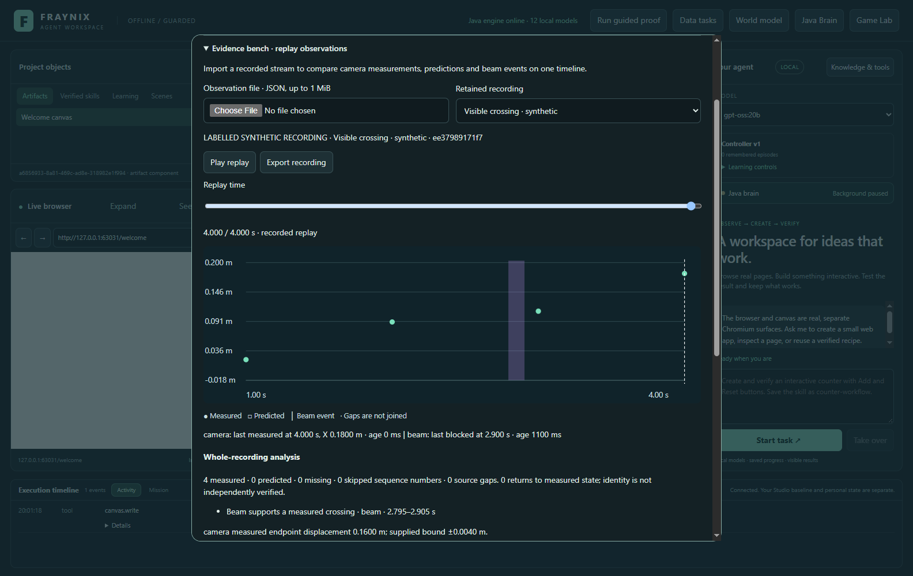
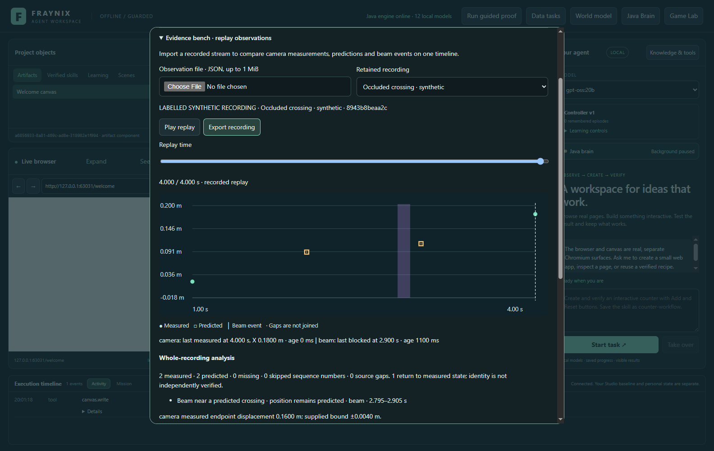
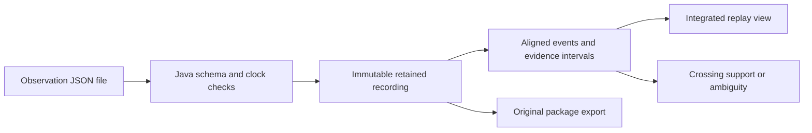

# Edition 049 · An evidence bench for recorded observations

2026-11-02 · [Previous edition](README-048.md) · [Edition history](docs/readmes/INDEX.md) · [Offline guide](docs/readmes/049/index.html) · [Acceptance contract](docs/EDITION_049_CONTRACT.md)

The Java brain now imports and replays timestamped camera and beam observations. Its job is to keep track of what each source actually supplied, align the clocks, and show where the accounts agree, disagree or leave a gap. The integrated view is **Java Brain → Evidence bench · replay observations**.

This edition delivers the recorded-stream foundation of the evidence bench. The app processes actual imported JSON files, saves them, exports them and restores them after a fresh Java process. The included camera positions and sensor readings are explicitly synthetic test data. A live Arduino recorder, ESP32 acquisition and a new physical mat experiment have not been validated or enabled by this edition.

## Try the complete workflow

1. Use a separate practice project, following the [edition 047 launch instructions](README-047.md). Preserve the existing review project and its camera calibration.
2. Open **Java Brain**, then **Evidence bench · replay observations**. Choose [visible.json](examples/evidence-049/visible.json) using the observation file control. A recording is saved only after Java validates it.
3. Click **Play replay**. Pause or move the time slider. The chart displays the recorded prefix, and each source shows the time and age of its last observation. Playback pauses when the dialog closes or the document becomes hidden.
4. Import [occluded.json](examples/evidence-049/occluded.json). The two middle positions remain hollow prediction markers even though a beam event overlaps their crossing interval. The whole-recording analysis is labelled separately from the replay cursor.
5. Click **Export recording**. The app writes the original package and a receipt into the practice project's `exports` directory and displays its location. Importing that package again does not create a second recording or rewrite the retained bytes.
6. Reopen the same practice project. Select the retained recording to recover the same aligned events and analysis. The browser and desktop timeline are presentation surfaces; Java owns the stored record and interpretation.

## What the bench can establish

Each recording declares a target label and a common coordinate frame in metres. A camera event is **measured**, **predicted** or **missing**. A beam event is **clear** or **blocked**. The target label is supplied by the recording; it does not establish visual identity.

Sources retain their original sequence numbers and device timestamps. Two supplied synchronization anchors map each device clock into session time with a linear offset and rate adjustment. Java retains the declared timing uncertainty, reports the rate difference, and refuses events outside the anchor interval. Clock resets or duplicate/non-increasing sequence numbers require a new recording. Missing sequence numbers and unexpectedly long intervals are exposed as gaps.

For a beam placed at a declared X coordinate, Java looks for consecutive camera samples confidently on opposite sides of the beam. Both endpoint bounds must be clear of the beam's own spatial uncertainty. It retains a crossing interval rather than claiming an exact crossing instant. A measured crossing requires two measured, sequence-contiguous samples within the declared sample period tolerance. A missing or predicted sample cannot silently become a measured one.

A clear-to-blocked sensor transition receives its own time interval. When exactly one independent-clock camera interval overlaps it, the result can support a measured crossing or indicate a witness near a predicted crossing. If several camera intervals overlap, the result is ambiguous. A shared declared clock is identified separately. A first blocked reading is only a baseline. A gap before a blocked state cannot establish when the transition occurred.

The supplied clocks and uncertainty bounds remain declarations. File hashes detect altered retained content; they do not certify the external measurements. The sensor can support an event without proving which object interrupted it. A cover, hand or another object can also break the beam. False reacquisition rates require independently labelled physical observations and are not inferred from these files.

## Frozen cases and results

The six input recordings were committed before executing their checks. They retain the same source identities and explicit synthetic provenance.

| Recording | Required interpretation |
| --- | --- |
| Visible crossing with an offset beam clock | Beam supports a measured crossing |
| Occluded crossing | Beam near a predicted crossing; position stays predicted |
| Witness shifted in time | Beam event with no matching camera crossing |
| Skipped camera sequence | No measured crossing across the gap |
| Two possible camera crossings | Ambiguous; no unique match |
| Sensor initially blocked | Baseline only; no observed transition |

Further tests cover clock-rate correction, uncertainty that overlaps the beam, correlated clocks, missing observations, sequence and time resets, invalid units, retrospective predictions, changed stored content and file limits. The app test checks real file input, chart markers, playback, pause, seek, export, duplicate import, narrow layout, fresh-Java restoration and an unchanged existing native world. [Java case results](docs/readmes/049/cases.json) · [Validation record](docs/readmes/049/verification.json)

## Implementation and retained state

The processing code is [EvidenceReplay049.java](workspace-engine/src/main/java/fraymus/workspace/EvidenceReplay049.java). It uses Java collections, arithmetic and the application's existing JSON support. [EvidenceStore049.java](workspace-engine/src/main/java/fraymus/workspace/EvidenceStore049.java) preserves the content-addressed package, validates it on reads, forces a temporary file and replaces it atomically. No new dependency is required.

Each recording is limited to 1 MiB, four sources, 4,096 events and one hour of session time. Each practice project retains at most 16 recordings. A damaged recording stays on disk and is marked unavailable; unaffected recordings can still be read. Replay does not create goals, change a native world revision, train weights or promote the advisory HDC memory from edition 048. [Source inventory](docs/readmes/049/FILE_TREE.md) · [Restored view](docs/readmes/049/evidence049-restored.png)

## Hardware reference and next measurement

The proposed sensor is an emitter/receiver pair, such as the [Adafruit 5 mm IR break-beam sensor, product 2168](https://www.adafruit.com/product/2168). Its [Arduino guide](https://learn.adafruit.com/ir-breakbeam-sensors/arduino) includes photos and wiring. An equivalent pair already in the user's collection may be suitable. Identify the actual board and sensor before selecting pins, voltage or firmware; this edition does not flash or open any device.

Next connect a board-specific recorder with device sequence numbers, a monotonic clock, synchronization exchanges, heartbeat samples and explicit reset detection. Acquire the existing fixed webcam and one ESP32 stream with their own identities. Verify source-to-frame registration on the 12 × 12-inch mat, then use fresh visible slides and occlusion trials. Compare witness timing, dropped samples, displacement and independently checked reacquisition. Keep the evidence bench's distinctions when connecting these observations back to the persistent world.

The longer-term benefit is a reusable disagreement record. A future Java goal can retain its prediction before acting, compare it against source-bound observations, and supply the discrepancy to a versioned skill evaluation. Promotion will still require better performance on held-out cases. [Phased plan](docs/EDITION_047_PLAN.md)
